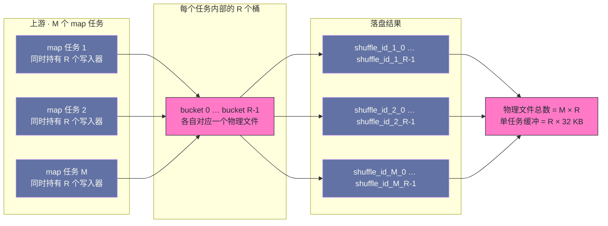
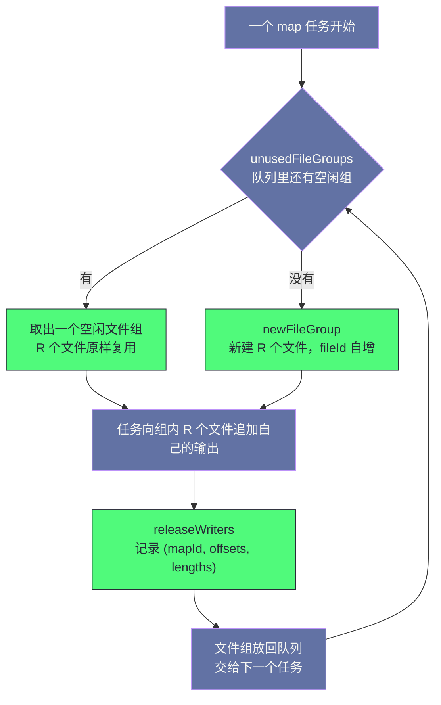
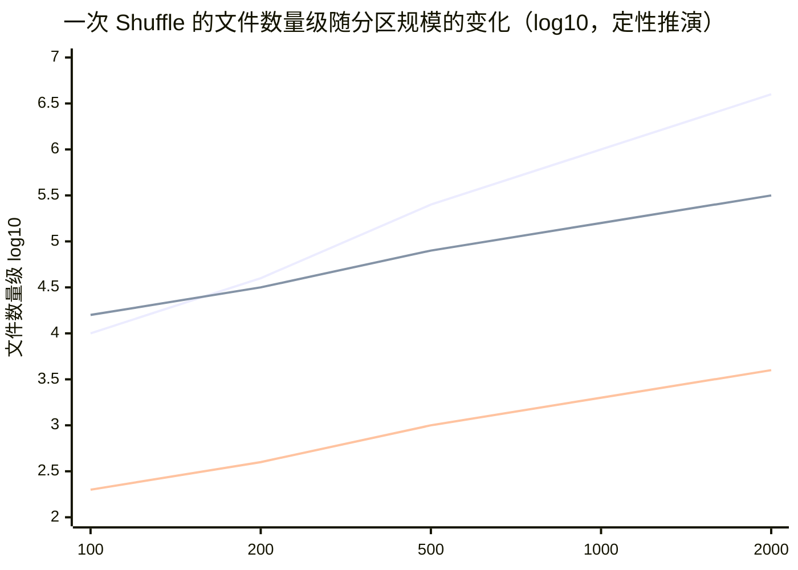
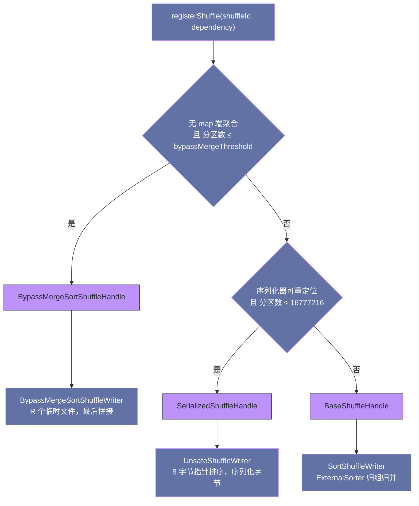
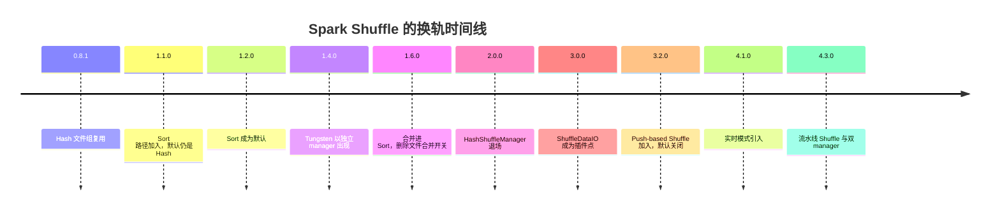
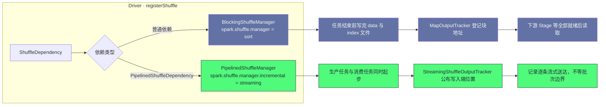

# 3. Spark Shuffle 框架演进与架构：文件数灾难、单文件索引与 4.x 流水线化

**摘要：**

Shuffle 这个词在 Spark 的讨论里出现得极频繁，但多数论述停在"它很贵"这一层。若把一次 Shuffle 真正拆开，它做的事情只有一件：把上游没有名字的中间结果，变成下游凭名字与地址就能取到的块；所谓演进，改的正是"名字与地址怎么组织"——从"一个分区一个文件"，到"一个任务一个文件加一段索引"，再到"一条流上的记录"。本文只走决策线，不追写入器内部怎么落盘：先界定演进究竟在改什么，给出文件数、内存形态、调度形态这三个可观测的面；再讲 HashShuffle 为什么在 1.1 之前是唯一选择、文件数为什么等于两侧规模之积，以及这个积如何把"调大分区数"这条最常用的调优手段堵死；接着讲 0.8.1 的文件组复用把文件数压到并发槽位与分区数之积，为什么它只降了文件总数、没降单任务的并发写入器数，因而只是缓兵之计；然后讲 1.1 引入、1.2 转正的 SortShuffle 如何用"一次按分区归组 + 一个数据文件 + 一份长度索引"把文件数与分区数解耦；再讲 1.4 的 Tungsten-Sort 用堆外页与八字节指针换掉反序列化，代价落在序列化器、聚合与单记录长度这一串硬约束上；随后讲 1.6 合并两套 manager、2.0 连 Hash manager 一起删除，决策点从 manager 级下沉到 handle 级；最后落到 4.3.0 的现状——阻塞式 manager 之外多了一个流水线 manager，为实时模式的状态算子提供边写边读的 Shuffle。

文章沿五问推进，凡涉版本、JIRA 编号与开关默认值的地方都给出来源，测不准处注明以对应版本文档为准。本文口径为 Spark 4.3.0（2026-10-30 发布），4.x 预编译包基于 Scala 2.13。

**关键词（Keywords）**: HashShuffle, SortShuffle, Tungsten-Sort, BypassMergeSort, consolidateFiles, PipelinedShuffle, StreamingShuffleManager

---

## 第 1 章 换的不是数据，是寻址方式

### 1.1 一次 Shuffle 真正交付的东西

窄依赖链上的中间结果是没有名字的。`map` 算出一个元素，`filter` 立刻把它消费掉，这条链在一个任务里一轮遍历跑完，中途不落地，因此也没有任何一处可以指着说"把第三个分区的中间结果给我"。宽依赖把这件事反转过来：下游每个分区要读上游全部分区里符合自己键的那些记录，于是上游必须先算完、按目标分区重排、落盘，并且在一个地方登记"第 i 个上游分区的输出在第几台机器的哪个文件里"，下游才谈得上读取。

这份登记就是寻址。**Shuffle 的演进，从头到尾都在改"地址长什么样"，而不是改"数据搬不搬"。**在 HashShuffle 里，地址是文件名本身——`shuffle_<shuffleId>_<mapId>_<reduceId>`，看一眼文件名就知道取第几个上游分区的第几份输出；在 SortShuffle 里，地址退化成"一个数据文件加一对偏移与长度"，名字只剩下 `(shuffleId, mapId)`；到了 4.x 的流水线 Shuffle，地址干脆不再是一个可以事先算出来的位置，而是一条流上按记录到达的次序。

把这条线拉直了看，会发现每一次改动都在回答同一个问题：当地址的组织方式成为瓶颈时，是把地址切得更细，还是把地址的粒度做大。HashShuffle 选择了最细的粒度——一份输出一个文件，代价是文件数；SortShuffle 选择了最粗的粒度——一个任务一个文件，代价是必须先把记录归组；流水线 Shuffle 则把"地址"这件事整个取消了，代价是调度与失败语义要跟着重写。

### 1.2 三个可观测的面

讨论演进最怕笼统。同一次改动，落在文件系统上、落在堆内存里、落在调度器上，是三件不同的事，对应的指标也不一样。笔者把这三面列成一张表，后文每一代都按这张表来对照。

| 面 | 度量什么 | 在哪里能看见 | 改动的后果落在哪 |
|---|---|---|---|
| 文件数 | 一次 Shuffle 在磁盘上留下多少个物理文件 | Executor 的本地目录、`merged_shuffle_*` 与 `shuffle_*` 前缀、inode 与目录项压力 | 文件系统元数据、关闭与打开的开销、清理成本 |
| 内存形态 | 排序与缓冲时记录以什么形态存在 | 单任务同时打开的写入器数、每记录占用的堆内字节、GC 日志 | 堆大小与 OOM 风险、序列化次数 |
| 调度形态 | 下游能不能在上游没写完时就开始读 | Stage 提交顺序、任务是否整组准入、失败是否整组重来 | 端到端延迟、资源占用、容错粒度 |

这三面很少同时改善。HashShuffle 在内存形态上是"每个任务按住 R 个写入器"，在文件数上是"两侧规模之积"；SortShuffle 把文件数打到 `2 × M`，却要求先归组排序，把成本挪到了 CPU 与一次额外的落盘；Tungsten-Sort 把内存形态换成序列化字节与指针数组，代价是一串关于序列化器与记录长度的硬约束；4.x 的流水线 Shuffle 改的是调度形态，代价是整组准入与整组失败。**每一代都只是把代价挪了个位置，没有一代把它消掉。**

### 1.3 一个贯穿全文的作业与一组算术

为了后面每一章都有具体的着力点，笔者设想一个订单归因作业 `order_rollup`：凌晨从 HDFS 读当天的订单流水与商品维表，各自解析、过滤掉无效记录，按商品标识 join 起来，再按省份与小时汇总成交额，最后把结果写回数仓。

写成 RDD 代码大致是这样：

```scala
// 两条窄依赖链，各自以一次 Shuffle 收尾
val ord = sc.textFile("hdfs:///dw/orders").map(parseOrder).filter(_.valid)
val sku = sc.textFile("hdfs:///dw/sku").map(parseSku).filter(_.onSale)

// join 会给 ord 与 sku 各建一个 ShuffleDependency
val joined = ord.join(sku)
val rollup = joined.map(toProvinceHour).reduceByKey(_ + _)

rollup.saveAsTextFile("hdfs:///dw/rollup")
```

这个作业的规模设定为：上游 2000 个 map 分区、下游 2000 个 reduce 分区，集群 20 台 Executor、每台 8 核、每任务占 1 核，因此并发槽位是 160 个。后面几章的数字都用这组设定来推。需要说清楚的是，这些数字是算术推演，用来比较不同方案的数量级关系，不是任何一次实测的结论；真实集群上的文件数与缓冲占用会受数据分布、失败重试与清理时机影响。

按这组设定，三种方案在一次 Shuffle 上留下的物理文件数是：HashShuffle 四百万个，consolidate 三十二万个，SortShuffle 四千个。三个数字的比值约为一千比八十比一，差距足以解释为什么这个领域的历史只剩下"换轨"而没有"微调"。

### 1.4 一个比喻：分报亭的三个年代

把 Shuffle 想成清晨的分报亭：一份总社来的报纸，要分给上千个订户。

最早的做法是每个分拣员给每个订户单独装一个袋子，装完把袋子堆在门口。订户数目一多，门口堆的袋子数就是"分拣员数乘以订户数"，找袋子、数袋子、扫地都成了灾难。第二代做法是让分拣员共用一套袋子：一个工位一套，工位空出来下一班人接着用，袋子数目从"分拣员数乘订户数"降到"工位数乘订户数"，但每个分拣员手上仍然同时攥着上千个袋子。第三代做法换了思路：不再按订户分袋，而是把所有报纸按订户号排好塞进一个大箱子，箱子外面贴一张清单，写明第几号订户的报纸从第几页开始、有多厚。订户来取时照着清单翻箱即可，门口的箱子数从此等于"分拣员数乘以二"。

比喻的技术限定在于：分报亭的第三代为"排序"付了工钱——把报纸按订户号排好本身就是一次不轻的劳动，而且这次劳动在业务不要求排序时显得冤枉。Spark 后来加的 bypass 路径与 Tungsten 路径，正是为了在"确实不需要排序"的场合把这笔工钱省掉，这两件事留到第 5 章与第 6 章。

---

## 第 2 章 HashShuffle：文件数等于两侧规模之积

### 2.1 它当初赢在哪

Spark 在 1.0 之前的那几年要回答的第一个问题，是凭什么比 Hadoop MapReduce 快。当年的 MapReduce 把排序写死在框架里：不管业务要不要有序结果，map 端要溢写排序、reduce 端要归并排序，记录在对象与字节之间来回转换。Spark 早期最响的卖点是不落地的迭代计算，紧接着的第二条就是"不强制排序"。

HashShuffle 顺着这条逻辑长出来：既然业务没要求有序，那就别排——记录进来，算一下分区号，直接追加到对应的文件里。整个写入路径上没有比较器，没有排序缓冲区，没有溢写归并，只有一次序列化与一次顺序写盘。在分区数不大、数据量中等的作业里，这条路径确实比排序快。**它当年不是妥协，而是针对"不强制排序"这个目标的最优解**；这也解释了为什么它在 1.1 之前是唯一实现，而 1.1 引入 SortShuffle 之后默认值仍是 hash，直到 1.2 才换成 sort。

### 2.2 一个 map 任务到底开了多少个写入器

问题出在"为每个分区准备一个文件"这个决定上。1.2.0 的 `FileShuffleBlockManager.forMapTask` 写得非常直白：

```scala
// Spark 1.2.0，FileShuffleBlockManager.forMapTask
val writers: Array[BlockObjectWriter] = if (consolidateShuffleFiles) {
  // 复用文件组的分支，第 3 章再说
  fileGroup = getUnusedFileGroup()
  Array.tabulate[BlockObjectWriter](numBuckets) { bucketId =>
    blockManager.getDiskWriter(blockId, fileGroup(bucketId), serializer, bufferSize, writeMetrics)
  }
} else {
  // 每个 bucket 一个独立的物理文件
  Array.tabulate[BlockObjectWriter](numBuckets) { bucketId =>
    val blockId = ShuffleBlockId(shuffleId, mapId, bucketId)
    val blockFile = blockManager.diskBlockManager.getFile(blockId)
    blockManager.getDiskWriter(blockId, blockFile, serializer, bufferSize, writeMetrics)
  }
}
```

`Array.tabulate(numBuckets)` 一次性把 R 个写入器都建出来，随后 `HashShuffleWriter` 对每条记录做的是"算出 bucketId，写进对应的写入器"。也就是说，**一个 map 任务在任何时刻都同时持有 R 个写入器**，每个写入器带一块输出缓冲（1.2 里由 `spark.shuffle.file.buffer.kb` 控制，默认 32 KB；4.x 里对应的键是 `spark.shuffle.file.buffer`，默认仍是 32 KB）。

按第 1 章的设定推一遍：单任务的缓冲上限是 `2000 × 32 KB`，约 64 MB；160 个并发任务同时跑，理论上限就是 10 GB。实际当然不会每条记录都均匀落进每个桶，但订单流水的分区键是商品标识，分布足够散，接近上限是常态。这笔账在分区数只有几十的年代不显眼，一旦下游为了更大的并行度把分区调到几千，内存就先撑不住了。

### 2.3 文件数为什么是两侧之积

写入器的数量决定文件数。一个 map 任务产出 R 个文件，M 个 map 任务产出 `M × R` 个。这个乘法关系有三个连锁后果，且都不是"慢一点"能概括的。

第一是文件系统的元数据成本。四百万个文件意味着四百万个 inode、四百万条目录项，以及同样数量的打开与关闭。本地盘的文件系统在这一量级上做目录遍历与空间回收都会明显变慢，清理阶段删文件本身就能跑很久。

第二是随机小 I/O。每个文件只装一个 map 任务写给一个 reduce 分区的那点数据，文件很小而数量极多，磁盘寻道与页缓存的效率都被这种布局拖住；而按分区追加的大文件（第三代的形态）在顺序读上是另一回事。

第三是文件句柄。单任务同时开 R 个文件，容器的 `ulimit -n` 常常是 1024 或 65535，R 取 2000 时单任务就已经越过第一档。真正在线上表现为"取不到 Shuffle 文件"的失败，多半不是文件被谁删了，而是 GC 停顿把心跳拖过超时、Executor 被判定失联之后连它的输出一起作废；句柄耗尽是另一种表现，报错落在打开失败上，与"找不到"是两回事，但两者的诱因常常是同一个——分区数被调得太大。

下图把一次 Shuffle 的文件生成关系摊开：每个 map 任务向每个 reduce 分区各交一份，交叉点就是文件。



图里真正值得盯住的是 `SUM` 那个节点：它同时是文件数的公式与单任务缓冲的公式，两个公式共用同一个乘数 R。这意味着在这个架构下，任何"把分区数调大"的动作都会同时抬高文件数与内存水位，两条曲线绑在一起往上走。

### 2.4 反事实：不换会怎样

把 HashShuffle 留下来，代价不是"慢 10%"，而是三条调优道路被同时堵死。

其一，分区数不能调大。分区数是 Spark 里最常用的调节旋钮：数据倾斜要靠它打散，小文件要靠它合并，并行度不够要靠它加。HashShuffle 让这个旋钮与文件数、内存直接挂钩，于是运维的实际选择变成"宁可倾斜也不敢加分区"。

其二，集群扩容反而更糟。Executor 从 20 台加到 40 台，并发槽位翻倍，哈希 shuffle 的文件总数不变（仍是 M×R），但同时打开的文件数与缓冲占用翻倍，文件系统的瞬时压力更大。一套"加机器能救"的架构才算健康，HashShuffle 在这条上是不合格的。

其三，文件数无法用配置偿还。`spark.shuffle.consolidateFiles` 在 1.x 里默认关闭，也就是说绝大多数集群从来没有开过它，悲剧一直持续到 1.2 把默认值换成 sort 才真正缓解。这一条恰好说明：默认值是架构决策的一部分，一个默认关闭的补丁等于没有补丁。

---

## 第 3 章 consolidate：把文件组按槽位复用

### 3.1 借用与归还

0.8.1 的 SPARK-751 给出了第一版补丁：既然文件是按"任务"分的，那就别按任务分，按"工位"分。实现上引入一个文件组（ShuffleFileGroup）的概念——一组 R 个文件，命名为 `merged_shuffle_<shuffleId>_<bucketId>_<fileId>`，`fileId` 是组号而不是任务号。任务开始时向池子借一个空闲组，任务结束时把组还回去，下一个任务接着往同一批文件尾部追加。这里顺便纠正一处流传很广的口径：文件合并常被记在 1.2 名下，而 SPARK-751 的 fixVersion 是 0.8.1，1.2 那一步做的是把默认实现换成 sort，两件事不在同一个版本上。下图是借用与归还的完整回路。



### 3.2 为什么只能降到槽位数乘分区数

文件组不能无限复用下去，也不能让两个正在跑的任务共用一个组。原因在写入方式：文件是追加写的，一个组的 R 个文件在被两个任务同时写时会交错成一团，而下游是按 `(mapId, bucketId)` 的偏移与长度来取数的，交错之后偏移表就无法表达"这一段属于谁"。

于是组数的下界由并发决定：一台 Executor 上同时最多有 `C / T` 个任务在跑（C 是核数，T 是 `spark.task.cpus`，默认 1），每个在跑的任务占一个组，因此一台机器上最多 `C / T` 个组。乘以 Executor 数 E，乘以每个 shuffle 的分区数 R，就是文件数：

```
文件数 = E × (C / T) × R        // consolidate 开启
文件数 = M × R                  // consolidate 关闭
```

按第 1 章的设定，20 × 8 × 2000，三十二万个。相比四百万降了约十二倍，这是实打实的收益：目录项、inode、打开关闭次数都跟着降。但把它放回"文件数 = 乘数 × R"这个形状里看，就该明白补丁的性质——**它把乘数从"map 任务数"换成了"并发槽位数"，R 这一项原封不动。**

这一项原封不动意味着两件事。其一，分区数一旦上调，文件数照旧线性膨胀，只是斜率变小；其二，这台集群的并发槽位并不稳定，弹性伸缩或动态分配让 E 在一天之内变化，文件数随之漂移，"这个作业会产生多少文件"从此没有确定答案。

### 3.3 补丁没有解决的那笔账

更要紧的是内存。上一节说过，单任务同时持有的写入器数是 R，与是否开 consolidate 无关：文件组换的是"写哪个文件"，不是"同时开几个写入器"。`Array.tabulate(numBuckets)` 那一行在两条分支上一模一样，缓冲是 R × 32 KB，R 等于 2000 时仍是 64 MB 一个任务。

**consolidate 降的是文件总数，没降单任务的并发写入器数。**这就是它只能算缓兵之计的全部理由：文件系统的压力缓解了，堆内存的水位一点没动，而分区数继续往上调时，先倒下的会是内存。

它还额外欠了一笔新账：寻址信息从"文件名"退回了"内存里的偏移表"。HashShuffle 时代，`(mapId, reduceId)` 直接编码在文件名里，进程重启后照着文件名就能定位；consolidate 之后，一个物理文件里混着很多个 map 任务的输出，谁在第几字节、多长，全记在 Executor 的 `ShuffleFileGroup` 里。这份偏移表是运行时状态，Executor 一挂，该组文件即便还在盘上也无法解读，只能整体重算。地址从文件系统搬进进程内存，可靠性随之下了一个台阶。

### 3.4 一条曲线说清三代关系

把三种方案的文件数放在同一张坐标上，横轴取分区规模（假设上下游分区数同步增长），纵轴是文件数的十进制量级，就得到下面这张定性曲线。



图里有三条线，取对数之后斜率就是阶数：最陡的那条是 HashShuffle，斜率接近 2，因为它对规模是平方关系；中间那条是 consolidate，斜率 1；最下面那条是 SortShuffle，斜率也是 1，但与 consolidate 相差约八十倍的常数。三条线在 log 坐标上的相对位置，比任何一段文字都更直白地说明了"换轨"与"打补丁"的区别：补丁改的是截距，换轨改的是斜率。

### 3.5 为什么 1.6 敢把它删掉

文件合并这个开关的寿命并不长。1.6.0 的 SPARK-9808 直接把它移除，而当时 HashShuffleManager 还留在代码里——也就是说，从 1.6 起如果有人坚持用 hash，拿到的就是没有合并补丁的裸实现，文件数退回 `M × R`。这个顺序很有意思：先拆补丁、再拆实现，中间隔着 1.6 系列的整个维护期，等于用一段时间告诉用户"这条路我们不再维护了"。

把补丁先删掉，代价是那段时间里 hash 的用户体验变差；收益是两套文件管理逻辑不必同时存在，测试矩阵收窄一半。这种"先减后删"的节奏在 Spark 的演进里反复出现，它承认了一个现实：兼容性不能一刀切，但维护成本可以分期偿还。

---

## 第 4 章 SortShuffle：一次归组、一个文件、一份索引

### 4.1 排序键是分区号，不是业务键

讲 SortShuffle 最容易滑过去的一句话是"它对数据排序"。这句话在字面上不算错，在理解上却会把人带偏，因为被排序的东西不是业务键，而是分区号。

1.1 的 SPARK-2045 引入 SortShuffle 时，要解决的是文件数，排序只是手段：把记录按目标分区归到一起，同一个分区的记录物理连续，就能用一个文件装下所有分区，再加一份长度表标明每段多长。归组这件事恰好可以借外部排序的原语来完成——`ExternalSorter` 接收一个分区器，把 `partitionId` 当作排序键，溢写与归并都按这个键走。

至于业务键要不要有序，是另一个问题。只有在 `sortByKey` 这类算子里，`ShuffleDependency` 才会带上 `keyOrdering`，`ExternalSorter` 才会在分区号之后按业务键再排一次；换成 `reduceByKey`，排序键只有分区号，分区内部记录的顺序是无所谓的。4.3.0 的 `SortShuffleWriter` 把这件事写得很清楚：

```scala
// Spark 4.3.0，SortShuffleWriter.write
sorter = if (dep.mapSideCombine) {
  // 有 map 端聚合：分区器 + 聚合器 + 可选的 key 排序
  new ExternalSorter[K, V, C](context, dep.aggregator, Some(dep.partitioner),
    dep.keyOrdering, dep.serializer, dep.rowBasedChecksums)
} else {
  // 没有聚合：只按分区器归组，ordering 传 None，分区内不排序
  new ExternalSorter[K, V, V](context, aggregator = None, Some(dep.partitioner),
    ordering = None, dep.serializer, dep.rowBasedChecksums)
}
```

第二段那个 `ordering = None` 是理解 SortShuffle 成本的钥匙：绝大多数 `reduceByKey` 型作业里，代价是一次"按分区号的归组"，不是一次全序排序。归组的成本与记录数成线性、与比较次数无关，这也是为什么后来的 Tungsten 路径能把比较也一并省掉，只对八字节指针排序。

### 4.2 单文件加索引怎么寻址

写入端做完归组，记录按分区号升序排好，接下来的动作很朴素：开一个数据文件，顺序写下去，同时记下每个分区的长度；写完把长度数组交给索引解析器，落成一个索引文件。索引文件的格式极简——每个分区一个定长条目，累计长度或长度值，取决于版本的实现，但语义只有一个：第 i 个分区的数据在数据文件里的起点由前 i 个长度累加得到。

读取端拿到的是 `(shuffleId, mapId)` 与目标分区号，先读索引，算出自己那一段的起点与长度，再对数据文件做一次带偏移的读。同一台机器上的多个 map 输出、同一 reduce 分区的多段数据，可以被合并成一次连续读——1.6.0 的 SPARK-9852 做的正是这件事，让 reduce 任务一次请求拿多个 map 输出的连续块，把请求数从"每个块一次"压到"每片一次"。

这套寻址有两个直接推论，值得单独记下来。

第一，空分区是合法状态。某个 reduce 分区在这个 map 输出里一条记录都没有，长度就是 0，索引里照样占一个条目，读取端拿到长度为 0 就跳过。这解释了为什么分区数远大于数据量时，索引文件会相对变大——它的体积由分区数决定，与数据量无关。

第二，文件数与分区数彻底解耦。一个 map 任务产出两个文件（一个数据、一个索引），总数 `2 × M`，R 取多少都不影响这个数字。第 1 章那组设定下，四百万降到四千。分区数这个旋钮第一次可以自由调大，代价只落在"索引变大、读取端请求变多"这类可预期的方向上。

### 4.3 新代价：一次额外的落盘与一次额外的请求

SortShuffle 不是免费的，它把成本从文件系统挪到了两处。

一处是 map 端的归组本身。记录进来要先放进 `ExternalSorter` 的内存结构，内存不够就溢写，溢写按分区号排好，最后把所有溢写文件归并成一个。一次 Shuffle 因此在 map 端多了一次写盘与一次读盘，加上比较与序列化的开销。这笔开销在需要聚合的作业里几乎白送——反正 `reduceByKey` 也要在 map 端做一次预聚合，归组顺手就完成了；但在纯粹的重分区（`repartition`）里，它就是净支出。第 5 章的 bypass 路径正是为后者准备的。

另一处是读取端的请求数。物理文件从四百万降到四千，逻辑块数却一个没少：每个 reduce 分区仍要读 M 个 map 输出。请求数、连接数、以及"每个请求要定位一次索引"的成本，都还是 `M × R` 的形状。**SortShuffle 解决的是文件数，不是块数。**把这两件事混起来，就会得出"换了 sort 之后 reduce 端取数也变轻松了"的错误结论；真正的缓解来自连续块批量取数与外置 Shuffle 服务，那是另一条线上的工作。

### 4.4 一个任务，三条写入路径

到 4.3.0，`SortShuffleManager.registerShuffle` 仍然是三分支，只是分支的判断条件比早年更清晰：



决策发生在 Driver 端注册 Shuffle 的那一刻，依据只有三样东西：依赖里有没有 map 端聚合、分区器会产出多少分区、序列化器支持不支持重定位。决策的结果不是换 manager，而是换一个 handle，再由 handle 决定 Executor 上用哪个 writer。**决策点从"整个应用用哪套 Shuffle"下沉成了"这一次 Shuffle 走哪条写入路径"**，这个下沉是第 7 章要讲的那次统一的直接产物。

---

## 第 5 章 Bypass：不需要排序时别付排序的钱

### 5.1 两个条件

`SortShuffleWriter.shouldBypassMergeSort` 的判据短得只有两行：

```scala
// Spark 4.3.0，SortShuffleWriter.shouldBypassMergeSort（条件概括）
if (dep.mapSideCombine) {
  false                       // 需要 map 端聚合，必须走 sorter
} else {
  val bypassMergeThreshold: Int = conf.get(config.SHUFFLE_SORT_BYPASS_MERGE_THRESHOLD)
  dep.partitioner.numPartitions <= bypassMergeThreshold   // 默认 200
}
```

两个条件都指向同一件事：这笔排序的开销能不能省。没有 map 端聚合，说明不需要在 map 端按键预合并，归组之后也不需要按键有序；分区数不超过阈值，说明同时打开的临时文件数可控。两条都满足时，写入器就直接按分区号把记录写进 R 个临时文件，写完把临时文件首尾拼成一个数据文件，再补一份长度索引。

`spark.shuffle.sort.bypassMergeThreshold` 这个配置在 1.1.1 就已经存在，默认 200，4.3.0 的配置文档里仍是这个数与这段说明。它的 fixVersion 是 1.1.1，比 1.1.0 的 SortShuffle 只晚一个补丁版本，说明这条路径从一开始就被设计成 SortShuffle 的旁路，而不是后来打的补丁。

### 5.2 它省掉的是哪一段

按第 4 章的分析，SortShuffle 的成本有两段：归组排序，与读取端的请求数。bypass 省掉的是第一段，而且省得很彻底——记录被序列化一次，直接进对应分区的临时文件，没有对象化、没有比较、没有溢写归并；最后拼接时如果压缩编码器支持把两段压缩流首尾相接（Spark 支持的那几种都支持），连解压重压都省了。

第二段它一点没动，文件数也仍是两个（一个数据、一个索引），所以 bypass 不是"回到 HashShuffle"，而是"用 HashShuffle 的写法产出 SortShuffle 的形态"。这个区别值得强调：它既拿到了文件数少的好处，又避开了排序的工钱，代价被推到了"同时打开 R 个写入器"上。

### 5.3 阈值为什么必须存在

既然 bypass 又快又省，为什么不总是走它？因为 R 个并发写入器这件事，正是第 2 章那笔账。R 等于 200 时，单任务缓冲约 6.4 MB，两百个句柄，在容器里还算安全；R 等于 2000 时，缓冲回到 64 MB，句柄两千，问题原样回归。

阈值的作用因此**不是性能拐点，而是资源止损线**。官方文档的措辞也只说"至多这么多分区时不合并排序"，没有给这个 200 的任何测量依据；笔者倾向于把它理解成一个经验上限，与当年典型的 Executor 规格与句柄限制相称。真要调它，判断依据应该是三件事：容器允许的句柄数、单任务可支配的堆外与堆内内存、R 的大小。把 200 调到 500 在某些作业里确实能省下一次排序，但代价是一个任务同时按住五百个文件，出问题时表现成"取数失败"或"打开文件过多"，排查方向会被误导。

### 5.4 与分区数调优的联动

这里有一处容易踩空的交互：`spark.sql.shuffle.partitions` 的默认值是 200，与 bypass 阈值的默认值相同。这个巧合让"SQL 作业里 bypass 是否生效"变得很敏感——初始分区数正好压在阈值上，等于走 bypass；一旦为了加大并行度把它调到 400，bypass 立刻关闭，map 端从"直接写临时文件"变成"进 sorter 归组"，单任务的 CPU 与内存特征都会变。调参的人如果只看"分区数变大、并行度变高"这一面，很容易把随之而来的写入变慢误判成数据量问题。

自适应查询执行（Adaptive Query Execution，AQE）把这件事又拧了一圈：它在 Shuffle 之后按实际数据量合并小分区，改变的是下游读取的分区数，不改变 map 端注册时看到的分区数，因此 bypass 的判定仍按写入侧的计划分区数走。换句话说，AQE 能让读取端变轻，却不能让"map 端该不该 bypass"这个决定改口。这类"决策发生的时间点"在 Spark 里遍布各处，读到任何与分区数有关的开关，第一件该问的都是它读的是哪一时刻的分区数。

---

## 第 6 章 Tungsten-Sort：把对象从 Shuffle 路径上拿掉

### 6.1 一次针对内存形态的改造

1.4.0 的 SPARK-7081 引入了另一条写入路径，标题写得比实现更清楚："用二进制处理与缓存友好的排序，做一条更快的 sort-based shuffle 路径"。它要解决的问题不是文件数——第 4 章已经解决了——而是内存形态：SortShuffle 的 `ExternalSorter` 在默认路径上把记录当对象存，对象头、指针、装箱、GC 都在为每条记录收费。

Tungsten 的思路是把这笔费用一次性砍掉：记录一进来就序列化成字节，缓冲进一块受管理的页内存；排序不再排对象，而是排指向这些字节的"压缩指针"。一个指针占八字节，其中二十四位放分区号、四十位放页号与页内偏移，排序因此退化成对一个 long 数组的排序——数组小到能整块留在 CPU 缓存里。

溢写与归并也跟着变形。溢写时按分区号把这些字节块写出去；归并时不再解压、反序列化、重新比较，只要压缩编码器支持把压缩流首尾相接，就直接把属于同一分区的字节块拼起来，甚至可以用 NIO 的 `transferTo` 让数据在内核态完成搬运。

### 6.2 收益落在哪三个地方

按上面这套机制，收益可以划成三块，每一块都有明确的对价。

第一块是 GC 与堆占用。序列化字节放在受管理的页内存里，要么在堆外，要么在紧凑的字节数组里，不再产生每条记录一个对象。这条收益在记录小、条数多的作业里最明显，也正是 Tungsten 项目最初的目标场景。

第二块是序列化次数。默认路径上记录要经历"反序列化成对象 → 排序 → 再序列化写盘"的往返，Tungsten 路径只有一次序列化。序列化成本通常不是瓶颈，但当记录结构复杂（嵌套 case class、宽表行）时，它能占到 map 端相当可观的比例。

第三块是缓存效率。八字节一个排序项，与"每个记录一个对象、每个对象一个引用"相比，排序数组的规模差了一个数量级，缓存命中率的差别直接反映在排序耗时上。

### 6.3 四条硬约束，一条都不宽松

收益越具体，限制就越不宽松。4.3.0 的 `canUseSerializedShuffle` 只检查三件事，加上序列化格式本身的一条，共四条：

```scala
// Spark 4.3.0，SortShuffleManager.canUseSerializedShuffle（条件概括）
if (!dependency.serializer.supportsRelocationOfSerializedObjects) false  // 序列化值必须可重定位
else if (dependency.mapSideCombine) false                                // 不能有 map 端聚合
else if (numPartitions > MAX_SHUFFLE_OUTPUT_PARTITIONS_FOR_SERIALIZED_MODE) false  // 16777216
else true
```

四条约束各自的理由都很硬：

- **序列化值必须可重定位**。Tungsten 路径排的是指针，记录在页里的位置会变，序列化格式必须允许"原样搬走字节、反序列化时照样能读"。Kryo 与 Spark SQL 自己的 `UnsafeRow` 序列化器满足这个性质，JavaSerializer 不满足——它把对象图与引用编号一起写进流里，搬走就坏。
- **不能有 map 端聚合**。聚合要在对象上做（或者至少要在行格式上做），而这条路径从头到尾只有字节，`mapSideCombine` 为真时只能退回 `SortShuffleWriter`。这条限制解释了为什么 `reduceByKey` 往往用不上 Tungsten 路径，而 `repartition`、`groupByKey`（不做 map 端合并的写法）、SQL 的纯重分区能用上。
- **分区数不超过 16777216**。压缩指针用二十四位放分区号，`2^24` 就是上限，与 `PackedRecordPointer` 的位宽一一对应。
- **单条记录不超过 128 MB**。四十位的页号与偏移里，偏移占二十七位，`2^27` 字节就是单记录的上限。超过这个长度的记录会溢出指针的表示范围，路径直接失效。

这几条约束合起来说明一件事：Tungsten 路径不是一个"更快的 SortShuffle"，而是"在满足前提时更快的 SortShuffle"。前提不满足就静默退回默认路径，日志里只有一行 debug，线上不会报错。

### 6.4 它后来的身份：一个别名

1.4 引入时，Tungsten 路径是一个独立的 manager：`spark.shuffle.manager=tungsten-sort`，对应 `UnsafeShuffleManager`。到 1.6.0 的 SPARK-10708，两个 manager 被合并进 `SortShuffleManager`，`tungsten-sort` 从此只是 `sort` 的别名。4.3.0 的短名解析仍然保留着这条映射：

```scala
// Spark 4.3.0，ShuffleManager.resolveShortName
val shortShuffleMgrNames = Map(
  "sort" -> classOf[org.apache.spark.shuffle.sort.SortShuffleManager].getName,
  "tungsten-sort" -> classOf[org.apache.spark.shuffle.sort.SortShuffleManager].getName,
  "streaming" -> classOf[org.apache.spark.shuffle.streaming.StreamingShuffleManager].getName)
shortShuffleMgrNames.getOrElse(shuffleMgrName.toLowerCase(Locale.ROOT), shuffleMgrName)
```

两个键指向同一个类，这就是"历史口径"在今天留下的痕迹。它的实际含义是：在 1.6 之后的任何版本里写 `spark.shuffle.manager=tungsten-sort`，与写 `sort` 完全等价，走哪条写入路径仍由 `registerShuffle` 的三分支按依赖决定。很多调优文章建议"打开 tungsten-sort 提速"，在这条口径下是一句空话——它没有打开任何东西，只是把默认值又写了一遍。

值得一提的是 4.3.0 的配置文档里已经完全搜不到 `tungsten` 这个词，`spark.shuffle.manager` 这个键本身也没有出现在配置表里；别名只活在源码的短名解析中。**文档不再解释它，代码还在接受它**，这种状态通常意味着一个历史包袱已经进入"只保证不炸、不再宣传"的阶段。

### 6.5 三条路径的能力矩阵

把第 4 章的三条路径并排放，差别一眼可见：

| 维度 | BypassMergeSort | SortShuffle（对象路径） | UnsafeShuffleWriter（序列化路径） |
|---|---|---|---|
| 触发条件 | 无 map 端聚合，且 R ≤ 阈值（默认 200） | 其余情况 | 序列化器可重定位、无 map 聚合、R ≤ 16777216 |
| map 端聚合 | 不支持 | 支持 | 不支持 |
| 分区内按键有序 | 不排序 | 仅 `keyOrdering` 存在时 | 不排序 |
| 记录在内存里的形态 | 直接序列化写临时文件 | 对象（`ExternalSorter`） | 序列化字节 + 8 字节指针 |
| 单任务同时打开的写入器 | R 个 | 1 个数据文件（另有溢写文件） | 1 个数据文件（另有溢写文件） |
| 物理文件数 | 2 × M | 2 × M | 2 × M |
| 主要成本 | 句柄与缓冲随 R 线性增长 | 一次归组排序、对象化与 GC | 四条硬约束、序列化器绑定 |
| 典型使用者 | `repartition`、分区数不大的 `groupByKey` | `reduceByKey`、`sortByKey`、聚合类 SQL | SQL 的纯重分区、Kryo 序列化的 RDD 作业 |

矩阵里最容易被忽略的是最后一行：SQL 作业几乎总走序列化路径，因为 `UnsafeRow` 序列化器满足可重定位；RDD 作业用默认的 JavaSerializer 时几乎总走对象路径。同一个"SortShuffle"名字下面，两侧跑的是完全不同的代码，这也是"SQL 作业的 Shuffle 比 RDD 作业快"这类体感差异的一部分来源——不过它不是唯一来源，列式格式与代码生成也在其中，不能把账全记在 Shuffle 上。

---

## 第 7 章 统一：决策点从 manager 下沉到 handle

### 7.1 两套实现并存的代价

1.1 到 1.5 这几年，Spark 同时维护着 HashShuffleManager 与 SortShuffleManager 两套实现，1.4 之后还要加上 UnsafeShuffleManager。三套实现意味着三套写入器、三套读取路径、三套指标口径，以及一个组合爆炸的测试矩阵。

维护成本之外还有一层隐性成本：外部 Shuffle 服务要跟着适配。外置服务通过块解析器按块坐标取数据，每种 manager 的块命名规则不同，服务端就得为每种实现写一份解析逻辑；某个 manager 的块布局一变，服务端要跟着发版。开源项目里这种"跨进程契约"的维护代价，往往比单机内的代码量更能决定一个分支的生死。

### 7.2 两次减法

第一次减法是 1.6.0 的 SPARK-10708：把 `UnsafeShuffleManager` 合并进 `SortShuffleManager`，`tungsten-sort` 降级为别名。合并之后，"用哪条写入路径"从应用级配置变成了单次 Shuffle 的 handle 选择，配置面少了一个维度，而能力一点没少。

同一年，SPARK-9808 把 hash 的文件合并开关删掉了。第二次减法是 2.0.0 的 SPARK-14667，把 `HashShuffleManager` 整个移除，`spark.shuffle.manager` 的取值集合里从此没有 `hash`。到这一步，Shuffle 这一层只剩一个 manager、三条写入路径、一套块解析。

两次减法的顺序值得记：先合并"更快的那个"（Tungsten 并入 Sort），再拆掉"更慢的那个"（Hash 退场）。如果反过来先删 Hash，那些显式写着 `spark.shuffle.manager=hash` 的作业会在 Tungsten 还没并进来时就先失败一次，等到 1.6 别名化完成又要改一次配置；合并先行等于把两次迁移压成一次，等到删除时，用户在配置上已经无事可做——默认值早就不是 hash 了。

### 7.3 留下的可插拔点在哪里

manager 只剩一个，可插拔性并没有消失，只是换了位置。3.0.0 起有 `spark.shuffle.sort.io.plugin.class`，默认实现是 `LocalDiskShuffleDataIO`，把"数据写到哪里、怎么提交"抽成 `ShuffleDataIO` 接口；远端的 Shuffle 服务、对象存储上的 Shuffle 数据，都从这个口子接进来。

另一处是 manager 本身。4.0.0 的 SPARK-45762 修掉了一个限制：用户 jar 里定义的自定义 `ShuffleManager` 在某些启动模式下加载不到，原因是 manager 的初始化发生得太早，用户 jar 还没进类路径。修法是把初始化推迟到 `SparkContext` 与 `Executor` 里，4.3.0 的 `SparkEnv` 里还能看到这段注释与 `initializeShuffleManager` 的延迟调用结构。

回到架构本身，这套可插拔结构始终由四个角色分担"地址"这条链：manager 决定用哪条写入路径并保管块解析器，handle 把这次选择的结论从 Driver 带到 Executor，writer 负责产出地址（写数据、写索引、返回 `MapStatus`），reader 与块解析器负责凭地址取数。几代演进下来，接口几乎没有动过，动的是实现与选择规则：

| 角色 | 在"地址"这条线上的职责 | 演进中改过的地方 | 4.3.0 的形态 |
|---|---|---|---|
| `ShuffleManager` | 注册 Shuffle、给出 writer 与 reader、保管块解析器 | 从"一种 manager 一套实现"到"一个 manager 三条路径"，再到"两个槽位按依赖路由" | `BlockingShuffleManager` 与 `PipelinedShuffleManager` 两类 |
| `ShuffleHandle` | 把"这次走哪条路径"的决定带到 Executor | 选择权从 manager 级下沉到 handle 级，路径细分成序列化、旁路、对象三种 | 三个子类（`SerializedShuffleHandle`、`BypassMergeSortShuffleHandle`、`BaseShuffleHandle`） |
| `ShuffleWriter` | 产出地址：写数据与索引、返回 `MapStatus` | 从 Hash 的 R 个文件，到对象排序，到序列化指针排序 | `HashShuffleWriter` 已移除，余下三种 |
| `ShuffleReader` 与块解析器 | 凭地址取数，负责把块坐标翻译成字节流 | 块坐标从"文件名"变成"数据文件加偏移"，取数从逐块变成连续块 | `BlockStoreShuffleReader` 与 `IndexShuffleBlockResolver` |

这张表能说明为什么"只换实现、不动接口"是一种有效的演进策略：上层调度、失败重算、指标采集都挂在接口上，实现换了几轮，这些逻辑一行没改。等到 4.3.0 需要改调度语义时，接口本身才不得不裂成两类——那是唯一一次改动触到了接口层。

下图是这条演进线的完整时间轴，每一格都对应一个可查的版本与一条 JIRA。



时间轴上有一个空档值得注意：3.0 到 4.0 之间，Shuffle 这一层的默认写入路径没有结构性变化，进展集中在"在哪写"（外置服务、远端存储、Push-based 合并）而不是"怎么写"。真正的结构变化要等到 4.3.0，而那一次的目标已经不是批作业的吞吐，而是流式作业的延迟。

### 7.4 版本锚点表

把散在各章的版本与出处收成一张表，便于对照。表里的版本号取自各 JIRA 的 fixVersion 与实际源码标签，凡是两者不一致的地方以源码为准。

| 版本 | 变更 | 出处 | 影响面 |
|---|---|---|---|
| 0.8.1 | Hash Shuffle 引入文件组复用 | SPARK-751 | 文件数从 M×R 降到 E×(C/T)×R |
| 1.1.0 | Sort-based Shuffle 实现加入，默认仍是 hash | SPARK-2045 | 提供另一条可选路径 |
| 1.1.1 | `spark.shuffle.sort.bypassMergeThreshold` 出现，默认 200 | 配置源码 | 排序旁路成为可调项 |
| 1.2.0 | Sort 成为默认实现 | SPARK-3280 | 多数集群从此不再撞文件数上限 |
| 1.4.0 | Tungsten-Sort 以独立 manager 出现 | SPARK-7081 | 序列化路径可用，需显式开启 |
| 1.6.0 | 两个 manager 合并；Hash 文件合并被移除 | SPARK-10708、SPARK-9808 | `tungsten-sort` 降为别名 |
| 2.0.0 | HashShuffleManager 移除 | SPARK-14667 | `spark.shuffle.manager` 不再接受 hash |
| 3.0.0 | `spark.shuffle.sort.io.plugin.class` 引入 | 配置源码 | 远端 Shuffle 从插件点接入 |
| 3.2.0 | Push-based Shuffle 引入，默认关闭 | SPARK-30602 | 需外置服务配合，默认不启用 |
| 4.0.0 | 用户 jar 中的自定义 manager 可用 | SPARK-45762 | manager 初始化推迟 |
| 4.3.0 | 流水线 Shuffle 与双 manager 结构 | 配置源码、源码注释 | 实时模式的状态算子可用 |

---

## 第 8 章 4.x 现状：流水线 Shuffle 把"等"换成"同时跑"

### 8.1 结构上多了一个 manager

4.3.0 的 `SparkEnv` 与早年的形态有一个根本区别：它持有两个 manager 字段，而不是一个。注释写得很明确——这两者不是"默认实现与覆盖实现"的关系，而是按 kind 并列的两个槽位，由依赖类型路由。

```scala
// Spark 4.3.0，SparkEnv.shuffleManagerFor
private[spark] def shuffleManagerFor(dependency: ShuffleDependency[_, _, _]): ShuffleManager =
  dependency match {
    case _: PipelinedShuffleDependency[_, _, _] => _pipelinedShuffleManager   // 流水线式
    case _ => _blockingShuffleManager                                        // 常规阻塞式
  }
```

两个槽位各有自己的配置键：`spark.shuffle.manager`（默认 `sort`）配阻塞式，`spark.shuffle.manager.incremental`（4.3.0 新增，默认 `streaming`）配流水线式。两个接口也分开了：`BlockingShuffleManager` 必须提供块解析器，`PipelinedShuffleManager` 明确不提供，因为它的输出不进入块管理器，而是"带外"直接送给消费者。

同一版本里，`SparkEnv.shuffleManager` 这个访问器被标了 `@deprecated(..., "4.3.0")`，注释建议改用 `shuffleManagerFor(dependency)` 或 `blockingShuffleManager`。一个长期存在的取 manager 入口被降级，通常意味着"单 manager"这个心智模型本身已经不再准确。

### 8.2 为什么非要一条流水线

要理解这次改动的动机，得先看 4.1.0 引入的实时模式（Real-time Mode）。实时模式不再按微批跑，而是每个输入分区起一个长跑任务，任务在整个批次期间常驻，逐条处理记录。这套模型把端到端延迟从微批的百毫秒级压到毫秒级，代价是把"任务会结束"这个前提给取消了。

有状态算子立刻就撞上这个前提。流式聚合、去重、`transformWithState` 都要按 key 把记录重新归到同一个任务上，这正是 Shuffle 的职责；而常规 Shuffle 的语义是"生产者写完，消费者再读"，生产者是一个永不结束的长跑任务，消费者会一直等下去——**不是慢，是死锁**。

4.3.0 的解法分两层，文档里写得很直白：一层改调度（pipelined shuffle），把生产者与消费者标成同一个流水线组，整批同时开始跑，谁也不等谁结束；另一层改传输（streaming shuffle），既然两边同时在跑，Shuffle 数据就不能落成文件再读回来，只能由生产方按记录直接送到消费方的任务里，边上边读。

这套机制在实时模式里自动生效，不需要配置，覆盖流式路径上的每一次 Shuffle，包括那些不带状态算子的 `repartition`。例外是范围分区：`repartitionByRange` 或计划成范围 Shuffle 的 `ORDER BY` 需要一个采样作业先算出分界点，而采样作业在源端持续产出时无法完成，这类查询在实时模式里会直接拒绝启动。

### 8.3 代价与边界

流水线化不是免费的，它把成本挪到了三处。

其一是准入。整组同时起步意味着资源必须一次性凑齐，而不是"先跑生产者、跑完再腾给消费者"。这类整组准入（gang admission）在集群紧张时的排队行为与常规作业不同：不是"有两个核就先跑两个任务"，而是"凑不齐就一个都不跑"；准入的具体判据与队列行为以对应版本文档为准。

其二是失败语义。所有 Stage 完成才能开始下游的那套重算逻辑，在这里不成立：一条长跑的流水线被打断，能重来的只有整组。这与常规路径上"只重算缺失的那几个 map 分区"的精细容错正好相反，属于用容错粒度换并行度。

其三是覆盖面。到 4.3.0，这条路径服务的场景是流式实时模式下的有状态查询，批作业、SQL 的常规 Shuffle 仍然走阻塞式 manager。把"4.x 已经全面流水线化"当成结论会读错现状：**默认路径没有变，变的是默认路径旁边多了一条专用车道。**

### 8.4 另一条走了一半的路：push-based Shuffle

在流水线化之外，3.2.0 起还有一条方向相反的路子：不取消"先写后读"，而是把"读"这一端要面对的碎片合起来。它的做法是把 map 输出主动推给外置 Shuffle 服务，由服务侧的合并器把属于同一个 reduce 分区的多个块合并成一个更大的块，reduce 端从此读合并块，请求数与连接数都会下降。

这条路要协调的东西比想象中多，从默认值就能看出它的谨慎：`spark.shuffle.push.enabled` 默认关闭，且必须与外置服务侧的合并器实现（`spark.shuffle.push.server.mergedShuffleFileManagerImpl`）配套；合并位置数要越过一道门槛才启用，`spark.shuffle.push.mergersMinStaticThreshold` 默认 5、比例门槛默认 0.05，两者取大；单块超过 `spark.shuffle.push.maxBlockSizeToPush`（默认 1 MB）就不推，仍按老路取；只有一次 Shuffle 的总量超过 `spark.shuffle.push.minShuffleSizeToWait`（默认 500 MB），驱动才愿意等合并收尾，否则直接放行；等的上限由 `spark.shuffle.push.results.timeout`（默认 10 秒）兜住。

这些默认值合起来是一句判断：**小 Shuffle 不值得为合并付协调成本。**一道门槛管"合并器够不够多"，一道管"块够不够小"，一道管"总量够不够大"，再加一道超时兜底——四道闸门全开，收益才可能为正。把这条路径与流水线路径并排看，会发现它们解决的是同一个矛盾的两种极端：早期架构让下游干等上游写完，push-based 用一次额外的合并把等待缩短，流水线化干脆让两边同时跑。前者保留物化与块寻址，因此容错还是老一套；后者放弃物化，因此准入与失败语义全要重写。

### 8.5 顺带核实的几个 4.x 口径

围绕 Shuffle，4.x 还有若干容易被旧资料误导的开关，一并核实在下面这张表里。

| 开关或机制 | 4.3.0 现状 | 依据与备注 |
|---|---|---|
| `spark.shuffle.manager` | 默认 `sort`；仍接受 `tungsten-sort`（指向同一个类）与 `streaming`；其它取值按全类名加载 | 源码短名解析；`spark.shuffle.manager` 未出现在 4.3.0 配置表中 |
| `spark.shuffle.manager.incremental` | 4.3.0 新增，默认 `streaming`（`StreamingShuffleManager`）；必须实现 `PipelinedShuffleManager` | 配置源码标注版本 4.3.0 |
| `spark.shuffle.sort.bypassMergeThreshold` | 默认 200，条件为"无 map 端聚合且分区数不超过阈值" | 配置文档与 `shouldBypassMergeSort` |
| `spark.shuffle.consolidateFiles` | 已不存在：1.6.0 移除文件合并，2.0.0 移除 hash manager | SPARK-9808、SPARK-14667；在 4.3.0 上写这个键不生效也不报错 |
| `spark.shuffle.push.enabled` | 3.2.0 引入，默认 `false`，还需外置服务侧配置合并实现 | SPARK-30602；配置源码标注 3.2.0 |
| `spark.shuffle.service.enabled` | 默认 `false`；4.0 起外置服务清理被释放 Executor 的 Shuffle 块，DB 后端默认 RocksDB | SPARK-37618；4.0 迁移指南 |
| `spark.shuffle.sort.io.plugin.class` | 3.0.0 引入，默认 `LocalDiskShuffleDataIO` | 配置文档；远端 Shuffle 从此接入 |
| 自定义 `ShuffleManager` | 4.0.0 起可从用户 jar 加载，初始化推迟到 `SparkContext`/`Executor` | SPARK-45762 |
| 流水线 Shuffle 的调参项 | 主线已有 `spark.shuffle.channel.batchSize`（标注 4.4.0）等内部项 | 尚未进入 4.3.0 文档，以对应版本文档为准 |

下图把 4.x 的两条路径并排画出来，左边是常规阻塞式，右边是流水线式，分歧点就在依赖类型上。



两条路径共享同一个 `ShuffleManager` 接口，但共享的部分到此为止：块解析、地址登记、失败重算，在两条路径上是两套语义。这也反过来解释了为什么 Spark 宁可新增一个 manager 槽位，也不愿意在 `SortShuffleManager` 里加一个分支——把两种语义塞进一个类，读代码的人迟早会把它们的失败处理混在一起。

---

## 第 9 章 边界与反例

### 9.1 "SortShuffle 会把数据按键排好"

这是最常见的一处误读。归组的键是分区号，分区内部的记录顺序在 `reduceByKey` 里是无所谓的；只有 `sortByKey`、`ORDER BY` 这类确实要求有序的场景，`keyOrdering` 才会被传进 `ExternalSorter`。把"SortShuffle 排了序"当成"数据有序"，接着推出"可以省掉下游的排序"，会在结果正确性上直接翻车。

### 9.2 "文件数降了，取数也变轻松了"

文件数从 `M × R` 降到 `2 × M`，逻辑块数一点没变：每个 reduce 分区仍要读 M 个 map 输出。减少的是文件名、inode、打开关闭次数，不是请求数。请求数的缓解来自两处：连续块批量取数（SPARK-9852，1.6.0）把多个块合成一次请求，以及外置 Shuffle 服务把取数从 Executor 进程里挪出去。把这三件事混成一件，是"换了 sort 为什么还是慢"这类困惑的常见来源。

### 9.3 "打开 tungsten-sort 会更快"

在 1.6 之后，这个配置值指向 `SortShuffleManager` 本身，写了等于没写。真正决定走哪条写入路径的是依赖的三个属性：有没有 map 端聚合、序列化器能否重定位、分区数是否越界。想确认一个作业到底走了哪条路，应该看 Shuffle Write 的指标形态（是否发生对象化溢写、溢写字节数与记录数的比例），或者直接把日志级别调到 debug 看 `registerShuffle` 的选择。

### 9.4 "打开 consolidateFiles 能省文件"

这个键在 1.6.0 就被移除，2.0.0 连它服务的 manager 一起删了。在 4.3.0 上把它写进 `spark-defaults.conf` 不会有任何效果，也不会报错——`SparkConf` 对未知的 `spark.*` 键是宽容的。这类"配了但不存在"的开关在迁移文档里最容易被漏掉，排查时的表现是"按老文章调了参数却没有变化"。

### 9.5 "分区数越大越好"

分区数确实是最有效的旋钮，但它同时推高三样东西：索引文件的条目数、读取端的请求数、以及 map 端是否还能走 bypass。SQL 侧默认 200 正好压在 bypass 阈值上，这个巧合让"把分区数从 200 调到 400"同时关掉了排序旁路；而在 sort 路径下，分区数翻倍并不减少文件数（文件数与 M 相关），只增加索引与请求。

### 9.6 4.x 文档与源码的口径差

4.3.0 的配置文档里既没有 `tungsten`，也没有 `consolidateFiles`，`spark.shuffle.manager` 这个键本身都不在表中；而源码里短名解析仍然接受 `tungsten-sort`，`SparkEnv` 里仍然有那个被标记弃用的访问器。这种情况下的正确做法是以源码与对应版本文档为准，而不是以任何一篇二手文章为准——包括本文，本文的每一条都可以顺着参考资料里的链接回到原始出处去核。

### 9.7 一张误判速查表

| 现象或说法 | 常见误判 | 实际机制 |
|---|---|---|
| 换 sort 之后 reduce 仍慢 | 文件数降了取数就该快 | 逻辑块数仍是 M×R，请求数由连续块取数与外置服务缓解 |
| 设了 `tungsten-sort` 没变化 | 配置未生效 | 1.6 起它就是 `sort` 的别名，路径由依赖属性决定 |
| 设了 `consolidateFiles` 没变化 | 参数需要配合别的开关 | 1.6 起该键已移除，4.x 上属于无效配置 |
| SQL 作业的 map 端很快 | Shuffle 实现更好 | 序列化器满足可重定位，走的是序列化写入路径 |
| 分区数调到 400 后写入变慢 | 数据量变大 | 越过 bypass 阈值，map 端从直写临时文件变成归组排序 |
| 以为 4.x 已全面流水线化 | 默认路径已改 | 流水线 manager 只服务实时模式的状态算子，批作业仍走阻塞式 |
| 弹性集群上文件数忽多忽少 | 数据量波动 | consolidate 的文件数随并发槽位数变化，槽位随集群伸缩漂移 |

---

## 第 10 章 落点

回到最初那条线：Shuffle 演进改的是寻址方式，而每一代解决上一代问题的同时，都把代价挪到了一个新位置。

HashShuffle 把代价放在文件系统上，因为它选择了最细的地址粒度——一份输出一个文件。consolidate 把地址粒度放大到"工位"，于是文件数从两侧之积降到槽位与分区数之积，代价是寻址信息从文件名退进进程内存，且单任务的并发写入器数一点没降。SortShuffle 把粒度再放大到"任务"，用一次归组排序换来"文件数与分区数解耦"，代价是 map 端多了一次落盘与比较、读取端请求数照旧。Tungsten 换的是内存形态，把对象从路径上拿掉，代价是四条谁都不能松的约束。4.x 的流水线 Shuffle 改的是调度形态，把"等上游写完"换成"两边同时跑"，代价是整组准入与整组失败。

这条线索能解释一个看起来矛盾的现象：为什么每一代都被称为"性能优化"，而每一代的收益都要在特定场景里才成立。因为它们优化的对象不同——Hash 优化的是 CPU（不排序），consolidate 优化的是文件系统，Sort 优化的是可扩展性，Tungsten 优化的是内存与 GC，流水线优化的是延迟。指标换了，结论自然跟着换；拿"吞吐"的尺子去量流水线 Shuffle，或者拿"延迟"的尺子去量 SortShuffle，都会得出错误的优劣判断。

于是判别一个 Shuffle 问题的顺序也就清楚了。先看物理文件数与逻辑块数，这两件事决定瓶颈在文件系统还是在网络；再看写入路径，`registerShuffle` 选的是旁路、对象还是序列化，这决定成本落在句柄、CPU 还是序列化器上；最后看这次 Shuffle 属于哪条调度语义——批作业的阻塞式，还是实时模式的流水线式，两者的失败与准入规则不能互相套用。三个问题问完，绝大多数"Shuffle 慢"的抱怨会落到一个具体的机制上，而不是停在"调大并行度"这类无从验证的建议上。

至于流水线化会不会成为默认路径，目前仍然言之尚早。它要成立，得同时解决准入、失败语义与资源占用，而这三件事的成本在批作业里未必划算——批作业不怕等，怕的是算不完重来。**每一代架构的选择，都是当时的硬件、负载与运维习惯共同写下的答案；硬件一变，答案就得重写。**这也正是"架构不是发明出来的，是演进出来的"这句老话在 Shuffle 这一层上最具体的注脚。

---

## 参考资料

1. Apache Spark JIRA：SPARK-751 Consolidate shuffle files（fixVersion 0.8.1）。https://issues.apache.org/jira/browse/SPARK-751
2. Apache Spark JIRA：SPARK-2045 Sort-based shuffle implementation（fixVersion 1.1.0）。https://issues.apache.org/jira/browse/SPARK-2045
3. Apache Spark JIRA：SPARK-3280 Made sort-based shuffle the default implementation（fixVersion 1.2.0）。https://issues.apache.org/jira/browse/SPARK-3280
4. Apache Spark JIRA：SPARK-7081 Faster sort-based shuffle path using binary processing cache-aware sort（fixVersion 1.4.0）。https://issues.apache.org/jira/browse/SPARK-7081
5. Apache Spark JIRA：SPARK-9808 Remove hash shuffle file consolidation（fixVersion 1.6.0）。https://issues.apache.org/jira/browse/SPARK-9808
6. Apache Spark JIRA：SPARK-10708 Consolidate SortShuffleManager and UnsafeShuffleManager（fixVersion 1.6.0）。https://issues.apache.org/jira/browse/SPARK-10708
7. Apache Spark JIRA：SPARK-14667 Remove HashShuffleManager（fixVersion 2.0.0）。https://issues.apache.org/jira/browse/SPARK-14667
8. Apache Spark JIRA：SPARK-9852 Let reduce tasks fetch multiple map output partitions（fixVersion 1.6.0）。https://issues.apache.org/jira/browse/SPARK-9852
9. Apache Spark JIRA：SPARK-30602 SPIP: Support push-based shuffle to improve shuffle efficiency（fixVersion 3.2.0）。https://issues.apache.org/jira/browse/SPARK-30602
10. Apache Spark JIRA：SPARK-45762 Shuffle managers defined in user jars are not available for some launch modes（fixVersion 4.0.0）。https://issues.apache.org/jira/browse/SPARK-45762
11. Apache Spark 源码（1.2.0）：`core/src/main/scala/org/apache/spark/shuffle/FileShuffleBlockManager.scala`，文件组复用与偏移记录。https://github.com/apache/spark/blob/v1.2.0/core/src/main/scala/org/apache/spark/shuffle/FileShuffleBlockManager.scala
12. Apache Spark 源码（4.3.0）：`core/src/main/scala/org/apache/spark/SparkEnv.scala`，双 manager 槽位、`shuffleManagerFor` 路由与弃用说明。https://github.com/apache/spark/blob/v4.3.0/core/src/main/scala/org/apache/spark/SparkEnv.scala
13. Apache Spark 源码（4.3.0）：`core/src/main/scala/org/apache/spark/shuffle/ShuffleManager.scala`，`BlockingShuffleManager`/`PipelinedShuffleManager` 两类接口与短名解析。https://github.com/apache/spark/blob/v4.3.0/core/src/main/scala/org/apache/spark/shuffle/ShuffleManager.scala
14. Apache Spark 源码（4.3.0）：`core/src/main/scala/org/apache/spark/shuffle/sort/SortShuffleManager.scala`，`registerShuffle` 三分支与 `canUseSerializedShuffle` 约束。https://github.com/apache/spark/blob/v4.3.0/core/src/main/scala/org/apache/spark/shuffle/sort/SortShuffleManager.scala
15. Apache Spark 源码（4.3.0）：`core/src/main/scala/org/apache/spark/shuffle/sort/SortShuffleWriter.scala`，`shouldBypassMergeSort` 与按分区归组。https://github.com/apache/spark/blob/v4.3.0/core/src/main/scala/org/apache/spark/shuffle/sort/SortShuffleWriter.scala
16. Apache Spark 源码（4.3.0）：`core/src/main/scala/org/apache/spark/internal/config/package.scala`，`spark.shuffle.manager`、`spark.shuffle.manager.incremental`、`spark.shuffle.sort.bypassMergeThreshold`、`spark.shuffle.push.enabled` 的默认值与引入版本。https://github.com/apache/spark/blob/v4.3.0/core/src/main/scala/org/apache/spark/internal/config/package.scala
17. Apache Spark 4.3.0 文档：Configuration，Shuffle Behavior 相关配置项。https://spark.apache.org/docs/latest/configuration.html
18. Apache Spark 4.3.0 文档：Real-time Mode（流水线 Shuffle 与有状态算子的关系）。https://spark.apache.org/docs/latest/streaming/real-time-mode.html
19. Apache Spark 4.0 迁移指南（外置 Shuffle 服务的 RocksDB 后端与 `removeShuffle` 默认行为）。https://spark.apache.org/docs/latest/core-migration-guide.html
20. Apache Spark 源码（4.3.0）：`core/src/main/java/org/apache/spark/shuffle/sort/PackedRecordPointer.java`，24 位分区号、13 位页号、27 位页内偏移的位布局，以及 128 MB 的页上限。https://github.com/apache/spark/blob/v4.3.0/core/src/main/java/org/apache/spark/shuffle/sort/PackedRecordPointer.java

---

> [!note] 思考题
> 1. consolidate 把文件数从 M×R 压到 E×(C/T)×R，但单任务的并发写入器数没变。如果当年只允许改一个地方，改"文件组"和改"并发写入器数"，哪一条能撑得更久？
> 2. SortShuffle 的文件数与分区数解耦，逻辑块数却仍是 M×R。在这个前提下，把分区数从 2000 调到 8000，收益与代价分别落在哪一层？
> 3. Tungsten 路径要求"序列化值可重定位"，JavaSerializer 正好不满足。这个约束是序列化格式的偶然限制，还是"把对象从路径上拿掉"这件事的必然要求？
> 4. 1.6 先删 Hash 的文件合并、2.0 才删 Hash manager。如果顺序反过来，中间那个版本会发生什么？
> 5. 4.3.0 的流水线 Shuffle 只在实时模式的状态算子上生效，且不接受范围分区。这两条限制分别来自调度语义与数据依赖的哪一部分？
> 6. `spark.shuffle.sort.bypassMergeThreshold` 默认 200，恰与 `spark.sql.shuffle.partitions` 默认值相同。这个巧合在调参时会造成什么样的连锁反应？