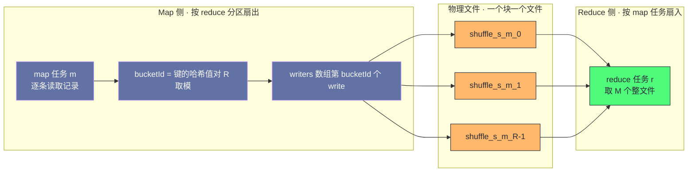
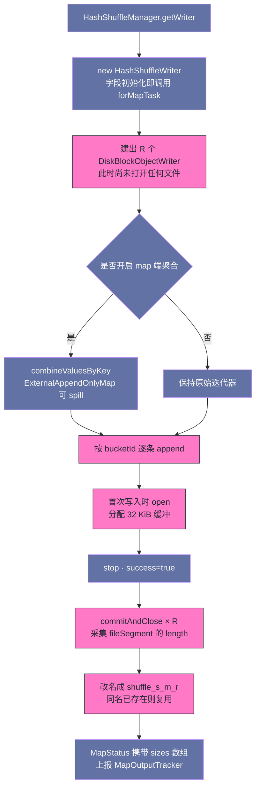
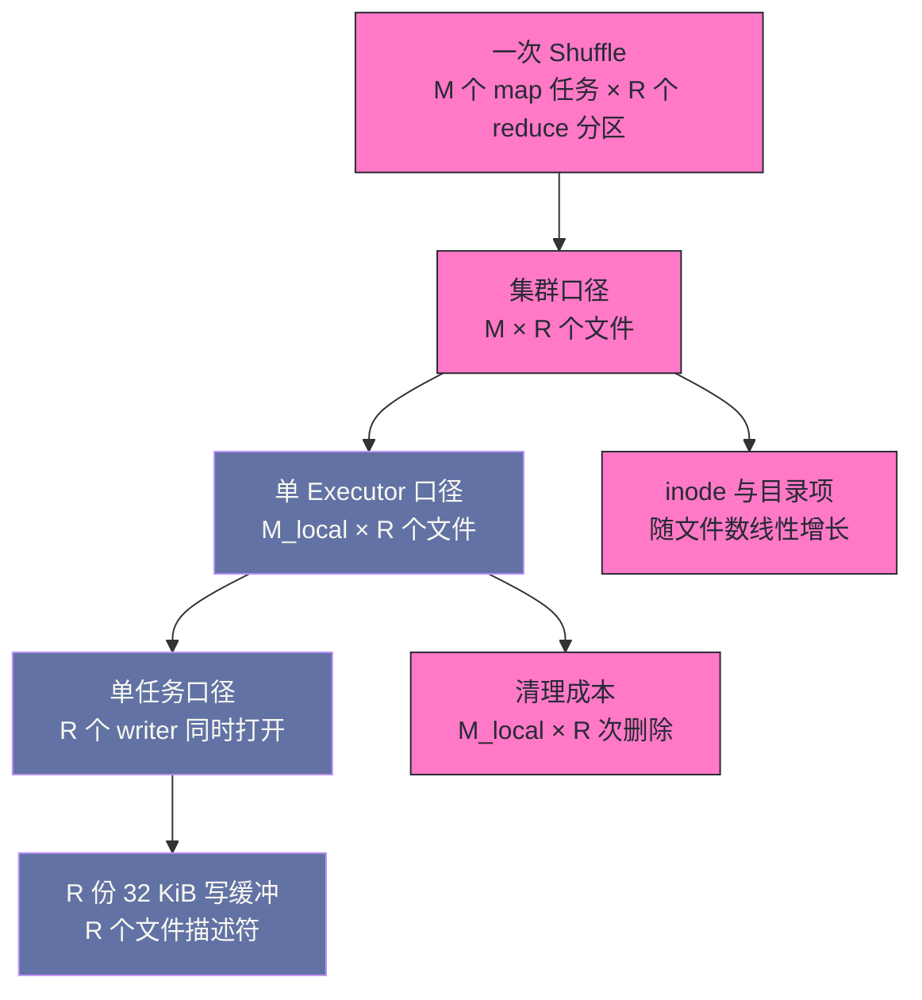
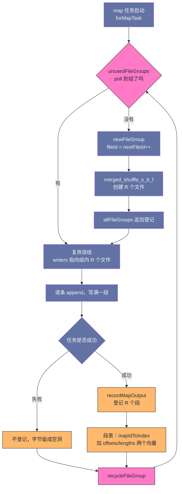
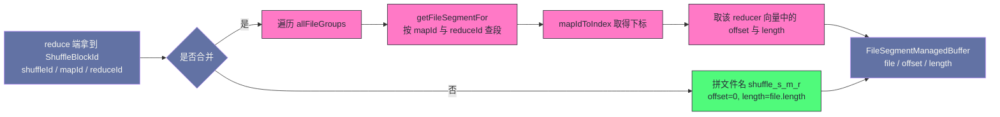
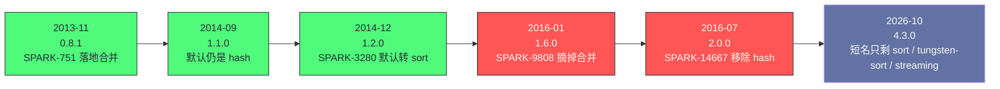

# 4. Spark Hash Based Shuffle：逐分区落盘、文件组复用与 FileSegment 寻址

**摘要：**

2013 年 5 月，一份标题平实的 JIRA 把问题摆到了台面上：每个 map 任务为每个 reduce 分区各开一个文件，一千乘一千就是一百万个文件，文件系统先于计算崩塌。Spark 当时给出的补丁并不是换掉这套写法，而是在写侧加一层文件组复用，让同一台机器上先后执行的 map 任务共用一组物理文件。这笔补丁的收益并不像名字暗示的那样稳定：它只在 map 任务多于并发槽位的 Shuffle 上成立，单波场景下几乎为零，而它把索引从文件系统搬进堆内存、把自己挡在外部 Shuffle 服务门外的代价却是恒定的。这篇文章把镜头收窄到实现层：`HashShuffleWriter` 如何在构造期就为每个 reduce 分区建出一个 `DiskBlockObjectWriter`，又如何在 `write` 里逐条追加；文件数 M×R 的上界从哪里来，又在什么规模上失控；`spark.shuffle.consolidateFiles` 打开的合并机制如何用 `ShuffleFileGroup` 登记每一段的偏移与长度，把文件总数压到 cores×R；一个 `FileSegment` 三元组（file、offset、length）如何在读取时被还原成一段可传输的字节。文章沿五问推进，落点在三种索引存放位置之间的取舍，并交代这套实现从 0.8.1 到 2.0 的退场，以及 4.3.0 里还剩下什么。

文章的版本口径是 Spark 4.3.0（2026 年 10 月 30 日发布，4.x 预编译 Scala 2.13）；讲历史实现时以 1.5.1 与 1.6.0 的源码为据，其余细节以对应版本文档或源码为准。

**关键词（Keywords）**: HashShuffleManager, HashShuffleWriter, FileShuffleBlockResolver, ShuffleFileGroup, consolidateFiles, FileSegment, DiskBlockObjectWriter, MapStatus

---

## 第 1 章 一次写出的边界：块就是文件

### 1.1 写侧的三个动作与一个近乎偷懒的回答

Shuffle 的写侧无论由哪种实现承担，都要完成三件事：按目标分区归类、把归类结果落到某个介质上、把落点的位置登记到一个下游查得到的地方。三件事的形态几乎决定了整个实现的面貌——归类靠哈希还是靠排序，落地成多个文件还是一个文件加一份索引，登记的是文件名还是一段偏移。

哈希式 Shuffle（Hash Based Shuffle）给出的答案近乎偷懒：一个 map 任务为每一个 reduce 分区各开一个文件，文件名是 `shuffle_<shuffleId>_<mapId>_<reduceId>`，文件里装的就是这个 reduce 分区要的全部数据。于是逻辑上的块（`ShuffleBlockId`）与物理上的文件完全重合，一个块就是一个文件，偏移恒为零，长度就是文件长度。

这个重合是所有后续结论的源头。**当块与文件重合时，寻址不需要索引**：读取方拿到 `(shuffleId, mapId, reduceId)`，把它拼成文件名，路径就出来了，既不必读一份索引文件，也不需要在内存里维护任何偏移表。代价同样来自这个重合：块的数量等于文件的数量，而文件的数量由 map 任务数与 reduce 分区数的乘积决定。

### 1.2 它为什么长成这样：排序不是契约

Hadoop MapReduce 把排序写进了契约：reduce 的输入必须按 key 分组且有序，所以 map 端无论如何都要排一遍，哪怕业务上并不需要有序结果。RDD 的语义要松得多，一次 `reduceByKey` 只要求同一个 key 的记录聚到同一个分区，并不要求分区内部有序；`groupByKey` 更是把聚合方式整个交给用户。需求松了，实现也就不必背排序这个包袱，哈希取模足以完成归类。

于是哈希路径省掉的不是一次磁盘写，而是一整套排序结构：没有 `ExternalSorter`，没有 spill 与归并，没有分区内的顺序保证。省下来的东西看起来全是好处，但**它把输出的份数从「map 任务数」放大到了「map 任务数 × reduce 分区数」**，代价被推迟到文件系统与文件描述符上去偿还。

这里要划清一条边界：哈希路径不排序，不等于它不聚合。map 端聚合（map-side combine）是另一条独立的开关，`reduceByKey` 默认打开，聚合所用的容器自己要占内存、也可能 spill，但那属于聚合容器的账，与写侧文件无关。把两者混为一谈，就会得出「哈希 Shuffle 完全不占内存」这种过度推论。

### 1.3 五个约定

把哈希实现的选择列成一张表，后文几乎每一条结论都能在这张表里找到出处：

| 维度 | 哈希式实现的选择 | 直接后果 |
|---|---|---|
| 输出粒度 | 每个 `(mapId, reduceId)` 一个文件 | 块与文件合一，寻址零成本 |
| 排序 | 不排序，只按分区归类 | 无排序 CPU 开销，也无分区内有序性 |
| map 端聚合 | 可选，由 `aggregator` 与 `mapSideCombine` 决定 | 有聚合时另有一份内存账与 spill |
| 索引 | 无显式索引，文件名即索引 | 不占堆内存，依赖文件系统目录项 |
| 读取粒度 | 整文件读取，`offset=0`、`length=文件长度` | 外部 Shuffle 服务可以原样实现 |

### 1.4 一个贯穿全文的作业

设想一个会话统计作业 `session_stat`：每天从 HDFS 读一天约两亿条页面事件，读入时切 2000 个分区，按用户标识做 `reduceByKey` 累加停留时长，结果按用户维度写成一张宽表；下游还会再按省份汇总一次，于是同一个应用里出现第二个 Shuffle。

为了把账算清楚，先固定一组参数：map 端 2000 个任务、reduce 端 2000 个分区、200 个 Executor、每个 Executor 8 个核、`spark.task.cpus` 取默认值 1。按这组参数，第一个 Shuffle 的块数是 2000 × 2000 = 400 万。这些数字不是实测值，只是一组便于推算的假设，后文每次用到都会重新交代口径。

写成代码就更直观了，两次 `reduceByKey` 各对应一次 Shuffle，后文讨论的都是第一次：

```scala
// 两条输入各自读入 2000 个分区；第一次按用户聚合，第二次按省份汇总
val views = sc.textFile("hdfs:///logs/page_views").map(parseView)        // map 端 2000 个分区
val dwell = views.map(v => (v.userId, v.dwellMs)).reduceByKey(_ + _)     // reduce 端 2000 个分区
dwell.map { case (uid, ms) => (provinceOf(uid), ms) }.reduceByKey(_ + _) // 第二个 Shuffle
```

### 1.5 一个比喻：信封与投递

哈希式实现的思路像极了按户分装的投递：每一批要寄出的信件里，凡是寄往同一户的，就装进同一个信封，信封上写清「第几批、第几户」，邮局凭信封上的编号直接投递，不需要一本总账。好处是投递极快、账本极薄；坏处是信封的数量等于批次数乘户数，批次一多，信封就把邮袋撑爆。

比喻的技术限定在于：Spark 的「信封」不是一次性的，reduce 任务取走数据之后文件并不会立刻消失，它要留到整个 Shuffle 被清理为止；而且同一个 reduce 分区在同一个 map 任务里的数据只有一份，信封没有重复利用的可能。

### 1.6 数据通路的两端不对称

下图把一次 Shuffle 在哈希实现下的读写通路画出来，注意两端的不对称：写侧按 reduce 分区扇出成 R 个文件，读侧按 map 任务扇入成 M 次取数。



写侧的扇出决定了文件数，读侧的扇入决定了取数次数。这两个数字一个由 R 决定、一个由 M 决定，而它们乘在同一个 Shuffle 上，这正是后续所有规模问题的乘法来源。

---

## 第 2 章 `HashShuffleWriter` 的写法

### 2.1 四个组件与它们的分工

哈希式实现挂在可插拔的 Shuffle 框架上，真正露面的只有四个角色：`BaseShuffleHandle` 携带 `shuffleId`、`numMaps` 与 `dependency`，是注册阶段留下的凭据；`HashShuffleManager` 负责装配，按句柄把写侧交给 `HashShuffleWriter`、把读侧交给 `BlockStoreShuffleReader`；`FileShuffleBlockResolver` 掌管磁盘上的文件与块标识之间的对账，第 4 章的合并机制整个长在它身上；`BlockStoreShuffleReader` 则是读侧的统一入口，reduce 端从 `MapOutputTracker` 拿到地址后经它取数。四者的边界恰好对应四个问题——这次 Shuffle 是谁、写到哪里、怎么找回来、怎么读出来。

| 组件 | 职责 | 在本篇里的出场位置 |
|---|---|---|
| `BaseShuffleHandle` | 携带 `shuffleId`、`numMaps`、`dependency` | 构造 writer 时的入参来源 |
| `HashShuffleManager` | 注册 Shuffle、装配 writer 与 reader | 2.2 节的起点 |
| `FileShuffleBlockResolver` | 建文件、登记段、按块标识取数据 | 第 4 章的主体 |
| `BlockStoreShuffleReader` | 按地址取块、反序列化、可选聚合 | 4.7 节的读侧代价 |

### 2.2 从 `getWriter` 到构造函数

`HashShuffleManager.getWriter` 只做一件事：把 `shuffleBlockResolver`、`handle`、`mapId`、`context` 交给 `HashShuffleWriter` 的构造函数。真正的动作发生在字段初始化阶段：

```scala
// 1.6.0：writer 的创建发生在构造期，早于第一条记录的到达
private val dep = handle.dependency
private val numOutputSplits = dep.partitioner.numPartitions        // R，reduce 端分区数
private val ser = Serializer.getSerializer(dep.serializer.getOrElse(null))
private val shuffle = shuffleBlockResolver.forMapTask(
  dep.shuffleId, mapId, numOutputSplits, ser, writeMetrics)        // 建出 R 个 DiskBlockObjectWriter
```

`forMapTask` 这一行位于字段初始化位置，意味着**writer 的创建早于第一条记录的到达**：任务一开始，R 个 `DiskBlockObjectWriter` 就已经准备就绪。这里的 `numOutputSplits` 取自 `dep.partitioner.numPartitions`，是 reduce 端的分区数，与 map 端的分区数没有关系——map 端有多少任务由父 RDD 的分区数决定，两者是不同的量，混用它们会算错文件数。

`forMapTask` 内部对两种实现是同一段骨架的两个分支（第 4 章展开），共同点是返回一个长度为 R 的 `writers` 数组。`DiskBlockObjectWriter` 的构造本身并不碰磁盘，真正的 `FileOutputStream` 要等到第一次 `write` 才打开：1.5.1 的 `write` 开头就是 `if (!initialized) open()`。这个懒打开的细节后面会带来一个精确的口径——没有收到任何记录的桶，不会产生文件。

### 2.3 `write`：先聚合，再逐条追加

`write` 的主体短得可以一眼看完，但两处判断值得停下来看：

```scala
// 1.6.0：聚合是唯一的额外结构，之后就是一条记录一次 append
override def write(records: Iterator[Product2[K, V]]): Unit = {
  val iter = if (dep.aggregator.isDefined) {
    if (dep.mapSideCombine) {
      dep.aggregator.get.combineValuesByKey(records, context)   // ExternalAppendOnlyMap，可 spill
    } else {
      records
    }
  } else {
    require(!dep.mapSideCombine, "Map-side combine without Aggregator specified!")
    records
  }

  for (elem <- iter) {
    val bucketId = dep.partitioner.getPartition(elem._1)         // 0 到 R-1
    shuffle.writers(bucketId).write(elem._1, elem._2)            // 写到对应桶
  }
}
```

第一处是聚合分支。`dep.aggregator.isDefined` 且 `dep.mapSideCombine` 为真时，记录先经过 `combineValuesByKey`，这个调用背后是 `ExternalAppendOnlyMap` 一类的容器，内存吃紧时会 spill 到磁盘；`require` 那一行是一道断言，防止调用方在没提供聚合器的情况下打开 map 端聚合。换句话说，**哈希写侧本身不 spill，但聚合容器会 spill**，把「哈希 Shuffle 没有磁盘溢写」当成结论是会踩坑的。

第二处是循环体。`partitioner.getPartition(elem._1)` 算出一个 0 到 R−1 的下标，随后 `writers(bucketId).write(...)` 把这条记录追加进去。没有攒批，没有排序，也没有缓冲区满时的 flush 判断——一条记录一次方法调用，写的目标由哈希值当场决定。这种边算边写的形态让写侧的内存占用与数据量解耦，任务不必把整个分区读进内存再决定怎么落盘。

不过「逐条写」不等于「逐条落盘」。每个 `DiskBlockObjectWriter` 内部包着一层 `BufferedOutputStream`，缓冲大小取自 `spark.shuffle.file.buffer`（该配置自 1.4.0 起存在，默认 32 KiB，4.3.0 仍是这个默认值）。于是每个任务在写侧持有的堆内存不是数据量，而是 `R × 32 KiB` 的缓冲，这个数字第 3 章会算，它是哈希路径真正的内存成本，而且不受统一内存管理管辖。

### 2.4 `stop`：提交、改名与 `MapStatus`

任务跑完之后，`stop` 负责把临时文件变成取数端认识的样子，并交出这个 map 分区的输出账本：

```scala
// 1.6.0：提交阶段把临时文件改成取数端认识的名字，并把每段长度交给 MapStatus
private def commitWritesAndBuildStatus(): MapStatus = {
  val sizes: Array[Long] = shuffle.writers.map { writer =>
    writer.commitAndClose()
    writer.fileSegment().length              // R 个长度，构成这个 map 分区的输出账本
  }
  shuffleBlockResolver.synchronized {
    shuffle.writers.zipWithIndex.foreach { case (writer, i) =>
      val output = blockManager.diskBlockManager.getFile(writer.blockId)
      if (sizes(i) > 0) {
        if (output.exists()) {               // 同一个 mapId 的另一个尝试已经写过
          sizes(i) = output.length()         // 用已有文件的长度，删掉自己那份
          writer.file.delete()
        } else if (!writer.file.renameTo(output)) {
          throw new IOException(s"fail to rename ${writer.file} to $output")
        }
      } else if (output.exists()) {
        output.delete()                      // 空桶：连文件都不留
      }
    }
  }
  MapStatus(blockManager.shuffleServerId, sizes)
}
```

三个动作依次是：对 R 个 writer 逐个 `commitAndClose`，把 `fileSegment().length` 收进 `sizes`；把临时文件改名成 `shuffle_s_m_r`；用 `sizes` 构造 `MapStatus` 上报给 Driver。`sizes` 的长度是 R，每个元素是这个 map 任务在对应 reduce 分区上写出的字节数，这份数组最终进 `MapOutputTracker`，成为下游判断块大小与取数调度的唯一依据。

改名这段里有一个容易被忽略的分支：`output.exists()` 为真时不再改名，而是采用已有文件的长度、删掉自己那份。这不是防御性编程，而是为同一个 `mapId` 的另一次尝试准备的——投机执行（speculative execution）会在同一台机器上跑出第二份输出，谁先落地谁算数，后到的认账。**同一个块名只允许存在一份物理文件，这条约束由改名时的存在性检查来守。**整个改名过程套在 `shuffleBlockResolver.synchronized` 里，因为一个 Executor 只有一个 resolver，改名是跨任务共享的临界区。

失败路径由 `revertWrites` 与一个 `stopping` 标志兜底：`stop` 可能被调用两次（先以成功调用、再因异常以失败调用），`stopping` 保证清理只做一次；`revertWrites` 则逐个 `revertPartialWritesAndClose`，把没有提交的字节丢掉。

把这几节串起来，一个 map 任务从建 writer 到交出账本的顺序如下图。图里有一个容易看漏的分支：聚合发生在写入之前，它可能 spill 到磁盘，但那批临时数据与写侧的文件没有关系，属于另一套生命周期。



### 2.5 五个方法的职责

| 方法 | 做的事 | 代价落在哪里 |
|---|---|---|
| `forMapTask` | 建 R 个 `DiskBlockObjectWriter` | 文件描述符与写缓冲，随 R 线性增长 |
| `write` | 聚合后逐条追加到对应桶 | CPU 哈希与序列化，无排序开销 |
| `commitWritesAndBuildStatus` | 提交、改名、拼 `MapStatus` | 每次提交一次目录操作，R 次长度采集 |
| `revertWrites` | 丢弃未提交的字节 | 失败任务的垃圾字节留在临时文件里 |
| `stop` | 串起上述动作，保证只跑一次 | 无额外存储成本，只关乎正确性 |

### 2.6 反事实：换掉任何一个约定会怎样

假如把 R 个 writer 换成一个文件加一份内存索引，写侧就要在内存里攒出「每条记录属于哪个分区、写到哪个偏移」，这就变成了排序式实现要解决的问题：要么先排序再顺序写（需要 `ExternalSorter`），要么攒批再按分区写（需要内存上限与 spill）。哈希路径之所以能一条一条直接写，前提正是每个分区有自己独立的文件，偏移天然就是文件末尾。

假如把逐条写改成按批攒再写，写侧的内存就从 `R × 缓冲` 变成「批大小 × 记录宽度」，与数据分布直接挂钩，一个大分区就能把任务撑爆。哈希路径用文件数换掉了这个不确定性，这是它的聪明处，也是它的死穴。

---

## 第 3 章 文件数：m×r 的来历

### 3.1 上界与精确口径

一个 map 任务要写出多少个文件？只要块与文件合一，答案就是它要产出的分区数，即 R。整个 Shuffle 有 M 个 map 任务，于是文件数不超过 M × R。

严格的等式只在每个 `(map, reduce)` 对都至少有一条记录时成立。前面提过 writer 是懒打开的：一个桶如果一条记录都没收到，`commitAndClose` 之后长度为零，1.6.0 的提交逻辑会走到 `sizes(i) == 0` 的分支——若同名文件此前不存在，就什么都不留下。所以精确口径是**非空 `(mapId, reduceId)` 对的个数**，M × R 是它的上界。哈希分区在数据量足够时几乎每个对都非空，上界与真实值相差无几，但用文件数反推 M 或 R 时要记得这个偏差。

### 3.2 三层口径

文件数在三个层次上各有各的算法，混用是很多误判的起点：

| 口径 | 计算方式 | 决定的资源 |
|---|---|---|
| 集群 | `M × R` | 文件系统 inode、目录规模、清理耗时 |
| 单 Executor | `M_local × R` | 单机 inode、目录项、`ls` 与删除的响应 |
| 单任务 | `R` | 文件描述符与写缓冲，与并发度相乘 |

三者的分母不同，能被优化的手段也不同：合并机制优化的是前两层，第三层由 R 直接决定，与合并无关。这一点在第 4 章会被反复用到——它解释了为什么合并救不了 `Too many open files`。

R 这个数字本身也不是 Spark 替用户定的。RDD 作业里它来自调用 `reduceByKey`、`groupByKey`、`repartition` 时传入的分区数，譬如 `reduceByKey(_ + _, 2000)` 里的第二个参数就是它；SQL 作业里它来自 `spark.sql.shuffle.partitions`，并在自适应查询执行介入之后被再次改写。文件数是用户参数与数据布局的乘积，不是框架内部的一个常数，这也是为什么同一段代码在不同分区数下会表现出完全不同的磁盘行为。

### 3.3 极端规模

2013 年 5 月 21 日提交的 SPARK-751 把这个问题写得很直白：每台机器上为一次 Shuffle 创建 M × R 个临时文件，一千个 map 乘一千个 reduce 就是一百万个文件，「这个数字能让文件系统瘫痪，并显著拖慢系统」。十多年后回看，这段描述依然准确。

按 `session_stat` 的参数，一次 Shuffle 是 400 万个块。若每个 Executor 平均分到 10 个 map 任务（2000 个任务分给 200 个 Executor），单机就是 10 × 2000 = 2 万个文件，集群合计 400 万个。若把 map 端分区数提到 20000（读入更细的切片），文件数就是 4000 万。

这些文件不是抽象的数字，每一个都要在文件系统里占一份 inode 与一个目录项。ext4 的 inode 默认为 256 字节（视格式化参数而定），加上目录项里的文件名等开销，单个文件是几百字节量级；400 万个文件意味着 GB 级的元数据，而且这些元数据不在 JVM 堆里，GC 看不见，只有在 `ls`、`du`、删除与 `fsck` 的时候才显出重量。

删除本身也是一笔账。1.6.0 的 `removeShuffleBlocks` 在非合并模式下是双重循环：外层遍历 `completedMapTasks`，内层遍历 `0 until numBuckets`，逐个拼出 `ShuffleBlockId` 再删除。一次 Shuffle 的清理要发 M × R 次删除调用，同样随乘积增长。

### 3.4 三笔并发的账

文件总数之外，还有三笔账同时在涨，它们才是哈希路径真正压垮执行器的原因。

第一笔是打开的文件描述符。一个任务在跑的时候，R 个 writer 里凡是有记录进来的都已经打开了 `FileOutputStream`，也就是单个任务握着接近 R 个描述符；一个 Executor 同时跑 8 个任务（8 个核、`spark.task.cpus=1`），就是 8 × 2000 = 16000 个描述符。Linux 的 `ulimit -n` 在不少发行版里默认是 1024，容器环境里若不显式调整，任务会直接死在 `Too many open files` 上。

第二笔是写缓冲。每个已打开的 writer 持有一个 32 KiB 的 `BufferedOutputStream`，单任务 2000 × 32 KiB 约 62.5 MiB，8 个任务就是约 500 MiB 堆内存。这些缓冲是普通字节数组，不走 `TaskMemoryManager`，也不参与统一内存管理中执行内存与存储内存的划分，只受 GC 约束。**哈希路径的内存成本不是「数据在内存里」，而是「文件数在内存里」。**

第三笔是写模式的交错。每条记录按哈希落到 R 个文件中的一个，从单个文件看是顺序追加，从整台机器看是 R 路交错；页缓存替我们吸收了大部分随机性，但 flush 边界一到，R 个文件的不同偏移同时落到盘上，寻道次数与 R 同阶。

### 3.5 反事实

不落地会怎样？Shuffle 的输出必须能被下游按 `(mapId, reduceId)` 找到，而且要能在 Executor 掉线后重算，内存里留一份既不现实也不可靠，所以落盘是必然。

落地成一个文件会怎样？那就需要一份「哪个分区在文件的哪个位置」的索引，写侧必须先知道每个分区的边界，也就是要先归类完再写——这正是排序式实现的形状。哈希路径用一个文件换掉了一份索引，代价是文件数乘上了 R。下图把这份乘积在三个层次上的放大画出来，后文讨论的合并机制只作用在其中两层。



---

## 第 4 章 文件组：把 m×r 压到 cores×r

### 4.1 一条类注释

1.5.1 的 `FileShuffleBlockResolver` 类注释把合并机制讲得比多数转述更清楚：为了减少物理 Shuffle 文件的数量，多个块被聚合进同一个文件；每个 reduce 分区、每个并发执行的 Shuffle 任务对应一个「合并文件」，任务写完之后立刻把它们释放给下一个任务。注释还给出文件的三元组标识——`shuffleId`（整个 Shuffle 阶段）、`bucketId`（输出分区，即 reduce 分区号）、`fileId`（一组合并文件的编号，同一时刻只被一个任务持有，任务结束后归还池中）；每个块最终映射到一个 `FileSegment`，也就是 `(file, offset, length)` 三元组。

这段注释解释了合并的全部秘密：**文件名里不再有 `mapId`，取而代之的是 `fileId`**。一个文件因此可以容纳多个 map 任务的输出，每个任务的输出是文件中的一段。

### 4.2 池、两个队列与一个自增号

合并模式的状态都挂在 `ShuffleState` 上，每个 `shuffleId` 一份：`nextFileId` 是原子自增号，用来给新文件组编号；`unusedFileGroups` 是空闲组队列，`poll` 取、`add` 还；`allFileGroups` 保存所有已创建的组，读取时按它遍历；`completedMapTasks` 只在非合并模式下使用，合并模式下用不到。

两个队列的分工是这套机制的核心：`unusedFileGroups` 决定复用，`allFileGroups` 决定寻址。前者是借还，后者是目录。**一个组被借出时它仍然留在 `allFileGroups` 里，因为已经写进去的段还要能被读到。**

借、造、还三个动作合起来不到二十行，却把整个文件数的上限钉住了：

```scala
// 1.5.1：池里的三个动作，决定了「最多有多少个文件组」
private def getUnusedFileGroup(): ShuffleFileGroup = {
  val fileGroup = shuffleState.unusedFileGroups.poll()   // 先还回来的先用
  if (fileGroup != null) fileGroup else newFileGroup()
}

private def newFileGroup(): ShuffleFileGroup = {
  val fileId = shuffleState.nextFileId.getAndIncrement()  // 组号只增不减
  val files = Array.tabulate[File](numBuckets) { bucketId =>
    val filename = physicalFileName(shuffleId, bucketId, fileId)
    blockManager.diskBlockManager.getFile(filename)       // 一组 R 个文件
  }
  val fileGroup = new ShuffleFileGroup(shuffleId, fileId, files)
  shuffleState.allFileGroups.add(fileGroup)               // 造出来的组必须进目录
  fileGroup
}

private def recycleFileGroup(group: ShuffleFileGroup): Unit = {
  shuffleState.unusedFileGroups.add(group)                // 归还，而不是删除
}

private def physicalFileName(shuffleId: Int, bucketId: Int, fileId: Int) = {
  "merged_shuffle_%d_%d_%d".format(shuffleId, bucketId, fileId)
}
```

三个动作里最容易被低估的是 `recycleFileGroup`：它只把组放回空闲队列，既不关文件也不删文件，因为文件里已经登记的段还要供读取用。这也意味着一个文件组的物理文件从创建到 Shuffle 结束一直在增长，中间不会有任何收缩的机会。

### 4.3 `forMapTask` 的两个分支

同一个方法里藏着两个世界，`blockId` 完全一样，落点不同：

```scala
// 1.5.1：合并开关打开时，一组物理文件被反复借出与归还
val writers: Array[DiskBlockObjectWriter] = if (consolidateShuffleFiles) {
  fileGroup = getUnusedFileGroup()                            // 先从池里借，借不到再造
  Array.tabulate[DiskBlockObjectWriter](numBuckets) { bucketId =>
    val blockId = ShuffleBlockId(shuffleId, mapId, bucketId)  // 逻辑块标识不变
    blockManager.getDiskWriter(blockId, fileGroup(bucketId), serializerInstance, bufferSize,
      writeMetrics)                                           // 落点是组的第 bucketId 个文件
  }
} else {
  Array.tabulate[DiskBlockObjectWriter](numBuckets) { bucketId =>
    val blockId = ShuffleBlockId(shuffleId, mapId, bucketId)
    val blockFile = blockManager.diskBlockManager.getFile(blockId)   // 一个块一个文件
    val tmp = Utils.tempFileWith(blockFile)                          // 1.6.0 改成临时文件再改名
    blockManager.getDiskWriter(blockId, tmp, serializerInstance, bufferSize, writeMetrics)
  }
}
```

两个分支的 blockId 一样，物理位置不一样。逻辑标识没有变，物理位置变了，这正是「块等于文件」这条约定被打破的地方——块还是那个块，文件已经不止属于它。也正因为逻辑块标识没变，`MapStatus`、`MapOutputTracker`、取数协议全都不需要改，这是合并机制能以极小侵入性落地的原因。

### 4.4 追加语义与段的诞生

合并分支能成立，靠的是文件以追加方式打开。1.5.1 的 `DiskBlockObjectWriter.open` 里写着 `new FileOutputStream(file, true)`，第二个参数就是 append。`initialPosition` 在 writer 构造时取 `file.length()`，`commitAndClose` 之后 `fileSegment()` 返回 `(file, initialPosition, finalPosition - initialPosition)`，也就是这个任务写进这个文件的那一段。

这一段坐标之所以可靠，是因为同一个文件在同一时刻只被一个任务持有：`fileGroup` 从池里借出、任务结束归还，池保证互斥。**互斥由池的借还语义提供，而不是由文件锁提供。**这一点值得记住，它决定了这套机制的失效方式——只要某个路径漏掉了归还，池就会慢慢漏空，后续任务不断新建组，文件数回升，而不会报任何错。

### 4.5 登记：两张表与一个下标

任务成功后，`releaseWriters` 把 R 个段的位置登记进文件组：

```scala
override def releaseWriters(success: Boolean) {
  if (consolidateShuffleFiles) {
    if (success) {
      // 只有成功才登记：失败尝试写过的字节留在文件里，但不进入段表
      val offsets = writers.map(_.fileSegment().offset)
      val lengths = writers.map(_.fileSegment().length)
      fileGroup.recordMapOutput(mapId, offsets, lengths)
    }
    recycleFileGroup(fileGroup)          // 无论成败都要还组，否则池会被失败任务占死
  } else {
    shuffleState.completedMapTasks.add(mapId)   // 非合并模式靠这张表删文件
  }
}
```

登记动作本身很短，数据结构才是关键：

```scala
// 1.5.1：一个组里记两张表——mapId 到「第几个写入」的下标，以及每个 reducer 的段位置
private class ShuffleFileGroup(val shuffleId: Int, val fileId: Int, val files: Array[File]) {
  private var numBlocks: Int = 0
  private val mapIdToIndex = new PrimitiveKeyOpenHashMap[Int, Int]()
  private val blockOffsetsByReducer = Array.fill[PrimitiveVector[Long]](files.length)(...)
  private val blockLengthsByReducer = Array.fill[PrimitiveVector[Long]](files.length)(...)

  def recordMapOutput(mapId: Int, offsets: Array[Long], lengths: Array[Long]) {
    mapIdToIndex(mapId) = numBlocks
    numBlocks += 1
    for (i <- 0 until offsets.length) {
      blockOffsetsByReducer(i) += offsets(i)
      blockLengthsByReducer(i) += lengths(i)
    }
  }

  def getFileSegmentFor(mapId: Int, reducerId: Int): Option[FileSegment] = {
    val index = mapIdToIndex.getOrElse(mapId, -1)
    if (index >= 0) {
      Some(new FileSegment(files(reducerId),
        blockOffsetsByReducer(reducerId)(index),
        blockLengthsByReducer(reducerId)(index)))
    } else {
      None
    }
  }
}
```

`ShuffleFileGroup` 的内存结构值得逐项看清。`mapIdToIndex` 是一张 `Int → Int` 的映射，记录「这个 mapId 是第几个写进本组的」，`recordMapOutput` 每调用一次就把 `numBlocks` 加一；`blockOffsetsByReducer` 与 `blockLengthsByReducer` 是两组 `PrimitiveVector[Long]`，每个 reduce 分区一份，按写入顺序追加偏移和长度。取段时先用 `mapIdToIndex` 拿到下标，再从第 `reducerId` 个向量里取出对应的偏移与长度。

这个设计的内存效率在注释里也被点明：不是把 `ShuffleBlockId` 直接映射到 `FileSegment` 对象，而是每组只维护偏移与长度两个数组，靠下标对齐。**一个块在堆里占 16 字节**（两个 `long`），再加上 `mapIdToIndex` 里的一条记录。

失败路径同样在 `releaseWriters` 里：只有 `success` 为真才登记，失败则直接归还文件组。失败尝试写进去的字节留在文件里，成了不会再被任何段引用的空洞，只影响文件大小，不影响正确性——这是「追加加段表」模型的固有代价，也是它不需要回滚的原因。

### 4.6 为什么是 cores×r

到这里可以推导文件数的上界了。文件组的数量由同时持有组的任务数决定，而一个 Executor 上同时运行的 map 任务数不超过它的 slot 数，即 `cores / spark.task.cpus`（`session_stat` 的假设下就是 8）。于是一个 Executor 为一次 Shuffle 创建的物理文件不超过 `slots × R`，集群合计不超过 `Executor 数 × slots × R`。取 `spark.task.cpus = 1` 时，这个式子就写成 cores × r。

更重要的是收益的倍数。设一个 Executor 上要跑 `M_local` 个 map 任务，非合并模式创建 `M_local × R` 个文件，合并模式最多创建 `min(M_local, slots) × R` 个，于是可以得到一个很朴素的结论：

**收益倍数等于 ceil(M_local / slots)，也就是每个 slot 上跑了几个任务，即波数。**

这个推论有一个不太受欢迎的含义：如果一个 Shuffle 的 map 任务数与集群 slot 数相当，每个 slot 只跑一个任务，合并一分钱都省不下来。合并只在波数大于一的 Shuffle 上有效，而波数取决于 map 分区数与并行度的比例，不是打开开关就能决定的：譬如读入 20000 个分区、集群共 1600 个 slot 时，波数是 12.5；读入 1600 个分区时，恰好一波。

把两组参数放在一起看更清楚。第一组是多波：map 端 10000 个任务、200 个 Executor、每个 8 核，共 1600 个 slot，平均每个 Executor 分到 50 个任务，约 6.25 波；R 取 2000，则非合并模式单机 50 × 2000 = 10 万个文件、集群 2000 万个，合并模式单机 8 × 2000 = 1.6 万个、集群 320 万个，收益 6.25 倍。第二组是单波：map 端 1600 个任务正好铺满 1600 个 slot，此时两种模式的文件数完全相同，收益为零。同一套机制、同一份代码，收益从 6.25 倍到 1 倍，差别只在于任务有没有在同一个 slot 上排队。

下图把这套借还与登记的关系画全，可以看到 `allFileGroups` 只增不减，而 `unusedFileGroups` 是一个不断进出的池：



### 4.7 读侧的代价

写侧省下来的文件数，读侧要用一次扫描来还：

```scala
// 1.5.1：读侧没有名字可查，只能逐个文件组问「这个 mapId 的段在你这里吗」
override def getBlockData(blockId: ShuffleBlockId): ManagedBuffer = {
  if (consolidateShuffleFiles) {
    val shuffleState = shuffleStates(blockId.shuffleId)
    val iter = shuffleState.allFileGroups.iterator
    while (iter.hasNext) {
      val segmentOpt = iter.next.getFileSegmentFor(blockId.mapId, blockId.reduceId)
      if (segmentOpt.isDefined) {
        val segment = segmentOpt.get
        return new FileSegmentManagedBuffer(
          transportConf, segment.file, segment.offset, segment.length)
      }
    }
    throw new IllegalStateException("Failed to find shuffle block: " + blockId)
  } else {
    val file = blockManager.diskBlockManager.getFile(blockId)   // 文件名就是地址
    new FileSegmentManagedBuffer(transportConf, file, 0, file.length)
  }
}
```

合并模式下，`getBlockData` 拿不到「文件名即地址」的便利，只能遍历这个 Shuffle 的所有文件组，逐个问「这个 `mapId` 的段在你这里吗」，命中就返回 `FileSegmentManagedBuffer(file, offset, length)`，全都问完还没有就抛异常。单次查询的代价是 `O(文件组数)`，组数等于 slot 数，通常是个位数到几十，可以接受；不过组数一旦随并发任务数上涨，这个代价就会显出来，何况它把一个常数操作变成了线性扫描，而扫描发生在每一次块读取上——一个 reduce 任务要取 M 个块，就要扫 M 次。

非合并模式那一支则是一行路径拼接再加一次 `file.length()`，`offset` 恒为零。**这就是「块等于文件」的便利被注销之后寄来的账单。**这里还有一个细节：扫描顺序是 `allFileGroups` 的插入顺序，不是 `fileId` 顺序。一旦同一个 `mapId` 在同一个 Executor 上留下两份登记（投机执行的两次尝试都成功时会这样），读到哪一份就取决于扫描顺序；两份都是完整输出，正常情况下内容一致，不一致的情形属于不确定性输出，由上层的不确定性处理接管。

### 4.8 清理的两条路

清理逻辑也随模式分叉：合并模式遍历 `allFileGroups`，把每个组里的 R 个文件删掉；非合并模式遍历 `completedMapTasks`，对每个 mapId 删 R 个文件。前者的循环次数是 `组数 × R`，后者是 `M_local × R`——清理成本也随之下降，这一点常被忽略，但在 400 万文件的量级上，删除本身就是分钟级的操作。

### 4.9 一张对照表

两种实现放在一起，差别集中在文件数、索引位置与兼容性三处，其余部分几乎是同一份代码：

| 维度 | 非合并（默认） | 合并（`consolidateFiles=true`） |
|---|---|---|
| 文件命名 | `shuffle_s_m_r` | `merged_shuffle_s_b_f` |
| 单 Executor 文件数 | `M_local × R` | `min(M_local, slots) × R` |
| 块与文件 | 一块一文件，`offset=0` | 一块一段，段表在堆里 |
| 寻址 | 拼文件名 | 扫文件组加下标 |
| 堆内存 | 仅 R 份写缓冲 | 写缓冲加每块 16 字节段表 |
| 并发描述符 | `R × 并发任务数` | `R × 并发任务数`（不变） |
| 清理成本 | `M_local × R` 次删除 | `组数 × R` 次删除 |
| 外部 Shuffle 服务 | 可用 | 不可用 |

---

## 第 5 章 索引放在哪里

### 5.1 三个存放位置

把三代实现放在一起看，会发现它们真正的差别只有一个：**「某个块在哪个文件的哪个位置」这条信息存在哪里**。

哈希非合并不存这条信息，它把信息编码进文件名，交给文件系统的目录项保管；哈希合并把它搬进 JVM 堆，用两个 `Long` 向量保管；排序式把它写进独立的 `.index` 文件，每条记录是第 i 个分区在数据文件里的长度累计值，读的时候先读索引再定位。三种做法各有一座靠山：目录项、堆、磁盘。

| 维度 | 哈希非合并 | 哈希合并 | 排序式 |
|---|---|---|---|
| 索引位置 | 文件系统目录项 | JVM 堆 | 独立 `.index` 文件 |
| 索引粒度 | 一个文件一块 | 每块两个 `long` | 每分区一个长度累计值 |
| 堆占用 | 零 | `16 字节 × M_local × R` | 每任务 R 个临时长度 |
| 寻址成本 | 一次路径拼接 | 扫描文件组数 | 一次索引读加一次定位 |
| 文件总数 | `M_local × R` | `min(M_local, slots) × R` | `2 × M` |
| 失效方式 | inode 耗尽、描述符耗尽 | 堆压力、外部服务不可用 | 索引文件损坏需重算 |

### 5.2 堆的账

合并模式的内存不是免费的。一个 Executor 为一个 Shuffle 登记的块数等于 `M_local × R`，每块 16 字节；`session_stat` 第一波里 `M_local = 10`、`R = 2000`，就是 10 × 2000 × 16 约 320 KiB，微不足道；但如果 reduce 端分区提到 20000、单机 map 任务 200 个，就是 200 × 20000 × 16 = 64 MiB，而这份数据在整个 Shuffle 生命周期里常驻，不随任务结束释放。

它还有个性质容易忽略：这部分内存不走统一内存管理，不参与执行内存与存储内存的借贷，Executor 堆的规划里没有为它留位置。堆吃紧时，GC 先感受到压力，而 Spark 的内存面板上看不到这笔账。

把这份占用与数据量放在一起比，会得到两个方向相反的结论，取决于分母取谁。若按 Shuffle 写出的总字节算，400 万块、假设总数据 200 GiB，平均一块 50 KiB，16 字节的段表连千分之一都不到，几乎可以忽略；若按 Executor 的堆算，同样这 64 MiB 落在一个 4 GiB 的堆里就是 1.5%，再加上 R 份写缓冲与聚合容器，堆的余量很快就被挤干。**索引占不占地方，取决于你拿它跟谁比——跟数据比它很小，跟堆比它不小。**这也是为什么这类成本在容量规划里经常被漏掉：做规划的人看的是数据量，感受到它的人看的是堆。

### 5.3 目录项的账

非合并模式把这笔账推给文件系统。ext4 的 inode 默认 256 字节，目录项还要存文件名（`shuffle_12_3456_789` 约 20 字节）与目录结构的开销；400 万个文件对应 GB 级的元数据，且这些元数据必须在磁盘上持久、被 `fsync` 保护、被备份与巡检工具扫描。两种做法的单位成本其实相差不大，差别在于文件系统的元数据不占 JVM 堆，也不触发 GC，但会拖慢目录遍历、删除与恢复。

### 5.4 Driver 侧还有一份

无论合并与否，Driver 上还有第三份账：每个 map 任务上报的 `MapStatus` 里带一个长度为 R 的 `sizes` 数组。Spark 从 1.x 中期起就对这份数组做压缩——reduce 分区数不超过 2000 时用 `CompressedMapStatus`，每个分区一个字节；超过 2000 时用 `HighlyCompressedMapStatus`，只保留平均大小与少数大块的明细。4.3.0 里这个分界由 `spark.shuffle.minNumPartitionsToHighlyCompress` 控制，默认 2000，自 2.4.0 起成为配置项，阈值本身与 1.6.0 时的硬编码一致。

这份账的存在说明一件事：**块的大小信息是调度与取数共用的公共设施，任何 Shuffle 实现都躲不掉**；合并机制压缩的只是「块在哪个文件的哪个位置」，压缩不了「块有多大」。

### 5.5 反事实：把段表也放磁盘

假如把段表写成一个文件、读的时候先读它，哈希合并就变成了排序式的形状：多一次元数据读，换来堆内存的解放。排序式正是这么做的，它的 `.index` 文件是每次取数前先读的。两条路的分界不在技术难度，而在读放大与堆占用之间怎么选：块数越多，磁盘索引的读放大越明显；块数越少，堆里的段表越划算。

假如坚持用文件名当索引，却要把文件数压到 400 万以下，那就得让一个文件承载多个块；一旦这样做，文件名里就放不下块的位置信息，索引必须搬家。**文件数与索引位置是一对共轭变量，压下一个必然抬起另一个。**下图把合并模式下的一次寻址走完整条路径，可以看到它是如何从「拼路径」退化成「扫描加下标」的。



---

## 第 6 章 开关的兴衰与 4.x 现状

### 6.1 0.8.1：从 O(m×r) 到 O(r)

SPARK-751 的原始诉求写得很清楚：把文件数从 `O(M×R)` 降到 `O(R)`。这张工单 2013 年 5 月 21 日创建，同年 11 月 14 日关闭，落在 0.8.1。注意它承诺的是 `O(R)`，实际落地的却是 `O(slots × R)`——注释里的「每个 reduce 分区、每个并发任务一个合并文件」就是这个意思。承诺与实现之间的差额，正是并发度这个变量。

### 6.2 默认值为什么是 false

1.5.1 的源码里，开关的读法是 `conf.getBoolean("spark.shuffle.consolidateFiles", false)`，默认关闭。同一段代码上方还留着一条 TODO，大意是「等 Shuffle 文件合并特性稳定之后再删除这个开关」。这条 TODO 写于 1.5，而这个特性在下一个版本就被删掉了，TODO 没有等来它的「稳定」。

默认关闭的原因不难理解：合并改变了块的物理布局，把寻址从文件系统搬进 Executor 的堆，任何一处不一致都会表现为取数失败，譬如段表里把某一格的偏移记错，读出来的就是另一段数据；而它带来的收益只在多波 Shuffle 上成立。一个默认开启、收益条件苛刻、失败后果严重的开关，维护者很难下决心打开。

还有一个旁证能说明哈希路径对内存的态度。1.6.0 的 `HashShuffleManager` 构造函数里有一句警告：如果用户把 `spark.shuffle.spill` 设成 `false`，这个设置会被忽略，Shuffle 该溢写时仍然溢写。这句警告针对的正是聚合容器——哈希写侧本身没有 spill 的逻辑，它把溢写的责任全部推给了 `ExternalAppendOnlyMap` 一类的结构。**一个把内存管理外包出去的写侧，在统一内存管理成为主流之后自然站不住脚**，这是它被替换掉的深层原因，比文件数更根本。

### 6.3 1.6.0：SPARK-9808 的三条理由

2015 年 8 月 11 日创建、9 月 18 日关闭的 SPARK-9808，标题就是「移除哈希 Shuffle 的文件合并」。理由在描述里写得很直接：这个特性没有被充分测试，而且不能与外部 Shuffle 服务一起工作；既然它很可能有 bug，而它的动机又已经被排序式 Shuffle 吸收了，那就是移除的首选对象。它落在 1.6.0。

「不能与外部 Shuffle 服务一起工作」这一条可以从 1.6.0 的代码里读出机制。外部 Shuffle 服务（`ExternalShuffleBlockResolver`）判断一个 Executor 用哪种 Shuffle 管理器，靠的是注册时上报的类名；如果类名是 `HashShuffleManager`，它就走「整文件」分支，直接用 `blockId` 拼出路径、把整个文件返回。合并模式下的块只是文件里的一段，而段表在 Executor 的堆里，外部服务进程读不到，也没有协议能把它传过去。**合并把寻址信息私有化到了执行器进程内，也就把外部服务挡在了门外。**

1.6.0 同时也是哈希实现的最后一个可用版本：这个版本里 `spark.shuffle.manager` 仍接受 `hash` 这个短名，也仍保留 `FileShuffleBlockResolver`，只是合并分支已经被摘掉，回到一块一文件。

### 6.4 2.0.0：整族消失

SPARK-14667 于 2016 年 4 月 15 日创建、4 月 19 日关闭，描述只有一句：「排序式 Shuffle 管理器自 1.2 起就是默认实现，是时候移除旧的哈希式管理器了。」它落在 2.0.0。从 1.1.0 的默认 `hash`、1.2.0 的默认 `sort`（SPARK-3280 的描述是「排序式 Shuffle 内存占用更低，且在我们几乎所有的测试里都胜过哈希式」），到 2.0.0 的移除，这条线走完了。

下图把这一段版本线按时间排出，节点里标出对应工单，可以看出开关与其宿主实现是分两步退场的，中间隔了三个大版本。



### 6.5 4.3.0：现在还能不能启用

结论是**不能，也没有什么可启用的**。逐项核实的结果如下，口径以 4.3.0 的源码为准：

- `spark.shuffle.manager` 的短名只剩三个：`sort`、`tungsten-sort`、`streaming`，`hash` 不在其中。传入未识别的名字时，配置值被当作全限定类名去实例化，而 `org.apache.spark.shuffle.hash` 这个包在 4.3.0 里已经不存在。
- `FileShuffleBlockResolver` 不存在。4.3.0 的 `shuffle` 包里只有 `IndexShuffleBlockResolver`、`MigratableResolver` 等实现，哈希路径的解析器没有留下。
- `spark.shuffle.consolidateFiles` 这个配置项自 1.6.0 起就不再存在，4.3.0 的配置清单里没有它。
- 4.3.0 还把 Shuffle 管理器拆成了两类：`spark.shuffle.manager` 必须是 `BlockingShuffleManager`，流水线 Shuffle 走另一个配置 `spark.shuffle.manager.incremental`（默认 `streaming`）。理论上第三方仍可以实现一个自定义的 `ShuffleManager` 来写「每分区一个文件」，但内置的哈希实现没有任何残留，具体可行性以对应版本文档或源码为准。

短名的解析逻辑就是下面这几行，它把「还能不能配 hash」这件事回答得很干脆：

```scala
// 4.3.0：spark.shuffle.manager 只解析三个短名，hash 不在其中
def resolveShortName(shuffleMgrName: String): String = {
  val shortShuffleMgrNames = Map(
    "sort" -> classOf[org.apache.spark.shuffle.sort.SortShuffleManager].getName,
    "tungsten-sort" -> classOf[org.apache.spark.shuffle.sort.SortShuffleManager].getName,
    "streaming" -> classOf[org.apache.spark.shuffle.streaming.StreamingShuffleManager].getName)
  shortShuffleMgrNames.getOrElse(shuffleMgrName.toLowerCase(Locale.ROOT), shuffleMgrName)
}
```

有一个东西留了下来：`FileSegment` 类仍在 4.3.0 的 `org.apache.spark.storage` 包里，`DiskBlockObjectWriter.commitAndGet()` 仍返回它，而 `BypassMergeSortShuffleWriter` 仍在用它记录每个分区的临时文件段。哈希式实现的「段」这个概念活了下来，只是不再用于承载多任务的合并文件，而是用于把 R 个临时文件拼成最终的数据文件。

把上述符号的存续状况列成一张表，退场的轮廓就很清楚了：

| 符号或配置 | 出现版本 | 4.3.0 是否还在 | 判据 |
|---|---|---|---|
| `org.apache.spark.shuffle.hash.HashShuffleManager` | 1.1.0 至 1.6.0 | 否 | `shuffle` 包下无 `hash` 子包 |
| `FileShuffleBlockResolver` | 1.5.x 至 1.6.0（更早版本位于 `hash` 包内） | 否 | 只剩 `IndexShuffleBlockResolver` 等 |
| `spark.shuffle.consolidateFiles` | 0.8.1 至 1.5.x | 否 | 1.6.0 的源码中不再读取 |
| `spark.shuffle.manager=hash` | 1.1.0 至 1.6.0 | 否 | 短名表只剩三个 |
| `FileSegment` | 早期版本至今 | 是 | `DiskBlockObjectWriter.commitAndGet` 返回它 |
| `BypassMergeSortShuffleWriter` | 1.x 至今 | 是 | 保留每分区一个 writer 的形状 |

### 6.6 一个旁证：bypass 路径是它的后代

排序式 Shuffle 里有一条 `BypassMergeSortShuffleWriter`，触发条件是不带聚合、不带排序要求、且分区数不超过 `spark.shuffle.sort.bypassMergeThreshold`（默认 200）。它的写法与哈希式如出一辙：为每个 reduce 分区建一个 `DiskBlockObjectWriter`，逐条按分区追加，最后把 R 个临时文件依次拼进一个数据文件，并写出索引。区别只在末尾多了一次拼接。

这条路径的存在说明「每分区一个 writer」并不是一个被证伪的设计，而是一个适用范围被压缩到 200 个分区以内的设计。超过这个数，R 份缓冲与 R 个描述符又会出现，于是排序式用一次排序把文件数压到 2 × M、把描述符压到个位数。**同一个思路，换了边界条件，就从主流变成了兜底。**

---

## 第 7 章 边界与反例

### 7.1 文件少不等于取数少

合并把物理文件数压下去了，逻辑块数一个没少：一个 reduce 任务仍然要取 M 个块，每个块仍然对应一次网络请求或一次本地读。取数的扇入由 M 决定，与文件数无关。把「文件数下降」当成「Shuffle 变快」，就会在合并打开之后发现取数耗时几乎没动。

### 7.2 描述符与缓冲不随合并下降

两个分支的 `writers` 数组长度都是 R，每个 writer 在第一次写入时打开自己的流、分配自己的 32 KiB 缓冲。合并改变的只是这 R 个流指向哪些文件，不改变流的数量。**合并治的是 inode，不治 fd。**

### 7.3 单波无收益

4.6 节的公式已经说明：收益倍数等于波数。一个 map 端只有几百个任务、集群却有上千个 slot 的 Shuffle，每个 slot 跑不到一个任务，合并的收益是零，而它带来的堆内存与寻址成本是实打实的。这个反例解释了为什么这个开关默认关闭，也解释了为什么不该因为「知道有这个东西」就把它打开。

收益在临界点附近的表现也值得一提。假使一个 Executor 有 8 个 slot、分到 10 个 map 任务，波数是 1.25，合并只能把 10 组文件压到 8 组，省下两成；而堆里多出的段表、读取时多出的扫描、加上与外部服务的不兼容，很可能把这两成吃掉。**合并的收益曲线不是线性的，它在「刚好一波」处为零，在「多出几个任务」处很小，只有波数成倍增加时才显著。**这类收益形状在容量规划里最容易被平均值掩盖：集群整体看是多波，落到每台机器上可能只是一波半。

### 7.4 失败尝试的空洞

合并模式下失败的尝试不会被登记，但它已经写进文件的字节不会消失。池把文件组还回去，下一个任务在文件末尾继续追加，中间那段就是永不被引用的空洞。单个空洞可能只有几十 MB，反复失败就会把文件撑大——磁盘用量与有效数据量脱钩，监控上看到的是 Shuffle 写字节数正常、磁盘占用偏高。

### 7.5 投机执行与同名文件

非合并模式里，同一个 `mapId` 的两次尝试若落在同一台机器上，两次都会写 `shuffle_s_m_r` 的临时副本，先成功的那次改名落地，后到的那次发现目标已存在，采用已有长度并删掉自己的副本。1.5.1 的处理方式更激进：写之前先删掉已存在的同名文件。两种做法在「同一时刻只有一个尝试写」的前提下都安全，但先删后写在并发下更脆弱，1.6.0 改成临时文件加改名，顺序上更稳。

### 7.6 外部服务看不到段

6.3 节已经从代码上说明了机制：外部 Shuffle 服务只认整文件。这在部署上有一个直接后果——启用了外部 Shuffle 服务的集群，合并开关即使打开也取不到数据：外部服务按 `shuffle_s_m_r` 的规则去拼路径，而合并后的文件叫 `merged_shuffle_s_b_f`，两边对不上。两件事不能同时成立，这不是配置组合的问题，是信息位置的问题。

### 7.7 把哈希的公式套到排序上

排序式的文件数是 2 × M（一个数据文件加一个索引文件），与 R 无关。用 M × R 去估算排序式的磁盘占用会高估几个数量级；反过来，用 2 × M 去解释哈希式的文件数会漏掉 R 这个乘数。两套公式的分母不同，混用是容量规划里最常见的错误。

### 7.8 一张速查表

| 现象 | 常见误判 | 实际机制 |
|---|---|---|
| 合并打开后取数耗时没变 | 合并没生效 | 块数仍由 M 决定，合并只改物理文件 |
| 合并后仍报 Too many open files | 合并应该解决 fd 问题 | 每任务仍开 R 个流，fd 数不变 |
| 合并后堆内存吃紧 | 合并省内存 | 每块 16 字节段表常驻堆，且不受统一内存管理 |
| 单波 Shuffle 开合并无收益 | 开关失效 | 收益倍数等于波数，单波为零 |
| 文件数少于 M×R | 公式错了 | 空桶懒打开不落文件，精确值是「非空对」的个数 |
| 外部服务集群开合并后取数失败 | 网络问题 | 段表在 Executor 堆内，外部进程读不到 |

---

## 第 8 章 落点

回到开头那条约定：块就是文件。哈希式 Shuffle 的全部优点与全部缺点都从这一条长出来——因为块是文件，寻址不需要索引，写侧可以一条一条直接追加，map 端聚合之外不需要任何额外结构；也因为块是文件，文件数乘上了 R，描述符与写缓冲也乘上了 R。

合并机制想在保留这条约定的同时把文件数压下去，做法是把「一个文件一个块」改成「一个文件多个段」。它成功地把文件总数压到了 `slots × R`，也让 inode 的压力回到可接受的范围；但它同时把索引从文件系统的目录项搬进了 JVM 堆，把读取从一次路径拼接变成了对文件组的线性扫描，还把自己关在了外部 Shuffle 服务的门外。三条代价里，前两条是可测量的工程成本，第三条是结构性的不兼容，这也是 SPARK-9808 用「不能与外部 Shuffle 服务一起工作」作为移除理由的原因。

把三代实现的索引位置并排放，取舍就清楚了：哈希非合并把索引放在目录项里，文件数最多、堆最省、寻址最快、对外部服务最友好；哈希合并把索引放在堆里，文件数居中，堆与寻址成本上升，外部服务不可用；排序式把索引放在磁盘上，文件数最少（2 × M），代价是先排一遍序。三者没有高下，只有「把哪一笔账放在哪里」的选择。哈希式把账放在文件系统，排序式把账放在磁盘索引，合并把账放在堆，而**堆是三者里最贵的一种介质**，因为它同时受容量与 GC 两重约束。

看到一次 Shuffle 的文件数失控，笔者习惯按三条线去查。先看块数：是 M × R 还是 2 × M，这决定了文件数、描述符数与取数扇入的量级，也决定了该往哪一边找原因。再看波数：一个 Executor 上跑了几个 map 任务，波数决定了合并这类「复用文件组」的手段到底有没有收益，单波场景下开与不开结果一样。最后看部署形状：集群里有没有外部 Shuffle 服务，有的话任何把寻址信息私有化到进程内的优化都不成立。三条线走完，大多数关于「该不该开合并」「文件数为什么这么多」的困惑会落到某个具体机制上，而不是停在「调大并行度」这种无法验证的建议上。

哈希式 Shuffle 已经不在 4.x 的代码里了，但它留下的三个问题还在：块怎么寻址、索引放在哪里、文件数与并发度怎么折中。今天读排序式的 `IndexShuffleBlockResolver`，或者读那条把 R 压到 200 以内的 bypass 路径，看到的仍然是同一组问题的另一种答法。

---

## 参考资料

1. Apache Spark 源码（1.5.1）：`core/src/main/scala/org/apache/spark/shuffle/FileShuffleBlockResolver.scala`，合并机制的完整实现，含 `consolidateFiles` 开关、文件组池、`ShuffleFileGroup` 与 `FileSegment` 寻址。https://github.com/apache/spark/blob/v1.5.1/core/src/main/scala/org/apache/spark/shuffle/FileShuffleBlockResolver.scala
2. Apache Spark 源码（1.6.0）：`core/src/main/scala/org/apache/spark/shuffle/FileShuffleBlockResolver.scala`，合并分支被摘除后的形态，一块一文件。https://github.com/apache/spark/blob/v1.6.0/core/src/main/scala/org/apache/spark/shuffle/FileShuffleBlockResolver.scala
3. Apache Spark 源码（1.6.0）：`core/src/main/scala/org/apache/spark/shuffle/hash/HashShuffleWriter.scala`，构造期建 R 个 writer、逐条追加、提交与 `MapStatus` 构造。https://github.com/apache/spark/blob/v1.6.0/core/src/main/scala/org/apache/spark/shuffle/hash/HashShuffleWriter.scala
4. Apache Spark 源码（1.6.0）：`core/src/main/scala/org/apache/spark/shuffle/hash/HashShuffleManager.scala`，`getWriter` 与 `getReader` 的装配。https://github.com/apache/spark/blob/v1.6.0/core/src/main/scala/org/apache/spark/shuffle/hash/HashShuffleManager.scala
5. Apache Spark 源码（1.5.1）：`core/src/main/scala/org/apache/spark/storage/DiskBlockObjectWriter.scala`，`FileOutputStream(file, true)` 追加语义、懒打开、`fileSegment()` 的偏移与长度计算。https://github.com/apache/spark/blob/v1.5.1/core/src/main/scala/org/apache/spark/storage/DiskBlockObjectWriter.scala
6. Apache Spark 源码（1.6.0）：`network/shuffle/src/main/java/org/apache/spark/network/shuffle/ExternalShuffleBlockResolver.java`，对 `HashShuffleManager` 走整文件分支的判定。https://github.com/apache/spark/blob/v1.6.0/network/shuffle/src/main/java/org/apache/spark/network/shuffle/ExternalShuffleBlockResolver.java
7. Apache Spark 源码（1.6.0）：`core/src/main/scala/org/apache/spark/storage/BlockId.scala`，`ShuffleBlockId` 的文件名格式 `shuffle_<shuffleId>_<mapId>_<reduceId>`。https://github.com/apache/spark/blob/v1.6.0/core/src/main/scala/org/apache/spark/storage/BlockId.scala
8. Apache Spark 源码（4.3.0）：`core/src/main/scala/org/apache/spark/shuffle/ShuffleManager.scala`，`resolveShortName` 只解析 `sort`、`tungsten-sort`、`streaming`。https://github.com/apache/spark/blob/v4.3.0/core/src/main/scala/org/apache/spark/shuffle/ShuffleManager.scala
9. Apache Spark 源码（4.3.0）：`core/src/main/scala/org/apache/spark/SparkEnv.scala`，阻塞式与流水线式两个 Shuffle 管理器的装配与类型约束。https://github.com/apache/spark/blob/v4.3.0/core/src/main/scala/org/apache/spark/SparkEnv.scala
10. Apache Spark 源码（4.3.0）：`core/src/main/java/org/apache/spark/shuffle/sort/BypassMergeSortShuffleWriter.java`，每分区一个 writer、末尾拼接的旁路写法。https://github.com/apache/spark/blob/v4.3.0/core/src/main/java/org/apache/spark/shuffle/sort/BypassMergeSortShuffleWriter.java
11. Apache Spark 源码（4.3.0）：`core/src/main/scala/org/apache/spark/storage/FileSegment.scala` 与 `DiskBlockObjectWriter.commitAndGet`，`FileSegment` 三元组在 4.x 的存续。https://github.com/apache/spark/blob/v4.3.0/core/src/main/scala/org/apache/spark/storage/FileSegment.scala
12. Apache Spark JIRA：SPARK-751（Consolidate shuffle files，0.8.1）https://issues.apache.org/jira/browse/SPARK-751
13. Apache Spark JIRA：SPARK-9808（Remove hash shuffle file consolidation，1.6.0）https://issues.apache.org/jira/browse/SPARK-9808
14. Apache Spark JIRA：SPARK-14667（Remove HashShuffleManager，2.0.0）https://issues.apache.org/jira/browse/SPARK-14667
15. Apache Spark JIRA：SPARK-3280（Made sort-based shuffle the default，1.2.0）https://issues.apache.org/jira/browse/SPARK-3280
16. Apache Spark 4.3.0 文档：Configuration，`spark.shuffle.file.buffer`、`spark.shuffle.sort.bypassMergeThreshold`、`spark.shuffle.minNumPartitionsToHighlyCompress` 等配置项的默认值。https://spark.apache.org/docs/latest/configuration.html

---

> [!note] 思考题
> 1. 合并机制承诺把文件数压到 `slots × R`，却把索引搬进了堆。如果把索引改成「每台 Executor 一份本地小文件」，它会付出什么代价，又能不能与外部 Shuffle 服务共存？
> 2. 收益倍数等于波数，这个结论依赖「任务结束才归还文件组」。如果允许一个任务只写完一半就归还组、后半段再借回来，文件数会怎么变，段的寻址还成立吗？
> 3. 1.6.0 的提交逻辑用「目标文件已存在则复用」来处理投机执行。如果两个尝试写出的大小不同，采用先落地者的长度会带来什么后果，Spark 靠哪一层机制兜住？
> 4. 空桶不落文件，使文件数的精确值成为「非空对」的个数。在大规模倾斜数据上，这个偏差会让容量规划偏高还是偏低？
> 5. 排序式用 2 × M 个文件换掉了 M × R 个文件，代价是一次排序。假如未来存储介质的随机读代价降到接近顺序读，这个交换还划算吗？
