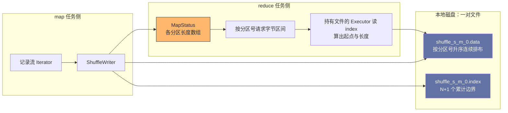
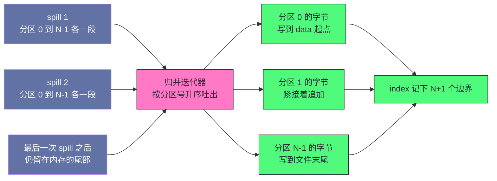
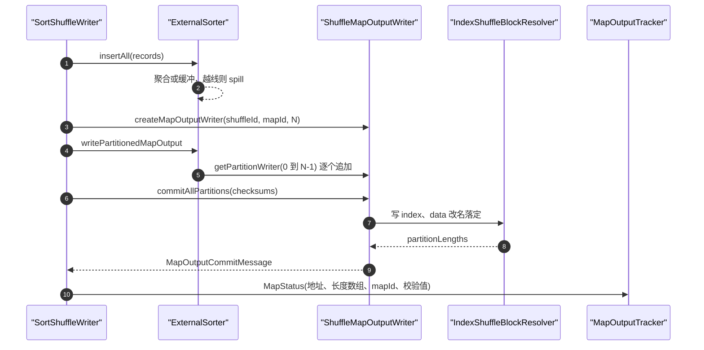
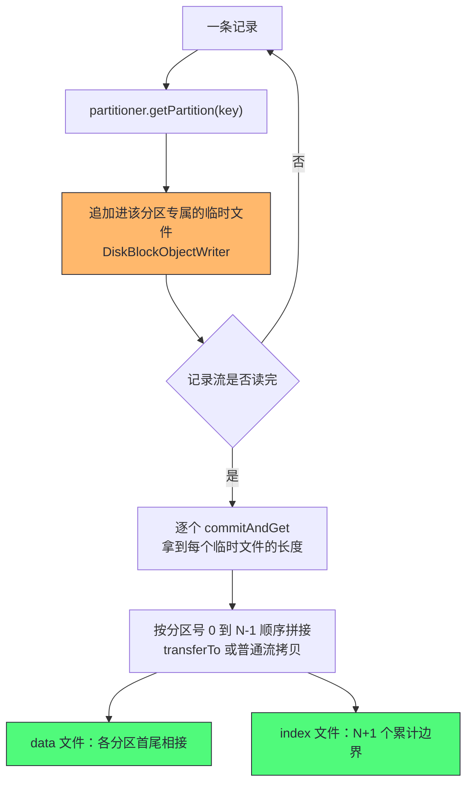
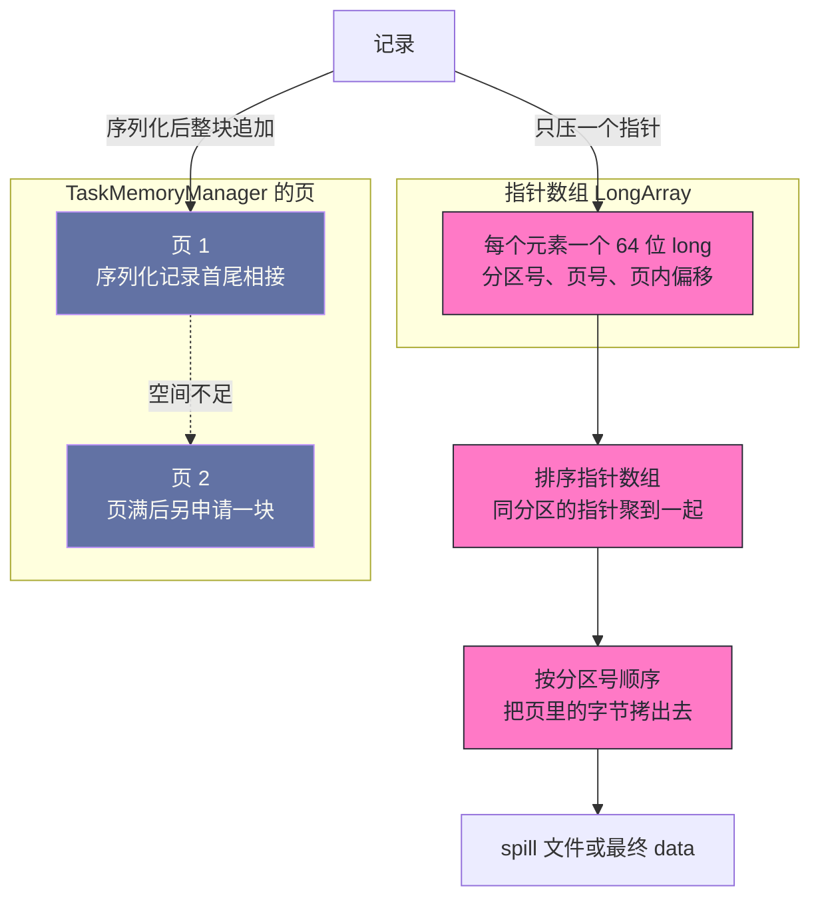
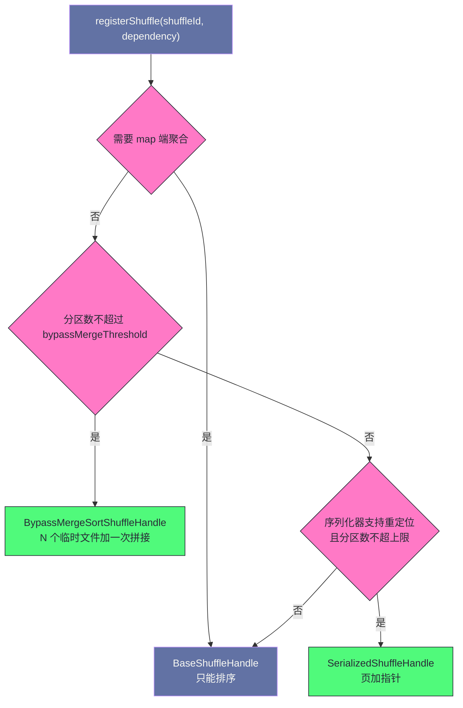

# 5. Spark Sort-Based Shuffle：双文件布局、三类 Writer 与 spill 归并

**摘要：**

Spark 的 Shuffle 写侧留在身后的东西少得出奇：一个 data 文件、一个 index 文件，外加一份回报给 Driver 的分区长度数组。这对文件是整个宽依赖能够成立的前提——下游之所以能"只拉自己那一段"，是因为上游把"第 r 个分区在这两个文件里的哪一段"这件事，变成了一个可以用两个 long 读出来的事实。但把千百个分区的数据装进同一个文件，代价是要在内存里先排好序，于是 spill 与归并成了常态，`SortShuffleManager` 也因此长出了三套完成同一件事的写法。

这篇文章不追溯这条路线是怎么一步步走到今天的，只回答两个问题：一个有界的、可寻址的双文件是怎么在内存不够的前提下被生产出来的，以及三种 Writer 各自把代价挪到了哪一维。文章沿五问推进：先界定一对文件的三重含义与命名规则；再走完 `SortShuffleWriter.write` 的五段主流程，交代插入聚合、按分区号排序、spill 触发与多路归并的细节；接着把 `IndexShuffleBlockResolver` 的字节级契约拆开，说清 index 里为什么是 N+1 个累计边界而不是成对的 offset/length，以及提交为何能重入；然后分别拆解 `BypassMergeSortShuffleWriter` 的 200 分区门槛与 `UnsafeShuffleWriter` 的页式内存和指针排序，逐项交代它们把 CPU 省下来之后把什么还了回去；最后用一张主表把三种 Writer 的 CPU、内存、文件句柄、排序稳定性与聚合能力并排放好，并单列边界与反例，交代哪些直觉会在分区数、压缩、加密与 push-based Shuffle 这几处失效。

文章的口径是 Spark 4.3.0（4.x 预编译 Scala 2.13）；源码细节以对应版本文档或源码为准。

**关键词（Keywords）**: SortShuffleWriter, BypassMergeSortShuffleWriter, UnsafeShuffleWriter, IndexShuffleBlockResolver, ExternalSorter, spill, bypassMergeThreshold

---

## 第 1 章 一对文件：写侧交出的到底是什么

### 1.1 契约的形态

一个 ShuffleMapTask 跑完，它在本地磁盘上留下的痕迹少得有点不成比例：一个 `shuffle_<shuffleId>_<mapId>_0.data`，一个同名的 `.index`，外加内存里一个几百字节的 `MapStatus`。任务处理了几百万条记录、几十个分区、若干次溢写，最终的交付物却是这两个文件和一段字节数组。

这份交付物的分量不在体积上，而在于它把三件原本纠缠在一起的事情一次解开了。第一件是数量：文件个数与下游分区数脱钩，2000 个 reduce 分区不再意味着 2000 个文件，而仍然只是一对。第二件是顺序：data 文件内部按照分区号升序把各分区的字节首尾相接，于是"第 r 个分区"退化成一段连续区间，随机寻址变成了顺序读的切片。第三件是幂等：这一对文件是一个 map 任务成败的完整凭证，写坏了整对丢弃重来即可，不会留下半个可读的中间态。

反过来设想这对文件不存在会怎样。若仍按下游分区各写一份，文件数就是 map 任务数与 reduce 分区数的乘积，磁盘上堆的是海量小文件，每个文件都要占一个句柄和一段缓冲区，句柄与 GC 会先于数据量崩掉；若干脆只写一个大文件而不记录分区边界，下游每个 reduce 任务就必须把整个文件读一遍再自行过滤，一次 Shuffle 的读取量会从 `1/R` 放大到 `1`。两条路都走不通，双文件是唯一能让"一个 map 任务一次落盘"与"一个 reduce 任务只读一段"同时成立的结构。

| 交付物 | 由谁写 | 由谁读 | 缺失时的后果 |
|---|---|---|---|
| `shuffle_<s>_<m>_0.data` | map 任务，按分区号升序追加 | 持有该文件的 Executor，按区间切片后发给 reducer | 整个 map 输出作废，该分区需重算 |
| `shuffle_<s>_<m>_0.index` | 提交阶段一次写成 | 同上，用于把分区号翻译成区间 | data 里字节还在，但没人知道分区边界 |
| `MapStatus`（分区长度数组） | map 任务，随任务结果上报 | Driver 的 `MapOutputTracker`，转给 reducer 做取数规划 | 下游不知道去哪个节点拉、拉多少 |
| checksum 文件与聚合校验值 | 提交阶段（开启校验时） | 读取侧，用于发现数据损坏 | 损坏只能表现为反序列化异常，定位困难 |

这张表里最容易被忽略的是第三行。**data 文件与 index 文件解决的是"这段字节在哪"，`MapStatus` 解决的是"这段字节在哪台机器上"**，两者缺一不可，但它们由不同的人保管：前者留在本地磁盘，后者登记进 Driver。明白了这一层分工，后面所有关于"取数失败"与"重算"的讨论才有落点——文件丢了要重算分区，地址丢了只需重新登记，两者的代价差着数量级。

### 1.2 名字：`(shuffleId, mapId)` 与一个占位常量

文件名里那个 `_0` 值得单独说一句。`IndexShuffleBlockResolver` 生成文件名时用的块标识是 `ShuffleDataBlockId(shuffleId, mapId, NOOP_REDUCE_ID)`，而这个常量在源码里被定义为 `0`，注释写得很直白：磁盘层目前仍期待写入操作对应一个 `(map, reduce)` 二元组，但 sort shuffle 把多个 reduce 的输出压进了同一个文件，于是 reduce 位只能用一个占位值填掉。

这个细节是整篇的缩影。命名规则从一个"每个 reduce 一份文件"的世界里长出来，到了双文件时代，规则没有改，只是把一个位置空着；空着的那一位恰好标出了变化发生在哪里——文件不再是"某个分区的输出"，而是"某个 map 任务的全部输出"，reduce 号退化为常量。读源码时看到这类占位常量，几乎总能顺着它找到一次语义上的收缩或扩张。

`(shuffleId, mapId)` 这对有序数构成了 Shuffle 输出在本地磁盘上的全部身份。它带来两个后果。其一，同一个 shuffle 的不同 map 任务输出完全独立，重算某个分区只需删掉那一对文件重写，不涉及任何别的分区。其二，整个索引结构可以退化成"一个文件里 N 个分区的长度数组"，因为不需要再用文件名去区分分区——分区号变成了文件内部的偏移，而非文件系统里的名字。

### 1.3 一个贯穿全文的结算作业

为了让机制有具体着力点，笔者设一个每日结算作业 `settle_daily`：从 HDFS 读当天的订单流与退款流，各自解析、过滤无效记录，先把退款流按商户号重分区到 64 个分区做预处理，再把订单流重分区到 2000 个分区，最后把两股数据汇合、按键聚合出"商户 × 小时"的结算金额。

```scala
val orders = sc.textFile("hdfs:///dw/orders/2026-11-18").map(parseOrder).filter(_.valid)
val refunds = sc.textFile("hdfs:///dw/refunds/2026-11-18").map(parseRefund).filter(_.valid)

// 第 1 次 Shuffle：64 个分区，无聚合、无排序 → 落进 BypassMergeSortShuffleWriter
val refundByMerchant = refunds.keyBy(_.merchantId)
  .partitionBy(new HashPartitioner(64)).cache()

// 第 2 次 Shuffle：2000 个分区，无聚合、无排序 → 序列化器决定走 Unsafe 还是 Sort
val ordersRepart = orders.repartition(2000)

// 第 3 次 Shuffle：200 个分区，带 map 端聚合 → 只能是 SortShuffleWriter
val settle = ordersRepart.map(toSettlePair)
  .union(refundByMerchant.map(toRefundPair))     // 窄依赖，不产生新的 Shuffle
  .reduceByKey(_ + _, 200)
settle.saveAsTextFile("hdfs:///dw/settle/2026-11-18")
```

三次 Shuffle 恰好落进三种 Writer：第一次因为 64 个分区没有超过阈值且不需要聚合，走旁路；第二次分区数远超阈值，既无聚合也无排序要求，是否走序列化路径取决于序列化器；第三次带着 `reduceByKey` 的 map 端聚合，任何试图旁路或序列化的方案都会被直接否掉。同一个作业、同一份数据、同一台集群，三个写侧实现轮番上场，这是本篇最好的观察窗口——差异不在数据上，而在依赖的形状上。

### 1.4 比喻：一册装订好的散页

把双文件想成一本装订好的册子：散页按章节顺序叠好、装订成一册，卷首附一张页码表，写着"第 3 章从第 87 页开始，第 4 章从第 121 页开始"。读者要找第 3 章，不必翻完全书，查表、翻到 87 页、读到 121 页之前即可；装订工也不必为每个读者另做一册，做一册就够所有人用。

比喻的技术限定在两处。其一，页码表里记的是"累计起点"而不是"起点加长度"，第 3 章的长度要用第 4 章的起点减出来，这个约定让表里永远比章节数多一条记录，也正是 index 文件的真实形状。其二，Spark 的装订工并非一次装完——册子太厚时他会先按章节顺序装出若干分册，最后再把分册按章节拼接成一本，这个"先分批、后归并"的动作就是 spill 与 merge，第 2 章要拆的就是它。

下图是一次 map 输出从记录流到两个文件、再被下游取走的全貌。请留意三条线的分工：写侧只负责产出文件与地址，取数侧先拿地址再定位区间。



图中 `MapStatus` 与 index 走的是两条路：前者跨网络进 Driver，后者始终躺在本地磁盘上。一条路线断掉，症状完全不同，这一点在第 3 章还会再遇到。

---

## 第 2 章 `SortShuffleWriter`：插入、排序、spill

### 2.1 `write` 的五段

`SortShuffleWriter.write` 的全部内容可以压成五行：

```scala
override def write(records: Iterator[Product2[K, V]]): Unit = {
  // 一、选排序器：有 map 端聚合就带上聚合器与 key 排序，否则两个都不带
  sorter = if (dep.mapSideCombine) {
    new ExternalSorter[K, V, C](
      context, dep.aggregator, Some(dep.partitioner), dep.keyOrdering, dep.serializer, dep.rowBasedChecksums)
  } else {
    new ExternalSorter[K, V, V](
      context, aggregator = None, Some(dep.partitioner), ordering = None, dep.serializer, dep.rowBasedChecksums)
  }
  // 二、灌数据：聚合与缓冲在这一步发生，spill 也在这一步被触发
  sorter.insertAll(records)
  // 三、拿到输出写入器：按 reduce 分区数开一个能顺序追加的容器
  val mapOutputWriter = shuffleExecutorComponents.createMapOutputWriter(
    dep.shuffleId, mapId, dep.partitioner.numPartitions)
  // 四、按分区号升序把字节吐出来，可能伴随多路归并
  sorter.writePartitionedMapOutput(dep.shuffleId, mapId, mapOutputWriter, writeMetrics)
  // 五、提交：data 改名落定、index 写成、长度数组回给 MapStatus
  partitionLengths = mapOutputWriter.commitAllPartitions(sorter.getChecksums).getPartitionLengths
  mapStatus = MapStatus(blockManager.shuffleServerId, partitionLengths, mapId, getAggregatedChecksumValue)
}
```

五段里最值得停下来看的是第一段的那个分支。有 map 端聚合时，排序器同时拿到聚合器、分区器与 `keyOrdering`；没有聚合时，聚合器与排序器都被显式置空，只留下分区器。源码注释给了理由：这一侧并不关心分区内的键是否有序，`sortByKey` 需要的排序会在读取侧完成，写侧排序的唯一用途是让"最后那次跨 spill 的归并"能够按分区顺序进行。

这句话纠正了一个流传很广的直觉。很多人以为 `sortByKey` 的排序发生在 map 端，于是把它和 `reduceByKey` 一起归为"map 端已排序"的那一类；实际上不带聚合的 Shuffle 在写侧只按分区号排，键序是在 reduce 端由 `ExternalSorter` 重新建立的。**map 端的键排序只在与聚合同时存在时才有意义**，因为只有在聚合路径上，同一个键的多条记录才会在写侧被合并到一处，排序顺带被复用；没有聚合时排序纯属白做。

### 2.2 插入：两种内存集合

第二段 `insertAll` 是所有代价的起点。它按 `shouldCombine` 分成两条路：有聚合器时，每条记录算出分区号后调用 `map.changeValue((partitionId, key), update)`，命中已有键就合并、没命中就建一个新的聚合值；没有聚合器时，调用 `buffer.insert(partitionId, key, value)`，原样入缓冲。

| 维度 | `PartitionedAppendOnlyMap` | `PartitionedPairBuffer` |
|---|---|---|
| 使用条件 | `dep.mapSideCombine` 为真，即存在聚合器 | 无聚合器，仅做分区与缓冲 |
| 逻辑键 | `(partitionId, key)`，分区号参与哈希 | 不哈希，按插入顺序追加 |
| 插入代价 | 一次哈希定位加一次合并 | 一次数组尾部追加 |
| 内存占用 | 键去重后只留一份值，实际数据量取决于基数 | 每条记录都占一格，与基数无关 |
| 排序时的比较器 | 分区号优先，需要时再比键 | 同左 |
| 典型算子 | `reduceByKey`、`aggregateByKey`、`combineByKey` | `repartition`、`partitionBy`、不带聚合的 `join` 侧 |

两种结构共用一条设计约束：**只支持插入与更新，不支持删除**。这个约束听起来是功能缺失，实际是一次让利——省掉删除路径之后，底层可以用一个连续数组加二次探测实现，不必维护链表或墓碑标记，扩容时整体重排即可。Spark 的写侧只需要"把记录放进去、把值改掉"，从来不需要"把某条记录拿掉"，约束与需求刚好对齐。

### 2.3 排序：排的是分区号，键是顺带的

spill 之前必须先排序，理由不是"用户要排序"，而是归并的需要。下一次 spill 或最终归并时，要把 k 个有序段合成一个有序段，前提是每一段自身有序且排序规则一致；排序规则定为"分区号优先、键次之"，那么归并结束后就能按分区号顺序把字节直接倾倒进 data 文件，一次成型，不必回头再按分区重排。

这个规则一旦确立，data 文件内部的结构就被锁死了：分区 0 的全部字节，接着分区 1 的全部字节，一直到分区 N-1。于是"写侧排一次序"换来了"读侧按区间切片"，也换来了 index 里那个简单的等差结构。**写侧的排序是一笔预付的费用，买的是读侧按分区的随机可寻址**，这笔交易划不划算，取决于一个分区被读几次——只读一次时它纯属浪费，被多个下游 Stage 各读一次时它便宜得惊人。

### 2.4 spill 的判据

内存不够就落盘，这件事的难点不在"落盘"，而在"怎么知道不够"。JVM 里一个 `PartitionedAppendOnlyMap` 占多少字节，没有任何 API 能直接回答：数组里存的是引用，值对象还可能在别处共享，聚合值的大小随更新而变。Spark 的解法是 `SizeTracker` 的采样估算——对集合中抽样若干对象，用 `SizeEstimator` 精确测量，再按样本比例外推整体，并在每次扩容或采样间隔到期时更新。复杂度是常数量级，误差被控制在可用范围内。

拿到估算值之后，落盘的判据共有四道：前三道写在 4.x 的 `Spillable.maybeSpill` 里，第四道来自内存管理器的主动回调，触发时机由内存管理器自己掌握。

| 判据 | 参数来源 | 默认形态 | 触发效果 |
|---|---|---|---|
| 元素条数越限 | `spark.shuffle.spill.numElementsForceSpillThreshold` | `Int.MaxValue`，等于不设限 | 立刻 spill |
| 估算字节越限 | `spark.shuffle.spill.maxSizeInBytesForSpillThreshold` | `Long.MaxValue`，等于不设限 | 立刻 spill |
| 内存池试探 | `spark.shuffle.spill.initialMemoryThreshold` | 5 MB，内部参数 | 借到内存则继续，借不到才 spill |
| 执行内存触顶 | `TaskMemoryManager` 主动回调 | 由内存管理器决定 | 强制 spill 以释放内存 |

第三道是整套机制最有意思的地方。每读入 32 条记录，若当前估算值已经越过阈值 `myMemoryThreshold`，排序器不会立刻落盘，而是向 shuffle 内存池申请 `2 * currentMemory - myMemoryThreshold` 字节；申请到多少就把阈值抬高多少，等于向池子要了一块更大的额度继续收集；只有当池子给不出足够内存、估算值仍然越线时，才真正落盘。这是一次**"先争取、后放弃"的谈判**，而非一次硬性判断。

```scala
protected def maybeSpill(collection: C, currentMemory: Long): Boolean = {
  val shouldSpill = if (_elementsRead > numElementsForceSpillThreshold
    || currentMemory > maxSizeForceSpillThreshold) {
    true                                       // 两条硬上限先判，绕开内存池
  } else if (_elementsRead % 32 == 0 && currentMemory >= myMemoryThreshold) {
    val amountToRequest = 2 * currentMemory - myMemoryThreshold
    val granted = acquireMemory(amountToRequest)   // 向 TaskMemoryManager 借
    myMemoryThreshold += granted                   // 借到多少，额度就涨多少
    currentMemory >= myMemoryThreshold             // 借不够才落盘
  } else {
    false
  }
  // 真正落盘时：spill、元素计数清零、记录 spilled 字节、把多借的内存还回去
  ...
}
```

为什么要"每 32 条才检查一次"？因为估算与申请本身有成本，逐条检查会把排序器变成测量仪。32 是一个经验值，够粗，不至于让内存超出太多，也够细，不至于在一条超大记录上直接把进程打死。这类经验常量的存在提醒我们：内存管理从来不是精确科学，它是一串"误差可接受"的工程折中。

### 2.5 一次 spill 一个文件

落盘动作本身很朴素：`spill` 取出当前的集合，用"分区号优先、需要时比键"的比较器做一次破坏性排序，然后顺序写入一个 spill 文件，同时记录每个分区在这个文件里的长度，供归并时定位。写完，集合被丢弃，`myMemoryThreshold` 回落到初始值，内存还给池子。

一次 spill 一个文件，意味着一个任务可能有多个 spill 文件。这与双文件的最终形态并不矛盾：spill 文件是中间产物，任务结束时会被删除；它是"内存装不下时的一次分批装订"，最终那本册子还要再装一遍。



图里那个"内存尾部"是容易漏掉的一环：最后一次 spill 之后读入的记录还留在内存里，从未落过盘，归并时必须把它当作第 k+1 个有序段一起参与，否则任务会静默丢掉最后一截数据。

### 2.6 归并：把 k 个有序段拼成一个

`writePartitionedMapOutput` 按 spill 文件是否为空分成两支。没有 spill 时，内存集合原地排序后逐分区吐出，直接调 `getPartitionWriter(partitionId)` 追加字节；有 spill 时，走 `partitionedIterator`：把每个 spill 文件视为一个有序段，加上内存尾部，用 `ExternalSorter.merge` 建一个按分区切分的多路归并迭代器。

归并的粒度值得说明。它不是"先把所有 spill 合成一个大文件再按分区切"，而是"逐分区推进"——迭代器先给出分区 0 的完整记录流，写侧把它们序列化后交给分区 0 的写入器，该分区耗尽后再推进到分区 1。这样做的好处是峰值内存与分区数无关，只与归并的路数（spill 个数加一）和每路的一个缓冲区有关；代价是必须顺序推进分区，`getPartitionWriter` 的契约里明确要求 `reducePartitionId` 单调递增，正是这一要求的镜像。

多路归并的开销常被低估。k 路归并每条记录要做 `log k` 次比较，k 等于 spill 个数；一个 spill 了 20 次的任务，每条记录要多做 4 到 5 次比较，几百万条记录就是上千万次额外比较。这就是"内存给得不够"的真实账单：**账不是记在磁盘 I/O 上，而是记在 CPU 上**。

### 2.7 落定

最后一步把临时状态变成正式交付。`commitAllPartitions` 拿到各分区的长度数组之后，负责把临时数据文件改名成正式的 data 文件、把 N+1 个累计边界写成 index 文件、在开启校验时写出 checksum，并把长度数组回给调用方。

在 3.0 之前，这一步由 `IndexShuffleBlockResolver.writeIndexFileAndCommit` 直接完成；3.0 之后写侧被抽象成 `ShuffleMapOutputWriter` 接口，本地磁盘实现把同样的动作藏进 `commitAllPartitions` 里，为的是让外部 Shuffle 服务或远端存储能够接管落盘过程。接口变形了，语义没变：**提交是一个原子的临界点，提交之前的一切都可以丢弃，提交之后的一切必须对下游可见。**



时序图里第 5 步到第 6 步之间的顺序是硬约束：分区写入器只能按号递增取用，提交必须落在全部追加之后。这两条都是接口契约，不是实现偏好，换成自定义的 Shuffle 扩展也绕不过去。

---

## 第 3 章 索引：字节级的寻址契约

### 3.1 成对命名

`IndexShuffleBlockResolver` 对外只有两个取文件的入口，一个给 data、一个给 index，两者都只用 `(shuffleId, mapId)` 定位，reduce 位一律填 `NOOP_REDUCE_ID`。成对不是靠约定维持的，而是靠同一对标识推进来的——两个块标识共享前缀，只有后缀不同，文件系统里它们必然同目录、同子目录槽位，删除时也是一对一起删。

成对还有一层运行期的含义。`getBlocksForShuffle` 只返回两个块标识，块管理器在数据迁移、副本登记、`unregisterShuffle` 清理时都按这一对处理；一对文件被视为一个不可分割的块集合，任何一半的丢失都等价于整个 map 输出失效。**索引与数据之间没有"部分可用"这种状态**，这条性质把容错的粒度固定在了 map 任务上，也让"重算一个分区"的代价永远是"重写一对文件"。

### 3.2 index 里到底是什么

打开 index 文件会看到 `(N+1) * 8` 个字节，也就是 N+1 个 64 位整数，且都是累计起点：第一个必须是 0，第二个是分区 0 的长度，第三个是分区 0 与分区 1 的长度之和，以此类推，最后一个恰好等于 data 文件的总长度。第 r 个分区的位置由两条记录给出——起点是第 r 个整数，长度是第 r+1 个整数减去第 r 个。

```scala
// 校验阶段的读法：index 长度必须精确等于 (blocks + 1) * 8
if (index.length() != (blocks + 1) * 8L) return null
var offset = in.readLong()
if (offset != 0L) return null        // 第一条记录必须是 0，否则说明文件错位
var i = 0
while (i < blocks) {
  val off = in.readLong()
  lengths(i) = off - offset          // 相邻两条相减，得到该分区长度
  offset = off
  i += 1
}
// 最后还要对账：data 文件的实际长度必须等于所有分区长度之和
if (data.length() == lengths.sum) lengths else null
```

这个格式背后是一次"看起来反直觉"的取舍：为什么不直接写成 N 对 `(offset, length)`，读写都更省事？因为累计起点有一个额外的好处——只要 index 与 data 都对，第 r 个分区的终点必然等于第 r+1 个分区的起点，两个分区首尾相接，中间不留空洞也无法重叠。如果用 `(offset, length)` 二元组，两段可以重叠、可以留缝，而这些不一致没有任何东西会去检查；用累计边界，**格式本身就把"无缝拼接"写成了约束**。

代价是读的时候要做一次减法，以及一处必要的事后对账：上面的代码在反算完长度后，用 `data.length() == lengths.sum` 验证两个文件是否真的配套。这个对账不是防御性编程的花哨，而是提交路径重入安全的基础，下一节会说明它为什么必须存在。

### 3.3 谁在读 index

一个常见的误解是"reducer 拉数据时先下载 index 再定位"。真实的分工要更细：reducer 手上先有的是 `MapStatus` 里的分区长度数组，它据此规划这一轮要拉多少字节、向哪几个节点发请求；真正的字节定位发生在持有文件的 Executor 上——收到按分区号的取数请求后，由 `IndexShuffleBlockResolver.getBlockData` 打开 index，把分区号乘 8 作为偏移量直接跳到对应位置，读出起点与终点，再交给文件分段缓冲区把那段区间发出去。

| 维度 | `MapStatus` 中的长度数组 | index 文件 |
|---|---|---|
| 存放位置 | Driver 的 `MapOutputTracker` | 每个 map 任务的本地磁盘 |
| 粒度 | 每分区长度，分区多时可退化为近似值 | 每分区精确累计边界 |
| 主要用途 | 取数规划：拉多少、从哪拉、分几批 | 字节定位：从哪个偏移读、读多长 |
| 读取者 | reduce 端 | 持有 data 文件的 Executor |
| 时效 | 随任务结果上报，可被整体替换 | 与 data 文件同生共死 |

这张表解释了一个日常现象：分区数上万时，`MapStatus` 里的长度可能不再逐分区精确，而只保留平均值加若干大分区的精确值，原因是把上万个长度全塞进 Driver 内存不划算；但 index 文件始终是精确的，因为它在本地磁盘上，只占 `(N+1) * 8` 字节，一万个分区也不过 80 KB。**精确信息留给最近的地方，近似信息才跨网络传播**，这是分布式系统里一条反复出现的省流量的思路。

顺带一说，`getBlockData` 里有一段从 SPARK-22982 遗留至今的位置校验：读完 index 之后要检查文件通道的位置是否恰好是"目标分区号乘 8 再加 8"，不符就抛异常。这类看似多余的断言，通常意味着历史上出过一次"读错偏移、把别人的分区数据发给 reducer"的事故，而这类事故的症状是数据错乱而非崩溃，最难排查。

### 3.4 提交的原子性与重入

提交要解决的问题是：一个 map 任务可能因为推测执行、失败重试、Executor 重启而运行多次，同一对文件会被写多遍，而下游随时可能正在读。所以提交必须满足两条——要么整对可见，要么整对不可见；多次提交中无论谁先谁后，最终留下的必须是内部一致的那一对。

本地的做法是"临时文件加改名"：数据先写到一个临时路径，提交时再 rename 到正式路径。改名在同一文件系统内是原子操作，读者要么看到旧文件、要么看到新文件，不会看到写了一半的中间态。index 也按同一套路处理，且顺序上有一个隐含要求：data 先落定、index 后落定，否则会出现"索引指向一个还不存在的 data"的窗口。

重入则靠前面那个对账逻辑兜底。提交前会检查目标位置是否已经存在一对文件，若存在则读取其 index、反算长度、与 data 实际长度对比；如果两者一致，说明已经有一份完好的结果，新写的那份直接丢弃；不一致就删掉旧的重命名新的。这段逻辑把一个分布式系统里最麻烦的问题——"两个副本同时写同一位置"——化简成了一次本地文件的长度比对。

### 3.5 反事实：没有 index 会怎样

把 index 抽掉，只留 data 文件，会发生三件事。第一，reducer 无法定位，只能把整个 data 文件拉过去再自行过滤，一次 Shuffle 的网络流量从 `1/R` 放大到 `1`，2000 个 reduce 分区意味着同一份数据被搬 2000 遍。第二，`MapStatus` 里的长度数组失去校验依据，文件被截断或写坏时无法察觉，故障会推迟到反序列化阶段才暴露。第三，map 任务的重算粒度被迫放大——没有索引就无法确认某段字节属于哪个分区，任何一处损坏都会让整对文件作废。

也可以反过来设想一个更"现代"的方案：不要文件，把每个分区的字节作为独立对象上传到对象存储，用对象名代替偏移量。这条路能省掉 index，但会引入每个分区一次上传的开销，且把顺序写拆成了大量小对象写。Spark 保留双文件，本质上是选择了"顺序写加一张小表"而不是"随机写加大量小对象"，这个选择在小分区多、单分区数据少的场景下尤其划算。

---

## 第 4 章 `BypassMergeSortShuffleWriter`：省掉排序，换来句柄

### 4.1 两个条件

旁路的判据只有两道，且分属两个不同的来源：聚合与否由依赖决定，分区数由配置决定。

```scala
def shouldBypassMergeSort(conf: SparkConf, dep: ShuffleDependency[_, _, _]): Boolean = {
  if (dep.mapSideCombine) {
    false                                                   // 需要 map 端聚合，直接排除
  } else {
    val threshold = conf.get(config.SHUFFLE_SORT_BYPASS_MERGE_THRESHOLD)
    dep.partitioner.numPartitions <= threshold               // 默认 200
  }
}
```

`settle_daily` 的第一次 Shuffle 正好踩在条件上：`partitionBy(new HashPartitioner(64))` 不产生聚合器，64 又远小于 200，于是判据为真，走旁路。第二次 Shuffle 的 2000 个分区则被这条判据挡在门外，只能继续往下问"能不能序列化"。

### 4.2 机制：N 个临时文件与一次拼接

旁路的写法与双文件的最终形态完全不同：它老老实实为每个 reduce 分区开一个临时文件，读一条算一次分区号、写进对应文件，读完再把 N 个临时文件按分区号顺序拼接成一个 data 文件，同时写下 index。



拼接这一步在支持 NIO 的路径上走 `transferTo`，数据在内核态直接从页缓存搬到目标文件，不经过用户态缓冲；路径不可用时退回普通流拷贝。源码里对这一分支的处理相当讲究——先尝试拿到可写的通道包装器，拿不到才退回流，理由是两条路径在资源关闭上的行为要保持一致。

### 4.3 快在哪里

旁路快的原因，源码注释写得比任何二手解释都清楚：它避免了"为了归并 spill 文件而多做一遍序列化与反序列化"。走常规路径时，记录进内存要先反序列化成对象，spill 时要再序列化回字节，归并时要再反序列化一次读出、再序列化一次写进 data，一条记录可能被序列化三四遍；**旁路全程只序列化一次，写进临时文件之后就是纯字节搬运**。

省掉的还有三样东西：排序（不需要把记录排成按分区号的序列，因为文件本身就是按分区分的）、spill 判断（不需要估算内存、不需要向内存池借额度）、归并（不需要 k 路合并，只需要按顺序拼文件）。三样加起来，写侧从"先收集、再排序、再归并"的批处理形态，退化成了"读一条写一条"的流式形态，CPU 与内存都轻得多。

### 4.4 阈值为什么停在 200

代价在另外一维上：**同时打开的文件句柄数等于分区数，缓冲区总量等于分区数乘以每个文件缓冲区大小**。这条账很好算，默认 `spark.shuffle.file.buffer` 是 32 KB，64 个分区意味着 64 个句柄加 2 MB 缓冲，200 个分区意味着 200 个句柄加 6.4 MB 缓冲，都在可控范围内；把阈值调到 2000，就变成 2000 个句柄加 64 MB 缓冲，而一个 Executor 上往往并行跑着若干个任务，句柄与内存会同时吃紧。

句柄这件事比数字更敏感。操作系统的单进程文件描述符上限通常是几千到几万量级，一个 Executor 跑 8 个并发任务、每个任务开 2000 个文件，理论上就能摸到上限；一旦触及，报出来的是 `Too many open files` 这类与 Shuffle 毫无字面关联的错误，排查时很难第一时间联想到分区阈值。**旁路的阈值本质上是一个资源配额，而不是一个性能开关**，把它调大换来的那点 CPU 收益，很可能在句柄耗尽时一次性赔回去。

阈值定在 200 还有一个隐含的匹配关系：它大致对齐了 `spark.sql.shuffle.partitions` 的默认值 200。SQL 作业在默认配置下刚好卡在边界上——分区数不超过阈值时旁路生效，超过时自动退回排序路径。这个数字上的巧合提醒我们，默认配置是一组相互咬合的假设，单独拧动其中一个，往往会让另一个的默认值失去意义。

### 4.5 bypass 不是"更小的 Sort"

最后要澄清一个定位问题。旁路并不实现 `SortShuffleWriter` 的一个子集，它是另一条完全不同的实现路径：没有排序器、没有 spill、没有归并，只有 N 个临时文件加一次拼接。两条路径只在最终形态上会合——都产出一对 data 与 index 文件，都汇报同样的 `MapStatus`。

正因如此，它才可能在"分区少、无聚合"的场景下明显更快，也正因如此，它在分区多时毫无还手之力。把它理解成"分区少时的小号 Sort"会得出错误结论，譬如以为它只是少了排序所以总是更快；实际上它的内存形态、故障形态、调优旋钮都与排序路径不同，两者的相似之处仅限交付契约。

---

## 第 5 章 `UnsafeShuffleWriter`：页、指针与重定位

### 5.1 四个条件

序列化路径的门槛由 `canUseSerializedShuffle` 判定，判据三条，加上一条来自内存模型的硬限制：

```scala
def canUseSerializedShuffle(dependency: ShuffleDependency[_, _, _]): Boolean = {
  val numPartitions = dependency.partitioner.numPartitions
  if (!dependency.serializer.supportsRelocationOfSerializedObjects) {
    false                                        // 序列化器不支持对象重定位
  } else if (dependency.mapSideCombine) {
    false                                        // 需要 map 端聚合
  } else if (numPartitions > MAX_SHUFFLE_OUTPUT_PARTITIONS_FOR_SERIALIZED_MODE) {
    false                                        // 分区数超过指针能编码的上限
  } else {
    true
  }
}
```

第一条是这套方案的地基。所谓**"支持序列化对象重定位"**，指的是序列化之后的字节流可以被整体搬家而语义不变——字节里不能出现指向原内存地址的绝对指针，也不能依赖对象在堆上的相对位置。Kryo 与 Spark SQL 自己那套序列化器都满足这条；Java 原生序列化不满足，因为它会在流里写入类描述与对象图的引用编号，落地位置一变就可能对不上。

第二条与前文的判断同源：需要 map 端聚合就必须按键合并，而按键合并要求同键记录能互相找到，这在"只按分区号聚簇"的序列化布局里做不到。

第三条是内存模型逼出来的。指针要同时编码分区号、页号与页内偏移，64 位里能分给分区号的位数有限，上限折算下来是 16777216 个分区；同时页内偏移的位数决定了单条记录不能超过 128 MB。这两条硬上限不是配置，改不了，只会在超限时静静地退回排序路径——**退回是静默的**，日志里只有一行 debug，不会给你一个警告。

### 5.2 页式内存与一个 64 位指针

序列化路径的内存形态与排序路径完全不同。排序路径把记录反序列化成对象，堆上散落着大量小对象，GC 压力与对象头开销都实实在在；序列化路径从头到尾不碰对象——记录被序列化成字节，整块追加进当前页，页是向 `TaskMemoryManager` 申请的一块定长连续内存。

真正参与排序的不是记录，而是指针。每追加一条记录，只在指针数组里压进一个 64 位 long，里面塞着分区号、页号与页内偏移。于是"排序几百万条记录"变成了"排序几百万个 long"：比较的是整数，交换的是整数，缓存局部性极好，这正是这套方案在 CPU 上大幅领先的原因。



图里页与指针数组是两套并行的结构：页存字节，数组存"字节在哪"。这种间接层带来一个副作用——spill 时不需要移动任何记录，只需按排序后的指针顺序把页里的对应区段拷出去，拷贝的粒度可以做到整块。间接层也带来一条约束：页一旦分配就不能随意搬迁，否则页号失效，所以内存是按页持有、按页归还的。

插入路径本身短得惊人，因为它把"序列化"与"排序"彻底分开了：序列化只负责把一条记录变成字节，排序只负责给字节定位，中间用**一块反复复用的序列化缓冲区**接上，从而不像排序路径那样为每条记录生成一个对象。

```java
void insertRecordIntoSorter(Product2<K, V> record) throws IOException {
  final K key = record._1();
  final int partitionId = partitioner.getPartition(key);   // 分区号先算出，它是指针的组成部分
  serBuffer.reset();                                       // 复用同一块缓冲区，不产生新对象
  serOutputStream.writeKey(key, OBJECT_CLASS_TAG);
  serOutputStream.writeValue(record._2(), OBJECT_CLASS_TAG);
  serOutputStream.flush();
  sorter.insertRecord(serBuffer.getBuf(), Platform.BYTE_ARRAY_OFFSET,
    serBuffer.size(), partitionId);                        // 交给排序器的只有字节、长度与分区号
}
```

这段代码解释了序列化路径为何能省下巨量 GC：整个过程里堆上新增的对象只有那几块页与指针数组，记录本身从未以对象形式存在过，序列化缓冲区每条记录被重置一次、复用到底。省下的不只是 GC 时间，还有对象头、指针字段、装箱值与随之而来的缓存失效。

### 5.3 spill 与归并：四条合并路径

spill 的触发条件与排序路径同源（内存池借不到就落盘，另有两条强制阈值），但落盘动作不同：排序路径是"排序后写一遍记录"，序列化路径是"排序指针、按指针顺序拷字节"。写出的 spill 文件内部同样按分区号聚簇，每个分区的长度被记下来，供后续合并使用。

合并阶段的路径选择相当细，`mergeSpills` 按 spill 个数先分三支，多 spill 时再按四个开关分四条：

| spill 个数 | fastMerge 可用 | transferTo 可用且未加密 | 采用的合并方式 | 特点 |
|---|---|---|---|---|
| 0 | 不适用 | 不适用 | 直接提交空分区长度数组 | 空输出也要落一对文件 |
| 1 | 不适用 | 不适用 | 交给单文件写入器接管，可改名时零拷贝 | 最省，改名失败才退回常规合并 |
| 多个 | 是 | 是 | `transferTo` 拼接各分段 | 内核态搬运，最快 |
| 多个 | 是 | 否 | 文件流拼接，不解压重压 | 压缩流按段拼接 |
| 多个 | 否 | 不适用 | 逐段解压再重压 | 最慢，CPU 与 I/O 双付 |

"fastMerge 可用"的判据是：未开启 Shuffle 压缩，或者所用压缩编解码器支持"序列化流的拼接"。前半句容易理解，不压缩的字节当然可以首尾相接；后半句是这套机制的关键——像 Snappy、LZ4 这类块式压缩，多个独立压缩块可以直接拼接成一个合法的压缩流，读取时依序解压即可；而那些依赖全局字典或跨块状态的编解码器做不到这一点，只能退回"解压、重压"的慢路径。

加密是另一道闸门。即便 fastMerge 可用、`transferTo` 也可用，只要开启了加密，就走不了 `transferTo` 这条内核态路径，因为字节必须经过加解密层，无法在文件描述符之间直接搬运。这条限制很实在：加密把"拼接字节"变成了"重新加密字节"，而重新加密天然要求经过用户态。

### 5.4 代价

序列化路径把 CPU 省下来了，代价落在四处。

其一，不能做 map 端聚合。这条最贵——`reduceByKey` 这类算子直接把整条路径排除在外，而聚合恰恰是 Shuffle 里最常见、也最能省网络流量的优化。序列化路径擅长的是"原样搬运"，一旦需要在搬运前合并，它就必须让位。

其二，序列化器被锁死。只能用支持重定位的序列化器，这一条又反过来限制了自定义类型的设计——如果你的类型依赖 Java 原生序列化的对象图语义，就享受不到这条路。SQL 侧之所以能常年走这条路，是因为它自己有一套列式序列化器，从来不用 Java 原生序列化。

其三，内存按页占用。页是不可分割的分配单位，一条很小的记录也要占满它在页里的位置，页尾的碎片无法被别的任务复用。分区数极大而每条记录极小时，页的利用率会下降。

其四，故障表现更晦涩。排序路径出错大多表现为 JVM 里的异常，堆栈指向明确；序列化路径处理的是裸字节与裸指针，越界、错位、页号失效这类问题往往以"反序列化出乱码"或"校验和不匹配"的形式出现，追根溯源要一路读到指针布局。

---

## 第 6 章 三种 writer 的代价对照

### 6.1 一张主表

把三种实现并排放好，差异就一目了然了。请注意每一列都不是"好或坏"，而是"把成本放在哪"。

| 维度 | `SortShuffleWriter` | `BypassMergeSortShuffleWriter` | `UnsafeShuffleWriter` |
|---|---|---|---|
| 触发条件 | 兜底路径，其余两者都不成立时使用 | 无聚合且分区数不超过 `bypassMergeThreshold`（默认 200） | 序列化器支持重定位、无聚合、分区数不超过 16777216 |
| 内存中的数据形态 | 反序列化对象，`PartitionedAppendOnlyMap` 或 `PartitionedPairBuffer` | 无内存集合，只有每个分区一个写缓冲 | 序列化字节存页，指针存 `LongArray` |
| CPU 主要开销 | 反序列化、比较排序、k 路归并 | 序列化一次，纯字节拼接 | 序列化一次，整数排序，按指针拷字节 |
| spill 机制 | 有，估算内存后落盘并可多次 | 无 spill 概念，缓冲满即落该分区文件 | 有，按页与指针数组的容量触发 |
| 文件句柄峰值 | 常数级，同一时刻只写一个分区 | 等于分区数 | 常数级；归并时与 spill 个数成正比 |
| 缓冲区峰值 | 排序器占用执行内存 | 分区数乘以 `spark.shuffle.file.buffer`（默认 32 KB） | 页数乘以页大小，加指针数组 |
| map 端聚合 | 支持，且是唯一支持者 | 不支持 | 不支持 |
| 分区内键序 | 有聚合或读取侧要求时才建立 | 不建立 | 不建立 |
| 最终产物 | data 与 index 各一 | data 与 index 各一 | data 与 index 各一；单次 spill 时由改名得到 |
| 典型失效方式 | spill 过多导致归并 CPU 飙升 | 分区数过大导致句柄耗尽 | 序列化器不满足重定位时静默退回 |

真正说明问题的是"最终产物"这一列：三种实现殊途同归，交付物的形状完全一致。这正是 `ShuffleManager` 这层抽象的价值——上游算子只声明"我要按这个分区器重分布、要不要聚合"，具体怎么写由管理器在注册时定夺，读取侧完全不需要知道是哪种写法产出的字节。**把差异关在写侧，把一致留给读侧**，这是 Shuffle 框架能够在不惊动上游语义的前提下更换写侧实现的根本原因。

### 6.2 选择权在谁手上

选择发生在 Driver 注册 Shuffle 的那一刻，顺序是三段判定：

| 判定顺序 | 判据 | 得到的 Handle | 对应的 Writer |
|---|---|---|---|
| 1 | `shouldBypassMergeSort`：无 map 端聚合，且分区数不超过阈值 | `BypassMergeSortShuffleHandle` | `BypassMergeSortShuffleWriter` |
| 2 | `canUseSerializedShuffle`：序列化器可重定位、无聚合、分区数不超上限 | `SerializedShuffleHandle` | `UnsafeShuffleWriter` |
| 3 | 以上皆不成立 | `BaseShuffleHandle` | `SortShuffleWriter` |

判定顺序本身携带信息：旁路排在最前，意味着"分区少、无聚合"这个组合被优先当作省事的情形处理；序列化路径排在中间，是常规情况下的性能优选；排序路径兜底，承担一切剩下的形状。把三条判据画成树，可以看到每个 Shuffle 只在两个分叉处做选择，而这两个分叉一个由算子决定、一个由配置决定。



树里那个"需要 map 端聚合"的分叉是最硬的：它不读任何配置，只由算子决定，`reduceByKey`、`aggregateByKey`、`combineByKey` 一族必然走到这里，任何试图绕开它的调参都没有意义。相比之下，第二个分叉只是资源配额上的一个数字，第三个分叉只看序列化器与分区数。**调优的作用域被这两个分叉划得很清楚：能调的只有后半段，前半段属于代码。**

顺着这两个分叉看，用户能拧的旋钮其实只有六个，每一个都有明确的代价：

| 旋钮 | 影响哪一步判定 | 拧动后的直接后果 |
|---|---|---|
| 分区数 | 旁路与序列化两条判据都看它 | 越过 200 失去旁路；越过 16777216 失去序列化；同时放大 index 与 `MapStatus` |
| 序列化器 | "序列化器支持重定位"这一条 | 换成 Kryo 或自定义的列式序列化器，才可能进入序列化路径 |
| `spark.shuffle.sort.bypassMergeThreshold` | 旁路门槛 | 调大让更多 Shuffle 走旁路，句柄与缓冲同步放大 |
| `spark.shuffle.file.buffer` | 旁路每分区缓冲 | 调大提升单文件写效率，总量是分区数乘以它 |
| `spark.shuffle.unsafe.fastMergeEnabled` | 多 spill 合并路径 | 关掉只会更慢，除排查合并相关故障外没有收益 |
| `spark.shuffle.spill.initialMemoryThreshold` | 排序路径的 spill 起点 | 调大减少 spill 次数，代价是占用更多执行内存 |

表里前两行是"结构级"的旋钮，改它们等于改变作业的形状；后四行是"资源级"的旋钮，改它们只是在同一形状内搬动代价。分清楚这两类，才不至于在结构不合适时拼命调资源。

这里有一处流传甚广的误判值得点名：把 `spark.shuffle.manager` 设成 `tungsten-sort` 并不会强制走序列化路径。4.x 的短名解析表里，`tungsten-sort` 与 `sort` 映射到同一个类 `SortShuffleManager`，源码注释也写明两个别名指向同一实现；也就是说，这个配置项在 4.x 里只决定由哪个管理器接管，两个别名之间没有任何行为差异。想确认某个 Shuffle 到底走了哪条路，看日志里 `canUseSerializedShuffle` 输出的 debug 信息，比改配置可靠。

### 6.3 常见误判

| 现象或直觉 | 实际机制 |
|---|---|
| "序列化路径一定比排序路径省内存" | 页是定长分配单位，页尾碎片不可复用，记录很小时利用率反而下降 |
| "用了 Kryo 就一定走序列化路径" | 还要满足无聚合、分区数不超上限；`reduceByKey` 会直接把路径否掉 |
| "旁路阈值调得越大越快" | 句柄与缓冲随分区数线性增长，调大换来的 CPU 收益可能被 `Too many open files` 一次性吃掉 |
| "spill 次数多说明内存不够，加内存就好" | 也可能是一次性 spill 后归并路数过多，问题在归并的 `log k`，不在内存 |
| "三种 Writer 的输出格式不同" | 交付契约完全一致：一对文件加长度数组，读侧不区分 |
| "map 端一定按 key 排过序" | 无聚合时 map 端只按分区号排，键序在读取侧建立 |

### 6.4 4.x 里新长出来的变量

三个变化值得记一笔，它们都还没有改变上表的结论，但已经改变了观察面。

第一是写侧校验和。4.x 的写路径上多了 `RowBasedChecksum` 这一路：有聚合时在 `changeValue` 之后顺手更新，无聚合时在 `buffer.insert` 之后更新；提交时每个分区的校验值随长度数组一起上报，`MapStatus` 里因此多了一个 mapId 与一个聚合校验值。开启校验后，写侧要多做一遍按记录的哈希，读侧则能在拉取时验证，把"数据损坏"从反序列化异常提前成一次明确的校验失败。

第二是 ShuffleManager 被拆成两支。4.x 把 `ShuffleManager` 分成"阻塞式"与"流水线式"两类，`spark.shuffle.manager` 只接受阻塞式实现，另有一个 `spark.shuffle.manager.incremental` 负责流水线式，默认指向内置的流式管理器。这条改动关系到后文的边界讨论——流水线式那一支根本不产出双文件，它走的是另一套增量读取的通道。

第三是缓冲配置更名。`spark.shuffle.unsafe.file.output.buffer` 自 4.0 起被标为废弃，改用 `spark.shuffle.localDisk.file.output.buffer`，同时新增了归并阶段专用的 `spark.shuffle.file.merge.buffer`。名字换掉背后是一次概念归位：这个缓冲区本来就不属于 Unsafe 路径，它属于"本地磁盘写"这个更一般的角色。

---

## 第 7 章 边界与反例

### 7.1 分区数是最贵的变量

三种 Writer 的触发条件里都出现分区数，这不是巧合。分区数同时决定了四件事：data 文件里区间的个数、index 的长度、`MapStatus` 的大小、旁路路径的句柄数。前三个是线性增长的小开销，第四个是可能致命的资源占用。

`settle_daily` 的第二次 Shuffle 把分区数从 64 拉到 2000，动作本身只是改一个数字，后果却横跨三处：旁路被判据挡掉、`MapStatus` 里 2000 个长度要跨网络传、data 文件里出现 2000 个区间。真实的作业里，把 `spark.sql.shuffle.partitions` 从 200 调到 2000 而数据量没有同步增长，得到的往往不是并行度提升，而是一堆"每个分区只有几十 KB"的碎片文件，加上读侧 2000 次小请求的调度开销。

### 7.2 spill 多不等于慢

"spill 多就是内存不够、就该加内存"是一个流行但过于粗糙的判断。spill 的代价分两截：落盘那一截是顺序写，相对便宜；归并那一截是 k 路比较，随路数按对数增长，而且发生在任务收尾阶段、无法与前面的计算重叠。一个 spill 了 20 次的任务，慢的往往不是那 20 次落盘，而是最后那次 21 路的归并。

还有一层反例值得记住：spill 也不总是坏事。它把内存峰值压平了，避免了 OOM 导致的整个任务失败重来；一个 spill 了三次但顺利跑完的任务，比一个不 spill 却 OOM 三次的任务要快得多。判断标准不是 spill 次数的绝对值，而是"归并路数乘记录数"这个乘积与"任务重试"之间的比较。

### 7.3 双文件假设失效的地方

前六章的所有结论都建立在一个前提上：Shuffle 的输出是"每个 map 任务一对文件"。这个前提在三种情形下不成立。

其一是 push-based Shuffle。开启之后，map 输出的分区会被远端合并成更大的块，落点是专门的合并文件，文件名遵循另一套规则，还多出 meta 文件与合并索引。此时下游读的不是双文件，而是合并块；原来的索引契约仍然存在，但它描述的是合并前的那一层。

其二是外部 Shuffle 服务。开启外部服务之后，双文件依然由 Executor 写，但读取与生命周期管理被移交给一个独立进程，Executor 可以提前释放。文件形态没变，所有权变了，于是"Executor 挂了输出就没了"这条推论不再成立——这也是为什么很多集群敢开动态资源分配。

其三是流水线式 Shuffle。4.x 的这一支根本不产出可寻址的双文件：写侧一边写、读侧一边增量读，字节不落地成一个完整文件，也就谈不上索引与偏移。它绕过的是第 1 章那三条契约中的第一条与第三条——**既不追求"一对文件"，也不追求"整对可见"**，换来的是下游不必等上游全部完成。

### 7.4 版本口径与不确定性

本篇的源码细节以 4.x 开发线为准，其中若干处与 3.x 有实质差异：`writeIndexFileAndCommit` 被 `commitAllPartitions` 取代、`canUseSerializedShuffle` 的判据里不再单独检查 `keyOrdering`、`MapStatus` 增加了 mapId 与聚合校验值、缓冲配置完成了一次更名。具体到某个补丁版本，个别字段与默认值可能又有微调，遇到对不上的情形，以对应版本文档或源码为准。

数字方面同样要克制。阈值 200、写缓冲 32 KB、分区上限 16777216、单记录上限 128 MB，这四个是源码里的常量，可以直接引用；而"旁路快多少倍""序列化路径省多少 CPU"这类结论高度依赖数据形状与集群配置，任何具体倍数都只在特定条件下成立，笔者不打算给出一个看起来精确的假数字。

---

## 第 8 章 落点

回到开头那两个问题。

有界的双文件是怎么生产出来的？答案是三段接力：内存里先按分区号聚簇（有聚合则顺便合并键），装不下就分批落盘并保持每批有序，最后把各批加内存尾部一起归并、按分区号顺序倾倒并记下边界。三段的接缝处各有一个取舍——聚簇阶段选了"内存优先、估算驱动"，落盘阶段选了"先排序后写、以归并换顺序"，归并阶段选了"逐分区推进、以路数换内存"。**双文件不是一个设计出来的格式，而是一串"内存装不下"的应对措施收敛出来的稳定形态**；正因为每一段都只能这样退，最终形态才如此统一。

三种 Writer 各自把代价挪到了哪一维？排序路径把代价放在 CPU 与内存上，换来的是"什么依赖形状都能接"的通用性；旁路把代价放在文件句柄与缓冲上，换来的是"一次序列化、零排序"的流式写入；序列化路径把代价放在序列化器的约束与内存的页粒度上，换来的是"只排指针、不碰对象"的整数排序。三者没有高下，只有形状匹配：分区少且无聚合，旁路最省；无聚合且序列化器合适，序列化路径最快；只要有 map 端聚合，回到排序路径，没有第二条路。

行文至此，可以给出一套判断顺序。看到一个 Shuffle 写侧慢，先问它走了哪条路——分区数与算子形状能直接定下来，日志里那行 debug 能确认；再问它的 spill 与归并路数——路数多说明内存配额与数据量不匹配，问题在收尾阶段；最后问分区数本身是否合理——2000 个分区里若有一半分不到 100 KB，真正的解法是减少分区，而不是换 Writer 或加内存。三个问题问完，绝大多数"Shuffle 慢"会落到一个具体机制上，而不是停在"调大并行度"这种无从验证的建议上。

至于三种 Writer 会不会收敛成一种，目前仍然言之尚早。可寻址的双文件是重算与容错的基础，只要"分区级重算"这条语义还在，索引就不会消失；但流水线式那一支已经在尝试绕开它，代价是把等待换成了资源占用与更复杂的失败语义。这笔账划不划算，取决于集群是紧是松、作业是长是短，不取决于哪一种写法更先进。

---

## 参考资料

1. Apache Spark 源码：`core/src/main/scala/org/apache/spark/shuffle/sort/SortShuffleWriter.scala`，`write` 五段主流程、排序器选择与 `shouldBypassMergeSort` 判据。https://github.com/apache/spark/blob/master/core/src/main/scala/org/apache/spark/shuffle/sort/SortShuffleWriter.scala
2. Apache Spark 源码：`core/src/main/scala/org/apache/spark/shuffle/sort/SortShuffleManager.scala`，`registerShuffle` 三段判定与 `canUseSerializedShuffle`。https://github.com/apache/spark/blob/master/core/src/main/scala/org/apache/spark/shuffle/sort/SortShuffleManager.scala
3. Apache Spark 源码：`core/src/main/scala/org/apache/spark/shuffle/IndexShuffleBlockResolver.scala`，`NOOP_REDUCE_ID`、index 的 N+1 累计边界、`checkIndexAndDataFile` 对账与 `getBlockData` 的区间切片。https://github.com/apache/spark/blob/master/core/src/main/scala/org/apache/spark/shuffle/IndexShuffleBlockResolver.scala
4. Apache Spark 源码：`core/src/main/scala/org/apache/spark/util/collection/ExternalSorter.scala`，`insertAll`、`maybeSpillCollection`、`partitionedIterator` 与 `writePartitionedMapOutput`。https://github.com/apache/spark/blob/master/core/src/main/scala/org/apache/spark/util/collection/ExternalSorter.scala
5. Apache Spark 源码：`core/src/main/scala/org/apache/spark/util/collection/Spillable.scala`，`maybeSpill` 的四道判据与内存池借贷逻辑。https://github.com/apache/spark/blob/master/core/src/main/scala/org/apache/spark/util/collection/Spillable.scala
6. Apache Spark 源码：`core/src/main/java/org/apache/spark/shuffle/sort/BypassMergeSortShuffleWriter.java`，N 个临时分区文件的写入、`commitAndGet` 与拼接路径。https://github.com/apache/spark/blob/master/core/src/main/java/org/apache/spark/shuffle/sort/BypassMergeSortShuffleWriter.java
7. Apache Spark 源码：`core/src/main/java/org/apache/spark/shuffle/sort/UnsafeShuffleWriter.java`，`insertRecordIntoSorter`、`mergeSpills` 的三支与 `mergeSpillsUsingStandardWriter` 的四条合并路径。https://github.com/apache/spark/blob/master/core/src/main/java/org/apache/spark/shuffle/sort/UnsafeShuffleWriter.java
8. Apache Spark 源码：`core/src/main/java/org/apache/spark/shuffle/api/ShuffleMapOutputWriter.java`，分区写入器单调递增与 `commitAllPartitions` 的交付契约。https://github.com/apache/spark/blob/master/core/src/main/java/org/apache/spark/shuffle/api/ShuffleMapOutputWriter.java
9. Apache Spark 源码：`core/src/main/scala/org/apache/spark/storage/BlockId.scala`，`ShuffleDataBlockId` 与 `ShuffleIndexBlockId` 的命名规则。https://github.com/apache/spark/blob/master/core/src/main/scala/org/apache/spark/storage/BlockId.scala
10. Apache Spark 源码：`core/src/main/scala/org/apache/spark/internal/config/package.scala`，`spark.shuffle.sort.bypassMergeThreshold`、`spark.shuffle.file.buffer`、`spark.shuffle.spill.initialMemoryThreshold`、`spark.shuffle.unsafe.fastMergeEnabled`、`spark.shuffle.localDisk.file.output.buffer` 等配置的默认值与引入版本。https://github.com/apache/spark/blob/master/core/src/main/scala/org/apache/spark/internal/config/package.scala
11. Apache Spark 源码：`core/src/main/scala/org/apache/spark/shuffle/ShuffleManager.scala`，4.x 中阻塞式与流水线式管理器的拆分、`resolveShortName` 的短名映射。https://github.com/apache/spark/blob/master/core/src/main/scala/org/apache/spark/shuffle/ShuffleManager.scala
12. Apache Spark 4.3.0 文档：Tuning Guide 的 Shuffle Behavior 一节与 Configuration 中 Shuffle Behavior 条目。https://spark.apache.org/docs/latest/tuning.html

---

> [!note] 思考题
> 1. index 记录的是 N+1 个累计边界而非 N 对 `(offset, length)`。若改成成对记录，格式本身会失去哪一条约束，读取侧又需要额外付出什么代价？
> 2. `maybeSpill` 在越过阈值时先向内存池借额度、借不到才落盘。如果改成"一旦越线立即落盘"，一个数据量恒定、内存配额充裕的任务会多付出什么？
> 3. 旁路路径的文件句柄数等于分区数，阈值默认 200。若集群上 Executor 并发任务为 8，把阈值调到 2000 后，最坏情况下单个 Executor 会同时持有多少句柄，这个数字与什么配置相互牵制？
> 4. 序列化路径要求"序列化器支持对象重定位"。请说明 Java 原生序列化为什么不能满足，以及这一限制如何反过来约束用户自定义类型的设计。
> 5. push-based Shuffle 与流水线式 Shuffle 都让"一对文件"这个前提失效，但失效的方式不同。分别说出它们各自绕过了第 1 章三条契约中的哪几条。