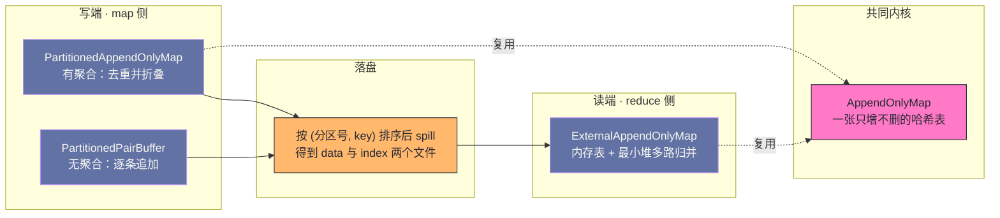
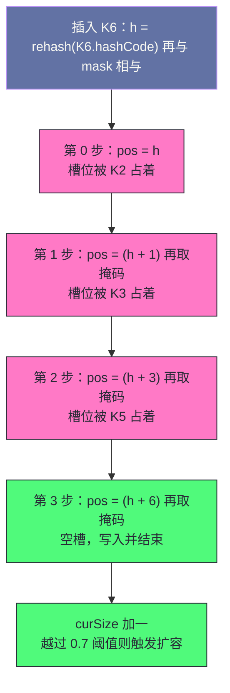
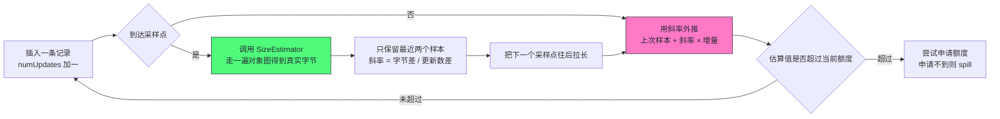
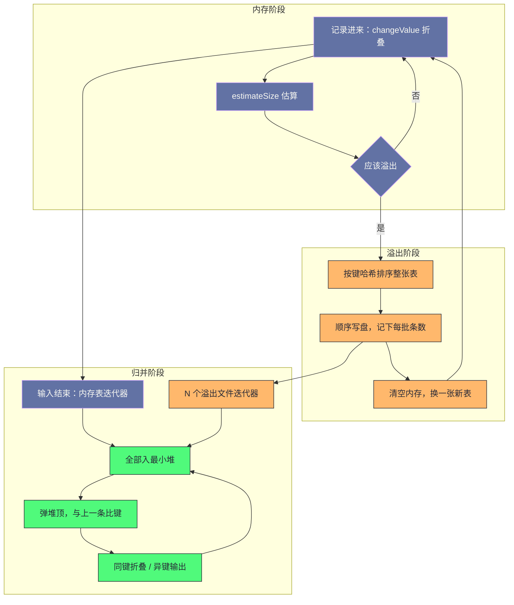
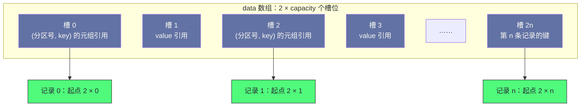

# 6. Spark Shuffle 聚合与排序结构：开放寻址、溢出归并与二进制记录

**摘要：**

2014 年底，Spark 1.2.0 把 Shuffle 的写端统一到排序路径上，一次 Shuffle 从此只产出 data 与 index 两个文件。文件数量的问题看似解决了，账却没有结束：既然数据要先在内存里攒起来、排好序、再落盘，那么"攒在哪里、攒到多大、攒不下怎么办"就成了决定一次 Shuffle 成败的三件事。Spark 为这三件事准备了一组专门的数据结构——纯内存的 `AppendOnlyMap`、能溢写到磁盘的 `ExternalAppendOnlyMap`，以及写端按分区前缀组织的 `PartitionedAppendOnlyMap` 与 `PartitionedPairBuffer`，另有 Tungsten 用字节代替对象之后派生出的二进制形态。

这篇文章不铺陈 writer 的整体流程，只拆这些结构内部的内存布局与记账方式，要回答两个问题：聚合用的哈希表为什么要自己实现一套开放寻址，以及一张内存表如何在"看不见自己真实大小"的前提下决定何时把数据交给磁盘。全文沿五问推进：先界定三条硬约束——只增不删、内存优先、输出有序；再拆开探测序列与 `growTable` 的扩容代价，说明为什么探测步长取三角数而不是平方；接着解释键为什么是 `(partitionId, key)` 二元组、`SizeTracker` 如何以采样代替称重、`Spillable` 如何在申请不到内存时主动让路；然后把 spill 之后的归并摊开，看 `ExternalAppendOnlyMap` 的最小堆与 `ExternalSorter.merge` 的流式归并各自要处理什么边界；最后落到 Tungsten 的记录布局，说明定长槽位与 `UnsafeRow` 的字节序为什么比对象比较快，并单列边界与反例，交代 `spark.shuffle.memoryFraction` 这类早已失效的直觉。

文章的口径是 Spark 4.3.0（4.x 预编译 Scala 2.13）；涉及内部实现细节处，以对应版本文档或源码为准。

**关键词（Keywords）**: AppendOnlyMap, ExternalAppendOnlyMap, 开放寻址, 二次探测, SizeTracker, Spillable, PartitionedAppendOnlyMap, PartitionedPairBuffer, UnsafeRow, PackedRecordPointer

---

## 第 1 章 三张表与三条硬约束

### 1.1 一次 reduce 端聚合把数据放在哪里

一个 `reduceByKey` 在 reduce 端究竟把数据放在哪里？这个问题初看是废话，答案当然是内存。但接着往下问就不好答了：两百个 map 分区各自送来上百万条记录，一台 16GB 的机器怎么可能把它们全部摊在内存里完成聚合？

真正的答案分两半。前半句是"放在一张按 key 组织的表里"，后半句是"这张表知道自己有多重，一旦装不下就按顺序倒到磁盘上，倒完之后再把内存里剩下的那部分与若干个溢出文件归并起来"。表、称重、倒出、归并，这四件事构成了一条完整的记账链，链上的每一个环节都有专门的数据结构负责，而它们之间并没有一个统一的抽象接口——`AppendOnlyMap` 管表，`SizeTracker` 管称重，`Spillable` 管倒出的时机，`ExternalAppendOnlyMap` 把三者缝在一起，`ExternalSorter` 则在写端做同一件事的另一种版本。

存进表里的并不是全部记录，而是去重之后的 key。这是第一个容易被忽略的事实：两百万条输入可能只对应五万个 key，内存占用由 key 的数量与聚合值的大小决定，与输入记录数只有间接关系。但 key 的数量在读到第一条记录时是未知的，某些 key 的聚合值还会持续膨胀，譬如表类型（list）的 combiner 每遇见一条就追加一个元素，于是一张"应该只有五万条"的表可能长到几个 GB。所以内存优先这句话必须配上一条兜底：装不下就落盘，落盘之后仍然要给出正确结果。

### 1.2 三条硬约束

Spark 这组结构的设计空间并不大，因为它一上手就被三条约束框住了。

第一条是只增不删（append-only）。聚合的语义决定了 key 一旦写入就只会更新值，不会被删除；即便某些算子的语义允许删除，Shuffle 这条路径上也没有这个动作。这条约束看着无关紧要，实际上决定了后面所有的取舍：没有删除，就不需要为已删除的槽位立墓碑（tombstone），查找时碰见空槽就可以直接断定"这个键不存在"，而不必继续沿探测序列往后走。开放式寻址能在 Spark 这里成立，靠的正是这条看起来最不像约束的约束。

第二条是内存优先。磁盘是兜底路径，不是主路径。这意味着数据结构的常用路径必须足够快，而溢出路径允许慢一些、笨一些——溢出前先把整张表排一遍序，这一步在正常路径上是完全不做的。

第三条是输出必须有序。写端的输出要按分区号连续排布，以便索引文件只记录每段的长度；读端的输出要按 key 归并，以便同键的聚合值折叠成一条。因此这些结构里的"排序"从来不是给用户看的全序，而是"先按分区号、再按 key"的两段序，两段的比较成本完全不同：分区号是两个 int 相减，key 可能要调用用户提供的比较器，也可能只比较哈希值。

三条约束落到具体的类上，就长成了下图的样子。图中把写端与读端分开画，是因为它们面对的数据形状不同：写端只处理本 Task 产出的记录，读端要跨多个 map 输出聚合。



图中那个"共同内核"是理解全篇的钥匙：四种结构并不是四个独立设计，而是同一张表在"要不要去重""要不要落盘""用对象还是用字节"三个维度上做出的若干种变形。把这三个维度记住，后面每一种结构出现在哪里、为什么长成那样，都只是把维度取值的组合念一遍。

### 1.3 一个贯穿全文的作业

为了让后文的机制有具体的着力点，笔者设想一个广告流量汇总作业 `traffic_rollup`：每天凌晨从 HDFS 读当天的曝光日志，按"广告位 + 小时"这个二元组汇总曝光量与点击量，输入侧按 200 个分区读入，输出侧按 400 个分区写出。

写成 RDD 代码大致是这样：

```scala
// 每条曝光记录先变成 ((广告位, 小时), 1) 这样的二元组
val pairs = sc.textFile("hdfs:///logs/impressions", 200)
  .map(parseImpression)
  .filter(_.valid)
  .map(e => ((e.slot, e.hour), 1L))

// reduceByKey 会带来一次 Shuffle：写端 200 个 Task，读端 400 个 Task
val rolled = pairs.reduceByKey(_ + _, 400)
rolled.saveAsTextFile("hdfs:///warehouse/traffic_rollup")
```

这个作业里有三处会用到本篇的结构。写端的 200 个 `ShuffleMapTask`，每个持有一张 `PartitionedAppendOnlyMap`，键是 `(分区号, (广告位, 小时))`，值是累加出来的 `Long`；写端在落盘前要把这张表按"先分区号、后 key"排一遍序。读端的 400 个 reduce Task，每个持有一张 `ExternalAppendOnlyMap`，键退化成 `(广告位, 小时)` 本身，因为它不再需要分区号——分区已经由它自己代表了。

需要说明的是，这里的聚合值是固定宽度的 `Long`，属于最省内存的一类；换成按广告位收集去重用户的作业，聚合值就变成一张持续生长的集合，估算误差与溢出判据会立刻变得敏感，后文讲误差与倾斜时会回到这个变体。

### 1.4 一个比喻：只进不出的寄存处

把 `AppendOnlyMap` 想成一间只进不出的寄存处。柜台后面是一排等宽的格子，格子没有编号标签，只有一个按钥匙算出来的起始位置：来一件行李，先算它该放哪一格，那一格被占了就按固定的步长往后跳，跳到一个空格为止。因为从来没有人来取走行李，所以"空格"这件事本身就是一个可靠的信号——找到空格就意味着这件行李确实没存过。

`ExternalAppendOnlyMap` 是这间寄存处的地下仓库：柜台放满之后，管理员把行李登记造册、整车运到地下，清空柜台继续收；闭店时再把柜台上剩下的一批与地下若干车货并排取出来核对。比喻到这里要收住——地下每一车货内部都已排好序，"并排取"不需要重新排序，只需要一个最小堆在几路之间挑出当前最小的那件。

---

## 第 2 章 AppendOnlyMap：一个数组装下一张表

### 2.1 偶数位放键，奇数位放值

`AppendOnlyMap` 的存储只有一个数组：

```scala
private var data = new Array[AnyRef](2 * capacity)
```

容量必须是 2 的幂，取槽位靠 `rehash(key.hashCode) & mask`，`mask` 等于容量减一。用位与代替取模是这里最表层的一处优化：`%` 在 JVM 上是一条除法指令，`&` 是一条与指令，前者在热路径上要多花几个周期，并且当除数是变量时无法被常量折叠。这条优化之所以成立，前提恰恰是"容量必须是 2 的幂"，而容量之所以能一直是 2 的幂，又是因为扩容的方式是翻倍——三件事互相咬合，缺一条都不成立。

键值不是成对的对象，而是被摊平进同一个数组：下标 `2 * pos` 放键的引用，`2 * pos + 1` 放值的引用。这样一条记录只占两个槽位，映射关系靠下标算术维持，不需要任何包装对象。空键（null key）不进入数组，而是单独用 `hasNullKey` 与 `nullValue` 两个字段记着——这是一个务实的小补丁，因为 `hashCode` 对 null 无定义，把它塞进正规路径反而要给每处探测加一次判空。

默认初始容量是 64。这个数字小得有点出人意料，但它符合使用场景：绝大多数 map 分区在聚合之后 key 并不多，一张 64 格的表能装 44 个条目（按 0.7 的装填因子算），从 64 起步意味着大多数 Task 一次扩容都不需要。

### 2.2 为什么不用链表

Java 的 `HashMap` 用数组加链表（新版在链表过长时转红黑树），思路是先定位桶，再在桶里线性查找。这套做法通用、易懂、支持删除，但在 Shuffle 聚合这个特定场景里，它的每一个优点都用不上，每一个代价却都要付。

先看内存。`HashMap` 的每个条目是一个 `Node` 对象，在 64 位 JVM 开启压缩指针时占 32 字节：12 字节对象头补齐到 16，加 4 字节哈希、4 字节键引用、4 字节值引用、4 字节后继引用，正好 32。表数组本身还要为每个桶留一个引用，按 0.75 的装填因子摊下来，一个条目实际占用接近 40 字节。`AppendOnlyMap` 一个条目只占两个引用槽位，压缩指针下是 8 字节，除以 0.7 的装填因子约 11.4 字节。**同样的堆，前者装一百万条，后者能装三百多万条**；对于一个动辄几百万 key 的聚合来说，这个差别直接决定了会不会溢出。

再看局部性。链地址法的一次查找需要两次访存：先读桶数组拿到头指针，再顺着指针跳到堆上某个 `Node`。后一次访存是一次随机寻址，大概率不在缓存里。开放寻址的探测全程在同一个数组内进行，相邻的槽位落在同一批缓存行上，第二次探测几乎必然是缓存命中。CPU 与内存之间的这道墙是当代性能分析里最硬的一道，一个数据结构有没有为它让路，比它的渐进复杂度更能决定实测表现。

第三看删除。链地址法删除一个节点只要改两个指针，成本极低，这正是它通用的原因。开放寻址删除要立墓碑，否则会截断别人的探测序列。`AppendOnlyMap` 从名字上就放弃了删除，于是它连墓碑都不需要，空槽同时承担两种语义：插入时是落脚点，查找时是终止符。**省掉的不只是墓碑的内存，还有"查找到底走到哪算结束"这个判断本身。**

最后看排序。Shuffle 需要把表里的内容排好序交出去。数组天然可以在原地压紧再原地排序：把所有非空槽位往前挪，形成一个连续的键值序列，然后用内建的 `Sorter`（TimSort 的移植）就地对这段数组排序，全程不分配新的容器。链地址法做不到这一点，它必须先把所有节点收集到一个列表里才能排序，这一趟收集本身就是一次全量分配。

四种差别并排放，可以看出这不是"实现风格"的偏好，而是场景把通用结构用不上的能力全部砍掉之后，剩下的那副骨架：

| 维度 | 链地址法（`java.util.HashMap`） | 开放寻址（`AppendOnlyMap`） |
|---|---|---|
| 单条目内存（压缩指针） | 32 字节节点 + 桶数组槽位，约 40 字节 | 两个引用槽位，按 0.7 装填摊薄约 11.4 字节 |
| 一次查找的访存次数 | 桶数组一次 + 随机跳转到节点一次 | 全部在数组内，通常一到两个缓存行 |
| 删除 | 支持，改指针即可 | 不支持，删除会截断探测序列 |
| 查找终止条件 | 桶内链表走完或命中 | 遇到空槽即终止 |
| 原地排序 | 需要先收集到独立容器 | 压紧到数组前端后就地排序 |
| 扩容代价 | 重新分配桶、重挂节点 | 重新分配数组、逐条重新探测 |
| 是否适合本场景 | 通用，但代价全付 | 场景收敛，代价最小 |

### 2.3 探测序列：为什么是三角数而不是平方

开放式寻址遇到冲突后的走法，决定了它在高装填下的表现。教科书上最常写的是线性探测（`pos + 1, pos + 2, ...`）与平方探测（`pos + 1, pos + 4, pos + 9, ...`），Spark 两者都没有直接用。

源码里的循环长这样：

```scala
var pos = rehash(k.hashCode) & mask
var i = 1
while (true) {
  val curKey = data(2 * pos)
  if (curKey.eq(null)) {
    // 空槽：键不存在，就插在这里
    data(2 * pos) = k
    curSize += 1
    afterUpdate()
    return
  } else if (k.eq(curKey) || k.equals(curKey)) {
    // 命中：更新值，不改变条目数
    data(2 * pos + 1) = ...
    return
  } else {
    // 冲突：把步长从 i 加到下一次
    val delta = i
    pos = (pos + delta) & mask
    i += 1
  }
}
```

关键在最后三行：每次不是跳到 `pos + i * i`，而是把步长本身累加进去。这样累计偏移量依次是 1、1+2、1+2+3、1+2+3+4，也就是三角数 1、3、6、10。这个序列在容量为 2 的幂时有一个非常好的性质：**它恰好遍历表里的每一个槽位，既不重复也不遗漏。**

平方数就没有这个性质。以容量 8 为例，`i² mod 8` 只能取到 0、1、4 三个值，也就是说一条探测序列最多覆盖三个槽位；一旦这三个槽位都被占，查找就会在这三个位置之间无限循环，而表里其实还有五个空槽。三角数序列则是 0、1、3、6、10、15、21、28，模 8 之后是 0、1、3、6、2、7、5、4，八个槽位一个不落。

这个性质解释了为什么"容量必须是 2 的幂"这条要求如此强硬：换成 10 或者 100 这样的容量，三角数序列不再构成置换，探测可能绕不回某些槽位，查找会在表还没满的时候就陷入死循环。用位与而不是取模，用翻倍而不是乘以 1.5，本质上都是在保住这条数论性质。

下图是一次插入的探测过程。图中给出的位置偏移是示意，用来展示"每一步跳多远"，不是某次真实运行的轨迹。



线性探测的问题在这里也能看清：固定步长 1 一旦遇上连续占用，后来者就排成一长串，探测长度随装填因子上升而急剧恶化，这种"一次聚集"是它最著名的短板。三角数探测把步长逐次拉大，让不同哈希值的探测序列彼此错开，代价是仍有"二次聚集"——哈希相同的键永远走同一条序列——外加只能靠加法累加步长。这两笔账 Spark 认为划算。

还有一处容易被忽略：这个循环没有显式上界。它之所以不会跑飞，两个条件缺一不可——容量是 2 的幂保证探测序列是置换，装填因子 0.7 保证表里一定有空格。任何一条被破坏，循环都会变成死循环，而且是那种不抛异常、只把 CPU 打满的死循环。

### 2.4 `changeValue`：聚合只有一个入口

表对外提供的核心方法叫 `changeValue`，签名里带一个 `(Boolean, V) => V` 的函数：

```scala
// hadValue 是"这个键之前存在吗"，oldValue 是旧值（不存在时为 null）
def changeValue(key: K, updateFunc: (Boolean, V) => V): V
```

这个设计把"查找"与"写入"合并成了一次探测过程。如果分开写成 `get` 再 `put`，同一个键要跑两遍探测序列，而 Shuffle 聚合是每一条记录都要做一次的操作，这一倍的探测成本很可观。合并之后，循环在第一次遇到空槽或命中时就已经知道该走哪个分支，`updateFunc` 拿到的 `hadValue` 直接来自这个判断，用户代码因此可以区分"首次聚合"与"后续聚合"——`createCombiner` 与 `mergeValue` 的分工正是靠这个布尔值实现的。

两处细节值得记下来。其一，`afterUpdate()`（也就是称重的钩子）只在插入分支调用，更新分支不调：`SizeTracker` 统计的是"更新次数"，而聚合场景里值的体积变化通常远小于条目增长的开销，把每次值更新计进去只会让采样更密、成本更高。其二，值被更新时只替换数组里的一个引用，键的槽位与探测序列都不动，这张表在更新路径上没有任何结构变化。

### 2.5 原地排序：`destructiveSortedIterator`

表要交出去的形态不是哈希表，而是一个有序的键值序列。方法名里的 destructive 是字面意思：调用之后这张表就不能再用了。

它做两件事。第一步是压紧：从头扫描整个数组，把所有非空槽位依次往前挪到数组前端，形成一个长度为 `curSize` 的连续键值序列，空槽全部挤到后面。第二步是排序：用内建的 `Sorter` 就地对这段 KV 数组排序，比较器由调用方给出。排完之后迭代器从前到后扫描即可，后面那些已经失效的槽位不再被访问。

这一步之所以能省掉一次全量分配，靠的是前四节攒下来的所有前提：数组连续、记录定长（两个槽位）、没有墓碑、没有链表。四个条件里少一个，压紧这一步就没有这么干净。压紧之后数组里存放的不再是"按哈希散列的表"，而是一个"按键排序的序列"，这也是 destructive 这个词的技术含义——它把一张哈希表变成了一段可顺序读出的数据，代价是哈希表本身不复存在。

写端在 spill 时调用的就是这个方法，得到的迭代器一路把记录写进磁盘缓冲。排序的比较器是什么，取决于这张表是"只按分区号排"还是"先分区号后 key 排"，这是第 4 章的内容。

---

## 第 3 章 `growTable`：扩容与 rehash 的账

### 3.1 什么时候必须扩

装填因子的作用是把"表会不会满"这个判断变成一个常数时间的不等式。`AppendOnlyMap` 把阈值记成 `growThreshold = 0.7 * capacity`，每次插入并让 `curSize` 自增之后比较一次，越线就调 `growTable()`。

0.7 这个数字不是随手取的，它被两条相反的力夹在中间。装填因子越高，表越紧凑、内存越省、缓存越友好；但探测序列的平均长度会随之上升，查找与插入的代价从"常数次探测"滑向"线性扫描"。装填因子越低，探测越短，代价是数组里空槽多，同样的条目数要占更多内存，而且溢出判据用的是估算出的字节数——表本身占得多，就意味着更早触发 spill。

三个候选值并排放，可以看出这条曲线的形状：

| 装填因子 | 平均探测长度（成功查找） | 一百万条目的数组占用 | 溢出风险 | 备注 |
|---|---|---|---|---|
| 0.5 | 约 1.5 次 | 约 16 字节/条 | 偏高 | 数组空槽一半，内存浪费明显 |
| 0.7 | 约 2 次 | 约 11.4 字节/条 | 适中 | Spark 的取值，探测与内存的折中 |
| 0.9 | 约 5 次以上 | 约 8.9 字节/条 | 低 | 探测聚集严重，长尾明显 |
| 0.99 | 数十次 | 约 8.1 字节/条 | 极低 | 接近不可用，已属病态 |

表里的探测长度是按开放寻址的经典结论估算的量级，不是某次实测的精确值；它想说明的是趋势——从 0.7 提到 0.9，内存只省了两成，探测成本却翻了一倍以上。装填因子的选择从来不是"省多少内存"，而是"用多少次探测去换那点内存"。

### 3.2 翻倍与重放

`growTable` 的动作只有四步：容量翻倍、新建一个两倍长的数组、逐槽扫描旧数组、对每个非空槽里的键重新定位。第三步的关键在于"重新定位"用的仍是同一套探测逻辑，但掩码换了，所以同一个哈希值在新表里的落点与旧表几乎必然不同——**扩容不能靠简单地把旧数组的前半段复制到新数组的前半段，因为掩码变了，落点就全变了。**

```scala
val newCapacity = capacity * 2
val newData = new Array[AnyRef](2 * newCapacity)
val newMask = newCapacity - 1
// 逐槽扫描旧数组：非空槽取出键值，按新掩码重新探测插入新数组
while (oldPos < capacity) {
  if (!data(2 * oldPos).eq(null)) {
    // 同一个键在新表里可能撞上完全不同的位置，必须重走一遍探测
    ...
  }
  oldPos += 1
}
data = newData
capacity = newCapacity
mask = newMask
growThreshold = (LOAD_FACTOR * capacity).toInt
```

下图把这条等式两侧的代价摊开：左边是触发条件，中间是重放过程，右边是新表的阈值。


这里有一个与 `PartitionedPairBuffer` 的关键差别，第 9 章还会再碰到：缓冲区扩容只是把数组复制一份，复制是顺序的、可预取的、不需要重算任何位置；哈希表扩容要为每一个条目重走一次探测，每一条都是一次可能失败的插入。同样叫"扩容翻倍"，前者的成本是一趟 `arraycopy`，后者是一万次小型插入。

### 3.3 摊还成本与峰值内存

单次扩容是 O(n)，但摊到每次插入上是 O(1)。这个摊还分析的前提是容量按倍数增长：从 64 扩到 2^29，总共搬迁的条目数是 64 + 128 + ... 不超过最终条目数的两倍，于是每次插入平均只多摊一次搬迁。如果每次只扩 10%，搬迁次数会变成 O(n) 量级，摊还成本退化为 O(n)，这个结构就没法用了。

真正的麻烦不在时间，而在**峰值内存**。扩容的瞬间，旧数组与新数组同时在堆上，新数组是旧数组的两倍长，所以峰值占用约等于原来数据量的三倍。对于一张已经占了几百 MB 的表，这个瞬间就是一次几百 MB 的额外分配，而堆的剩余空间往往正好卡在这个量级上——**一次扩容引发的 OOM，看起来像是"表太大装不下"，实际上是"翻倍的那一瞬间装不下"。**

### 3.4 2^29 这条硬上限

源码在初始化和扩容两处都做了同一个断言：容量不得超过 2^29。这个数字来自数组长度与索引算术的实际约束——条目数 2^29 意味着数组长度 2^30，压缩指针下已经是 4GB 的单一数组，再翻一倍就逼近 JVM 数组长度的上限与地址空间的边界，这条线因此是结构本身能承受的尽头。

---

## 第 4 章 键的两截：分区号为什么要进键

### 4.1 写端的一张表要同时干两件事

读端的键就是聚合键本身，写端不是。写端的每一个 Task 在处理本分区数据的同时，还要把结果按目标分区归拢——因为它最终要写出一个按分区号连续排布的文件，索引里只记每段的长度。于是写端的表必须同时回答两个问题：这条记录属于哪个分区，以及同一个分区里这个 key 出现过没有。

一种直白的做法是两级表：外层 `Map[Int, Map[K, V]]`，先按分区号找到内层表，再在内层表里聚合。这样写代码很自然，代价是每条记录要做两次哈希、两次查找、两次指针跳转：外层查一次分区，内层查一次 key。当记录数上千万时，这一倍的查找成本不是小数。

Spark 的做法是把两级压成一级：键直接写成 `(partitionId, key)` 这个二元组，塞进同一张表。`PartitionedAppendOnlyMap.insert` 的实现只有一行——`update((partition, key), value)`，**一个元组、一次哈希、一条探测序列，同时定位了分区与键两个维度**。

这就是"省一次哈希"的实际含义：省的不是计算哈希的几个周期，而是整整一层容器——一次桶定位、一次指针解引用、一层额外的对象分配。代价是每条记录多出一个 `Tuple2`，在对象形态下这笔开销真实存在（Tungsten 把它消掉的方式见第 9 章），但两级表在每次查找时都要付两次，元组只在插入时付一次。

### 4.2 聚合期与排序期是两种形态

写端有两张表可选，选择的依据只有一个：这次 Shuffle 有没有聚合函数。

有聚合函数时用 `PartitionedAppendOnlyMap`。它继承自 `AppendOnlyMap`，键是 `(partitionId, key)`，进来一条记录就先查表，命中就折叠、不命中就插入。它的语义与第 2 章那张表完全一致，只是多了一层"分区前缀"。

没有聚合函数时用 `PartitionedPairBuffer`。它是一个纯粹的追加数组：来一条记录就在末尾占两个槽位，不去重、不查找、不折叠，因为既然没有聚合函数，同一个 key 出现多次本来就是合法的输出。它既不哈希也不探测，插入是 O(1)，扩容只是复制。

这两者的分工可以概括成一句话：**聚合期关心"这个键出现过没有"，排序期只关心"这条记录属于谁"。** 前者必须是一张哈希表，后者可以退化成一段数组。把无聚合的场景塞进哈希表，白付探测成本；把有聚合的场景塞进缓冲区，同一个键散落成多条记录，正确性直接丢掉。

### 4.3 两个比较器，两种排序口径

两张表都实现了同一个特质 `WritablePartitionedPairCollection`，它规定了一件事：你能给我一个"按分区、可写、可销毁"的迭代器。至于排序怎么比，由调用方决定，这就是两个比较器的由来。

`partitionComparator` 只比分区号：`a._1 - b._1`。它用在不需要 key 序的场合。`partitionKeyComparator` 在分区号相等时继续比 key：`a._1 - b._1` 为零则交给用户提供的 `keyComparator`。它用在需要 key 有序的场合，譬如下游要做 `sortByKey` 或者 `repartitionAndSortWithinPartitions`。

| 维度 | 只比分区号 | 先分区号后 key |
|---|---|---|
| 比较器 | `partitionComparator` | `partitionKeyComparator` |
| 分区内是否有序 | 否，同分区内记录顺序由探测序列决定 | 是，按用户给的 key 序 |
| 输出文件的可用性 | 可直接写 data 与 index，下游按需再排 | 下游可直接做归并连接或范围扫描 |
| 比较成本 | 一次 int 相减 | int 相减，必要时调用用户比较器 |
| 典型来源 | 无排序要求的 Shuffle | `sortByKey`、二次排序、`repartitionAndSortWithinPartitions` |

分区号排在第一位的妙处在于它是"免费"的：键的第一个字段就是分区号，排序时不必额外取一个字段，比较器直接读元组第一项。而输出阶段要的正是"按分区号连续"——排完序的迭代器从头扫到尾，每进入一个新分区记一次边界，得到的边界数组就是索引文件的内容。**分区号坐在键的第一位，让"排序"与"切分"变成了同一趟扫描。**

---

## 第 5 章 `SizeTracker`：不称重怎么知道有多重

### 5.1 精确估算的代价

溢出判据需要知道"这张表现在占了多少字节"。这件事在 JVM 上没有便宜的答案。一个对象在堆上占多少，取决于对象头、字段对齐、压缩指针是否开启、以及它引用的那些对象各自占多少——后者还要递归下去。Spark 自带的 `SizeEstimator` 干的就是这件事：它按类元数据算出每个字段的偏移，用 `Unsafe` 逐个读出来，遇到引用就递归，并用一个身份哈希表记录已访问对象避免重复计算。

这个工具的精度不错，成本却与对象图的大小成正比。一条记录里如果能引用到一张上千元素的集合，一次估算就要走一千次。如果每次插入都调一次，聚合的复杂度会从"每条记录常数时间"退化成"每条记录与已存数据量成正比"，整个 Shuffle 直接不可用。

于是问题变成：能不能用一个恒定成本的量，去近似一个昂贵但准确的量？`SizeTracker` 的答案是用采样加外推。

### 5.2 采样与外推

`SizeTracker` 记着三样东西：更新次数 `numUpdates`、最近两个采样点、以及一个"每次更新平均增长多少字节"的斜率。采样点不是每次都取——**每隔若干次更新才真正调用一次 `SizeEstimator`，两次采样之间用斜率做线性外推**。源码里的采样间隔从一个不大的常数起步（32 次更新），之后每采一次就按一个固定系数把间隔拉长一些，于是采样次数随数据量增长只是对数级的。

斜率是这么算出来的：拿最近两个样本，用字节差除以更新数差，得到一个"每次更新涨多少"。两次采样之间的任何时刻，估算值 = 上一个样本的字节数 + 斜率 × 距上次采样的更新次数。整个过程只做一次减法、一次乘法，摊到每次插入上几乎可以忽略。

下图是这套机制的形状：外推的直线在两个采样点之间延伸，采样点处被真实值拉回。



### 5.3 误差是双向的

采样外推必然有误差，而这个误差不是无害的噪声，它会沿着两条相反的方向变成实际的麻烦。

一条方向是低估。如果某段时间里聚合值普遍变大（譬如表类型 combiner 开始堆积元素），而斜率还停留在"每条记录涨几个字节"的旧值上，估算值就会落后于真实占用。落后的后果是 spill 判据迟迟不触发，表在实际已经超限的情况下继续接收数据，最终的失败形态是一次真实的 OOM，而不是一次有序的溢出。

另一条方向是高估。如果采样点恰好落在一次大批量插入之后，斜率被抬得偏高，后续估算会提前越过阈值，触发一次本不必要的 spill。这一次 spill 的代价不只是写盘：它还打断了"一次排序完成"的路径，多出一个 spill 文件，多出一趟归并。对一张本来能一次装下的表来说，这是纯粹的浪费。

**两条方向里，低估的后果更重，但实现上更倾向于接受低估。** 原因是溢出有一条硬兜底（强制溢出阈值），而多一次溢出只是慢一点。这个取向本身就是一个权衡的落点：宁可多写一次盘，不要在一次没有预告的 OOM 里丢掉整个 Task。

### 5.4 阈值从哪里来：一段被废弃的配置

溢出判据里那个"当前额度"从哪来，是这一节最容易被记错的地方。

在 Spark 1.x 时代，执行内存被切成三块：Shuffle 聚合一块、存储一块、其他一块，边界由 `spark.shuffle.memoryFraction`（默认 0.2）这类参数划定。那个年代，讨论"Shuffle 能占多少内存"确实是在讨论这个参数。

1.6 引入统一内存管理之后，这块隔断被拆掉了：执行与存储共用一个池，谁用谁申请，存储可以驱逐。2.0 起静态内存管理器被移除，统一内存管理成为唯一实现，`spark.shuffle.memoryFraction` 从此只是一个保留在配置表里、不再生效的废弃项。**今天再去调它，什么都不会发生。**

真正决定一个 Task 能要多少内存的，是统一池里的执行内存：`spark.memory.fraction`（默认 0.6）划出堆内可用于执行与存储的比例，扣掉约 300MB 的保留区之后按比例切分；`spark.memory.storageFraction`（默认 0.5）只是存储侧的软边界，执行内存紧张时存储的缓存可以被驱逐。而一个 Task 能拿到多少，还要除以同一 Executor 上并发运行的 Task 数——第 6 章会看到这个除法是怎么变成溢出频率的。

| 口径 | 1.4 及以前 | 1.6 | 2.0 及以后 | 4.x |
|---|---|---|---|---|
| 内存划分方式 | 静态分块 | 统一管理（默认） | 统一管理（唯一实现） | 统一管理 |
| Shuffle 聚合的边界 | `spark.shuffle.memoryFraction` | 该参数失效 | 该参数失效 | 该参数失效 |
| 真正的来源 | 静态 Shuffle 池 | 执行内存池 | 执行内存池 | 执行内存池 |
| 存储与执行的关系 | 各自独立、互不侵占 | 可互相借用 | 可互相借用，存储可被驱逐 | 同左 |

---

## 第 6 章 `Spillable`：把额度让出去

### 6.1 一次溢出判定的四步

估算值有了，接下来要决定"现在该不该倒出去"。这段逻辑在 `Spillable` 特质里，所有需要溢出的集合都混入它，`ExternalAppendOnlyMap` 与 `ExternalSorter` 各自实现了自己的 `spill`。

判定本身只有四步，但每一步都有讲究：

```scala
// 每读满 32 个元素才检查一次，避免每条记录都做一次阈值比较与可能的申请
if (elementsRead % 32 == 0 && currentMemory >= myMemoryThreshold) {
  // 要的不是差额，而是"两倍当前用量"——一次要到能再装一倍的额度
  val amountToRequest = 2 * currentMemory - myMemoryThreshold
  val granted = acquireMemory(amountToRequest)
  myMemoryThreshold += granted
  // 要到之后仍然不够，说明内存池已经不给更多了，只能溢出
  shouldSpill = currentMemory >= myMemoryThreshold
}
// 另一条独立的硬线：元素数超过强制阈值，无条件溢出
shouldSpill = shouldSpill || elementsRead > numElementsForceSpillThreshold
```

第一处讲究是那个 `% 32`。内存申请要走 `TaskMemoryManager`，是带锁的、可能触发其他 Task 内存回收的操作，不能每条记录都做。每 32 条检查一次，等于把判定成本摊薄到可以忽略，代价是最多晚 32 条记录才发现该溢出了——这个延迟在百万级的记录量面前无关紧要。

第二处讲究是"要两倍而不是差额"。如果每次都只申请"还差多少"，那么每插入几条记录就要申请一次，申请频率与记录数成正比。而要两倍，意味着一次获批就能让表再长一倍；下一次越线时再要一次，几何增长。**申请次数因此是 O(log n) 的，与扩容翻倍是同一个思路。**

第三处讲究是 `granted` 可能远小于申请量，甚至为零。执行内存池是按需分配的，池子空的时候你能拿到全额，池子紧张的时候只拿到一点点甚至拿不到。源码没有为"拿不到"设计重试，而是直接判定溢出——内存池已经告诉你答案了，再问一次不会变。

### 6.2 溢出之后要把额度还回去

一个容易漏掉的动作在 `spill` 之后：`releaseMemory()` 把这次持有的额度还回内存池，同时把 `myMemoryThreshold` 复位到初始的小额度，`elementsRead` 清零。

不还回去会有两个后果。其一，这张表已经清空，却还占着几百 MB 的额度，其他 Task 申请不到，整个 Executor 的并发度被一个空表卡住。其二，下一次攒数据时表从零开始，如果额度还挂在旧值上，阈值判据就失真了——它会先撑到旧额度才检查，等于把溢出的时机推迟了一倍。

### 6.3 初始额度与强制阈值

`Spillable` 上还有两个数。初始额度 `spark.shuffle.spill.initialMemoryThreshold` 是一个很小的常数，源码里取 5MiB 量级——它只是"第一次申请之前允许用的免申请额度"，不是目标内存量。强制溢出阈值 `spark.shuffle.spill.numElementsForceSpillThreshold` 默认是 `Long.MaxValue`，也就是默认关闭；把它调成一个具体数字（譬如一百万），可以在估算严重失真时提供一条与内存无关的硬线。

三个参数放在一起看，各自的角色很清楚：

| 参数 | 默认 | 管什么 | 什么时候该动 |
|---|---|---|---|
| `spark.shuffle.spill.initialMemoryThreshold` | 数 MiB 量级 | 首次申请前允许用的免申请额度 | 基本不必动，改它只影响第一次申请的时间点 |
| `spark.shuffle.spill.numElementsForceSpillThreshold` | `Long.MaxValue` | 与内存无关的强制溢出线 | 记录数可预估且单条很小、估算容易失真时 |
| `spark.memory.fraction` | 0.6 | 执行与存储共用的堆内比例 | 溢写频繁且堆大量闲置时，可以上调 |

### 6.4 并发 Task 分摊同一块池子

到这里可以回答一个在实际调优里反复出现的问题：为什么给 Executor 加了内存，溢出反而更严重了？

加内存本身不会让溢出变多，但加内存往往伴随着"同一个 Executor 上跑更多 Task"——核数跟着涨，或者动态资源分配把更多 Task 塞了进来。执行内存池是 Executor 共享的，`myMemoryThreshold` 却是逐 Task 的，每个 Task 能申请多少取决于同一时刻有多少 Task 在竞争。**池子变大与竞争者变多同时发生，每个 Task 分到的那一份未必变大，甚至可能变小。**

---

## 第 7 章 `ExternalAppendOnlyMap`：溢出与最小堆归并

### 7.1 一张内存表加一列溢出文件

读端的聚合表由两部分组成：一张当前正在用的 `SizeTrackingAppendOnlyMap`，和一个溢出文件列表。前者就是第 2 章那张表加上第 5 章的称重能力，后者每个元素是一个能从磁盘上按序读回记录的迭代器。

一条记录进来，先走 `changeValue` 折叠到内存表里，然后估一次大小，再走一次 `maybeSpill`。判定为真时，把当前这张表排好序写到磁盘，清空，换一张新的空表继续收——**溢出的单位是"整张表"，不是"一部分记录"**。这一点很重要：它意味着一次溢出会把内存彻底腾空，而不是挤出一点余量，代价是这一次写的量可能远超阈值。

溢出文件的格式很朴素：把排好序的键值对一串写下去，同时记下每批写了多少条。记批大小的目的是读回时能分批反序列化，避免一个 spill 文件在读取时被整个展开进堆里——溢出文件本来就是为了绕开内存不足，如果读回时又把它全部装进来，等于绕了一圈回到原点。

### 7.2 溢出之前按什么排序

排序用的不是用户给的键比较器，而是一个只比较哈希值的比较器：取两个键的 `hashCode`（null 当作 0），比大小。这个选择需要解释。

原因是读端这里唯一需要的性质是"同键相邻"。归并阶段要做的判断是"当前这条与上一条是不是同一个键"，只要同一个键在序列里连在一起，归并就能一趟扫完。哈希相同必然同键相同，所以按哈希排序足以保证同键相邻；而比较两个 int 的成本，远低于调用用户可能很昂贵的比较器。

但"按哈希排序"只是必要条件，不是充分条件里的那个"相同"。哈希值是 32 位的，键空间更大，碰撞一定存在——两个不同的键完全可能哈希相同，于是它们在哈希序里紧挨着。**排序负责把候选聚在一起，判定相等仍然要回到键的 `equals`。** 这两件事如果混为一谈，碰撞的那一对键会被错误地折叠成一条聚合结果，而且这种错误不会崩溃，只会让最终数字对不上。

### 7.3 最小堆：几路并排取最小的那件

所有输入读完、溢出若干次之后，手里是 N 个已排序的溢出文件加一张内存表。把它们的迭代器全部塞进一个最小堆，堆顶永远是"当前所有流里键最小的那一条"。取堆顶、取出记录、把该流的迭代器重新入堆，如此往复，得到的序列就是全局有序的。

同键折叠发生在取出的过程中：维护一个"上一条记录"，新取出的键与它相同就用 `mergeCombiners` 折进去，不同就把上一条交出去、换上新的。因为同键必然相邻，这个只需要一个变量的状态机就够了，不需要额外的分组容器。

下图是这条链路的样子。左半边是写入路径，右半边是读取路径，中间的溢出文件是唯一需要落盘的地方。



用最小堆而不是"两两归并到只剩一个"，是为了只读一遍。两两归并的每一轮都要把数据完整写读一次，N 个文件要 log N 轮；k 路归并只读一遍，代价是同时打开 N 个流。当 N 只有个位数到几十时，这个交换毫无悬念。

### 7.4 溢出的代价账

把整条链路的总成本写出来，会得到一个熟悉的形状：设输入 N 条、每次溢出时表里有 n_1, n_2, ..., n_k 条，那么总时间是若干次 n_i log n_i 的排序加上一趟 O(N log k) 的归并，再加上 k 次文件的写与读。排序的总量还是 N 条，没有变多；变多的是磁盘 I/O 与归并的路数。

---

## 第 8 章 写端的流式归并

### 8.1 溢出之后为什么还要再合一次

写端的目标与读端不同：它最终要交出的是两个文件——一个 data 文件，里面按分区号连续排着所有记录；一个 index 文件，里面只有每个分区那一段的长度。如果 spill 了三次，手里就有三个按 `(分区号, key)` 有序的文件，外加内存里可能还剩的一批，而目标是"一个文件、分区连续"。

把三个文件首尾相接是不行的：那样每个分区会在文件里出现三次，index 就无法用"每个分区一段"来描述。所以必须做一次归并，把同一分区的三条流合成一条连续的数据，边合并边写出去，并且一次性拿到每个分区的总长度。

### 8.2 按分区切片，逐段归并

`ExternalSorter.merge` 的做法是把"归并"降级成"对每个分区单独归并一次"。对第 p 个分区，从每个 spill 文件里取出属于该分区的那一段（因为 spill 内部已按分区号排好序，这一段是连续的偏移区间），再加上内存里残余迭代器中属于 p 的项，凑成一组有序流，做一次 k 路归并，把结果追加到输出文件，并记下这一段的长度。

因为分区是一个个顺序处理的，输出文件天然就是"分区 0 一段、分区 1 一段"的布局，index 文件要的内容在写的过程中就攒齐了——**没有第二次扫描，也没有额外的临时文件。** 这就是"流式"这个词在这里的含义：数据从 spill 文件读出来、归并、写进 data 文件，全程不落地到第三个文件，也不整体进内存。

### 8.3 边界键：同一个键可能横跨两个 spill

这里有一个比读端更棘手的细节。读端的键是聚合键，一个键在整张表里唯一（同一时刻）；写端不是——写端的键是 `(分区号, key)`，而**同一个键在第一次溢出之后又重新出现，是完全正常的**。譬如表在接收到第一批数据后溢出，之后又来了同一个 key 的记录，它会进入新的内存表，落盘时形成第二个 spill 文件里的同键记录。

于是归并时不仅要排顺序，还要在跨流的位置上做折叠：同一个键如果在两个 spill 里都出现，最终输出文件里只能留一条（否则下游会看到重复的 `(分区, key)`，聚合结果翻倍）。这就是 `mergeWithAggregation` 存在的理由，它把归并与聚合合成一趟。

边界处理的难点在于"什么时候可以确定一组同键记录已经收完"。在 k 路归并里，通常的做法是"堆顶的键变了就收组"，但当某条流读到分区切片末尾时，它暂时没有下一条可供比较——此时堆顶的键可能只是"暂时最小"，切片之外还有同键的记录没读进来。实现上的对策是把最后一个迭代器当作"永远还有下一条"，用它兜住切片的边界，使得同键分组不会因为某条流临时耗尽而被提前关闭。

这个技巧的代价是一点额外的判断，收益是省掉了一次"边界键二次合并"的收尾流程。**流式归并的正确性，几乎全部压在这种边界条件的处理上**；排序本身是教科书内容，边界才是工程实现里真正会出错的地方。

### 8.4 一趟归并与多趟归并

外部排序的经典做法是多趟归并：内存里能放 k 个流，就每趟把 k 个合成一个，趟数是 log_k(N)。Spark 没有走这条路，而是一趟把 N 个 spill 全部归并掉，前提假设是 N 不会大。

| 维度 | 一趟 k 路归并（Spark 的选择） | 多趟归并（经典外部排序） |
|---|---|---|
| 磁盘读写遍数 | 一遍 | log_k(N) 遍 |
| 同时打开的文件数 | N（spill 数） | k（常数） |
| 内存需求 | 每流一个读缓冲 | 每流一个读缓冲，流数受控 |
| 对 spill 次数的约束 | 不能太多，否则文件句柄与缓冲吃紧 | 无理论上限 |
| 实现复杂度 | 低，一趟写完就是最终文件 | 高，需要管理多轮中间文件 |

Spark 敢这么选，是因为它同时控制着 spill 的产生：单次溢出把整张表倒空，溢出次数大致等于"总量除以单次可用额度"，通常在个位数到几十之间。

### 8.5 读端与写端的分工

两处归并放在一起看，分工是清楚的：写端合并记录，把 N 个文件里的 `(分区号, key, value)` 合成一条连续的流，顺带折掉同键的聚合值；读端合并聚合值，把内存表与 N 个 spill 里的 `(key, combiner)` 合成每个键一条。两者都靠 k 路归并与最小堆，差别只在写端还要管分区切片。用装车打比方：写端在装车时就把同一目的地的货码到连续位置，读端在到站后把几车货并排卸下、按单号核对。

---

## 第 9 章 从对象到字节：记录布局的第二次改造

### 9.1 `PartitionedPairBuffer` 的定长记录

没有聚合函数时，写端用 `PartitionedPairBuffer`。它的内存模型比哈希表更简单：一个长度为两倍容量的引用数组，第 i 条记录占两个槽位——`data(2 * i)` 放 `(分区号, key)` 这个二元组，`data(2 * i + 1)` 放值。插入就是把游标往后推一格，两条赋值，没有哈希、没有探测、没有查找。

这种"每条记录固定占两个槽位"的形态，换来了一串连锁的好处。位置可以算出来，所以可以随机访问第 i 条记录；记录之间没有指针，所以扩容只需要 `arraycopy` 把整个数组复制到两倍长的新数组，**不需要像哈希表那样为每条记录重走一遍探测**；排序可以直接在数组上做，用 `Sorter` 按"先分区号、后 key"的比较器就地重排，全程没有额外的容器。

下图是这段内存的样子。图中把逻辑记录与物理槽位并排画，是为了说明"定长"两个字的实际含义：记录 i 的起点永远是 `2 * i`，这个等式让后面的所有操作都不需要查找。



这套布局的代价藏在细节里：每条记录都要新建一个 `Tuple2` 来装分区号与键。两百万条记录就是两百万个元组对象，每个至少十六字节的对象头，还要被 GC 反复扫描。**定长的是数组里的槽位，不是堆上的对象**——槽位之间的等距，并没有消掉元组分配这一层。

### 9.2 `UnsafeRow`：把一条记录压成一段连续字节

Tungsten 要解决的就是这一层。它的做法是不再用对象表示记录，而是把一条记录序列化成一整段字节，所有字段按固定规则排布。SQL 侧的 `UnsafeRow` 是这套布局的标准形态，规则有三条：

第一条是空值位图打头。一个 `UnsafeRow` 的头 8 个字节是一张位图，第 i 位标记第 i 个字段是否为 null，八个字节正好覆盖 64 个字段，超过 64 个字段就再占 8 个字节。判空因此变成一次位与运算，不需要解引用任何对象。

第二条是定长区。位图之后是定长字段的槽位，每个槽位固定 8 字节，按字段顺序排列。`long` 与 `double` 直接放进去，`int`、`short`、`boolean` 这类窄类型也占满 8 字节——用空间换"位置可算"，第 i 个字段的地址就是 `8 + 8 * i`。

第三条是变长区。字符串、二进制、嵌套行这类字段的实体放在定长区之后，定长区的槽位里只存一对"偏移量 + 长度"（各 4 字节，合起来正好 8 字节）。读一个字符串因此是两次内存访问：先从槽位里取出偏移与长度，再按偏移去变长区取那一段字节。

三条规则合起来的效果，可以用一行十列全是 `long` 的记录做对比：`UnsafeRow` 占 8 字节位图加 80 字节定长区，共 88 字节，一段连续内存；换成对象形态，要一个承载对象加十个装箱的 `Long`，每个 `Long` 在 64 位 JVM 上是 24 字节（12 字节对象头加 8 字节值，再补齐到 8 的倍数），光装箱值就是 240 字节，还要加上对象头与指针。**同一条记录，字节形态是 88 字节的一段，对象形态是两百多字节散落在十几处。**

Tungsten 的排序与溢出不直接持有这些字节，而是持有一个 64 位的记录指针。这个指针的位分配很讲究：高 24 位放分区号，中间 13 位放页号，低 27 位放记录在页内的偏移。于是"按分区分组"退化成"对一个 long 数组排序"——分区号在最高位，比较两个 long 的大小就是在比较分区号的先后。**16,777,216 这个看起来莫名其妙的输出分区上限，就是这个 24 位字段的全部容量。** 低 27 位偏移给出页内 128MB 的寻址范围，单条记录与页大小的相关限制也从这里来。

### 9.3 为什么二进制比较比对象比较快

把 `UnsafeRow` 之间的大小比较与对象之间的比较放在一起，差距来自四个方面，且彼此叠加。

其一，省掉了序列化与反序列化。对象比较必须先把值从堆上的对象里读出来，参数是引用，读字段要跟着指针走；字节比较直接对两段内存做 `memcmp` 式的逐字节读，全程没有对象参与。

其二，局部性。一条记录的所有字段连续存放，一次比较通常只碰一到两个缓存行；对象形态下每个字段都可能指向堆的另一处，一次比较要触发多次随机访存，缓存未命中率随字段数上升。

其三，没有多态分派与装箱。生成的比较代码是针对具体类型的直线代码，比较两个 `long` 就是两条加载加一条比较；对象比较要走 `compareTo` 的虚方法，遇到装箱类型还要把值从对象里拆出来，甚至可能触发新的分配。

其四，也是最能接上前文的一条：内存占用小，同样的执行内存能装下更多记录，于是越过溢出阈值的时刻来得更晚。**二进制化省下的不只是 CPU，还有第 5 章那本内存账上的字节数**——一条记录从两百多字节压到八十八字节，意味着同一块内存能多装将近两倍的记录，溢出次数自然下降。

两代形态并排，差异可以列成一张表：

| 维度 | 对象形态（`PartitionedPairBuffer`） | 二进制形态（`UnsafeRow` 与记录指针） |
|---|---|---|
| 一条记录的物理形态 | 两个引用槽位加一个 `Tuple2` | 一段连续字节加一个 64 位指针 |
| 记录的定位方式 | 下标算术 `2 * i` | 页号加页内偏移 |
| 比较成本 | 追指针、调用比较器、可能装箱 | 逐字节或逐字段读取，无分派 |
| 判空 | 引用是否为 null | 位图一次位测试 |
| 扩容 | 复制引用数组 | 换更大的页或再加一页 |
| 单条记录大小限制 | 受堆与数组长度约束 | 受低 27 位偏移约束 |
| 适用前提 | 任意 JVM 对象，序列化器不限 | 序列化器支持重定位，且无聚合、无排序要求 |

### 9.4 一条走不通的路

二进制形态虽好，却不是所有 Shuffle 都能走。判断条件有四条：Shuffle 依赖上不能有聚合函数，不能有键排序要求，序列化器必须支持"序列化后的记录可重定位"，输出分区数不能超过那个 24 位上限。

第二条与第一条是同一个理由的两面：聚合要按 key 比较、排序要按 key 比较，而序列化之后 key 的边界只能靠反序列化才能确定——一旦要反序列化，二进制化省下的那部分全部还回去，还额外多付一次序列化。所以带 `reduceByKey`、带 `sortByKey` 的作业，写端走的仍然是第 2 章那张哈希表与第 8 章那套归并，Tungsten 只在"不需要看键内容"的场合生效。

---

## 第 10 章 边界与反例

### 10.1 三个常见的误判

第一个误判是把 `spark.shuffle.memoryFraction` 当旋钮。这个参数从 2.0 起就不再生效，调大调小都不会改变溢出行为；真正起作用的是统一内存池里的执行内存，以及同一个 Executor 上并发 Task 的数量。看到溢出就去找这个参数，等于在改一个已经没有接线的开关。

第二个误判是把"按哈希排序"当成"按 key 排序"。读端溢出时按哈希值排序，只是为了让同键相邻，得到的序列对下游没有任何有序性可言；写端只有在 `keyOrdering` 存在时才会用真正的键比较器。**把哈希序当成 key 序传给需要有序输入的下游，得到的是偶发的错误结果，而不是报错。**

第三个误判是把估算值当成内存占用。`estimateSize` 覆盖的是被估算的那个结构，不含输入缓冲、反序列化临时对象与写盘缓冲；`peak execution memory` 指标记的是前者，Executor 的 OOM 由后者触发。两者差一个数量级并不稀奇。

### 10.2 估算失灵与倾斜放大

估算失灵有两种典型场景。一种是聚合值本身会膨胀，譬如表类型的 combiner 每条记录追加一个元素，而斜率还停留在条目增长的量级上，估算会持续低估；另一种是记录在两次采样之间突然变大，外推来不及反应。两种场景的共同后果是溢出判据来迟，最后以一次 OOM 收场。

倾斜是同一件事的极端形态。如果某一个键的聚合值长到几个 GB，整张表无论怎么溢出都绕不开它——溢出只能把"其他键"腾出去，那个键的值仍然要在内存里长。此时溢出次数会异常上升，而每一次溢出带走的都是少量数据，写得又慢又碎。**倾斜在聚合阶段的真正代价不是"慢"，而是把溢出从"有序的后备路径"变成了"频繁的无效动作"。**

无聚合的 `PartitionedPairBuffer` 还有一层放大：它不去重，内存占用与输入记录数成正比，装的是原始记录而不是去重后的键，溢出因此来得更早、次数更多。这也是 `reduceByKey` 与 `groupByKey` 的差别在内存层面的具体形态。

| 现象 | 常见误判 | 实际机制 |
|---|---|---|
| 调大 `spark.shuffle.memoryFraction` 无效果 | 参数没生效或版本不兼容 | 该参数自 2.0 起已废弃，额度来自统一内存池 |
| 溢出次数多但每次量很小 | 判据过于敏感，应该关掉 | 倾斜键导致整表反复腾空，每次只带走少量数据 |
| 估算内存不高却 OOM | 估算算法有 bug | 估算只覆盖表本身，不含缓冲与临时对象 |
| 同键记录在下游出现两次 | 聚合函数写错 | 跨 spill 的边界键未被归并折叠 |
| 有序下游读到乱序数据 | 排序没生效 | 溢出用的是哈希序，不是 key 序 |
| 加内存后溢出更频繁 | 内存分配有误 | 并发 Task 变多，每 Task 分摊到的执行内存反而更少 |

---

## 第 11 章 落点

回到开头那两个问题。

聚合用的哈希表为什么要自己实现一套开放寻址？因为 Shuffle 聚合把"通用哈希表"的大半能力都用不上——不删除、不要求任意键类型、不需要并发写、不需要跨版本兼容，而它需要的东西恰是通用实现最不擅长的：每条记录尽量少的字节、连续的内存、可原地排序的数组、以及一个"空槽即不存在"的廉价终止条件。把这些条件凑齐，链地址法的那套指针与节点就没有存在的理由了；而一旦拿走删除，开放寻址里最难处理的墓碑问题也随之消失。**这不是一次算法上的创新，而是一次把使用场景收窄到极致之后的减法。**

一张内存表如何在看不见真实大小的前提下决定何时落盘？答案是把"称重"换成"采样加外推"，再用两条独立的线兜底：一条是估算值越过额度，一条是元素数越过强制阈值。这套机制一定不精确，实现者也清楚它不精确，所以它在两个方向上做了不对称的选择——宁可低估、宁可多写一次盘，也不要高估到频繁溢出，更不要在没有任何预告的情况下 OOM。

把这两个答案放在一起，三种结构的关系就清楚了：它们是同一条内存账的三种记账粒度。`PartitionedAppendOnlyMap` 记的是去重之后的键，`PartitionedPairBuffer` 记的是每一条记录，`ExternalAppendOnlyMap` 记的是内存这一份加磁盘那几份。粒度越细，内存占用越高、溢出越早；粒度越粗，聚合与比较的成本越高。选哪一种，取决于这次 Shuffle 有没有聚合函数、键是否本来有序、序列化器能不能让记录搬得动。

行文至此，可以给一个排查顺序。看到 Shuffle 慢，先看溢出字节数而不是溢出次数——字节数说明有多少数据走了磁盘这条路；再看每个核分到的执行内存与并发 Task 数，这一步决定溢出是"数据太多"还是"额度太碎"；最后看键的分布，若存在单个键的聚合值远超平均值，前面两步的调优都只是把问题推后。三个问题问完，多数"Shuffle 慢"会落到一个具体结构或一条具体判据上，而不是停在"加内存、加并行度"这种无法验证的建议上。

记录从对象走向字节这条路还没有走完。Tungsten 解决了布局，堆外内存与代码生成解决了访问方式，但只要聚合仍然要按 key 比较，序列化与反序列化这一层就无法彻底消失——带聚合的 Shuffle 至今走的仍是对象形态，这本身就是对"二进制化有边界"最实在的注脚。这条边界会被推到什么位置，目前仍然言之尚早。

---

## 参考资料

1. Zaharia M., Chowdhury M., Das T., et al. Resilient Distributed Datasets: A Fault-Tolerant Abstraction for In-Memory Cluster Computing. NSDI 2012. https://www.usenix.org/system/files/conference/nsdi12/nsdi12-final138.pdf
2. Apache Spark 源码（4.3.0）：`core/src/main/scala/org/apache/spark/util/collection/AppendOnlyMap.scala`，开放寻址、三角数探测、`growTable` 与 `destructiveSortedIterator`。https://github.com/apache/spark/blob/v4.3.0/core/src/main/scala/org/apache/spark/util/collection/AppendOnlyMap.scala
3. Apache Spark 源码（4.3.0）：`core/src/main/scala/org/apache/spark/util/collection/SizeTracker.scala`，采样间隔、双样本斜率与 `estimateSize`。https://github.com/apache/spark/blob/v4.3.0/core/src/main/scala/org/apache/spark/util/collection/SizeTracker.scala
4. Apache Spark 源码（4.3.0）：`core/src/main/scala/org/apache/spark/util/collection/Spillable.scala`，`maybeSpill`、`myMemoryThreshold`、`acquireMemory` 与 `releaseMemory`。https://github.com/apache/spark/blob/v4.3.0/core/src/main/scala/org/apache/spark/util/collection/Spillable.scala
5. Apache Spark 源码（4.3.0）：`core/src/main/scala/org/apache/spark/util/collection/ExternalAppendOnlyMap.scala`，哈希序排序、溢出文件批读与最小堆归并。https://github.com/apache/spark/blob/v4.3.0/core/src/main/scala/org/apache/spark/util/collection/ExternalAppendOnlyMap.scala
6. Apache Spark 源码（4.3.0）：`core/src/main/scala/org/apache/spark/util/collection/ExternalSorter.scala`，map 与 buffer 的取舍、`merge` 的分区切片与 `mergeWithAggregation`。https://github.com/apache/spark/blob/v4.3.0/core/src/main/scala/org/apache/spark/util/collection/ExternalSorter.scala
7. Apache Spark 源码（4.3.0）：`core/src/main/scala/org/apache/spark/util/collection/PartitionedPairBuffer.scala`，分区前缀键、定长记录与扩容。https://github.com/apache/spark/blob/v4.3.0/core/src/main/scala/org/apache/spark/util/collection/PartitionedPairBuffer.scala
8. Apache Spark 源码（4.3.0）：`core/src/main/scala/org/apache/spark/util/collection/WritablePartitionedPairCollection.scala`，`partitionComparator` 与 `partitionKeyComparator` 两种排序口径。https://github.com/apache/spark/blob/v4.3.0/core/src/main/scala/org/apache/spark/util/collection/WritablePartitionedPairCollection.scala
9. Apache Spark 源码（4.3.0）：`core/src/main/java/org/apache/spark/shuffle/sort/PackedRecordPointer.java`，24 位分区号、13 位页号与 27 位页内偏移的位分配。https://github.com/apache/spark/blob/v4.3.0/core/src/main/java/org/apache/spark/shuffle/sort/PackedRecordPointer.java
10. Apache Spark 源码（4.3.0）：`sql/catalyst/src/main/java/org/apache/spark/sql/catalyst/expressions/UnsafeRow.java`，空值位图、定长区与变长区的字节布局。https://github.com/apache/spark/blob/v4.3.0/sql/catalyst/src/main/java/org/apache/spark/sql/catalyst/expressions/UnsafeRow.java
11. Apache Spark 源码（4.3.0）：`core/src/main/scala/org/apache/spark/shuffle/sort/SortShuffleManager.scala`，`canUseSerializedShuffle` 的四条判据。https://github.com/apache/spark/blob/v4.3.0/core/src/main/scala/org/apache/spark/shuffle/sort/SortShuffleManager.scala
12. Apache Spark 4.3.0 文档：Configuration，Memory Management 与 Shuffle Behavior 两节，`spark.memory.fraction`、`spark.memory.storageFraction` 与已废弃的 `spark.shuffle.memoryFraction`。https://spark.apache.org/docs/latest/configuration.html
13. Databricks. Project Tungsten: Bringing Apache Spark Closer to Bare Metal. 2015-04-28. https://www.databricks.com/blog/2015/04/28/project-tungsten-bringing-spark-closer-to-bare-metal.html

---

> [!note] 思考题
> 1. 开放寻址依赖"空槽即不存在"这个断言，而它成立的前提是这张表从不删除。如果某类聚合需要在读到新数据后撤销旧 key，这套结构要怎样改，代价会落在哪几处？
> 2. 三角数探测在容量为 2 的幂时构成置换，平方数序列不构成。把容量改成 100000 这样的非 2 次幂，除了取模代替位与之外，还会破坏哪些前提？
> 3. `SizeTracker` 只保留最近两个样本。如果某个键的聚合值在两次采样之间突然膨胀十倍，估算会以什么方式失真，第 6 章的溢出判据能否兜住？
> 4. 读端溢出按哈希值排序，因为只需要"同键相邻"。假设某个作业的键对象 `hashCode` 实现极差，绝大多数键都落到同一个值上，这套归并会退化成什么形态？
> 5. Tungsten 写端的四道门里，"不能有聚合函数"是最硬的一条。如果要求支持带聚合的 Shuffle 也走字节形态，需要额外引入什么结构才能在不反序列化的情况下比较键？