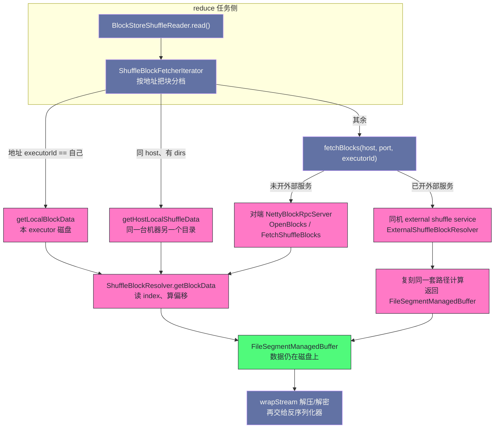
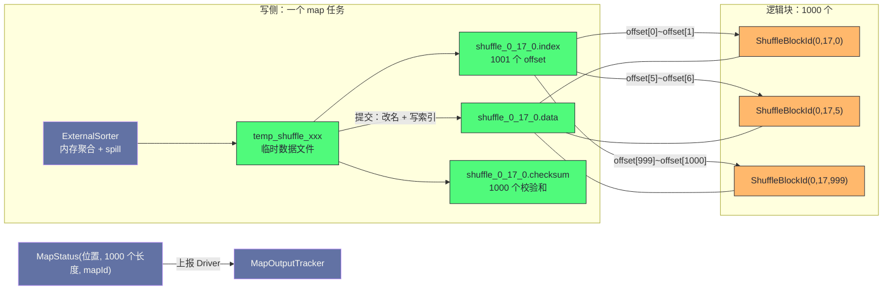
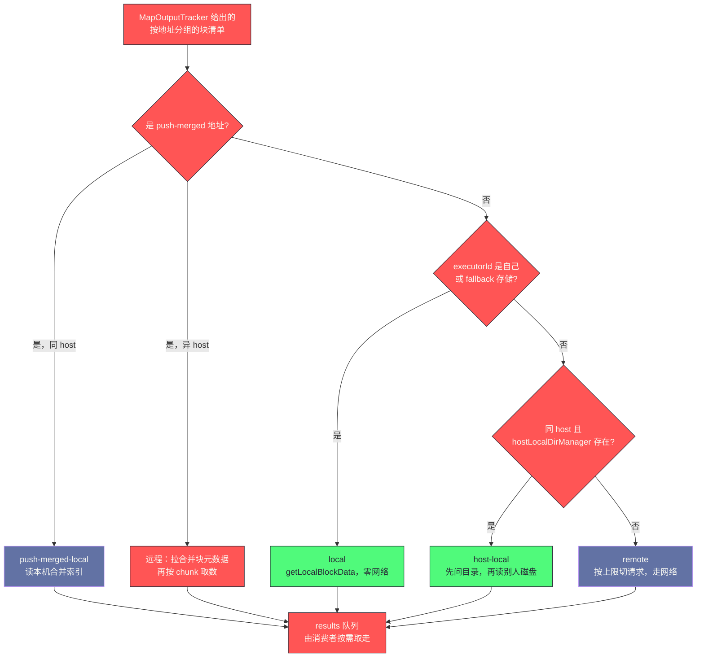
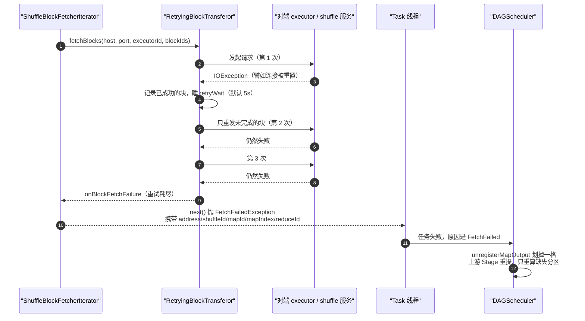
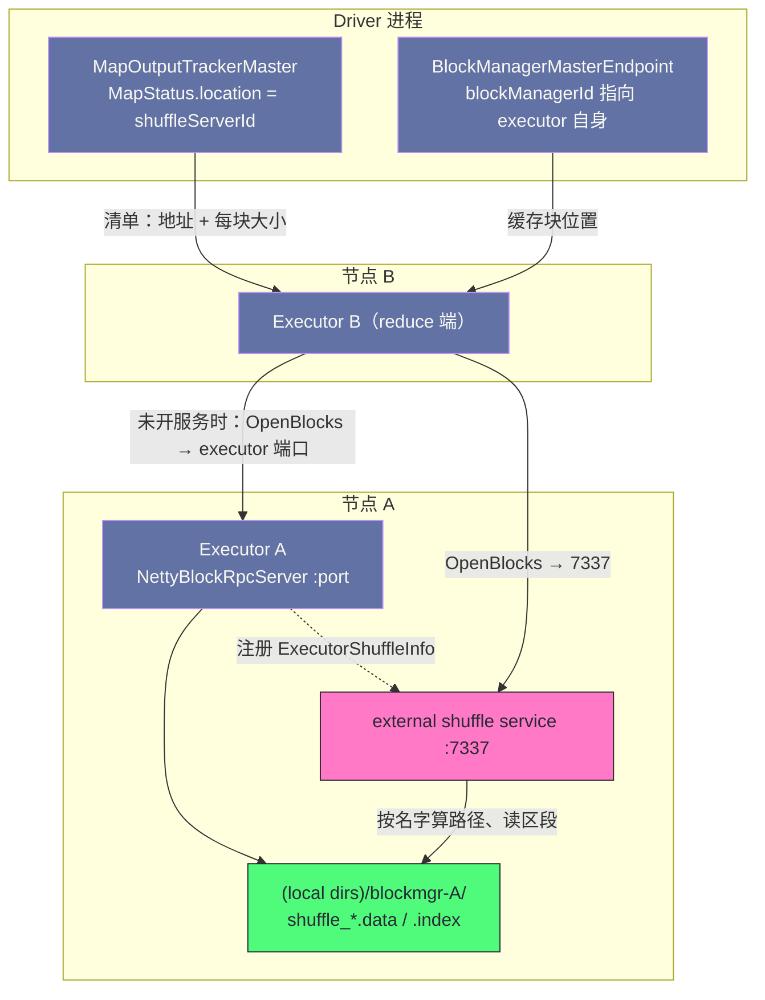

# 7. Spark Shuffle 与 Storage 交互：两本地址簿、拉取背压与外部 Shuffle 服务

**摘要：**

2014 年 Spark 1.1 引入基于排序的 Shuffle，随后在 1.2 把它设为默认实现，当时社区讨论的焦点几乎都落在文件数量上：一个 200 个 map 分区、1000 个 reduce 分区的作业，Hash 式实现要写出 20 万个小文件，排序式实现把它压成 200 个。但文件数只是表象，真正让这次切换站得住脚的，是 Shuffle 与存储层之间那条界线——Spark 没有把 shuffle 数据送进 `BlockManager` 的常规存储路径（`putBlock` 那一套内存/磁盘分层、副本与淘汰），而是让它以"名字即地址"的方式直接落在本地磁盘上，由一个专门的解析器 `IndexShuffleBlockResolver` 管文件、由 `MapOutputTracker` 管位置。

这篇文章盯住这条界线，回答两个问题：shuffle 块凭什么可以绕开 Storage 层的块管理，以及绕开之后读侧要靠什么机制把"一次 Shuffle 的量"收进"每任务几十兆"的内存预算里。文章沿五问推进：先界定交界在哪、为什么必须有两本地址簿；再拆写侧的三个文件、`ShuffleBlockId` 的命名规则与提交协议，说明为什么这套设计只承认"文件"而不承认"块"；接着走读侧，看 `ShuffleBlockFetcherIterator` 如何把地址清单分流成本地、同机直读、远程三类并按三个上限切成请求；然后把背压、重试、`FetchFailed` 串成一条完整的失败链，落地到 `spark.shuffle.io` 那一组参数上；再把 external shuffle service 摆到它真正的位置——它不是缓存，而是让"数据寿命"与"进程寿命"解耦的唯一办法；最后单列边界与反例，交代哪些直觉会在同机直读、动态分配与 push-based shuffle 这几处失效。全篇以 Spark 4.3.0（2026-10-30 发布）为口径，4.x 预编译包基于 Scala 2.13；凡版本间有出入的地方，以对应版本文档或源码为准。

---

## 第 1 章 交界处的一次委托

### 1.1 一个块请求的三种结局

reduce 任务取数的起点在 `BlockStoreShuffleReader.read()`。它做的第一件事是构造一个 `ShuffleBlockFetcherIterator`，把 `BlockManager`、`MapOutputTracker`、地址清单、序列化器的流包装函数以及一串上限值一起交进去：

```scala
// BlockStoreShuffleReader.read()（4.3.0 形态，节选）
val wrappedStreams = new ShuffleBlockFetcherIterator(
  context,
  blockManager.blockStoreClient,          // 有外部服务时是 ExternalBlockStoreClient，否则是 BlockTransferService
  blockManager,
  mapOutputTracker,
  blocksByAddress,                        // (BlockManagerId, Seq[(BlockId, size, mapIndex)])
  serializerManager.wrapStream,           // 解压/解密在这一层套上去
  conf.get(config.REDUCER_MAX_SIZE_IN_FLIGHT) * 1024 * 1024,
  conf.get(config.REDUCER_MAX_REQS_IN_FLIGHT),
  conf.get(config.REDUCER_MAX_BLOCKS_IN_FLIGHT_PER_ADDRESS),
  conf.get(config.MAX_REMOTE_BLOCK_SIZE_FETCH_TO_MEM),
  ...).toCompletionIterator
```

这个迭代器把异步的拉取模型压成同步的 `(BlockId, InputStream)` 序列，但压缩的方式不是等全部到齐，而是一个块一个块地交出去。它内部对每个块只做三件事之一，取决于这个块的地址与自己的关系：

第一，地址的 `executorId` 等于自己，走 `blockManager.getLocalBlockData(blockId)`，直接读本地文件。第二，地址的 host 等于自己的 host、且另一台 executor 在同一台机器的另一个本地目录里，走同机直读，先向对方（或向本机的 shuffle 服务）问出目录列表，再按名字拼路径打开文件。第三，其余情况走网络，把 `host`、`port`、`executorId` 与一小组块 ID 交给 `blockStoreClient.fetchBlocks`，由对端把文件区段推回来。

三条路的终点是同一个方法。`BlockManager.getLocalBlockData` 一进来就分叉：

```scala
// BlockManager.getLocalBlockData（4.3.0，节选）
override def getLocalBlockData(blockId: BlockId): ManagedBuffer = {
  if (blockId.isShuffle) {
    // shuffle 块不进 blockInfoManager，不查 StorageLevel，直接问解析器
    shuffleBlockResolver.getBlockData(blockId)
  } else {
    getLocalBytes(blockId) match {
      case Some(blockData) => new BlockManagerManagedBuffer(blockInfoManager, blockId, blockData, true)
      case None =>
        reportBlockStatus(blockId, BlockStatus.empty)   // 顺手纠正 Driver 上的过期账本
        throw SparkCoreErrors.blockNotFoundError(blockId)
    }
  }
}
```

这两支的差别远不止一行 `if`。走 else 的那一支要拿 `blockInfoManager` 的读锁、要按 `StorageLevel` 判断数据在内存还是磁盘、要把数据包成受锁保护的 buffer，块不存在时还要向 Driver 汇报"我这儿没有"。走 if 的那一支什么锁都不拿，什么账都不查，直接由文件名字算出偏移量、返回一个指向文件的区段视图。**同一个方法名之下，Storage 层的全部机制在 shuffle 块上是缺席的。**这就是交界处的第一个事实，也是本篇所有讨论的地基。

反过来，远程那一端也一样。请求打到对端之后，如果没开外部服务，落到该 executor 的 `NettyBlockRpcServer`，它处理 `OpenBlocks` 或批量的 `FetchShuffleBlocks`，最终仍然调 `getLocalBlockData`；如果开了外部服务，落到同机那个独立进程的 `ExternalBlockHandler`，由 `ExternalShuffleBlockResolver` 复刻同一套路径计算，返回一个 `FileSegmentManagedBuffer`。三条路、两个进程、一个方法，这条链的形状值得画出来看一眼。



图中被标成粉色的六个节点，是真正触到磁盘或触到服务的那几步；`NettyBlockRpcServer` 那一支虽然在 executor 进程里，处理的也是 shuffle 请求，与缓存块的 `UploadBlock` 共用一个端点，但两条业务线在 `getLocalBlockData` 之后就再无交集。

### 1.2 Storage 层在这条链上只剩三件事

为了把篇幅留给交界本身，这里只交代所需的轮廓。`BlockManager` 是整个存储模块对外的统一门面，`BlockManagerMaster`（Driver 端）与 `BlockManagerSlaveEndpoint`（Executor 端）构成控制面，`BlockManagerMasterEndpoint` 用一张 `HashMap[BlockManagerId, BlockManagerInfo]` 记住每个节点上有哪些块、占多少内存与磁盘；介质层是 `MemoryStore` 与 `DiskStore`，前者管堆内/堆外的反序列化或序列化数据，后者管落盘块；`DiskBlockManager` 负责把块名映射成某个本地目录下的某个文件；`BlockInfoManager` 记住每个块的 `StorageLevel`、读写锁与大小。

在这条链上，Storage 层实际只贡献三样东西给 Shuffle：**本地目录**（`spark.local.dir` 派生出的 `blockmgr-<uuid>`，以及每个目录下 64 个十六进制子目录）、**传输通道**（`BlockTransferService` 或它的外部服务版本）、**名字到路径的哈希规则**。shuffle 数据借用了存储层的"仓库地址"，但不借用它的"库存管理"。这个区分在后文会反复出现：同一个本地目录里既有 `broadcast_0_piece0` 这样的缓存块，也有 `shuffle_0_17_0.data` 这样的 shuffle 文件，前者有 `BlockInfoManager` 里的条目，后者只有文件名。

Storage 块的常规路径是另一条：读走 `getLocalValues`（先取读锁，再按 `StorageLevel` 决定从 `MemoryStore` 还是 `DiskStore` 取）或 `getRemoteValues`（向位置所在节点发起 `fetchBlockSync`），写走 `doPut` 系列（`doPutIterator`/`doPutBytes` 的差别只在序列化时机），内存不足时 `dropFromMemory` 按 `StorageLevel` 决定落盘还是丢弃重算。这条路径上的每一步都围绕"块是一等公民"展开，而 shuffle 数据从头到尾没有踏入过它。

顺带纠一个流传很广的说法："RDD 的 Partition 与 Storage 的 Block 等价"。这句话在缓存语义下成立——一个分区被缓存后对应一个块、块名里就带着分区号；但把它套到 shuffle 上就会失准，因为 shuffle 块是 `(shuffleId, mapId, reduceId)` 的函数，一个 map 分区在磁盘上只对应一个文件，在逻辑上却对应 reduce 数个块，与 RDD 分区并不一一对应。**概念可以类比，寻址不能类比。**

清点一下同一个作业里两类块的不同待遇，能立刻看出界线划在哪里。

| 维度 | Storage 块（cache、broadcast、磁盘持久化 RDD） | Shuffle 块（sort shuffle 输出） |
|---|---|---|
| 是否进 `BlockInfoManager` | 是，带 `StorageLevel` 与读写锁 | 否，连条目都不创建 |
| 谁负责记账 | `BlockManager` 在写入成功后向 `BlockManagerMaster` 汇报 | `MapOutputTracker` 记 map 分区级状态，不问块 |
| 物理形态 | 内存对象、堆外页，或 `DiskStore` 管理的独立文件 | 每个 map 分区一个 `.data` 文件，内含全部分区 |
| 淘汰与迁移 | 受内存压力驱动，`MEMORY_AND_DISK` 会落盘、纯内存会丢弃重算 | 不淘汰、不迁移，只在 shuffle 生命周期结束时整体清理 |
| 副本 | 按 `StorageLevel.replication` 复制 | 不复制，丢了就重算 map 分区 |
| 失败语义 | 块丢失 → 重算该 RDD 分区（沿血缘） | 块丢失 → `FetchFailed` → 划掉账本一格、重提上游 Stage |
| 数据量与记账量之比 | 1:1，一个块一条记录 | 一个 map 分区一条记录，覆盖 reduce 数个逻辑块 |

最后一行是整篇文章的枢纽。200 个 map 分区、1000 个 reduce 分区，逻辑上的 shuffle 块有 20 万个；若按 Storage 的方式逐块记账，Driver 上要多出 20 万条元数据，而按 map 分区记账只有 200 条。**记账单位与容错单位在这里是同一件事：一个 map 分区要么整体可用，要么整体重算，所以只需要记 200 条。**这不是省内存的小技巧，而是把"寻址"从"查表"改成了"计算"。

### 1.3 两本地址簿

Spark 里关于"数据在哪"的事实，分散在两本互不隶属的账上。它们长得像，用法完全不同，混起来读就会得出错误结论。

| 维度 | `BlockManagerMaster` 的账 | `MapOutputTracker` 的账 |
|---|---|---|
| 记录的粒度 | 一个 `BlockId` 一条 | 一个 map 分区一条 `MapStatus` |
| 一条记录装什么 | 位置（`BlockManagerId`）、`StorageLevel`、内存/磁盘字节数 | 位置（`BlockManagerId`）、mapId、每个 reduce 分区的大小编码、聚合校验和 |
| 谁能写 | 持有该块的 `BlockManager`，写入成功后 `updateBlockInfo` | `ShuffleMapTask` 成功后上报 `MapStatus`，经 `MapOutputTrackerMaster` 汇总 |
| 谁能读 | `getRemoteBytes` 一类接口按块查位置 | reduce 端按 `(shuffleId, 分区区间)` 批量拉清单 |
| 覆盖哪些块 | cache、broadcast、磁盘持久化 RDD | 只有 shuffle 输出 |
| 撤回方式 | `removeBlock`、Executor 失联时整条记录删掉 | `unregisterMapOutput` 划掉一格，或整条 shuffle 注销 |
| 规模量级 | 与缓存块数成正比 | 与 map 分区数成正比，与 reduce 数无关 |

第二本账的关键在于它"压缩"。`MapStatus` 继承 `Externalizable`，序列化时并非把每个 reduce 分区的块都写一遍，而是按 reduce 数选两种编码：分区数不超过 2000 时用 `CompressedMapStatus`，每个 reduce 分区的大小压成 1 个字节，用底数 1.1 的对数编码，最大能表示 35GB、误差不超过 10%；超过 2000 时用 `HighlyCompressedMapStatus`，只留一个空块位图、一个平均值和少数"大块"的精确值。也就是说，reduce 端拿到的 size 从一开始就是估算值，不是实测值。这个事实后面会直接决定"`spark.reducer.maxSizeInFlight` 是硬闸门还是软预算"这个问题该怎么回答。

两本账分开，还带来一个容易被忽略的对应关系：`MapStatus.location` 里放的不是 executor 自己的地址，而是 `blockManager.shuffleServerId`。没开外部服务时它等于 `blockManagerId`，开了外部服务时它是 `BlockManagerId(executorId, host, 7337)`——指向那台机器上的 shuffle 服务端口。同一个 executor 在 Driver 眼里因此有两副面孔：存缓存块要找它本人，取 shuffle 块要找它所在机器上的服务。这个"偷换"是第 5 章的主题。

### 1.4 一个贯穿全文的作业

为了让后面的机制有具体的着力点，笔者设想一个每天凌晨跑一次的汇总作业 `daily_rollup`：从 HDFS 读当天的埋点日志，按 `(siteId, hour)` 聚合曝光与点击，算出一张宽表，再与站点维表做一次 join 补上行业分类，最后写回数仓。

```scala
// 输入侧 200 个分区，聚合后 1000 个分区，join 维表后再 Shuffle 一次
val events = sc.textFile("hdfs:///logs/events").map(parse).filter(_.valid)   // 200 分区
val rollup = events.map(e => ((e.siteId, e.hour), e)).reduceByKey(addCounts, 1000)
val joined = rollup.map { case (k, v) => (k._1, (k._2, v)) }.join(siteDim)     // 维表很小，但仍是宽依赖
joined.saveAsTextFile("hdfs:///dw/daily_rollup")
```

这个作业有两个 Shuffle：`reduceByKey` 一次（200 个 map 分区产出、1000 个 reduce 分区消费），`join` 一次。第一次 Shuffle 落在本文讨论的核心位置上：20 万个逻辑块、200 个 `.data` 文件、200 个 `.index` 文件，每个 reduce 任务要拉 200 个块，每个块的大小从几十 KB 到几十 MB 不等。

把它想成一个港口会更直观。Storage 块像酒店前台寄存：每件行李都要贴条、登记、有人管钥匙，取的时候凭条对号。Shuffle 输出像集装箱堆场：箱子按"船名-航次-箱号"命名，堆场管理员不需要一张 20 万行的库存表，他只要知道"这条船停在第几个堆场"，剩下的靠命名规则算出来。这个比喻的技术限定在于：堆场规则是死的，船一旦挪位，规则就失效——Spark 里对应的是 `MapStatus` 记录的位置失效，此时不是改规则，而是把那一格账划掉重算。

### 1.5 本篇路线

接下来的五章按数据流的反方向走：第 2 章先看写侧，为什么三个文件就能承载 20 万个逻辑块、`ShuffleBlockId` 的名字如何成为地址；第 3 章看读侧第一段，`MapOutputTracker` 的清单如何被切成请求，本地、同机直读、远程三档的判据分别是什么；第 4 章看读侧第二段，背压如何由消费速度反向驱动、重试在哪里发生、`FetchFailed` 在多远处被接住；第 5 章把外部 shuffle 服务放到拓扑里，解释它为什么是动态分配的前提而不是可选的加速器；第 6 章收边界与反例；第 7 章落点。

---

## 第 2 章 写侧：三个文件与一个名字

### 2.1 "经过 BlockManager"这个说法错在哪

旧笔记里有一句流传很广的表述：Shuffle 写数据最终通过 `BlockManager` 写入 `MemoryStore` 或 `DiskStore`。这句话在 `BlockManager` 的构造参数上找到了依据——`SparkEnv` 建 `BlockManager` 时确实传入了 `shuffleManager`，`BlockManager` 也确实在 `initialize` 里调了 `shuffleClient.init(appId)`、在开启外部服务时向服务注册。但这些证据只能说明"二者互相持有引用"，不能说明"shuffle 数据流经了存储路径"。

判别方法很朴素：顺着数据走一遍，看它有没有经过 `putBlock`、有没有在 `BlockInfoManager` 里留下条目、有没有向 `BlockManagerMaster` 汇报。三条都没有。`SortShuffleWriter.write` 的主干是四行：

```scala
// SortShuffleWriter.write()（4.3.0，节选）
sorter = new ExternalSorter[K, V, C](context, dep.aggregator, Some(dep.partitioner), ...)
sorter.insertAll(records)                       // 内存聚合，必要时 spill 到临时文件
val mapOutputWriter = shuffleExecutorComponents.createMapOutputWriter(
  dep.shuffleId, mapId, dep.partitioner.numPartitions)
sorter.writePartitionedMapOutput(dep.shuffleId, mapId, mapOutputWriter, writeMetrics)
partitionLengths = mapOutputWriter.commitAllPartitions(sorter.getChecksums).getPartitionLengths
mapStatus = MapStatus(blockManager.shuffleServerId, partitionLengths, mapId, ...)
```

`createMapOutputWriter` 来自 `ShuffleExecutorComponents`，默认实现是 `LocalDiskShuffleDataIO`（`spark.shuffle.sort.io.plugin.class` 的默认值，自 3.0.0 起）：它创建的是 `LocalDiskShuffleMapOutputWriter`，直接向 `IndexShuffleBlockResolver.getDataFile(shuffleId, mapId)` 指向的临时文件写字节。写完调 `commitAllPartitions`，进入 `IndexShuffleBlockResolver.writeMetadataFileAndCommit`，落索引、落数据、可选落校验和，最后返回一个 `MapStatus`。

整条路径上，唯一与"存储"沾边的动作是取本地目录：`DiskBlockManager.getFile(blockId)`。数据既没有进 `MemoryStore`，也没有进 `DiskStore` 的对象体系，更没有 `StorageLevel`。

把视角拉到接口层，这部分职责的归属会更清楚。`ShuffleManager` 向内核暴露的是 `registerShuffle`、`getWriter`、`getReader`、`unregisterShuffle`、`stop` 五个方法，外加一个 `shuffleBlockResolver`。前三个分别对应"建 Shuffle 的元信息""给出写数据的 writer""给出读数据的 reader"，`shuffleBlockResolver` 是把块名翻译成文件区段的解析器，而 `unregisterShuffle` 是唯一一个与"删除"有关的入口——shuffle 生命周期结束时，Spark 通过它通知各节点清理文件。换言之，**shuffle 数据的生死都由 `ShuffleManager` 这条线管，`BlockManager` 只提供目录与通道**。不妨顺着 `unregisterShuffle` 往下读一遍：`SortShuffleManager` 记着每个 shuffle 用过哪些 map 任务编号，逐个调 `IndexShuffleBlockResolver.removeDataByMap`，删的就是那三个文件，中间不经过任何块级账本。

三条 writer 路径（`UnsafeShuffleWriter`、`BypassMergeSortShuffleWriter`、`SortShuffleWriter`）在 `SortShuffleManager.getWriter` 里按 handle 类型分派，但落盘这一端都收敛到同一个 `ShuffleMapOutputWriter` 接口上，所以"文件长什么样"与"用哪种排序算法"已经解耦——这是插件化留下的好处，也说明文件格式是跨 writer 稳定的。

至于"内存缓冲、磁盘溢出由 `MemoryStore` 与 `DiskStore` 协调"这半句，也要改。`ExternalSorter` 继承 `Spillable(context.taskMemoryManager())`，它申请的是**执行内存**（execution memory），走的是任务内存管理器的那套账；溢出时用 `diskBlockManager.createTempShuffleBlock()` 建临时文件，名字是 `temp_shuffle_<uuid>`，用 `blockManager.getDiskWriter` 写到磁盘。这些临时文件与 `MemoryStore`/`DiskStore` 无关，`DiskStore` 只管通过 `putBlock` 进来的块。统一内存池把执行内存与存储内存放在一个池子里动态借用，这是内存"额度"层面的共享，不是数据"路径"层面的共享，两者不能混着说。

### 2.2 三个文件、三个块类型

一个 map 分区的产出物是三个文件，命名规则把 `shuffleId`、`mapId` 和一个占位用的 reduce 号拼在一起：

| 文件 | 块类型与名字 | 内容 | 谁来写 |
|---|---|---|---|
| 数据文件 | `ShuffleDataBlockId` → `shuffle_<sid>_<mid>_0.data` | 该 map 分区面向全部 reduce 分区的记录，按 reduce 号顺序首尾相接 | `LocalDiskShuffleMapOutputWriter` 先写临时文件，提交时改名 |
| 索引文件 | `ShuffleIndexBlockId` → `shuffle_<sid>_<mid>_0.index` | `numReduces + 1` 个 8 字节长整型偏移量，相邻两项之差就是某个 reduce 分区的块长度 | `writeMetadataFileAndCommit` |
| 校验和文件 | `ShuffleChecksumBlockId` → `shuffle_<sid>_<mid>_0.checksum` | 每个 reduce 分区一个校验和，用于事后诊断损坏来源 | 同一提交过程，尽力而为 |

文件名里的那个 `0` 是 `IndexShuffleBlockResolver.NOOP_REDUCE_ID`。源码注释解释得很直白：磁盘存储那一层原本期望"一次写入对应一个 (map, reduce) 对"，而排序式 Shuffle 把多个 reduce 分区的输出揉进了同一个文件，只好拿 0 当占位符。也就是说，**文件名层面的"块"与逻辑层面的"块"不是一回事**：文件是 map 分区级的，逻辑块是 reduce 分区级的，一个 map 分区对应 `numReduces` 个逻辑块，它们共享同一个数据文件与索引文件。

把逻辑块与物理文件叠在一张图上看，能看清"名字即地址"这句话的具体含义。



图里的关键在中间那条索引：`1000` 个逻辑块不是 1000 个文件，而是同一个文件上的 1000 段区间，索引文件就是这 1000 段区间的刻度表。`MapStatus` 上报的是 1000 个长度（压缩后），而不是 1000 个位置——位置只有一个，就是整个文件所在的那台机器。

### 2.3 索引文件：写在磁盘上的寻址表

`getBlockData` 的实现只有二十来行，但它把"寻址"这件事定义得非常彻底：

```scala
// IndexShuffleBlockResolver.getBlockData（4.3.0，节选）
val (shuffleId, mapId, startReduceId, endReduceId) = blockId match {
  case id: ShuffleBlockId      => (id.shuffleId, id.mapId, id.reduceId, id.reduceId + 1)
  case batchId: ShuffleBlockBatchId => (batchId.shuffleId, batchId.mapId, batchId.startReduceId, batchId.endReduceId)
}
val indexFile = getIndexFile(shuffleId, mapId, dirs)
val channel = Files.newByteChannel(indexFile.toPath)
channel.position(startReduceId * 8L)          // 第 startReduceId 个偏移
val startOffset = new DataInputStream(Channels.newInputStream(channel)).readLong()
channel.position(endReduceId * 8L)            // 第 endReduceId 个偏移
val endOffset = ...
new FileSegmentManagedBuffer(transportConf, getDataFile(shuffleId, mapId, dirs),
  startOffset, endOffset - startOffset)
```

三处值得停下来看。第一，**寻址是一次定位加两次读**：按 `reduceId * 8` 直接跳到索引文件的对应位置，读出起点与终点，不扫描、不解析、不建表。第二，返回的是 `FileSegmentManagedBuffer`，一个"文件 + 起点 + 长度"的三元组，它不读数据；真正的读取发生在 `createInputStream` 或传输层把这段区间推给 socket 的那一刻。这正是"磁盘与内存的交接点"最省内存的形态：交接的是描述符，不是字节。第三，`ShuffleBlockBatchId` 让一次请求可以覆盖连续的一段 reduce 分区，也就是批式拉取（`FetchShuffleBlocks` 协议），它省的是请求数而不是数据量。

源码里还留着一段与 SPARK-22982 有关的注释：读索引时显式校验 `channel.position()` 是否等于预期位置。原因是曾经有别的代码借用了同一个文件描述符并错误地改变了它，导致读到的偏移错位，reduce 端拿到的数据属于另一个 reduce 分区——数据不丢、长度也对，就是内容错位，这种故障排查起来极其困难。注释说这些检查现在留着当防复发的手段。这段历史说明一件事：**索引文件是整个 shuffle 读路径上最不能出错的一环，它错了不会报错，只会给出错误的数据。**

### 2.4 提交：临时文件、改名与一次长度比对

写侧最容易写错的地方不是序列化，而是提交。一个 map 任务可能因为推测执行、任务重试、Stage 重提而同时存在两个 attempt，它们会往同一个 `shuffle_<sid>_<mid>_0.data` 上写。`writeMetadataFileAndCommit` 用一把 JVM 内的锁（一个 executor 只有一个解析器实例）加一次长度比对来兜底：

```scala
// IndexShuffleBlockResolver.writeMetadataFileAndCommit（4.3.0，节选）
this.synchronized {
  val existingLengths = checkIndexAndDataFile(indexFile, dataFile, lengths.length)
  if (existingLengths != null) {
    // 另一个 attempt 已经成功提交过，直接采用它的长度，删掉自己的临时文件
    System.arraycopy(existingLengths, 0, lengths, 0, lengths.length)
    if (dataTmp != null && dataTmp.exists()) dataTmp.delete()
  } else {
    val offsets = lengths.scanLeft(0L)(_ + _)     // 1001 个偏移
    writeMetadataFile(offsets, indexTmp, indexFile, true)
    if (dataFile.exists()) dataFile.delete()
    if (!dataTmp.renameTo(dataFile)) throw ...    // 同一文件系统内的原子改名
    // 校验和文件尽力而为：失败只记日志，不推翻已经落好的数据
  }
}
```

这段代码里有三个取舍。其一，索引先落、数据后落，中间存在一个极短的窗口：新的索引已经就位，数据文件还是上一轮的。这个窗口之所以不会造成读到错位数据，是因为读方要等 map 任务成功上报 `MapStatus` 之后才会来取，而那时候提交早已结束；同一 map 任务的多个 attempt 之间，则靠下面的长度比对收敛到一个赢家。其二，判重的依据是既有索引文件与数据文件的长度是否彼此自洽、且与本次的分区数吻合，这是一种"便宜的等价判断"，不比对内容——同一 map 分区的输出内容是确定的，长度吻合就认为等价。其三，校验和文件失败不回滚，注释说明理由：数据与索引已经落好，校验和只用于事后诊断，为它推翻一次成功的提交不划算。

`commitAllPartitions` 里还有一处与内核版本相关的检查：合并 spill 文件时用的是 `FileChannel.transferTo`，而 2.6.32 内核上存在调用后文件位置不前进的缺陷（SPARK-3948），所以提交前要校验 `position()` 与预期字节数是否一致，不一致就抛错并提示用 `spark.file.transferTo=false` 关掉这条快速路径。这类检查的性质是"把平台缺陷显式化"：宁可提交失败，也不要产出一个长度正确、内容错位的文件。

### 2.5 `ShuffleBlockId`：名字的两端

`ShuffleBlockId(shuffleId, mapId, reduceId)` 的 `name` 是 `"shuffle_" + shuffleId + "_" + mapId + "_" + reduceId`，`BlockId.apply` 用一条正则把它反解回三元组，另外还有 `.data`、`.index`、`.checksum` 三个带后缀的变体，以及四段式的 `ShuffleBlockBatchId`。这套命名之所以能当地址用，是因为名字到路径的映射是一个纯函数：

```scala
// DiskBlockManager.getFile：名字 → 本地目录 + 子目录 + 文件名
val hash = Utils.nonNegativeHash(filename)
val dirId = hash % localDirs.length
val subDirId = (hash / localDirs.length) % subDirsPerLocalDir
new File(subDirs(dirId)(subDirId), filename)
```

同样的哈希在另一个进程里也实现了一遍：`common/network-shuffle` 模块的 `ExecutorDiskUtils.getFilePath`，供外部 shuffle 服务在 executor 之外算路径。两处代码的注释里都写着"必须与对方保持同步"。这份重复不是疏忽，而是架构选择：shuffle 服务是一个独立进程、独立模块，它不该依赖 core 的内部类，于是只能把"名字→路径"这条规则复制一份。**凡是靠复制维持的契约，都是演进时最容易断裂的地方**，第 6 章会回到这一点。

名字的另一端是唯一性。`shuffle_<sid>_<mid>_<rid>` 在整个应用范围内唯一，`sid` 区分 Shuffle，`mid` 是 map 输出的编号（默认取任务 attempt 的唯一编号，开启旧拉取协议时退回该任务的分区号），`rid` 是 reduce 分区号。有了三元组，读侧就不需要向任何人问"这个块在第几个文件的第几段"，只需要知道三件事：`sid` 对应的 `MapStatus` 在哪台机器上、那台机器的地址、以及本地的目录。前两件事由 `MapOutputTracker` 提供，第三件由自己或对方的 `ExecutorShuffleInfo` 提供。

### 2.6 反事实：如果提交不是原子的

设想把 `writeMetadataFileAndCommit` 换成"直接往最终文件写、写完再写索引"。故障面立刻分成两处：一是任务写了一半被杀或磁盘写满，最终路径上留下一个半截文件，索引却还是上一轮留下的；二是同一个 map 的第二个 attempt 看到一个"存在"的最终文件，误判为别人已经成功，直接把自己那份删掉。前者更常见。此时下游来读，`channel.position(startReduceId * 8)` 落在一个长度不足的索引上，读到的是文件尾或残留的旧字节，算出来的 `startOffset`、`endOffset` 可能为负、可能倒序、可能巨大。倒序会让长度变成负数，构造 `FileSegmentManagedBuffer` 时抛错；巨大则会让读取跨越文件末尾，读出一段无效字节，随后在解压或反序列化阶段爆炸。

读到无效字节这一支尤其麻烦：解压失败会被当成"数据损坏"，`ShuffleBlockFetcherIterator` 对非本地块的处理是重试一次，重试仍失败才抛 `FetchFailed`。于是故障表现成"偶发的 shuffle 数据损坏，重跑就好了"，而根因在写侧少了一次原子改名。这类问题的排查成本极高，因为它在时间上是稀疏的、在空间上与写侧任务毫无关联。

同一段代码里还有一条隐含的正确性约束值得说清：**同一 shuffle 的同一 mapId 只允许一个赢家**。`checkIndexAndDataFile` 比对长度，本质上是在承认"多个 attempt 可能都写成功了"，然后用"先到者赢、后到者删"的方式收敛。如果不做这个收敛，两个 attempt 各自改名，最终数据文件与索引文件可能来自不同 attempt——长度恰好一致时甚至不会报错，只是数据里混了两次计算的结果。

### 2.7 唯一的例外：优雅下线时的迁移

到这里可以回答一个自然的追问：既然 shuffle 块从不进 `BlockManager` 的账，为什么 `BlockManager` 里到处都能看到 shuffle 相关的分支？答案是那些分支几乎都服务于一个场景——优雅下线（decommissioning）。

开启 `spark.storage.decommission.enabled`（默认 `false`）之后，一个被标记为下线的 executor 会把本机上的 shuffle 块迁移到同应用的另一个 executor 上，迁移开关是 `spark.storage.decommission.shuffleBlocks.enabled`（默认 `true`，前提是解析器支持迁移，排序式 Shuffle 支持）。迁移的数据流走的是 `BlockManager.putBlockDataAsStream`，块是 shuffle 的时候转给 `migratableResolver.putShuffleBlockAsStream`；迁移完成、需要让 Driver 知道新位置时，`updateBlockInfo` 才第一次看到 `ShuffleIndexBlockId` 与 `ShuffleDataBlockId`。源码里那句注释说得很清楚：`blockId` 只有在 decommission 的场景下才可能是这两种类型。

这也是理解"两本账"的一个好角度：常规运行时它们是分离的，只有"数据搬家"这种需要两边协同的时刻，才短暂地在一本账上留下另一本账的痕迹。第 5 章会看到，外部 shuffle 服务走的是完全不同的另一条路——它不搬数据，只接管"读"这件事。

---

## 第 3 章 读侧之一：把地址清单切成请求

### 3.1 清单的形状

reduce 任务在构造迭代器之前，要先拿到"我要读哪些块、它们在谁那儿"。这件事由 `MapOutputTracker` 完成。4.3.0 的入口签名比早期版本多了两个参数：

```scala
// MapOutputTracker.getMapSizesByExecutorId（4.3.0）
def getMapSizesByExecutorId(
    shuffleId: Int,
    startMapIndex: Int, endMapIndex: Int,        // 只取 map 输出的一个子区间
    startPartition: Int, endPartition: Int       // 只取 reduce 分区的一个区间
): Iterator[(BlockManagerId, collection.Seq[(BlockId, Long, Int)])]
```

返回值的第一层按 `BlockManagerId` 分组，第二层是 `(块 ID, 估算大小, map 序号)` 的三元组。分组键是位置而不是 map 序号，这个选择决定了后面所有事情：一个 reduce 任务面对的不是 200 个块，而是"最多 200 个位置，每个位置一小组块"，请求天然按机器聚合。两个区间参数是给自适应查询执行与倾斜 join 用的——一个被拆开的 reduce 分区可以只读一部分 map 输出的子区间，而不必把 200 个块全拉一遍。

清单生成时有两条容易被忽略的规则。其一，零大小的块被剔除，注释里写得很明确：零大小的块没有记录，也不该出现在请求里。其二，块 ID 里的 `mapId` 取自 `MapStatus.mapId`，而不是数组下标，第三元的 `mapIndex` 才是下标；两者在推测执行或任务重试后可能不一致，因此必须分开传。这个区分在第 4 章讲 `FetchFailed` 时会派上用场：上报给 Driver 的失败信息里，`mapId` 用来定位那份输出、`mapIndex` 用来在账本上划格子。

清单里的每个块都带着一个 `size`。这个 `size` 前面提过，是 `MapStatus` 里压过的估算值：分区数不超过 2000 时是 1 字节的对数编码，超过 2000 时是"平均值 + 少数大块的精确值 + 空块位图"。为什么要费这个劲？因为 `MapStatus` 要跟着心跳与 RPC 走，一个 map 分区的状态若按 reduce 数存原始长整型，200 个 map 分区在 1000 个 reduce 分区上就是 200×1000×8 字节，接近 1.6MB，而压缩后不到 200KB。代价是读侧拿到的大小有 10% 量级的误差。记住这个误差，下一节的上限都要在它之上打折扣。

### 3.2 四路分流

拿到清单后，`ShuffleBlockFetcherIterator.initialize` 调 `partitionBlocksByFetchMode`，把块分成四路。四路的判据按顺序排列，先命中先归类：

```scala
// ShuffleBlockFetcherIterator.partitionBlocksByFetchMode（4.3.0，节选）
if (pushBasedFetchHelper.isPushMergedShuffleBlockAddress(address)) {
  if (address.host == blockManager.blockManagerId.host) pushMergedLocalBlocks ++= ...
  else collectFetchRequests(address, blockInfos, collectedRemoteRequests)
} else if (localExecIds.contains(address.executorId)) {
  localBlocks ++= ...                                  // 真本地：自己或 fallback 存储
} else if (blockManager.hostLocalDirManager.isDefined &&
           address.host == blockManager.blockManagerId.host) {
  hostLocalBlocksByExecutor += address -> ...           // 同机另一个 executor 的目录
} else {
  collectFetchRequests(address, blockInfos, collectedRemoteRequests)
}
```

四路的分工与代价差别很大，值得并排放一张图。



判定"本地"的键是 `executorId`，不是 host。这条差别比看上去重要：很多排查笔记把"本地读"与"同机读"混为一谈，看到 `localBytesRead` 很高就以为数据是自己写的，实际上同机直读也被记在本地一侧（代码里对 `hostLocalBlocks` 的块按 `local = true` 记指标）。真正的本地只有一种：块的地址就是自己，或者是一个 fallback 存储的虚拟地址（`FallbackStorage.FALLBACK_BLOCK_MANAGER_ID`，配合优雅下线时的远端落盘用）。

第三路"同机直读"是 3.0 之后才成为默认行为的，开关是 `spark.shuffle.readHostLocalDisk`，自 3.0.0 起默认 `true`。它的工作方式是：先拿对方的本地目录列表，再用同一套哈希规则把块名拼成绝对路径直接打开。目录从哪来？开外部服务时，向本机的 shuffle 服务一次性问一批 executor 的目录（一次 RPC 换多个目录，因为"一台机器上通常不会挤很多 executor"）；没开外部服务时，逐个向对端 executor 的 `NettyBlockRpcServer` 发 `GetLocalDirsForExecutors`。目录会缓存在 `HostLocalDirManager` 里，缓存容量由 `spark.storage.localDiskByExecutors.cacheSize` 控制，默认 1000。

这里有一条反直觉的边界，值得提前点破：同机直读失败不会回落成远程拉取。`fetchHostLocalBlock` 一旦捕获异常，直接把一个 `FailureFetchResult` 塞进结果队列，`next()` 取到它就抛 `FetchFailedException`。也就是说，省掉网络的那条捷径，代价是"读失败就走容错"，而不是"读失败就退回去走网络"。这个设计选择背后的理由不难想：能读到文件却读坏了，通常意味着磁盘或权限出了问题，换个通道也读不到同一份数据。

### 3.3 请求的切分与三个上限

远程那一组块进入 `collectFetchRequests`，按两个维度切：一组的字节总量、一组的块数量。字节维度的目标是 `maxBytesInFlight / 5`，源码注释解释了为什么是五分之一——留出空间让最多五个节点的拉取并行起来，而不是阻塞在某一台机器上。块数量维度由 `maxBlocksInFlightPerAddress` 控制，切完的尾巴会被放回 `curBlocks` 等下一轮，避免产生一个很小的碎请求。

切出来的请求不是立刻全发出去，而是塞进 `fetchRequests` 队列，由 `fetchUpToMaxBytes` 按"在途预算"逐个放行。预算由三个上限共同定义：

| 参数 | 默认值（4.3.0） | 约束什么 | 调小会怎样 | 调大会怎样 |
|---|---|---|---|---|
| `spark.reducer.maxSizeInFlight` | `48m` | 单个 reduce 任务同时拉取的远程字节总量 | 网络利用率下降，小请求变多 | 每任务缓冲占用上升，可能挤压执行内存 |
| `spark.reducer.maxReqsInFlight` | `Int.MaxValue` | 同时挂起的远程请求个数 | 对单机入站连接数形成保护 | 大集群下可能压垮个别节点 |
| `spark.reducer.maxBlocksInFlightPerAddress` | `Int.MaxValue` | 向同一个 host:port 同时取多少个块 | 降低服务端单点压力，拉长整体时间 | 一次请求过大时可能拖垮对端 executor 或 NodeManager |
| `spark.network.maxRemoteBlockSizeFetchToMem` | `200m` | 单个请求超过此值改为落临时文件 | 更多请求走磁盘，减少堆压力 | 大块常驻内存，GC 压力上升 |
| `spark.shuffle.readHostLocalDisk` | `true` | 是否允许同机直读 | 同机块改走网络，流量与耗时可观 | — |

前三行的语义并不对等。`maxSizeInFlight` 管的是**字节**，是一个软预算——单块超过预算时也允许发（第 4 章会看到 `bytesInFlight == 0` 的豁免分支）；`maxReqsInFlight` 管的是**连接数**，是防止某台机器被几十个 reduce 任务同时打穿的护栏；`maxBlocksInFlightPerAddress` 管的是**单个对端的块并发**，最贴近 shuffle 服务（YARN 里是 NodeManager 里的辅助服务）的承受能力。三者叠在一起才是实际并发，只调其中一个往往看不到效果。

关于 `maxSizeInFlight` 还有一个常见误解：把它调大并不必然加速。它的作用对象是"同时在途的字节"，而在途字节要靠每块的接收缓冲兜着；调大等于让每个 reduce 任务同时占更多内存，在统一内存管理下会挤压执行内存，进而影响聚合与排序的堆内空间。真正的加速旋钮往往是连接数（`spark.shuffle.io.numConnectionsPerPeer`，默认 1）与单请求大小，前者决定"磁盘多、主机少"的集群能不能把多块盘同时喂饱。

---

## 第 4 章 读侧之二：背压、退避与失败

### 4.1 由消费者驱动的闭环

`ShuffleBlockFetcherIterator` 的核心是一个 `LinkedBlockingDeque[FetchResult]` 与两个队列：待发请求队列 `fetchRequests`、按地址挂起的暂缓队列 `deferredFetchRequests`。数据流是反向的——不是"拉完了再给消费者"，而是"消费者取走一个块，才允许再发下一批请求"。

```scala
// ShuffleBlockFetcherIterator.next()（4.3.0，节选）
result = withFetchWaitTimeTracked[FetchResult](results.take())      // 阻塞等一个块
result match {
  case SuccessFetchResult(blockId, mapIndex, address, size, buf, isNetworkReqDone) =>
    if (address != blockManager.blockManagerId) {
      numBlocksInFlightPerAddress(address) -= 1
      bytesInFlight -= size                                          // 归还字节预算
    }
    if (isNetworkReqDone) { reqsInFlight -= 1; resetNettyOOMFlagIfPossible(maxReqSizeShuffleToMem) }
    ...
}
withFetchWaitTimeTracked(fetchUpToMaxBytes())                        // 循环末尾补发
```

放行的判据写成一个局部函数：

```scala
def isRemoteBlockFetchable(fetchReqQueue: Queue[FetchRequest]): Boolean = {
  fetchReqQueue.nonEmpty &&
    (bytesInFlight == 0 ||
      (reqsInFlight + 1 <= maxReqsInFlight &&
        bytesInFlight + fetchReqQueue.front.size <= maxBytesInFlight))
}
def isRemoteAddressMaxedOut(addr: BlockManagerId, request: FetchRequest): Boolean =
  numBlocksInFlightPerAddress.getOrElse(addr, 0) + request.blocks.size > maxBlocksInFlightPerAddress
```

这三行代码就是"背压"的全部实现，没有信号量、没有限流器、没有独立线程池。它的语义是：只要还有一条请求没发出去且预算不够，就先停在队列里；等到某次 `next()` 取走一个块、归还了字节与请求计数，`fetchUpToMaxBytes` 再放行下一批。**消费速度因此直接变成拉取速度的上限**——消费者在聚合上卡住，队列里的结果被取完之后，在途字节自然降到零，网络随即空闲下来。

`bytesInFlight == 0` 这个豁免分支不是随手写的：它保证单个超大请求不会因为"预算装不下它"而永远发不出去，否则一个 60MB 的块在 48MB 的预算下会死锁。豁免让 `maxSizeInFlight` 变成真正的软上限：单块可以超预算，超出的部分靠这一块的接收缓冲兜住，这也是为什么把预算调得极大反而危险——一张大块就可能吃掉整个任务的内存配额。

按地址的暂缓队列补上了第四道限制。某个请求因为对端块并发已满而被暂缓，它不会阻塞其它地址的请求，而是进 `deferredFetchRequests` 等下一次机会；`fetchUpToMaxBytes` 每次先处理暂缓队列，再处理常规队列。这个顺序意味着被暂缓的请求会被优先补发，避免它无限期地排在队尾。

还有一层跨任务的节流，容易被漏掉。Netty 的堆外内存耗尽时，会置上一个在 executor 内所有任务间共享的静态标志 `isNettyOOMOnShuffle`，随后所有任务的 `fetchUpToMaxBytes` 都直接返回，直到某次请求完成或缓冲释放、且可用堆外内存回到 `maxReqSizeShuffleToMem` 以上才复位。单个块因 Netty OOM 重试的次数上限是 `spark.shuffle.maxAttemptsOnNettyOOM`（默认 10）。也就是说，**背压不只发生在单个任务内部，还会以"整个 executor 暂停拉取"的形式出现**，表现为这台机器上所有 reduce 任务同时卡在 fetch 阶段。

### 4.2 背压在指标上长什么样

判断一个 reduce 任务是"在等数据"还是"在算"，看 `ShuffleReadMetrics` 里的三个量就够了，但它们的含义常被读反。

`fetchWaitTime` 统计的是线程阻塞在 `results.take()` 上等待块到达的累计时间，以及初始批量发送请求那一段的等待。它接近任务总耗时，说明瓶颈在拉取侧；它很小而任务依然慢，说明瓶颈在消费侧——聚合、排序、溢写磁盘，与网络无关。`remoteBytesRead` 与 `localBytesRead` 的比值给出流量结构的轮廓，但要注意同机直读会计入后者，所以"本地读得多"不等于"数据是自己写的"。`remoteBytesReadToDisk` 是一个容易被忽略的细分项，它统计的是**因为超过 `maxRemoteBlockSizeFetchToMem` 而落到临时文件**的字节量，这个值持续偏高说明请求普遍很大，增大 `maxSizeInFlight` 并不会让它们更快，反而应当先看分区大小分布。

把这三个量放在 `daily_rollup` 的场景里：如果 `fetchWaitTime` 占任务时长的六成以上，同时 `remoteBytesReadToDisk` 很高，那基本可以判断是"大块 + 落盘"，调大内存预算没有意义，该做的是减小分区、或者提高 `maxRemoteBlockSizeFetchToMem` 让大块留在内存里（代价是堆压力）；如果 `fetchWaitTime` 低而任务时长高，且 spill 指标高，那么问题在聚合结构而不是拉取层。

### 4.3 磁盘与内存的交接点

拉取层有三个明确的"落盘/落内存"分界，理解它们就理解了这一层的内存模型。

第一个分界是请求级：一个请求的总大小超过 `spark.network.maxRemoteBlockSizeFetchToMem`（默认 `200m`）时，`fetchBlocks` 会带上一个临时文件管理器（`ShuffleBlockFetcherIterator` 自己实现了 `DownloadFileManager`），数据直接写进 `diskBlockManager.createTempLocalBlock()` 建出的临时文件，返回的 `ManagedBuffer` 是一个指向该文件的视图。这些临时文件登记在 `shuffleFilesSet` 里，任务结束时由 `onCompleteCallback` 一并清理。3.0 之前这个旋钮叫 `spark.reducer.maxReqSizeShuffleToMem`，之后统一到现在的名字，配置文档里也明说它同时作用于 shuffle 取数与 BlockManager 的远程块取数。

第二个分界是块级：无论落在内存还是临时文件，真正交给上层的是 `FileSegmentManagedBuffer` 或内存缓冲的"流"，而不是字节数组。`next()` 里那行 `buf.createInputStream()` 把区段变成一个输入流，随后 `streamWrapper` 在它外面套上解压与解密。**从这里开始，数据是按需流动的，不再有"整块读入内存"的动作。**

第三个分界是消费级：`BlockStoreShuffleReader` 对每个流调 `serializerInstance.deserializeStream(wrappedStream).asKeyValueIterator`，反序列化器一次只吐一个键值对；流用完后由 `BufferReleasingInputStream.close()` 释放缓冲，下一轮 `next()` 再把预算让出来补发。整条链上同时处于打开状态的块流只有一个，这就是"一次 Shuffle 的量"被收进几十兆预算的机制来源：不是在内存里切块，而是根本不把整块放进内存。

聚合结构是另一回事。`reduceByKey` 走 `combineCombinersByKey`，内部是 `ExternalAppendOnlyMap`，超过任务内存就溢写到磁盘；`sortByKey` 走 `ExternalSorter`，同样是内存加溢写。这些结构与拉取层共享同一份执行内存，但它们的落盘与拉取层的临时文件是两回事：前者是聚合的中间状态，后者是传输的中转。混起来看会误判——"溢写很多"未必是数据太大，也可能是并行拉取把执行内存占走了。

### 4.4 重试：只重试失败的块

网络请求的失败由 `RetryingBlockTransferor` 处理（3.x 里叫 `RetryingBlockFetcher`，4.x 更名为 transferor）。它接收一个块的列表与一个 `BlockFetchingListener`，在底层传输器之上做三件事：记录哪些块已经传完、失败时只把剩下的块重新发起、按固定间隔等待后重试。

参数来自 `spark.shuffle.io.maxRetries`（默认 3）与 `spark.shuffle.io.retryWait`（默认 5s）。两者相乘给出最坏情况下的延迟上界，官方文档写得很直白：默认最多 15 秒。这里有一处流传很广的错误说法需要纠正——**它不是指数退避，而是固定间隔**。`RetryingBlockTransferor` 的重试逻辑是"睡 `retryWait` 毫秒再试"，没有翻倍。把它与"指数退避"的常见印象区分开，是判断延迟量级时的一个前提：这里的上限是线性算出来的，不是翻倍累积出来的。

重试也不是无条件的。`shouldRetry` 只对 `IOException`、`SaslTimeoutException` 一类"可能是瞬态"的异常放行，并且要经过 `errorHandler.shouldRetryError` 的判断；`OutOfDirectMemoryError` 不在其列，它走的是前面那条 Netty OOM 的专用计数路径。这个区分很关键：堆外内存耗尽重试再多次也不会好转，只会把整个 executor 拖进更深的泥潭。

### 4.5 `FetchFailed` 从哪来，往哪去

重试耗尽之后，`onBlockFetchFailure` 把 `FailureFetchResult` 放进结果队列，`next()` 取到它时调用 `throwFetchFailedException`：

```scala
// ShuffleBlockFetcherIterator.throwFetchFailedException（4.3.0，节选）
blockId match {
  case ShuffleBlockId(shufId, mapId, reduceId) =>
    throw SparkCoreErrors.fetchFailedError(address, shufId, mapId, mapIndex, reduceId, msg, e)
  case ShuffleBlockBatchId(shuffleId, mapId, startReduceId, _) =>
    throw SparkCoreErrors.fetchFailedError(address, shuffleId, mapId, mapIndex, startReduceId, msg, e)
  case ShuffleBlockChunkId(shuffleId, _, reduceId, _) =>   // push-based shuffle 的块
    throw SparkCoreErrors.fetchFailedError(address, shuffleId, SHUFFLE_PUSH_MAP_ID.toLong, ...)
}
```

抛出的 `FetchFailedException` 里带着五个关键坐标：失败的对端地址、`shuffleId`、`mapId`、`mapIndex`、`reduceId`。`mapId` 是从块名里解出来的，`mapIndex` 是从清单第三元带下来的，两者必须同时存在——前者标识"哪一次 map 输出"，后者标识"第几个 map 分区"，账本按后者划格子。

除了网络失败，还有三条路会走到同一个出口。一条是本地块读失败：`getLocalBlockData` 抛 `IOException` 时同样走这个函数，地址是自己。另一条是数据损坏：解压或反序列化失败时，第一次会把这个块单独重新入队重试一次（记录在 `corruptedBlocks` 里），第二次才抛；对本地 `FileSegmentManagedBuffer` 的 `IOException` 则第一次就抛，理由是磁盘层面的错误重试不会自愈。还有一条是批式拉取的批量 ID 失败，它按批内起点报错。

`FetchFailed` 抛到 `Task` 之后并不走"重试同一个任务"的老路——同一个 Task 重试多少次也读不到已经消失的数据——它被当作一种必须由上游介入的失败直接上报，最终落到 DAGScheduler 的 `FetchFailed` 分支：把账本上对应那一格划掉、重提上游 Stage（细节见 [[5. Spark_DAGScheduler_Stage划分]]）。这条交接意味着读侧的职责到此为止：它只负责"把失败说清楚"，不负责"决定谁重算"。

把一次远程块拉取的全过程画成时序，可以看清重试层与容错层的分界线在什么位置。



时序图里第 9 步是分界线：在第 9 步之前，一切都是"这一条连接还能不能救"；在第 9 步之后，问题已经变成"这份输出去哪了"。两层的判据不同，所以即便重试次数调到 10 次，也只是把第 9 步往后推，不会改变"数据确实不在了"这个事实。

### 4.6 参数面

把读侧会碰到的旋钮集中到一张表里，便于对照排查。默认值以 4.3.0 源码里的 `ConfigEntry` 为准，`spark.shuffle.io.*` 一组由 `SparkTransportConf` 从同一份 `SparkConf` 里读出。

| 参数 | 默认值 | 作用位置 | 什么时候该动它 |
|---|---|---|---|
| `spark.shuffle.io.maxRetries` | `3` | `RetryingBlockTransferor` | 集群有长 GC 或网络抖动时上调，代价是最坏延迟等比放大 |
| `spark.shuffle.io.retryWait` | `5s` | 同上 | 与上一项乘积决定最坏延迟上界，默认 15 秒 |
| `spark.shuffle.io.numConnectionsPerPeer` | `1` | 传输层连接池 | 磁盘多、主机少的集群，上调可提高并发读盘能力 |
| `spark.shuffle.io.connectionTimeout` | 继承 `spark.network.timeout`（默认 120s） | 连接空闲判定 | 大块传输时间长的场景可适当放宽 |
| `spark.shuffle.io.preferDirectBufs` | `true` | 堆外缓冲 | 堆外内存紧张时关闭，把分配挪回堆内 |
| `spark.shuffle.io.backLog` | OS 默认 | 服务端 accept 队列 | 大应用短时间内涌入大量连接时，在服务端调大 |
| `spark.shuffle.file.buffer` | `32k` | 写侧输出流缓冲 | 调大可减少小写入的系统调用，代价是每分区一个缓冲 |
| `spark.shuffle.file.merge.buffer` | `32k` | 写侧合并 spill 的输入缓冲 | 4.0 起独立出来，文件多时不宜放大 |
| `spark.shuffle.maxAttemptsOnNettyOOM` | `10` | 单块堆外 OOM 重试 | 内部参数，通常不调 |
| `spark.shuffle.compress` | `true` | 是否压缩 map 输出 | 关掉能省 CPU，但网络与磁盘字节随之上升 |

这张表里最容易被误用的一行是 `maxRetries`。它的作用范围是"一次请求内"，重试的对象是还没传完的块，重试期间的连接由 `numConnectionsPerPeer` 那套池子复用。把它调得很大，遇到"对端已经彻底消失"的情形只是把失败推迟；遇到"对端还在、只是慢或抖"的情形才是它的用武之地。判断依据很简单：如果 `FetchFailed` 的地址在不同任务里反复出现，调它没用；如果同一台机器上的失败时有时无、且伴随长 GC 或磁盘抖动，它才有意义。

---

## 第 5 章 external shuffle service：把"谁托管"从 executor 里剥离

### 5.1 文件还在，服务没了

executor 退出时，它写下的 shuffle 文件不会立刻消失——文件在本地磁盘上，除非有人去删。真正消失的是"能把它读出来的人"：常规路径下，读请求要打到那台 executor 的 `NettyBlockRpcServer`，进程没了，端口没了，文件就成了一堆无人认领的字节。上层看到的后果是 `FetchFailed`，账本上那一格被划掉，map 分区重算。若这台机器上恰好有几 GB 的输出，重算的代价与"最慢那个分区"成正比。

外部 shuffle 服务（external shuffle service，下文简称 ESS）解决的就是这件事。它是一个独立进程，随集群管理器常驻：YARN 里作为 NodeManager 的辅助服务（`yarn.nodemanager.aux-services` 里配的那个名字，默认 `spark_shuffle`），Standalone 里可以由 Worker 拉起。executor 上线时把自己的目录登记给它，下线后登记仍在，读请求转而打到它身上。**它不是缓存、不是副本、也不是代理——它只是让"这批文件归谁读"这件事与"写它的进程是否活着"解耦。**

### 5.2 服务做的三件事

ESS 的内部结构简单到可以一句话概括：一张注册表、一套路径规则、一条文件到 socket 的通道。

注册表是 `ExternalShuffleBlockResolver` 里的 `Map[(appId, execId), ExecutorShuffleInfo]`。`ExecutorShuffleInfo` 里装的不是数据，而是三个字段：`localDirs`（这个 executor 的本地目录列表）、`subDirsPerLocalDir`（每个目录下多少个子目录，默认 64）、`shuffleManagerMeta`（shuffle 管理器类名，push-based 打开时还带合并目录与 attempt id 的 JSON）。注册信息可以落盘——Standalone 模式下 `spark.shuffle.service.db.enabled` 默认为 `true`，后端是 RocksDB（`spark.shuffle.service.db.backend`，自 3.4.0 起默认 `ROCKSDB`），服务重启后不必等所有 executor 重新注册。

路径规则是 `ExecutorDiskUtils.getFilePath`，与 executor 内部 `DiskBlockManager.getFile` 完全同构：同一个 `nonNegativeHash`、同样的模运算、同样的 `%02x` 子目录名。拿到路径之后还要做一次校验：解析出的绝对路径必须仍落在注册的那些本地目录之内，防止被构造出来的块名穿越到别处。

通道这一端最省事也最要紧。服务按块名算出索引文件路径，从索引里取出区段偏移，返回一个 `FileSegmentManagedBuffer`，随后由传输层把这段文件直接推进 socket。索引文件不是每次重开：`spark.shuffle.service.index.cache.size`（默认 `100m`）给了一层 `ShuffleIndexInformation` 缓存，注释写明动机是避免每个块都开关一次索引文件。块数据本身不进服务的内存，服务只搬"区段"，这是它能用很小的堆扛住大量并发拉取的原因。

### 5.3 地址簿里的那次偷换

回到第 1 章留下的那个伏笔：`MapStatus.location` 里放的是 `blockManager.shuffleServerId`。它的取值取决于一个开关：

```scala
// BlockManager.initialize（4.3.0，节选）
if (externalShuffleServiceEnabled) {
  shuffleServerId = BlockManagerId(executorId, blockTransferService.hostName, externalShuffleServicePort)
  if (!isDriver && ...) registerWithExternalShuffleServer()
}
val id = BlockManagerId(executorId, blockTransferService.hostName, blockTransferService.port, None)
blockManagerId = master.registerBlockManager(id, diskBlockManager.localDirsString, ...)
if (!externalShuffleServiceEnabled) shuffleServerId = blockManagerId
```

同一个 executor 因此有两个 `BlockManagerId`：`blockManagerId` 指向它自己的传输端口，用于缓存块的点对点读写；`shuffleServerId` 指向那台机器上的 7337（`spark.shuffle.service.port` 默认值），用于 shuffle 数据的读取。Driver 的两本账各记一个，互不干扰。这个设计的美妙之处在于**读方完全不需要知道自己是走服务还是走 executor**——它拿到的就是一个地址，把请求发过去即可；变化被关在了地址里。

把 ESS 放进拓扑里看，位置会更清楚：它夹在"存储文件的磁盘"与"取数据的 reduce 任务"之间，且与 executor 是并列关系，不是父子关系。



图里 executor A 与 ESS 之间那条虚线是注册，ESS 到磁盘那条实线是读取。注意 ESS 与 executor 之间没有数据通道：服务从不向 executor 要数据，它只按规则去磁盘上取。也正因如此，executor 挂掉之后服务照常工作。

### 5.4 注册：顺序、重试与一个前置约束

注册发生在 `BlockManager.initialize` 里，位置在向 `BlockManagerMaster` 注册之前。这个顺序是 SPARK-39647 定下来的：push-based shuffle 下，Driver 会把注册过的 BlockManager 选为 merger，而本机的 ESS 要成功合并 shuffle 块，需要 executor 注册时提供的合并目录元数据。顺序错了，合并会找不到目录。

注册本身是一次同步 RPC，失败会重试：`spark.shuffle.registration.maxAttempts` 默认 3，代码里间隔写死为 5000 毫秒，超时由 `spark.shuffle.registration.timeout`（默认 5000 毫秒）控制。三次都失败就抛错，让 executor 起不来。这个"宁可起不来"的取舍很硬：一个注册不上 ESS 的 executor 仍能跑计算，但它写出的 shuffle 数据在进程退出后无人可读，等于埋下一个随机时点才爆的故障，不如在启动阶段就失败。

### 5.5 目录为什么不删

`BlockManager` 构造 `DiskBlockManager` 时传了一个布尔量：

```scala
// BlockManager（4.3.0，节选）
val deleteFilesOnStop = !externalShuffleServiceEnabled || isDriver
new DiskBlockManager(conf, deleteFilesOnStop = deleteFilesOnStop, isDriver = isDriver)
```

开启外部服务时，executor 停止时**不删本地目录**。`DiskBlockManager.doStop` 里那段 `Utils.deleteRecursively(localDir)` 被这个开关挡住，目录留给了服务。这一行是整个机制里最容易被忽略的物理前提：服务能"接管"读，前提是文件没被写它的进程带走。反过来说，关掉外部服务而目录仍被保留的情形只有 Driver（`isDriver` 为真），因为 Driver 也可能写 shuffle 文件（本地模式下）。

与"保留"配套的是"何时删"。shuffle 的生命周期结束时，Driver 会通知各节点注销这个 shuffle（`unregisterShuffle`），服务侧把对应文件删掉；executor 被动态分配回收后，`BlockManagerMasterEndpoint` 会在确认该应用的 shuffle 数据不再需要时，让服务清理这个 executor 的目录（`spark.shuffle.service.removeShuffle`，自 3.3.0 起默认 `true`）。没有这条清理，被回收的 executor 会持续在本地盘上留下垃圾，直到应用结束。

### 5.6 与动态分配的关系

动态分配的核心动作是"空闲就还资源"，而 shuffle 输出恰恰是"看起来空闲、实际不能还"的东西：一个 executor 可能一分钟没接到任务，但它上面存着后面 Stage 要读的 map 输出。这就产生了一个矛盾——不由 Spark 判断"能不能还"，就必然会还错。

这个矛盾有三条解法，ESS 只是第一条。

| 维度 | external shuffle service | shuffle tracking | 优雅下线迁移 |
|---|---|---|---|
| 数据存活在哪 | 原机器的本地盘，由独立进程托管 | 原机器的本地盘，由 Driver 记账决定"先别还" | 迁移到另一台 executor 的本地盘 |
| 需要额外进程 | 需要，且每台机器都要有 | 不需要 | 不需要 |
| 关键开关 | `spark.shuffle.service.enabled` | `spark.dynamicAllocation.shuffleTracking.enabled`（默认 `true`） | `spark.decommission.enabled` + `spark.storage.decommission.shuffleBlocks.enabled`（默认 `true`） |
| 扩容/缩容的判断依据 | executor 一退出，数据仍可读，判断可以很激进 | Driver 查账本，凡被后续 Stage 引用的 executor 不回收 | 下线前先搬完数据再退出 |
| 代价 | 每节点多一个必须活着的守护进程，多一套路径规则实现 | 空闲 executor 不能立刻回收，资源利用率下降 | 迁移带宽与时间，且要有接收方 |
| 适用 | YARN 这类有辅助服务机制的部署 | 云上、K8s、无辅助服务的部署 | 主动缩容、节点维护 |

`shuffle tracking` 的思路与 ESS 正好相反：它不延长数据的寿命，而是延长持有数据的 executor 的寿命。`MapOutputTracker` 本来就知道每个 shuffle 的输出落在哪些 executor 上，动态分配只要在回收前问一句"后面还有 Stage 要用吗"，就能避免还错。默认超时 `spark.dynamicAllocation.shuffleTracking.timeout` 是 `Long.MaxValue`，也就是只要还有引用就一直等——这也解释了它最常见的抱怨：明明负载已经下来了，executor 却迟迟不释放。

### 5.7 反事实：三件事都缺

设想一个集群同时关掉 ESS、关掉 shuffle tracking、也没开 decommission。作业在 `daily_rollup` 的两个 Shuffle 之间恰好碰上动态分配回收：负责 `reduceByKey` 那一步的几个 executor 因为短暂空闲被标记为可回收，进程退出，本地目录随 `DiskBlockManager.doStop` 一起被删（ESS 关闭时 `deleteFilesOnStop` 为真）。下游 join 的 reduce 任务发起拉取，清单里那几个地址连不上，重试三次、十五秒后抛 `FetchFailed`。

接着发生的是 Spark 的标准容错：划掉账本、重提上游 Stage、只重算缺失的 map 分区。问题在于，重算出来的输出又落在新的 executor 上，如果新 executor 再次被回收，就再来一轮。熔断（`spark.stage.maxConsecutiveAttempts`，默认 4）最终会兜住，表现为作业失败，而不是无限循环；但在此之前，用户看到的是一份越来越长的 Stage 重提记录，以及一个"跑得越久、越容易失败"的作业。

这也解释了为什么 Spark 的文档在讲动态分配时，把 ESS、shuffle tracking、decommission、自定义 `ShuffleDataIO` 这四条路并列写出：它们解决的是同一个矛盾，任选其一即可，一个都不选就会得到上面那个故事。

### 5.8 ESS 的边界

ESS 让 shuffle 数据不随 executor 消失，但它没有让 shuffle 数据变得可靠。它不做复制，数据仍在一台机器的本地盘上；那台机器的盘坏了、目录被清理了、服务进程本身崩了（此时哪怕 executor 还活着，读请求也会打到 7337 上得到一个连接拒绝），结果都一样：`FetchFailed`。它也不理解 `StorageLevel`，不会因为数据重要就多留一份。**它延长的只是"可读窗口"，不是"数据寿命"。**

第二处边界在部署形态上。ESS 依赖部署层提供"常驻进程 + 辅助服务注册"这套机制，YARN 有 NodeManager 的 aux-service 体系，Standalone 有 Worker 可以拉起，Kubernetes 没有等价物——Pod 死了就什么都没了，所以 K8s 上的推荐做法是用 shuffle tracking，或者自建一个外部的远程 shuffle 服务。这一点在各版本的部署文档里有不同表述，具体以对应版本文档为准。

第三处边界藏在一个默认关闭的开关里。`spark.shuffle.service.fetch.rdd.enabled`（默认 `false`）打开之后，ESS 还能顺带托管磁盘持久化的 RDD 块（`rdd_<rddId>_<splitIndex>`）。这时 Storage 与 Shuffle 的边界在服务端就模糊了：同一个进程既提供 shuffle 文件，也提供磁盘缓存块。默认关闭是对的——两种块的失效语义、权限与清理时机都不同，把它们塞进同一个进程只是省事，不是更正确。

---

## 第 6 章 边界与反例

### 6.1 "本地读一定快"

把"本地"当成一个整体是这一层最常见的认知错误。实际有三档：`executorId` 相同的真本地，走 `getLocalBlockData`，零网络、零目录询问；同 host 不同 executor 的同机直读，仍要一次目录 RPC，仍要与别的进程争同一块盘的 I/O；剩下的才是网络。前两档在指标上都被算进 `localBytesRead`，但在故障语义上完全不同——第二档失败会直接变成 `FetchFailed`，不回落远程。

同机直读还有一个隐含前提：读方进程要能打开写方目录里的文件。这在共享 `spark.local.dir`、权限放开到组可读写的部署里成立；在容器化部署里，如果每个 executor 的本地卷彼此不可见，同机直读会失败，进而变成一整批 `FetchFailed`。这类故障的表象是"某几台机器上的 reduce 全部失败"，排查时容易误判成网络问题。

### 6.2 "把 maxSizeInFlight 调大就能加速"

这条反例在第 3 章已经埋好：`maxSizeInFlight` 管的是在途字节的账面额度，它既不等于带宽配额，也不等于接收缓冲的真实占用上限。把它从 48m 调到 200m，在途字节变多，每个任务吃的接收缓冲也变多；在统一内存管理下，这部分内存与聚合、排序抢同一个池子，溢写次数可能因此上升。真正决定吞吐的往往是三个更细的旋钮：单请求大小（`maxRemoteBlockSizeFetchToMem` 决定大块落内存还是落盘）、每对端并发（`maxBlocksInFlightPerAddress`）、每对端连接数（`numConnectionsPerPeer`）。

另一种更糟的调法是把所有上限一起拉到无穷大。此时单个任务会同时对几百个对端发起请求，`maxReqsInFlight` 的保护消失，某些节点被瞬间打满，Netty 堆外内存告急，`isNettyOOMOnShuffle` 被置位，整个 executor 的拉取一起停摆。**限流参数的价值不在"上限高"，而在"上限把压力挡在系统崩溃之前"。**

### 6.3 "shuffle 文件由 BlockManager 清理"

`DiskBlockManager` 确实会删目录，但那只发生在 executor 退出（且 `deleteFilesOnStop` 为真）的时候。运行期的 shuffle 文件清理走的是另外两条路：shuffle 生命周期结束时 `SortShuffleManager.unregisterShuffle` 逐个 map 调 `removeDataByMap`，把三个文件删掉；executor 被回收、服务确认该应用的 shuffle 数据不再需要时，由 `removeShuffle` 清理目录。两条路都不经过 `BlockInfoManager`，Spark 也不主动扫描孤儿文件。

这带来两个现实后果。一头是容量：`spark.local.dir` 的规划必须按"最坏情况下同时存活的 shuffle 输出总量"来算，而不是按当前 Stage 的量。另一头是归因：磁盘写满时最先出问题的是 shuffle 写入与 spill，表现为任务失败或 `FetchFailed`（读一个被截断的文件），而这两类错误都不会指向"磁盘满"这个根因。

### 6.4 "FetchFailed 一定是网络问题"

`FetchFailed` 是读侧所有取数异常的统称，它至少覆盖四种根因：对端进程消失、文件被删或截断、数据损坏、序列化不兼容。最后一种最隐蔽——Driver 与 Executor 若用了不同的序列化器配置（譬如一侧开了 Kryo 注册而另一侧没开），块能取回来、长度也对，反序列化时才爆炸；如果开了 `spark.shuffle.checksum.enabled`（默认 `true`），校验和会给出"是网络问题还是磁盘问题"的诊断提示，但它只能定位到"这份数据与写它时的校验和不符"，无法追到配置差异。

判据可以简化成一条：看失败地址的分布。若失败集中在少数几台机器上、且这些机器有共同的运维事件（下线、磁盘告警、重启），问题在数据侧；若失败散落在大量地址上、且与任务的重试次数相关，问题更可能在配置或资源侧。

### 6.5 "ESS 让 shuffle 变高可用"

ESS 只把可读窗口延长到 executor 生命周期之外，它没有引入任何冗余。数据仍是一份，仍在一台机器的本地盘上。它带来的是"缩容不再必然导致重算"，不是"丢盘不再导致重算"。把它当成高可用方案去设计，会在第一次磁盘故障时被打回原形。

### 6.6 "AQE 与 push-based shuffle 推翻了这套"

adaptive query execution（AQE）会让 Stage 在运行期重新划分分区，push-based shuffle 会在 map 侧先把同一 reduce 分区的块合并再供下游读取。这两个变化都会改写清单的形状：清单里可能出现 `ShuffleMergedBlockId` 与 `ShuffleBlockChunkId`，`mapIndex` 可能被写成 `SHUFFLE_PUSH_MAP_ID`，取数可能先从合并块的元数据开始、失败后再回落到原始块。但第 1 章那个"两本地址簿"的结构没有变：`MapOutputTracker` 依旧按 map 分区记账（合并块另有一份 `MergeStatus`），`ShuffleBlockId` 依旧是名字即地址，读侧依旧按上限切请求。新增的是两种块类型与一条回落路径，不是另一套架构。

### 6.7 一张反例速查表

| 现象 | 常见误判 | 实际机制 |
|---|---|---|
| `localBytesRead` 很高，但仍频繁 `FetchFailed` | 本地数据没问题 | 同机直读失败不回落远程，一次目录或权限问题就是一批失败 |
| 调大 `maxSizeInFlight` 后作业更慢 | 参数没生效 | 更多在途字节挤压执行内存，溢写增加，或触发 Netty OOM 全局暂停 |
| executor 闲置很久却不释放 | 动态分配失效 | shuffle tracking 默认开启，账本上还有引用就一直等（超时默认无穷） |
| executor 退出后下游仍能读 | 数据被复制了 | ESS 接管了读取，文件从未离开原机器的本地盘 |
| 单个 map 分区重算，Task 数从 200 变 1 | 重提逻辑异常 | 账本只划掉一格，`findMissingPartitions` 只返回缺失的那一个 |
| 同一 map 任务出现两份输出但没报错 | 提交有 bug | 长度比对把后到者判为重复，赢家的文件被采用 |
| `fetchWaitTime` 很低但任务极慢 | 网络正常 | 瓶颈在消费侧：聚合结构、溢写或数据倾斜 |

---

## 第 7 章 落点

回到开篇那两个问题。

shuffle 块凭什么绕开 Storage 层？因为它不需要"登记"就能被找到。三个文件对应三个纯函数式的名字：`shuffle_<sid>_<mid>_0.data`、`.index`、`.checksum`，索引文件把 1000 个逻辑块压成 1001 个偏移量，`MapStatus` 只记一个位置与一组压缩后的大小。这套设计把"元数据量"从 O(map × reduce) 降到 O(map)，把"容错单位"从块对齐到 map 分区，两者的单位一致，所以重算与寻址可以共用同一本账。反过来，如果 shuffle 数据真走了 `putBlock`，它就要接受副本、淘汰、锁与逐块记账，而 shuffle 输出恰恰是既不能淘汰、也不该复制、更没法承受逐块记账的那种数据。

读侧凭什么把一次 Shuffle 的量收进几十兆？因为拉取是由消费反向驱动的：一个 `results` 队列、三个上限、一个暂缓队列，没有独立线程、没有信号量，消费慢下来，在途字节自然归零。它的软肋也在这里——`size` 是估算值，所以预算从一开始就不是精确的；单个大块靠 `bytesInFlight == 0` 的豁免才能发出去；堆外内存耗尽时，节流会从任务级上升到 executor 级。

这两个答案背后是同一种分工：**写侧把简单留给自己（一个文件加一张索引），读侧把复杂接过来（分档、上限、重试、服务）**。这份分工并不免费。它把"名字到路径"的规则复制成了两份实现——`DiskBlockManager.getFile` 与 `ExecutorDiskUtils.getFilePath`，两处注释都写着必须与对方保持同步；它也让外部服务成为一个必须常驻的额外组件，每台机器上一个，与 executor 平级。演进时最脆弱的位置，往往就是这种靠约定维系的地方。

至于 ESS 会不会被更彻底的方案取代，目前仍然言之尚早。远程 shuffle 服务、push-based shuffle、以及围绕 K8s 重新设计的部署形态都在推进，它们各自把"数据放哪"与"谁来读"再拆一次；但无论怎么拆，只要 `MapOutputTracker` 还按 map 分区记账、只要索引文件还是那个 1001 个长整型的刻度表，读侧的三个上限与那条消费驱动的闭环就不会消失——它们描述的不是某个实现的细节，而是"用网络读磁盘上的碎片"这件事本身的成本结构。

---

## 参考资料

1. Apache Spark 源码（4.3.0）：`core/src/main/scala/org/apache/spark/shuffle/IndexShuffleBlockResolver.scala`，`NOOP_REDUCE_ID`、`getBlockData` 的偏移读取、`writeMetadataFileAndCommit` 的提交协议。https://github.com/apache/spark/blob/v4.3.0/core/src/main/scala/org/apache/spark/shuffle/IndexShuffleBlockResolver.scala
2. Apache Spark 源码（4.3.0）：`core/src/main/scala/org/apache/spark/storage/BlockManager.scala`，`getLocalBlockData` 的 shuffle 分支、`shuffleServerId`、`registerWithExternalShuffleServer`、`deleteFilesOnStop` 与 `HostLocalDirManager`。https://github.com/apache/spark/blob/v4.3.0/core/src/main/scala/org/apache/spark/storage/BlockManager.scala
3. Apache Spark 源码（4.3.0）：`core/src/main/scala/org/apache/spark/storage/ShuffleBlockFetcherIterator.scala`，四路分流、`targetRemoteRequestSize`、`isRemoteBlockFetchable`、`throwFetchFailedException` 与 Netty OOM 节流。https://github.com/apache/spark/blob/v4.3.0/core/src/main/scala/org/apache/spark/storage/ShuffleBlockFetcherIterator.scala
4. Apache Spark 源码（4.3.0）：`core/src/main/scala/org/apache/spark/storage/BlockId.scala`，`ShuffleBlockId`、`ShuffleDataBlockId`、`ShuffleIndexBlockId`、`ShuffleChecksumBlockId` 与 `BlockId.apply` 的解析规则。https://github.com/apache/spark/blob/v4.3.0/core/src/main/scala/org/apache/spark/storage/BlockId.scala
5. Apache Spark 源码（4.3.0）：`core/src/main/scala/org/apache/spark/storage/DiskBlockManager.scala`，本地目录命名、`getFile` 的哈希规则与 `doStop` 的清理条件。https://github.com/apache/spark/blob/v4.3.0/core/src/main/scala/org/apache/spark/storage/DiskBlockManager.scala
6. Apache Spark 源码（4.3.0）：`core/src/main/scala/org/apache/spark/scheduler/MapStatus.scala`，`CompressedMapStatus` 的 1 字节编码与 `HighlyCompressedMapStatus` 的平均值口径。https://github.com/apache/spark/blob/v4.3.0/core/src/main/scala/org/apache/spark/scheduler/MapStatus.scala
7. Apache Spark 源码（4.3.0）：`core/src/main/scala/org/apache/spark/MapOutputTracker.scala`，`getMapSizesByExecutorId` 与 `convertMapStatuses` 的清单生成规则。https://github.com/apache/spark/blob/v4.3.0/core/src/main/scala/org/apache/spark/MapOutputTracker.scala
8. Apache Spark 源码（4.3.0）：`core/src/main/scala/org/apache/spark/shuffle/sort/SortShuffleWriter.scala`、`SortShuffleManager.scala` 与 `core/src/main/scala/org/apache/spark/util/collection/ExternalSorter.scala`，写侧的 writer 分派、`writePartitionedMapOutput` 与 spill 路径。https://github.com/apache/spark/blob/v4.3.0/core/src/main/scala/org/apache/spark/shuffle/sort/SortShuffleWriter.scala
9. Apache Spark 源码（4.3.0）：`core/src/main/java/org/apache/spark/shuffle/sort/io/LocalDiskShuffleMapOutputWriter.java` 与 `LocalDiskShuffleDataIO.java`，`ShuffleMapOutputWriter` 的默认实现与 `commitAllPartitions`。https://github.com/apache/spark/blob/v4.3.0/core/src/main/java/org/apache/spark/shuffle/sort/io/LocalDiskShuffleMapOutputWriter.java
10. Apache Spark 源码（4.3.0）：`common/network-shuffle/src/main/java/org/apache/spark/network/shuffle/`，`ExternalShuffleBlockResolver.java`（注册表、索引缓存、路径校验）、`ExecutorDiskUtils.java`（与 `DiskBlockManager` 同构的路径规则）、`RetryingBlockTransferor.java`（固定间隔重试）。https://github.com/apache/spark/blob/v4.3.0/common/network-shuffle/src/main/java/org/apache/spark/network/shuffle/ExternalShuffleBlockResolver.java
11. Apache Spark 4.3.0 文档：Configuration，`spark.reducer.*`、`spark.shuffle.io.*`、`spark.shuffle.service.*`、`spark.dynamicAllocation.*` 各配置项的默认值与引入版本。https://spark.apache.org/docs/latest/configuration.html
12. Apache Spark 4.3.0 文档：Job Scheduling，动态分配与 shuffle 服务的依赖关系。https://spark.apache.org/docs/latest/job-scheduling.html
13. Apache Spark JIRA：SPARK-3948（`transferTo` 在内核 2.6.32 上的位置缺陷）、SPARK-22982（索引文件描述符被误用导致的偏移错位）、SPARK-39647（ESS 注册须早于 BlockManagerMaster 注册）、SPARK-37618（ESS 场景下本地目录的组可写权限）。https://issues.apache.org/jira/browse/SPARK-3948

---

> [!note] 思考题
> 1. 如果要求把 shuffle 块也逐块登记进 `BlockManagerMaster`，在 200 个 map 分区、1000 个 reduce 分区的规模下，元数据量与失效路径会各自变成什么样？这个改动会连带打破哪一条现有的重算裁剪能力？
> 2. `isRemoteBlockFetchable` 里 `bytesInFlight == 0` 的豁免避免了超大请求的死锁，但它也意味着预算可以被单个请求突破。如果要收紧这个豁免，需要在哪一层引入什么样的约束，才不会让大块永远发不出去？
> 3. 同机直读把"省网络"换成了"失败即容错"，不回落远程。请设想一种故障形态：回落远程本来能救回作业，而现在直接变成 `FetchFailed`。
> 4. ESS 与 shuffle tracking 分别解决了"数据寿命"问题的哪一半？为什么一个依赖额外进程，另一个依赖 Driver 的账本，两者不能合并成一个机制？
> 5. push-based shuffle 引入 `ShuffleMergedBlockId` 与 `ShuffleBlockChunkId` 之后，"两本地址簿"的结论是否仍然成立？如果成立，新块类型是在哪一本账上留下的痕迹？