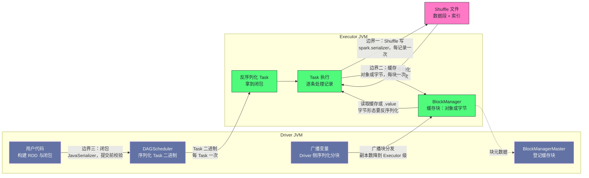
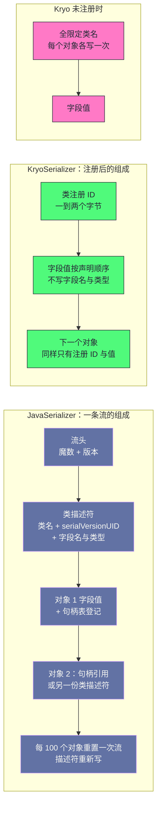
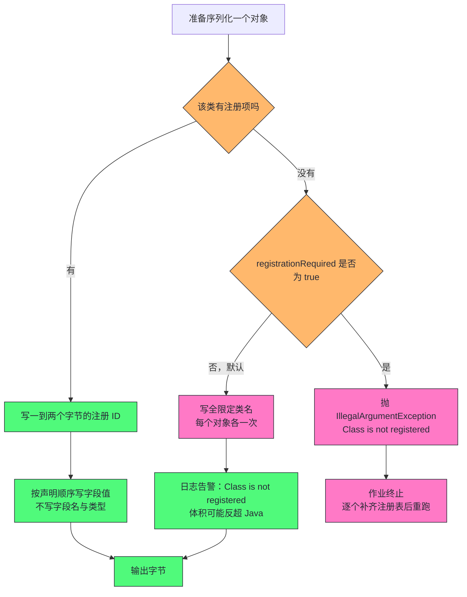
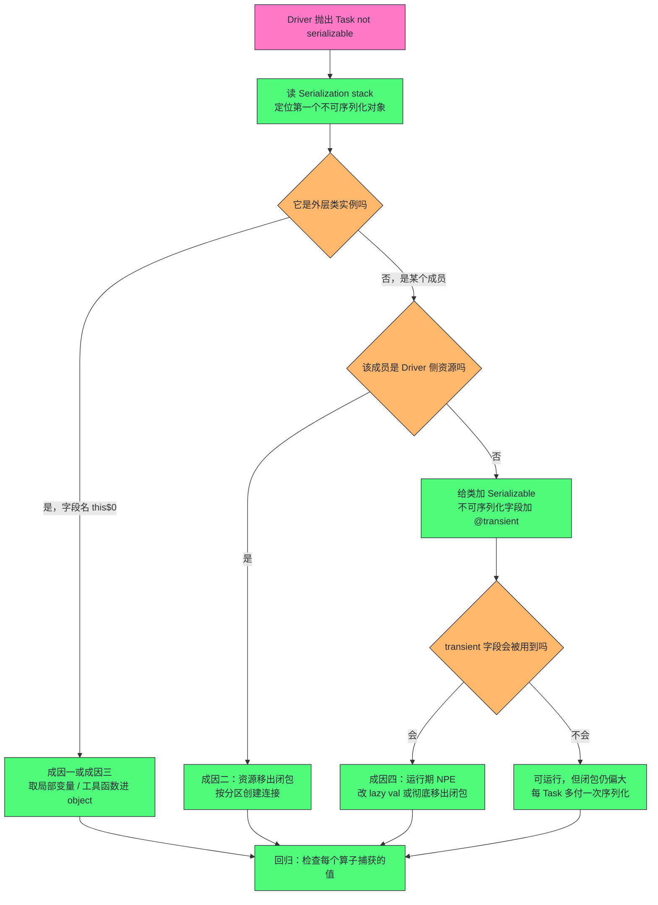
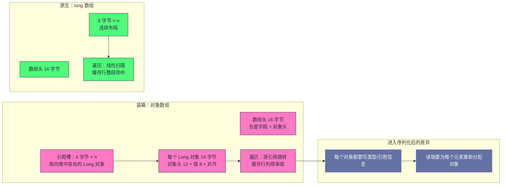
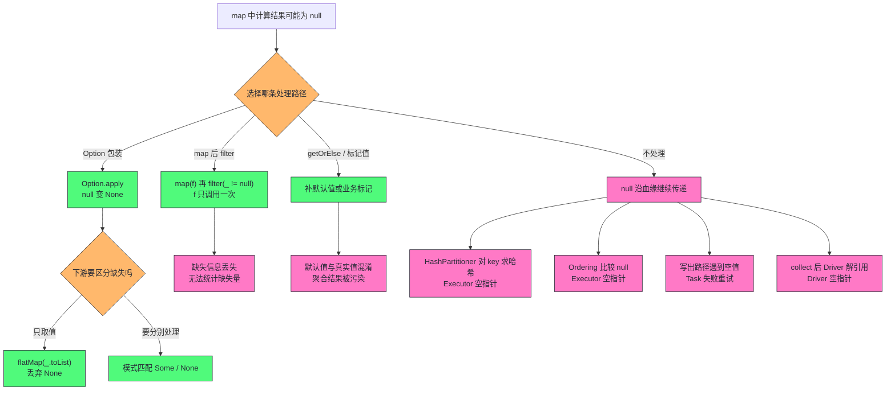

# 1. Spark 序列化与对象模型：三处边界、四种错误与装箱的内存账

**摘要：**

Spark 的调优讨论里，"序列化"常常被当成一个参数：把 `spark.serializer` 换成 Kryo，作业就快一截。真实情况要复杂得多。序列化在 Spark 里不是一个动作，而是三个位置上的三本账：Shuffle 落盘时要按记录编码，RDD 缓存到内存或磁盘时要按块编码，闭包下发到 Executor 时要按对象图编码。三者的触发频率、编码单位、失败形态各不相同，用同一把旋钮去调它们，得到的往往是"一处变快、两处变慢"，而且方向随对象形状漂移。

这篇文章沿五问推进。先界定三处序列化边界分别在哪里、各自由谁触发、各自用哪个序列化器，并说明为什么闭包那条路不受 `spark.serializer` 支配。再把 Java 序列化拆开：类元数据、字段名、句柄表与引用追踪，逐项算清它为什么体积大、为什么慢，以及它凭什么长期占据默认位置。接着进入 Kryo：注册表换来的是一到两个字节的类标识，代价是漏注册就从性能问题升级为可用性问题；`registerKryoClasses` 写漏一个类会发生什么，Spark 自己的内部类提供过反面教材。然后处理 `Task not serializable`：把四种真实成因（捕获外部类实例、捕获不可序列化成员、`this` 逃逸、`transient` 未初始化）分开，并说明 `SerializationDebugger` 打印的栈该从哪一行读起。最后落在对象模型上：一个 `Long` 在堆里值多少字节，装箱如何把内存账放大数倍，FastUtil 在什么规模上才值得引入、代价是什么，以及 `null` 沿三条处理路径传播时，空指针会在 Driver 还是在 Executor 上炸开。

文章回答两个问题：为什么改了序列化配置作业却没变快，以及 `Task not serializable` 到底在报什么。口径是 Spark 4.3.0（2026-10-30 发布，4.x 预编译 Scala 2.13）；涉及实现细节处，以对应版本文档或源码为准。

**关键词（Keywords）**: 序列化, **Kryo**, **Java 序列化**, **Task not serializable**, 闭包, **装箱**, **FastUtil**, NULL 处理, UnsafeRow

---

## 第 1 章 三次过境：序列化在 Spark 里的位置

### 1.1 一个不报错的慢

不妨设一个没有异常的现场：某电商的点击归因作业 `ad_attr` 每天处理三亿条点击流，按广告计划标识连接一张两百万行的维表，再与一份用户画像 RDD 关联，产出按计划聚合的小时级归因结果。这个作业一直能跑完，只是耗时在几个月里从四十分钟涨到了三个小时，GC 时间占了执行时间的一半以上，而业务逻辑一行没改。

接手的人按常规顺序动了几处：把画像 RDD 的存储级别从 `MEMORY_ONLY` 改成 `MEMORY_ONLY_SER`，内存占用立刻降了下来，GC 时间却只降了一点，作业总耗时反而多了一成；把维表改成广播变量，网络传输明显减少，Driver 的序列化时间却冒了出来；再把 `spark.serializer` 换成 Kryo，Shuffle 阶段的写盘量小了，Task 启动时间却没有变化。三处改动，三个方向，每一处都只在自己那本账上生效。

这种"改了有反应、但反应不在预期位置"的现象，根源是把序列化当成了一个整体。它在 Spark 里至少出现在三个互不重叠的位置上：数据离开计算节点时的 Shuffle 落盘、数据被留下来的缓存、以及代码本身被送到 Executor 时的闭包下发。三者共用一套 `Serializer` 抽象，却各有各的触发者、各有各的计量单位，也各有各的失败方式。

### 1.2 边界一：Shuffle 落盘

第一处边界在 Shuffle 的写端。`reduceByKey`、`join`、`groupBy`、`repartition` 这类宽依赖算子要让下游按 key 重新分组，而分组要求数据离开它被算出来的那个 Task，先物化成字节，再被搬运、被归并、被重新读成对象。写端每产出一条记录，都要经过 `SerializerInstance.serialize` 编成字节数组，塞进写端缓冲区；缓冲区满了就排序、溢写；读端拿到字节之后，用同一个序列化器的 `deserialize` 还原成对象，才谈得上聚合。

这里的计量单位是"记录数乘以单条记录的字节数"，触发频率是每条记录、每次 Shuffle。后果分三层：字节多，磁盘写与网络搬运就多；字节多，读端的反序列化次数不变但每次要读的字节变多；而反序列化本身是读端热路径上最贵的一段 CPU，因为每条记录都要走一遍反射或字段复制。压缩可以在这层字节上再做一次削减，但压缩只改字节的表示，改不了"每条记录都要编码、都要解码"这个次数。

这条边界有一个容易被忽略的性质：它是三处里唯一"不序列化就根本做不到"的一处。Driver 与 Executor 是两个进程，两个进程之间传递的只能是字节，没有第二种选择。因此这里的讨论从来不是"要不要序列化"，而是"用哪种编码、每条记录多付几个字节"。

### 1.3 边界二：缓存

第二处边界在 RDD 的持久化上，位置比 Shuffle 隐蔽，因为它发生在"数据本来已经在内存里"的时候。`MEMORY_ONLY` 把分区当作反序列化后的对象数组留在堆里，这条路上没有序列化动作，代价换成了内存占用与 GC 扫描：一个逻辑上只有几列整数的记录，在堆里可能是一个元组套着两个装箱对象，外加对象头与对齐填充。`MEMORY_ONLY_SER` 与各种带磁盘的级别（譬如 `MEMORY_AND_DISK`、`DISK_ONLY`）则相反，数据以字节形态存放，内存占用降下来，但每次下游读取这块缓存都要反序列化一次。

于是同一次缓存，在两个方向上收费：存对象，收的是内存与 GC；存字节，收的是每次读取的 CPU。`spark.serializer` 在这条边界上直接生效，Kryo 换上去，缓存块的字节数会变小，能装下的分区变多，代价是反序列化路径换成 Kryo 的字段复制，某些对象形状上并不比 Java 快。缓存边界的计量单位是"块"，触发频率是"每次访问这块缓存"，这个频率取决于血缘：一个被五个 Action 复用的 RDD，它的每个分区会被反序列化五次。

这也是"缓存之后反而更慢"这类现象最常见的来路。缓存省掉的是重算，付出去的是序列化与反序列化；当重算本身很便宜、而对象又很"碎"时，这笔兑换就是亏的。存储级别的取舍另有一套账本，这里只记一条：**缓存把"计算成本"换成了"编码成本"**，而编码成本的高低由序列化器和对象形状共同决定。

把常见的几种缓存形态按"序列化发生在什么时候"排开，边界的位置就清楚了：

| 存储形态 | 序列化发生在 | 堆内存占用 | 每次读取的成本 |
|---|---|---|---|
| `MEMORY_ONLY` | 不发生，直接存对象 | 高，对象图加引用 | 无解码，直接读对象 |
| `MEMORY_ONLY_SER` | 写入缓存时编码一次 | 低，按字节块计 | 每次读取都要反序列化 |
| `MEMORY_AND_DISK` | 内存存对象，溢写磁盘时编码 | 内存部分高，磁盘部分低 | 命中内存不解码，命中磁盘要解码 |
| `DISK_ONLY` | 写入时编码 | 不占堆内存 | 每次读取都要磁盘 IO 加反序列化 |

### 1.4 边界三：闭包下发

第三处边界不在数据上，在代码上。`rdd.map(f)` 里的 `f` 不是一段可以单独传输的字节码，它是一个对象：Scala 的匿名函数编译成一个类，类里持有它捕获的外部变量，如果这个函数写在某个类的成员方法里，它还持有一个指向外层类实例的引用。Driver 在提交 Stage 时，要把这个闭包对象连同它捕获的整张对象图序列化，随 Task 一起下发到 Executor，Executor 反序列化之后再执行。

这里的计量单位是"闭包对象图的大小乘以 Task 数"。一个 10 MB 的只读字典被闭包直接捕获，意味着每个 Task 各带一份，Driver 要为每个 Task 序列化一次这张图，Executor 要反序列化一次；Task 数上万时，这笔开销与数据量无关，只与闭包的大小和任务数成正比。它的失败方式也与其他两处不同：数据边界的编码失败只会让某条记录写不出去，闭包边界的编码失败会让作业在 Driver 端、在 RDD 变换被调用的那一刻就抛出 `Task not serializable`，一个 Task 都不会启动。

这条边界还有一个常被误解的地方：它不受 `spark.serializer` 支配。SPARK-12414 移除了 `spark.closure.serializer` 配置，2.0.0 起闭包序列化固定为 `JavaSerializer`，因此把 `spark.serializer` 改成 Kryo，既不会让闭包变小，也不会让 `Task not serializable` 消失。这一点在诊断时至关重要——它意味着闭包类错误的解法只能在代码结构上找，不在配置里找。

### 1.5 三本账不能混

把三处边界并排放，差异比共同点更值得记住。触发频率上，Shuffle 是记录级、缓存是块级、闭包是 Task 级；编码单位上，前两者是数据、后者是代码；失败形态上，Shuffle 编码慢表现为写盘与反序列化的 CPU，缓存编码慢表现为 GC 或读取延迟，闭包编码失败则是提交前的一场硬报错。同一个参数 `spark.serializer` 只对前两者生效，对第三者无效；而 `registerKryoClasses` 只对"会被 `spark.serializer` 编码的类"有意义，注册一个只出现在闭包里的类，除了多一条注册表项，什么也不会改变。

还有一条支线值得顺手记下：Task 的结果回传 Driver 时也要编码，小结果直接内联在 `DirectTaskResult` 里，超过 `spark.task.maxDirectResultSize`（默认 1 MiB）的结果会先存进 BlockManager，再由 Driver 远程拉取。这条路径同样走 `spark.serializer`，所以 `collect` 一个超大结果时的 Driver 压力，一半来自堆内存，另一半来自序列化与反序列化的往返。它不在三处主边界之内，却常常在"为什么 collect 很慢"的问题里出现。

| 边界 | 触发者 | 编码对象 | 计量单位 | 频率 | 失败形态 |
|---|---|---|---|---|---|
| Shuffle 落盘 | 宽依赖算子的写端 | 每条记录 | 记录 × 单条字节 | 每记录、每次 Shuffle | 写盘与网络膨胀、读端反序列化 CPU 高、spills 增多 |
| RDD 缓存 | `persist`/`cache` 与 BlockManager | 分区块（对象或字节） | 块 × 字节数 | 每次读取缓存 | 对象形态内存与 GC 高；字节形态每次读取要反序列化 |
| 闭包下发 | `RDD` 变换调用时的 `sc.clean` | 函数与其捕获的对象图 | 闭包大小 × Task 数 | 每个 Task 一次 | `Task not serializable`、Driver 序列化耗时、Driver OOM |
| Task 结果回传（支线） | `Executor` 回传 `DirectTaskResult` | 结果对象 | 结果大小 × Task 数 | 每个 Task 一次 | Driver 内存压力、`collect` 慢、结果超限转间接结果 |

### 1.6 贯穿案例与一个比喻

后面的论述需要一个固定的着力点，就用前面那个 `ad_attr`。它的形状能同时压到三处边界：三亿条点击按计划标识聚合，写端要按记录编码并落盘，这是第一处；用户画像 RDD 被五个下游 Action 复用，缓存形态决定了每次读取要不要反序列化，这是第二处；维表与画像加载逻辑写在同一个 `AttributionJob` 类里，算子内部只要引用了一次类成员，整个 `AttributionJob` 实例就会被拖进闭包，这是第三处。三处边界在这一个作业里同时存在，而它们各自的最优解并不一致：Shuffle 希望编码越紧凑越好，缓存希望读取越快越好，闭包希望捕获的东西越少越好。

不妨用搬家来打这个比方。搬家公司进门先做三件事：把家具拆开、按箱打包、贴上清单，这对应 Shuffle——东西必须离屋，离开之前必须变成可搬运的形态，箱子越紧凑，车跑得越少；有些家具这一趟用不上、下一趟还要用，就先存进中转仓，存的时候可以选择"拆好的状态"还是"装好的状态"，对应缓存——存拆好的省地方，但每次要用都得重新装一遍；工人随身的工具箱则是闭包——工具不是货物，它跟着人走，箱子越重，每个工人都要多背一份。

这个比喻的限定在于：搬家公司的三件事可以分别外包给三家公司，Spark 的三处边界却共用一个 JVM 堆和一套序列化抽象，任何一处省下的字节，都可能以另一处的 CPU 或内存还回来；而工具箱那件事更特殊，它的重量不随货物量变化，只随工人数（Task 数）放大，这正是闭包问题与数据问题在量级上分开的原因。

把三处边界画在一张图上，它们的相对位置与数据流向会更清楚：



图中标了字的三条边就是三处边界，虚线只传递块的位置信息、不搬数据；底下那条广播支线是同一套序列化机制的另一位使用者，副本数从 Task 级降到 Executor 级，但块本身仍要编码。需要注意左边那条"提交前校验"的边：它在 Driver 上完成，校验失败的作业根本走不到右边，这也解释了为什么闭包类错误的堆栈里看不到任何 Executor 的痕迹。

---

## 第 2 章 Java 序列化：以"对象图"为单位编码

### 2.1 一条流里到底写了什么

要理解 Java 序列化为什么体积大，得先看它往流里写了什么。`ObjectOutputStream` 打开时先写一段流头（魔数与版本号），随后每遇到一个此前没写过的类，写一份**类描述符**（class descriptor）：类名、`serialVersionUID`、这个类的字段名与字段类型列表，以及该类是否自定义了 `writeObject`/`readObject`。描述符写过之后，同类的后续对象只写"引用哪份描述符"加上各字段的值。

对象与对象之间的引用另有一套**句柄表**机制：每个被写过的对象在句柄表里占一个位置，同一个对象第二次出现时只写一个句柄编号，不重复写内容。这套机制加上类描述符，构成了 Java 序列化的"流式对象图"格式，它的设计目标从来不是"让一条记录尽量短"，而是"让任意一张对象图能被完整还原，包括共享引用与环"。

Spark 在这个格式上加了一个旋钮：`spark.serializer.objectStreamReset`（默认 100）让 `JavaSerializer` 每序列化 100 个对象就重置一次流。重置会清空句柄表，避免长流里句柄表无限增长带来的内存与哈希开销，代价是类描述符要重新写一遍。于是同一条 Shuffle 写端的流里，描述符并不是只出现一次，而是每隔百来个对象重复一次——这个细节解释了为什么"类描述符按流摊薄"这个说法在 Spark 里只能算半对。

### 2.2 引用追踪：同一性的代价

句柄表服务于一个明确的语义承诺：序列化再反序列化之后，原本指向同一个对象的两个字段，仍然指向同一个对象。这条承诺对对象图是必要的，对数据记录却大多是多余的——一条订单记录里的两个字段几乎不会共享同一个对象，更没有环。为一份用不上的能力付费，是 Java 序列化在数据场景里最根本的错配。

这份成本落在两处：一是每个对象都要进句柄表做一次判重，二是每个对象引用都要写成句柄而不是直接内联。对象越小、引用越多，这两笔开销占比越高。一个只装两个整数的元组，本身内容 8 字节，加上对象头、句柄记录与描述符均摊，实际写出去可能是它的五六倍。数据是"记录"，序列化格式却是按"对象图"设计的，**这个错配不会报错，只会稳定地多收几倍字节**。

Kryo 同样默认开启引用追踪（`spark.kryo.referenceTracking` 默认 true），因为它要保住同样的对象图语义。把它关掉能省字节与哈希开销，但共享引用会被展开成多份副本，有环的对象图会直接栈溢出。要不要关，取决于数据里是否存在共享结构，而这个判断只能由写代码的人做，框架不敢替你做。

### 2.3 它凭什么一直是默认

把 Java 序列化说得一无是处很容易，不过它占据默认位置的理由相当硬。任何实现了 `Serializable` 的类都能直接工作，不需要注册、不需要无参构造、不需要额外的库；跨版本演进有 `serialVersionUID` 兜底，加字段给默认值（譬如新字段反序列化后为 0 或 `null`）、删字段直接忽略，虽然粗糙，但至少不会在升级当天炸掉；失败时抛出的 `NotSerializableException` 会带上字段路径，定位成本低。对于一个要兼容整个 Java 生态的计算框架，这三条加起来的分量超过性能。

反过来设想默认换成 Kryo 的后果：每个用户类都要注册，漏一个就从"慢"变成"崩"，而 Spark 自己的内部类也在不断新增，SPARK-25100 记录过 `TaskCommitMessage` 未注册导致作业失败，SPARK-36009 记录过 GraphX 的 `ShippableVertexPartition` 漏注册。这类问题的修复方式是把内部类一个个补进注册表，而每一个漏网之鱼都要等到某条特定代码路径被执行时才暴露。默认值的选择因此不只是性能取舍，还是"由谁承担确定性"的分工：框架选 Java，把确定性留给自己，把注册成本交给愿意付的人。

### 2.4 一个比喻：报关单与三位数编码

Java 序列化的流像一箱一箱的货物，每箱都附一份格式统一的报关单：品名、规格、产地、材质逐项写明，报关单本身有时比货物还占地方。它的好处是任何海关都认，不需要事先约定；坏处是每一箱都要重新填一遍，哪怕这一百箱装的是同一种螺丝。

Kryo 注册之后的做法，是给每种货物发一个三位数编码，箱子上只写编码加数量，报关单只存在于双方共用的编码表里。字节数立刻降下来，前提是编码表两边一致——表里没有的货物，要么现场手写全名（未注册路径），要么直接退运（`registrationRequired` 打开时）。这个比喻的限定在于：编码表不是一次约定永久有效，货物规格（类的字段）一变，表就得同步改，而 Spark 的编码表没有版本号，改错了不会在打包时发现，只会在拆箱时对不上。

把两种格式的字节布局并排画出来，差异一目了然：



图下半部分那个"未注册时"的分支值得单独记住：Kryo 找不到注册项时会退化为"每个对象写一次全限定类名"，而 Java 的类描述符是按流（或按 100 个对象的重置周期）摊薄的。两者在最坏情况下的体积关系可能反转，SPARK-10251 在描述未注册类的问题时给出的判断正是"存储与运行时开销大得多"，而不是"略慢一点"。

把两套格式的机制逐项对照，取舍的位置会更清楚：

| 维度 | Java 序列化 | Kryo（已注册） | Kryo（未注册） |
|---|---|---|---|
| 类标识 | 类描述符，按流或重置周期摊薄 | 一到两个字节的注册 ID | 每个对象写全限定类名 |
| 字段元数据 | 写字段名与类型 | 只按声明顺序写值 | 只按声明顺序写值 |
| 引用追踪 | 句柄表，始终开启 | 可配，默认开启 | 可配，默认开启 |
| 版本演进 | `serialVersionUID` 弱兼容 | 无版本概念，字段增删会错位 | 同左 |
| 失败形态 | `NotSerializableException` + 字段路径 | `Class is not registered`（开启强制注册时） | 只有告警，体积悄悄膨胀 |
| 主要成本 | 描述符、字段名、句柄 | 注册维护与编码表一致性 | 类名字符串与反射 |

---

## 第 3 章 Kryo：注册表换来的体积

### 3.1 机制：把类名换成整数

Kryo 的核心并不是某种更聪明的压缩算法，而是"事先约定"四个字。每个类在**注册表**里占一个整数编号，编码时写编号而不是全限定类名；`FieldSerializer` 按字段声明顺序写值，不写字段名、不写类型、不写流头；同一份注册表在 Driver 与每个 Executor 上各建一次，两端靠配置保持一致。省下来的字节有三个来源：类名（未注册时每个对象三十到六十字节不等）、字段名与类型（注册后完全不写）、以及 Java 那条按重置周期重复的类描述符。

速度上的差异来自另一条路径。Java 序列化在运行时反复做反射式的字段查找与访问检查，Kryo 为每个类缓存一个序列化器实例，字段访问器在首次使用时解析并缓存，后续是直接的字段读写；字节变少之后，写盘、网络与读端解码的绝对量也同步下降。**它快，一半快在少写字节，一半快在少做反射**，两者都依赖注册表事先建好。

Spark 通过 chill 使用 Kryo 4，SPARK-60024 记录了把依赖升到 Kryo 5 的讨论（影响版本包括 4.3.0），也就是说截至目前，4.x 上的 Kryo 注册 API 与字节格式仍以 Kryo 4 为准。注册有三个入口，分别对应三种使用场景：`SparkConf.registerKryoClasses` 写在应用代码里，适合少量业务类；`spark.kryo.classesToRegister` 通过提交参数传入，不必改代码，适合运维侧补齐；`spark.kryo.registrator` 指定一个 `KryoRegistrator` 实现，适合类数量多、注册逻辑需要收在一处的场景，由框架或基础库统一提供。三者最终都落到同一张注册表上。

### 3.2 不注册会怎样

这是 Kryo 最容易被轻描淡写的一节。`spark.kryo.registrationRequired` 默认是 false，于是漏注册不会让作业失败：Kryo 找不到注册项时退化为写全限定类名，作业照跑，日志里偶尔出现一行 "Class ... is not registered" 的告警。体积呢，按第 2 章那张表的最后一行，可能比 Java 序列化还大——Java 的描述符至少还按流摊薄，Kryo 的类名是按对象重复的。换句话说，**换 Kryo 但不注册，得到的可能是一个"更慢、更大、只是没报错"的组合**，而这恰恰是最难被发现的失败方式，因为监控上看不出异常，只有 Shuffle 写盘量悄悄涨了一截。

把 `registrationRequired` 打开，问题立刻从性能变成可用性：第一个未注册的类直接抛 `IllegalArgumentException: Class is not registered`，作业终止。SPARK-25100 的现场是 `FileCommitProtocol$TaskCommitMessage`，一个用户代码里根本不会提到的 Spark 内部类；SPARK-10251 的现场是 `scala.Tuple2[]`，数组类型需要单独注册；SPARK-36009 的现场是 GraphX 的 `ShippableVertexPartition`，属于框架自带工具方法漏注册。三个案例指向同一件事：需要注册的不只是"我写的那个 POJO"，还包括元组、数组、Scala 集合、Spark 内部类，以及第三方库里会进入 RDD 的类型。

发现漏注册只能靠迭代：先在 `registrationRequired=false` 下跑一遍全链路，把告警里的类名收集起来补齐，再打开强制注册回归。补齐之后仍然不能宣布完成，因为只在特定分支、特定数据形状下才会出现的类，可能要到下一次数据异常时才排队进场。这项工作的性质接近"给整个类型系统做一次普查"，成本真实存在，也正因为真实，才不该在不清楚收益的情况下随手打开强制注册。

### 3.3 配置落地

配置本身只有几行，值得看清的是每行的作用与顺序：先换序列化器，再注册类，注册必须发生在 `SparkContext` 创建之前，因为序列化器实例在 `SparkEnv` 初始化时就固定了，之后再改配置不会生效。

```scala
import org.apache.spark.SparkConf
import org.apache.spark.serializer.KryoSerializer
import org.apache.spark.serializer.KryoRegistrator

// 业务类：进入 RDD 的元素、广播内容、聚合中间结果都算
case class ClickEvent(planId: Long, userId: Long, ts: Long, cost: Int)
case class PlanDim(planId: Long, category: String)

class AttributionRegistrator extends KryoRegistrator {
  override def registerClasses(kryo: com.esotericsoftware.kryo.Kryo): Unit = {
    // 注册表要在 Driver 与 Executor 两端一致，注册器类本身必须随作业分发
    kryo.register(classOf[ClickEvent])
    kryo.register(classOf[PlanDim])
    kryo.register(classOf[Array[ClickEvent]])
    kryo.register(classOf[Array[PlanDim]])
    // 元组与 Scala 集合常被忽略，却在 RDD 算子链里大量出现
    kryo.register(classOf[(Long, Long)])
    // 元组数组是 Kryo 注册里最常被漏掉的一类，SPARK-10251 的现场就是 Tuple2[]
    kryo.register(classOf[Array[(Long, Long)]])
  }
}

val conf = new SparkConf()
  .setAppName("ad_attr")
  .set("spark.serializer", classOf[KryoSerializer].getName)
  // 用注册器而不是逐个 classesToRegister，便于把注册逻辑收在一处
  .set("spark.kryo.registrator", classOf[AttributionRegistrator].getName)
```

这段配置里有两条隐含约束。其一，注册器类要在 Executor 的 classpath 上，通常通过 `--jars` 或 fat jar 分发，否则 Executor 初始化序列化器时会找不到类。其二，`spark.serializer` 只影响 Shuffle 与缓存，闭包序列化仍走 JavaSerializer，因此闭包里的类即使注册了也不会因此变小——注册表服务的是数据路径，不是代码路径。

### 3.4 边界：Kryo 不是免费的

Kryo 的第一条边界是版本演进。它的字段按声明顺序编码，没有字段名也没有版本号，给类加一个字段、删一个字段、改一次字段顺序，旧字节就会按新布局解读，轻则数据错位，重则抛异常。Java 序列化同样不擅长演进，但至少有 `serialVersionUID` 与"加字段给默认值"的约定，Kryo 连这层约定都没有。这条边界在两种场景下会咬人：一是把 RDD 持久化到磁盘后跨应用读取，二是升级 Spark 或 chill 之后读取旧的缓存与 checkpoint 数据，字节格式跟着库版本变，旧文件读不回来。

第二条边界是缓冲区。`spark.kryoserializer.buffer`（默认 64 KiB）与 `spark.kryoserializer.buffer.max`（默认 64 MiB）限定单个对象能占用的缓冲，一个异常巨大的单条记录会撞上上限并抛出与 buffer 相关的异常。遇到这类报错，正确的反应不是把上限调大，而是先问"为什么单条记录会有几十 MB"——这通常意味着本该拆分的结构被塞进了一个对象。

第三条边界在 SQL 侧。`spark.serializer` 对 Dataset/DataFrame 基本无效：SQL 的记录以 `UnsafeRow` 承载，Shuffle 与聚合走的是 Tungsten 那条自己的二进制路径，Kryo 换上去不会改变 SQL 作业的编码方式。对一个纯 DataFrame 作业调 `spark.serializer`，多数情况下什么也不会发生，而在 RDD 与 DataFrame 混用的作业里，它只对 RDD 那一段生效。这一点以对应版本的源码为准，但它足够稳定，可以作为排查时的第一道筛子。

第四条边界是诊断体验。Kryo 的异常通常只给类名与缓冲区信息，不像 Java 序列化那样打印出从闭包根到问题字段的完整路径；同样是"序列化失败"，Java 那条路给出的是路线图，Kryo 给出的往往只是一个坐标。省下的字节与省下的诊断信息，是同一笔交易的两面。

### 3.5 注册查表的判定路径

下面这张图画的是 Kryo 序列化一个对象时的判定顺序。它把"漏注册"的两种后果并排放在同一个分叉上：要么体积悄悄膨胀，要么作业当场失败，取决于一个配置项。



图中两条失败支路的分岔点只有一个开关，但它决定的是"性能问题"还是"可用性问题"。选择把它关着，等于选择让漏注册以体积的形式慢慢收账；选择把它打开，等于选择用一次失败换一次确定。两种都合理，前提是知道自己选的是哪一种。

Kryo 相关的配置项不多，但每一条都有明确的失效方式，值得一并列清（默认值以对应版本文档或源码为准）：

| 配置项 | 默认值 | 作用 | 误用后的表现 |
|---|---|---|---|
| `spark.serializer` | `JavaSerializer` | 选择 Shuffle 与缓存的序列化实现 | 换成 Kryo 却未注册业务类，体积可能不降反升 |
| `spark.kryo.classesToRegister` | 空 | 提交参数方式追加注册 | 漏掉数组、元组与内部类，开启强制注册后失败 |
| `spark.kryo.registrator` | 空 | 用 `KryoRegistrator` 集中注册 | 注册器类未随作业分发，Executor 端初始化失败 |
| `spark.kryo.registrationRequired` | false | 强制要求所有类已注册 | 打开后任何一个内部类漏网都会终止作业 |
| `spark.kryo.referenceTracking` | true | 保住对象图的共享引用与环 | 关掉后共享对象被展开成多份，语义改变 |
| `spark.kryoserializer.buffer` / `.max` | 64 KiB / 64 MiB | 单对象序列化缓冲上限 | 超大单条记录报缓冲溢出，掩盖了结构设计问题 |
| `spark.serializer.objectStreamReset` | 100 | Java 流的重置周期 | 调大省描述符但句柄表变长，内存与哈希开销上升 |

---

## 第 4 章 Task not serializable：四种成因与一条读法

### 4.1 报错发生在哪里

先把报错的位置钉死：`Task not serializable` 是 Driver 端的异常，抛出点在用户调用算子的那一行，而不是某个 Executor 的任务里。`rdd.map(f)` 这类变换在构建 RDD 时会调用 `sc.clean(f)`，`ClosureCleaner` 随之尝试用 `SparkEnv` 里的闭包序列化器把 `f` 序列化一遍，作为一个提前校验；序列化失败，就把 `NotSerializableException` 交给 `SerializationDebugger` 增强成带路径的栈，再包成 `SparkException` 抛回用户代码。于是一个 Task 都没启动，作业已经结束了。

这也解释了一个常见的排查误区：看到 `Task not serializable` 就去翻 Executor 日志，翻不到任何东西。堆栈里全是 Driver 的调用帧、`ClosureCleaner` 与 `JavaSerializer` 的类名，唯一属于用户的部分是算子被调用的那个行号。定位的起点应当是"这行代码的闭包捕获了哪些东西"，而不是"集群哪台机器出了问题"。

`ClosureCleaner` 在这条路径上扮演的角色常被高估。它的做法是通过反射把闭包里不必要的 `$outer` 引用剪掉，让本来只是"编译器顺手挂上去"的外层对象不再进入序列化范围。但它是尽力而为的优化，不是语言层的保证：SPARK-7237 曾指出大量用户闭包其实没有被真正清理，SPARK-31399 记录了 Scala 2.12 把 lambda 编译成 `SerializedLambda` 之后，清理器的反射路径失灵、捕获参数被原样带进序列化的情况。剪不掉的引用，只能靠改写代码来剪。

### 4.2 成因一：捕获了外部类实例

最常见的一种，是把算子写在类的成员方法里，并在闭包中引用了类的成员变量。Scala 的匿名函数会捕获它用到的外部变量，如果这个变量是 `this` 的字段，编译器就把整个外层实例作为 `this$0` 字段挂到闭包对象上；序列化闭包时，外层实例连同它的全部字段一起被拖进去，只要其中一个字段不可序列化，整个闭包就失败。

```scala
// 反例：闭包只"看起来"用了一个 String，实际捕获了整个 AttributionJob 实例
class AttributionJob(conf: String) {
  val rootDomain: String = conf
  val planCache = new java.util.concurrent.ConcurrentHashMap[Long, String]() // 不可序列化

  def process(rdd: RDD[String]): RDD[Boolean] = {
    // 引用 rootDomain 会生成 this$0，planCache 也跟着进入对象图
    rdd.map(item => item.contains(rootDomain))
  }
}

// 正例一：把需要的值取成局部变量，闭包只捕获这个 String
class AttributionJobFixed {
  def process(rdd: RDD[String], rootDomain: String): RDD[Boolean] = {
    rdd.map(item => item.contains(rootDomain))
  }
}

// 正例二：把无状态工具函数放进 object，闭包只引用单例，不拖外层实例
object DomainUtils {
  def normalize(host: String): String =
    if (host.startsWith("www.")) host else "www." + host
}
```

反例里最刺眼的是 `planCache`：闭包一个字都没提到它，它却稳稳地躺在报错栈里。原因是 Java 序列化以"对象图"为单位，`this$0` 一旦被写进流，它持有的所有非 `transient` 字段都要跟着走，不管闭包用不用。这也是为什么修复方式通常不是"给类加 `Serializable`"，而是"别让闭包看到这个类"。

### 4.3 成因二：捕获了不可序列化的成员

第二种与第一种只差一步：外层类确实实现了 `Serializable`，但它的某个字段不是。典型的有 `SparkContext`、`java.sql.Connection`、`org.slf4j.Logger` 的实现类、`ThreadLocal`、以及各种持有线程或文件句柄的客户端。这些对象有一个共同点：它们的生命周期属于 Driver 进程，语义上根本不该跨进程复制。

麻烦在于失败出现的位置。序列化器遍历对象图时，先写这个类的普通字段，走到那个不可序列化的字段才报错，于是报错信息里出现的往往是一个与业务无关的类名，而用户真正写错的地方是"把一个 Driver 侧的资源放进了算子所在类的字段里"。更糟的一种情况是 `SparkContext`：它本身不实现 `Serializable`，而它引用着 DAGScheduler、JobArtifacts 与一整套运行时结构，序列化可能在抛异常之前先花掉大量时间与内存，表现为作业长时间卡在提交阶段，最后以一个 OOM 或深递归栈溢出收场，`Task not serializable` 反而不出现。

修法有两条，优先级不同。首选是把资源从闭包路径上移走：连接在 `mapPartitions` 里按分区创建与关闭，配置值在构造算子之前取成局部变量，日志对象则用具名 `object` 持有，或者写成 `@transient lazy val` 让它在每个 Executor 上重建。次选才是给字段加 `@transient`，而那会把问题推到下一节。

### 4.4 成因三：`this` 逃逸

第三种是**`this` 逃逸**，最难看出来，因为代码里看不到任何变量引用。闭包里只要调用了外层类的方法，方法就需要一个接收者，编译器于是把 `this` 捕获进去；同理，`rdd.map(transform)` 这种 eta 展开、把成员方法直接当函数传的写法，也会捕获 `this`。还有隐式参数：从类成员里取出一个 `implicit val`，闭包同样把它背后的实例拖进来。

```scala
class AttributionJob {
  private val multiplier: Double = 0.7

  def score(cost: Long): Double = cost * multiplier

  def run(rdd: RDD[Long]): RDD[Double] = {
    rdd.map(score)              // eta 展开：捕获 this
    // rdd.map(cost => score(cost))  // 同样捕获 this
  }
}
```

这段代码的作者会觉得自己只是复用一个纯函数，报错却指向 `AttributionJob` 不可序列化。判断方法很简单：闭包里出现的方法名如果是"类自己的方法"，就当作捕获了 `this`。修法是把方法搬进 `object`、改成局部函数，或者把 `multiplier` 取成局部 `val` 后写 `rdd.map(cost => cost * m)`。

这一种成因还随编译器版本漂移。Scala 2.12 起 lambda 的编码方式与 2.11 不同，`ClosureCleaner` 能剪掉的引用范围跟着变化，SPARK-31399 记录的就是这条链路上的失灵；2.13 又做了调整。同一份代码从 2.11 迁到 2.13、或者从 2.13 迁到 4.x 预编译的运行时，原本能跑的算子可能突然报错，原因不在 Spark，在闭包的形状变了。

### 4.5 成因四：`transient` 未初始化

第四种根本不报 `Task not serializable`，它绕过校验，把错误推迟到运行期。给字段标上 `@transient`，序列化器会跳过它，闭包因此"可序列化"了；但反序列化之后，这个字段不会被赋值，在 Executor 上就是 `null`。闭包一旦用到它，空指针就在 Task 里炸开，重试若干次之后整个 Stage 失败。

```scala
class BadJob extends Serializable {
  @transient private val conf = new SparkConf().setAppName("ad_attr")
  @transient private val sc = new SparkContext(conf)   // Driver 侧资源，本来就不该进闭包
  val threshold: Long = 100L                            // 可序列化的普通字段

  def run(rdd: RDD[Long]): Long = {
    // sc 在 Executor 上是 null：序列化通过了，运行期才炸
    rdd.filter(_ > threshold).map(_ => sc.longAccumulator).count()
  }
}
```

`@transient lazy val` 是这条例外的安全形态：`lazy` 的初始化位图不会被序列化，字段在反序列化后处于"未初始化"状态，第一次访问时才在 Executor 本地重新计算。日志对象常用这个写法，因为它在每个 JVM 上重建一份是合理的。而 `@transient val` 只是挖了一个洞，洞什么时候塌，取决于哪条数据先走到那个分支。

这四种成因对应四种修法，优先级与残余风险各不相同：

| 成因 | 报错时机 | 栈里的特征 | 修法 | 残余风险 |
|---|---|---|---|---|
| 捕获外部类实例 | 提交前，Driver 抛 `Task not serializable` | 出现 `this$0`，指向业务类 | 取局部变量、工具函数进 `object` | 若业务类还有共享状态，仍需重构 |
| 捕获不可序列化成员 | 提交前，可能先卡住再失败 | 报错类名是 `SparkContext`、连接、Logger 等 | 资源移出闭包，按分区创建 | 加 `Serializable` 只是把错误后移 |
| `this` 逃逸 | 提交前，栈里找不到变量引用 | 闭包调用了类自己的方法 | 方法搬进 `object` 或改局部函数 | 换 Scala 版本后可能复发 |
| `transient` 未初始化 | 运行期，Task 内 NPE | 无序列化栈，只有任务失败 | 不要捕获 Driver 资源；必要时改 `lazy val` | 分支未覆盖时上线才暴露 |

### 4.6 怎么读 SerializationDebugger 的栈

`SerializationDebugger` 做的事只有一件：在序列化失败时，沿着对象图把"不可序列化的那个对象是怎么被持有的"打印成一条路径。输出形如：

```text
java.io.NotSerializableException: com.example.AttributionJob
Serialization stack:
	- object not serializable (class: com.example.AttributionJob, value: ...)
	- field (class: com.example.AttributionJob$$anonfun$1, name: this$0, type: class com.example.AttributionJob)
	- object (class: com.example.AttributionJob$$anonfun$1, ...)
```

笔者见过的栈绝大多数止步于第一行，后面的路径只是用来确认它是怎么进来的。读法是从第一行开始：第一行指出"谁不可序列化"，后面每一行都是"它被谁、以哪个字段持有"，越往下越接近闭包的根。上面这段栈一眼就能看出问题出在 `this$0`——闭包类持有外层实例，与 4.2 完全对应。SPARK-31399 里那段栈更绕一些，路径经过 `java.lang.invoke.SerializedLambda` 的 `capturedArgs` 数组，再落到 `$iw` 的某个字段上，说明捕获是编译器生成的 lambda 元数据带进来的，`ClosureCleaner` 没剪掉。

它只给路径，不给判断。栈能告诉你"这个字段被带进来了"，不能告诉你"这个字段该不该被带进来"；后者是设计问题，取决于闭包到底需要哪些值。因此读完栈之后的动作不是改配置，而是回到代码，把捕获范围收窄到"这个算子真正需要的那几个值"。把这条判断路径画成决策树，四种成因落在不同的分支上：



图里特意把"加了 Serializable 之后还能不能跑"作为一个独立判定：它是对症下药与暂时止痛的分界。止了痛不代表闭包变小了，一个 10 MB 的只读字典仍然会随每个 Task 各带一份，只是不再报错——把副本数从 Task 数降到 Executor 数是广播变量那条账本的事，这里只需记住：广播内容同样要序列化，用的正是 `spark.serializer`。

---

## 第 5 章 装箱：一个 Long 在堆里的价钱

### 5.1 一个 Long 值多少字节

序列化之前的对象已经在堆里占了一份空间，这部分常被忽略，却往往比序列化本身更贵。按 64 位 HotSpot 与压缩指针的常见配置估算：对象头 12 字节（8 字节 mark word 加 4 字节类型指针），对象大小按 8 字节对齐；一个 `java.lang.Long` 是 12 加 8 等于 20，对齐后 24 字节；一个 `java.lang.Integer` 是 12 加 4 等于 16 字节；而一个原始类型 `long` 在数组里只占 8 字节。

差距在容器里被放大。一个 `Array[Long]` 或 `long[]` 的元素成本就是 8 字节，加一次数组头的固定开销；换成 `Array[java.lang.Long]`，每个元素是一个 4 字节引用加一个 24 字节的 `Long` 对象，合计约 28 字节，再算上数组头，是原生数组的三倍多。`List[Integer]` 更夸张：`ArrayList` 内部是 `Object[]`，每个槽 4 字节引用，每个 `Integer` 16 字节，外加数组扩容的余量。一个 `RDD[(Long, Long)]` 的元素成本还要再加一层元组对象：`Tuple2` 对象头 12 加两个引用 8，对齐 24 字节，两个 `Long` 各 24 字节，一个逻辑上 16 字节的键值对在堆里占 72 字节。

小整数有一个例外：`Integer` 与 `Long` 的 `valueOf` 对 -128 到 127 区间有缓存，这个区间内的装箱不产生新对象。业务标识、时间戳、金额都远超这个范围，缓存帮不上忙。`-XX:AutoBoxCacheMax` 可以把上界调大，但那等于用启动参数给一个本可以避免的编码方式打补丁。

| 表达方式 | 每元素估算 | 一亿元素量级 | 说明 |
|---|---|---|---|
| `long[]` / `Array[Long]` | 8 字节 | 约 0.8 GB | 只有数据与数组头，无逐元素对象 |
| `java.lang.Long` 对象 | 24 字节 | 约 2.4 GB | 对象头 12 加 8 字节值，对齐到 24 |
| `Array[java.lang.Long]` | 约 28 字节 | 约 2.8 GB | 引用 4 加对象 24，元素对象分散在堆中 |
| `RDD[(Long, Long)]` | 约 72 字节 | 约 7.2 GB | 元组 24 加两个 `Long` 各 24 |
| `Integer` 对象 | 16 字节 | 约 1.6 GB | 对象头 12 加 4 字节值 |
| `IntArrayList` 等原始集合 | 约 4 字节加扩容余量 | 约 0.4 GB 起 | 连续 `int[]`，无逐元素对象 |

这些数字是按典型配置做的量级估算，实际值随 JVM 参数、字段布局与是否开启压缩指针变化，但比例关系稳定：**装箱不是"多几个字节"，而是把每个元素从"一个值"变成"一个对象加一个引用"**，元素数上亿时，这条差别以 GB 计。

### 5.2 三层放大

第一层是对象数量。十亿个 `Long` 就是十亿个对象，GC 要标记、要复制、要清扫的对象数同步放大，分配速率上升会让年轻代回收从"偶尔一次"变成"每秒若干次"，而每次回收都要暂停应用线程。序列化之前，堆已经被这些对象填满了。

第二层是指针追逐。原始类型数组在内存里是连续的一段，遍历是一次线性扫描，缓存命中率高；装箱对象散落在堆的各处，数组只存引用，每读一个元素都要跳一次地址，缓存行里大部分字节用不上。同样是求和，`long[]` 的循环与 `Array[Long]` 的循环在 CPU 上的表现可以差出数倍，原因不在算术，在访存。

第三层是序列化体积。装箱对象进入 Shuffle 或缓存时，编码器要为每个对象写类型信息或引用，解码时又要在读端重新分配对象；字节数与分配次数一起上升。三层不是简单相加，而是相乘：元素数、每元素对象数、每对象开销，三者任一变大，总账都按乘法放大。把装箱与原生数组的内存布局并排画出来，放大发生在哪一层就很清楚了：



图里左侧那条链是"一个元素一个对象"的代价，右侧是"一段内存装全部元素"的代价。Spark 自己的内部实现走的是右边：聚合用的哈希表、排序用的缓冲、SQL 的 `UnsafeRow`，无一不是原始类型数组加偏移量，而不是标准集合。用户侧写出标准集合时，等于把框架刻意避开的那条路又走了一遍。

### 5.3 FastUtil 什么时候值得

FastUtil 的思路很直接：为每种原始类型生成一套专用集合，内部用原始类型数组加**开放寻址**，不产生逐元素的节点对象。`Int2IntOpenHashMap` 每个槽位是键数组 4 字节、值数组 4 字节、占用标记 1 字节，按负载因子折算每条约十余字节；而 `java.util.HashMap[Integer, Integer]` 每条要一个 `Node` 对象（对象头 12 加 hash 4 加三个引用 12，对齐 32 字节）、两个 `Integer` 对象（各 16 字节）、外加桶数组里的一个引用，合计七十字节上下。两者相差五倍左右，元素上百万时就是几十 MB 与几百 MB 的差别。

值得引入的条件可以写成三条，缺一条收益就打折：集合元素数在百万级以上；集合常驻内存而不是用完即弃；每条记录至少访问它一次。三条同时成立的位置在 Spark 作业里其实很集中，譬如广播出去的维表字典、缓存 RDD 内部维护的映射结构、单个 Task 里按 key 聚合的中间表、自定义 `Partitioner` 的映射。`ad_attr` 的维表是两百万行 `planId -> category`，用 `Long2ObjectOpenHashMap[String]` 替掉 `HashMap[java.lang.Long, String]`，省掉的是两百万个 `Long` 键对象与两百万个 `Node`，广播体积与反序列化时间一起下降。

```scala
import it.unimi.dsi.fastutil.longs.{Long2ObjectOpenHashMap, LongOpenHashSet}
import it.unimi.dsi.fastutil.ints.Int2IntOpenHashMap

// 维表：键是原始 long，值是对象，省掉键的装箱与 Node 节点
val planMap = new Long2ObjectOpenHashMap[String](1 << 21)
planMap.put(1001L, "3C")
planMap.put(1002L, "美妆")

// 计数表：键值都是原始 int，最省的一档
val counter = new Int2IntOpenHashMap()
counter.addTo(42, 1)

// 去重集合：开放寻址，无逐元素对象
val seen = new LongOpenHashSet()
seen.add(1001L)
```

### 5.4 FastUtil 的代价

第一笔代价是 API 不兼容。`Long2ObjectOpenHashMap` 不是 `java.util.Map`，`Int2IntOpenHashMap` 也不是 `Map[Int, Int]`，它与 Scala 集合、Kryo 的默认序列化器、JSON 库、以及任何以标准集合为参数的方法之间都要做转换。转换本身不贵，贵的是它出现在热路径上：每转换一次就多一次遍历与装箱，刚刚省下的东西又还回去一部分。

第二笔是类型擦除带来的摩擦。JVM 的泛型在编译之后被擦除，原始类型特化版本干脆放弃了泛型，`Int2IntOpenHashMap` 不能装 `Int` 之外的任何东西，与 Scala 的类型推断、隐式转换配合起来噪音很大；团队里不熟悉这套 API 的人读代码时，要额外分辨 `get` 返回的是默认值还是"键不存在"，因为原始类型集合通常无法用 `null` 表示缺失。

第三笔是序列化与依赖。FastUtil 的类要进 Kryo 注册表，类数量不少；不同 fastutil 版本的实现与包结构会变，跨版本读取缓存字节不可靠。更微妙的是依赖历史：Spark 在 SPARK-1520 里把 fastutil 从依赖中移除，理由是把 assembly jar 的条目数压到 65536 以下，用户自行引入等于把它请回来，还要自己处理与 Spark 内置的 parquet、hive 依赖之间的版本冲突。这类冲突不会在编译期报错，只会在某个 Executor 上以 `NoSuchMethodError` 的形式出现。

最后是维护成本。一个项目里同时存在标准集合与 FastUtil 集合，等于要求所有人维护两套心智模型；收益集中在少数几个大集合上，成本却摊到全部代码评审里。笔者倾向于把 FastUtil 限制在明确的内存热点上，其余地方一律用标准集合，并在注释里写清为什么这里破例。

### 5.5 反例：什么时候不该用

元素数少于十万的集合，收益在毫秒与几 MB 的量级，初始化与转换成本足以吃掉它。用完即弃的临时集合收益更小，它还没来得及影响 GC 就被回收了。键是 `String` 的映射收益有限，因为大头是 `String` 对象与其哈希，`Object2IntMap[String]` 只省掉了值的装箱，占比很小。而在 DataFrame/SQL 路径上，记录以 `UnsafeRow` 承载，用户侧换不换集合对编码方式没有影响。

更值得警惕的是一种"局部优化、整体变慢"的情形：把广播字典换成 FastUtil 集合后，广播体积确实小了，但每个 Task 在使用它时都要把 FastUtil 集合转成标准 `Map` 才能喂给下游库函数，转换成本按 Task 数乘以元素数放大，最终比不换还慢。判断这种情形的方法很朴素：看这个集合在 Executor 侧被"原样使用"还是"转换后使用"，前者才有收益。

---

## 第 6 章 NULL：三条路与空指针的位置

### 6.1 null 是"少一个对象"，不是"缺一个值"

RDD 允许 `null` 元素存在：`map` 返回 `null` 不报错，序列化器也能把 `null` 编码成一个空标记，Kryo 与 Java 序列化都支持。它在这里的含义是"这个位置没有对象"，而不是"这个字段的值缺失"。DataFrame 里的 `null` 是另一回事：它是 Catalyst 管理的值层面的缺失，可以用 `isNull` 判断、可以在表达式里传播；把 DataFrame 转成 RDD，`null` 会原样变成 RDD 里的 `null` 引用，但反过来把 RDD 转成 DataFrame，RDD 的元素类型若不允许空，语义就对不上。

正因为 `null` 是一个合法的引用值，它的错误总是被推迟。`map` 里返回 `null`，这一行不会报错；`filter` 里对 `null` 做判空，也不会报错；第一个报错的位置，一定是某个真正"使用"了它、需要解引用或需要它的哈希值的地方。**空指针的位置不取决于 null 在哪产生，取决于它第一次被当真使用在哪**，这就是三条处理路径真正的区别所在。

### 6.2 三条路

第一条是 `Option` 包装，把"可能没有"写进类型里。`Option.apply` 会把 `null` 变成 `None`，非空值包成 `Some`；下游用 `flatMap` 把 `None` 过滤掉，或者用模式匹配分别处理两种情况。它的好处是类型系统会提醒你"这里可能没有值"，编译器逼着你在某个环节做决定；代价是每个元素多一个 `Some` 或 `None` 对象，元素量大时是实实在在的堆开销，而且 `Option` 本身也要被序列化。

```scala
// 把可能为 null 的计算结果包进 Option，下游用 flatMap 丢掉 None
val scored: RDD[Option[Double]] = clicks.map { c =>
  val s = scoreOrNull(c)          // 业务函数可能返回 null
  Option(s)                        // null -> None，非空 -> Some
}

// flatMap(_.toList) 把 Some 展开、把 None 丢掉，一步完成过滤与取值
val clean: RDD[Double] = scored.flatMap(_.toList)

// 需要区分"缺失"与"有值"时，用模式匹配显式处理两条分支
scored.foreach {
  case Some(v) => println(v)
  case None    => println("missing")
}
```

第二条是 `map` 之后 `filter`，最直白，也最容易被写错顺序。`rdd.map(f).filter(_ != null)` 把 `f` 调用一次，再判一次空，两个窄依赖算子在同一条流水线上完成，没有额外遍历；`rdd.filter(x => f(x) != null).map(f)` 则对每个元素调用两次 `f`，第一次只为了判断，第二次才取结果。两者结果相同，成本差一倍。这条路径适合"缺失的记录直接丢掉"的语义，不适合需要统计缺失量的场景。

第三条是给缺失一个默认值，用 `getOrElse` 或者一个业务标记值。默认值路线是 `Option(f(x)).getOrElse(0.0)`，写法短，语义是"没有就当零"；**标记值**路线是返回 `"##NULL##"` 这类特殊字符串，下游过滤掉。两条路线都有同一个隐患：**默认值与真实值在类型上不可区分**。成交额缺失补 0，会让均值被拉低；补标记值，则要保证这个标记永远不会与业务数据碰撞，而"永远不会碰撞"这个承诺在字符串域里很难兑现。

| 方案 | 类型形态 | 是否需要额外遍历 | 丢弃缺失 | 保留缺失语义 | 主要代价 |
|---|---|---|---|---|---|
| `Option` + `flatMap` | `RDD[Option[T]]` → `RDD[T]` | 否，窄依赖流水线内完成 | 是 | 是，可模式匹配分别处理 | 每元素一个 `Some`/`None` 对象，额外序列化开销 |
| `map` 后 `filter` | `RDD[T]` | 否，但 `f` 只调用一次 | 是 | 否，缺失信息在过滤时丢失 | 若顺序写反，`f` 会被调用两次 |
| `getOrElse` / 标记值 | `RDD[T]` | 否 | 否 | 否，默认值与真实值混在一起 | 语义失真；标记值有碰撞风险，聚合结果被污染 |

### 6.3 空指针的位置

不处理 `null` 时，它会沿着血缘一路往后走，直到某个算子必须解引用。位置大致分四类，差别不只是"在哪炸"，还有"炸了之后好不好查"。

最隐蔽的一类在分区器里。`reduceByKey`、`groupByKey`、`join` 都要先用 `HashPartitioner` 算出记录该去哪个分区，而 `HashPartitioner.getPartition` 会对 key 取哈希，key 为 `null` 时直接空指针；异常发生在 Shuffle 写端的 Executor 里，堆栈指向 `Partitioner` 的实现类，用户代码只出现在更下面几层。看到这种栈，第一反应往往以为是分区器配置有问题，实际上问题在数据里混进了空 key。

第二类在排序与比较里。`sortBy`、`sortByKey`、`repartitionAndSortWithinPartitions` 都要调用 `Ordering` 比较元素，比较器对 `null` 没有定义，空指针发生在 Executor 的排序阶段。第三类在写出路径上，`saveAsTextFile` 一类以 `Text` 承载记录的格式遇到空值会在写出时失败，表现为 Task 重试若干次之后整个 Stage 失败；具体抛出点随输出格式的实现而变，但位置总在 Executor。第四类在 Driver 上：`collect` 把含 `null` 的结果拉回 Driver，用户在本地代码里解引用时才炸，堆栈干净、行号明确，代价是 `collect` 的成本已经付掉了。

| 出现位置 | 典型触发 | 错误形态 | 定位难度 |
|---|---|---|---|
| `HashPartitioner.getPartition` | `null` 作 key 进入 `reduceByKey`/`groupByKey`/`join` | Executor 端空指针，栈指向分区器 | 高，用户代码不在栈顶 |
| `Ordering` 比较器 | `sortBy`/`sortByKey` 遇到 `null` 元素 | Executor 端空指针，发生在排序阶段 | 中，需结合上游血缘判断 |
| 写出路径 | 空值进入 `saveAsTextFile` 等输出格式 | Task 失败并重试，最终 Stage 失败 | 中，日志里有 Task 序号 |
| Driver 本地代码 | `collect` 后在主程序里解引用 | Driver 端空指针，栈指向用户行号 | 低，但已付出收集成本 |

### 6.4 `Option` 并不消灭 `null`

把值包进 `Option` 只是把"可能没有"显式化，它不改变 `null` 本身。`Option(null)` 是 `None`，但 `Some(null)` 是合法的 `Some`，它的 `get` 返回 `null`，`map` 会把 `null` 传给函数，模式匹配会走进 `case Some(v)` 分支然后在下游炸开。真正安全的写法是只用 `Option.apply` 构造、不在 `Some` 里放 `null`，并且避免在可能拿到 `null` 的地方直接 `.get`——`get` 在 `None` 上抛 `NoSuchElementException`，在 `Some(null)` 上返回 `null`，两种都不是"安全"。

还有一条容易忽略：`Option` 的检查只在被检查的地方有效。从 Java 库、Hadoop `Writable`、或者 DataFrame 的 `Row.getAs` 拿到的值，`null` 不会自动变成 `None`；把它塞进 `Some` 之后，`Option` 的类型标注给人一种"已经处理过"的错觉，实际处理并没有发生。类型系统能约束的是"有没有 Option 这层包装"，不是"里面的引用是不是空"。把三条处理路径与不处理时的落点画在一张图上，各自选择的后果就摆在了明面上：



图中的四条"不处理"分支对应 6.3 节那张表。它们的共同点是：报错位置离产生位置很远，而血缘越长，这段距离越难追。选择哪条处理路径，本质上是在回答"缺失要不要被保留"，而不是在回答"哪种写法更优雅"。

---

## 第 7 章 边界与反例

### 7.1 "换成 Kryo 就一定更快"

Kryo 的收益依赖三个前提：类已注册、对象图较大、序列化次数足够多到能摊薄初始化成本。一个只跑几分钟、数据量几十 GB 的作业，注册与初始化带来的固定开销可能盖过收益；对象很小、字段很少时，Kryo 省下的字节有限，初始化与注册的固定成本反而更显眼。更常见的是"注册不全"：业务类注册了，元组、数组、Scala 集合没注册，Kryo 退化成每个对象写类名，体积反而超过 Java。基准要按自己的对象形状测，任何固定倍数都不可信。

### 7.2 "注册得越多越好"

注册本身几乎无成本，多注册几个类不会让序列化变慢，不过真正的问题是打开 `spark.kryo.registrationRequired` 之后，注册表的完备性变成了可用性前提。Spark 内部类会随版本新增，第三方库会带自己的类型，数组与元组会被编译器隐式引入，这些都不在"我写的业务类"范围内。SPARK-25100 与 SPARK-36009 的教训是：漏注册的第一个现场往往不是你的代码，而是框架某个分支里的一个内部类。比较稳妥的做法是让强制注册保持关闭，把日志里的未注册告警当成待办清单来收敛，而不是一次性把开关打开当作"严格模式"。

### 7.3 "`Task not serializable` 就是没实现 Serializable"

这句话把四种成因压缩成一种。实际现场里，第一因（捕获外部类实例）与第三因（`this` 逃逸）占多数，两者都与"某个类没实现 Serializable"无关，而是"根本不该捕获却捕获了"。即便给类补上 `Serializable`，也只是把报错换成两种更糟的形态：一种是把 Driver 侧资源（`SparkContext`、连接）真的序列化了一次，代价是 Driver 端序列化耗时与 OOM；另一种是被 `@transient` 掩盖，变成 Executor 上的空指针。修法的方向始终是缩小捕获范围，而不是让更多东西变得可序列化。

### 7.4 "FastUtil 在哪儿都能用"

收益只出现在"大、常驻、高频访问"的集合上。把它用到小集合、一次性集合、字符串键映射上，收益接近于零，而 API 不兼容与依赖冲突的成本照付。SPARK-1520 里 Spark 自己把 fastutil 移出依赖，说明"框架内置一个集合库"这件事的成本高到需要专门处理；用户在自己的作业里引入它，等于继承同一类问题，只是规模小一些。

### 7.5 "`Option` 能消除空指针"

`Option` 把空指针从一个运行期问题变成了一个类型标注问题，它没有消除 `null`，只是要求你在某个位置显式处理。`Some(null)`、`opt.get`、以及在 `Option` 之外继续传 `null`，都能让空指针原样回来。真正减少空指针的是"在数据入口处就把缺失编码清楚"，`Option` 只是这件事的一种表达方式。

| 现象 | 常见判断 | 实际机制 |
|---|---|---|
| 换 Kryo 后 Shuffle 写盘量没降甚至上升 | Kryo 没生效 | 类未注册，每个对象写全限定类名，体积反超 Java |
| 打开 `registrationRequired` 后作业立刻失败 | 配置写错 | 首个未注册类终止作业，内部类、数组、元组都可能漏 |
| 给业务类加 `Serializable` 后报错消失但作业变慢 | 问题已解决 | 闭包仍然很大，每 Task 多付一次序列化与反序列化 |
| 加 `@transient` 后不再报序列化错误，但任务 NPE | 数据有问题 | 字段在 Executor 上未初始化，空指针被推迟到运行期 |
| 广播字典换 FastUtil 后整体耗时上升 | 优化无效 | 每次使用都要转换回标准集合，转换成本按 Task 数放大 |
| `Option` 包了一层仍然空指针 | `Option` 有 bug | `Some(null)` 合法，`get` 返回 `null`，包装不等于处理 |

---

## 第 8 章 落点

序列化在 Spark 里之所以难调，是因为它把三件不同的事放在同一个名字下：数据离开计算节点时的编码、数据被留下时的编码、代码被送出去时的编码。三者的单位、频率与失败形态都不同，`spark.serializer` 只覆盖前两件，`registerKryoClasses` 只对"会被它编码的类"有意义，而闭包那条路固定走 Java 序列化，改配置改不动它。

由此得到一条判断顺序：先问这个对象要过哪道关——是随 Shuffle 落盘、被缓存留下、还是随闭包下发；再问它的形态该怎么选——数据走 Java 还是 Kryo、要不要注册、缓存存对象还是存字节；最后才问容器——这个集合值不值得为它引入 FastUtil、这个缺失值该用 `Option` 还是直接丢弃。三步走完，绝大多数"序列化很慢"会落到某个具体机制上，而不是停在"换个序列化器试试"。

每一步的落点都是权衡，不是最优解。Java 序列化用体积换兼容与诊断，Kryo 用注册表的确定性换字节数，FastUtil 用 API 与依赖成本换内存，`Option` 用一层对象开销换类型安全。这些交换没有哪一边是绝对正确的，只有"当前这个作业的瓶颈在哪一边"这一个判据。

至于 4.x 之后默认序列化器会不会换成 Kryo、依赖会不会从 Kryo 4 升到 5，目前仍然言之尚早；换与不换，改变的是默认值由谁承担，而不是三处边界本身。只要数据仍要跨进程、缓存仍要落地、代码仍要下发，这三本账就还在，只是记账的货币会换一种。

---

## 参考资料

1. Apache Spark 4.3.0 文档：Tuning Guide，Data Serialization 一节对 Java 序列化与 Kryo 的定位与使用建议。https://spark.apache.org/docs/latest/tuning.html
2. Apache Spark 4.3.0 文档：Configuration，`spark.serializer`、`spark.kryo.*`、`spark.serializer.objectStreamReset` 等配置项与默认值。https://spark.apache.org/docs/latest/configuration.html
3. Apache Spark 源码（4.3.0）：`core/src/main/scala/org/apache/spark/serializer/JavaSerializer.scala`，`ObjectOutputStream` 封装、`objectStreamReset` 的重置逻辑。https://github.com/apache/spark/blob/v4.3.0/core/src/main/scala/org/apache/spark/serializer/JavaSerializer.scala
4. Apache Spark 源码（4.3.0）：`core/src/main/scala/org/apache/spark/serializer/KryoSerializer.scala`，Kryo 实例创建、注册表构建与缓冲区上限。https://github.com/apache/spark/blob/v4.3.0/core/src/main/scala/org/apache/spark/serializer/KryoSerializer.scala
5. Apache Spark 源码（4.3.0）：`core/src/main/scala/org/apache/spark/serializer/SerializationDebugger.scala`，序列化失败时打印 Serialization stack 的路径遍历。https://github.com/apache/spark/blob/v4.3.0/core/src/main/scala/org/apache/spark/serializer/SerializationDebugger.scala
6. Apache Spark 源码（4.3.0）：`core/src/main/scala/org/apache/spark/util/ClosureCleaner.scala`，闭包清理与 `ensureSerializable` 的提前校验。https://github.com/apache/spark/blob/v4.3.0/core/src/main/scala/org/apache/spark/util/ClosureCleaner.scala
7. Apache Spark 源码（4.3.0）：`core/src/main/scala/org/apache/spark/SparkEnv.scala`，闭包序列化器固定为 `JavaSerializer` 的初始化位置。https://github.com/apache/spark/blob/v4.3.0/core/src/main/scala/org/apache/spark/SparkEnv.scala
8. Apache Spark 源码（4.3.0）：`core/src/main/scala/org/apache/spark/rdd/RDD.scala`，各变换算子入口处的 `sc.clean` 调用。https://github.com/apache/spark/blob/v4.3.0/core/src/main/scala/org/apache/spark/rdd/RDD.scala
9. Apache Spark 源码（4.3.0）：`core/src/main/scala/org/apache/spark/Partitioner.scala`，`HashPartitioner.getPartition` 对 key 取哈希、空 key 的处理位置。https://github.com/apache/spark/blob/v4.3.0/core/src/main/scala/org/apache/spark/Partitioner.scala
10. Apache Spark 源码（4.3.0）：`core/src/main/scala/org/apache/spark/storage/memory/MemoryStore.scala`，缓存块的字节形态与读取时反序列化的位置。https://github.com/apache/spark/blob/v4.3.0/core/src/main/scala/org/apache/spark/storage/memory/MemoryStore.scala
11. Apache Spark 源码（4.3.0）：`core/src/main/scala/org/apache/spark/internal/config/package.scala`，`spark.kryo.referenceTracking`、`spark.kryo.registrationRequired`、`spark.kryoserializer.buffer` 等配置的默认值。https://github.com/apache/spark/blob/v4.3.0/core/src/main/scala/org/apache/spark/internal/config/package.scala
12. Apache Spark JIRA：SPARK-12414，移除 `spark.closure.serializer` 配置、闭包序列化固定为 Java 序列化的变更。https://issues.apache.org/jira/browse/SPARK-12414
13. Apache Spark JIRA：SPARK-7237，大量用户闭包未被真正清理的问题与栈样例。https://issues.apache.org/jira/browse/SPARK-7237
14. Apache Spark JIRA：SPARK-31399，Scala 2.12 下闭包清理器失效与 `SerializedLambda` 捕获参数进入序列化栈。https://issues.apache.org/jira/browse/SPARK-31399
15. Apache Spark JIRA：SPARK-10251，Kryo 未注册类在默认配置下的体积与运行时开销。https://issues.apache.org/jira/browse/SPARK-10251
16. Apache Spark JIRA：SPARK-25100，`registrationRequired=true` 时 `TaskCommitMessage` 未注册导致作业失败。https://issues.apache.org/jira/browse/SPARK-25100
17. Apache Spark JIRA：SPARK-36009，`registerKryoClasses` 漏注册 GraphX 类导致强制注册模式下失败。https://issues.apache.org/jira/browse/SPARK-36009
18. Apache Spark JIRA：SPARK-1520，为控制 assembly jar 条目数从依赖中移除 fastutil。https://issues.apache.org/jira/browse/SPARK-1520
19. Apache Spark JIRA：SPARK-60024，Spark 仍通过 chill 依赖 Kryo 4、升级到 Kryo 5 的讨论（影响版本含 4.3.0）。https://issues.apache.org/jira/browse/SPARK-60024

---

> [!note] 思考题
> 1. 三处边界里，只有闭包下发不受 `spark.serializer` 支配。如果让闭包也改走 Kryo，`Task not serializable` 会变多还是变少，代价落在谁身上？
> 2. `spark.serializer.objectStreamReset` 默认 100，把描述符重复写了多次。把它调到 10000 能省字节，也会让句柄表变长，这两笔账在什么数据形状下会反转？
> 3. 一个类注册了 Kryo、也出现在闭包里，注册对它有没有帮助？如果没有，为什么还有人坚持注册全部业务类？
> 4. `ad_attr` 的维表用 `Long2ObjectOpenHashMap` 替掉 `HashMap[Long, String]` 后，如果每个 Task 都要把它转成标准 `Map` 才能调用下游库，这笔兑换还划算吗，判断依据是什么？
> 5. `null` 作 key 进入 `reduceByKey` 时，空指针在分区器里爆开。若把 `null` 换成 `Option[Long]` 再聚合，成本与语义各发生了什么变化？