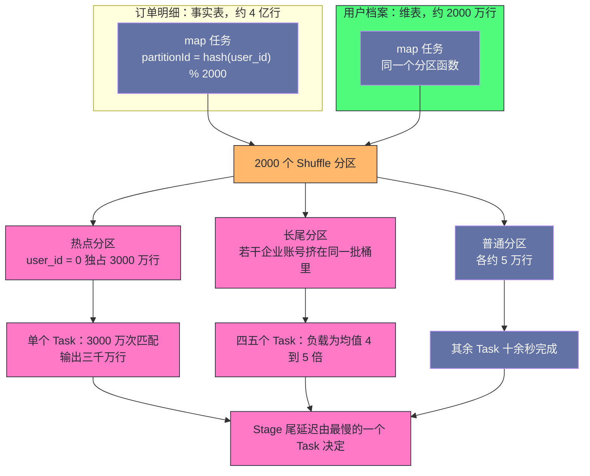
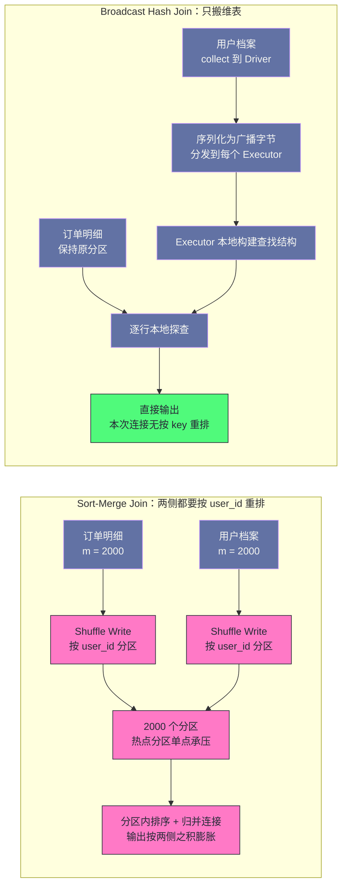
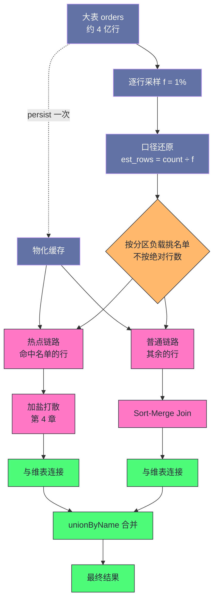
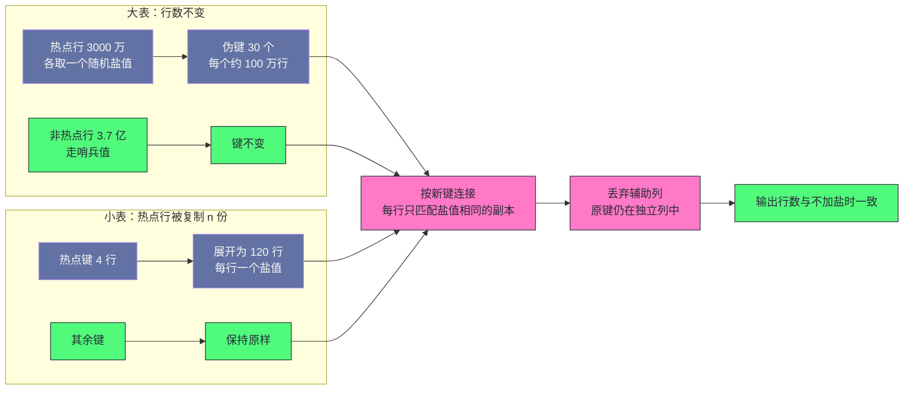
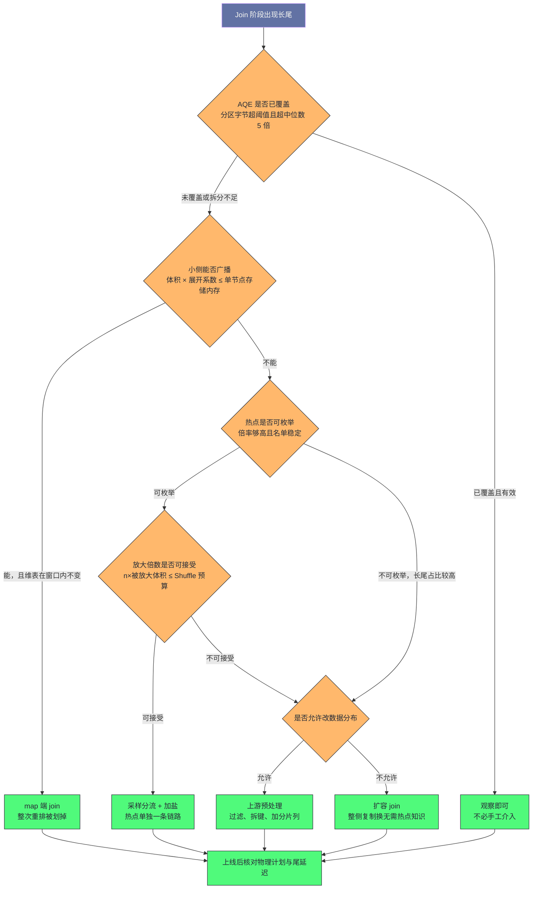

# 10. 数据倾斜解决方案 下：Join 倾斜的四条路与选型框架

**摘要：**

数据倾斜的判定口径与聚合型解法另有交代，但真正把作业拖垮的现场，多半落在 Join 上。聚合倾斜只是让一个 Task 多读几百万行，Join 倾斜让一个 Task 去做几百万行乘以几百万行的匹配——输出的规模是两侧之积，这是两者在物理形态上的分水岭，也是"调大并行度"这类手段拿到 Join 面前往往失效的原因：分区数再大，同一个键仍然只能落进一个分区。

这篇文章只处理 Join 场景，把四条路逐条摊开：map 端 join（广播连接）用"人手一份小表"换掉整次重排；采样热点后单独处理，用"分流"把热点与长尾切开；随机打散（加盐）把热键人为拆成 n 个伪键；扩容 join 把副本维度加进键空间，以"整侧复制"换"无需知道热点在哪"。四条路各自的**前置条件**才是选型的要害——它们不是可以互相替代的四种优化，而是四种代价结构完全不同的交易。文章回答两个问题：每一条路在什么前提下才成立、付的是哪一笔钱；以及面对一个具体的倾斜现场，按什么顺序问四个问题，才能落到其中一条。

文章口径是 Spark 4.3.0（2026-10-30 发布，4.x 预编译 Scala 2.13），涉及自适应查询执行（Adaptive Query Execution，AQE）的倾斜拆分与广播判定的参数默认值，均按该版本文档核对；凡实现细节与版本强相关处，以对应版本文档为准。

**关键词（Keywords）**: BroadcastHashJoin, **autoBroadcastJoinThreshold**, **broadcast hint**, 热点采样, 加盐, 前缀数, 扩容 join, OptimizeSkewedJoin, **AQE**

---

## 第 1 章 Join 倾斜：一次乘法把长尾放大

### 1.1 两种倾斜不在一个量级

同样叫数据倾斜，聚合与连接给出的失败形态差得很远。按用户标识做一次 `groupBy` 再求和，某个键独占三千万行，代价是一个 Task 要读三千万行、并压成一个数——只要内存能扛住这个键的中间状态，任务还能跑完，只是慢。换成两张表按同一个标识连接，同一个键在几千万行的一侧撞上维表里的一行，输出是几千万行；若撞上的是维表里的一千行，输出就是几百亿行。**输入只放大一次，输出按两侧之积放大**，这是 Join 倾斜与聚合倾斜最本质的差别，也是它更容易以 OOM、磁盘写满、下游作业连锁失败收场的原因。

这条差别直接改写了可用的解法空间。聚合倾斜可以用写端预聚合把 N 条压成一条，因为"求和"允许分批；Join 不允许——连接的结果条数由匹配关系决定，任何"先压一压"的动作都可能改变结果，所以聚合那边最锋利的工具（map 端 combine）在 Join 这边根本没有对应物。能动的只剩两件事：要么把这个键的匹配搬到不需要按键重排的地方去做（广播连接），要么把这个键拆成若干个"看起来不同"的键，让哈希函数把它们分到不同分区去（加盐与扩容）。四条解法，本质上就是这两件事的四种排列组合。

### 1.2 两侧共享同一把哈希函数

连接在物理上要做的是：把两张表里键相同的行放进同一个分区，再在这个分区里完成匹配。为了让"键相同的行落在同一处"，两侧必须使用同一个分区函数（`HashPartitioner`，分区号等于 `hash(key) % r`）——这就是连接内部必然有两个 Shuffle 依赖的原因：左表一个、右表一个，汇入同一组下游分区。

问题出在这把函数的性质上：它对分布不敏感。哈希函数只保证"相同键同分区、不同键大体均匀"，至于某个键有多少行、这些行会不会天然比别的键多出一千倍，它一概不管——它也无法管，因为分区在写数据之前就已经定好了。于是当业务数据里存在一个天然热点（`user_id = 0` 的游客、内部压测账号、平台自营店铺、被置顶的默认值），这个键的全部行会被忠实地、一份不少地送进同一个分区，无论 `r` 取两百还是两千。

这里还有一个常被忽略的层次：热点不止放大输入，还放大"分区内的匹配密度"。一个分区里若同时落进两个中等热点键，它们的输入行数相加，输出按各自与维表的匹配倍数相乘，Task 的耗时并不是两个热点各自耗时的平均，而接近两者之和再乘上一个与维表重复度有关的系数。所以"单个键不算大"并不等于"这个分区安全"，判断的粒度必须是分区，而不是键。

### 1.3 不这样会怎样：一条尾延迟如何吃掉整段资源

假设某天有四亿行订单明细，`r = 2000`，平均每个分区二十万行，单个 Task 跑几十秒；其中 `user_id = 0` 占了三千万行（约百分之七），全部落在同一个分区。这个分区的 Task 要读三千万行、与维表里那一行做三千万次匹配、写出三千万行结果，耗时是其余 Task 的几百倍。整个 Stage 的完成时间由它决定，其余一千九百九十九个 Task 早已结束、槽位空转；更糟的是这一台机器还要承担三千万行的写出，磁盘、网络、GC 三处同时吃紧，稍有抖动就触发溢出甚至 OOM，而一旦失败，重试的又是这一个分区。

反事实的另一半在输出侧。若热点键在维表里不是一行而是一千行（一个"默认归属"在维表里对应了上千条配置记录），输出从三千万行变成三百亿行，作业根本走不到尾延迟那一步，会在写端把磁盘写满、在 Shuffle 写阶段把网络打穿。这两种失败形态指向同一个结论：**Join 倾斜的成本不在"慢"，而在"慢得没有下限"**——它的放大系数由数据本身决定，不由集群规模决定，加机器只是让空转的槽位更多。

### 1.4 一个贯穿全文的作业

后面的四章需要一个具体的着力点，笔者设一个电商数仓的日结作业：订单明细表按天分区，约四亿行；用户档案表约两千万行，是典型的维表；两者按 `user_id` 内连接，之后再按品类汇总成交额。分区数取两千，是这类日结作业的常见量级。

```scala
// 事实表约 4 亿行/天，读入后 m = 2000 个分区
val orders = spark.read.parquet("hdfs:///dw/order_detail")

// 维表约 2000 万行，同样按 2000 个分区读入
val users = spark.read.parquet("hdfs:///dw/user_profile")

// 星型模型里最普通的一次连接：事实表 × 维表
val joined = orders.join(users, Seq("user_id"), "inner")

// 连接之后再按品类汇总，这是第二个 Shuffle
val byCat = joined.groupBy("category").agg(sum("amount"))
```

这个作业的倾斜有两处，性质不同，后面会分别用到。第一处是几个可枚举的坏键：`user_id = 0`（下单未登录时的占位）、`user_id = -1`（历史脏数据）、以及两个内部压测账号，合计约占事实表的百分之八。第二处是一条长尾：头部两三千个企业采购账号各占几十万行，单个看都不算"热点"，但它们恰好密集地哈希到相邻的几个分区上，把那几个分区的负载抬到平均值的四五倍。前一处适合加盐，后一处连"热点是谁"都难以枚举——这正是四条解法必须区分对待的现实理由。

### 1.5 一个比喻：两个档案室按同一份人名册分柜

把连接想成两家档案室按同一份人名册核对材料：左边是订单档案室，四亿份材料按客户分袋；右边是客户档案室，两千万份档案按客户归档。规则是"同一个客户的两份材料必须摆在同一个柜子里"，于是两家各自按人名册重新分柜，柜号用同一个公式算出来——这就是两侧共享分区函数。

麻烦在于"游客"这个条目在订单档案室堆了三千万袋，在客户档案室只有一袋。按公式它们必须进同一个柜子，于是那个柜子前只有一个核对员，其余一千九百九十九个柜子早核对完毕，核对员坐在那里等着。想解决，要么让每个核对员手边都放一份客户档案室的全副本（广播），要么给"游客"编出二十五个编号、把三千万袋分到二十五个柜子里（加盐），要么再复制出若干套柜子按副本编号分流（扩容）。三种办法都在改"分柜规则"，没有一种能凭空增加核对员——柜子的数量早就定死了，瓶颈是"同一个柜子只有一个核对员"这个结构。

比喻的限定在于：现实里的档案室可以把一个柜子的材料临时搬到别处分摊，Spark 的分区不能，一个分区就是一个 Task 的输入单元，没有"半个 Task"这种产物。要拆只能在数据落进分区之前拆，这就是所有 Join 倾斜解法都必须在 Shuffle 写端或读端动手的原因。

把两侧重分布、热点分区、尾延迟这三件事画在一张图上，倾斜的发生位置就清楚了：



图里两条上游分支都必须先经过同一个分区函数，这是连接无法回避的结构性成本：倾斜不是某一侧的问题，而是两侧在同一个坐标上撞车的结果。把两种倾斜并排放好，差别一目了然：

| 维度 | 聚合倾斜（`reduceByKey`、`groupByKey`） | Join 倾斜 |
|---|---|---|
| 需要重排的侧 | 只有被聚合的那一份数据 | 两侧都要按同一个分区函数重排，形成两个 Shuffle 依赖 |
| 单 Task 的输入 | 热键的记录条数 N | 左表该键行数 + 右表该键行数 |
| 放大形态 | 加法：一个分区多背 N 条 | 乘法：输出条数等于两侧匹配行数之积 |
| 框架内建手段 | map 端聚合、AQE 分区合并 | 广播连接、AQE 倾斜拆分 |
| 典型失败表现 | 单 Task 溢出、GC 时间飙升、OOM | 溢出与 OOM 之外，还有输出爆炸与下游连锁倾斜 |
| 解法空间 | 预处理、并行度、双重聚合 | 四条路：广播、采样分流、加盐、扩容 |

---

## 第 2 章 map 端 join：把重排整笔划掉

### 2.1 一条不需要重排的连接路径

连接之所以要先重排，是因为"键相同的行必须在一起"。但如果其中一张表小到可以给每个 Executor 都发一份完整副本，这个前提就可以绕过：大表照旧按自己的分区扫描，每一行在本地小表的查找结构里探一次，命中就输出。整个过程中大表没有离开过它被算出来的分区，小表只被分发了一遍——按键重排这件事被整笔划掉了，倾斜赖以生存的载体（哈希分区）也就随之消失。

这就是广播连接（Broadcast Hash Join），在 RDD 语境里常被叫作 map 端 join。它对倾斜的化解是结构性的，而不是缓解性的：既然没有按 `user_id` 重排出来的那个分区，就不存在"某分区独吞三千万行"这回事，三千万行会均匀地留在上游两千个 map 任务里，各自探一次本地哈希表即可。代价从"重排整张大表"变成"分发一遍小表"，而后者的体量由小表决定，与事实表的规模无关；**它消掉的只是这一次连接的重排**，后面那次按品类汇总依然要重排，若品类本身也倾斜，作业仍会慢。

### 2.2 前置条件：能进内存，而不只是"看起来小"

"小表可以广播"这句话里的"小"，是一个关于内存的物理判断，不是关于文件大小的直觉判断。三件事要一起算：

其一，判据是压缩后的字节数。catalog 里记录的 `sizeInBytes`（Parquet footer 的统计、Hive 表的元数据）指的是落盘时的大小，列存加压缩之后，同一个逻辑数据集可能只有展开后的三分之一到五分之一。一张落盘 8 MiB 的表，读进堆里变成对象、再建起哈希表，占用几十 MiB 是常态，宽字符串键还要更多——每个字符在 JVM 里占两个字节，外加对象头与对齐填充。

其二，每个 Executor 需要一份，不是每个核一份。广播块在 BlockManager 里存一份，同节点上的并发 Task 共用这同一份数据；真正与并发相关的是查找结构的构建与访问开销，而不是数据本身的份数。所以估算时应当用"单表展开体积 × 1"除以"单节点可用存储内存"，而不是除以并发度——后者会让人高估可广播的规模。

其三，这张表必须是一份静态快照。广播发生在作业启动后的某个时刻，之后维表再怎么更新都与已分发出去的副本无关。如果维表每半小时同步一次，而作业要跑两小时，那么后一个半小时里新注册的用户在广播副本里不存在，连接结果会安静地少掉一批匹配——不报错，只是数字对不上。

三点合起来给出一条粗略准入线：小表展开后的体积控制在单节点存储内存的三成以内，同时留够执行内存。"几百 MB 以内"的经验说法只在行窄、键短、压缩比正常时成立，一旦有大文本列或嵌套结构，同样的字节数会膨胀出完全不同的内存画像。

### 2.3 阈值与显式广播：两种"决定广播"的方式

Spark 有两套机制决定"这次连接要不要走广播"，它们的决策主体、依据与失败方式都不一样，混用是最常见的误判来源。

第一套是优化器的自动判定，由 `spark.sql.autoBroadcastJoinThreshold` 控制，默认值是 10 MiB（10,485,760 字节）。它在生成物理计划时读取两侧的统计信息（catalog 里的 `sizeInBytes`、或者经 `spark.sql.statistics.size.autoUpdate.enabled` 更新过的表统计），小于阈值的侧会被规划成 `BroadcastExchange`，连接算子随之变成 `BroadcastHashJoinExec`。这套机制的优点是无需干预、统计可信时判断准确；缺点是它依赖统计，而统计经常不可信——没跑过 `ANALYZE` 的 Hive 表、经过 `filter` 但未回写的中间结果、包了一层视图或子查询的输入，都可能被严重低估或高估。

第二套是使用者的显式断言：DataFrame 上的 `broadcast(df)`、SQL 里的 `/*+ BROADCAST(t) */` 提示。它绕开阈值，直接要求优化器把指定的一侧做成广播。优点是决定权在懂业务的人手里，遇到统计失真时可以强制纠正；缺点是它没有任何安全网——断言错了，作业就会以一种很难归因的方式失败。

AQE 在两者之间补了第三种时点。计划期判定用的是估算值，运行期判定用的是实际 shuffle 出来的字节数：`spark.sql.adaptive.autoBroadcastJoinThreshold`（默认沿用 `spark.sql.autoBroadcastJoinThreshold` 的值）让 AQE 在 map 阶段结束后，把统计出来足够小的一侧改写成广播连接，配合 `spark.sql.adaptive.localShuffleReader.enabled`（默认开启），改写之后只需在本地读 shuffle 文件，不必再走一次网络拉取。

下面是三种方式的对照，差异集中在"谁下判断、拿什么下判断、判断错了会怎样"这三处：

| 维度 | `autoBroadcastJoinThreshold` 自动判定 | 显式 `broadcast()` / `BROADCAST` hint | AQE 运行期改写 |
|---|---|---|---|
| 决策主体 | 优化器 | 使用者 | 优化器，但基于实测 |
| 判断依据 | 计划期的统计信息（压缩后字节） | 使用者的业务判断 | map 阶段结束后的实际分区大小 |
| 生效时点 | 生成物理计划时 | 分析计划时即钉死 | 每次重优化时 |
| 判错的后果 | 悄悄退回 Sort-Merge Join，慢但不失败 | Driver 收集 OOM、每 Executor 展开失败、广播超时 | 规划本身无风险，代价是多一次计划重算 |
| 可否被覆盖 | 可被 hint 覆盖 | 不可被阈值推翻 | 不覆盖既有 hint，只修正估算偏差 |
| 适用场景 | 统计可靠、表大小稳定 | 统计失真、维表大小已知且稳定 | 大作业、上游有 filter、统计不可信 |

有两个默认值值得单独记住，它们决定了失败时的表现而不是成功时的表现。`spark.sql.broadcastTimeout` 默认 300 秒，管的是 Driver 收集与构建广播结果的等待上限，超时就抛异常，而不是退回 Sort-Merge Join；`spark.sql.autoBroadcastJoinThreshold` 置为 -1 则彻底关闭自动广播，只留 hint 这一条路。前者意味着"广播失败是硬失败"，后者意味着"关掉自动判定之后，倾斜的解法必须由人显式指定"。

### 2.4 代价：三份内存与一次迟迟不来的回收

广播不是免费的，它把成本从"每次 Shuffle 的字节数"换成了"三处常驻内存"。

第一份在 Driver。小表要先被收集成一个本地集合、再序列化成可广播的字节数组，这份内存在广播发出后仍要保留一段时间，供失败重试与后续 Stage 复用。若小表实际上是"看起来小"的大表，第一个撑不住的就是 Driver——它的堆通常比 Executor 小得多，而且是单点，一 OOM 就是整个作业结束。

第二份在每个 Executor。广播块以 `MEMORY_AND_DISK` 的存储级别落在 BlockManager 里，构建出的查找结构还要再占一块执行内存。这块内存不参与 Shuffle 的内存回收：执行内存不够时，Spark 会把 Shuffle 的溢出与缓存挤掉，却不会把广播块挤掉，因为广播块被视为"本 Stage 必需的只读输入"。于是广播一个偏大的表，表现往往不是"广播失败"，而是"其余部分全部退化"——溢出变多、GC 变频繁、有效计算时间占比下降，指标上看不出广播是元凶。

第三份是时间维度上的：广播什么时候被释放。RDD 侧的广播变量依赖 `ContextCleaner` 在变量被回收后清理，由 `spark.cleaner.referenceTracking` 控制，若一直挂在长生命周期的对象上，清理就永远等不到。SQL 侧更隐蔽：广播结果由物理计划持有，常驻会话（ThriftServer、常驻的结构化流作业、反复提交小作业的调度器）里若计划被缓存或复用，同一份广播会跨查询存活；AQE 为了在多次重优化之间不重复构建广播侧，还会把已构建的结果缓存起来复用。这条链的净效果是：广播块的生命周期常常比"这一次查询"长得多，具体回收时机与版本实现相关，以对应版本文档为准；在长驻服务里，这一栏会随查询次数累积，直到会话结束。

### 2.5 什么时候不该走这条路

四种情形下，广播连接不是"次优"，而是"错"。

两侧都大，这是最直接的一种：小表进不了内存，广播要么超时要么把 Executor 撑爆，后面三章处理的正是这种局面。

小表仍在增长，这是最容易被忽略的一种。维表若是缓慢变化维、或由上游实时写入，广播到的是一个时间点上的快照；作业越长、维表更新越频繁，偏差越大。判断标准不是"维表现在多大"，而是"它在作业运行窗口内是否可能变化"。

行宽与结构导致的展开膨胀，是第三种。譬如两千万行、每行三个短字段的维表，展开后可能只有几百 MiB；同样两千万行但带一个 JSON 文本列，展开后可能几十 GiB。判据是抽样若干行、粗算单行堆内占用再乘行数，而不是看文件大小。

键的重复度是第四种，也最少被提到。哈希表要为每个不同的键保留条目，若维表对同一个键有上千行，查找结构里这一项就要挂一个千行列表，体积比原表还大，探查时还要遍历。这时内存账要按"键基数 + 重复行额外开销"重算，而不是按行数线性外推。

### 2.6 两个失败案例

第一个案例来自统计信息失真。某张 Hive 维表三年没跑过 `ANALYZE`，catalog 里记的还是建表时写入的 8 MB，实际已经涨到 6 GB。优化器按 8 MB 判定"可以广播"，Driver 在收集阶段直接把堆打满，报的是 `java.lang.OutOfMemoryError: Java heap space`，栈顶在一个与"连接"毫无关系的收集方法里。归因的难点在于：报错位置在 Driver、触发原因是三年前的元数据、现场表现却像是"作业启动就崩"。修法不是调大 Driver 内存，而是先 `ANALYZE TABLE ... COMPUTE STATISTICS`，再用 hint 或阈值把判定纠正过来。

第二个案例是显式断言的代价。为了避免上面那种失配，有人习惯性地给所有维表加 `broadcast()`，其中一张 1.5 GB 的维表也被加了进去。广播本身成功了，但每个 Executor 上要展开出数 GB 的查找结构，结果是频繁 Full GC、Task 的反序列化与探查时间占了七成，作业从四十分钟变成两个半小时，且没有任何报错。这类失败的特点就是"没有异常，只有全面变慢"，用 hint 前先量一下展开体积，比事后归因便宜得多。

### 2.7 最小例子与两条实现路径

原笔记里那个广告点击的例子足够小，适合把机制看清楚：同一个广告位被反复曝光，键的分布天然不均，而维表只有两行——这种"一侧极小"的形状，正是广播连接的标准场景。

```scala
// 广告点击流：广告位 1 被曝光三次，广告位 2 两次
val clicks = sc.parallelize(Seq((1, 1), (1, 2), (1, 3), (2, 1), (2, 2)))
// 广告位维表：只有两行，进内存毫无压力
val dim = sc.parallelize(Seq((1, "首页横幅"), (2, "详情页侧栏")))

// RDD 侧：显式广播维表，之后 map 内部完成连接，不产生 Shuffle
val small = sc.broadcast(dim.collectAsMap())
val joined = clicks.map { case (adId, uid) => (adId, uid, small.value(adId)) }
```

DataFrame 与 SQL 侧是同一件事，只是判定的主体不同：一个是给优化器的断言，一个是信任统计的默认行为。

```scala
import org.apache.spark.sql.functions.broadcast

// 先把上面两个 RDD 转成 DataFrame，字段名与后文一致
val clicksDF = clicks.toDF("ad_id", "uid")
val dimDF = dim.toDF("ad_id", "name")

// 断言式：不信任统计，直接要求广播维表
val result = clicksDF.join(broadcast(dimDF), Seq("ad_id"), "inner")
```

```sql
-- hint 与函数式等价，都是"相信人"而不是"相信元数据"
SELECT /*+ BROADCAST(d) */ c.*, d.name
FROM clicks c JOIN ad_dim d ON c.ad_id = d.ad_id;
```

两条路写出来的执行计划是一样的：维表一侧变成 `BroadcastExchange`，连接算子变成 `BroadcastHashJoinExec`，事实表一侧没有 `Exchange`。差别只在"谁下的判断"以及"判断错了谁负责"。把两种物理形态并排放在一张图里，重排这件事被划掉的位置看得最清楚：



图的左半边有两个 `Shuffle Write`，右半边一个都没有；这个差额就是广播连接省下的钱。不过它并没有凭空消失，而是被转成了 Driver 与每个 Executor 上的常驻内存——所以适用条件不是"我想避免 Shuffle"，而是"我有一张确实能装进内存的静态小表"。前者是愿望，后者是事实，只有后者能成立。

---

## 第 3 章 采样分流：先把热点认出来，再分两条路走

### 3.1 一个 Stage 拆成两个形状不同的 Stage

广播连接要求"一侧足够小"，而 1.4 节里那个作业两侧都不小：四亿行对两千万行，谁也不能塞进每个 Executor 的内存。这时候最朴素的想法是分区治之——把大表切成"热点部分"与"其余部分"，前者走一条为热点定制的链路（通常是加盐），后者走普通的 Sort-Merge Join，最后把两段结果并起来。两段的分区形态、Task 规模、甚至执行策略都可以不同，等价于把原来那一个被热点压住的 Stage，换成两个各自均衡的 Stage。

这条路不改变语义、只改变数据路由：连接还是那个连接，只是"游客订单"与"普通订单"走不同的门。代价集中在两处：先要知道热点是谁（一次额外统计），并为两次计算的重复扫描付费。所以这一章要写透的不是流程，而是统计口径与重复代价怎么摊薄。

### 3.2 统计口径：阈值按什么算才算数

原笔记里给的做法是采样、按 `count` 降序取前三个键当热点。这个做法在真实数据上会两头出错：绝对行数阈值不随分区数变化，分区数翻倍之后它就不再对应"单 Task 过载"；而"取前三名"在热点有二十个、或者根本没有单个巨型键而是一批中等键挤在一起时，选出来的三个键既不解决问题，又白白多付了分流成本。要让阈值有意义，得先确定衡量对象。

衡量的对象其实是**分区负载**，而不是键的大小。一个 Task 处理的是一个分区，分区里所有键的行数之和才是它的输入量；若干"不算大"的键恰好哈希到同一个桶，与一个"特别大"的键独占一个桶，对 Task 而言是一回事。所以判定应当落在这条式子上：把候选键按 `hash(key) % r` 折算到分区，累加得到每个分区的估计负载，再挑出一组键，使"扣掉这组键之后的最大分区负载"降到单 Task 可承受的量级以下。

在这个框架下，几种常见的统计口径各有明确的误判方向：

| 口径 | 计算方式 | 误判方向 | 适用与失效 |
|---|---|---|---|
| 绝对行数 | 键的计数超过固定阈值 | 分区数变化后阈值失效；小键密集落桶时完全看不见 | 分区数稳定、热点是少数巨型键时可用 |
| 相对倍率 | 键计数 ÷ 键计数中位数 | 数据均匀但中位数极小时会误报；长尾的倍率本就只有两三倍，容易漏 | 用于刻画"热点有多热"，不用于决定名单 |
| 分区负载 | 按落点累加后的单分区行数 | 依赖对 `r` 的估计，AQE 改分区数后落点会偏 | 与 Task 过载直接对应，是名单的正确判据 |
| 字节口径 | 行数 × 单行平均宽度 | 需要额外采样行宽；宽行键会被低估 | 行宽差异大时（有大文本列）必须用 |

四种口径里，只有分区负载与 Task 的实际处境一一对应，其余三种要么是它的近似，要么是辅助量。实践中的做法是组合使用：先用相对倍率筛出候选集合，再用分区负载定名单与优先级，最后用字节口径校验有没有"行少但很宽"的键。**判定的最小单位是分区，不是键**——这一句如果不接受，后面的阈值设计全都会偏。

### 3.3 采样能给出多准的估计

分流的前提是"不用扫全表就知道谁热"，所以样本的精度直接决定成败。不妨设某个键真实有 N 行，采样率为 f，则样本中的计数服从二项分布，期望为 fN，标准差约为 √(fN(1−f))，相对误差约 1/√(fN)。这条式子给出两件事。

第一件：采样率的下限由"最小的待识别热点"决定，而不是由表的总量决定。若希望识别出至少 N_min 行的热点，且希望它在样本里有几百个计数以免被噪声淹没，就需要 f ≥ 300 / N_min。表再大也不会让这个下限变松，因为增大的是总量而不是每个键的绝对计数。

第二件，也是更容易被误解的一件：**提高采样率并不能提高"热点与背景的可分离度"**。分离度约等于倍率（热点行数 ÷ 背景键的平均行数），它是一个与 f 无关的比值；采样只影响这个比值被估计得准不准。所以当长尾的倍率只有两三倍时，无论把采样率抬到多高，它都不会变成一个"明显异常"的键——这是采样分流的固有盲区，不是实现瑕疵。

还有一处偏差与采样方式有关。Spark 的 `DataFrame.sample` 按行做伯努利抽样，与数据在文件里的物理顺序无关；若换用按文件块抽样的写法，而上游恰好按 `user_id` 聚簇落盘，块抽样就会系统性地漏掉整段键或重复计入整段键。这种偏不是"样本少"，而是"样本有结构"，靠加采样率救不回来。

### 3.4 重复代价：三次扫描与一次物化

分流方案的账面上有三笔读：采样一遍、热点链路一遍、普通链路一遍。四亿行的表从 HDFS 读一次若需三分钟，三遍就是九分钟，而倾斜本身可能只值二十分钟——分流赚到的钱有一半被重复读吃掉了。

摊薄的办法是把大表物化一次。`persist(StorageLevel.MEMORY_AND_DISK)` 之后，采样与两条链路都读同一份缓存，物理读从三次降到一次，代价是这份缓存要占存储内存，装不下就溢到磁盘、退化成"一次写加三次本地读"。判断值不值，看"缓存命中率"与"倾斜带来的尾延迟"哪个更大：集群内存宽裕、尾延迟是小时级，物化几乎必然划算；若倾斜只是两三倍的长尾、物化又要挤掉执行内存，宁可多读一遍 HDFS。

名单本身还有一笔小账。热点键在几十个以内时，广播出去用 `isin` 过滤最省事；一旦名单涨到几千个，`isin` 会被展开成巨大的 `In` 表达式，Catalyst 要处理几千个常量，计划编译时间可能超过数据扫描时间，个别版本上还会撞上方法体过大或栈深超限。名单规模上了三位数，就应当改用半连接（`semi join`），或者把名单写成一张小表再 `broadcast` 过去，让过滤变成一次哈希探查。

### 3.5 落地：一份可以照抄的分流骨架

把上面几节的决定落成代码，结构大致如下。注意三处与直觉不同的地方：还原口径时除以采样率、名单按分区负载而不是行数排序、大表只物化一次。

```scala
import org.apache.spark.sql.functions._
import org.apache.spark.storage.StorageLevel

// 第一步：逐行伯努利采样（与文件内物理顺序无关，不会因聚簇落盘而系统性偏移）
val f = 0.01
val est = orders
  .sample(withReplacement = false, fraction = f)
  .groupBy("user_id")
  .count()
  .withColumn("est_rows", col("count") / f)      // 还原到全量口径

// 第二步：按"扣掉名单后最大分区负载"挑键，而不是按行数取前 N 名
val r = spark.conf.get("spark.sql.shuffle.partitions").toInt
val hotList = est
  .withColumn("bucket", pmod(hash(col("user_id")), lit(r)))
  .orderBy(desc("est_rows"))
  .limit(200)                                     // 给名单设上限，避免退化成全表过滤
  .select("user_id")
  .as[Long]
  .collect()

// 第三步：名单广播出去；规模上千时改用 semi join，避免巨型 In 谓词
val hotKeys = spark.sparkContext.broadcast(hotList.toSet)
val isHot = col("user_id").isin(hotList.toSeq: _*)

// 第四步：大表物化一次，采样与两条链路共用，把三次物理读压成一次
val base = orders.persist(StorageLevel.MEMORY_AND_DISK)
val hotPart = base.filter(isHot)
val restPart = base.filter(!isHot)

// 第五步：热点链路内部再打散（见第 4 章），普通链路照常连接
val hotResult = saltedJoin(hotPart, users)
val restResult = restPart.join(users, Seq("user_id"), "inner")

// unionByName 按列名对齐，避免两条链路的列顺序不一致
val finalResult = hotResult.unionByName(restResult)
```

下面这张图把分流的三条路径画在一起。虚线是物化的那条边：它不属于任何一条计算链路，却是让三条链路只读一次数据的枢纽。



图中的分叉点是唯一需要人下判断的地方，其余都是机械动作。这也解释了为什么分流方案的实施成本其实比想象的低：真正难的是"C"那个菱形，而不是代码。

### 3.6 结果正确性：互斥、完备与去盐

分流最容易出的错不是性能，而是结果，三条约束要逐条查。

互斥与完备必须来自同一份名单快照。`filter(isHot)` 与 `filter(!isHot)` 必须用同一个 `hotList` 求值，不能一条链路调一次采样——两次采样的随机种子不同，键集合就会有出入，交叠部分被重复计入、缺口部分凭空消失。

热点链路若做了加盐，输出必须去盐且保留原始键。从拼接字符串里用正则反解原键是脆弱的写法：键含分隔符、键为数值、盐的位数变化，都会让解析悄悄错位，而错位不报错，只会把一批行的键变成 `null`。正确做法是加盐时就把原键留存一列，连接后丢掉辅助列，让原键始终是数据里的一列，而不是从字符串里反解出来的假设。

列集合要在 `union` 之前对齐：盐列、副本号列、临时键列必须先丢掉，因为 `union` 按位置合并，列顺序一旦不同，结果会把金额放进类目字段而不报错。至于输出顺序，`union` 不作保证，下游若有"按时间排序写出"的要求，排序要显式做一次。

### 3.7 两个失败案例

第一个案例是漏检的长尾。某作业按百分之一采样、取前十名作为热点名单，名单上的十个键确实都是巨型键，加盐之后那十个分区恢复了正常；但作业总耗时只降了两成，因为真正拖住 Stage 的是两百多个"各占二十万行"的键，它们按倍率看只有背景的三倍，在采样里各只有两千个计数，既进不了前十名、也不触发任何绝对阈值。更麻烦的是，这二百多个键里有相当一部分哈希到了同几个桶，那四五个分区负载仍是均值的四倍——**采样分流的盲区就是长尾，而长尾恰恰是电商与社交数据里最常见的倾斜形态**。

第二个案例是阈值没跟着分区数走。原本按"单键超过五十万行"判定热点，作业跑得很稳；后来为了压小文件把 `spark.sql.shuffle.partitions` 从 500 抬到 2000，平均分区负载降到四分之一，但阈值没变，名单里只剩下两个键，而实际需要处理的是二十个。这次调整没有报错，只是作业从"偶尔慢"变成"稳定慢"，归因时最容易怀疑到新加的分区参数上，而真正的问题是判据的量纲错了。

---

## 第 4 章 随机打散：把热键拆成 n 个伪键

### 4.1 一个键变 n 个键

采样分流的最后一环是"热点链路怎么连"。既然普通链路走 Sort-Merge Join 会再次撞上热点，热点链路就得换一种分区形态：把那个热键人为拆成 n 个互不相同的伪键，让哈希函数把它们分到 n 个不同的分区去，每个分区只承担原负载的 n 分之一。

具体动作分三处。大表侧给热点行加一个随机盐值，行数不变，只是键从 `user_id` 变成 `盐_user_id`；小表侧要为每个伪键都准备一份数据，于是热点键在维表里的那几行被复制 n 份，每份带一个不同的盐值；两侧按新键连接，大表的一行只会匹配到"盐值相同"的那一份副本，因此输出的行数与不加盐时完全一致，不重不漏。连接完成后再去掉盐值、丢掉辅助列，结果与普通连接并无区别。

这套动作有个容易忽略的前提：它正确工作的原因，是"大表每一行只取一个盐值，而小表覆盖了全部 n 个盐值"。反过来写（大表覆盖全部盐值、小表只取一个）就会得到 n 倍重复输出，出错时不会报错，只会让下游指标整体偏大 n 倍——而 n 通常是个两位数，对账时才发现已经晚了。

### 4.2 为什么只能对热点加盐

如果对全表无差别加盐，等价于把维表整表复制 n 份：非热点键本来分布均匀，加盐只会让它们的小表副本凭空多出 n 倍体积，Shuffle 写放大、广播体积放大，收益为零。所以加盐是一种**稀疏操作**，它的前提是"热点集合已知且不大"——这也是它在长尾场景里失效的原因：长尾的键有几千个，逐个加盐等于全表加盐。

一条实用的边界：热点键数乘以 n 之后，伪键总数不宜超过分区数的量级——伪键太少打不散，太多则维表副本条目暴涨，伪键之间还会开始碰撞（见 4.3 节）。常见的组合是"十几个热点键 × 二十到三十个盐值"，伪键总数几百个，落在一两千个分区里，热点负载就降到与普通分区相当的量级。

### 4.3 n 的取值：三条约束求交

盐值的个数 n 是这个方案唯一的自由参数，它由三条互相拉扯的约束决定，取小了不解决问题，取大了会引入新的问题。

第一条约束来自目标负载。若热点键有 N_hot 行，单分区可承受的输入是 T，则至少要 `n ≥ ⌈N_hot / T⌉`。T 不是常数，而是"总行数 ÷ 分区数"再乘一个容忍系数（1.5 到 3 之间）：分区负载本来就有随机波动，把热点压到恰好等于平均值，只会让它"恰好不拖后腿"，稍有波动又回到长尾。按字节算 T 更准，但要额外采样行宽。

第二条约束来自伪键与分区的碰撞。n 个伪键落在 r 个桶里，期望的碰撞对数是 n(n−1)/(2r)；当 n 与 r 同量级时，几乎必然有某个桶吃到两个伪键，那个分区的负载就是 2T，加盐的效果被打掉一半。所以经验上希望 `n ≤ r/4`，这也解释了为什么"盐值取分区数那么多"是一种常见的用力过猛。

第三条约束来自小表放大的字节预算。增量约等于 `(n−1) × 小表热点行数 × 行宽`。多数场景下这个量微小到可以忽略，但有两种情况会翻车：维表对同一个键有大量重复行（一个"默认归属"对应上千条配置），放大后是 `(n−1) × 上千行`；或者热点键本身就多、n 又大，两个因子相乘把副本体积抬到与维表原表同量级。这时应当先查"维表为什么对同一个键有上千行"——若能先去重或预聚合，加盐的成本会降一个数量级。

把三条约束放在一张表里，n 的取值就变成了一个可检查的量，而不是凭感觉的数字：

| n 的档位 | 单分区负载 | 伪键碰撞 | 小表放大 | 典型表现 |
|---|---|---|---|---|
| 明显偏小 | 仍为均值的数倍 | 少 | 可忽略 | 加盐"生效"了但作业没变快，热点从独占变成"三倍长尾" |
| 大致合适 | 与均值同量级或略低 | 偶发一对 | 在预算内 | 尾延迟收敛到与普通分区相当，整体耗时由数据量决定 |
| 明显偏大 | 低于均值，无收益 | 必然多对 | 可能超过维表原体积 | Shuffle 写与广播体积暴涨，作业反而更慢，甚至 OOM |

下面这段代码是加盐连接的一个可运行骨架。与"从拼接字符串里用正则还原原键"的写法相比，它在加盐时就把原键留在独立列里，后面只需要丢辅助列，不需要解析任何字符串。

```scala
import org.apache.spark.sql.functions._

// n 由"热点行数 ÷ 单分区可承受负载"推出，向上取整后不超过 r/4
val hotKeys: Set[Long] = ...      // 来自第 3 章的名单
val n: Int = ...                  // 例：热点 3000 万行、T 取 100 万行，则 n ≥ 30

val isHot = col("user_id").isin(hotKeys.toSeq: _*)

// 大表：热点行取一个随机盐值，原键另存一列；非热点行用哨兵值
val bigSalted = orders
  .withColumn("salt",
    when(isHot, pmod(hash(col("user_id"), rand()), lit(n))).otherwise(lit(-1)))
  .withColumn("join_key",
    when(isHot, concat(col("salt"), lit("_"), col("user_id")))
      .otherwise(concat(lit("_"), col("user_id"))))

// 小表：热点键复制 n 份（explode 必须是唯一的生成器，故把 when 放进 explode 内部）
val salts = (0 until n).toSeq
val dimExpanded = users
  .withColumn("salt", explode(
    when(col("user_id").isin(hotKeys.toSeq: _*), array(salts.map(lit(_)): _*))
      .otherwise(array(lit(-1)))))
  .withColumn("join_key",
    when(col("salt") >= 0, concat(col("salt"), lit("_"), col("user_id")))
      .otherwise(concat(lit("_"), col("user_id"))))

// 连接后丢掉辅助列：原键一直在 user_id 列里，不需要从 join_key 反解
val result = bigSalted
  .join(dimExpanded, Seq("join_key"), "inner")
  .drop("join_key", "salt")
```

这段代码里最值得琢磨的是 `salt` 列的两个取值域：热点行走 `0..n-1`，非热点行走哨兵值 `-1`，于是同一条连接里既完成了打散也完成了普通匹配。代价是每行多算一次哈希，相对于省下来的尾延迟可以忽略。

把三步的数据量变化画出来，加盐的收益与代价就同时可见了：



图中被染色的两个节点是真正付出代价的位置：连接要处理 30 个伪键而不是 1 个，去盐要多做一次投影。这两个代价都是常数级的，与小表被放大的倍数无关——这也是加盐在小表很小时几乎是"免费"的原因。

### 4.4 三个失败案例与外连接的语义要求

第一个案例是 n 算小了。热点键三千万行、单分区可承受一百万行，需要三十个盐值，实施时却按"先取十个试试"上了十。那个键从"独占一个分区"变成"三个分区各背一千万行"，尾延迟仍是均值的三倍——改善是真的，达标是假的，而这类失败最容易被误读成"加盐不管用"。

第二个案例是把问题搬到了下游，这也是最普遍的一种。连接这一步均衡了，但紧接着的 `groupBy("user_id")` 又按原键重排，三千万行游客订单再一次涌进同一个分区，慢只是从第一个 Stage 挪到了第二个。加盐不会改变"输出里那个键仍然是热点"这一事实，要彻底解决，得让聚合也吃到打散的红利：先用伪键做一次局部聚合，去盐后再做一次全局聚合；或者接受第二次倾斜，在那一处重新选一次解法。

第三个案例最反直觉：小表扩容之后仍然小于广播阈值，于是优化器把它广播了。原本维表超过 10 MiB 阈值、走的是 Sort-Merge Join，加盐后若只保留热点那部分参与连接，体积可能重新落到阈值以下，优化器改走广播连接，而广播的是被放大 n 倍的副本——Driver 收集体积与每个 Executor 的查找结构都比预算高出 n 倍，表现为"加盐上线后 Driver 偶发 OOM"。**加盐改变的不只是数据分布，还改变了统计信息，因而可能改变执行计划**；上线前用 `explain` 看一眼物理计划，比事后翻 Driver 日志便宜得多。

外连接另有一层语义要求：左连接时以大表为左、小表扩容副本，未匹配行正常输出空扩展，语义成立；右连接与全外连接时，小表被复制出的 n 份副本在无匹配情形下会各产生一行，输出出现 n 倍重复，必须改写成"内连接加未匹配补齐"，或者干脆不在外连接上用加盐。

---

## 第 5 章 扩容 join：把副本维度加进键空间

### 5.1 与加盐只差一处：n 加在谁身上

第 4 章的加盐做的是"稀疏扩容"：只把热点键挑出来，放大它在小表侧的副本，其余键原样通过。扩容 join 做的是"稠密扩容"：不区分热点，把参与连接的一整侧复制 n 份，另一侧按行随机落到其中一个副本号上，两侧按"键 + 副本号"这个复合键连接。两者的机制骨架完全一样——都是给哈希函数之前的数据加一个维度，把"一个键一个桶"变成"一个键 n 个桶"——区别只在 n 加在谁身上。

这个区别决定了代价的量级。加盐的放大体积约等于 `(n−1) × 热点行数`，扩容的放大体积约等于 `(n−1) × 被复制侧的整侧体积`。前者由热点集合的大小决定，后者由整表大小决定，两者可能差一到两个数量级。所以扩容不是一个"更好的加盐"，而是另一笔交易：**它用"整侧复制的字节量"，买"完全不需要知道热点在哪"**。这笔交易值不值，取决于你对"热点是否可枚举"这件事有多大的把握。

### 5.2 副本号加在哪一侧，代价就在哪一侧

扩容有两种落地形态，副本维度的位置不同，适用面也不同。

第一种把副本加在较大的一侧：大表每一行复制 n 份、各带副本号 `0..n−1`，另一侧每一行随机取一个副本号。热点键的 n 份副本按 `hash(key, replicaId)` 落到 n 个不同分区，原本独占一个分区的三千万行被摊成 n 份；另一侧的热点行随机散进这 n 个分区，作为探查侧与它们配对。内连接下输出不重不漏——大表的每一份副本只会遇到"副本号相同"的那一侧行。这条路的放大倍数按大表整侧计，重得惊人，因此只在两种情形下成立：n 很小（两到四），或者被复制的那一侧其实是一张已经窄化过的投影，而不是原始宽表。

第二种把副本加在较小的一侧：整张维表复制 n 份，大表按行随机取副本号。这等于"不知道热点时的全表加盐"——不挑键，把所有键一视同仁地打散，代价按维表整侧计。当维表不大而事实表的热点又不可枚举时，它反而比加盐便宜：省掉了采样、两遍扫描与名单漏检的风险，换来的是维表整体放大 n 倍。

把两种形态与加盐并排放在一张表里，各自的账就清楚了：

| 维度 | 加盐（稀疏扩容） | 扩容：副本加在小侧 | 扩容：副本加在大侧 |
|---|---|---|---|
| 放大对象 | 热点键在小表侧的副本 | 小表整侧 | 大表整侧（或其窄化投影） |
| 放大体积量级 | `(n−1) × 热点行数` | `(n−1) × 小表行数` | `(n−1) × 大表行数` |
| 是否需要热点名单 | 需要，且必须可枚举 | 不需要 | 不需要 |
| 长尾是否被覆盖 | 覆盖率取决于采样 | 全覆盖 | 全覆盖 |
| 语义风险 | 外连接下需改写 | 外连接下需改写 | 外连接下重复更严重 |
| n 的可行范围 | 数十量级 | 数倍到数十倍 | 通常只有 2 到 4 |

### 5.3 何时代价更低：一笔可以算的账

把两个方案的增量字节写出来，比较就变成了一次除法。加盐的增量约 `(n−1) × S_hot`，扩容的增量约 `(n−1) × S_replica`，比值就是 `S_hot / S_replica`——也就是热点在"被复制侧"里占的比例。这个比例越接近 1，两者的字节量越接近，扩容省的正是采样的开销与漏检的风险；比例越小，加盐越省。

举个具体的账。设事实表四亿行、热点三千万行（占 7.5%）、单分区可承受一百万行，于是 n 取 30。加盐的增量是"29 份热点键在小表侧的副本"，维表对这几个键只有几行，增量可以忽略；扩容若复制大表侧，增量是 29 乘四亿，一百多亿行的键空间，Shuffle 写足以把磁盘打满。**在这个量级上，把副本加在大表侧根本不成立**，它的合理用法只有"n 取 2 到 4、且复制的是窄投影"那种边界情形。

真正让扩容有价值的场景，是"热点根本数不清"。设事实表四亿行、其中两亿行集中在两千个企业账号上，这些账号单个看都不算巨型键，采样分流会漏掉大半，逐个加盐又等于全表加盐。此时把维表整侧复制 30 份，增量是"29 乘维表的体积"——维表两千万行，放大后六亿行，虽然不便宜，却是一个可预算、可执行的数字，而且不依赖任何分布假设。这条路的定位由此清晰：它不是更快，而是**不需要先赢一次侦察**。

### 5.4 不适用与两个失败案例

扩容对连接类型比加盐更敏感。大表侧复制 n 份时，未匹配的大表行会在 n 个分区里各出现一次，内连接下它们全部被丢弃、没有影响；但左外连接以大表为左时，那 n 份未匹配的副本会各输出一行空扩展，结果被放大 n 倍。这个错误不会报错，只会在对账时表现为"左表行数变成 n 倍再减去匹配部分"。可行的改写是"内连接算匹配行 + 左反连接补齐未匹配行"，代价是两次连接与一次 `union`。

第一个失败案例是字节账算漏了。某作业为了彻底解决长尾，把事实表侧复制了八份，`n = 8`，shuffle write 从两百 GB 涨到一点六 TB，写端磁盘先被打满，作业从四十分钟变成三小时，而且失败在写阶段、与连接毫无关系的位置。事后复盘，八份副本里有七份半的膨胀是浪费——真正的长尾只占全表的百分之几，加盐足以覆盖，扩容只是把"不知道该加盐给谁"这个不确定性，换成了确定的八倍写放大。

第二个失败案例更隐蔽：扩容之后下游紧跟着一个 `dropDuplicates`，重复行被去掉了，正确性检查全部通过，指标也对得上。问题在于 `dropDuplicates` 自身要再做一次全量 Shuffle，把扩容放大的数据又搬了一遍——两次放大的代价叠在一起，作业慢了一倍，而"结果正确"掩盖了"路径荒谬"。判断这类问题要看物理计划里 Shuffle 的次数与字节数，而不是看结果对不对。

---

## 第 6 章 选型：四个问题定一条路

### 6.1 四问的顺序不能颠倒

四条路的成立条件已在前面摊开，剩下的是把它们串成一个可以照着问的顺序。这个顺序不是并列的四选一，而是层层排除：前一个答案决定要不要问下一个。

第一问，小侧能不能广播。判据是物理的：展开后的体积能否在单节点存储内存里留出一份，维表在作业窗口内是否变化，统计信息是否可信。三条都成立就选广播连接——这是唯一能把整次重排划掉的解法，后面的问题不必再问。

第二问，热点是否可枚举。判据有三个：采样里最大键的倍率有多高、名单在采样估计下的覆盖率有多少、这份分布在下一批数据上是否还会重现。可枚举且稳定，分流成立；不可枚举（长尾占了相当比例）或每批都不一样，分流会在"名单漏检"上反复失手，应当直接跳到第四问。

第三问，放大倍数是否可接受。算出 n 之后，把 `(n−1) × 被放大体积` 与本次作业的 Shuffle 预算、磁盘余量、网络余量比一比。放得下就加盐；放不下说明这一侧的体积已经不允许任何形式的复制，只能回头改数据分布。

第四问，是否允许改数据分布。这一问的答案往往不在 Spark 里：能不能在上游把无效键过滤掉、能不能把热键拆成业务上合理的子键（譬如把"游客"按来源渠道再分一层）、能不能让维表多一列"分片号"。允许，就在数据侧解决；不允许，就只能在框架侧用"多一次重排换均衡"，并接受剩下的那部分倾斜。

### 6.2 决策路径

把这四问画成一条路径，四个出口分别对应四条解法，另有一条"框架已经替你做了"的旁路：



图里最上面那个菱形是很多人会跳过的一步：动手前先确认框架的运行时优化是否已经覆盖现场——AQE 的倾斜拆分开着、阈值又设得合理时，一部分"看起来像倾斜"的慢其实是别的原因，手工加盐只会让计划更难读。

### 6.3 四解法矩阵

把四条路的适用条件、代价与禁区收进一张矩阵，选型时可以逐列对照：

| 解法 | 前置条件 | 代价 | 不适用 |
|---|---|---|---|
| **map 端 join**（广播连接） | 一侧展开后能装进单节点存储内存；该侧在作业窗口内不变；统计可信或愿意用 hint 兜底 | Driver 收集一份、每 Executor 常驻一份、查找结构占执行内存；广播块在长驻会话里不易回收 | 两侧都大；小侧仍在增长；行宽或键重复度导致展开膨胀；长驻服务里会累积 |
| **采样分流** | 热点可枚举且名单稳定；大表可物化一次；能接受多一次 Job 与名单维护 | 一次额外采样、名单广播、两条链路各扫一遍、`union` 一次；`isin` 名单过大时计划编译变慢 | 长尾占比高、倍率只有两三倍；热点每批都变；大表无法物化；名单规模上千 |
| **加盐 join** | 热点键数有限；连接为内连接或可改写；n 可算出且小表放大在预算内 | 小表热点行放大 n 倍；多一次投影与去盐；可能改变统计信息进而改变执行计划 | 热点不可枚举；n 与分区数同量级导致碰撞；外连接语义未改写；下游紧接同键聚合 |
| **扩容 join** | 被复制侧体积可承受；连接以内连接为主 | 整侧放大 n 倍，Shuffle 写与网络按倍数上涨；外连接下未匹配行重复 | 大表侧复制且 n 大于 4；外连接未改写；磁盘与网络余量不足；下游还要去重 |

### 6.4 框架内建的那条路

四条路都是手工干预，而 Spark 自己还有一条：AQE 的倾斜拆分（skew join）。它的判定条件是两个不等式同时成立——分区大小超过中位数乘以 `spark.sql.adaptive.skewJoin.skewedPartitionFactor`（默认 5），并且超过 `spark.sql.adaptive.skewJoin.skewedPartitionThresholdInBytes`（默认 256 MiB）。两个条件都过，AQE 就把这个分区按 key 拆成若干子分区，让原本一个 Task 干的活分给几个 Task。

```scala
// 默认值已经适合多数场景；这里显式写出，是为了让口径落在纸面上
spark.conf.set("spark.sql.adaptive.enabled", "true")
spark.conf.set("spark.sql.adaptive.skewJoin.enabled", "true")
spark.conf.set("spark.sql.adaptive.skewJoin.skewedPartitionFactor", "5")
spark.conf.set("spark.sql.adaptive.skewJoin.skewedPartitionThresholdInBytes", "256MB")
```

它的优势是零成本：不需要名单、不需要改代码、不改变语义。局限同样明确。其一，它只按字节判定，一个"行数极大但每行很窄"的键可能拆不动。其二，它只对 Sort-Merge Join 生效，广播连接那一侧不在其管辖范围。其三，拆分的粒度受因子与阈值约束，热点极大时拆出来的子分区仍然偏大，尾延迟只降一截。其四，它不减少 Shuffle 的数据量，只是把一个 Task 变多个，磁盘与网络的账照付。

因此更合理的定位是把 AQE 倾斜拆分当成"第零问"：先确认它在不在、有没有生效、拆分之后还剩多少尾延迟，再决定要不要手工上四条路中的一条。它和手工方案不是替代关系，而是"先用免费的那一层，再用付费的那一层"。

---

## 第 7 章 两处盲区与一张反例表

### 7.1 "分区大小均衡"不等于"没有倾斜"

四条解法的判定口径都落在字节与行数上，而字节均衡只是倾斜消失的必要条件。设每个分区都是两百万行、都在一百 MB 上下，看起来无可挑剔；但若一部分行要走解析 JSON 的 UDF、另一部分只做一次算术，处理时间可以差几十倍，尾延迟照样由最慢的分区决定。这类倾斜在所有阈值里都是隐形的：AQE 的 `skewedPartitionThresholdInBytes` 看不见它，分流的行数阈值也看不见。判据要跟着瓶颈走——瓶颈是 CPU，就去看 Task 的 `Duration` 与 `Shuffle Read Size` 之比，而不是继续调字节阈值。

### 7.2 改分布会破坏下游的隐含契约

加盐与扩容都在改分区形态，而下游往往对分区有未言明的假设：写出按 `user_id` 分区的表、下游据此做增量覆盖，加盐把分区键换成了 `盐_user_id`，覆盖范围就全错；依赖单文件顺序的脚本也会读到不同排列。这些契约不写在代码里，动手前问一句"谁在读这张表的物理布局"。

### 7.3 一张反例速查表

| 现象 | 常见误判 | 实际机制 |
|---|---|---|
| 广播之后仍有一个 Task 特别慢 | 广播没生效 | 维表对热点键有大量重复行，探查侧在同一个键上做了上千次匹配；或大表侧上游 `filter` 造成分区不均 |
| 加盐之后作业没变快 | 加盐无效 | n 算小了、伪键与分区碰撞、或倾斜已转移到下游同键聚合 |
| 采样分流后尾延迟只降两成 | 采样率不够 | 长尾倍率只有两三倍，提高采样率也不增加分离度，盲区是长尾本身 |
| 扩容后 shuffle write 翻了几倍 | 参数配错了 | 整侧放大 n 倍本来就贵，选它买的是"无需热点知识"而不是"更省字节" |
| AQE 开着但倾斜没被拆 | 阈值调错了 | 两个阈值没有同时满足，或该连接不是 Sort-Merge Join |
| 分区字节很均衡但 Stage 很慢 | 没有倾斜 | 单行处理成本差异（UDF、正则、JSON 解析）造成 CPU 长尾 |

---

## 第 8 章 落点

四条路的干预深度是递增的：广播只改执行计划，数据一行不动；分流改路由，把数据分成两拨走不同的门；加盐改键，热点键在连接前被换成一族伪键；扩容改副本，整份数据在键空间里被复制出多个维度。干预越深，能解决的问题越顽固，代价与不可控性也同步上升——这才是"从浅到深"的由来，而不是因为前面的解法更先进。

四笔账付的其实是同一种货币的不同面：广播付内存，分流付重复扫描与一次采样，加盐付小表热点部分的放大，扩容付整侧放大的字节。没有一条路能不付钱，因为倾斜是数据分布的事实，不是执行计划的缺陷；所谓"解决倾斜"，准确的说法是"选择在哪一本账上付款，并把付款额压在预算之内"。

回到 1.4 节那个作业：游客订单与压测账号可枚举，适合分流加盐；两千个企业账号是采样看不见的长尾，要么在上游按渠道拆键，要么接受扩容的字节代价；维表体积不足以广播，第一问就答"不能"。它真正需要的不是某个"最佳解法"，而是三种解法各管一段——一个 Stage 里同时存在可枚举热点与不可枚举长尾，是实践中最常见的形态。

至于 4.x 之后 AQE 会不会继续压缩手工干预的空间，目前仍然言之尚早。它已经把分区级拆分与运行期广播改写做成了默认行为，但判据仍然是字节与分区，看不见单行处理成本的差异，也不会替使用者回答"是否允许改分布"这类业务问题。工具能替人算账，不能替人选择账本。

---

## 参考资料

1. Dean J., Ghemawat S. MapReduce: Simplified Data Processing on Large Clusters. OSDI 2004. https://research.google/pubs/pub62/
2. Armbrust M., Xin R. S., Lian C., et al. Spark SQL: Relational Data Processing in Spark. SIGMOD 2015. https://people.csail.mit.edu/matei/papers/2015/sigmod_spark_sql.pdf
3. Apache Spark 4.3.0 文档：SQL Performance Tuning，自适应查询执行、倾斜连接拆分与广播连接的判定条件。https://spark.apache.org/docs/latest/sql-performance-tuning.html
4. Apache Spark 4.3.0 文档：Configuration，`spark.sql.autoBroadcastJoinThreshold`、`spark.sql.broadcastTimeout`、`spark.sql.adaptive.*` 各项默认值。https://spark.apache.org/docs/latest/configuration.html
5. Apache Spark 源码（4.3.0）：`sql/core/src/main/scala/org/apache/spark/sql/execution/joins/BroadcastHashJoinExec.scala`，广播侧查找结构的构建与探查路径。https://github.com/apache/spark/blob/v4.3.0/sql/core/src/main/scala/org/apache/spark/sql/execution/joins/BroadcastHashJoinExec.scala
6. Apache Spark 源码（4.3.0）：`sql/core/src/main/scala/org/apache/spark/sql/execution/exchange/BroadcastExchangeExec.scala`，广播结果的收集、序列化、分发与构建缓存。https://github.com/apache/spark/blob/v4.3.0/sql/core/src/main/scala/org/apache/spark/sql/execution/exchange/BroadcastExchangeExec.scala
7. Apache Spark 源码（4.3.0）：`sql/core/src/main/scala/org/apache/spark/sql/execution/adaptive/OptimizeSkewedJoin.scala`，倾斜分区的判定与按 key 拆分。https://github.com/apache/spark/blob/v4.3.0/sql/core/src/main/scala/org/apache/spark/sql/execution/adaptive/OptimizeSkewedJoin.scala
8. Apache Spark 源码（4.3.0）：`sql/catalyst/src/main/scala/org/apache/spark/sql/internal/SQLConf.scala`，广播阈值、广播超时与倾斜拆分参数的默认值与版本引入点。https://github.com/apache/spark/blob/v4.3.0/sql/catalyst/src/main/scala/org/apache/spark/sql/internal/SQLConf.scala
9. Apache Spark 源码（4.3.0）：`sql/core/src/main/scala/org/apache/spark/sql/functions.scala`，`broadcast` 函数的实现与提示的注入方式。https://github.com/apache/spark/blob/v4.3.0/sql/core/src/main/scala/org/apache/spark/sql/functions.scala
10. Apache Spark 4.3.0 文档：Tuning Guide，内存管理、并行度与广播相关建议。https://spark.apache.org/docs/latest/tuning.html
11. Databricks Engineering Blog. Adaptive Query Execution: Speeding Up Spark SQL at Runtime. 2020. https://www.databricks.com/blog/2020/05/29/adaptive-query-execution-speeding-up-spark-sql-at-runtime.html
12. Apache Spark 源码（4.3.0）：`core/src/main/scala/org/apache/spark/broadcast/Broadcast.scala`，广播变量的生命周期与 `destroy` 的语义。https://github.com/apache/spark/blob/v4.3.0/core/src/main/scala/org/apache/spark/broadcast/Broadcast.scala

---

> [!note] 思考题
> 1. 广播连接把"按 key 重排"整笔划掉，代价换成三份常驻内存。若集群单节点存储内存不变、维表体积翻倍，这条路的边界会先撞在哪一份内存上？
> 2. 采样分流的分离度与采样率无关，只与热点相对背景的倍率有关。这条性质对"是否值得再提高采样率"这个决策意味着什么？
> 3. 加盐的 n 同时受目标负载、伪键碰撞、小表放大三条约束挤压。若三条约束求出的可行区间为空，说明缺的是资源还是信息？
> 4. 扩容把自己的卖点定在"不需要知道热点在哪"，而它的字节代价按整侧计。什么样的现场会让这笔交易划算？
> 5. AQE 的倾斜判定只看字节与分区。若倾斜的成因是单行处理成本，框架层还有哪些线索能把它暴露出来？