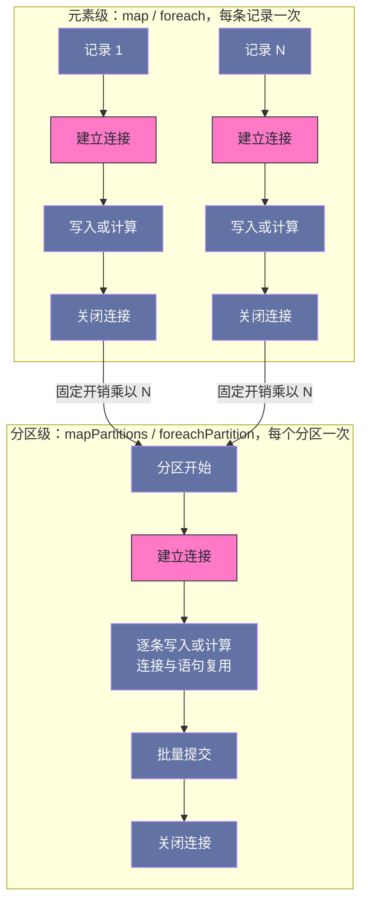
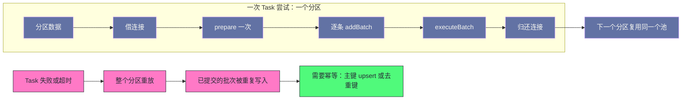
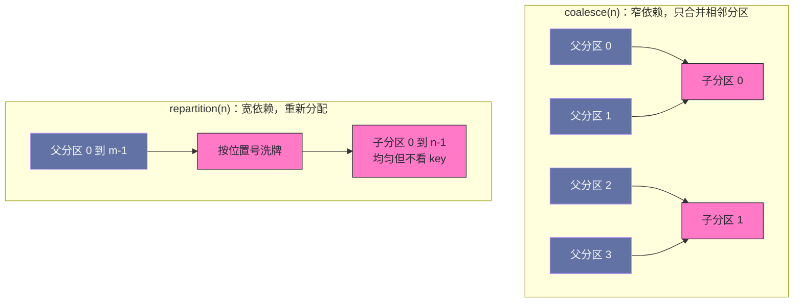
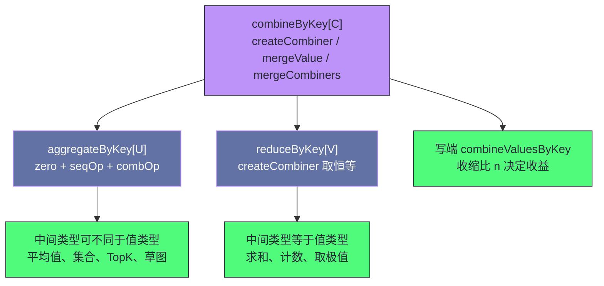
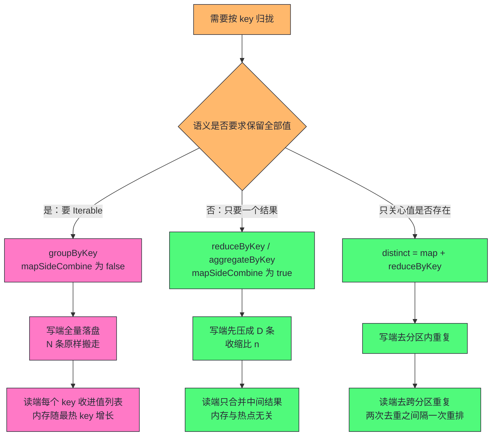
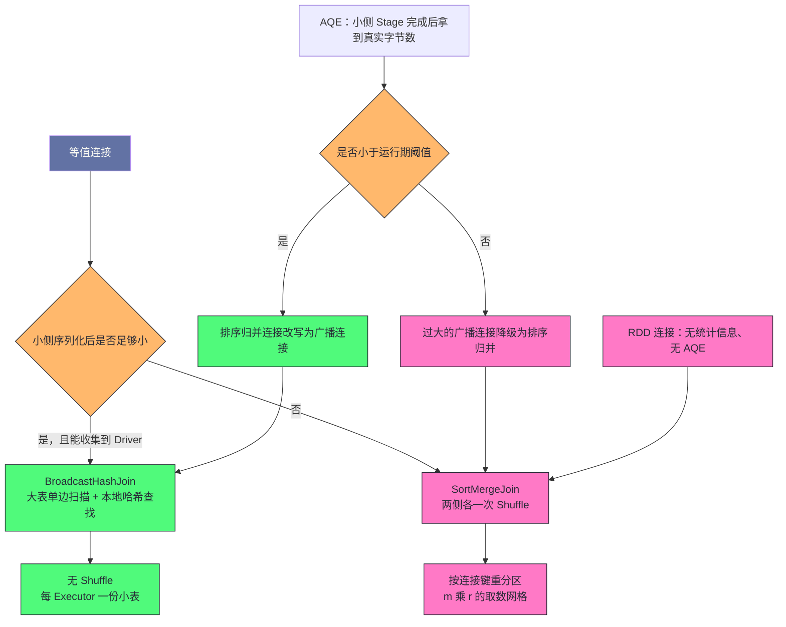

# 2. Spark 算子调优最佳实践：同一语义的写法选择与各自账单

**摘要：**

算子调优最容易被写成一张“用 A 替代 B”的对照表：`map` 换 `mapPartitions`、`groupByKey` 换 `reduceByKey`、`repartition` 换 `coalesce`。对照表本身没错，错在它把结论与前提拆开了——`mapPartitions` 在分区极大时会把内存峰值抬到 OOM，`coalesce` 在需要重新分布时根本做不到，`reduceByKey` 在 key 基数接近记录数时会白付一次哈希。同一批“最佳实践”，有人照做省下数倍时间，有人照做出事，差别不在算子本身，而在成本被记到了哪一本账上。本文换一个角度，把算子选择还原成一组物理量的选择：一次函数调用的作用域是元素还是分区、一次重分布要不要发生以及分区数怎么变、聚合的中间类型能不能与值类型分开、写端能不能先做一次收缩、连接时是重排两张表还是把一小张表分发下去、缓存被物化在哪一步。它要回答两个问题：同一段语义换一种写法，成本究竟被挪到了哪里；以及在什么条件下这种看似更优的写法反而更贵。文章以一个广告日报作业贯穿，沿五问推进：先界定算子选择的物理含义，再逐组比较元素级与分区级、副作用落地、分区算子、三级聚合、`groupByKey` 与 `distinct`、两类连接以及复用的位置，最后单列边界与反例，并把结论收束成一条从语义到参数的判断顺序。口径取当前稳定的 Spark 4.3.0（2026-10-30 发布，4.x 预编译 Scala 2.13），AQE 相关默认值以官方 Configuration 文档为准。

**关键词（Keywords）**: mapPartitions, foreachPartition, **coalesce**, repartition, **combineByKey**, map端聚合, **broadcast join**, AQE, distinct, cache

---

## 第 1 章 算子选择改的是物理动作

### 1.1 三次替换，两种相反的结局

同样一份曝光日志、同一条 200 分区的读入链路，把“先 `groupByKey` 再 `mapValues(_.sum)`”换成 `reduceByKey(_ + _)`，耗时常常从数十分钟掉到个位数分钟；把写库那段 `map(record => insert(record))` 换成 `foreachPartition`，能从两小时量级降到二十分钟量级。两次替换用的是同一批“最佳实践”，收益都在数倍以上。

第三次替换翻了车：把一段逐条解析的逻辑从 `map` 改成 `mapPartitions`，顺手在函数体里写了 `iter.toList` 以便“先排序再输出”，作业直接 OOM，堆日志里溢出的正是那个想装下整个分区的列表。同一条建议，前两次是省钱，第三次是出事。

这三个情形说明一件事：算子不是语义的等价改写，而是**把同一段语义翻译成不同物理动作的选择器**。翻译得对不对，取决于你打算把成本记在哪一本账上，而不是取决于哪个算子“更高级”。

### 1.2 一次选择同时改了三样东西

把算子放回 RDD 的物理模型里看，任何一次选择都在同时改动三样东西。第一样是 DAG 的形状：窄依赖算子可以把整条链折叠进同一个 Task，用迭代器套迭代器的方式流水推进；宽依赖（Shuffle Dependency）算子必须在中间插入一条 Stage 边界，让上游先物化。第二样是函数的作用域：有的算子每个元素调一次函数，有的每个分区调一次，有的在每个 Task 结束后还要再收一次尾，作用域决定了“能复用什么、必须重复什么”。第三样是中间结果的落点：留在堆里的迭代器、落到本地磁盘的 Shuffle 段、拉到 Driver 的数组，还是写进外部数据库的行。

后文所有的比较都落在这三样上。凡是只谈“哪个快”而不谈这三样的建议，都只能算经验，不能算方法。

### 1.3 一个贯穿全文的作业

为了让讨论有一个具体的着力点，笔者设一个广告投放日报作业 `ad_daily`：从 HDFS 读入前一天的曝光日志 `imp_log`（200 个分区、几十亿行）、点击日志 `clk_log`（同样 200 个分区），以及一张几万行的广告位维表 `slot_dim`；要做的事按顺序是解析、过滤无效流量、按广告位与小时汇总曝光与点击、连接维表补名称、按用户去重、最后写回数仓。

```scala
// parseImp 把一行文本解析成 ImpRecord：userId、slotId、ts、dwell
val imp  = sc.textFile("hdfs:///dw/imp_log/2026-11-18", 200).map(parseImp)  // 200 个分区
val clk  = sc.textFile("hdfs:///dw/clk_log/2026-11-18", 200).map(parseClk)  // 200 个分区
val slot = sc.textFile("hdfs:///dw/slot_dim")                               // 维表，几万行
```

这个作业里的每一步，都会在后面的某一章里被换一种写法重写一遍；换法不同，账单的落点就不同。分区数 200 是读入那一刻就定下的，后面每一次 Shuffle 的 map 任务数都由它继承，这种“配置在上游、收账在下游”的错位，是算子选择最容易被忽略的背景。

### 1.4 一个比喻：按件、按车、按趟

搬家公司有三种计价方式：按件，每件家具单独开单、单独计费；按车，一车一单，车装满了才走；按趟，从旧居到新居跑一趟，路上所有东西都得重新装一次车。元素级算子像按件，分区级算子像按车，Shuffle 像按趟。

三者的成本曲线完全不同。按件的好处是随时可以停、不需要堆场，坏处是单件的手续费乘以件数；按车的好处是手续只办一次、可以批量装车，坏处是车必须开出去，装不满也得走，而且一旦这车翻了，整车的货都要重来；按趟则是唯一能改变“东西在哪个房间”的方式，也是唯一要动用卡车与道路的，一次就要付清装卸、运输与重新归位的全部费用。

这个比喻有一处必须限定：Spark 的“车”是分区，而分区大小由上游文件切分决定，不按你的意愿装填；而“趟”也不是想跑就跑，只有语义要求按 key 重新分组时，这趟车才非开不可。把这两点记住，后面每一节的取舍都能自己推出来。

### 1.5 五问与全文路线

文章沿五问推进：先界定算子选择在物理上改了什么（本章），再逐组回答“不这样写会怎样”与“怎么落地”：第 2 章比较元素级与分区级，第 3 章把副作用落到外部系统，第 4 章处理分区数与重分布，第 5 章拆开聚合算子的能力阶梯与写端预聚合的触发条件，第 6 章解释 `groupByKey` 与 `distinct` 为什么贵，第 7 章比较两类连接以及 AQE 的自动转换，第 8 章谈复用的位置与物化时机，第 9 章集中列边界与反例，第 10 章收束到判断顺序。

先把整篇文章要反复引用的账本摊开：每个算子组作用于什么单位、产生什么依赖、要不要付 Shuffle、主要成本记在哪里。

| 算子组 | 作用单位 | 依赖类型 | 是否 Shuffle | 账单主要记在 |
|---|---|---|---|---|
| `map` / `filter` | 每条记录 | 窄 | 否 | 闭包调用次数、临时对象分配 |
| `mapPartitions` / `mapPartitionsWithIndex` | 每个分区 | 窄 | 否 | 分区级 setup 次数、materialize 时的内存峰值 |
| `foreach` / `foreachPartition` | 每条记录 / 每个分区 | 无（action） | 否 | 外部资源的建连、语句编译、事务提交 |
| `coalesce` | 若干相邻分区 | 窄 | 否 | 并行度下降、分布可能更不均 |
| `repartition` / `coalesce(n, true)` | 全部记录 | 宽 | 是 | 一次完整重排 + m×r 索引 |
| `reduceByKey` / `aggregateByKey` / `combineByKey` | 每个 key | 宽 | 通常是 | 写端聚合表、收缩比、读端合并 |
| `groupByKey` | 每个 key 的全部值 | 宽 | 是 | 全量落盘、读端值列表 |
| `distinct` | 每个不同的值 | 宽 | 是 | 两段去重 + 一次重排 |
| `join`（shuffle） | 每个 key | 宽 | 两侧各一次 | 重排两张表 |
| `join`（broadcast） | 每个大表分区 | 窄 | 否 | Driver 收集、每 Executor 一份小表 |
| `cache` / `persist` | 每个分区块 | 无 | 否 | 存储内存、序列化、驱逐与重算 |

---

## 第 2 章 元素级与分区级：一次函数调用的作用域

### 2.1 `map` 的账记在每条记录上

先看 `map` 的实现。它在 RDD 里只有几行，而这几个字决定了后面所有的成本形状：

```scala
// RDD.map：闭包被包装成"对整个分区的迭代器做一次 map"
def map[U: ClassTag](f: T => U): RDD[U] = withScope {
  val cleanF = sc.clean(f)
  new MapPartitionsRDD[U, T](this, (_, _, iter) => iter.map(cleanF))
}
```

这里有一个常被读错的地方：`map` 在物理上也只对每个分区调用一次 `compute`，只不过那个 `compute` 内部对每个元素调用一次 `f`。所以“`map` 每个元素调用一次函数”说的是 **`f` 的调用次数**，不是 RDD 的调用次数。

成本因此可以写成两项之和：单次调用的固定开销乘以记录数，加上函数体本身的成本乘以记录数。JIT 编译并内联之后，一次普通函数调用的固定开销在纳秒量级，几乎可以忽略；但若函数体里做了“建立数据库连接、打开文件、构造解析器、读远程配置”，这项固定开销就不再是纳秒，而是毫秒，而它偏偏要按记录数付。

### 2.2 `mapPartitions` 换掉的到底是什么

`mapPartitions` 的签名把作用域抬高了一层：它不再接收“一个元素到另一个元素”的函数，而是接收“一个迭代器到另一个迭代器”的函数。

```scala
// f 收到的是整个分区的迭代器，整个分区只调用一次
def mapPartitions[U: ClassTag](
    f: Iterator[T] => Iterator[U],
    preservesPartitioning: Boolean = false): RDD[U] = withScope {
  val cleanedF = sc.clean(f)
  new MapPartitionsRDD(
    this,
    (context: TaskContext, index: Int, iter: Iterator[T]) => cleanedF(iter),
    preservesPartitioning)
}
```

换成这种写法之后，有三样东西变了。第一样是 setup 的次数，从记录数 N 降到分区数 P；分区越大，这个比值的收益越可观。第二样是能持有分区级状态，譬如一个解析器、一个批量缓冲、一张缓存表，它们可以在分区内被所有记录共享。第三样是内存峰值，这一样最容易被忽略，后文单独说。

必须澄清一句：`mapPartitions` 并不会让“逐条处理”这件事变快。函数体内部仍然要对每条记录做一次实际工作，迭代器仍然是流式的，一次只吐一个元素。它换来的是“每次调用的固定开销只需付 P 次”以及“可以在分区内做批量与复用”。把这个前提想反，就会得出“分区级永远更快”的错误结论。

### 2.3 连接复用：固定开销从 N 次变成 P 次

数据库写入是最能放大这个差别的场景。

```scala
// 反例：每条记录建一次连接。握手、认证、权限校验都按记录数重复
rdd.map { r =>
  val conn = DriverManager.getConnection(url, user, pwd)
  try conn.createStatement().executeUpdate(toSql(r))
  finally conn.close()
}
```

```scala
// 正解：每个分区建一次连接，并在 Task 结束（含失败）时释放
rdd.mapPartitions { iter =>
  val conn = DriverManager.getConnection(url, user, pwd)
  TaskContext.get().addTaskCompletionListener[Unit](_ => conn.close())
  iter.map { r =>
    conn.createStatement().executeUpdate(toSql(r))
    r
  }
}
```

两段代码的语义完全一样，差别只在 `getConnection` 被调用的次数。若按每次建连 1 毫秒估算——握手、认证、会话初始化的合计在毫秒量级是常见量级——一百万条记录就是一千秒左右的纯等待，与数据量无关，与网络无关，只与“在哪一层建立连接”有关。这个估算不是实测数字，只是用来标定量级：固定开销乘以记录数，是一条斜率不随集群规模变化的直线。

换成 `mapPartitions` 之后，同样的一百万条记录，建连次数等于分区数（这里是 200），剩下的时间才花在真正的写入上。

### 2.4 内存峰值：`mapPartitions` 的代价面

迭代器本身是流式的，把一个分区的迭代器交给 `mapPartitions`，并不会自动把这个分区装进内存。危险的是函数体里那些“先收全再处理”的写法：`iter.toList`、`iter.toArray`、分区内排序、分区内 `groupBy`、把记录逐条塞进一个大 `ArrayBuffer` 之后再统一写出。

一旦这么写，内存峰值就从 O(1) 变成 O(分区大小)，而分区大小由文件切分决定：HDFS 上一个 block 默认 128 MiB，`spark.sql.files.maxPartitionBytes` 也定在 128 MiB 这一档，一个分区里可能是几十万到上百万条记录，换算成堆内对象就是几百 MB 到数 GB。`map` 几乎不可能因为“处理方式”而 OOM（除非单条记录本身巨大），`mapPartitions` 可以，而且往往是在换了一个看起来更“高级”的算子之后才 OOM。

所以判断标准不是“哪个快”，而是“函数体需不需要看见整个分区”。需要，就认这份内存；不需要，就老老实实让迭代器流过去。

### 2.5 边界：`preservesPartitioning` 是承诺，不是开关

`mapPartitions` 的第二个参数常被当成“性能优化开关”，其实它是一个语义承诺：它告诉 Spark“我的输出仍然按原来的分区器分区”。如果函数体里改了 key，却把这个参数传成 `true`，下游的连接或聚合会按错误的分区假设建立窄依赖，结果是**错而不报**——没有异常、没有告警，只有对不上的数字。

`mapPartitionsWithIndex` 的用途则相对明确：拿到分区号之后，可以让每个分区生成互不冲突的输出文件名、给样本打上分片标记、或者在分区号上做盐的分配。它多出来的那个 `Int` 参数，本身就是“分区级作用域”的最直接体现。

下面这张图把元素级与分区级的调用边界并排画出来，图中从元素级折回分区级的那两条箭头，就是“固定开销从 N 次降到 P 次”的那一步：



图中被染色的三个节点才是真正的固定开销发生处：左边两次，右边一次。其余节点做的事两边一模一样，所以任何“分区级比元素级快”的收益，都必须能追溯到这三个节点的次数差，否则就只是测量误差。

把三个算子的差异收进一张表：

| 维度 | `map` | `mapPartitions` | `mapPartitionsWithIndex` |
|---|---|---|---|
| 函数签名 | `T => U` | `Iterator[T] => Iterator[U]` | `(Int, Iterator[T]) => Iterator[U]` |
| 每分区调用次数 | 每条记录一次 | 一次 | 一次 |
| 可共享的分区级资源 | 无（只能靠闭包外的静态对象） | 有 | 有，且可拿到分区号 |
| 内存形态 | 一次一条，O(1) | 流式时 O(1)，materialize 时 O(分区) | 同左 |
| 典型用途 | 逐条改写、逐条判断 | 连接复用、批量写、共享解析器 | 分片输出、按分区打盐 |
| 主要风险 | 固定开销乘以记录数 | 误用 materialize 导致 OOM | 同左，且易错用分区号 |

---

## 第 3 章 副作用落地：`foreach` 与 `foreachPartition`

### 3.1 两个 action 的差别只在资源开在哪里

`foreach` 与 `foreachPartition` 都是 action，都返回 `Unit`，都不会产生 Shuffle，代码也都很短：

```scala
def foreach(f: T => Unit): Unit = withScope {
  val cleanF = sc.clean(f)
  sc.runJob(this, (iter: Iterator[T]) => iter.foreach(cleanF))
}

def foreachPartition(f: Iterator[T] => Unit): Unit = withScope {
  val cleanF = sc.clean(f)
  sc.runJob(this, (iter: Iterator[T]) => cleanF(iter))
}
```

两个闭包都在 Executor 上执行，区别只在闭包被调用的次数。`foreach` 的闭包按元素调用，所以任何写在闭包里的“建连、开文件、初始化客户端”都会按元素重复；`foreachPartition` 的闭包按分区调用，那些动作只发生 P 次。

### 3.2 外部资源的三笔账：建连、语句、事务

写外部系统时，资源成本可以拆成三笔。第一笔是建连：TCP 三次握手、TLS 协商、身份认证、会话初始化，这笔钱按“连接数”计费，与数据量无关。第二笔是语句：`prepareStatement` 要把 SQL 发给数据库做语法分析与执行计划生成，这笔钱按“语句数”计费；如果每条记录都 `prepare` 一次，等于把编译成本乘上记录数。第三笔是事务：每条记录提交一次，意味着每条记录一次日志落盘与一次可见性切换；批量提交则把这些合并，代价是“失败时已提交多少”这个边界变粗。

三笔账里，前两笔靠“把作用域抬到分区”就能省掉，第三笔则必须与幂等性一起考虑。

### 3.3 连接池、批处理与结束监听

```scala
// 连接池按 Executor 配，不按分区配：一个 JVM 一个池，池大小约等于并发 Task 数
rdd.foreachPartition { iter =>
  val pool = DbPool.forExecutor()
  val conn = pool.borrow()
  TaskContext.get().addTaskCompletionListener[Unit](_ => pool.release(conn))
  val ps = conn.prepareStatement(insertSql)   // 语句编译一次，分区内复用
  try {
    var n = 0
    iter.foreach { r =>
      ps.setString(1, r.userId)
      ps.setLong(2, r.ts)
      ps.addBatch()
      n += 1
      if (n % 1000 == 0) ps.executeBatch()    // 批的粒度就是失败时重来的单位
    }
    ps.executeBatch()
  } finally ps.close()
}
```

这段代码里有三个容易写错的细节。连接池要按 Executor 的并发 Task 数配置，而不是按分区数配置：一个四核 Executor 同时跑四个 Task，池里四个连接就够，配成两百个只会把数据库的 `max_connections` 打满。资源释放要挂在 `TaskContext` 的结束监听上，而不是只写 `finally`：Task 被 kill 时执行路径未必走到 `finally`，监听器则是 Spark 自己在任务收尾时统一回调的。批的大小要显式选择，因为它是“失败时重来的单位”，批太大则重试代价高，批太小则退化成逐条提交。

### 3.4 反事实与三个陷阱

如果不把作用域抬到分区，会依次发生三件事。第一件，连接风暴：每个 Task 里的每条记录都去建连，数据库的连接数上限先被打满，接着是其他作业被拒绝服务——故障从一个作业扩散到整个集群。第二件，语句编译风暴：`prepareStatement` 按记录数执行，数据库的 SQL 解析线程成为瓶颈，而 Spark 侧的 CPU 反而空闲。第三件，GC 压力：每个元素都创建一个 `Statement`，这些短命对象把所有 Task 的年轻代填满，监控上看是“Spark 变慢了”，实际是数据库与 GC 在被反复摩擦。

即使换成了 `foreachPartition`，还有三个陷阱要单独交代。其一，Task 重试会重放整个分区，已经提交的批次会被再写一遍；如果没有主键约束或幂等 upsert，“恰好一次”是做不到的，能保证的只有“至少一次”。其二，连接泄漏：如果 `borrow` 之后抛异常而没有归还，池会在若干轮之后耗尽，Task 卡在借连接这一步，表现是“作业挂住”。其三，把整个分区 materialize 之后再写：`iter.toList.foreach(insert)` 看起来只是换了个循环，实际上把内存峰值抬到了 O(分区)，与上一章的 OOM 是同一个病。

### 3.5 落点：优先让框架做

如果目标就是 JDBC，不必手写这套代码。DataFrame 的 `write.jdbc` 已经把这些事做掉了：`batchsize` 控制批的大小，`numPartitions` 控制并发连接数，`isolationLevel` 与 `truncate` 控制事务边界与清理方式。

```scala
df.write
  .format("jdbc")
  .option("url", jdbcUrl)
  .option("dbtable", "ad_daily")
  .option("batchsize", 1000)
  .option("numPartitions", 16)          // 并发连接数，别超过数据库的连接预算
  .option("isolationLevel", "READ_COMMITTED")
  .mode("append")
  .save()
```

手写 `foreachPartition` 只在三种情况下才有意义：目标不是 JDBC（譬如自研的 HTTP 批量接口）、需要数据库方言不支持的 upsert 语法、或者写入逻辑必须与 Spark 的分区一一对应（分片文件、按分区号路由）。除此之外，手写版本多半是把框架已经处理过的边界条件重新踩一遍。

下图把一次 `foreachPartition` 的连接生命周期与重试路径连起来画：



图中绿色节点是唯一的解法所在：重试不可避免，能改的只有“重复写入是否等价于一次写入”。这一点与算子无关，却是所有外部写入场景必须提前想清楚的事。

| 维度 | `foreach` | `foreachPartition` | `write.jdbc` |
|---|---|---|---|
| 建连次数 | 每条记录一次 | 每个分区一次 | 每个分区或每个连接池一次 |
| 语句编译 | 每条记录一次 | 每个分区一次 | 框架内部复用 |
| 批处理 | 无 | 需自己实现 | `batchsize` 参数 |
| 事务边界 | 逐条提交 | 自行决定 | `isolationLevel` + 提交策略 |
| 重试语义 | 至少一次 | 至少一次 | 至少一次 |
| 适用场景 | 纯本地副作用、日志打印 | 自研批量接口、方言 upsert | 标准 JDBC 写入 |

---

## 第 4 章 分区数：`coalesce` 与 `repartition` 的边界

### 4.1 分区数一次决定三件事

分区数在 Spark 里是一个“从读入一路继承下来”的量，很少有人在中途刻意改它，但它同时决定三件事：并行度（有多少个 Task 可以同时跑）、单 Task 的数据量（决定溢出与 OOM 的边界）、下游 Shuffle 的 r（进而决定 m×r 的账本面积）。三件事互相牵制，所以“分区数该定多少”没有一个与数据量无关的答案。

`ad_daily` 里有一段逻辑是这样的：曝光日志过滤掉无效流量之后，只剩原来 3% 左右的数据，但分区数还是 200。这意味着 200 个 Task 里绝大多数只处理几 MB 乃至更少的数据，启动、调度、序列化的固定成本盖过了真正的计算成本。

### 4.2 `coalesce` 的窄依赖：只合并相邻分区

`coalesce(n)` 默认不产生 Shuffle。它的做法是把相邻的若干个父分区在逻辑上并成一个子分区，子分区由同一个 Task 顺序读取多个父分区：

```scala
// 不 shuffle 的那条路：CoalescedRDD 只改"分区的边界"，不动数据的归属
def coalesce(numPartitions: Int, shuffle: Boolean = false,
             partitionCoalescer: Option[PartitionCoalescer] = Option.empty)
            (implicit ord: Ordering[T] = null): RDD[T] = withScope {
  if (shuffle) {
    // 省略：走 ShuffledRDD 的那一支
  } else {
    new CoalescedRDD(this, numPartitions, partitionCoalescer)
  }
}
```

这条路径有三个硬约束。其一，只能减不能增：目标分区数不小于当前分区数时，它退化为原样返回，什么也不会发生。其二，合并是相邻的：子分区拿到的是“几个父分区依次拼接”的数据，顺序与归属都没有被重新打散，所以它不能修倾斜，也不能改变某条记录落在哪个分区。其三，并行度会跟着下降：从 200 个 Task 变成一个 Task，如果数据量并没有同步变小，反而更慢。

### 4.3 `repartition` 的必然 Shuffle，以及它不是按 key 分区

`repartition` 在 RDD 上的实现只有一行，它把参数转给了 `coalesce` 的另一条分支：

```scala
def repartition(numPartitions: Int)(implicit ord: Ordering[T] = null): RDD[T] = withScope {
  coalesce(numPartitions, shuffle = true)
}
```

`shuffle = true` 那一支的做法是：给每条记录分配一个递增的位置号（起点由分区号做伪随机打散），再对位置号做哈希分区。这样每个目标分区拿到的记录条数大致相等，但它从头到尾**没有看 key**。它与 `partitionBy(new HashPartitioner(n))` 是两件不同的事：前者保证均匀，后者保证“同 key 同分区”。

这个区别在连接场景里非常关键。如果目的是让后续 `join` 的两侧分区器一致、从而把宽依赖退化成窄依赖，那么用 `repartition` 是无效的——分区器仍然是空的，`CoGroupedRDD` 依然会建宽依赖。此时必须用 `partitionBy`，或者用带分区表达的 `repartitionByRange`。

### 4.4 反事实：没有过滤之后的重分区会怎样

把上面那段逻辑按“不做任何处理”跑一遍，会看到三个现象。第一，Task 数虚高：每个 Task 只处理原来那几十 MB 里的 3%，启动与调度开销占比过半，UI 上表现为“Task 数很多、每个 Task 都很短、Stage 时间却不短”。第二，下游 Shuffle 的读端仍然按 200 个分区拉数，索引条目与请求编排一分不少。第三，如果这段逻辑后面还要写文件，200 个分区会写出 200 个小文件，小文件问题在数仓侧再收一次账。

把分区数降到 20，Task 的固定成本被摊薄，单 Task 数据量回到可处理的量级，小文件数量也同步下降。这个动作的成本几乎为零，因为它不产生 Shuffle，只改分区边界。

### 4.5 边界：什么时候 `coalesce` 不解决问题

有四种情况，`coalesce` 帮不上忙，甚至会让情况更糟。

第一种是目标分区数大于当前分区数：`coalesce` 做不到，只能用 `repartition`。第二种是需要均匀分布：`coalesce` 只合并相邻分区，如果相邻分区本身一胖一瘦，合并后的子分区还是一胖一瘦，此时省下的 Shuffle 成本会以长尾的形式还回来。第三种是倾斜：倾斜是 key 分布的问题，不是分区边界的问题，任何不改变 key 归属的算子都修不了它。第四种是 `coalesce(1)`：所有数据挤进一个 Task，前面所有并行度归零，除了“确实只需要一个文件”这种场景，它几乎总是错的。

反过来，`repartition` 也有它省不掉的账：只要目标是“改变分区数或分布”，这次 Shuffle 就必须付，因为数据确实要离开原来的分区。所谓“用 `repartition` 减少分区数”是一笔白付的账——你花钱做了一次重排，只为了得到一个 `coalesce` 免费就能给出的结果。

### 4.6 `repartitionAndSortWithinPartitions`

当“重分区”与“排序”同时需要时，还有一个合并版的算子：

```scala
// 排序被推进 Shuffle 的写端：落盘时就是有序段，读端不必再排一次
def repartitionAndSortWithinPartitions(partitioner: Partitioner): RDD[(K, V)] =
  new ShuffledRDD[K, V, V](self, partitioner).setKeyOrdering(ordering)
```

它的收益来自“一次数据移动干两件事”：`repartition` 加 `sortByKey` 是两次数据移动（一次重排、一次排序时的溢出与归并），而它把排序融进写端的落盘过程，排序后的段直接落盘，数据只搬一次。它的边界也很清楚：排序只在分区内有序，全局有序仍要靠 `sortByKey` 的 range 分区器；分区器必须自己给，给错了就等于白排。

下面这张图把两条路的分区变化画出来，左边只改边界，右边重新分配：



图里左侧的子分区只由相邻的父分区拼成，右侧的子分区则可能来自任意父分区。这个差别决定了 `coalesce` 不需要落地、不需要搬运，也决定了它无法改变“数据在哪个分区”这件事。

| 算子 | Shuffle | 分区数变化 | 是否按 key | 主要代价 | 不该用的场景 |
|---|---|---|---|---|---|
| `coalesce(n)` | 否 | 只能减少 | 否 | 并行度下降、分布可能更不均 | 需要增加分区或重分布 |
| `coalesce(n, true)` | 是 | 可增可减 | 否 | 一次完整重排 | 目的只是减少分区数 |
| `repartition(n)` | 是 | 可增可减 | 否 | 一次完整重排 | 想靠它让 join 复用分区器 |
| `repartitionAndSortWithinPartitions` | 是 | 可增可减 | 按给定分区器 | 重排 + 写端排序 | 不需要分区内有序 |

---

## 第 5 章 聚合的三级台阶

### 5.1 三个签名，一条能力线

三个聚合算子常被并列介绍，但它们的签名里藏着一条清晰的能力线：

```scala
def reduceByKey(func: (V, V) => V): RDD[(K, V)]

def aggregateByKey[U](zeroValue: U)
    (seqOp: (U, V) => U, combOp: (U, U) => U): RDD[(K, U)]

def combineByKey[C](createCombiner: V => C,
                    mergeValue: (C, V) => C,
                    mergeCombiners: (C, C) => C): RDD[(K, C)]
```

从下往上看：`combineByKey` 允许中间结果类型 `C` 与值类型 `V` 不同，并且把“第一个值怎么变成中间结果”“同分区内再来一个值怎么并”“不同分区的中间结果怎么并”三件事分别交给你；`aggregateByKey` 在中间加了一个零值，把“第一个值”这件事简化成“从零值开始做一次 `seqOp`”；`reduceByKey` 则要求中间结果与值同类型，于是三个函数退化成一个。

### 5.2 `combineByKey` 是母型

`reduceByKey` 的实现直接回答了“为什么它本质上是 `combineByKey` 的特例”：

```scala
def reduceByKey(partitioner: Partitioner, func: (V, V) => V): RDD[(K, V)] = self.withScope {
  combineByKeyWithClassTag[V]((v: V) => v, func, func, partitioner)
}
```

三个位置分别对应 `createCombiner = (v: V) => v`（第一个值原样作为中间结果）、`mergeValue = func`、`mergeCombiners = func`。也就是说，`reduceByKey` 把中间结果类型取成了 `V` 本身，于是“创建一个中间结果”退化成恒等函数，“合并”这一件事在两个位置复用了同一个函数。

这不是实现上的巧合，而是**中间类型退化成了值类型**所必然导致的结果。一旦你需要的中间结果与值类型不同——平均值要 `(sum, count)`、去重要一个集合、TopK 要一个堆——`reduceByKey` 的签名就装不下了，必须上抬到 `aggregateByKey` 或 `combineByKey`。

### 5.3 `aggregateByKey` 在中间加了一个零值

`aggregateByKey` 的实现同样是把参数转给 `combineByKeyWithClassTag`：

```scala
combineByKeyWithClassTag[U](
  (v: V) => clean(seqOp(clean(zeroValue), v)),   // createCombiner：从零值起算
  seqOp,                                          // mergeValue
  combOp,                                         // mergeCombiners
  partitioner)
```

这里有一个非常容易被忽略、又非常容易出错的语义：零值是**每个 key 在每个分区第一次出现时**取一次，不是每条记录取一次。如果零值是一个可变对象，譬如 `ArrayBuffer.empty`、`HashSet.empty`、`mutable.Map.empty`，那么同一个分区内的所有 key 会共享这同一个实例，所有 key 的中间结果会互相污染，最后得到一个看起来能跑、数字却莫名其妙的结果。正确做法是传不可变值，或者每取一次就深拷贝一次。

### 5.4 为什么需要中间类型

平均值的例子最能说明问题。用 `reduceByKey` 求平均，写法通常是先把两条记录平均，再把两个平均值平均，最后得到一个加权错误的结果；这个错误不会报错、不会告警，只会让报表与账面对不上。正确的做法是把平均值拆成两个可结合的统计量：和与计数，以 `(和, 计数)` 一路加下去，最后一步再相除；`aggregateByKey` 从 `(0L, 0L)` 起算，`reduceByKey` 则以首个值作为起点。

```scala
// 平均曝光时长：中间类型是 (总时长, 条数)，最后一步才做除法
val avgDwell = imp
  .map { r => (r.slotId, (r.dwell, 1L)) }
  .reduceByKey { case ((s1, c1), (s2, c2)) => (s1 + s2, c1 + c2) }
  .mapValues { case (s, c) => if (c == 0) 0.0 else s.toDouble / c }
```

这段代码其实用的是 `reduceByKey`，因为它的中间类型恰好就是值类型（一个二元组）。真正需要 `aggregateByKey` 的场景，是“零值必须存在”的聚合：譬如求集合的并、求分位数近似（草图结构需要一个空的草图作为起点），此时值类型与中间类型不同，`reduceByKey` 装不下。

### 5.5 写端预聚合的触发条件

三个算子的收益，最终都落在同一个机制上：写端能不能先把同一个 key 的多条记录压成一条。这个机制由 `ShuffleDependency` 上的 `mapSideCombine` 标志控制，触发条件可以逐条列出来。

第一，算子必须打开 `mapSideCombine`。`reduceByKey`、`aggregateByKey`、`combineByKey` 默认打开；`groupByKey` 显式关掉，原因下一章再说。第二，聚合函数必须满足结合律与交换律，否则“任意分批、任意顺序地合并局部结果”与“一次合并全部”得到的答案不同。第三，收缩比必须大于一：设一个分区的输入是 N 条记录、不同 key 是 D 个，收缩比就是 n = N/D；n 接近 1 时，写端的哈希表既不收缩数据，又多付一次哈希与一次内存占用。第四，写端聚合表的大小等于本分区的 key 基数，key 基数极大时这张表本身就会溢出，收益被溢出成本吃掉。

在这个基础上，写端还会在两条路之间选一条：当分区数不超过 `spark.shuffle.sort.bypassMergeThreshold`（默认 200）且没有写端聚合时，可以走 bypass 路径，不排序、按分区各开一个文件最后再合并；否则走排序路径，用外部排序器边聚合边落盘。这两条路径不是风格差异，而是两笔账的互换：bypass 为了绕开排序，给每个目标分区各开一个文件，最后再合并成一个，文件句柄的压力正来自这里；排序路径则用一次排序换掉那些并发打开的文件，让溢出段可归并。SPARK-6237 处理的是前者的句柄问题，SPARK-2045 引入的排序式 Shuffle 处理的是后者的文件数与缓冲压力。

| 条件 | 满足时 | 不满足时 |
|---|---|---|
| `mapSideCombine` | 写端先压成 D 条 | 全量 N 条落盘 |
| 聚合可结合可交换 | 分批合并结果正确 | 结果静默出错 |
| 收缩比 n 明显大于 1 | 三笔账同步按 n 缩小 | 白付一次哈希与内存 |
| key 基数远小于记录数 | 写端聚合表小、可控 | 聚合表自身溢出 |
| 分区数大于 bypass 阈值 | 走排序路径，写端聚合 | 可能走 bypass，不聚合 |

### 5.6 `reduceByKey` 不一定产生 Shuffle

这一条是很多“算子调优”材料里缺失的边界。`combineByKeyWithClassTag` 在构造 RDD 之前会先做一次判断：如果当前 RDD 的分区器已经等于目标分区器，它就不建 `ShuffledRDD`，而是直接在分区内做一次聚合，并保留分区信息。

```scala
// 简化后的分支：分区器已经匹配时，不产生 Shuffle
if (self.partitioner == Some(partitioner)) {
  self.mapPartitions(iter => aggregator.combineValuesByKey(iter, TaskContext.get()),
                     preservesPartitioning = true)
} else {
  new ShuffledRDD[K, V, C](self, partitioner)
    .setAggregator(aggregator)
    .setMapSideCombine(mapSideCombine)
}
```

这意味着：对一个已经 `partitionBy` 过的 RDD 调用 `reduceByKey`，且传入的分区器与现有分区器等价时，这一次聚合只付写端聚合的钱，不付重排的钱；即便不显式传分区器，`defaultPartitioner` 也有可能挑中现有分区器，于是同一个 `reduceByKey` 调用在不同血缘上是否产生 Shuffle，并不完全一致。这条规则也解释了“预分区复用”的收益来源——省掉的不只是一次计算，而是一整次数据搬迁。

### 5.7 收口到 Driver：`reduce` 与 `treeReduce`

聚合算子的另一端是 action：把结果收回到 Driver。`reduce` 的做法是把所有分区的结果逐条拉到 Driver 上合并，分区数一多，Driver 就成了单点瓶颈：它要接收 P 个中间结果、串行调用 P−1 次合并函数，期间所有 Executor 都在等它。

`treeReduce` / `treeAggregate` 把这件事改成树形：先在 Executor 侧做多级归并，Driver 只收最后一层的少量中间结果。

```scala
def treeAggregate[U: ClassTag](zeroValue: U)(
    seqOp: (U, T) => U, combOp: (U, U) => U, depth: Int = 2): U = {
  // 1. 每个分区先做局部聚合，把结果变成一个元素的 RDD
  var partiallyAggregated = mapPartitions(it => Iterator(it.aggregate(zeroValue)(seqOp, combOp)))
  var numPartitions = partiallyAggregated.partitions.length
  // 2. 按 depth 算出每一层收拢的倍数
  val scale = math.max(math.ceil(math.pow(numPartitions, 1.0 / depth)).toInt, 2)
  // 3. 逐层用 reduceByKey 在 Executor 侧归并，直到规模足够小
  while (numPartitions > scale + math.ceil(numPartitions.toDouble / scale)) {
    numPartitions /= scale
    partiallyAggregated = partiallyAggregated
      .mapPartitionsWithIndex((i, iter) => iter.map((i % numPartitions, _)))
      .reduceByKey(new HashPartitioner(numPartitions), combOp)
      .values
  }
  // 4. 最后一层才回到 Driver
  partiallyAggregated.reduce(combOp)
}
```

判断标准很直接：分区数少（几十个）时，树形聚合多出来的调度成本盖过收益，直接用 `reduce` 更快；分区数上千时，Driver 串行合并的代价与分区数成正比，树形聚合能把这一段压到与层数成正比。`depth` 默认 2，相当于每层收拢 √P 个，层数是 O(log P)。

下图把三级聚合算子画成一条能力阶梯，越往下能力越强、需要写的函数越多：



图中最上面那个节点是母型，另外两个聚合算子都可以由它加约束得到。把这张图记住，遇到“这个聚合该用哪个算子”的问题时，只需问一句：我的中间结果与值类型是不是同一个类型。

| 算子 | 中间类型 | 需要提供的函数 | 典型用途 | 主要限制 |
|---|---|---|---|---|
| `reduceByKey` | 与值同类型 | 一个合并函数 | 求和、计数、取极值 | 中间结果不能换类型 |
| `aggregateByKey` | 可不同 | 零值 + 分区内 + 分区间 | 平均值、集合、草图 | 零值必须不可变或深拷贝 |
| `combineByKey` | 可不同 | 建、并值、并中间结果 | 需要精细控制首值与合并 | 代码最长，最易写错 |
| `treeReduce` / `treeAggregate` | 同左 | 同左 | 把结果收回到 Driver | 分区少时不如直接 `reduce` |

---

## 第 6 章 `groupByKey` 与 `distinct`：语义不允许收缩的那一类

### 6.1 `groupByKey` 的语义要求看到全部值

`groupByKey` 返回的是 `(K, Iterable[V])`。这个签名把话说死了：下游要看到每个 key 的全部值，任何合并都会丢信息，所以写端不能收缩、读端不能只保留一个中间结果。它不是实现得懒，而是语义上不允许。

实现里这一点是显式写死的：

```scala
// groupByKey：mapSideCombine 被显式置为 false
combineByKeyWithClassTag[CompactBuffer[V]](
  (v: V) => CompactBuffer(v),                        // createCombiner
  (c: CompactBuffer[V], v: V) => c += v,             // mergeValue
  (c1: CompactBuffer[V], c2: CompactBuffer[V]) => c1 ++= c2,  // mergeCombiners
  partitioner,
  mapSideCombine = false)                            // 关键：写端不合并
```

注意读端仍然有 aggregator：它负责把同一个 key 的值收进一个 `CompactBuffer`，`mapSideCombine = false` 只关掉了写端那一次收缩。换句话说，`groupByKey` 与 `reduceByKey` 共用同一套 Shuffle 机制，差别只在“写端要不要先压一次”。

源码里给这件事留了一段注释，理由是双重的：写端合并并不会减少要搬的字节数（每个 key 的全部值最终仍要留着），却要求把写端所有记录先塞进一张哈希表，于是同一批数据在堆里多活了一遍，把老年代更快地填满。也就是说，`groupByKey` 关掉写端合并，一半是语义不允许，一半是“合了也不省、还更费内存”。这两条理由叠在一起，才解释了为什么它在实现层面被写死，而不是留一个可调开关。

### 6.2 全量落盘与预聚合的差距

设一个分区有 N 条记录、D 个不同 key，平均每个 key 有 n = N/D 条。`groupByKey` 落盘与搬迁的对象是 N 条，`reduceByKey` 是 D 条，两者相差 n 倍。这个倍数同时作用在三笔账上：磁盘上写入字节与溢出写放大按 n 缩小，网络上拉取字节按 n 缩小，CPU 上读端反序列化的次数按 n 缩小。

n 的值由业务决定，不由框架决定。按广告位聚合，几万个广告位对上亿条曝光，n 可以到几千；按请求 ID 聚合，每个 ID 一条记录，n 等于 1，预聚合一点用都没有。判断一次聚合的 Shuffle 贵不贵，第一步不是看数据量，而是看 key 的基数：数据量大而 key 基数小，是最幸运的组合；数据量大而 key 基数也大，才是最贵的 Shuffle。

### 6.3 读端的内存形态

`groupByKey` 的读端要为每个 key 攒一个值列表，这个列表的大小由该 key 的记录数决定。整个 Task 的内存峰值因此由“最热的那个 key”决定，而不是由“平均每个 key 多少条”决定。遇到一个千万条记录的 key，Task 必须先攒下这一千万条才能往下走；攒不下就溢出到磁盘，溢出段还要排序、还要归并，于是又绕回磁盘账。

`reduceByKey` 在同样的场景下只需要为每个 key 保留一个中间结果，热 key 的代价被压成常数。这不是“实现更聪明”，而是“语义允许它只保留一个数”。

### 6.4 反事实：`groupByKey` 之后再手写聚合

最常见的错误写法是先分组再求和：

```scala
// 反例：把全部原始记录搬一遍，再在读端做一次本可以在写端做的加法
val bySlot = imp
  .map(r => (r.slotId, r.dwell))
  .groupByKey()
  .mapValues(_.sum)
```

这段代码的语义与 `reduceByKey(_ + _)` 完全一样，代价却差 n 倍：Shuffle 搬的是全部原始记录而不是每个广告位一个数；读端要为每个广告位攒一个列表再求和；遇到倾斜时，最热广告位的列表会把整个 Task 拖垮。数据量越大、key 基数越小，这个差距越明显。

不过，“值列表”在某些场景下确实无法避免：要算中位数、要按时间顺序拼接字符串、要把值列表原样输出、要做二次排序，这些语义都要求看到全部值。此时能做的是控制 key 基数、加盐打散、换算法（譬如用近似分位数代替精确中位数），而不是假装它与 `reduceByKey` 一样便宜。

### 6.5 `distinct`：两段去重夹着一次重排

`distinct` 的全部实现只有一行：

```scala
// RDD.distinct：把去重翻译成"以自身为 key 的聚合"
def distinct(numPartitions: Int)(implicit ord: Ordering[T] = null): RDD[T] = withScope {
  map(x => (x, null)).reduceByKey((x, _) => x, numPartitions).map(_._1)
}
```

它做的事情，是把“去重”翻译成“以值本身为 key 的 `reduceByKey`”，而合并函数取左边的值——对 `null` 而言，取左还是取右没有区别。因为 `createCombiner` 是恒等、`mergeValue` 与 `mergeCombiners` 都是“取一个”，这三个函数全都满足结合律与交换律，所以写端可以预聚合：同一个分区内的重复值先被压成一条。

于是它的物理形状可以分成两段：写端先把分区内的重复压掉（第一段去重），读端再把来自各分区的同一个值压成一条（第二段去重），两段之间隔着一次完整的 Shuffle。**常被口头概括成“两次 Shuffle”的说法抓对了一半**：去重确实分两段，但重排只有一次，那一次重排把两段隔开，也因此两段都不能省。如果 `distinct` 之后还要按别的键连接、或者在写出前重新平衡分区，才会再叠上真正意义上的第二次 Shuffle。

这个视角解释了 `distinct` 与 `groupByKey` 的差别：两者的 Shuffle 机制一样，但 `distinct` 的值是 `null`，读端不需要攒列表，内存是 O(不同值的个数)；`groupByKey` 需要攒全部值，内存是 O(最热 key 的记录数)。同样是“按 key 归拢”，一个的内存与基数有关，一个的内存与热点有关。

下图把三条路径并排画出来，各条支路把成本压在哪个量级上，一眼可见。



图中的分叉点只有一个判据：这段语义能不能在“只看到部分同 key 记录”的情况下先算出一个中间结果。能，就走上半支，成本的量级由收缩比决定；不能，就走下半支，成本的量级由记录总数与最热 key 决定。

| 维度 | `groupByKey` | `reduceByKey` / `aggregateByKey` | `distinct` |
|---|---|---|---|
| 返回形态 | `(K, Iterable[V])` | `(K, C)` | 去重后的元素 |
| 写端预聚合 | 关掉 | 默认打开 | 打开（取任一即可） |
| Shuffle 数据量 | 约等于记录总数 | 约等于不同 key 数 | 约等于不同值数 |
| 读端内存 | 随最热 key 线性增长 | 每个 key 一个中间结果 | 每个值一条记录 |
| 适用前提 | 语义要求看到全部值 | 聚合可结合可交换 | 只需判重、不需要值 |
| 常见误用 | 分组后再手写聚合 | 把不可结合的运算硬塞进去 | 重复调用 `distinct` 多次 |

---

## 第 7 章 连接：重排两张表，还是分发一小张表

### 7.1 shuffle join 的账

RDD 的 `join` 走的是 `cogroup`：把两侧按同一个分区器重排，再在每个分区内把同 key 的两组值配起来。

```scala
// join 的骨架：两侧先按同一分区器重排，CoGroupedRDD 负责在分区内配对
val slotDim = slot.map { line => val f = line.split(","); (f(0), f(1)) }
val joined  = imp.keyBy(_.slotId).cogroup(slotDim)
// 输出 (K, (Iterable[V], Iterable[W]))，再摊平成行
```

它的成本结构很直接：两侧各生成一个 `ShuffleDependency`，每侧都付一次完整的 Shuffle；如果两侧的分区器本来就一致，`CoGroupedRDD` 会把对应的依赖改成一对一的窄依赖，此时那一侧的重排就省掉了。这也是“先把两张表按同一个分区器 `partitionBy` 再反复连接”能省钱的原因。

### 7.2 广播连接：把重排换成一份副本

如果连接的一侧足够小，小到可以给每个 Executor 各发一份，那么就不需要重排了：大表照旧按自己的分区扫描，每一行在本地小表的哈希表里查一次。

```scala
// RDD 侧的广播连接：小表收集成 Map，广播出去，大表逐条查本地
val dim = slot.map { line => val f = line.split(","); (f(0), f(1)) }.collectAsMap()
val bc  = sc.broadcast(dim)

val enriched = imp.mapPartitions { iter =>
  val local = bc.value            // 每个 Executor 反序列化一次，Task 之间共享
  iter.map { r => (r, local.get(r.slotId)) }
}
```

收益是结构性的：连接从“按 key 重排整张大表”变成“每个 Task 内的一次哈希查找”，网络成本从“按 key 重排”降为“把小表分发一遍”，而且不再有 Shuffle 段的拉取、重试与 `FetchFailed`。代价同样明确：小表要在 Driver 侧收集、序列化，再分发到每个 Executor 并常驻内存；小表一大就压垮 Driver 或 Executor。

SQL 侧的对应物是广播哈希连接（Broadcast Hash Join），由 `spark.sql.autoBroadcastJoinThreshold` 控制自动选择，默认 10 MiB。这个阈值是“编译期估计的字节数”，不是行数，也不是压缩后的大小。

### 7.3 AQE 的自动转换

计划生成时估不准大小，是连接策略最常见的失效来源。自适应查询执行（Adaptive Query Execution，AQE）把这件事推迟到运行期：小表那一侧的 Stage 先跑完，拿到真实的数据量（`MapOutputStatistics`），再决定要不要把排序归并连接（Sort-Merge Join）改写成广播哈希连接。

在 Spark 3.2 之后 AQE 默认开启，相关的几个开关是：`spark.sql.adaptive.enabled` 控制总开关，`spark.sql.adaptive.autoBroadcastJoinThreshold` 控制运行期判定的阈值（默认取 `spark.sql.autoBroadcastJoinThreshold` 的值，即 10 MiB），`spark.sql.adaptive.localShuffleReader.enabled` 让改写之后仍然可以就近读取已经落盘的 Shuffle 数据，`spark.sql.adaptive.skewJoin.enabled` 处理倾斜分区。反向也有一条路：`DemoteBroadcastHashJoin` 会把运行期发现过大的广播连接降级回排序归并连接。

这里必须把边界说清楚：**AQE 只作用于 SQL / DataFrame 的物理计划**。RDD 的 DAG 不经过 `AdaptiveSparkPlanExec`，所以它的连接策略在提交那一刻就定死了，没有运行期纠正的机会。RDD 侧要做广播连接，只能靠人判断“这一侧足够小”，然后显式收集与广播。

### 7.4 两层共用的判据

把 RDD 与 SQL 放在一起看，广播连接的判据其实是同一组，只是执行者不同：

第一，比较的是字节数，不是行数。十万行宽表可能比一亿行窄表还大，而阈值判断的是序列化后的体积。

第二，小侧要能被收集到 Driver。收集这一步走的是 Driver 的堆内存与网络，几百万行的表即使“在 Executor 上算起来很快”，收集到 Driver 也可能 OOM；单个数组还有 JVM 层面的长度上限。

第三，小侧要能放进每个 Executor 的堆。广播变量在每个 Executor 上只有一份，但它与执行内存、存储内存共享同一个堆，表一大就会把缓存与聚合挤出内存。

第四，连接键要可哈希。等值连接可以走哈希，非等值连接只能退化成嵌套循环，广播的收益会被嵌套循环的 O(n×m) 吃掉。

第五，小侧的统计信息要可信。SQL 侧靠元数据与运行期统计，估错了还能被 AQE 纠正；RDD 侧没有任何统计，估错了就是估错了。

### 7.5 反事实：把小表广播出去会怎样

把一张 500 MB 的维表当“小表”广播，会发生三件事中的一件。第一件，Driver 在 `collectAsMap` 时 OOM，作业在提交后的第一个 action 上直接失败。第二件，Driver 撑住了，但每个 Executor 上多出 500 MB 常驻内存，原本给聚合与缓存的执行内存被挤掉，于是原本不溢出的 Stage 开始溢出，整体反而更慢。第三件，广播分发本身成为瓶颈：Executor 数量越多，分发总量越大，在弹性伸缩的集群上，新拉起的 Executor 每次都要重新拉一遍。

反过来说，把一张只有几万行的维表拿去走 shuffle join，也是浪费：两侧各一次重排的固定成本，远大于“给每个 Executor 发几万行”的成本。

### 7.6 边界

广播连接有四条边界值得单独记住。其一，小侧如果是一段计算结果而不是源表，那么“先算完再广播”的代价要计入总账，有时这笔计算本身就是一次全量 Shuffle。其二，广播不解决倾斜：小侧被复制到每个 Executor，大侧的热 key 仍然落在同一个 Task 上。其三，广播变量是只读的，无法参与需要动态更新的场景。其四，统计信息过期时，SQL 侧可能选错连接方式，AQE 能纠正一部分，但纠正本身有成本——它要等小侧 Stage 完成，短作业未必划算。

下面这张图把两条连接路径与 AQE 的改写方向画在一起：



图中最下面那条边值得特别注意：RDD 的连接没有 AQE 这一层，所有判断都在提交前完成，错了也没有第二次机会。

| 维度 | shuffle join | broadcast join |
|---|---|---|
| Shuffle 次数 | 两侧各一次 | 零次 |
| 网络形态 | 按 key 重排整张表 | 小表分发到每个 Executor |
| 内存形态 | 读端按分区缓冲与归并 | 小表常驻、每 Executor 一份 |
| 失败面 | Shuffle 段拉取失败、重试 | 广播分发失败、Driver 收集失败 |
| 适用前提 | 两侧都大、键可哈希 | 一侧足够小、能收集、能装进堆 |
| 自动选择 | SQL 侧由优化器与 AQE 决定 | 同上，RDD 侧只能手动 |

---

## 第 8 章 复用：`cache` 的位置与物化的时机

### 8.1 复用的判据

复用的收益可以写成一句话：重算代价乘以复用次数，大于物化代价。重算代价包括重新读 HDFS、重跑上游的窄依赖链、重付上游的 Shuffle；物化代价包括存储内存、序列化与反序列化、以及“被驱逐之后要重算”的风险。

这个不等式里最容易被忽略的是“重算代价”的估计。一个 RDD 如果只有两条 `map`，重算几乎免费，缓存它只是白占内存；如果它前面有一次 Shuffle 与一次外部读取，重算就要把这两件事再付一遍，缓存才有意义。

### 8.2 `cache` 放在哪一行

位置比存储级别更重要。三条经验可以照着用。

第一，放在共同祖先上。如果下游有三条分支都要用到某个 RDD，缓存点应当在分叉点之上，而不是在每条分支里各缓存一次。第二，放在最贵的边界之后。昂贵的 Shuffle 之后再缓存，省掉的是“重跑 Shuffle”；在 Shuffle 之前缓存，只省掉“重读源数据”，下游每次仍要重付 Shuffle。第三，缓存窄表而不是宽表。`select` 出真正需要的列之后再缓存，内存占用可能相差数倍，而省掉的 IO 是一样的。

### 8.3 `cache` 之后立刻 `count` 为什么可能是浪费

`cache` 与 `persist` 是惰性的：它们只给 RDD 打上标记，真正的物化发生在下一次 action 时。于是常见的写法是“先 cache，再 count 一次把它物化，然后再跑真正的作业”。这个写法在某些场合是对的，但它常常是一笔浪费，原因有三个。

第一，物化本来就会在第一次 action 时发生。如果紧接着就是真实作业，那么这次 `count` 只是多提交了一个 Job，多抢了一轮资源，多占了一段时间的 Stage 调度；真实作业该付的物化成本一分没少。第二，`count` 会把整张表的数据都物化，而不是作业真正用到的那一部分。如果真实作业只取其中几列、或者会在缓存之后先做一次过滤，那么这次预热把大量用不上的数据装进了内存，反而把真正需要的数据挤出去。第三，缓存被驱逐之后要重算。如果预热与真实作业之间还有别的作业在跑，LRU 可能已经把这块内存换走，预热的钱白付，真实作业还要再算一遍。

有两种情况，立刻 `count` 是合理的：需要测量数据量来决定下游并行度；或者后面跟着一串短作业，希望把物化成本集中到一次、避免每个短作业都触发一次重算。除此之外，让它自己在第一次真实使用时物化就好。

### 8.4 `unpersist` 的时机

缓存的释放有两种方式：主动 `unpersist` 与被动驱逐。主动释放应当在“最后一次使用之后”立刻做，`unpersist(blocking = false)` 是异步的，不会阻塞调用线程。被动驱逐由存储内存的 LRU 完成，它保证内存不会无限增长，但代价是“被驱逐的块下次要用时重新计算”。

在长驻应用里，这件事的性质会变。ThriftServer、常驻的结构化流作业、反复提交小作业的调度器，它们的 `SparkContext` 生命周期以天计，缓存如果不主动释放，就会一直占着 Executor 的存储内存，直到进程结束；而 LRU 驱逐会让“缓存命中率”这个指标看起来还行，实际每次都在重算。长驻应用应当把“谁缓存的、什么时候释放”写进代码，而不是依赖驱逐。

### 8.5 存储级别的选择

存储级别的差别只在两件事上：放在内存还是磁盘，以及是否序列化。序列化能显著压缩内存占用，代价是每次读取都要反序列化；不序列化访问快，但堆占用大、GC 压力大。

需要留意一个容易混淆的默认值：`RDD.cache()` 等价于 `persist()`，默认级别是 `MEMORY_ONLY`；而 `Dataset.cache()` 走的是 SQL 侧的缓存管理器，默认级别带磁盘兜底（`MEMORY_AND_DISK`）。两者名字一样，语义并不完全一样。

| 存储级别 | 数据放哪 | 是否序列化 | 内存占用 | 适用场景 |
|---|---|---|---|---|
| `MEMORY_ONLY` | 内存 | 否 | 最大 | 内存充足、访问频繁、对象可直接复用 |
| `MEMORY_ONLY_SER` | 内存 | 是 | 约为前者几分之一 | 内存紧张、CPU 有余量 |
| `MEMORY_AND_DISK` | 内存 + 磁盘 | 否 | 内存 + 磁盘 | 数据量略大于内存、可接受磁盘读 |
| `MEMORY_AND_DISK_SER` | 内存 + 磁盘 | 是 | 最小 | 大数据量、内存与磁盘都要省 |
| `DISK_ONLY` | 磁盘 | 是 | 0（堆内） | 数据量极大、只求不重算 |

### 8.6 `checkpoint` 与 `cache` 的分工

`cache` 切断的是“重算”，`checkpoint`（检查点）切断的是“血缘”（Lineage）。前者把数据留在内存或本地磁盘，RDD 的血缘还在，一旦缓存丢失仍可重算；后者把数据写到可靠存储（通常是 HDFS），并把血缘截断，此后即使上游全部丢失也不影响它。

判断标准是血缘的长度与重算的代价：血缘很长（几十层变换、多次 Shuffle）、且数据会被多次复用，就值得 `checkpoint`；血缘短、只是被复用几次，`cache` 就够了。`checkpoint` 需要一次 action 触发；`localCheckpoint` 用缓存层代替可靠存储，同样会截断血缘，但数据只留在 Executor 本地、不做副本，节点失效之后既没有血缘可重算、也没有远端数据可读，适合“集群稳定、只想省掉重算”的场景。

---

## 第 9 章 边界与反例

把前八章的建议逐条反过来问一遍，会得到六条常见的误判。它们之所以常见，是因为每一条都曾经在某个场景里成立过，然后被当成了普遍规律。

**分区级更快**。这个结论只在“函数体有固定开销”或“需要分区级批量”时成立；纯粹逐条改写的场景里，两者的差距在测量误差之内，而 `mapPartitions` 多出来的 materialize 风险是实打实的。

**换算子就解决重复写**。`foreachPartition` 只解决了建连次数，不解决重试重放。重复写入要靠幂等（主键 upsert、事务去重键、写入批次号）解决，与算子无关。

**`coalesce` 总比 `repartition` 便宜**。这个说法在需要增加分区、需要均匀分布、需要按 key 重排时，`coalesce` 根本做不到，此时“便宜”没有意义。反过来，只为减少分区数而用 `repartition`，是白付一次 Shuffle。

**`reduceByKey` 总比 `groupByKey` 快**。当 key 基数接近记录数时，写端聚合表既不收缩数据又占内存，还多付一次哈希，此时它是一场净亏损；当语义确实需要看到全部值时，`groupByKey` 没有替代品。

**广播连接总是更快**。小侧不够小时，它会把 Driver 或 Executor 压垮，或者因为分发成本与内存挤占而变慢；非等值连接时，它退化成嵌套循环。

**`cache` 了就一定快**。缓存位置错（缓存在 Shuffle 之前）、缓存列太宽、缓存后立刻 `count` 预热、用完不释放，这四种写法都会让缓存从“省钱”变成“占地方”。

| 现象 | 常见误判 | 实际机制 |
|---|---|---|
| `mapPartitions` 之后 OOM | 数据量变大了 | 函数体 materialize 了整分区，内存峰值从 O(1) 变成 O(分区) |
| 写库作业偶发主键冲突 | 数据库有问题 | Task 重试重放了整个分区，已提交批次被重复写入 |
| `coalesce` 之后任务更慢 | `coalesce` 有 bug | 并行度下降，或相邻合并让分布更不均 |
| `repartition` 之后 join 仍然 Shuffle | 分区数没生效 | `repartition` 不设置分区器，`CoGroupedRDD` 仍建宽依赖 |
| `reduceByKey` 没有变快 | 算子用错了 | key 基数接近记录数，写端聚合无收缩收益 |
| 广播连接后 Driver OOM | 广播没生效 | 小侧在 Driver 侧被 `collect`，体积超出堆 |
| `cache` 之后仍然重算 | 缓存没生效 | 块被执行内存挤占后被驱逐，或缓存点选在了分叉点之下 |

---

## 第 10 章 落点

回到开头那三次替换：同样的建议，两次省钱、一次出事。差别不在建议本身，而在“这笔钱记在哪本账上”。

算子选择的第一层是语义层：这段逻辑能不能换一种写法，从而少一次重排或少一次重算。`groupByKey` 换 `reduceByKey`、`distinct` 之后不再重分区、广播连接替代 shuffle 连接，都属于这一层，省掉的是整笔账。第二层是作用域层：同一段语义，函数该按元素调还是按分区调，资源该在哪一层建立。`map` 与 `mapPartitions`、`foreach` 与 `foreachPartition` 的取舍都在这一层，省掉的是固定开销乘以次数的那条直线。第三层是分区与分布层：分区数、分区器、连接策略，决定的是账本的面积与形状。第四层才是参数层：并行度、内存比例、压缩开关、重试次数，它们只决定同一本账上的费率。

四层的顺序不能颠倒。在错误的账本上省费率，越努力越远：把并行度调大并不会让 `groupByKey` 少搬记录，把执行内存加大也不会让广播连接的分发量变小。

由此得到一条判断顺序：先看语义能不能换写法，再看作用域该抬到哪一层，再看分区数与连接方式是否选对，最后才动参数。四处都问过一遍，绝大多数“算子调优”的收益都能被解释成某一次重排、某一次重算或某一次固定开销的消失，而不是“换了个更高级的算子”。

至于 Spark 4.x 正在推进的自适应执行会把多少判断从“写代码时”挪到“运行时”，目前仍然言之尚早。它能让分区数与连接方式在运行期被纠正，但纠正的前提仍然是“语义允许另一种物理形状”——`groupByKey` 不会因为 AQE 就变得便宜，`mapPartitions` 也不会因为 AQE 就变得安全。判据没有变，变的只是由谁来执行判断。

---

## 参考资料

1. Zaharia M., Chowdhury M., Das T., et al. Resilient Distributed Datasets: A Fault-Tolerant Abstraction for In-Memory Cluster Computing. NSDI 2012. https://www.usenix.org/system/files/conference/nsdi12/nsdi12-final138.pdf
2. Apache Spark 源码（4.3.0）：`core/src/main/scala/org/apache/spark/rdd/RDD.scala`，`map`、`mapPartitions`、`coalesce`、`repartition`、`distinct`、`foreach` 的定义与分区语义。https://github.com/apache/spark/blob/v4.3.0/core/src/main/scala/org/apache/spark/rdd/RDD.scala
3. Apache Spark 源码（4.3.0）：`core/src/main/scala/org/apache/spark/rdd/PairRDDFunctions.scala`，`reduceByKey`、`aggregateByKey`、`combineByKey`、`groupByKey` 如何转调 `combineByKeyWithClassTag`。https://github.com/apache/spark/blob/v4.3.0/core/src/main/scala/org/apache/spark/rdd/PairRDDFunctions.scala
4. Apache Spark 源码（4.3.0）：`core/src/main/scala/org/apache/spark/rdd/MapPartitionsRDD.scala`，元素级算子最终落到同一个 RDD 实现上的方式。https://github.com/apache/spark/blob/v4.3.0/core/src/main/scala/org/apache/spark/rdd/MapPartitionsRDD.scala
5. Apache Spark 源码（4.3.0）：`core/src/main/scala/org/apache/spark/rdd/CoalescedRDD.scala`，`coalesce` 的相邻合并与分区边界计算。https://github.com/apache/spark/blob/v4.3.0/core/src/main/scala/org/apache/spark/rdd/CoalescedRDD.scala
6. Apache Spark 源码（4.3.0）：`core/src/main/scala/org/apache/spark/rdd/ShuffledRDD.scala` 与 `CoGroupedRDD.scala`，宽依赖的构造，以及分区器一致时退化为窄依赖的判定。https://github.com/apache/spark/blob/v4.3.0/core/src/main/scala/org/apache/spark/rdd/ShuffledRDD.scala
7. Apache Spark 源码（4.3.0）：`core/src/main/scala/org/apache/spark/Aggregator.scala`，`combineValuesByKey` 在写端与读端的分工。https://github.com/apache/spark/blob/v4.3.0/core/src/main/scala/org/apache/spark/Aggregator.scala
8. Apache Spark 源码（4.3.0）：`core/src/main/scala/org/apache/spark/scheduler/TaskContext.scala`，`addTaskCompletionListener` 与任务收尾时的资源释放。https://github.com/apache/spark/blob/v4.3.0/core/src/main/scala/org/apache/spark/scheduler/TaskContext.scala
9. Apache Spark 源码（4.3.0）：`core/src/main/scala/org/apache/spark/internal/config/package.scala`，`spark.shuffle.sort.bypassMergeThreshold`、`spark.sql.adaptive.*` 等配置的默认值定义。https://github.com/apache/spark/blob/v4.3.0/core/src/main/scala/org/apache/spark/internal/config/package.scala
10. Apache Spark 源码（4.3.0）：`sql/core/src/main/scala/org/apache/spark/sql/execution/adaptive/DynamicJoinSelection.scala` 与 `DemoteBroadcastHashJoin.scala`，AQE 在运行期改写与降级连接方式的规则。https://github.com/apache/spark/blob/v4.3.0/sql/core/src/main/scala/org/apache/spark/sql/execution/adaptive/DynamicJoinSelection.scala
11. Apache Spark 源码（4.3.0）：`sql/core/src/main/scala/org/apache/spark/sql/Dataset.scala` 与 `execution/cache/CacheManager.scala`，`Dataset.cache()` 的默认存储级别与 SQL 缓存的物化路径。https://github.com/apache/spark/blob/v4.3.0/sql/core/src/main/scala/org/apache/spark/sql/Dataset.scala
12. Apache Spark 4.3.0 文档：RDD Programming Guide，`mapPartitions`、`foreachPartition`、`reduceByKey` 的语义与注意事项。https://spark.apache.org/docs/latest/rdd-programming-guide.html
13. Apache Spark 4.3.0 文档：SQL Performance Tuning，广播连接阈值、自适应查询执行与分区合并。https://spark.apache.org/docs/latest/sql-performance-tuning.html
14. Apache Spark 4.3.0 文档：Configuration，Shuffle、AQE 与存储级别相关配置项及默认值。https://spark.apache.org/docs/latest/configuration.html
15. Apache Spark JIRA：SPARK-2045，排序式 Shuffle 的引入动机——写端文件数与缓冲压力的收敛。https://issues.apache.org/jira/browse/SPARK-2045
16. Apache Spark JIRA：SPARK-6237，合并 Shuffle 文件以缓解打开文件句柄过多，bypass 路径的文件压力由此而来。https://issues.apache.org/jira/browse/SPARK-6237

---

> [!note] 思考题
> 1. `mapPartitions` 把建连次数从 N 降到 P，但 P 本身由上游文件切分决定。若分区数从 200 降到 20，这条收益会放大还是缩小，代价又落在哪一笔账上？
> 2. `aggregateByKey` 的零值若是可变对象，为什么会让不同 key 的结果互相污染？除了把零值改成不可变对象，还有哪些手段能在类型层面避免这类错误？
> 3. `reduceByKey` 在分区器已经匹配时不产生 Shuffle。这条规则能否推广到 `join`，推广之后“预分区复用”的适用边界在哪里？
> 4. `distinct` 的写端预聚合由“分区内重复率”决定收益。什么分布的数据会让这次预聚合几乎白付，此时还有别的写法吗？
> 5. AQE 能在运行期把连接方式改写两次（升格与降级）。这种“先估计、再纠正”的模式，在哪些场景下会因为纠正成本过高而得不偿失？
> 6. `cache` 之后立刻 `count` 有时是合理的。请构造一个场景，使这次预热的收益明确为正，并说明它依赖哪个前提。