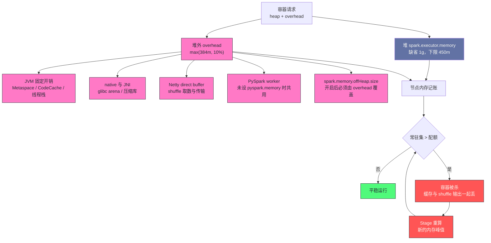
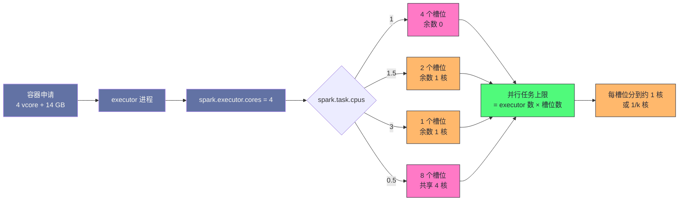
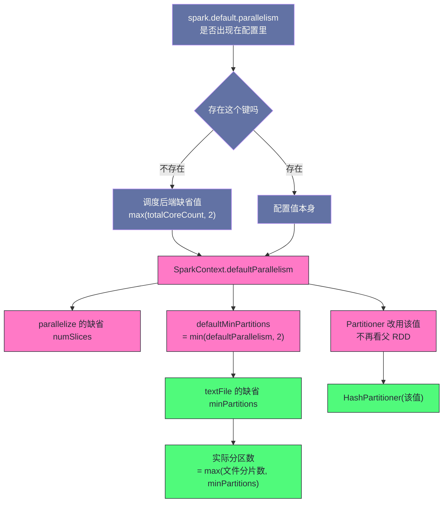
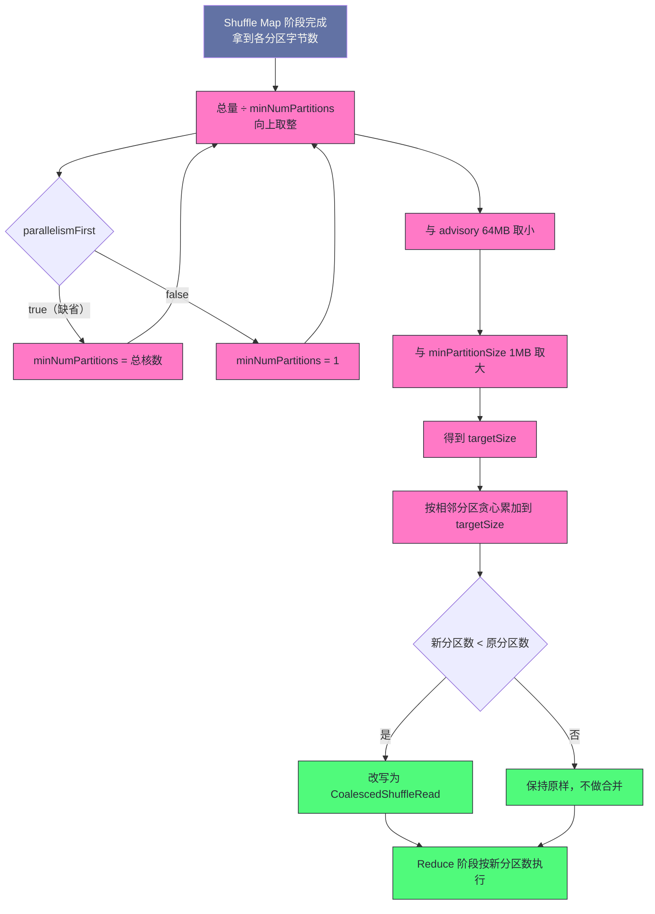
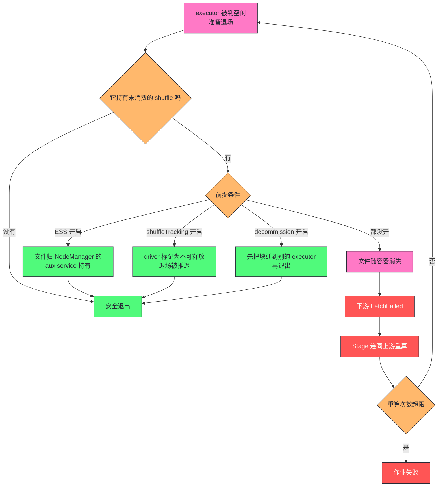

# 3. Spark 集群资源分配与并行度调优：容器账、槽位除法与分区数的两条下界

**摘要：**

调优这件事在 Spark 上有一个很别扭的起点：面对一个跑得慢的作业，最先被动手的往往是 executor 的个数、核数与内存，而这三个数字恰好是最难验证对错的一组——改大之后快了一点，你说不清是新配置起了作用，还是队列恰好空了。本文要做的事情很有限，只把静态配置的算术算清楚：一个 executor 在容器里究竟占多少字节，核数除上 `spark.task.cpus` 之后能开出几个槽位，executor 个数有哪几种给法、各自在哪个集群管理器上生效，`spark.default.parallelism` 的口径为什么在文档与代码之间错位，以及分区数与核数之间那条"2 到 4 倍"的经验关系在什么条件下成立、在什么条件下会把人带进沟里。

文章沿五问推进。先界定资源分配与并行度各自管什么，把两者中间那个真正承压的量——槽位——找出来；再把 executor 的内存构成拆成堆、堆外开销与额外堆外三段加法，算出容器请求的真实字节数，并解释容器化之后为什么 10% 的余量经常不够；随后进入任务侧，用除法算出槽位数与除不尽的余数，说明分数核的两种用法与代价；接着回到"个数"这个上游变量，逐条摊开 `--num-executors`、`spark.executor.instances` 与动态分配三条路，并指出 `--num-executors` 在 Standalone 上是被静默过滤掉的；再处理并行度的来路，把文档口径与代码口径对齐，给出不同 master 下的实际取值；最后用两条下界（单分区字节上限与槽位数倍数）重新解释分区数，把 AQE 在 4.x 的合并行为、资源申请的排队语义、动态分配对 shuffle 数据归属的前提逐条展开，并单列边界与反例。

文章口径为 Spark 4.3.0（2026-10-30 发布，4.x 预编译 Scala 2.13）。4.x 在这条主线上有两处口径变化值得注意：`memoryOverhead` 从"一个比例"变成"比例加下限"两个配置，动态分配的前提从"必须配 external shuffle service"放宽成四选一。默认值以官方 Configuration 文档与对应版本源码为准。

**关键词（Keywords）**: executor 内存构成, memoryOverhead, **分数核**, task.cpus, defaultParallelism, 分区数, **AQE coalesce**, 动态分配, external shuffle service

---

## 第 1 章 两本账：资源分配管"用多少"，并行度管"用得多满"

### 1.1 一次方向相反的复盘

有一类现场很难复盘。同一个 `gmv_daily` 作业，原先 `--executor-cores 2`、`--executor-memory 8g`，跑得起但慢；把每个 executor 加到 4 核、内存加到 12g，executor 总数减半，总核数没变，按直觉应该更快，实测却慢了将近两成，Spark UI 上还多出一截 GC 时间。第二次尝试把核数改回 2、内存保持 12g，速度又回升，但不如最初那一版清爽。

三次改动，账面上的"总核数"和"总堆内存"几乎一样，结果却横跨两成。这类现象的根源不在参数本身，而在两个量被混成了一口锅：**资源分配决定这个应用能从集群拿走多少计算能力，并行度决定这份能力被切成多少份、以什么粒度用出去**。前者是容器层的字节与核，后者是任务层的个数与粒度，两者之间隔着一个从来不在配置项里出现、却决定了全部换算关系的中间量——槽位（slot）。

### 1.2 两个量之间隔着一个槽位

资源分配这一侧的计量单位是容器：YARN 分配一个 container，Kubernetes 起一个 pod，Standalone 分配若干 vcore 加若干内存。容器里住着一个 executor 进程，进程的堆由 `spark.executor.memory` 定，堆外的保命空间由 `spark.executor.memoryOverhead` 定，两者相加就是节点上被占掉的物理内存。这一侧的所有算术都是加法与取整，算错了不会立刻报错，只会在某个深夜以 "Container killed by YARN for exceeding memory limits" 的形式出现。

并行度这一侧的计量单位是任务：一个 Stage 有多少个 task，每个 task 处理多少字节。任务不是凭空出现的，它要落到某个 executor 的某个槽位上，一个 executor 能同时跑几个 task，由核数除以单任务核数向下取整决定。这一侧的所有算术都是除法与余数，算错了也不会报错，只会表现为"核占着但不出活"，或者"任务排队等槽位"。

把两侧连起来看，整条链就清楚了：集群给出容器，容器开出槽位，槽位承接任务，任务数由分区数决定。四个环节里任何一个的数字没算对，现象都会指向别处——内存不够时看着像 GC 问题，槽位算错时看着像并行度问题，分区数定错时看着像"Spark 不行"。

### 1.3 一个贯穿全文的作业

后面的算术需要一个具体的着力点，笔者这里设一个电商数仓的日结作业 `gmv_daily`：从 HDFS 读入当天的订单明细（约 2 TB Parquet，按天分区，单文件可切分），与一张几百 MB 的商品维表按商品标识连接，再按品类与渠道两个维度汇总成交额，写回数仓。它每天跑一次，读多写少，连接的一侧足够小，聚合有 shuffle。

承载它的集群是一套 20 节点的 YARN 集群，每个节点 16 vcore、64 GB 可供容器使用的内存，合计 320 核、1280 GB。这个规模不大不小，正好让算术的误差落在"看得见但不致命"的区间里。

第一版配置是团队拍的：每个 executor 4 核、12 GB 堆、40 个 executor。

```bash
spark-submit --master yarn --deploy-mode cluster \
  --num-executors 40 \
  --executor-cores 4 \
  --executor-memory 12g \
  --conf spark.sql.shuffle.partitions=200 \
  --class com.example.GmvDaily gmv.jar
```

40 × 4 = 160 核，占集群核数的一半；40 × 12 GB = 480 GB 堆，占集群内存的三成多。从"总量"看，这是一份很保守的申请，理应留足了余量。真正的问题藏在三处：容器实际占用的内存远不止 12 GB；160 个槽位与 200 个 reduce 任务之间是一个除不尽的比值；而 2 TB 的输入在 shuffle 之后仍有 1.2 TB，被压进 200 个分区，每个任务要吞下 6 GB 左右的数据。这三个数字会在第 2、3、6 章被逐个拆开。

### 1.4 一个比喻：车间、机台与工单批次

把 executor 想成一间租来的车间：租约按"整间"签，合同上写的是面积，但车间里能放机台的地方只有一部分，剩下的是通道、立柱、配电柜与消防间距——这些不产出任何东西，却必须付租金。堆内存是机台占的地面，`memoryOverhead` 就是通道与立柱，租约面积是容器请求量。把通道压到极限，车间平时能用，一旦进了大件物料，叉车转不开身，整间车间被物业清场（容器被杀），而不是某台机台坏掉。

一个车间里能摆几台机台，就是槽位数；机台数是核数，一张工单需要占用几台机台，是 `spark.task.cpus`。工单批次是分区：一批做多少件，决定换模次数与在制品堆积。车间、机台、工单三层各自有各自的账，混着算就会得出"多租几间车间就能让每批货更小"这种听起来对、算起来错的结论。

比喻的限定在于：Spark 的车间不能超租，容器一旦超出配额是被外部（NodeManager 或 kubelet）杀掉，而不是自己缩一缩；所以通道宽度只能预留，不能临时借用。这一点与真实的厂房改造恰好相反，也是后面所有"留多少余量"讨论的前提。

---

## 第 2 章 executor 的内存构成：从堆到容器的三次加法

### 2.1 三个数字而不是一个

新手最容易犯的错是把 `spark.executor.memory` 当成 executor 的内存。它只是堆（heap），是 JVM 里可以用 `-Xmx` 描述的那一部分。在一个被 YARN 或 Kubernetes 管着的容器里，一个 executor 进程真正让节点少掉的内存，至少由三段构成：

第一段是堆，`spark.executor.memory`，缺省 1 GB，4.x 的源码里给它标了一个下限 450m，配得比这更小会直接报错。第二段是堆外开销，`spark.executor.memoryOverhead`，用来装 VM 自身开销、interned string、JNI 与 native 库、Netty 的 direct buffer，以及在 PySpark 场景下与 JVM 同住的 Python worker。第三段是显式开启的堆外内存，由 `spark.memory.offHeap.enabled` 与 `spark.memory.offHeap.size` 控制，缺省关闭、大小为 0；一旦打开，它不占堆，但照样占容器的物理内存，所以要额外预算。

**容器请求的量是堆加堆外开销（再加显式配置的 PySpark 内存），不是堆**。这是 Spark 向集群管理器报出去的数，也是节点上被记账的数，超了就是容器被杀。三段加法里最容易漏的是第三段：`spark.memory.offHeap.size=2g` 只是告诉 executor"你可以用 2 GB 堆外"，它并没有自动把那 2 GB 加到容器请求里，必须由你把 `memoryOverhead` 抬高去覆盖，否则容器配额里 16 GB 堆加 2 GB 堆外已经吃满，JVM 自身一点余量都不剩。

### 2.2 overhead 的口径变化：从比例到比例加下限

`spark.executor.memoryOverhead` 是 2.3.0 引入的配置，而它的取值规则在 3.x 时代定型：不给就按堆的 10% 算，但至少 384 MB。3.x 的文档里那句"10%，最小 384 MB"，说的正是这条规则。

4.x 把它拆成了两个配置。一个是 `spark.executor.minMemoryOverhead`，缺省 384m，是下限；另一个是 `spark.executor.memoryOverheadFactor`，缺省 0.10，是比例。未显式设置 `spark.executor.memoryOverhead` 时，生效值等于 `max(minMemoryOverhead, executorMemory × memoryOverheadFactor)`；显式设置时，这两个配置都被忽略。同一个 factor 在 Kubernetes 上有一个例外：非 JVM 任务（PySpark、R 之类）缺省取 0.40，理由是这类任务需要更多非堆空间，而它们最典型的失败就是 "Memory Overhead Exceeded"。

把这条口径变化读透，能得到一个有用的判断：**这个比例是一个保守的缺省，而不是一个经过测算的结论**。它默认"堆越大、非堆开销按比例越大"，这在堆主要被数据对象占据时成立；但当非堆开销由固定成分主导时（类元数据、线程栈、direct buffer），比例就会两头失真——小堆时 384 MB 的下限常常偏紧，大堆时 10% 又可能给多了。真正该做的是按成分估，而不是按比例套。

### 2.3 算术：一张容器内存表

把三段加法摊成一张表，`gmv_daily` 那套配置的真实占用就藏不住了。下表按堆 4/8/12/16/24 GB 五档，对比"只给默认 overhead"与"显式给到 2.5 GB"两种做法，单位一律换算成 MB 后再按 YARN 的 1024 MB 粒度向上取整：

| 堆（`spark.executor.memory`） | 默认 overhead = max(384M, 10%) | 容器请求（默认） | 取整后 | 显式 overhead 2.5G 时容器 | 取整后 |
|---|---|---|---|---|---|
| 4 GB | 410 MB | 4506 MB | 5120 MB | 6656 MB | 7168 MB |
| 8 GB | 819 MB | 9011 MB | 9216 MB | 10752 MB | 11264 MB |
| 12 GB | 1229 MB | 13517 MB | 14336 MB | 14848 MB | 15360 MB |
| 16 GB | 1638 MB | 18022 MB | 18432 MB | 18944 MB | 19456 MB |
| 24 GB | 2458 MB | 27034 MB | 27648 MB | 27136 MB | 27648 MB |

第一列到第四列说明一件事：在 4 GB 到 24 GB 这一区间里，默认 overhead 的实际比例稳定在 10% 上下；只有堆小于 3.8 GB 时，384 MB 的下限才真正接管，那时比例会明显高出 10%。第五、六列说明另一件事：显式给 2.5 GB 时，12 GB 堆的容器申请 14848 MB，取整到 15360 MB，只多付 512 MB；但 4 GB 堆的容器被抬到 7168 MB，等于为一个只用了 4 GB 堆的进程多付了 3 GB 租金。

`gmv_daily` 的第一版配置在第四列：12 GB 堆的容器实际要 14336 MB ≈ 14 GB，而不是配置文件里那行 12g。20 个节点、每节点 64 GB，按 14 GB 一装，每个节点放 4 个（56 GB），余下 8 GB 不够再开一个；再叠加 16 vcore 除 4 核的限制，也是 4 个。两条约束恰好对齐，40 个 executor 占掉 20 个节点中的 10 个。这笔账看着还算体面，但它把"每节点 8 GB 的零头"永久浪费了——四个 executor 之后剩下的 8 GB 谁也住不进去。

### 2.4 容器化之后，10% 为什么常常不够

先把 JVM 的堆外固定开销列一遍，就能看出 10% 这个比例的边界在哪里。类元数据（Metaspace）在应用刚起来时很小，但 UDF、动态编译的表达式、Kryo 的序列化器类、Parquet 与 Arrow 的 reader 类会把它推到几百 MB；JIT 编译产物占 code cache，缺省预留上限是 240 MB 量级；每个线程一块栈，缺省 1 MB，4 核 executor 上除了任务线程还有 Netty IO 线程、BlockManager 传输线程、Shuffle 取数线程与 GC 线程，几十个线程就是几十 MB；Netty 传 shuffle 数据走 direct buffer，上限与堆挂钩；glibc 的 malloc arena 按线程分配，虚拟地址大、常驻内存按需增长，碎片化严重时能吃掉几百 MB；另有 mmap 的索引文件与 JNI 加载的 native 库。

这些成分加起来，在一个 12 GB 堆的 executor 上通常是 1.5 GB 到 2.5 GB，正好压在默认 overhead 的 1229 MB 之上。也就是说，默认配置不是"不够"，而是"刚好在边缘"：作业平稳时够，一旦某个 Stage 产生大量短命对象、堆在 GC 前后反复震荡，或者临时多加载了几十个类，常驻集就会顶破配额。**容器化把这件事的性质变了**：在没有 cgroup 的时代，超一点只是节点内存紧张；在 cgroup 与 NodeManager 的内存监控下，超一点是整容器被杀，日志里留下一条与业务无关的 "physical memory used" 记录，重试之后大概率在同一个 Stage 再死一次。

还有一层与堆无关的放大：容器被杀时，executor 上缓存的 RDD 块、正在写的 shuffle 文件、已完成的 map 输出一起消失。若前面已经写了几百 GB 的 shuffle，这些数据要重算，重算又产生新的内存峰值，形成"越重试越容易死"的循环。这就是为什么调优现场的经验值往往是"至少留 15% 到 20%"，而不是文档里的 10%——10% 是让进程跑起来的门槛，不是让它扛住尖峰的门槛。把三段加法与这条失败回路画在一起，能看清容器里的每一段是在哪一步被突破的：



图中那条从"容器被杀"回到"新的内存峰值"的回路是这段讨论的重点：它不是一次性的失败，而是一个自我强化的循环，越到后面越难靠调参数收场。

### 2.5 什么时候必须显式抬高 overhead

四种情形下不要依赖缺省值，直接把 `spark.executor.memoryOverhead` 写死。

其一是 PySpark。Python worker 与 JVM 同住一个容器，Python 侧的对象、pandas 的中间结果、pyarrow 的 buffer 都算在 overhead 里；不显式设 `spark.executor.pyspark.memory` 时，Spark 也不会替你限制 Python 的内存，等于让 Python 与 JVM 的非堆部分抢同一块配额。其二是打开 `spark.memory.offHeap.enabled` 的作业，堆外大小必须额外加进 overhead，前文已算过。其三是 UDF 密集、动态编译多的作业，Metaspace 与 code cache 会显著超过比例值。其四是 shuffle 与网络密集的作业，Netty 的 direct buffer 在高并发取数时会短时间抬升常驻内存，这类峰值与堆大小无关，比例估算必然偏低。

反过来，纯批处理、没有 PySpark、没有堆外、类加载稳定的作业，默认值通常够用，此时把 overhead 抬到 2.5 GB 只是多付租金，还降低每个节点能放的容器数。抬高 overhead 与抬高堆的代价不同：后者改变 GC 行为，前者只是把容器变大，代价落在装箱与配额上。

### 2.6 平台会再取整一次

算出来的字节数并不是最终申请量。YARN 的调度器会按 `yarn.scheduler.minimum-allocation-mb`（常见缺省 1024 MB）把内存请求向上取整，并以 `yarn.scheduler.minimum-allocation-vcores` 对 vcore 做同样处理；Kubernetes 则按 request 与 limit 分别记账，`spark.executor.memory` 加 overhead 是 request，而容器能不能用满还要看 limit 与节点可分配量。这意味着你在 `spark-submit` 里写的 13517 MB，落地时可能变成 14336 MB，一个节点的装箱数从 4 变成 4（本例恰好没变），也可能从 4 变成 3（当节点内存是 48 GB 而非 64 GB 时）。

算术在这里有一个通用的收尾动作：**每一次加法之后都要按平台的取整粒度再算一遍，并且用"节点能放几个"作为校验，而不是用"总共申请了多少"**。前者决定并行度的上限，后者只是一个好看的汇总数。

---

## 第 3 章 核的除法：槽位、分数核与除不尽的余数

### 3.1 槽位是除出来的

一个 executor 能同时跑几个任务，官方文档写得很干脆：并发任务数等于 `floor(executor cores / spark.task.cpus)`，`spark.task.cpus` 缺省 1。4 核、单任务 1 核，就是 4 个槽位；4 核、单任务 1.5 核，就是 2 个槽位，第三个任务永远开不出来，因为剩下 1 核不够。

**这个除法是资源分配与并行度之间唯一的换算通道**。前文的 `gmv_daily`：40 个 executor × 4 核 = 160 核，槽位 160 个，这就是这个作业的并行任务上限。哪怕分区数给到 16384，同时跑的也只有 160 个任务，其余排队。很多"并行度调不上去"的现场，卡的就是这个乘积，而不是分区数。四种常见的单任务核数配置，除出来的槽位与余数各不相同：



图中三条分支的余数才是关键：槽位数是整数，核数也是整数，两者相除的余数不会消失，只会变成"申请了但用不上"的核。

### 3.2 分数核的两种用法与一个陷阱

`spark.task.cpus` 可以配成分数，文档举了两个方向：小于 1（譬如 0.2）让多个任务共享一个核，大于 1（譬如 1.5）让一个任务独占多于一个核。两个方向对应两种完全不同的需求。

小于 1 的用法，是为了在"任务很轻、但线程数很多"的场景里把槽位开得更密。I/O 密集的读文件、解析小 JSON、调用外部服务这类任务，CPU 大部分时间在等，一个核上叠几个任务能提高利用率。代价是这些任务共享同一个核，一旦遇到 CPU 密集的片段，它们会互相抢，GC 线程也抢，最终表现为 Stage 的整体时间不稳定。

大于 1 的用法，是为了给"单任务本身多线程"的算子留出真实核数。某些 UDF 内部起线程池、或者算子本身就是 CPU 密集的数值计算，给 1.5 核能让调度器少塞任务进去，避免同核竞争。代价是槽位数下降：4 核 executor 只剩 2 个槽位，利用率从 100% 掉到 75%。

陷阱在于"分数"会传染。`spark.task.cpus` 改成 1.5 之后，并行任务上限定为原来的三分之二，而分区数往往没跟着改，于是每个槽位要串行处理更多任务，Stage 变长；如果此时又看到负载不满去加 executor，加出来的核依然被除法吃掉一部分。更隐蔽的是 YARN 一侧：vcore 是整数资源，容器申请的是 4 个 vcore，而 Spark 内部只在这些 vcore 上开 2 个槽位，从 YARN 的视角看这 4 个 vcore 全部"已分配"，从 Spark 的视角看有一半在空转。"集群很忙、作业很慢"的矛盾，有一部分就是这么来的。

### 3.3 除不尽：余数去哪了

把常见组合的槽位与浪费率列出来，规律很直白——凡是除不尽的组合，余数就是白白占着的核：

| executor 核数 | `spark.task.cpus` | 槽位数 | 实际用到的核 | 空转核 | 空转比例 |
|---|---|---|---|---|---|
| 4 | 1 | 4 | 4 | 0 | 0% |
| 4 | 1.5 | 2 | 3 | 1 | 25% |
| 4 | 3 | 1 | 3 | 1 | 25% |
| 5 | 2 | 2 | 4 | 1 | 20% |
| 8 | 3 | 2 | 6 | 2 | 25% |
| 6 | 4 | 1 | 4 | 2 | 33% |
| 3 | 0.5 | 6 | 3 | 0 | 0% |

表中 4 核配 3 是现场最常见的一种"手滑"：想让任务粗一点、少一点调度开销，配了 `spark.task.cpus=3`，结果每个 executor 只开 1 个槽位，四分之一的核在整场作业里一动不动。判断方法很简单：**核数除以单任务核数必须整除**，除不尽就把核数改到能整除，或者把单任务核数改回 1。

### 3.4 每核 2 到 4 GB 的来历与反例

"一个核配 2 到 4 GB 内存"是流传最广的一条经验配比。它其实不是定律，而是两个约束夹出来的区间：下界来自 GC——堆太小、对象分配速率高，Young GC 频繁，CPU 被 GC 吃掉，此时加核没用；上界来自装箱——堆太大、单 executor 太重，节点上放不下几个容器，并行度上不去，而且大堆的 Full GC 停顿更长。

在 `gmv_daily` 的配置里，4 核配 12 GB 是 1:3，落在区间中部，属于安全牌。但如果把堆加到 24 GB 而核仍是 4，配比变成 1:6，每次 Full GC 的停顿可能上到秒级，而 4 个槽位里只要有一个被 GC 卡住，整个 executor 的三个任务都在等；反过来 4 核配 4 GB，配比 1:1，堆里放不下 shuffle 的排序缓冲，溢写频繁，磁盘成为瓶颈。

真正决定配比的是三件事的交集：shuffle 的排序缓冲需要多少堆、缓存的 RDD 有多大、以及节点能装几个容器。前两件决定堆的下界，后一件决定堆的上界，经验值只是这两条线交叉出来的一段。**判断配比是否合适，看的是 GC 时间占比与每个节点的容器数，而不是那条 1:2 到 1:4 的口诀**。

### 3.5 并行任务总数的天花板

把第 2 章与本章的算术合起来，就能写出并行度的天花板：

并行任务数 = floor(可用总核 / `spark.executor.cores`) × floor(`spark.executor.cores` / `spark.task.cpus`)

两个除法都会向下取整，**每一次取整留下的余数都是被浪费掉的核**。第一个除法受装箱碎片影响（第 8 章展开），第二个受分数核影响，两次取整叠加，浪费可能超过三成。`gmv_daily` 的 160 个槽位是两个除法都整除的结果，属于运气好的那一类；换成 5 核、单任务 2 核，同样的 320 核只能开出 128 个槽位，白白少了两成并行度。

---

## 第 4 章 executor 个数的三种给法

### 4.1 显式给：一个参数两个名字

`--num-executors` 是 `spark.executor.instances` 的命令行别名，两者在语义上完全等价。用 `spark-submit` 提交时就写在命令行，用配置文件时就写 `spark-defaults.conf`，用代码构造 `SparkConf` 时也能设，但这一项在代码里设置的可移植性最差——它依赖集群管理器与部署模式，官方文档对这类"集群管理器相关"的配置明确建议走配置文件或命令行。

`spark.executor.instances` 在 4.x 源码里是一个 optional 配置，没有缺省值。这一点值得强调：别处都有缺省值可查，唯独 executor 个数没有，因为它必须由三种来源之一给出——你显式给、动态分配算、或者集群管理器按核数除。所谓"缺省 executor 数"在代码层面并不存在，任何声称它是某个固定数字的说法都要打一个问号。

### 4.2 Standalone：被静默过滤的那一个

`--num-executors` 在 Standalone 上不生效，而且不报错。这不是文档的含糊其辞，而是提交链路上的一段明确逻辑：Spark 的 `SparkSubmit` 用一个 `OptionAssigner` 表把命令行参数映射成 Spark 配置，其中 `--num-executors` 这一项只对 YARN 与 Kubernetes 生效，Standalone 不在其列。同一张表里，`--executor-cores` 对 Standalone、YARN、Kubernetes 都生效，而 `--total-executor-cores` 只对 Standalone 生效，映射到 `spark.cores.max`。

于是 Standalone 上的"个数"是被除出来的——**它不是被配出来的，是被算出来的**。`StandaloneSchedulerBackend` 只读 `spark.cores.max`，拿它作为要向 Master 申请的核数上限，Master 按 Executor 的核数配置把这个总核数切开，切出几个 executor 就是几个。你没设 `spark.cores.max` 时，缺省由集群侧的 `spark.deploy.defaultCores` 决定，而它的出厂值是"不限"，等于向 Master 要它能给的全部核。

这就解释了一类经典困惑：在 Standalone 上把 `--num-executors 20` 改成 40，Executor 数纹丝不动，因为这条参数在被消费之前就被丢掉了。想在 Standalone 上调个数，只能调除法两端的量——总核数（`spark.cores.max` 或 `--total-executor-cores`）与单 executor 核数（`spark.executor.cores`）。

### 4.3 动态分配：把个数交给运行时

第三条路是动态分配，用 `spark.dynamicAllocation.enabled=true` 打开，缺省是关闭的。打开之后，executor 个数不再是一个数，而是一个区间：`spark.dynamicAllocation.minExecutors`（缺省 0）是下界，`spark.dynamicAllocation.maxExecutors`（缺省无穷）是上界，`initialExecutors` 是初值，`executorIdleTimeout`（缺省 60 秒）决定空闲多久被回收，`cachedExecutorIdleTimeout`（缺省无穷）决定持有缓存块的空闲 executor 什么时候才肯走。

`initialExecutors` 的缺省值与 `--num-executors` 有一个优先级关系：文档写得明确，若 `--num-executors` 或 `spark.executor.instances` 存在且大于 `initialExecutors`，则以前的值为初始个数。**这条规则把静态配置与动态配置缝在了一起**，也埋了一个坑——以为开了动态分配就等于放弃了静态个数，实际上命令行里那行 `--num-executors` 仍在决定起跑线上有几个 executor。

动态分配还有一个不常被提到的旋钮 `spark.dynamicAllocation.executorAllocationRatio`，缺省 1，意思是"按待处理任务数把并行度拉满"。文档自己承认这个激进策略在任务很碎的时候会浪费资源：拉起的 executor 可能一个任务都没干就被回收。把它调到 0.5，目标 executor 数减半，等待时间变长，资源占用下降。这是典型的时间换资源的旋钮，没有对错，只有取舍。

### 4.4 三种给法的对照

| 维度 | 显式给（`--num-executors` / `spark.executor.instances`） | Standalone 的"总数除核数" | 动态分配 |
|---|---|---|---|
| 个数由谁定 | 你 | `spark.cores.max` 除以单 executor 核数 | 运行时按任务积压计算 |
| 生效平台 | YARN、Kubernetes | Standalone（`--num-executors` 在此被过滤） | YARN、Kubernetes、Standalone |
| 起跑线 | 立刻申请全部 | Master 有多少给多少 | `initialExecutors`，受 `--num-executors` 抬高 |
| 缩容 | 不能 | 不能 | 能，受 `executorIdleTimeout` 控制 |
| 典型失败 | 申请量超过队列容量，长期 pending | 参数不生效，个数不受控 | shuffle 数据随 executor 走，触发重算 |
| 适合的负载 | 时长稳定、资源独占的日结批 | 小集群、共享 Standalone | 交互式、波动大、多租户 |

### 4.5 优先级与初值

配置有三个来源，优先级从高到低是：代码里 `SparkConf` 的显式设置、`spark-submit` 命令行与 `--conf`、`spark-defaults.conf`。动态分配的 `initialExecutors` 又在这之上叠了一层"取较大值"的规则，所以同一个数可能被三处同时影响。

实践上比较稳的做法是把个数收归一处：静态作业只写一处 `--num-executors`，动态作业只写一处 `min`/`max`/`initialExecutors`，并且把 `maxExecutors` 显式设成小于队列容量的值——缺省无穷这一项在多租户集群上的后果，第 8 章会算。

### 4.6 三档参考配置

把上面的算术收成三档配置，表中的内存是"堆"，容器请求要按第 2 章再算一遍：

| 负载类型 | 堆 | 核数 | 槽位 | 适用场景 | 容器请求参考 |
|---|---|---|---|---|---|
| 内存密集型 | 16 到 24 GB | 4 到 5 | 4 到 5 | 大规模 Join、机器学习、图计算 | 18 到 28 GB |
| CPU 密集型 | 8 到 12 GB | 5 到 6 | 5 到 6 | 复杂 UDF、JSON 解析、加解密 | 10 到 15 GB |
| 通用型 | 12 到 16 GB | 4 | 4 | 标准数仓 ETL | 14 到 19 GB |

这张表是起点而不是答案：它的每一行都要再用"节点能放几个"校验一次，否则会出现 24 GB 堆的容器在 32 GB 节点上一个都放不下、只能干等的局面。

---

## 第 5 章 defaultParallelism：文档口径与代码口径的三处错位

### 5.1 文档怎么说

`spark.default.parallelism` 的文档描述翻译过来是这样：它是 `join`、`reduceByKey`、`parallelize` 这些算子在用户没有显式指定分区数时返回的 RDD 的缺省分区数；对 `reduceByKey`、`join` 这类分布式 shuffle 操作，取父 RDD 中最大的分区数；对 `parallelize` 这类没有父 RDD 的操作，取决于集群管理器，本地模式下是本地核数，其他模式是"所有 executor 节点上的总核数与 2 之间的较大者"。

这段话读起来很顺，问题在于它把两种行为揉进了一句。前半句"取父 RDD 中最大的分区数"是一个与配置无关的规则，后半句"总核数与 2 取大"是一个与配置有关的缺省值。两者只有在"你没有设置这个配置"时才同时成立，一旦设置，前半句立刻失效。

### 5.2 代码怎么算

源码把这两件事拆在了两个恰好相反的位置。

调度后端这一侧是缺省值的来源：`CoarseGrainedSchedulerBackend` 的 `defaultParallelism` 实现只有一行，读 `spark.default.parallelism`，读不到就返回 `max(totalCoreCount, 2)`。`totalCoreCount` 是一个从 0 开始、在 executor 注册时累加的原子计数器。这一行同时是缺省值、是上限的来路、也是一个时序陷阱（见 5.4）。

分区器这一侧是"父 RDD 最大值"的来源：`Partitioner.defaultPartitioner` 先在一组父 RDD 里找分区数最大的那个，然后判断——**如果 `SparkConf` 里显式出现了 `spark.default.parallelism` 这个键，就用 `rdd.context.defaultParallelism`；否则才用父 RDD 分区数的最大值**。也就是说，配置一旦存在，代码就不再去看父 RDD 了。文档那句"取父 RDD 中最大的分区数"只描述了"配置未设置"这一条分支。

把两条分支画在一起，能看清同一个量如何被三个地方各自解读：



图中三条出口分别是三类使用者：`parallelize` 把它当缺省切片数，读文件的入口把它压到最多 2，`Partitioner` 在配置存在时把它当成最终答案。同一个数值被三种语义消费，这就是错位的来源。


### 5.3 错位一：设置之后就不再是"父 RDD 最大值"

这条错位会造成一个反直觉的后果：显式设置 `spark.default.parallelism` 之后，`join` 的分区数可能比父 RDD 还少。

设想上游两个 RDD 各有 2000 个分区（因为输入文件被切成了 2000 块），团队在配置里加了一行 `spark.default.parallelism=200`，理由是"200 个任务足够跑满集群"。结果这次 `join` 用的是 `HashPartitioner(200)`，而不是父 RDD 的 2000——每个分区要处理十倍于原来的数据，shuffle 读端的缓冲被撑爆，溢写与 GC 一起上来。参数的本意是"提高并行度"，实际效果是"降低并行度"，而且没有任何日志提示这件事发生。

正确的姿势是相反的：RDD 路径上要么不设这一项，让父 RDD 的分区数顺着血缘传下去；要么把它设成不小于任何上游分区数的值。把它当成一个"随手写个 200"的调优旋钮，是这条错位最常见的受害者。文档与代码的关系在这里有点像说明书与老师傅：说明书说按最长的那根料下料，老师傅只认锯片宽度表上那个缺省值，两边都没错，错的是拿说明书去验收师傅的手艺。

### 5.4 错位二：totalCoreCount 是"注册时累加"的

**`totalCoreCount` 从 0 开始，executor 每注册一个才加上它的核数**，executor 丢失时再减回去。这意味着 `defaultParallelism` 的返回值随时间变化：作业刚启动时是 `max(0, 2) = 2`，executor 陆续注册后逐渐逼近总核数。

本地模式与 Standalone client 模式下这个变化几乎看不见，因为启动时序紧凑。在 YARN cluster 模式与 Kubernetes 上就不一样了：driver 先起，AM 申请容器，容器起 executor，executor 反向注册，这中间是秒级到分钟级的间隔。如果 driver 的 `main` 里在提交任务之前就读取了 `defaultParallelism`（`sc.parallelize` 的缺省 `numSlices`、`sc.textFile` 的缺省 `minPartitions`、以及对外暴露的 `sc.defaultParallelism` 本身，都是这条路），拿到的很可能是 2。

`gmv_daily` 里有一处正是踩在这个点上：代码在 `main` 开头就 `sc.textFile(...)` 读订单明细，此时 executor 还没注册完，`defaultMinPartitions` 算出来是 `min(2, 2) = 2`。后面第 5.5 节会说明，这个 2 在可切分文件上会被 HDFS 的分片数盖住，所以这次没出事；但同一个作业里另一段读的是 200 个小 JSON 文件，走了另一个数据源，分区数就真的落在了 2 上，那一小段 Stage 一直只有两个任务在跑。

### 5.5 错位三：textFile 的 minPartitions 最多 2

`SparkContext` 里有一行很容易被忽略的定义：`defaultMinPartitions = min(defaultParallelism, 2)`。`textFile`、`hadoopFile`、`wholeTextFiles` 这些读文件的入口，缺省的 `minPartitions` 都取这个值。于是"读文件时的缺省分区数"与"集群有多少核"几乎无关——它最多是 2。

**但这不意味着读文件只有 2 个分区**。分区数取的是"文件分片数"与 `minPartitions` 的较大者：一个 2 TB 的可切分 Parquet 目录，按 128 MB 一块会切出一万六千个分片，远大于 2，所以实际分区数是一万六。可切分性一旦丧失，结论就反过来了：整份 gzip 压缩文件不可切分，只能落在 1 个分区上，于是 2 GB 的输入只由一个任务读；200 个几十 KB 的小文件各自成一个分片，于是 200 个分区、每个只有几十 KB，并行度上去了而单任务全是固定开销。

这解释了为什么"读入阶段分区数不对"的问题总在奇怪的地方出现：不是大文件，而是小文件与不可切分文件。判断方法很直接：看 Stage 详情页的输入分片数与 task 数，若 task 数远小于核数而输入又不小，就是这里。

### 5.6 各 master 下的实际取值

把上面的分支收成一张表，"同一个配置在不同 master 上是什么值"就一目了然了：

| master / 部署模式 | 未设置时的取值 | 显式设置后的行为 | 需要留意的时序 |
|---|---|---|---|
| `local` | `max(1, 2) = 2` | 用配置值 | 无 |
| `local[4]` | `max(4, 2) = 4` | 用配置值 | 无 |
| `local[*]` | 本机核数 | 用配置值 | 无 |
| Standalone | `max(总核数, 2)`，随 executor 注册增长 | 用配置值；`join` 不再看父 RDD | client 模式下 driver 先起，早期读取偏小 |
| YARN（client / cluster） | `max(总核数, 2)`，注册后逐步到位 | 同上 | cluster 模式下窗口更长，早期的 `textFile` 会拿到 2 |
| Kubernetes | `max(总核数, 2)` | 同上 | pod 启动比 YARN 容器更慢 |
| SQL / DataFrame 路径 | 不看这一项，用 `spark.sql.shuffle.partitions`（缺省 200） | 同左 | AQE 会接管后续调整 |

最后一行是很多混淆的源头：`spark.default.parallelism` 对 SQL 侧的 shuffle 分区数没有影响，SQL 用的是自己的配置项。两条路的分区数来源不同，调优时不能互换。

---

## 第 6 章 分区数与核数：2 到 4 倍的经验关系与它的两条下界

### 6.1 一个任务的固定开销

一个 task 从被调度到退出，付的固定成本与它处理多少数据基本无关：序列化任务本身与闭包、把任务发到 executor 并反序列化、创建线程与初始化累加器、向 MapOutputTracker 问地址、把结果写回驱动或落盘、更新状态到调度器。这一串动作在毫秒到几十毫秒量级，处理 1 MB 与处理 128 MB 的花费几乎一样。

固定开销的存在，是"分区数要大于核数"这条经验关系的全部来源：分区数刚好等于核数、且每个任务都很大时，只要有一个任务提前结束，它的槽位就空着，没有后备任务可接；分区数是核数的 2 到 4 倍时，槽位空了立刻有新任务补上，Stage 的完成时间从"最慢任务之和"变成"总工作量除以槽位数再加一点尾巴"。

### 6.2 2 到 4 倍在买什么

这个倍数买的是三样东西。其一是流水线的填充率：任务粒度越小，尾部空隙越小，但固定开销也越多，2 到 4 倍是这两股力量的平衡点。其二是负载均衡的粒度：分区数多，单个大分区对整体时长的影响被摊薄，倾斜的伤害被稀释。其三是容错成本：一个任务失败要重算的范围等于它自己的输入，分区越小，单次重算越便宜。

三样东西都有价格。价格就是 6.1 节那串固定开销乘上任务数，以及 shuffle 侧按分区数放大的索引与寻址开销——这部分在宽依赖上按 m×r 的乘数增长，分区数翻倍，索引条目、文件句柄、取数请求同步翻倍。

### 6.3 反例一：小任务太多

把倍数从 2 推到 40，多数现场会变慢，而且慢得没有规律。任务数上去了，但每个任务只处理几 MB，固定开销压过有效计算：一个 Stage 里两万个任务，每个耗时 300 毫秒，其中 200 毫秒是启动与收尾，真正算数据的只有 100 毫秒，CPU 利用率看起来很高，有效吞吐却只有三成。

小任务还会在三个地方收账。输出侧，Spark 的每个分区写一个文件，分区数等于输出文件数，几万个小文件会把 HDFS 的 NameNode 压出长尾，下游读取时又要为每个小文件付一次打开与寻址成本。调度侧，几万个任务要经过调度器的队列、DAGScheduler 的 stage 计算与 TaskScheduler 的资源匹配，driver 的 CPU 会成为瓶颈，Spark UI 上表现为 "Scheduler Delay" 与 "Task Deserialization Time" 明显变长。失败侧，`spark.task.maxFailures` 允许每个任务重试若干次，任务数越多，撞上慢节点与网络抖动的概率越高，重试带来的重复计算量也越大。

判断一条界线不靠数字，靠"单个任务的有效工作时间占比"。看 Stage 详情页里任务耗时的分布：若中位数任务的耗时里，shuffle read/write 与计算加起来不到一半，剩下都是调度与序列化，这个分区数就是过碎的。

### 6.4 反例二：任务太少与长尾

另一个方向的问题更常见，也更难被承认。分区数少于核数时，从第一个任务结束开始就有槽位空转；分区数等于核数时，整场作业的时间由最慢的那个任务决定，其余槽位跑完就闲。`gmv_daily` 的第一版正好踩在这里：200 个 reduce 任务、160 个槽位，第一波跑满 160 个，第二波只有 40 个任务在跑、120 个槽位空转，两波下来槽位利用率是 200/(160×2)=62.5%。

这个算术给出一条很实用的规则：**分区数取槽位数的整数倍，可以消掉最后那一波空转**。320 个分区配 160 个槽位是两波整齐，640 个是四波整齐；210 个分区配 160 个槽位，第二波只有 50 个任务，利用率掉到 65%。分区数很少整好等于槽位数的倍数，但把它调到一个接近的整数倍，收益是看得见的。

任务太少还会把"数据倾斜"放大成灾难。当分区数只有几十个时，一个热点 key 占据的分区可能装着全量数据的三成，这个任务要跑几十分钟，其余槽位早已跑完。分区数多的时候，同样的绝对倾斜量被摊到更多分区上，尾任务的长尾变短——当然这只是稀释，不是解决，真正的倾斜处理要靠加盐或者 AQE 的 skewJoin（后者只对 join 生效）。

### 6.5 两条下界取大者

到这里可以把分区数的确定方法收成一个两步算术，而不是一条口诀。

第一条下界是字节下界：单分区处理的数据量应当落在 64 MB 到 256 MB 之间（对应 Parquet 的一个行组到几个行组），于是分区数 ≥ 总 shuffle 量 ÷ 单分区上限。第二条下界是并行下界：分区数 ≥ 槽位数 × 2，用来填充流水线与稀释倾斜。最终取值是两个下界中的较大者，再向上取到槽位数的整数倍。

以 `gmv_daily` 为例，shuffle 输出约 1.2 TB，槽位 160：

| 口径 | 算式 | 结果 | 说明 |
|---|---|---|---|
| 并行下界 | 160 × 2 | 320 | 只够填满两波，每分区 3.75 GB |
| 并行下界（4 倍） | 160 × 4 | 640 | 每分区仍有 1.9 GB，偏大 |
| 字节下界（128 MB） | 1.2 TB ÷ 128 MB | 9600 | 每分区 128 MB，160 槽位要跑 60 波 |
| 字节下界（64 MB） | 1.2 TB ÷ 64 MB | 19200 | 每分区 64 MB，固定开销占比上升 |
| 本章建议 | max(320, 9600) 并对齐槽位 | 9600 | 恰好是 160 的 60 倍，波次整齐 |

最后一行是本章的核心结论：**"2 到 4 倍核数"是分区数的地板，不是分区数的答案**。数据量小的时候它说了算，数据量大的时候它连零头都算不上，真正决定分区数的是"每个任务处理多少字节"。把这条关系记反了，就会出现 2 TB 数据配 320 个分区、每个任务扛 3.75 GB 的经典配置。

---

## 第 7 章 AQE 与 shuffle.partitions：4.x 的默认行为

### 7.1 一张默认值清单

Spark 4.3.0 在 SQL 路径上的相关默认值如下。这张表值得贴在调优笔记的第一页，因为其中几项在不同版本之间改过缺省值，凭记忆写配置很容易停留在旧口径上：

| 配置 | 4.3.0 缺省值 | 作用 | 该不该动 |
|---|---|---|---|
| `spark.sql.adaptive.enabled` | true | AQE 总开关 | 极少数要求确定性的场景才关 |
| `spark.sql.adaptive.coalescePartitions.enabled` | true | 运行期合并小分区 | 一般不动 |
| `spark.sql.adaptive.coalescePartitions.parallelismFirst` | true | 合并时优先保并行度 | 繁忙集群建议关 |
| `spark.sql.adaptive.advisoryPartitionSizeInBytes` | 64 MB | 合并的目标分区大小 | 大分区场景可抬到 128 MB |
| `spark.sql.adaptive.coalescePartitions.minPartitionSize` | 1 MB | 合并后的分区下限 | 一般不动 |
| `spark.sql.adaptive.coalescePartitions.initialPartitionNum` | 未设，等于 `spark.sql.shuffle.partitions` | 合并前的初始分区数 | 与 `shuffle.partitions` 二选一 |
| `spark.sql.shuffle.partitions` | 200 | SQL shuffle 的初始分区数 | 大作业必须改 |
| `spark.sql.adaptive.skewJoin.enabled` | true | 倾斜 join 拆分 | 一般不动 |
| `spark.sql.adaptive.skewJoin.skewedPartitionFactor` | 5 | 超过中位数 5 倍算倾斜 | 视分布调整 |
| `spark.sql.adaptive.skewJoin.skewedPartitionThresholdInBytes` | 256 MB | 同时要超过这个绝对量 | 与 advisory 保持同量级 |
| `spark.sql.adaptive.coalescePartitions.maxReducerPartitionsPerTask` | 2147483647 | 单任务最多合并多少个 reducer 分区 | 4.3.0 新增，限制 fan-in 时才用 |

最后一行是 4.3.0 才有的配置，它给"一次合并吞进多少个上游分区"加了一个硬上限，与目标大小无关。默认值等于 int 上限，等于没有限制；当某个任务合并了几百个空分区、光是编排就够慢时，这个旋钮可以把 fan-in 压下来。

### 7.2 coalesce 的真实算法：一个公式

AQE 的合并逻辑常被简化成"把小于 64 MB 的分区合并到 64 MB"，源码里的实际行为比这精确，也比这更值得记住。合并目标大小由三量决定：

- `targetSize = min(ceil(总 shuffle 字节 ÷ minNumPartitions), advisoryPartitionSizeInBytes)`，再与 `minPartitionSize` 取较大者；
- `minNumPartitions` 在 `parallelismFirst=true` 时等于 `SparkContext.defaultParallelism`（也就是总核数那条链），在 `=false` 时为 1；
- `advisoryPartitionSizeInBytes` 是 64 MB，`minPartitionSize` 是 1 MB。

三个量一起看，结论就出来了：大数据量时 `ceil(总量 ÷ 总核数)` 远大于 64 MB，`min` 取到 64 MB，合并行为与"按 64 MB 分组"完全一致；小数据量时 `ceil(总量 ÷ 总核数)` 可能只有十几 MB，`min` 取到这个更小的值，于是分区被合到"十几 MB 一个"，任务数刚好够铺满核数。文档那句"计算出的目标大小通常小于配置值"，说的正是后一种情况。把这条公式的判定顺序画出来，三个量的分工就清楚了：



**图中"取小""取大"两步是全部关键：AQE 只做合并，从不拆分**（倾斜 join 是另一条独立的规则，只作用于 join）。因此把初始分区数设小，AQE 救不回来——它没有把一个大分区切成两半的能力。这就像只能并箱、不能裁箱的装柜工：相邻的小箱子可以并成一个大箱，已经超重的那一个，他只能原样搬上车。

### 7.3 parallelismFirst 的取舍

`parallelismFirst` 缺省为 true，这个选择有明确的动机，文档也把动机写在了配置说明里：合并是为了避免小任务，但如果合并得太狠，任务数会低于集群核数，并行度反而下降，于是 AQE 一开性能就退。为了不背这个锅，缺省行为是"优先保并行度"，代价是"目标分区大小被牺牲"。

在小作业上这个代价是划算的：3 GB 的 shuffle 若按 64 MB 合并只有 48 个任务，160 个槽位里 112 个空转，而按 defaultParallelism 优先能合出约 160 个任务，虽然每个只有 19 MB，但跑满了核。在大作业上这个代价不存在，因为总量除以核数已经远大于 64 MB，`min` 永远取 64 MB。

文档还给了另一半建议：繁忙集群上建议把这个配置设为 false，理由是"不要制造大量小任务"。这两个建议并不矛盾，它们对应两种集群状态——空集群上并行度是稀缺品，忙集群上调度资源是稀缺品。同一份配置在两种集群上给出相反的推荐，恰好说明它是一个取舍而不是一个最优点。

### 7.4 AQE 不解决的三件事

第一件是聚合侧的倾斜。`skewJoin` 从名字就能看出作用域：它只处理 shuffle join 里的倾斜分区，把大的那侧拆分、必要时复制小的那侧。`groupByKey`、`repartition`、窗口函数造成的倾斜不在这条规则的射程内，`gmv_daily` 按品类聚合时的热点品类（一个头部品类可能占三成订单）不会被自动拆开。

第二件是 map 侧的任务数。AQE 的统计来自 map 阶段的输出，它能调整的是读端任务数，对 map 端的输入分区数无能为力。输入侧分片过碎或过少，AQE 都不插手。

第三件是"初始分区数太少"。合并只能往下走，不能往上走；`shuffle.partitions=200` 的作业碰上 1.2 TB shuffle，AQE 会把 200 个 6 GB 的分区原样保留（`targetSize` 取 64 MB，但每个分区已经远超它，没有相邻分区可合并，`newPartitionSpecs` 长度不小于原分区数，直接返回原计划）。这就是"开了 AQE 还是很慢"最常见的原因：问题在初始值，而不在自适应。

### 7.5 什么时候该关掉它

关 AQE 的场景很少，但确实存在。要求分区数完全确定、结果可逐字节复现的作业（对拍、快照比对、审计留痕），AQE 的运行期改写会让"同样的输入产生同样的分区布局"不再成立；下游直接依赖输出文件个数的管道（某些文件系统监控、某些增量同步工具按文件数判断完成度）也会被合并打乱；还有微批场景下的极短 Stage，AQE 的规划开销与收益不成比例。

关掉之后要自己接管分区数：`spark.sql.shuffle.partitions` 按第 6 章的两条下界算，并且接受"小数据量时会有一堆小任务"这件事。自由与确定性在这里是互斥的，选哪个取决于下游要不要这个确定性。

---

## 第 8 章 申请与排队："总核够但起不来"到底错在哪

### 8.1 四个层次的"够"

"集群还有 100 个核空闲"这句话，在四个不同的层次上可以指四件事，而只有第四件才意味着 executor 真的会起来。

第一层是集群层面：所有节点的 vcore 总和减去已分配量。第二层是队列层面：这个应用所属队列的容量上限与当前用量，即使集群整体空闲，队列打满也申请不到。第三层是节点层面：每个节点上剩余的 vcore 与内存是否各自够放下一个完整的容器。第四层是容器层面：申请的那一个容器，其内存与 vcore 必须在同一个节点上同时满足，YARN 以容器为单位原子分配，不接受"跨节点凑"。

**前面三层的"够"都不蕴含第四层**。这就是"总核够但起不来"的全部真相：不是调度器算错了，而是"够"这个字被用在了不同粒度的对象上。

### 8.2 装箱碎片：100 个核放不进 4 核的容器

算术最直观，不妨假设队列里还剩 100 个 vcore，分布在 30 个节点上，每个节点剩 2 到 3 个；需要的是 4 核的 executor，每个还要 14 GB 内存。30 个节点里没有任何一个能凑出 4 个连续的空闲 vcore，于是申请全部 pending，一个 executor 也起不来。这就像停车场里明明空着一百个车位，来的是需要四个连号车位的加长货车，绕场三圈也停不进去。Spark UI 上 executor 数是 0，YARN 页面上 pending containers 是几十，两边看起来都"资源充足"。

改法只有三条：把单 executor 核数降下来（4 改 2，碎片就装得进去）；把总核数需求降下来（少要几个 executor，牺牲并行度）；或者等别的作业退出，让碎片重新拼成整块——最后一条不算改法，只是运气。

这种碎片在共享集群上会稳定存在：不同应用用不同的容器尺寸，退出时留下的空洞尺寸各不相同，最后大家都卡在"核总数够、连续块不够"上。`gmv_daily` 的 4 核配置在 16 vcore 节点上还算友好（16 ÷ 4 整除），若改成 5 核，16 个 vcore 的节点只能放 3 个、浪费 1 个，20 个节点浪费 20 个 vcore，等于一个节点白送。

### 8.3 主导资源：内存与核的配比决定装箱效率

YARN 判断"放不放得下"时有两种口径。`DominantResourceCalculator` 会同时比较内存与 vcore，取占比高的那个作为主导资源；CapacityScheduler 的缺省 `DefaultResourceCalculator` 只看内存，vcore 不参与比较。两种口径给出的结果可能完全相反。

`gmv_daily` 的容器是 14 GB 内存配 4 个 vcore，节点是 64 GB 配 16 vcore，两种口径都得出 4 个容器，结论一致。若把配置换成 5 GB 内存配 4 个 vcore（小堆多核），在只看内存的口径下，64 GB 能放 12 个容器，对应 48 个 vcore，而节点只有 16 个——**vcore 被超卖三倍**，表现为 CPU 利用率长期 100%、任务互相踩、Stage 时间方差极大，而 YARN 那边一切"正常"。反过来，若配置成 28 GB 内存配 2 个 vcore（大堆少核），只看内存的口径下只能放 2 个容器，用掉 4 个 vcore，剩下 48 GB 内存与 12 个 vcore 全部闲置，装箱效率掉到三成。

配比决定装箱效率，装箱效率决定同样一台机器能贡献多少并行度。这条关系比"每核 2 到 4 GB"更接近本质：后者只是某个节点规格下的中间值。

### 8.4 额度与冲击：maxExecutors 默认不设上限

动态分配的 `maxExecutors` 缺省是无穷，`minExecutors` 缺省是 0。这两个缺省值合起来意味着：一个开了动态分配的作业，在队列允许的范围内可以无限扩张；它退出时又可以把所有 executor 全部还回去。在独占集群上这没有问题，在多租户队列上它是冲击的来源——一个作业把队列吃到上限，其他作业全部 pending，而它自己的任务可能只有几百个。

额度应当显式写死，并且写在两处：Spark 侧用 `spark.dynamicAllocation.maxExecutors`，YARN 侧用队列容量上限。只设前者，队列仍可能被多个应用合起来吃满；只设后者，单个应用仍会顶到队列上限。两个上限都要有，并且前者应当明显小于后者，给同队列的其他应用留出空间。

`executorAllocationRatio` 是另一个与冲击相关的旋钮。缺省 1 意味着"任务有多少就拉多少 executor"，而任务数在 Stage 交界处恰好是低谷，激进策略会在这个间隙里拉起一批注定闲着的 executor；调到 0.5 到 0.8 能让冲击变小，代价是某些阶段等资源的时间变长。

### 8.5 诊断顺序

遇到"提交了但不动"，按下面的顺序看，能省下大量时间：

| 现象 | 先看哪里 | 判据 | 常见原因 |
|---|---|---|---|
| executor 数为 0，作业卡在等待 | YARN 的 pending 与 allocated | pending 高、allocated 为 0 | 装箱碎片、队列容量、单容器超过节点上限 |
| executor 数少于申请值 | 节点剩余资源与容器尺寸 | 申请 40、起来 12 | 碎片、`maxExecutors`、队列上限 |
| executor 起来又消失 | NodeManager 日志 | "exceeding memory limits" | overhead 不足、off-heap 未预算 |
| executor 数正常但任务排队 | Stage 详情页的 pending tasks | 任务数远多于槽位 | 分区数超过槽位太多，或 Stage 串行 |
| 任务全跑完但作业不结束 | driver 日志 | 收集结果、写文件耗时长 | 分区过多导致小文件与汇总开销 |

第一行与第二行是同一种病的两种剂量，第三行是内存算术没做对，第四行是并行度算术没做对，第五行常被误认为 Spark 卡死。判据比经验更重要：先在 YARN 侧确认容器有没有起来，再在 Spark 侧确认槽位有没有被填满，两个问题分开看。

---

## 第 9 章 动态分配的前提：退场不能带走别人还要的数据

### 9.1 危险来自本地盘

静态分配下 executor 只会在作业结束时退出，此时所有 shuffle 数据都已经消费完，退出是安全的。动态分配把这个假设打破了：executor 可以在作业跑到一半时因为空闲被回收，而它的本地盘上可能还躺着上一个 Stage 写下的 shuffle 文件，下游 Stage 正要来读。

读不到就是 `FetchFailed`。这个异常不会让整个作业重来，但会让失败的那个 Stage 连同它的上游一起重算——上游要重新读输入、重新算、重新写 shuffle。重算是按 Stage 粒度计的，在 `gmv_daily` 这种多 Stage 作业里，一次重算可能意味着几十分钟与几百 GB 的重复 I/O。更麻烦的是连锁反应：重算期间 executor 又被拉起来，新起来的 executor 又要重新分配，若它是最后一个 Stage 的读端，重算本身又会触发新的空闲与回收。

### 9.2 四条合法路径与 4.x 的口径变化

要让动态分配安全，"executor 退出"这件事就必须与"shuffle 数据继续可读"解耦。4.3.0 的文档给了四条路径，满足任意一条即可：打开 external shuffle service（`spark.shuffle.service.enabled=true`）；打开 shuffle tracking（`spark.dynamicAllocation.shuffleTracking.enabled`）；同时打开 decommission 与 shuffle 块迁移（`spark.decommission.enabled` 加 `spark.storage.decommission.shuffleBlocks.enabled`）；或者配置自定义的 `ShuffleDataIO` 插件，由它的 `ShuffleDriverComponents` 提供可靠存储。

这四条路径的存在本身，说明了 3.x 时代那句"动态分配必须配 external shuffle service"的口径已经松动。松动的关键在第二条：`spark.dynamicAllocation.shuffleTracking.enabled` 在 4.x 的缺省值是 true。也就是说，一个 4.3.0 的作业打开动态分配，即使没有配 ESS，也大概率不会因为 executor 退场丢 shuffle 数据——driver 会用 shuffle tracking 记住哪些 executor 还持有活跃 shuffle 的数据，并因此不释放它们。

但那句 3.x 的老话并没有完全过时，它只是被换了一种说法：**动态分配的前提不是"配 ESS"，而是"executor 退场时，它手上的 shuffle 数据必须还有别的可读来源"**。ESS 把文件从 executor 手里拿走，shuffle tracking 用"不让你走"来保证来源，decommission 用"走之前先搬"来保证来源，三条路的代价各不相同。

### 9.3 external shuffle service：把文件从 executor 手里拿走

ESS 的做法是把 shuffle 文件的归属从 executor 转给节点上的一个独立进程。YARN 场景下它是 NodeManager 的一个 auxiliary service（`yarn.nodemanager.aux-services` 里加 `spark_shuffle`），Kubernetes 场景下它是一个 DaemonSet。executor 写 shuffle 文件时写到这个进程管理的目录，容器退出不影响文件，直到 driver 通知引用结束才清理。

这条路最彻底：executor 的生死与数据的生死彻底解耦，缩容能力不受限制。代价落在运维上——ESS 是集群级组件，要滚动升级、要单独配端口与目录、要跟着 Spark 版本一起升级，多租户集群还要处理它的磁盘清理。它不是一个 `--conf` 能解决的事，所以不少团队宁可不开动态分配，也不愿意动 ESS。

### 9.4 shuffle tracking：用"不释放"换"不丢"

shuffle tracking 的机制简单粗暴：driver 已经知道每个 executor 上写了哪些 shuffle、有没有被消费，于是把"持有未消费 shuffle 数据"的 executor 标记为不可释放。缺省的 `spark.dynamicAllocation.shuffleTracking.timeout` 是无穷，意思是"一直等到 shuffle 被垃圾回收为止"。

代价立刻显现：动态分配的收缩能力被打了折。一个作业在最后几个 Stage 里可能只需要 20 个 executor，但因为前面 100 个 executor 上还留着 shuffle 文件，这 100 个都得留着，等于动态分配退化成"只会扩、不会缩"。在长作业上这造成明显闲置；把 timeout 设成有限值能缓解，但超时后被回收的 executor 一旦带走未消费的 shuffle，下次读它就触发重算。

于是取舍变得具体：**ESS 是花运维成本买完整的弹性，shuffle tracking 是花弹性买零运维成本**。前者适合有平台团队维护的基础设施，后者适合自建小集群。

### 9.5 不配前提会发生什么

最坏的情况不是立刻报错，而是"看起来能跑"。小作业的 shuffle 数据在 executor 被判定空闲之前就已经消费完，于是测试环境一切正常；上线之后数据量变大、Stage 变多，某个 Stage 的读端迟迟没起来，持有数据的 executor 先被回收，`FetchFailed` 开始出现。第一次重算还能成功，第二次重算又被回收，循环几次之后 `spark.executor.maxNumFailures` 触顶（缺省按 executor 数的两倍、最少 3 计），作业直接失败。

这种故障的排查难度在于日志的指向：报错是 `FetchFailed`，指向的是网络与 shuffle 服务，而根因是"executor 在别人还要用的时候走了"。判据是时间线——把 executor 的增删日志与 Stage 的重提日志按时间对齐，如果每次 `FetchFailed` 之前都有一个 executor 被回收，结论就很清楚。退场时的四条分支与各自后果，可以画成一张判定图：



图中四条分支的差别不在"能不能退"，而在"退之前谁替它保管"，这也是判断一个集群能不能开动态分配的唯一标准。

### 9.6 一个参数闭环

把动态分配的参数按上面的前提配成一组，才有意义：

| 配置 | 建议取值 | 理由 |
|---|---|---|
| `spark.dynamicAllocation.enabled` | true | 波动负载下省资源 |
| `spark.dynamicAllocation.minExecutors` | 2 到 5 | 保证低峰期不必从零拉起 |
| `spark.dynamicAllocation.initialExecutors` | 等于 min，或由 `--num-executors` 抬高 | 起跑线不要过高 |
| `spark.dynamicAllocation.maxExecutors` | 小于队列容量的固定值 | 缺省无穷会吃满队列 |
| `spark.dynamicAllocation.executorIdleTimeout` | 60s 到 120s | 太短会反复抖动，太长回收不及时 |
| `spark.dynamicAllocation.cachedExecutorIdleTimeout` | 视缓存而定，长作业可设 10 到 30 分钟 | 缺省无穷等于缓存住就永不缩容 |
| `spark.dynamicAllocation.executorAllocationRatio` | 0.5 到 0.8 | 缺省 1 在碎任务上浪费 |
| `spark.dynamicAllocation.shuffleTracking.timeout` | 十分钟量级，或保持无穷 | 有限值能回收，但可能触发重算 |

这张表里没有"最优值"，只有一组互相牵制的取值：初值小、上限硬、回收快，换来弹性与调度压力；初值大、上限宽、回收慢，换来稳定与资源占用。选哪一组，取决于作业更怕"慢"还是更怕"贵"。

---

## 第 10 章 边界与反例

### 10.1 "核越多越快"

核数上去了，槽位多了，但共享同一份内存与同一块网卡。8 核 executor 上 8 个任务同时做 shuffle read，读端缓冲按任务数成倍占用，堆里留给排序的空间被压缩，溢写变多；同一台机器上 8 个任务的网络请求也更容易撞上带宽上限。经验上单 executor 3 到 5 核是个甜点区，超过 8 核之后收益递减，而 GC 与 I/O 竞争的伤害递增。这不是硬上限，只是提醒"核"不能独立加大。

### 10.2 "内存越大越稳"

堆越大，Full GC 的单次停顿越长，而 task 线程在停顿期间整体挂起；装箱粒度也越粗，同等内存下能起的 executor 越少；默认 overhead 的绝对量还跟着涨，14 GB 的容器在 16 GB 节点上就放不下。把 12 GB 的 executor 改成 24 GB，往往只是把"频繁小 GC"换成"偶发长停顿"，后者对 Stage 尾延迟的伤害更大。

### 10.3 "并行度越高越快"

并行度的上限由槽位决定，槽位之外的并行度只是把任务排得更碎。当分区数远超槽位数时，多出来的分区只增加固定开销、调度压力与输出文件数，不增加同时运行的任务数。判断的依据是"待处理任务数 ÷ 槽位数"：这个比值在 2 到 4 之间是健康的，超过 10 就说明分区数给多了，好处已经被开销吃掉。

### 10.4 "AQE 开了就不用管分区数"

AQE 只做合并与倾斜 join 拆分，不做拆分。初始分区数过少时它无事可做，初始分区数过多时它也只合到目标大小为止，不会替你决定"目标大小应该是多少"。把 `spark.sql.shuffle.partitions` 留在缺省 200 而指望 AQE 处理 1.2 TB 的 shuffle，是把一个必须在提交前算的账推给了运行期，而运行期没有这个能力。

### 10.5 "动态分配一定省钱"

动态分配的收益来自"低谷期把资源还回去"，代价是"高峰期的资源申请延迟"。任务很碎、Stage 很短的作业，拉起与回收的次数可能比任务数还多，省下的资源还不够付申请延迟；持有缓存或持有 shuffle 的 executor 又不能回收，实际能缩的比例远低于预期。判断方法是看 Spark UI 的 executor 增删曲线与 Stage 时长：如果增删频繁而 Stage 都很短，动态分配在这个作业上大概是在做负功。

### 10.6 一张反例速查表

| 现象 | 常见误判 | 实际机制 |
|---|---|---|
| 加了 executor 但速度不变 | 集群不给资源 | 槽位已满而分区数是瓶颈，或 Stage 串行导致并行度用不上 |
| 改 `--num-executors` 无效 | 参数写错位置 | Standalone 下该参数被过滤，个数由 `spark.cores.max` 除出来 |
| 容器反复 OOMKilled | 堆内存不够 | overhead 不足、off-heap 未预算，或 PySpark 未限内存 |
| 核利用率只有一半 | Spark 调度有问题 | `spark.task.cpus` 除不尽，余数核永久空转 |
| 作业启动很久才出任务 | 集群慢 | `defaultParallelism` 在 executor 注册前被读取，早期分区数只有 2 |
| 开了 AQE 仍然长尾 | AQE 没生效 | 倾斜在聚合侧或 map 侧，`skewJoin` 只覆盖 shuffle join |
| 分区数调大后更慢 | 参数方向错了 | 固定开销与输出小文件主导，有效计算占比下降 |
| 作业跑一半 FetchFailed | 网络不稳定 | executor 退场带走了未消费的 shuffle，前提条件没配 |

---

## 第 11 章 落点

把全文的算术收一句：资源分配是容器账，算的是加法与取整；并行度是任务账，算的是除法与余数；两者在槽位处相交，而槽位数是这两个账本之间唯一的汇率。`gmv_daily` 那三个数字——14 GB 的容器、160 个槽位、200 个 reduce 分区——分别对应三处没算完的账：容器账漏了堆外的 2 GB，槽位账撞上了 200 除 160 的余数，分区账把 1.2 TB 摊在了 200 个分区上。

由此得到的判断顺序是：先算容器，确认单节点能放几个，这决定了并行度的天花板；再算槽位，确认核数除得尽、分数核用得值，这决定了天花板里有多少真正能用；最后算分区，用字节下界与并行下界取大者，并对齐到槽位的整数倍。三步都算完，参数才是一个可以被验证的假设，而不是一句"调大一点试试"。

这条主线上的每一个选择都是权衡，没有一个是免费的：堆大一点，GC 停顿长一点；槽位密一点，单任务慢一点；分区多一点，固定开销多一点；动态分配省一点，退场风险高一点；ESS 稳一点，运维重一点。所谓"最佳实践"，不过是在某一种集群规格、某一种负载形状下，这些权衡暂时收敛到了一个好用的点；集群一变，那个点就漂移了。

4.x 把不少选择交给了运行期：AQE 接管了合并，动态分配接管了个数，shuffle tracking 接管了退场安全。这让调优的起点从"猜数值"变成了"算约束"——你仍然要算清楚容器占多少、槽位有几个、分区该给多少，只是不必再猜运行期会怎么用它们。至于这条路能走多远，取决于自适应机制能否理解"数据分布"这件它目前还看不见的事，目前仍然言之尚早。

---

## 参考资料

1. Apache Spark 4.3.0 源码：`core/src/main/scala/org/apache/spark/internal/config/package.scala`，`spark.executor.memory`（缺省 1g、下限 450m）、`spark.executor.memoryOverhead`、`spark.executor.minMemoryOverhead`（384m）、`spark.executor.memoryOverheadFactor`（0.10）、`spark.task.cpus`、`spark.executor.instances` 的定义与文档串。https://github.com/apache/spark/blob/v4.3.0/core/src/main/scala/org/apache/spark/internal/config/package.scala
2. Apache Spark 4.3.0 源码：`core/src/main/scala/org/apache/spark/scheduler/cluster/CoarseGrainedSchedulerBackend.scala`，`defaultParallelism` 读 `spark.default.parallelism` 否则取 `max(totalCoreCount, 2)`，以及 `totalCoreCount` 在注册时累加、丢失时递减的实现。https://github.com/apache/spark/blob/v4.3.0/core/src/main/scala/org/apache/spark/scheduler/cluster/CoarseGrainedSchedulerBackend.scala
3. Apache Spark 4.3.0 源码：`core/src/main/scala/org/apache/spark/Partitioner.scala`，`defaultPartitioner` 在显式配置存在时改用 `context.defaultParallelism`、否则取父 RDD 分区数最大值的分支。https://github.com/apache/spark/blob/v4.3.0/core/src/main/scala/org/apache/spark/Partitioner.scala
4. Apache Spark 4.3.0 源码：`core/src/main/scala/org/apache/spark/SparkContext.scala`，`defaultParallelism`、`defaultMinPartitions = min(defaultParallelism, 2)` 与各读取入口的 `minPartitions` 缺省值。https://github.com/apache/spark/blob/v4.3.0/core/src/main/scala/org/apache/spark/SparkContext.scala
5. Apache Spark 4.3.0 源码：`core/src/main/scala/org/apache/spark/deploy/SparkSubmit.scala`，`OptionAssigner` 表把 `--num-executors` 限定到 YARN 与 Kubernetes、把 `--total-executor-cores` 限定到 Standalone。https://github.com/apache/spark/blob/v4.3.0/core/src/main/scala/org/apache/spark/deploy/SparkSubmit.scala
6. Apache Spark 4.3.0 源码：`core/src/main/scala/org/apache/spark/scheduler/cluster/StandaloneSchedulerBackend.scala`，只读 `spark.cores.max` 并以 `totalExpectedCores` 计算注册比例。https://github.com/apache/spark/blob/v4.3.0/core/src/main/scala/org/apache/spark/scheduler/cluster/StandaloneSchedulerBackend.scala
7. Apache Spark 4.3.0 源码：`sql/core/src/main/scala/org/apache/spark/sql/execution/adaptive/CoalesceShufflePartitions.scala`，`parallelismFirst` 回落到 `sparkContext.defaultParallelism` 作为最小分区数的逻辑。https://github.com/apache/spark/blob/v4.3.0/sql/core/src/main/scala/org/apache/spark/sql/execution/adaptive/CoalesceShufflePartitions.scala
8. Apache Spark 4.3.0 源码：`sql/core/src/main/scala/org/apache/spark/sql/execution/adaptive/ShufflePartitionsUtil.scala`，`targetSize = min(ceil(总量 / minNumPartitions), advisory).max(minPartitionSize)` 的合并目标大小计算与 `maxReducerPartitionsPerTask` 参数。https://github.com/apache/spark/blob/v4.3.0/sql/core/src/main/scala/org/apache/spark/sql/execution/adaptive/ShufflePartitionsUtil.scala
9. Apache Spark 4.3.0 源码：`resource-managers/yarn/src/main/scala/org/apache/spark/deploy/yarn/YarnAllocator.scala` 与 `resource-managers/yarn/src/main/scala/org/apache/spark/scheduler/cluster/YarnSchedulerBackend.scala`，初始 executor 目标数与 `spark.executor.instances` 的读取路径。https://github.com/apache/spark/blob/v4.3.0/resource-managers/yarn/src/main/scala/org/apache/spark/deploy/yarn/YarnAllocator.scala
10. Apache Spark 4.3.0 文档：Configuration，`spark.executor.*`、`spark.task.cpus`、`spark.default.parallelism`、`spark.dynamicAllocation.*`、`spark.sql.adaptive.*` 的默认值与说明。https://spark.apache.org/docs/latest/configuration.html
11. Apache Spark 4.3.0 文档：Tuning Guide，内存、并行度与 executor 配置的经验建议。https://spark.apache.org/docs/latest/tuning.html
12. Apache Spark 4.3.0 文档：Job Scheduling，动态分配与 external shuffle service 的说明。https://spark.apache.org/docs/latest/job-scheduling.html
13. Apache Spark 4.3.0 文档：SQL Performance Tuning，Adaptive Query Execution 的分区合并与倾斜处理。https://spark.apache.org/docs/latest/sql-performance-tuning.html
14. Apache Hadoop 文档：`yarn-default.xml`，`yarn.scheduler.minimum-allocation-mb`（1024）、`yarn.scheduler.minimum-allocation-vcores`（1）与 `yarn.nodemanager.resource.cpu-vcores` 的定义。https://hadoop.apache.org/docs/stable/hadoop-yarn/hadoop-yarn-common/yarn-default.xml

---

> [!note] 思考题
> 1. `gmv_daily` 的容器从 14 GB 抬到 16 GB 之后，每个节点只能放 3 个 executor。这次改动的收益与代价各落在哪本账上，怎么用一次 A/B 验证它？
> 2. `spark.default.parallelism` 在 executor 注册前被读到 2，是时序问题而不是配置问题。如果不改代码，能否用配置绕开它？
> 3. AQE 的 `parallelismFirst` 在空集群与忙集群上给出相反的建议，那么"空"与"忙"的分界线应该用什么指标来划？
> 4. 如果集群只能用 `DefaultResourceCalculator`，vcore 不参与装箱判断，容器尺寸应该怎么配才不至于把 CPU 超卖？
> 5. 动态分配的弹性、shuffle 数据的安全、运维成本三者只能取其二时，一个多租户的离线数仓该取哪两个？
