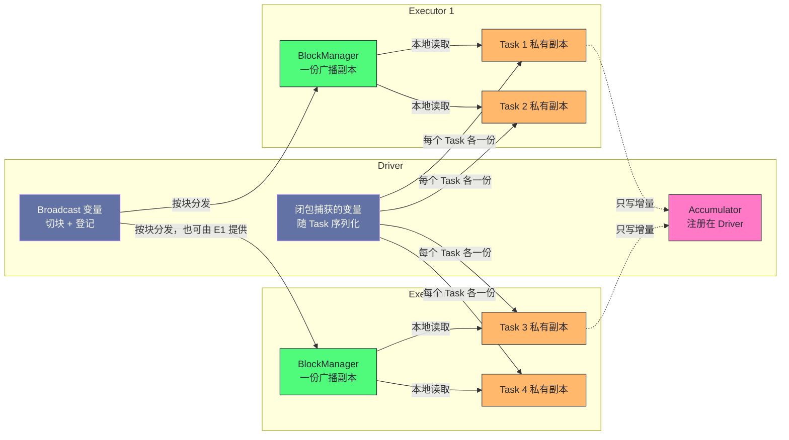
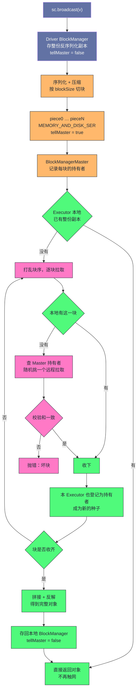
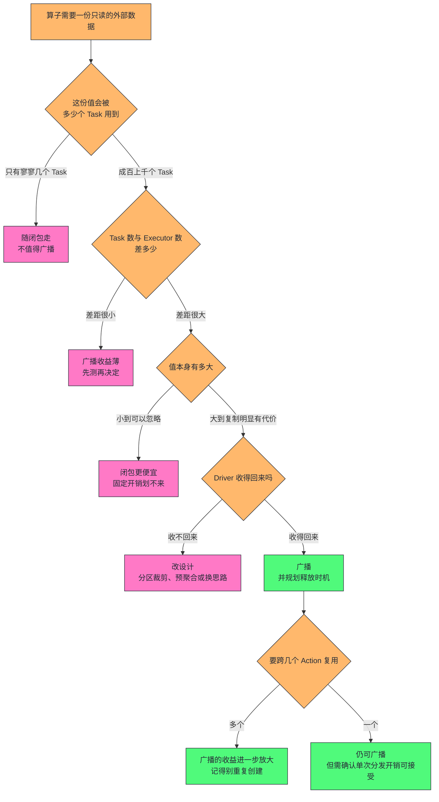
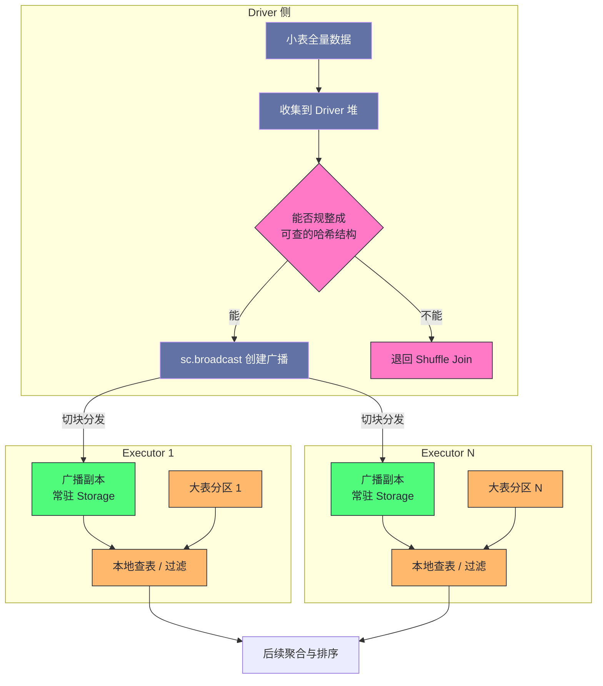
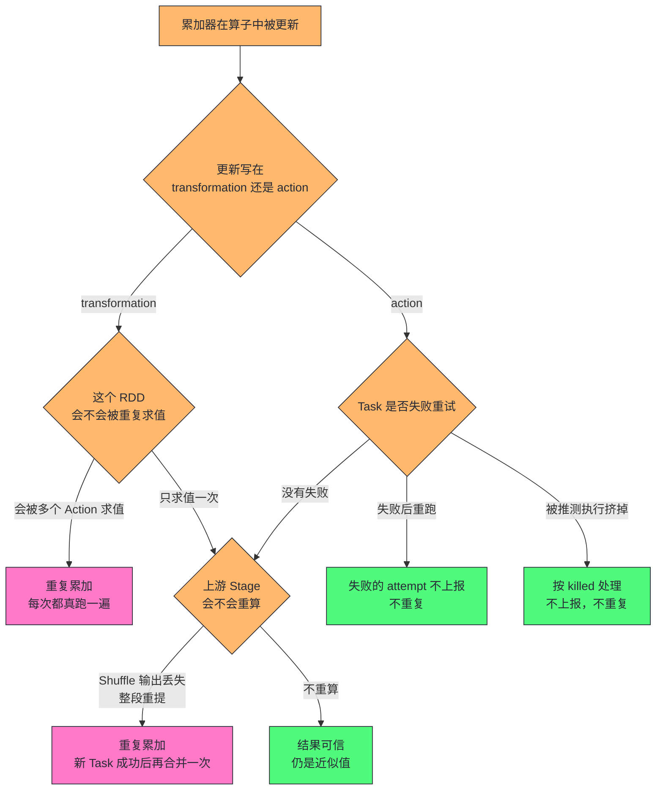
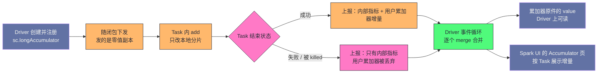

# 4. Spark 共享变量：Broadcast 的分发经济学与 Accumulator 的语义陷阱

**摘要：**

2012 年伯克利 AMPLab 在 NSDI 上发表 RDD 论文时，把「可变共享状态」明确挡在了编程模型之外：算子只接收数据、只产出数据，任务之间不靠共享内存协作。这条设计换来的是极简的容错语义——任何一段中间结果丢了，顺着血缘重算即可——却也留下两个绕不开的需求：一份只读的大字典怎么让每个任务都用上，而不必人手一份地搬运；一批散落在各任务里的计数又怎么汇总回 Driver。Spark 对此的答案是两个方向相反的旁路：Broadcast 把一份值从 Driver 推向所有 Executor，Accumulator 把各 Task 的增量收拢回 Driver。

这篇文章只讨论这两个机制。先算清普通变量随闭包下发到每个 Task 的代价，说明它为什么随任务数线性放大；再看 TorrentBroadcast 如何把一份值切成块、登记进 BlockManager、让 Executor 之间互相拉取，从而把分发压力从 Driver 这个单点摊开；接着给出「多大值得广播」的判据——收益来自任务数与 Executor 数之间的差额，而不是值的绝对大小，这也解释了为什么小对象广播反而更慢；然后把广播的生命周期摊开，分清 `unpersist` 与 `destroy` 各自的边界，以及销毁之后那份值还能不能用。后半程转向 Accumulator：它的语义是只写、不回读、Driver 唯一权威，失败重试与重复求值会在什么层级让它重复累加，`TaskContext` 的 attempt 判定能挡住什么、又挡不住什么，自定义累加器的线程安全边界在哪里，推测执行下的重复又如何取舍。最后把两者并排放回执行模型里，看它们为什么都不享有数据流的容错语义。

口径为 Spark 4.3.0（2026-10-30 发布，4.x 预编译 Scala 2.13）。

---

## 第 1 章 闭包里的变量：为什么「顺手引用」会变成「人手一份」

### 1.1 一个不寻常的落差

同样一份只读的字典，写在算子里直接引用，和先收集回 Driver 再广播出去，哪一个更快？直觉往往选后者，因为「广播」这个词听起来就像一次优化的名字。可真实的现场里，两种写法有时差出几倍，有时几乎一模一样，偶尔还是直接引用更快——落差的方向如此不稳定，说明分界线并不落在「有没有广播」这个动作上，而落在「这份值被复制了多少份」以及「复制这件事有没有搭上便车」上。

RDD 的执行模型把共享状态挡在门外，但闭包是那个例外。闭包是「代码加上它捕获的变量」，它必须整体序列化后随 Task 一起下发；换句话说，共享并没有被禁止，只是被换了一种形式——不是共享内存，而是复制。理解广播的全部起点，就在于先把这次复制的账算清楚。

### 1.2 闭包下发的物理过程

一个 Task 从 Driver 发往 Executor 时，走的是序列化通道：Task 对象里包着要执行的函数体，函数体捕获的外部变量被一并写出。Executor 收到之后反序列化，得到一个属于这个 Task 私有的闭包实例，捕获的变量也就成了这个实例的私有字段。

这条路径上有三笔成本，它们都以任务数为乘数。

第一笔是网络字节：值的大小乘以 Task 数，就是这个作业为了「让大家都能看到这份字典」而在网络上搬运的字节数。分区数越多、并行度越高，这笔账越大，而分区数往往在读入数据的那一刻就定死了，中途很少有人回头改它。

第二笔是反序列化次数，每个 Task 各自解一遍，解出来的对象互不相干，也互不共享。

第三笔是堆占用，它是瞬时的，却会在同一 Executor 上并发跑多个 Task 时叠加：八个 Task 同时跑，就有八份字典同时驻留在同一个 JVM 的堆里。

不妨把这三笔账摊成一张表，看清各自的量级由什么决定：

| 成本项 | 量级 | 何时消失 |
|---|---|---|
| 网络字节 | 值大小 × Task 数 | 只有当值不再随闭包走，才降到「值大小 × Executor 数」 |
| 反序列化 | Task 数（每个 Task 一次） | 同上；广播之后降到每个 Executor 的首次访问一次 |
| 堆占用 | 值大小 × 并发 Task 数 | Task 结束即释放，属于瞬时峰值而非长驻 |
| 序列化开销 | 随 Task 序列化一起发生，边际成本近乎为零 | 它本来就是 Task 必须付的那笔钱 |

最后一行是整章的关节：闭包下发之所以在很多场景下便宜，是因为它**搭了 Task 序列化的便车**——Task 无论如何都要过网络，多写几百字节几乎是免费的。而广播是一次独立的、额外的分发动作，它有自己的一套固定开销。这一点会在第 3 章变成判断阈值的关键。

### 1.3 为什么「每个 Executor 一份」不会自动发生

很多资料把广播的收益写成「副本数从 Task 数量级降到 Executor 数量级」，这句话本身没错，但它跳过了中间那个「为什么」。同一个 Executor 上通常并发跑着若干个 Task，它们当然在同一个 JVM 里，为什么不能天然共享同一份字典？

因为 Task 之间本就没有共享的命名空间——每个 Task 的闭包是各自反序列化出来的独立对象图，A 的字段与 B 的字段在堆上毫无关系，即便它们来自同一个 Driver 侧变量。要让「一份」真正成立，必须引入一个**跨 Task 的存储层**，把这份值放在 Task 生命周期之外，让后来者按标识去取——这个存储层就是 BlockManager，而广播变量的全部实现，本质上就是把「一份值」安放进 BlockManager 并让所有 Executor 都能寻址到它。

### 1.4 三条通道

把闭包、广播、累加器放在同一张图上，三者的方向差异一目了然：闭包是「每个 Task 一条细流」，广播是「Driver 向所有 Executor 的一次性铺开」，累加器则是「所有 Task 向 Driver 的收拢」。



图中橙色节点是复制品，它们的数量与 Task 数同阶；绿色节点是共享副本，数量与 Executor 数同阶；粉色节点只有一个，永远在 Driver 上。三条通道的差别不在快慢，而在「谁是权威」：闭包与广播的权威都在 Driver，累加器的权威也在 Driver——这条共性会在第 6 章重新回到台面上。

### 1.5 一个贯穿全文的作业

后面的论述需要一个具体的着力点，笔者这里设一个电影点评的统计作业 `topn_by_age`：从数仓读入用户、评分、影片三份数据，找出 18 岁与 25 岁用户各自最喜爱的电影前十名。

```scala
// 三份输入各自按默认分区读入，均为窄依赖
val users   = sc.textFile("hdfs:///dw/movielens/users")    // userID::gender::age::occupation
val ratings = sc.textFile("hdfs:///dw/movielens/ratings")  // userID::movieID::rating::ts
val movies  = sc.textFile("hdfs:///dw/movielens/movies")   // movieID::title::genres

// 目标年龄段的用户 ID 集合：过滤之后规模已经很小，收集回 Driver
val targetUsers: Set[String] = users
  .map(_.split("::"))
  .filter(f => f(2) == "18" || f(2) == "25")
  .map(_(0))
  .collect()
  .toSet

// 影片标识到名称的映射，同样是一份小字典
val movieNames: Map[String, String] = movies
  .map(_.split("::"))
  .map(f => f(0) -> f(1))
  .collectAsMap()

val topN = ratings
  .map(_.split("::"))
  .map(f => (f(0), f(1)))                       // (userID, movieID)
  .filter { case (uid, _) => targetUsers.contains(uid) }
  .map { case (_, mid) => (mid, 1L) }           // (movieID, 1)
  .reduceByKey(_ + _)                           // 仍需一次 Shuffle，但输入已被大幅裁掉
  .map { case (mid, cnt) => (cnt, mid) }        // (count, movieID) 为排序做准备
  .sortByKey(ascending = false)
  .take(10)
  .map { case (cnt, mid) => (movieNames.getOrElse(mid, "unknown"), cnt) }
```

这段代码里，`targetUsers` 与 `movieNames` 都被两个匿名函数捕获，因而随每个 Task 复制一份。它们恰好都很小——目标年龄段的用户可能只占全量的几分之一，影片表也不过几万行——所以这份复制在日常作业里常常并不显眼，直到并行度被拉高、Executor 数量被压缩，问题才浮出水面。**广播要解决的从来不是「大」，而是「重复」**。

### 1.6 一个比喻：工位手册

把闭包下发想成给每个工位发一本操作手册：车间里有八十个工位，就印八十本，每本都从仓库搬一趟。手册内容不多时这没什么，毕竟工人来上班本来就要带工牌和工具，手册往包里一塞也就是顺手的动作——这正是「搭便车」的含义。

广播则是每层楼放一本，谁要用谁去拿，同一层楼的人共用一本，甚至还能去隔壁楼借。它省下的是印数与搬运次数，付出的是额外的管理动作：得有人把手册拆成册页、登记在楼层索引里、放上书架，还得处理「书被人借走之后来的人怎么办」。手册只有一页纸的时候，这套管理动作比复印八十次还贵——这句话会在第 3 章变成一个可操作的判据。

### 1.7 这一章留下的问题

行文至此，可以确定两件事：闭包下发的代价随任务数放大，而这种放大可以靠「跨 Task 的存储」来消除。但消除的具体形式仍然模糊——把一份值安放进 BlockManager，究竟要经过哪些步骤，Executor 之间又如何得知彼此手上有哪些块，Driver 会不会成为分发的瓶颈。这些问题要留给下一章，去看 TorrentBroadcast 的实现。

---

## 第 2 章 Broadcast 的分发：切块、登记与就近拉取

### 2.1 接口的三件事

广播变量的用户接口极小：`sc.broadcast(v)` 创建一个 `Broadcast[T]`，算子内用 `.value` 取回值，用完可以用 `unpersist` 或 `destroy` 释放。接口小，语义却有三处需要提前说清。

其一，被广播的对象必须可序列化。广播的传输通道与闭包是同一条序列化通道，`NotSerializableException` 并不会因为换了个写法就放过你；而且序列化器用的是 `spark.serializer`，默认仍是 `JavaSerializer`，换成 Kryo 之后广播的体积与解包速度都会跟着变。这条约束对第 1 章那两份小数据同样生效：`HashSet`、`Map` 本身可序列化，但若里面装的是自定义类型，那个类也必须可序列化；Kryo 下若没有提前注册类，写出去的会是完整类名，体积优势随之打折，而广播一个体积偏大的值，恰恰是最不该省这笔的地方。

其二，广播之后不要修改原对象。Driver 侧保存的是那个对象的引用，Executor 侧拿到的是当时的字节快照，两边同名不同物；改一边，另一边不会跟着变，这种不一致往往在作业跑偏之后才被发现。

其三，`.value` 在 Driver 上同样可用，而且拿到的可能就是同一个对象实例。这一点常被忽略：以为「广播了就等于放进保险柜」，实际上在 Driver 上改一改 `.value` 返回的内容，本地副本立刻被污染，而已经分发出去的快照仍是旧的。

### 2.2 Driver 端：先存一份，再切块

TorrentBroadcast 的构造过程分两步，顺序很重要。

第一步，把原对象以反序列化形态存进 Driver 自己的 BlockManager，存储级别 `MEMORY_AND_DISK`，并且**不向 BlockManagerMaster 报告**（`tellMaster = false`）。这一步的目的是让跑在 Driver 上的 Task 不必再复制一份，同时给 Driver 保留一份「随时可以重新切块分发」的底本。

第二步才做切块：把对象按 `spark.serializer` 序列化，按 `spark.broadcast.compress`（默认开启）压缩，再按 `spark.broadcast.blockSize`（默认 4 MiB）切成若干块，每一块以 `BroadcastBlockId(id, "pieceN")` 为标识存进 BlockManager，存储级别 `MEMORY_AND_DISK_SER`，这次**要向 Master 报告**（`tellMaster = true`）。报告这个动作是整条链路的分水岭：一旦 Master 知道某块在哪个 Executor 上，别的 Executor 就可以直接去那里取，而不必都挤回 Driver。

切块时还会按 `spark.broadcast.checksum`（默认开启）为每块算一个 Adler32 校验和。校验和的存在说明广播的传输路径被当成不可靠通道对待——远程取回的块要先验一遍，对不上就抛错，而不是把一个坏块当作好块继续拼。

### 2.3 Executor 端：块从哪里来

Executor 上第一次有 Task 访问这份广播时，取数顺序是这样的：

先看本地是否已有「合并后的整份值」。这份值以 `BroadcastBlockId(id)` 为标识，存储级别 `MEMORY_AND_DISK`，是上一个 Task 拼装完成之后留下的。命中就直接返回，后面的 Task 也就都不必再碰网络。

没有命中，就进入逐块拉取，块的下标顺序会被随机打乱，然后逐块尝试：先看本地 BlockManager 有没有这一块（可能是上一次拉取中途失败留下的战果，也可能是本 Executor 恰好是某个块的「种子」），没有就调 `getRemoteBytes` 向 Master 查这块的持有者列表，从那里面挑一个去取；如果拿到的块带校验和，先验再收。取到之后，本 Executor 会把它以 `MEMORY_AND_DISK_SER` 存进自己的 BlockManager 并**向 Master 报告**——于是它从「索取者」变成「提供者」，后面加入的 Executor 可以从它这里拿。

随机打乱这个细节值得单独说一句，因为它的用意不只是让分布更均匀，而是为了让同时开始拉取的多个 Executor 尽量不撞在同一块上：谁先拿到，谁就成为这一块的新种子，拉取的拓扑因此从「星形」慢慢长成「网状」，Driver 的出口带宽也就不会被所有 Executor 同时敲门打满。这正是 TorrentBroadcast 名字里那个类 BitTorrent 的含义。

还有一个不显眼但要紧的机制：同一个 Executor 上并发访问同一份广播的多个线程，会被一把以 `broadcastId` 为键的锁串起来。这把锁保证「只有一个线程去拉取」，其余线程等它拉完直接取结果，而不是各自发起同样的请求、把网络打成一堆重复流量。

### 2.4 拼装与反序列化：一份副本究竟在哪一步成立

块全部到齐之后，把它们按序拼成一个字节流，用同一个序列化器与压缩器反解出对象，然后把这份**反序列化后的完整对象**以 `BroadcastBlockId(id)` 存回本地 BlockManager（`MEMORY_AND_DISK`，不报告 Master）。

这一步是「每个 Executor 一份副本」这句话在物理上的落点。在此之前，散落在 BlockManager 里的是若干块序列化字节；在此之后，才有一个可用的对象常驻下来，同一 Executor 上后续的 Task 通过本地查找直接拿到它，不再付出反序列化代价。反过来，如果某个 Executor 上从来没有 Task 用过这份广播，它就永远不会有副本——广播是**惰性分发**的，「发到所有 Executor」只是逻辑上的说法，不是一次广播动作就把字节推到了每一台机器上。

惰性分发带来一个容易被误读的后果：广播的耗时不出现在 `sc.broadcast(...)` 那一行，而出现在**第一个用到它的 Stage 的 Task 上**。看监控时如果发现某个 Stage 的第一个 Task 明显比同批其他 Task 慢，且慢在反序列化与网络等待上，多半就是这里在付账。

### 2.5 一次分发的完整形状

把上面的步骤连起来，一次广播从创建到被使用，走的是一条「Driver 切块 → Master 登记 → Executor 就近拉取 → 拼装留存」的路径：



图中粉色节点是真正走网络的位置。把这张图和 2.3 节的叙述对上，会发现 Driver 只出现在最上面一层：切完块、登记完之后，它的角色就从「分发者」退成了「持有者之一」。这正是广播要解决的那个瓶颈——若所有 Executor 都向 Driver 要，Driver 的出口带宽与 BlockManager 线程池就是天花板；让 Executor 彼此供块，天花板就从「单机出口」变成了「集群总带宽」。

### 2.6 广播的失效面

广播不是「设好就不用管」的东西，它有几种典型的失效形态，且报错信息都很朴素。

最常见的是块找不到：Executor 端的广播块被清掉之后，仍在跑的 Task 再去取，报的是「Failed to get broadcast_x_pieceN」之类的话。清掉的原因可以是显式 `destroy`、Driver 侧广播对象被垃圾回收后由 ContextCleaner 清理，也可以是 Executor 自己的磁盘目录被写满导致 `putBytes` 失败。

第二种是坏块：远程取回的块校验和对不上，抛的是 corruption 相关的错误。它通常指向网络或磁盘的真实故障，而不是配置问题，值得当作硬件信号看待。

第三种最隐蔽：Driver 端在创建广播时就把值放进了自己的 BlockManager，如果这份值本身就大得离谱，Driver 的存储内存先被撑爆，作业在切块阶段就 OOM。这类事故的根因往往不在广播，而在上游那个 `collect()` 收了一张本不该收的表。

### 2.7 生命周期：unpersist 与 destroy 不是一回事

两个释放接口的语义差别，必须在写代码时就分清，因为它们的后果完全不同。

| 维度 | `unpersist(blocking)` | `destroy(blocking)` |
|---|---|---|
| 清理范围 | 只清 Executor 上的副本，Driver 保留底本 | Driver 与 Executor 上的数据、元数据一并清除 |
| 之后再用 | 可以，会重新分发一遍到各 Executor | 不可以，`.value` 直接抛异常 |
| 典型用途 | 长驻应用里阶段性释放 Executor 内存 | 确定这份值在本次应用内不再需要 |
| 是否可逆 | 可逆，代价是一次重新分发 | 不可逆 |
| 阻塞语义 | `blocking = true` 时等清理完成再返回 | 同上 |

「销毁之后还能不能用」这个问题，答案要分两层看。Driver 侧是明确的不能用：`Broadcast.value` 在取数之前先做一次有效性检查，销毁之后调用会抛「Attempted to use Broadcast(x) after it was destroyed」，连把它序列化进闭包这一步都会因为同一处检查而失败，错误里还会带上销毁发生的调用点。

Executor 侧则更容易让人困惑：手上那个广播对象的引用仍然在，看起来「还能访问」，实际上它已经没有块可取了，于是会在取数时失败，报的是块缺失而不是「已销毁」。换句话说，**销毁之后不是读到旧值，而是拿不到值**——这一点在排查时很关键，因为报错信息指向的是存储层，根因却在 Driver 的一次 `destroy` 调用。

不显式释放会怎样？Driver 侧那个广播对象一旦失去引用被垃圾回收，ContextCleaner 会替你把各 Executor 上的块清掉。所以「忘了 unpersist」在短作业里通常不会漏，但在长驻的 ThriftServer 或结构化流作业里，广播对象往往被 Driver 上的缓存结构长期持有，GC 迟迟不发生，Executor 上的副本就一直占着存储内存——**长驻应用里，释放广播要靠显式调用，而不是指望垃圾回收**。

---

## 第 3 章 什么值得广播：阈值的判据

### 3.1 收益的准确形状

广播把副本数从「Task 数」降到「Executor 数」，于是它省下的字节量可以写成：

> 省下的量 ≈ 值大小 × (Task 数 − Executor 数)

这个式子里没有「值大小」单独出场。它说明两件事：值越大，差额放大得越厉害；而 Task 数与 Executor 数的比值越小，收益越薄。极端情况下，一个 Executor 只跑一个 Task，两者相等，广播省下的网络字节是零，付出的固定开销却一分不少。

Task 数与 Executor 数的比值，取决于作业形态而不取决于配置是否「调优过」。一个只有单个 Stage、并行度等于 Executor 数乘核数的短作业，每个核跑一个 Task，比值大致等于每个 Executor 的核数，两三倍而已；而一个多 Stage、Task 数上千、Executor 只有几十台的作业，比值可以到几十。同样一份字典，在前一种作业里广播近乎白付，在后一种作业里则是决定性的。

### 3.2 为什么小对象广播反而更慢

上一章末尾那个「一页纸的手册」的比喻，换成机制语言就是固定成本的问题。广播一次要付的开销，几乎都不随对象变小而缩小：

Driver 侧要序列化、压缩、切块、`putBytes`、向 Master 登记；Master 侧要维护一份块位置表；Executor 侧要查本地、查远程、发请求、收字节、验校验和、再 `putBytes`、再登记；拼装时还要反序列化一次、`putSingle` 一次。这些动作的次数由「有没有广播」决定，而不是由「值有多大」决定。一个只有几 KB 的字典走完整套流程，固定开销比它本身的体积大出一两个数量级，都是常事。

反过来看闭包下发：Task 本来就要序列化，本来就要过网络，多写几 KB 几乎不影响这条既有管道的成本结构，多解几 KB 也不过多几微秒。于是出现一个反直觉但完全合理的结论——**小对象随闭包走更便宜，广播的收益要等到「重复次数 × 值大小」超过那套固定开销之后才出现**。

### 3.3 块大小：`spark.broadcast.blockSize`

默认 4 MiB。这个参数控制的是切块粒度，而切块粒度同时影响两件相反的事。

块太大，单块传输就成了长尾：一个 Executor 拉到最后一个大块时，其他块早已到位，整个拼装只能等它，并行拉取的优势被吃掉一部分。块太小，块数变多，块级元数据、请求次数、Master 上的位置条目数一起上涨，BlockManager 的簿记压力上升——官方文档对这个参数的两句注解恰好就是这两句话：太大会降低广播期间的并行度，太小则可能让 BlockManager 吃亏。

这个参数还有一个容易忽略的性质：它只在**广播发起方**被读取一次，用来决定切几块。也就是说，改它需要重新创建广播，对已经广播出去的变量无效；而且它影响的是大对象的分布效率，与「值不值得广播」的阈值无关。把小对象广播得更快，靠的不是调小 blockSize，而是干脆别广播。

### 3.4 压缩与校验：两个默认开启的开关

`spark.broadcast.compress` 默认开启，用的是 `spark.io.compression.codec` 指定的编码器。它的账很好算：拿 CPU 换网络与存储，与 Shuffle 里的压缩是同一笔交易。对于文本类字典、JSON 配置、字符串映射表，压缩比通常很可观；对于已经压缩过的二进制（譬如序列化好的模型文件），再压一遍只是白费 CPU。这条判断与「值是否值得广播」是两件事，可以独立决策。

`spark.broadcast.checksum` 也默认开启。它给每块算一个 Adler32，远程取回时验一遍。代价是每块多一次遍历，收益是把坏块挡在拼装之前——如果不校验，坏块会以「反序列化失败」或更糟的「解析出一个诡异对象」的形式暴露，后者的排查成本远高于前者。

### 3.5 副本落在哪一片内存

Executor 上的广播块是 `MEMORY_AND_DISK_SER`，拼装好的整份对象是 `MEMORY_AND_DISK`。这两个级别都落在 Storage 区，与 RDD 缓存、Shuffle 的读端缓冲共享同一片统一内存。

于是有一条不太直观的账：广播一份 2 GB 的字典，等于在每台 Executor 上长期占用 2 GB 的 Storage 内存，而且这份占用不会因为作业跑完某个 Stage 就自然消失——它要等到 `unpersist`、`destroy` 或 Driver 侧的引用被回收。如果这个作业同时还缓存了一批 RDD，两者会互相挤压，被挤掉的那一方要么落盘、要么重算。**广播不是免费的内存共享，它是把 Driver 的内存账转移到了每台 Executor 上，并按 Executor 数复制了这份账。**

### 3.6 一张判据表

把上面的几条收成一张表，用于日常判断「这份值该不该广播」：

| 场景 | 值的大小 | 每 Executor 的 Task 数 | 建议 | 理由 |
|---|---|---|---|---|
| 算子里的临时小常量、几十个元素的集合 | 极小 | 任意 | 不广播 | 固定开销远大于复制成本，闭包下发几乎免费 |
| 配置字典、维表映射，被同一个 Stage 的大量 Task 反复使用 | 中等偏大 | 多 | 广播 | 收益由 (Task 数 − Executor 数) 放大，固定开销被摊薄 |
| 一份值要跨多个 Stage、多个 Action 复用 | 中等 | 任意 | 广播 | 闭包要在每个 Stage 重新下发一遍，广播只分发一次 |
| 值大到 Driver 收集时就吃力 | 很大 | 任意 | 不广播，改设计 | 广播不减少 Driver 的内存压力，只转移 Executor 侧副本数 |
| 值需要随批次更新 | 任意 | 任意 | 按批次重建广播 | 广播是不可变快照，更新只能重建，旧的要显式释放 |
| 单 Stage、并行度约等于 Executor 数乘核数的短作业 | 任意 | 少 | 谨慎 | Task 与 Executor 数接近，省下的字节很有限 |

### 3.7 判据的执行顺序

表格适合查，但现场的判断是一条链。笔者把它排成下面这个顺序，前三问挡住绝大多数不必要的广播：



图中的顺序刻意把「有多少 Task 用」放在最前面，因为广播的收益本质上是**摊薄**：同一个固定开销，被越多的 Task 摊，单次成本越低。先问摊薄的空间有多大，再问固定开销本身有多重，最后才问值本身能不能收得回来——顺序颠倒，就会在「值很大所以该广播」这种直觉上栽跟头。

---

## 第 4 章 broadcast join：把重排换成「人手一份」

### 4.1 为什么不重排也能连接

宽依赖的代价来自「相同 key 必须聚到一起」。连接两张表时，如果两边都是大表，这笔钱非付不可：两张表都得按连接键重新分区，然后同键的行才能在同一个 reduce 分区里相遇。

但如果其中一侧小到可以给每个 Executor 各发一份，逻辑就变了：大表照旧按自己的分区扫描，每一行在本地那张小表的哈希结构里查一次即可，一次 Shuffle 都不需要发生。这就是广播连接（Broadcast Join），也叫 map 侧连接。它的收益是结构性的，不是省了一点网络字节，而是整次重排消失。

不过「小到可以发一份」这个前提，比字面上要严格得多，值得拆开看。

不妨用一个比喻把它定住：广播连接像是把一本薄薄的登记册复印到每个办事窗口，让每个窗口自己翻查；Shuffle Join 则是把所有材料都搬到一间中心大厅，按编号归拢一遍再分发回去。前者省掉了搬运与归拢，代价是每个窗口都得腾出一个抽屉长期放着这本册子；后者的册子从不离身，代价是每次办事都得去大厅排一次队。比喻的限定在于：登记册是只读的，窗口不能在册子上增删条目，所以能把册子分发出去的前提是「这份信息本来就只需被查，不需被改」。

### 4.2 「小」到底相对于什么

至少有三道约束在同时起作用，任何一道不满足，「小表」就不再小。

第一道是 Executor 的存储内存：广播的副本落在 Storage 区，是一份**常驻**占用，而不是随 Task 结束释放的临时对象。假如每个 Executor 分到 8 GB 存储内存，还缓存着一批要紧的 RDD，那么留给广播的空间可能就是一两 GB，小表的序列化体积必须落在这个窗口里。

第二道是 Driver 的收集能力，SQL 侧的广播连接要把 build 侧收拢到 Driver，再规整成可查形态分发出去；RDD 侧的写法则直接是一个 `collect()`。这两步都要在 Driver 的堆里过一遍，表一大，先倒下的是 Driver，而不是 Executor。

第三道是分发时间，`spark.sql.broadcastTimeout`（默认 300 秒）管的是广播连接的等待上限：Driver 把广播发出去之后，要等各 Executor 拉取完成才能开始计算，超过这个时限作业就失败。表在两三百 MB 量级、集群又不太健康的时候，卡在这个超时上的现场并不罕见。

关键在于，这三道约束都是**相对量**：相对于单机内存、相对于 Driver 堆、相对于集群带宽。同一张 200 MB 的表，在三十台大内存机器的集群上广播得从容，在三台小机器的集群上就是事故。所以「小表」这个词必须带上环境才成立，脱离部署规格谈「多大算小」没有意义。

还有一层更隐蔽的相对性：**优化器看到的大小，是统计信息说的大小，不是真实大小**。分区表新增了分区而统计没刷新、视图在连接前经过了复杂的过滤、`select` 之后仍带着几个超长字符串列，都会让「小表」在两个方向上失真——统计偏大时优化器不敢广播，白白多付一次 Shuffle；统计偏小时优化器广播了一张其实不小的表，于是 Driver OOM 或超时。广播连接最典型的翻车方式，几乎都出自这个错位。

### 4.3 SQL 侧：自动判据与它的输入

SQL 侧由 `spark.sql.autoBroadcastJoinThreshold` 决定何时自动选择广播连接，默认 10 MB，设为 -1 可以整体关闭。自适应查询执行另有一个 `spark.sql.adaptive.autoBroadcastJoinThreshold`，默认不单独设置、沿用前者的值，作用是让运行期的真实统计能推翻计划期的估计。

这两个参数容易被当成「调大就能加速」的旋钮，实际上它们只是把判断的阈值挪了挪，判断所依赖的输入并没有变：优化器读的是表的 `sizeInBytes` 统计。统计不存在（譬如表由外部系统直接写入、没有经过 Hive 或 metastore 登记）、统计过期、或者表被一系列过滤器改写之后估计失真，阈值调多大都无济于事。

需要强制指定时，SQL 侧有两条路：`SELECT /*+ BROADCAST(t) */ ...` 这样的 hint，或者 `BROADCAST(t)` 函数把某张表显式标成广播侧。hint 的价值不在于「让优化器变聪明」，而在于把「这张表确实很小」这个只存在于工程师脑子里的知识，写进计划里。

至于这次广播在物理上怎么发生，回到上一章就清楚了：build 侧被收拢、规整成可直接查找的形态之后，作为一份内部广播分发出去，走的是同一条切块、登记、就近拉取的通道；区别只在于这类内部广播的值不在 Driver 侧长期保留反序列化副本，因为它本来就不会在 Driver 上被查询——这处处理是为 Driver 内存减负的优化，反过来说明广播的默认行为确实会在 Driver 上留一份完整副本。

### 4.4 RDD 侧：手写的三步

RDD 侧没有优化器代劳，广播连接要自己写，三步：收集小表到 Driver、广播、在算子内部查表。把第 1 章的案例改成广播版：

```scala
// 第一步：两份小数据在 Driver 侧已经就绪（见第 1 章的 collect）
// 第二步：广播，注意闭包里捕获的是 Broadcast 包装，而不是 .value 的结果
val targetUsersBc: Broadcast[Set[String]]    = sc.broadcast(targetUsers)
val movieNamesBc:  Broadcast[Map[String, String]] = sc.broadcast(movieNames)

val topN = ratings
  .map(_.split("::"))
  .map(f => (f(0), f(1)))                                  // (userID, movieID)
  .filter { case (uid, _) => targetUsersBc.value.contains(uid) }
  .map { case (_, mid) => (mid, 1L) }
  .reduceByKey(_ + _)                                      // 输入已被裁掉大半，这次 Shuffle 便宜得多
  .map { case (mid, cnt) => (cnt, mid) }
  .sortByKey(ascending = false)
  .take(10)
  .map { case (cnt, mid) => (movieNamesBc.value.getOrElse(mid, "unknown"), cnt) }

// 第三步：作业结束，显式释放；跨多个 Action 复用时才值得保留
targetUsersBc.unpersist()
movieNamesBc.destroy()
```

这里有一处几乎人人都踩过的写法错误：在 Driver 上先取 `val usersLocal = targetUsersBc.value`，再把 `usersLocal` 捕获进算子。这等于把整份值塞回了闭包，广播白做，副本数又回到 Task 数量级。`Broadcast` 包装本身要被捕获，`.value` 要在算子内部调用——首次调用会触发拉取，之后就是对本地 BlockManager 的查找，代价很低。

如果想更省一点，可以在分区级别取一次，避免每条记录都穿过一层包装：

```scala
// 每个 Task 只解引用一次，之后在分区内复用；适合分区内记录数很多的场景
val filtered = ratings.mapPartitions { iter =>
  val usersLocal = targetUsersBc.value
  iter.map(_.split("::"))
      .filter(f => usersLocal.contains(f(0)))
      .map(f => (f(1), 1L))
}
```

`mapPartitions` 在这里的收益不是避免了网络，而是避免了逐条记录的包装解引用与方法调用。它属于细枝末节，但在千万级的过滤场景里累计起来并不小。

### 4.5 两种连接的代价对照

| 维度 | Shuffle Join | Broadcast Join |
|---|---|---|
| 数据移动 | 两侧都按连接键重排，搬的是大表 | 只搬小表，且每个 Executor 一份 |
| 触发的 Stage 边界 | 一次宽依赖，任务被切成两段 | 不切断 Stage，大表侧保持流水 |
| Driver 的角色 | 只做调度 | 要收集小表，可能成为单点瓶颈 |
| 内存形态 | 读端按 key 攒数据，受倾斜影响 | 小表常驻 Storage 区，与 RDD 缓存争内存 |
| 失败模式 | FetchFailed、倾斜长尾、溢出 | Driver OOM、广播超时、统计信息误判 |
| 适用前提 | 两侧都大，或连接键分布可控 | 一侧确实小，且小得能放进每台 Executor |
| 调优旋钮 | 分区数、map 端聚合、加盐 | `autoBroadcastJoinThreshold`、`broadcastTimeout`、`blockSize` |

### 4.6 数据流的样子

下面这张图把广播连接的数据流摊开。左边是 Driver 侧的准备动作，右边是各 Executor 上的本地过滤；注意大表从头到尾没有被搬动过。



图里最要紧的是中间那条分叉：广播连接能否成立，取决于「小表能不能规整成一份便宜的查找结构」。如果它不能——譬如连接条件不是等值、或者需要保留全部列而不能预先裁剪——那么无论表多小，都只能退回 Shuffle Join。等值连接、可裁剪的列、可估的规模，这三条同时成立，广播连接才谈得上是一个选项。

### 4.7 四条边界

其一，广播的收益是「消掉一次 Shuffle」，而这次 Shuffle 本来可能并不贵。如果大表侧的分区数与数据量本就不大，改用广播只是把成本从 Shuffle 挪到了 Driver 收集与常驻内存上，未必划算。

其二，build 侧倾斜照样能毁掉它。广播连接只在「小表小」这一点上做文章，如果连接键在小表上分布极不均匀，某个 Executor 上的哈希结构会被局部热点拖慢——这不是广播的问题，是数据分布的问题，加盐与拆分只能缓解。

其三，广播的副本是常驻的，一个作业里广播十张小表，就是十份常驻内存，而且都要等到显式释放。真正常见的现场事故不是「广播了一张大表」，而是「广播了太多张不算大的表」。

其四，`broadcastTimeout` 的等待发生在 Stage 开始之前，表现为「作业卡住不动」，而不是「某个 Task 很慢」。看到大量 Task 处于未启动状态、Driver 日志停在广播相关的行上，就该往这个方向查。

---

## 第 5 章 Accumulator：只写的单向通道

### 5.1 语义：只写、不回读、Driver 唯一权威

累加器（Accumulator）在 Spark 2.0 之后统一为 `AccumulatorV2[IN, OUT]` 抽象，输入类型与结果类型可以不同，需要实现的方法有五个：`add`、`merge`、`reset`、`copy`、`isZero`，外加一个返回值的方法 `value`。

把它想成车间里的计件箱：工人只往箱里投，不能从箱里取，下班时由组长统一清点。关键的一点在于，返工重做的零件会被再投一次，于是箱子里的数代表「投了多少次」，而不代表「做了多少件」——这个比喻的限定是，计件箱挂在流水线之外，它既不影响零件的加工，也不参与零件的检验，因而只能用来观察，不能用来决定生产。

它与广播的走向恰好相反。广播是 Driver 创建、Task 读取；累加器是 Driver 创建、Task 写入，写进去的只是一份本地增量，Task 结束时随结果一起回传，由 Driver 端的那个原始实例做合并。给累加器起一个名字，还能在 Spark UI 的 Accumulator 页里逐个 Task 看到它上报了多少——这是它最实用的地方，也是最容易被误用的地方：看得见的数字会让人忘记它只是增量之和。

这套语义在实现上有两处精巧的设计。第一处在序列化：累加器随闭包发往 Executor 时，发出去的不是当前值，而是一份**重置为零的副本**（`copyAndReset`），框架还会断言这份副本确实是零值。于是每个 Task 拿到的都是一个干净的本地累加器，写进去的自然是增量，Driver 汇总时把增量逐份加起来即可。

第二处在反序列化：Executor 端解出累加器对象时，它会自动向当前的 `TaskContext` 注册自己。这个注册动作把「累加器」与「Task 的产出」绑在了一起——Task 结束（无论成功还是失败）时，`TaskContext` 手上已经有了一份该上报的累加器清单，不必再由用户代码操心。

### 5.2 为什么只能在 Action 里可靠读取

「累加器要在 Action 里更新」这句忠告流传很广，却很少有人说清它挡的是什么。它挡的是三件事。

第一件是惰性求值，写在 `map` 里的 `accum.add(1)` 只是一段还没被执行的代码，只要没有 Action 触发，它就一次也不会运行；这时去读 `accum.value`，读到的是零。这一点在调试时格外容易误导：代码「明明写了」，值却是零。

```scala
// 基础用法：Driver 创建并命名，Task 内累加，Driver 读取
val accum = sc.longAccumulator("oddCount")
val data = sc.parallelize(Array(1, 2, 3, 4))

// 更新写在 transformation 里：这一步只搭出一张计划，不会执行
val doubled = data.map { x => if (x % 2 == 1) accum.add(1); x * 2 }

println(accum.value)   // 仍是 0：没有任何 Action 触发过这张计划
doubled.count()        // Action 触发执行，累加器才真正被写
println(accum.value)   // 2
```

第二件是重复求值。这是同一个 RDD 被多个 Action 触发的直接后果：第一次 `count()` 让所有 Task 各加一遍，第二次 `collect()` 又让所有 Task 各加一遍，同一个 RDD 没被缓存，两遍都是真跑。此时累加器的值不是「数据的条数」，而是「这段代码被执行的次数」。这是最常见的重复形态，而且它完全不需要任何失败发生。

第三件是读取位置，在 Task 内读 `.value`，读到的是这个 Task 的本地分片，不是全局值；Driver 上读到的才是合并后的结果。把这个区别弄反的代码，通常表现为「日志里每个 Task 都打印了一个小数字，最后 Driver 打印了一个大数字，而中间某处逻辑拿小数字做了判断」。

### 5.3 失败重试到底会不会重复累加

这是累加器最容易被说错的地方。准确的答案是：**取决于重试发生在哪一层，框架的保证只覆盖其中最窄的一层。**

先看框架做了什么。Task 失败时，上报回 Driver 的累加器清单里只包含内部指标（Task 的各类 metrics）和那些显式声明「失败也要统计」的累加器；用户自己创建的累加器不在其中，它们的更新随失败的 Task 一起被丢弃。被推测执行挤掉的落败 attempt 走的是同一套逻辑，按 killed 处理，用户累加器的更新同样不上报。所以在「同一个 Stage 的同一次尝试内，某个 Task 失败后换台机器重跑」这个层面，累加器不会重复累加。

但这个保证的边界很窄，有三条路绕得过去。

第一条是 Stage 重算，上游 Stage 的 Shuffle 输出因为 Executor 丢失或取数失败而失效时，整个 Stage 会被重新提交，重算出来的是一批新的 Task，它们成功完成，更新照常合并。此前那一批已经合并过一次，于是同一份数据被计了两遍。这条路径在长作业、大规模集群、频繁抢占的环境里出现得并不少。

第二条是重复求值，上一节已经说过，它连失败都不需要，一个未缓存的 RDD 被两个 Action 用到，就重复一次。

第三条是作业级的重跑，调度器层面的重试、外部工作流引擎的重跑、把同一个累加器对象跨作业复用而不重置，都会让「同一个累加器」承载多轮累加。这一类重跑在框架看来是完全正常的多次执行，没有任何机制会替你去重。

把三条路并排放，结论就清楚了：失败重试本身在 Task 这一层是被挡住了，但「重跑」在 Stage、RDD、作业这三个更高的层级上完全没有被挡住，而现场遇到的重复累加，绝大多数来自后面三层。

下面这张图把三条路径画在一起，注意它们的分叉点不在「有没有失败」，而在「重跑发生在哪一层」：



图中绿色是框架替你兜住的部分，粉色是兜不住的部分。这张图解释了为什么官方文档的措辞那么谨慎：它承诺的是「restarted task 不会重复」，而不是「累加器精确一次」——两个说法之间隔着整整三层重跑。

### 5.4 `TaskContext` 的 attempt 判定与它的代价

既然重复累加防不住，有人会想到一条补救：在算子内部读 `TaskContext.get().attemptNumber()`，只让第零次尝试去累加。

```scala
val parsed = sc.longAccumulator("parsed")
val badRows = sc.longAccumulator("badRows")

ratings.foreach { line =>
  val ctx = TaskContext.get()
  // 同一 Task 的失败重跑会拿到递增的 attemptNumber；只让第一次尝试计数
  if (ctx.attemptNumber() == 0) {
    if (line.split("::").length == 4) parsed.add(1) else badRows.add(1)
  }
}
```

这段代码能挡住重复，但挡住的方式是把「多计」换成了「漏计」。理由在 5.3 节已经埋下：失败的 attempt 本来就不上报，真正成功的那次 attempt 的 `attemptNumber` 往往不是零；一旦第一次尝试失败、第二次成功，守卫条件把成功的这次也拦掉了，那一批数据一条都不计。守卫越严格，漏得越多。

比这更麻烦的是，`attemptNumber` 只能看见 Task 级的重试，看不见 Stage 重算与重复求值——而后者才是重复的主要来源，它们产生的都是「第零次尝试」。所以这个守卫在最需要它的场景里恰好不起作用。

真正需要精确计数时，可靠的路只有一条：把统计变成数据流的一部分，用 RDD 或 DataFrame 自己的聚合去算。行数就是 `count()`，分类计数就是按类别 `reduceByKey` 或 `groupBy`。累加器的定位从来不是精确统计，而是「顺手记一笔，用来观察作业的行为」。

### 5.5 自定义累加器与线程安全

原生只有 `LongAccumulator`、`DoubleAccumulator`、`CollectionAccumulator` 三种。要累计别的形态，就得自己实现 `AccumulatorV2`。以累计向量为例：

```scala
import org.apache.spark.util.AccumulatorV2
import breeze.linalg.{DenseVector, Vector}

// IN 是单条记录送进来的增量，OUT 是 Driver 侧读到的结果
class VectorAccumulator extends AccumulatorV2[Vector[Double], Vector[Double]] {
  private var sum: Vector[Double] = DenseVector.zeros[Double](0)

  override def isZero: Boolean = sum.length == 0 || sum.data.forall(_ == 0.0)

  override def copy(): VectorAccumulator = {
    val other = new VectorAccumulator
    other.sum = this.sum.copy
    other
  }

  override def reset(): Unit = { sum = DenseVector.zeros[Double](0) }

  override def add(v: Vector[Double]): Unit = {
    // 维度在第一次 add 时确定，之后必须一致
    if (sum.length == 0) sum = DenseVector.zeros[Double](v.length)
    require(sum.length == v.length, "向量维度不一致")
    sum += v
  }

  override def merge(other: AccumulatorV2[Vector[Double], Vector[Double]]): Unit = other match {
    case o: VectorAccumulator =>
      if (o.sum.length > 0) { if (sum.length == 0) sum = o.sum.copy else sum += o.sum }
    case _ => throw new UnsupportedOperationException(s"无法合并 ${other.getClass}")
  }

  override def value: Vector[Double] = sum
}

val vecAcc = new VectorAccumulator
sc.register(vecAcc, "vectorSum")
```

以 Spark 1.x 时代的 `AccumulatorParam` 与 `sc.accumulator(init)(param)` 写自定义累加器的做法，在 2.0 之后已被 `AccumulatorV2` 取代——前者只能「同类型进、同类型出」，且缺少 `merge` 的显式语义，向后兼容的代价是全类型的信息丢失。

自定义时有三个坑必须自己盯着，且都不在编译期报错。

第一个是 `copyAndReset` 与 `copy` 的区别。框架在序列化发出的那一刻调用 `copyAndReset`，并要求返回的副本是零值（框架里有断言，不满足会直接抛错）。`copy` 则用于 Driver 侧保留原件、把副本发出去。两者混淆的典型表现是「累加器在 Driver 上每次序列化之后归零」。

第二个是 `merge` 的线程模型，它全部发生在 Driver 上，由调度器的事件循环线程串行调用，不会并发，所以合并逻辑本身不需要加锁；但这也意味着合并的顺序由 Task 完成的先后决定，而不是由分区序决定。

第三个是 `add` 的线程安全，这一点最容易被误解为「框架已经处理好了」。`LongAccumulator.add` 的实现就是一句 `_sum += v`，没有原子性；`DoubleAccumulator` 同理。同一个 Task 内部如果开了线程池、多个线程往同一个累加器上加，丢失更新是必然的。框架保证的只是「不同 Task 之间互不干扰」——因为它们各有各的副本；它不保证「同一个 Task 内多线程往同一个实例上加」。

`CollectionAccumulator` 是例外，它的 `add` 与 `merge` 都加了同步，代价是每次累加都要抢锁。它适合收集少量样本，不适合当作大容量的收集器：把几百万条记录攒进一个集合累加器，最后回传与合并都会落在 Driver 的堆上，OOM 是迟早的事。

### 5.6 浮点与顺序：结果为什么不可复现

`DoubleAccumulator` 的 `add` 是浮点加法，而浮点加法不满足结合律。合并顺序取决于 Task 完成的先后，同一个作业跑两遍，合并顺序可能不同，末位数字也就可能不同。

对「统计一下大概多少条」这种用途，这点差异无关紧要；但如果有人把浮点累加器的结果写进对账逻辑、或者拿它与另一条路径的结果做精确比较，那就会遇到「一模一样的输入、两次不同的输出」。累加器的近似性不只是「可能多计」，还包括「同样多计的程度每次都不太一样」。

### 5.7 各种使用位置的可靠性

| 使用位置 | 惰性求值的影响 | 重复求值的影响 | Stage 重算的影响 | 可靠性判断 |
|---|---|---|---|---|
| transformation 内（未缓存） | 有，不触发就不执行 | 严重，每个 Action 都加一遍 | 有 | 不可用于任何计数 |
| transformation 内（已缓存） | 有，首次触发后才执行 | 无 | 有，缓存失效后重算仍会加 | 仅可作粗略观测 |
| action 内（`foreach`、`foreachPartition`） | 无，Action 本身就是触发点 | 无 | 有 | 最接近可用，但仍非精确 |
| Driver 上直接 `add` | 无 | 无 | 无 | 精确，但与分布式统计无关 |

### 5.8 回传链路

把一次累加从 Task 到 Driver 的路走一遍，可以看出「框架在哪一层做了去重、哪一层没有」：



图里绿色节点是唯一的合并点，粉色节点是框架替你做的取舍：失败 attempt 的增量被整份丢弃。这个设计把「Task 级重试」的重复挡住了，同时也意味着累加器天生是**近似值**——它宁可少计，也不愿意让同一份工作被算两遍。

---

## 第 6 章 两种单向值：共同点与分界

### 6.1 四条共同点

广播与累加器看起来毫不相干，一个是分发、一个是汇集，但只要放回执行模型里看，它们的共同点相当密集。

第一，两者都是旁路，都不在数据流里。RDD 的血缘图只记录数据集之间的变换，广播变量与累加器不产生新的分区、不参与依赖关系，因此它们的生命周期与血缘图的任何节点都不对应。

第二，两者都是单向的。广播从 Driver 流向 Executor 后就不再回头，累加器从 Task 流向 Driver 后也不再回头；没有哪个机制支持「Executor 改广播」「Driver 回写累加器」。

第三，两者都**不享有数据流的容错语义**。RDD 丢了可以重算，因为血缘记录了它是怎么来的；广播的值丢了只能重新分发，累加器丢了的增量永远补不回来。这条差异是本质的：容错依赖「可重建」，而共享变量恰恰是那个「无法从上游重建」的侧信道。

第四，两者的**权威副本都在 Driver**。广播的值以 Driver 侧为准，Executor 上的是快照；累加器的结果以 Driver 侧为准，Executor 上的是增量。这条共性解释了为什么两者都在 Driver 上占内存——广播占一份完整副本，累加器占一份合并结果。

### 6.2 分界：读的复制与写的归并

共同点之外，两者的失效方式几乎正交。

广播的失效偏向资源：Driver 收不回来、Executor 装不下、分发超时、块被清理。它的症状通常很直接——OOM、超时、块缺失报错，看一眼日志就能定位到。

累加器的失效偏向语义：值不对，但不报错。作业正常结束，数字偏大或偏小，没有任何异常提示。它需要人主动去怀疑「这个数字为什么和预期对不上」，而怀疑的前提是知道它会怎么错。

于是两者的调试成本正好相反：广播是「错了会喊」，累加器是「错了不吭声」。这也解释了为什么现场更怕后者——一个不吭声的错误会一路流到报表里。

### 6.3 一张对照表

把两种机制并排放在一起，原来那点「看起来对称」的印象会被具体差异取代：

| 特性 | Broadcast | Accumulator |
|---|---|---|
| 方向 | Driver → 所有 Executor | 所有 Task → Driver |
| 读写权限 | Executor 只读，Driver 可读可写（创建时） | Executor 只写，Driver 只读 |
| 数据移动 | 一份值按块分发，每 Executor 一份副本 | 每个 Task 一份增量回传，Driver 合并 |
| 是否可变 | 不可变快照，改了要重建 | 累加方向固定，不能回读当前值做判断 |
| 典型用途 | 小表连接、字典分发、配置广播 | 行数统计、脏数据计数、调试观测 |
| 失败模式 | Driver OOM、广播超时、块缺失 | 重复累加、漏计、结果不可复现 |
| 是否参与容错 | 不参与，丢了重新分发 | 不参与，丢了补不回来 |
| 释放方式 | `unpersist` / `destroy` | 无释放概念，随 Driver 侧对象回收 |

### 6.4 共同的误用：把共享变量当分布式全局状态

两种机制最容易被误用的方式其实是同一个：把它们当成「分布式的全局变量」，用来在任务之间传递状态。

广播的版本是「广播一份可变的结构，指望 Executor 上的修改能回传」——这不可能，Executor 改的只是自己那份快照，而且下次重新分发时还会被覆盖。累加器的版本是「用累加器的值做分支判断」——Task 内读到的只是本地分片，用它做判断等于让每个 Task 各按各的局部视角行事，结果无从预期。

两者都失败在同一个前提上：分布式执行模型里没有「全局状态」这个东西，只有「复制出去的值」和「汇集回来的增量」。真要维护跨任务的状态，那是一条完全不同的路——外部存储、状态存储、或者干脆把状态做成数据流的一部分。

---

## 第 7 章 边界与反例

### 7.1 「广播总比闭包便宜」

这条直觉来自「副本数变少」，但副本数只是账本上的一栏。把第 3 章那两个式子摆在一起看：闭包的成本是「值大小 × Task 数」，但它的边际成本近乎为零，因为 Task 本来就要序列化；广播的成本是「固定开销 + 值大小 × Executor 数」，固定开销与值大小无关。当值很小、或者 Task 数与 Executor 数接近时，前者的总量可能低于后者。

更值得警惕的是一种「双向付费」的写法：值已经广播了，但代码里又把 `.value` 的结果在 Driver 上取出来捕获进闭包。这时广播的钱照付，闭包的钱也照付，而且两份开销都白花——副本数没降，还多了一套块分发。这种写法在评审时几乎看不出来，因为两行代码离得很远：一行在作业开头 `sc.broadcast(...)`，另一行在算子里引用了一个名字很像局部变量的值。

判断的办法不是估算，而是看两个现成的指标：一是 Task 的序列化体积（Spark UI 的 Stage 页里能看到每个 Task 的输入与序列化字节），它告诉你闭包那份复制究竟有多重；二是作业首个 Stage 里第一个 Task 的耗时，它告诉你一次分发的固定开销有多贵。两个数放在一起，值不值得广播就不必靠猜。同一份字典在小集群上该广播、在把并行度压到极低的调试作业里不该，差别不在字典，在这两个数。

### 7.2 「小表就能广播」

第 4 章已经把「小」拆成三道相对约束，这里补一条最常被忽略的：**优化器判定的大小来自统计信息，而统计信息会过期。**

一个典型现场是分区表按天写入。表刚建时只有几天的数据，统计里记着几百 MB，优化器于是长期把它当小表广播；半年后它涨到了几十 GB，如果统计没有刷新，优化器仍按旧尺寸决策，于是 Driver 在收集阶段 OOM，或者广播分发卡在超时上。反过来也有：新分区刚加进来、统计还没收集，优化器看到的是一个偏小的估计，于是在该广播的时候选了 Shuffle Join，白白多付一次重排。

比统计更硬的一条约束是结构。广播连接要求等值连接、要求 build 侧能被规整成查找结构、要求列可以裁剪。把 `select *` 写在广播侧，会把一堆用不上的宽字段一起搬进内存；连接条件如果是范围比较或函数表达式，则根本走不了哈希查找，表再小也只能换别的算法。这些条件与「表有多大」无关，却决定广播连接能不能成立。

### 7.3 「累加器是精确计数器」

这条误判最危险的形态，是把它写进数据质量断言：作业末尾比较「累加器统计的输入行数」与「预期的行数」，不等就抛异常。在平稳运行的环境里它能工作很久，但只要发生一次上游 Stage 重算，累加器就会偏大，断言随即误报，而真正的故障可能并不存在。

反过来，如果为了躲开重复累加而加上 `attemptNumber` 守卫，断言又会偏向漏报：重算之后的那批数据没被计入，行数偏小，本该拦住的问题被放过去了。一个既会误报又会漏报的断言，比没有断言更消耗信任。

可靠的做法是把这件事交给数据流本身：要断言行数，就真的算一次行数；要断言分类齐全，就真的做一次分组计数。这类计算本身也要付一次 Shuffle，但它给出的是确定的结果，而不是一个「大概对」的数字。

### 7.4 「unpersist 之后广播就废了」

`unpersist` 与 `destroy` 常常被当成同义词，实际上前者的语义是「把 Executor 上的副本撤掉，Driver 留着底本」。撤掉之后广播仍然可用，下一次被 Task 访问时会重新分发一遍。

这个语义有两面，好的一面是它给了长驻应用一个「阶段性瘦身」的手段：一批数据用完就撤掉副本，等下一批计算需要时再让框架重新分发。麻烦的一面是它可能悄悄制造重复分发：如果代码在循环里反复 `unpersist` 又在下一轮立刻使用，每一轮都要重新走一遍切块登记与拉取，成本比一直留着还高。

另一种误用是把 `unpersist` 当成 `destroy`：以为撤掉副本之后这份广播就作废了，于是每次需要时重新 `sc.broadcast(同一个值)`。每次广播都会生成新的标识、切一套新的块，新旧两套块互不共享，Driver 与 Executor 上的存储占用于是成倍增长；真正被复用的只有 Driver 侧那个原始对象，而它恰恰是唯一不该复制的部分。同一个值在应用里长期使用时，广播对象应当在 Driver 侧持有一次并反复引用，而不是按需重建。

### 7.5 一张反例速查表

| 现象 | 常见误判 | 实际机制 |
|---|---|---|
| 加了广播之后作业没变快 | 广播没生效 | 值太小、或 Task 数与 Executor 数接近，省下的字节盖不住固定开销 |
| 广播了却仍然出现大量副本 | 广播被优化器忽略 | 代码在 Driver 上取了 `.value` 再捕获进闭包，广播与闭包双付 |
| 作业卡在 Stage 开始前不动 | 资源不足在排队 | 广播分发等待超时（`spark.sql.broadcastTimeout`），Task 尚未启动 |
| Driver OOM，报在收集阶段 | 广播机制有 bug | build 侧被 `collect` 到 Driver，或统计过期导致大表被广播 |
| 累加器数字偏大 | 有重复数据 | 上游 Stage 重算或 RDD 被重复求值，Task 级重试本身已被框架挡住 |
| 累加器数字偏小 | 累加器坏了 | 加了 `attemptNumber` 守卫，或更新写在从未被触发的 transformation 里 |
| 销毁广播后任务报块缺失 | 存储层故障 | `destroy` 已清掉 Driver 与 Executor 上的块，报错指向存储但根因在调用点 |
| 自定义累加器在 Driver 上归零 | 累加逻辑写错 | `copyAndReset` 与 `copy` 混用，序列化时把原件也重置了 |

---

## 第 8 章 落点

回到开头那个问题：既然 RDD 的执行模型已经把共享状态挡在门外，为什么还需要两种共享变量？

因为执行模型挡掉的是「协作式共享」，而不是「信息共享」。一份只读的字典，每个任务都要看，这是读的需求；一批分散的计数，每个任务各贡献一点，这是写的需求。广播与累加器正是对这两种需求的最小回应：一个把值推下去，一个把增量收上来，两者都不进入血缘图，也都不试图成为「全局变量」。

由此得到一条判断顺序：先问这批信息是否真的需要跨任务——很多被广播的字典，其实一个分区内就能算出来，根本不必离开数据流。再问它是读还是写：读的，看摊薄的空间有多大，任务数与 Executor 数差得越多越值得；写的，看重跑会发生在哪一层，Task 级的重试被框架兜住了，Stage 级、RDD 级与作业级都没有。最后才落到参数上：块大小、压缩、阈值、超时，这些旋钮调的是「这套机制跑得多顺」，改不了「该不该用这套机制」。

两个机制的代价结构其实是同构的：广播用「一次性的固定开销 + 每台机器一份常驻内存」换「副本数与网络字节」；累加器用「近似的、可能偏大也可能偏小的数字」换「一次不占数据流、不触发 Shuffle 的旁路统计」。两种交换都成立，但都不承载正确性。**一旦某个业务结论依赖它们的精确值，这段逻辑就已经站错了位置。**

至于 4.x 里正在推进的流水线化 Shuffle、自适应查询执行与更细的运行期统计，它们改变的是数据流的形状与代价的分布，而旁路通道的性质没有变：广播仍然是一次分发加多次读取，累加器仍然是一次写入加一次合并。这两条通道会不会因为执行模型的演进被收进数据流本身，目前仍然言之尚早；但在此之前，把它们各自的边界记清楚，比把它们当成万能优化手段要可靠得多。

---

## 参考资料

1. Zaharia M., Chowdhury M., Das T., et al. Resilient Distributed Datasets: A Fault-Tolerant Abstraction for In-Memory Cluster Computing. NSDI 2012. https://www.usenix.org/system/files/conference/nsdi12/nsdi12-final138.pdf
2. Apache Spark 源码（4.3.0）：`core/src/main/scala/org/apache/spark/broadcast/TorrentBroadcast.scala`，切块、`writeBlocks`、`readBlocks`、校验和与拼装后的本地留存。https://github.com/apache/spark/blob/v4.3.0/core/src/main/scala/org/apache/spark/broadcast/TorrentBroadcast.scala
3. Apache Spark 源码（4.3.0）：`core/src/main/scala/org/apache/spark/broadcast/Broadcast.scala`，`value` 的有效性检查、`unpersist` 与 `destroy` 的语义差异。https://github.com/apache/spark/blob/v4.3.0/core/src/main/scala/org/apache/spark/broadcast/Broadcast.scala
4. Apache Spark 源码（4.3.0）：`core/src/main/scala/org/apache/spark/util/AccumulatorV2.scala`，零值副本的 `writeReplace`、Executor 侧的 `readResolve` 注册、`LongAccumulator.add` 的非原子实现。https://github.com/apache/spark/blob/v4.3.0/core/src/main/scala/org/apache/spark/util/AccumulatorV2.scala
5. Apache Spark 源码（4.3.0）：`core/src/main/scala/org/apache/spark/scheduler/Task.scala`，`collectAccumulatorUpdates` 对失败 Task 的上报裁剪。https://github.com/apache/spark/blob/v4.3.0/core/src/main/scala/org/apache/spark/scheduler/Task.scala
6. Apache Spark 源码（4.3.0）：`core/src/main/scala/org/apache/spark/scheduler/TaskSetManager.scala`，`handleSuccessfulTask` 对重复 attempt 的处理与 killed 转换。https://github.com/apache/spark/blob/v4.3.0/core/src/main/scala/org/apache/spark/scheduler/TaskSetManager.scala
7. Apache Spark 源码（4.3.0）：`core/src/main/scala/org/apache/spark/scheduler/DAGScheduler.scala`，`updateAccumulators` 的合并路径与 ResultTask 的按 outputId 去重。https://github.com/apache/spark/blob/v4.3.0/core/src/main/scala/org/apache/spark/scheduler/DAGScheduler.scala
8. Apache Spark 源码（4.3.0）：`core/src/main/scala/org/apache/spark/TaskContext.scala`，`attemptNumber()`、`taskAttemptId()` 与 `registerAccumulator`。https://github.com/apache/spark/blob/v4.3.0/core/src/main/scala/org/apache/spark/TaskContext.scala
9. Apache Spark 4.3.0 文档：RDD Programming Guide，Broadcast Variables 与 Accumulators 两节的语义声明与使用约束。https://spark.apache.org/docs/latest/rdd-programming-guide.html
10. Apache Spark 4.3.0 文档：Configuration，`spark.broadcast.blockSize`、`spark.broadcast.compress`、`spark.broadcast.checksum`、`spark.sql.autoBroadcastJoinThreshold`、`spark.sql.broadcastTimeout`、`spark.sql.adaptive.autoBroadcastJoinThreshold` 的默认值与说明。https://spark.apache.org/docs/latest/configuration.html
11. Apache Spark 4.3.0 文档：SQL Performance Tuning，连接策略提示与广播连接的适用条件。https://spark.apache.org/docs/latest/sql-performance-tuning.html
12. Apache Spark JIRA：SPARK-39983，内部广播不为 Driver 保留反序列化副本以减轻堆压力。https://issues.apache.org/jira/browse/SPARK-39983
13. Apache Spark JIRA：SPARK-46383，Task 完成后清理 accumulables 以缩短引用生命周期。https://issues.apache.org/jira/browse/SPARK-46383

---

> [!note] 思考题
> 1. 广播的收益写成「值大小 × (Task 数 − Executor 数)」之后，如果某个作业的 Task 数恰好等于 Executor 数，广播还有别的收益吗？
> 2. TorrentBroadcast 在拉取时打乱块序。这个动作对同批启动的 Executor 有什么作用，若集群中只有两台机器，它还有意义吗？
> 3. `unpersist` 之后广播仍可使用，代价是一次重新分发。什么情况下「卸了再装」比「一直留着」更划算？
> 4. 框架把失败 attempt 的用户累加器整份丢弃，宁可少计也不重计。这个取舍对「监控作业行为」与「做数据质量断言」两种用途分别意味着什么？
> 5. 如果要求统计结果精确，除了改用 RDD 聚合，还有哪些不进入数据流的旁路手段，它们的精确性边界在哪里？
