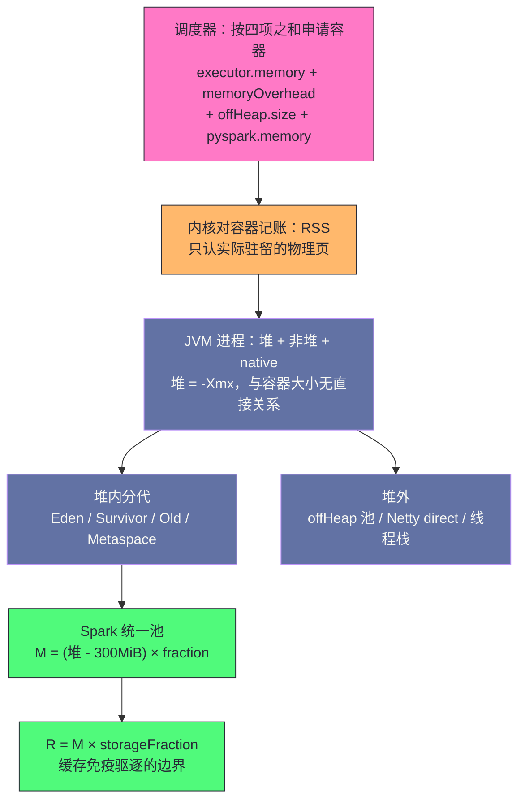
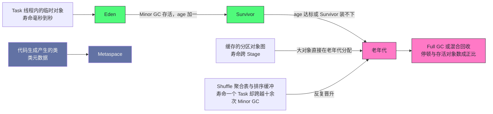
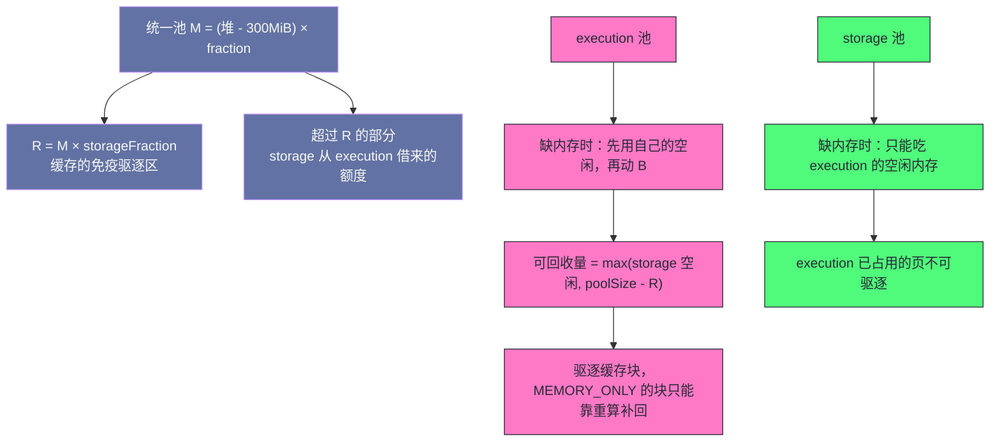
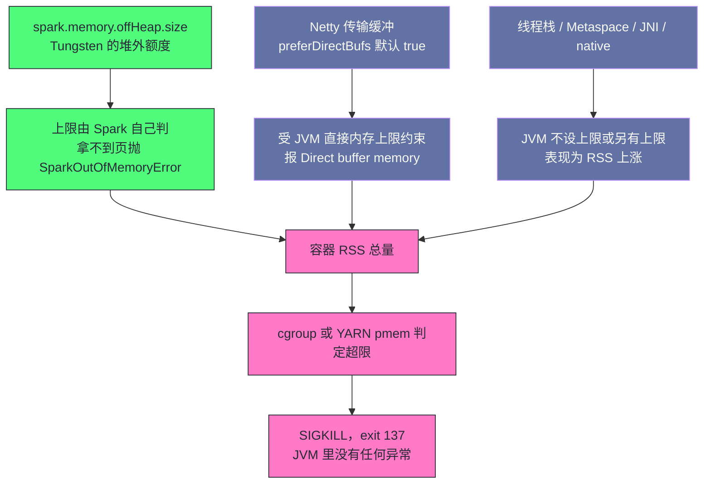
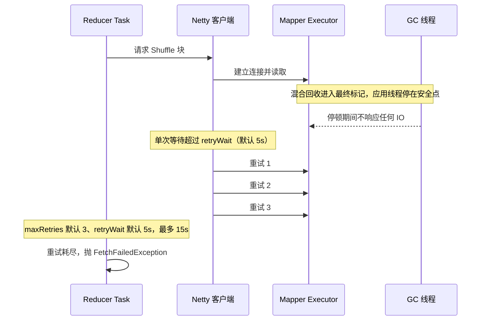
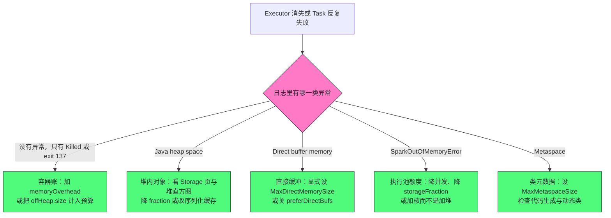

# 5. Spark JVM 性能调优：四层内存账本、统一池的不对称与三种 OOM

**摘要：**

一个 executor 报 `java.lang.OutOfMemoryError: Java heap space` 的作业，把 `--executor-memory` 从 8g 调到 16g，第二天报错换成了 `Container killed ... exceeding memory limits`；再给 `spark.executor.memoryOverhead` 加上几 G，报错又换成了 `Direct buffer memory`。这三次改动都朝着"多给内存"的方向走，报错却换了三张脸，说明被调整的对象与真正越界的对象并不是同一个。

这篇文章沿着"一台 executor 里到底有几本内存账"这条线展开，要回答两个问题：Spark 的统一内存池里，缓存与计算之间那条**只能单向借用**的规则是怎样写进实现的，以及它为什么会让"加内存"这件事在某些作业上变成负收益。全文先用四层账本把容器、JVM、分代与统一池分开，再解释老年代的压力为什么来自缓存与 Shuffle 缓冲而不是用户代码，随后拆开 `spark.memory.fraction` 与 `spark.memory.storageFraction` 的双层划分、执行内存回收存储内存的那段源码、堆外内存的收益与三本互不通气的账，接着把 `memoryOverhead` 与容器被杀、G1 与 Parallel 的判据、三种 OOM 的定位路径逐一对齐，最后回到"加大 executor 内存为什么有时更慢"这个反直觉的问题。

文章口径为 Spark 4.3.0（4.x 预编译 Scala 2.13，默认 JDK 17）；涉及默认值处，以官方配置文档为准。

**关键词（Keywords）**: UnifiedMemoryManager, storageFraction, offHeap, memoryOverhead, exit 137, Direct buffer memory, SparkOutOfMemoryError, G1, Humongous, 分代晋升

---

## 第 1 章 四层账本

### 1.1 被调整的对象与越界的对象

讨论 Spark 的 JVM 调优，最容易走偏的一步是把"给 executor 加内存"当成一个一元问题。`--executor-memory` 只写进 JVM 的 `-Xmx`，而真正决定进程能不能活下去的，是内核与调度器对容器驻留内存的记账；两者之间隔着堆外内存、线程栈、类元数据以及一层名为 Spark 统一内存池的划分逻辑。只管其中一层，另外三层照旧越界，于是报错只是换了个名字。

把范围限定清楚：这里谈的是 executor 进程的内存，driver 不在其中。driver 的 OOM 另有形状——`collect` 把分区结果全收进堆、广播变量在 driver 侧留一份、`spark.driver.maxResultSize` 限制的正是这条路径——它的调优手段是减少回传量而不是调池子。executor 则不一样，它同时承载几十个 task 线程、若干份缓存、若干份 Shuffle 缓冲，还要向集群申请一整块容器，四层账本叠在一起。

### 1.2 四层各自的记账单位

最外层是容器。YARN 按 `spark.executor.memory + spark.executor.memoryOverhead + spark.memory.offHeap.size + spark.executor.pyspark.memory` 这四项之和申请 container，Kubernetes 把它们折算成 pod 的 memory request 与 limit。这一层的记账单位是 RSS，也就是进程实际驻留的物理页，它不区分堆内堆外，也不关心 JVM 自己怎么想。

第二层是 JVM 进程。堆由 `-Xmx` 确定，`spark.executor.memory` 最终写成的就是它，并且 `-Xms` 与 `-Xmx` 被设成相等以免运行期扩缩；堆之外还有线程栈、Metaspace、代码缓存、JNI 与各类 native 分配。第三层是堆内分代，Eden、两个 Survivor、老年代、Metaspace 各占一块，比例要么由 `NewRatio`、`Xmn` 这类参数固定，要么交给 G1 自适应。第四层才是 Spark 的统一池，它把"堆减去 300MiB 保留区"再乘上 `spark.memory.fraction`，得到一块供执行与存储共用的区域 M，并在其中划出 `M × storageFraction` 作为缓存不被驱逐的边界 R。

下面这张图把这四层摊开。横着看是四本账，竖着看是"谁向谁要内存"：调度器向集群要，JVM 向操作系统要，Spark 池向 JVM 堆要。



四层账本的每一层都有各自的失败形态，这是后文所有定位工作的根据：

| 层 | 谁分配 | 记账单位 | 这一层越界的表现 | 观测手段 |
|---|---|---|---|---|
| 容器 | YARN ResourceManager / K8s kubelet | RSS 与 cgroup 计数 | SIGKILL，exit 137，JVM 内无异常 | `kubectl describe pod`、YARN 容器日志、`memory.current` |
| JVM 进程 | JVM 启动参数 | 堆上限与非堆上限 | `OutOfMemoryError: Java heap space` 或 Metaspace | GC 日志、jcmd、堆直方图 |
| 堆内分代 | JVM 收集器 | Eden / Old 的占用 | 频繁混合回收、晋升失败、Full GC 停顿 | `-Xlog:gc*`、UI 的 GC Time |
| Spark 统一池 | `UnifiedMemoryManager` | 执行池与存储池的字节额度 | `SparkOutOfMemoryError`、溢出激增、缓存被驱逐 | Storage 页、Spill 字节数 |

### 1.3 一个贯穿全文的作业

为了让后文的机制有具体的着力点，笔者设想一个广告流量汇总作业 `traffic_rollup`：每天凌晨从 HDFS 读当天的曝光日志，按"广告位 + 小时"汇总曝光与点击，中间把解析后的宽表 `persist` 一份以备三次复用，最后按渠道分区写出。它跑在 YARN 上，50 个 executor，每个 8g 堆、4 核，`spark.memory.fraction` 与 `spark.memory.storageFraction` 都用默认值。

这个作业的形状刚好能同时踩到三种内存故障：解析阶段产生海量毫秒级对象，把年轻代压得很紧；聚合阶段缓存与 Shuffle 缓冲同时涨，把老年代推到 Full GC 边缘；写出阶段大量 Netty 传输与序列化缓冲，把堆外的账搅乱。后文每一次讨论都会回到它，看同一个作业在不同阶段先撞上哪一层。

### 1.4 线程模型决定了谁在为谁买单

有一个常被跳过的前提：executor 里的 task 是线程，不是进程。线程私有的只有栈与程序计数器，堆是整个进程共享的。于是四个核上的四个 task 各自产生的临时对象，全部落进同一个 Eden；一个 task 的解析逻辑写得浪费，受苦的是同进程的另外三个 task 乃至整个 stage。

这条性质解释了为什么"把 task 写得更省内存"比"把 task 拆得更细"更根本：拆细只改变并发的宽度，不改变单个 task 在 Eden 里留下的垃圾量；而 GC 的成本，按官方的说法，正比于存活对象的数量。**线程共享堆这件事，把每个 task 的局部浪费放大成了整个 executor 的全局成本。**

### 1.5 一个比喻：整层写字楼的分租

把一台物理机想成一栋写字楼，把容器想成一整层。物业按层收租，进门只查一块总电表，不问这层里怎么隔断。租户（JVM）拿到的面积是 `-Xmx`，屋里的隔断（分代）与工位（统一池）都是租户自己的事。堆外内存是楼里的公共仓库，位置在层内、面积要另算，物业的电表照样会把它计入。Spark 的统一池则是租户自己画的一张工位图，图上写着"缓存可以坐哪、计算临时坐哪、哪些座位随时可能被清空"。

比喻到这里要收住：工位图是租户画的，物业不认；一旦总用电超了，物业直接拉闸，不给租户收拾东西的时间——这正是容器被杀时 JVM 里连一条异常都没有的原因。

---

## 第 2 章 分代：老年代为什么先满

### 2.1 分代假说在 Executor 里的样子

JVM 分代的前提是"绝大多数对象朝生夕灭"，年轻代用复制算法廉价地清掉它们，长命对象晋升老年代后用标记整理处理。Spark 的 executor 恰好是这条假说的极端样本：task 线程里的反序列化对象、`Row` 的临时包装、正则中间结果、字符串拼接，寿命以毫秒计；而缓存的分区对象图、广播变量的查找表、类元数据，寿命以分钟到小时计。两类对象的寿命差了四五个数量级，年轻代与老年代的分工因此特别有效。

但极端样本也带来一个极端问题：中间那一类——寿命以秒计的 Shuffle 缓冲与聚合表——既不够短，也不够长。它们在一个 task 内反复分配又反复丢弃，单个对象活不过一次 task，可 task 本身要跑几十秒，足以跨过十几次 Minor GC。

### 2.2 晋升：三类住户走进老年代

下面这张图画的是对象进入老年代的三条路径。三条路径对应三种完全不同的压力来源，混在一起看，就会把"老年代满"错误地归因成"缓存太多"。



第一条路径是正常的晋升：Eden 满触发 Minor GC，存活对象复制到 Survivor 并加一岁，岁数到了或 Survivor 放不下就进老年代。第二条是直接分配：超过一定体积的对象（G1 里是半个 region 以上，称为 Humongous）不走 Eden，直接占老年代的 region。缓存的分区如果是反序列化后的对象图，往往是一棵挂了几十万节点的大树，根节点与主干很容易跨过这条线；如果是序列化缓存，一个分区就是一个大字节数组，几乎必然 Humongous。

第三条路径最隐蔽：Shuffle 聚合表、排序用的指针数组、`BytesToBytesMap` 的页（这几样结构自身的内存布局见 [[6. Spark_Shuffle聚合与排序结构]]），这些东西在一个 task 内是"短命"的，但 task 存活期长，它们撑过十几次 Minor GC 之后年龄达标，被当成长寿对象送进老年代；等 task 结束，它们又立刻变成垃圾。**老年代因此经常被一批"已经死了但还没被回收"的临时结构占着，这才是 Full GC 反复出现的直接原因。**

### 2.3 NewRatio 与 memory.fraction 之间那条隐含不等式

官方 Tuning 文档里有一句很容易读漏的话：`spark.memory.fraction` 的取值应当让这块区域"舒服地放进 JVM 的老年代"，并且 `NewRatio` 要大到使老年代占比超过 `spark.memory.fraction`。这句话背后是一条可以算出来的不等式。

`NewRatio` 表示老年代与年轻代的比例，默认值 2 意味着老年代占堆的 `2/3`，约 0.667。默认 `spark.memory.fraction` 是 0.6，0.667 对 0.6，只剩 6.7 个百分点的余量。余量之所以必须留，是因为老年代里除了 M 还要装下 `-Xmx` 与 M 之间的那部分用户内存，以及晋升过程中的浮动垃圾。

任何把 `fraction` 往上抬的调优动作都会立刻吃掉这点余量。把 `fraction` 调到 0.75，M 就超过了老年代的容量，等于给老年代下了一道"永远装不满却永远想装"的指令：缓存与 Shuffle 缓冲不停地往老年代挤，老年代在接近满的时候触发 Full GC，而 Full GC 只能回收那批已经死掉的 Shuffle 结构，回收率低、停顿时长长——这就是"提 fraction 换执行内存"经常反噬的机制。

这条不等式在 Parallel 收集器下是硬边界，因为 `NewRatio` 是固定的。G1 没有固定的年轻代大小，它会按 `MaxGCPauseMillis` 自适应地伸缩年轻代，`-Xmn` 与 `NewRatio` 在 G1 下只是提示。不过压力本身没有消失，它换了两副面孔回来：一是混合回收的周期变密，每次都要挑一批老年代 region 一起收；二是 Humongous 区碎片——大对象占整 region，回收后留下的空洞装不下别的大对象，于是并发标记周期被频繁触发。

### 2.4 老年代里的两类长期住户

把老年代的住户口径分清，调优的动作才不会打偏。一类是缓存：`MEMORY_ONLY` 存的是对象图，`MEMORY_ONLY_SER` 存的是分区级字节数组，前者对象多、GC 扫描成本高，后者对象少但容易 Humongous。另一类是 Shuffle 缓冲：聚合用的哈希表、排序用的指针数组、写盘前的缓冲，这些结构的共同点是"体积大、分配频繁、生命周期跟着 task"。

两类住户对 Full GC 的贡献完全不同。缓存是"该活的"，Full GC 收不走它，只会在它周围反复做无用功；Shuffle 缓冲是"装死人的"，Full GC 收走的是它们，但代价是一次全堆扫描。于是同一个现象——Full GC 频繁——可能对应两种完全相反的动作：缓存型作业应该降 `fraction` 或改成序列化缓存；Shuffle 型作业应该看执行内存额度与并发 task 数，甚至应该加核而不是加堆。

| 分代区域 | Executor 里装什么 | 谁往里放 | 装满了会怎样 |
|---|---|---|---|
| Eden | 解析对象、`Row` 包装、正则中间结果 | 每个 task 线程的分配 | Minor GC，复制存活对象 |
| Survivor | 撑过一次 GC 的临时对象 | 收集器复制 | 空间不足则提前晋升 |
| 老年代 | 缓存分区、Shuffle 缓冲、广播查找表 | 晋升与直接分配 | Full GC 或混合回收，停顿与存活对象数成正比 |
| Metaspace | 类元数据、代码生成产物、Kryo 动态类 | 类加载 | `Metaspace` OOM，或顶着容器上限被杀 |

### 2.5 元空间：与堆无关的那一半

Metaspace 从 JDK 8 起取代永久代，用的是本地内存，默认不设上限，只受容器约束。Spark 在它上面的开销比一般 Java 应用更大：`WholeStageCodegen` 为每个查询计划生成一批类，Kryo 与序列化框架也会动态产生类。一个跑几百个 SQL 的常驻应用，Metaspace 缓慢上涨是正常的。

问题在于它的越界形态与堆完全不同。堆 OOM 会给出 `Java heap space` 并让 task 失败，Metaspace 涨到容器上限时，JVM 拿到的是"无法再申请本地内存"，表现为进程被内核杀掉或者 `OutOfMemoryError: Metaspace`（如果设了 `-XX:MaxMetaspaceSize`）。前者在日志里留下的是 exit 137，后者才是异常。**给 Metaspace 设一个显式上限，等于把一个静默的容器超限改成一条明确的报错**，这是少数几个"设上限反而更容易排障"的例子。

---

## 第 3 章 双层划分：fraction 与 storageFraction

### 3.1 300MiB 与那条 1.5 倍的启动检查

统一池的算式是 `M = (heap - 300MiB) × spark.memory.fraction`，默认 `fraction` 为 0.6。300MiB 来自 `MemoryManager` 里的保留区常量，用途是容纳那些无法被 Spark 统计的部分：JVM 自身的内部结构、类加载与线程栈的一部分、以及对象大小估算的误差。

这个常量还带来一条容易被忽略的启动检查：Spark 要求堆至少是保留区的 1.5 倍，也就是 450MiB，否则直接抛错拒绝启动。这解释了为什么官方文档给 `spark.executor.memory` 标的最小值是 450m，也解释了在小堆上做本地测试时偶尔会看到的那条"system memory must be at least"报错——它不是内存不足，是配置越过了启动门槛。

### 3.2 R 是边界，不是配额

`spark.memory.storageFraction` 描述的是"存储内存中不被执行内存驱逐的部分占 M 的比例"，默认 0.5。这个定义的措辞很关键：它划的是一条**免疫驱逐的边界**，不是缓存的配额上限。

两者在行为上完全不同。作为配额，缓存超过额度就该被拒绝；作为边界，缓存完全可以在 R 之外继续生长，长到接近 M，只是这部分随时可能被执行内存收走。所以 R 调小并不意味着缓存会变少，它只意味着缓存更容易被抢走；R 调大也不意味着缓存变多，它只是把执行的回收线往上推，让执行更早开始溢出。理解这一点之后，实际观测到的 Storage 页数字就不会再让人困惑：缓存用量超过 `storageFraction` 是设计内的正常状态。

### 3.3 另外那 40% 去哪了

`fraction` 之外的 40% 被称为用户内存，装在里面的有三样东西：用户代码创建的对象（UDF 里的集合、闭包捕获的状态）、Spark 内部的元数据（任务对象、累加器、BlockInfo）、以及稀疏且异常大的单条记录的缓冲。前两样是可解释的，第三样是这块空间真正的用途——它是给 SizeEstimator 的估算误差留的缓冲。

这也解释了官方为什么反复建议不要动 `fraction`：它不是一个"执行与存储各分多少"的参数，而是一条"Spark 能碰多少堆"的红线。把它调大，等于把估算误差的缓冲挪走；一旦某条记录比估算的大一个数量级，失误就会以堆 OOM 的形式出现在最不该出现的地方。

### 3.4 两个参数的真实作用点

把两个参数放到同一张表里对比，作用点的差别就清楚了：`fraction` 改变的是 M 的绝对大小，因此同时影响三件事——执行内存的总额度、缓存的可用上限、以及 M 能不能装进老年代；`storageFraction` 只在 M 内部挪一条线，不改变 M，也不改变老年代压力。

这个差别对应着两条不同的调优意图。想减少缓存占用，官方给的动作是降 `fraction`，因为那样才真正缩小了 Spark 能碰的堆；想保护缓存不被执行内存驱逐，才该调 `storageFraction`。把两者混用，就会出现"调了 `storageFraction` 但老年代压力一点没减"的情况——它本来就不管这件事。

下表把两个参数各取三档的后果并排，可以作为一次检查的清单：

| 取值 | M 的绝对大小 | 对缓存的影响 | 对执行的影响 | 对老年代的影响 |
|---|---|---|---|---|
| `fraction = 0.5` | 变小 | 缓存上限下降，更早溢出到磁盘 | 执行额度下降，Shuffle 溢出增多 | 余量变大，Full GC 减少 |
| `fraction = 0.6`（默认） | 基准 | 缓存与执行各占一半边界 | 与默认并发匹配 | 0.667 对 0.6，余量仅 6.7 个百分点 |
| `fraction = 0.75` | 变大 | 缓存上限上升 | 执行额度上升 | 超过老年代占比，Full GC 风险显著上升 |
| `storageFraction = 0` | 不变 | 缓存无免疫区，任一次执行请求都可驱逐 | 执行可回收全部缓存 | 不直接改变 |
| `storageFraction = 0.5`（默认） | 不变 | 一半免疫 | 只能回收一半以上的部分 | 不直接改变 |
| `storageFraction = 1.0` | 不变 | 缓存完全免疫 | 只能回收缓存的空闲内存，几乎必然溢出 | 不直接改变，但缓存被鼓励长到 M |

表中最后一行值得单独说：把 `storageFraction` 设成 1.0 并不会让缓存更"安全"，它会让执行内存池在缓存占满 M 之后变成一分钱都要不回来。此时 `memoryReclaimableFromStorage` 等于 `max(0, poolSize - M)`，也就是零，执行只能溢出。这是"两个参数各自最优、组合起来最差"的典型例子。

---

## 第 4 章 借用的不对称

### 4.1 三条规则

统一内存池的借用规则只有三条，其中第三条是前两条的否定：

- 执行内存缺额度时，可以回收存储内存的**空闲部分**，以及存储内存**超出 R 的那部分**，回收方式是驱逐缓存块；
- 存储内存缺额度时，只能占用执行内存的**空闲部分**，也就是执行池里暂时没人申请的那一块；
- 存储内存**不能驱逐**执行内存已经占用的部分。

第三条的官方说法是"由于实现上的复杂性，存储不能驱逐执行"。这句话把设计取舍讲得很直白：两种内存的可回收性不对等，所以允许的回收方向也不对等。

### 4.2 源码里的两个方向

`UnifiedMemoryManager` 把这三条规则写成了两段逻辑。执行侧申请内存时，先算一个"能从存储那里要回多少"，再让存储池缩容、执行池扩容：

```scala
// 执行池缺内存时，能回收的 = 存储的空闲内存 + 存储超出 R 的借用额
// poolSize 是存储池当前大小（含从执行借来的部分），减去 R 剩下的就是"借来的"
val memoryReclaimableFromStorage = math.max(
  storagePool.memoryFree,
  storagePool.poolSize - storageRegionSize)

if (memoryReclaimableFromStorage > 0) {
  // 只收够用为止，不一次收干；freeSpaceToShrinkPool 内部会调 MemoryStore 驱逐块
  val spaceToReclaim = storagePool.freeSpaceToShrinkPool(
    math.min(extraMemoryNeeded, memoryReclaimableFromStorage))
  storagePool.decrementPoolSize(spaceToReclaim)
  executionPool.incrementPoolSize(spaceToReclaim)
}
```

存储侧申请内存时，逻辑短得多，也只有一处让步——它可以向执行池的空闲内存伸手，因为那部分内存此刻确实没人用：

```scala
// 存储池自己的空闲不够时，只能借执行池"当下空着"的那一块
if (numBytes > storagePool.memoryFree) {
  val memoryBorrowedFromExecution = Math.min(
    executionPool.memoryFree, numBytes - storagePool.memoryFree)
  executionPool.decrementPoolSize(memoryBorrowedFromExecution)
  storagePool.incrementPoolSize(memoryBorrowedFromExecution)
}
storagePool.acquireMemory(blockId, numBytes)
```

两段代码放在一起看，不对称的原因就清楚了。执行侧的 `memoryReclaimableFromStorage` 里有一个 `poolSize - storageRegionSize`，它允许把存储池从"借来的大小"缩回 R，缩的过程必然伴随缓存块被驱逐；存储侧只有 `executionPool.memoryFree`，一个"空闲"限定词就把已占用的执行内存挡在门外。**执行可以拿走存储已经借到手的东西，存储只能捡执行暂时不用的零钱。**

下图把这两个方向画在一起。图的重点不在箭头数量，而在两个方向上"可回收的范围"不同：向右的那条能从 R 之上一直收到 R，向左的那条只碰得到空闲部分。



### 4.3 不对称造成的四个现象

第一个现象是 Storage 页上的数字会超出 `storageFraction` 的直觉。M 为 4GB、`storageFraction` 为 0.5 时，缓存用量显示到 3GB 完全正常，多出来的 1GB 是从执行池空闲处借来的，执行一旦要用，这部分立刻回吐。

第二个现象是缓存在 Shuffle 阶段被驱逐，随后触发重算。`MEMORY_ONLY` 的块被驱逐后只剩 lineage，下一次访问同一分区时整条依赖链要重跑；这不会报错，只会让某个 stage 的耗时莫名上升。`MEMORY_AND_DISK` 把代价从重算换成一次本地读盘，是一个用磁盘换确定性的选择。缓存块被驱逐还带来一个粒度问题：驱逐以块为单位，同一分区的块被删掉后，重算要重算整个分区，而不是只补被删的那一段。

第三个现象是调低 `storageFraction` 不会立刻腾出内存。它只把 R 往下挪，缓存块本身还在，直到执行内存真的来要，回收才发生。所以在作业不忙的时候改这个参数，观察不到任何变化；等到忙起来，缓存被大幅回收，又会误以为是新参数"太激进"。

第四个现象是缓存曲线呈锯齿状，并且与 Full GC 的时间点重合。缓存先自由长满 M，执行需求上来后把它驱逐到 R，下一阶段又需要缓存于是重算并重新缓存，再被驱逐。每一次这样的往复，都在老年代里留下大量刚死掉的字节数组，于是锯齿的每一个波谷附近都跟着一次混合回收。

### 4.4 为什么不对称是被容忍的

从工程角度追问一句：为什么不去实现"存储驱逐执行"？答案在两种内存的语义差异上。存储的块是有身份的：它在 BlockManager 里有登记，背后要么有一条可重算的 lineage，要么有一份磁盘副本，驱逐它的动作只是删掉一条记录并通知下游，代价可控且可预期。执行内存则是正在被 task 线程使用的页，里面可能是半张聚合表、半个排序缓冲，交出它等于让 task 中途放弃手里的中间状态——要么回滚重算，要么把整个 task 杀掉。

两害相权，Spark 选了"让缓存重算"。这个选择有一个重要的推论：**在统一池里，缓存的可用性永远低于计算的可用性**，缓存不是"预留"，而是"抢来的余量"。所有以缓存为前提的调优——把维表全量缓存、把中间结果反复 persist、用 broadcast 换 join——都要按这个前提重算一遍收益。

### 4.5 一个比喻：会议室与工位

把执行内存想成临时会议室，把存储内存想成长期工位。会议室按需占用、散会即还；工位占了就是你的，桌上的纸箱可以一直堆着。会议室不够用时，行政可以把工位上堆的纸箱挪走腾地方——这就是执行驱逐缓存；但反过来，工位上的纸箱再多，也不能因此把一场进行中的会议中断，让所有人出去——这就是存储不能驱逐执行。R 相当于"工位面积的保底线"，保证至少有一半的工位不会被纸箱之外的东西挤掉。

---

## 第 5 章 堆外：绕过 GC 的代价

### 5.1 堆外解决的是寻址问题

Tungsten 想按字节而不是按对象来组织数据，这就绕不开一个底层矛盾：堆内的对象会被 GC 搬迁，任何一个跨越多次分配的长生命周期指针都不可靠。Spark 用 `MemoryLocation` 把两种内存统一成"基址 + 偏移"的形式——堆内时基址是对象引用、偏移是对象内偏移，堆外时基址为空、偏移是绝对地址。序列化后的字节块放在堆外，指针就稳定了。

除了寻址，堆外还有两个直接收益：GC 不扫描它，因此老年代里少了一批大字节数组，混合回收的候选 region 数量下降；对象头与引用指针都不再需要，同样多的数据占用的字节更少。对一个需要在内存里摊开几百 GB 序列化数据的作业来说，这两条的合计收益是实打实的。

### 5.2 两个参数与它们真正的边界

`spark.memory.offHeap.enabled` 默认 false，`spark.memory.offHeap.size` 默认 0，单位是字节，所以必须写成 `4g` 这样的带单位形式，写成 `4` 就是 4 个字节。开启之后，Tungsten 的 `tungstenMemoryMode` 从堆内切到堆外，排序器、聚合表的页与序列化缓冲改从这块绝对额度里出，堆内池则留给不走 Tungsten 的那部分结构与缓存。

有一处必须记住的错位：**`spark.memory.fraction` 仍然是按堆算的**。开了堆外，堆内那块 M 不会自动缩小，`fraction` 也不会因此变小。同时，缓存只有在 `StorageLevel` 显式要求堆外时才会进这块区域，而堆外缓存以序列化字节形式存放，需要 `OFF_HEAP` 这类存储级别。也就是说，"开了堆外"默认只搬走了 Tungsten 的执行内存，缓存仍在堆内。

### 5.3 用了堆外为什么还 OOM

这是堆外调优里最常见的一个落差。原因有四层，逐层排下来基本能覆盖全部情形。

第一层是容器账没跟着改。前面说过，容器大小是 `executor.memory + memoryOverhead + offHeap.size + pyspark.memory` 四项之和，`offHeap.size` 是加在总账上的，不是从堆里挪出来的。只写了 `spark.memory.offHeap.size=8g` 而没有同步加 `memoryOverhead`、也没减 `executor.memory`，容器需求就凭空多了 8GB，结果是容器被杀而不是 JVM 报错。

第二层是堆内 M 一点没变。用户 UDF 创建的对象、闭包里捕获的数据、反序列化后的中间结果，全都在堆里，堆内 OOM 照旧发生。堆外只承接 Tungsten 的字节形态结构，它救不了"用户代码在堆里建了一个大 Map"这类问题。

第三层是堆内堆外都不报错，但进程的 RSS 一路涨。堆外内存不受 GC 管理，泄漏在堆内会表现为 GC 后仍然降不下来的老年代占用，在堆外则表现为后台看不见的额度消耗，唯一的观测点是容器计数。等到额度用尽，Spark 抛出的是 `SparkOutOfMemoryError`（拿不到页），而不是堆 OOM。

第四层是"堆外"这个词在 Spark 语境里其实指向三块不同的内存，各有各的上限。下图把这三本账与容器总账画在一起：



三本账互不通气这件事有直接的实践含义：`spark.memory.offHeap.size` 调大，不会挤爆 JVM 的直接内存计数；反过来，Netty 的直接缓冲用超了，也不会让 Spark 的堆外池变小。排查时看到 `Direct buffer memory`，先怀疑并发 fetch 的数量与 `preferDirectBufs`，而不是 `offHeap.size`。

### 5.4 堆内与堆外的取舍

| 维度 | 堆内 | 堆外（offHeap 池） |
|---|---|---|
| 管理方 | JVM 堆与收集器 | Spark 的 `UnsafeMemoryAllocator` |
| 地址是否稳定 | 否，GC 会搬迁对象 | 是，绝对地址 |
| 是否参与 GC | 是，扫描与停顿都算在内 | 否，GC 看不见 |
| 容量上限 | `-Xmx` 与分代比例 | `spark.memory.offHeap.size` |
| 越界形态 | `Java heap space`、频繁 Full GC | `SparkOutOfMemoryError`、容器被杀 |
| 适合放什么 | 用户对象、缓存对象图 | 序列化字节、Tungsten 的工作区 |
| 主要代价 | 对象头与指针开销、GC 停顿 | 手工管理、额度需计入容器预算 |

堆外的代价在表里写得很清楚，但容易被低估的是最后一行：额度必须计入容器预算。把堆外当"额外的免费内存"来用，是这套机制最常见的误用。

---

## 第 6 章 memoryOverhead 与容器被杀

### 6.1 容器总账的算式

`spark.executor.memoryOverhead` 默认取 `executorMemory × 0.10` 与 384MiB 中的较大者；4.0 起这个下限可以由 `spark.executor.minMemoryOverhead` 调整，比例由 `spark.executor.memoryOverheadFactor` 控制（Kubernetes 上的非 JVM 作业默认 0.40，因为 Python worker 需要更多非堆空间）。最终提交给 YARN 或 K8s 的容器大小，是前面那四项之和。

默认的 10% 在多数作业里够用，因为 JVM 的非堆开销确实大致随堆增长。但它是一个**比例**，而真正消耗非堆内存的东西并不都按比例增长：线程栈按线程数算，Netty 直接缓冲按并发 fetch 数算，Metaspace 按类数算。一个 executor 从 4 核扩到 16 核，线程数与并发 fetch 数翻了几倍，而 `memoryOverhead` 只跟着内存涨——这就是大核数 executor 更容易被容器杀的结构性原因。

### 6.2 非堆开销的清单

把 overhead 里的东西列一遍，有助于判断该不该调它：JVM 的 Metaspace 与代码缓存；每个线程的栈（默认 1MiB 一个，executor 上还有 RPC、Netty event loop、GC 线程、心跳线程）；JNI 与 native 库的映射；Netty 的直接缓冲与 Kryo 的序列化缓冲；PySpark 的 worker 进程；以及 glibc 的 arena 碎片——最后这一项最阴险，它表现为"JVM 说自己只用了 6GB，容器看到 7.5GB"，而差额是已经 free 但没有归还操作系统的 native 内存。

官方文档给的经验值是"随容器增大而增长，典型 6% 到 10%"。这个区间在核数少、并发低时成立；一旦出现大量直接缓冲或大量线程，比例会失控。

### 6.3 两处记账为什么不一致

JVM 只对堆负责：它知道 `-Xmx`、知道各分代用了多少，也大致知道直接缓冲的计数，但它不知道自己的 RSS。容器只对 RSS 负责：堆里那些已经空闲、尚未归还操作系统的页，它照样算钱；堆外的映射、线程栈、共享库，它一视同仁。两边唯一的交点是一次 GC 之后堆能还给操作系统多少。

这个交点决定了调优的方向。G1 在并发周期之后会把空闲 region 归还，JDK 12 起还有周期性回收机制在空闲时主动归还；Parallel 一般不会在两次回收之间主动归还。所以在同一个容器预算下，用 G1 的 executor 往往比用 Parallel 的更容易"压着上限活"，而 Parallel 更容易在高峰时被一次性顶爆。

把两边的视野并排放，缺口的位置就清楚了：JVM 的账上"已空闲但未归还的堆页"是空的，容器账上它是实的；线程栈、native 分配、共享库映射与 glibc 的 arena 碎片则干脆不在 JVM 的账上。两份账只在一种情况下短暂对齐——一次回收把空闲页真正还给了操作系统。

### 6.4 YARN 与 Kubernetes 的两种杀法

YARN 有两道检查。物理内存检查（`yarn.nodemanager.pmem-check-enabled`）比较 RSS 与容器上限，超了就杀；虚拟内存检查（`yarn.nodemanager.vmem-check-enabled`）比较虚拟地址空间，这一道对 JVM 与直接缓冲极不友好——保留地址不等于使用内存，而 JVM 会预留大量地址空间。Spark on YARN 的部署实践里关掉 vmem 检查是常见做法，原因就在这里。报错指纹是那句很长的 `Container killed by YARN for exceeding memory limits`，后面跟着"用了多少 GB、上限多少 GB"。

Kubernetes 走的是 cgroup。容器内存超过 limit 时，内核的 OOM killer 在 cgroup 内挑一个进程杀掉，默认发 SIGKILL，退出码 128+9 即 137。`kubectl describe pod` 里能看到 `Last State: Terminated`、`Reason: OOMKilled`、`Exit Code: 137` 这三件套。需要注意 137 不等于 OOMKilled：被驱逐、被人工 kill、被节点压力清理同样是 137，判定要看 `Reason` 字段。

还有一处容易混淆：cgroup 的 `memory.current` 包含 page cache，而 page cache 在内核判定超限之前会先被回收，所以它一般不会直接导致 OOMKilled，但会让 `memory.current` 的读数长期偏高。**拿 `memory.current` 当 JVM 用量来读，会得到一个偏大且波动的数字**，正确做法是看 `container_memory_working_set_bytes` 或 JVM 自己的堆与非堆指标。

### 6.5 容器被杀时的日志形状

容器被杀最折磨人的地方在于日志。JVM 没有机会写任何异常，executor 日志常常停在一行 GC 日志、或者半行 task 日志上；driver 端看到的是 `ExecutorLostFailure`、`Container ... exited with a non-zero exit code 137`、`Killed`，看不到 `OutOfMemoryError`。

于是有一条几乎不会错的判据：**如果日志里没有 OOM 异常，而 executor 在反复重启，先算容器账，不要动 GC 参数**。反过来，如果日志里有明确的 `Java heap space` 而容器从未被杀，那堆还有余量，问题在堆内的对象量而不是容器预算。

| 容器账的构成项 | 来源参数 | 默认 | 谁在为它买单 |
|---|---|---|---|
| 堆 | `spark.executor.memory` | 1g | JVM，`-Xmx` |
| 非堆 | `spark.executor.memoryOverhead` | `memory × 0.10`，下限 384MiB | Metaspace、线程栈、direct、native |
| 堆外池 | `spark.memory.offHeap.size` | 0 | Tungsten 的 off-heap 额度 |
| Python | `spark.executor.pyspark.memory` | 未设 | PySpark worker 进程 |

### 6.6 什么时候才该动 overhead

调 `spark.executor.memoryOverhead` 有三种典型时机，各自的判据不同。第一种是容器被杀的报错里给出的用量只超出上限一点点（比如用 5.6GB、上限 5.5GB），这时按比例加一档就能解决，属于账算漏了。第二种是核数或并发 fetch 数明显增加过——大核数的 executor 上线程与直接缓冲都会跟着涨，而默认的 10% 是跟着内存走的，比例本身就跟不上。第三种是引入了新的 native 组件，比如换了压缩库、接了自定义的 JNI 扩展、或者开了 PySpark，这些都会把开销从"随堆增长"变成"按用量增长"。

反过来，有两种情况不该动它。堆 OOM 时加 overhead 毫无作用，因为那块内存根本不进堆；`SparkOutOfMemoryError` 时加 overhead 也没用，它说的是执行池额度不够。把 overhead 当"万能加内存"的旋钮，结果是容器预算越来越大、堆还是那么小、问题原地不动。

---

## 第 7 章 GC 的选择与停顿的判据

### 7.1 默认收集器已经换过一次

Spark 4.x 的构建口径是 JDK 17，官方 Tuning 文档明确写了"自 4.0.0 起 Spark 默认使用 JDK 17，这也使 G1 成为默认收集器"。这条事实意味着大量在 JDK 8 时代积累的调参经验需要重读一遍：JDK 8 的 server-class 机器默认是 Parallel，`-Xmn`、`NewRatio`、`SurvivorRatio` 那一套是在固定分代的前提下设计的；G1 没有固定分代，年轻代大小是它按停顿目标算出来的。

这不是说 Parallel 不能用。JDK 17 上仍可用 `-XX:+UseParallelGC` 显式切回，而且对"只读一次、算完就写"的纯批处理作业，Parallel 的吞吐往往更好。选择的分水岭不在收集器本身，而在作业对停顿时长的容忍度；G1 的 region 划分与混合回收机制见 [[07 G1 收集器——Region 化内存与混合回收]]。

### 7.2 两种收集器的目标函数不同

Parallel 优化的是总吞吐：它允许较长的单次停顿来换取更少的回收总时间，用 `GCTimeRatio` 表达目标（默认 99，也就是允许约 1% 的时间花在 GC 上），代价是单次 Full GC 的停顿随堆线性增长。G1 优化的是停顿可预测：默认 `MaxGCPauseMillis` 为 200ms，它按这个目标挑选每次回收的 region 数量，用"更多次、每次更短"换"单次不超时"。

对 Spark 来说，这两种目标函数对应两种失败模式。Parallel 的长停顿会直接打断 task 的 IO 响应：一个 executor 停顿 3 秒，期间它上面的所有 fetch 请求都得不到响应，下游 reducer 的重试窗口被吃掉。G1 的短停顿则把成本转移到总吞吐和后台并发线程上：并发标记阶段与应用线程抢 CPU，在核数紧张的 executor 上表现为"没有长停顿但整体变慢"。

### 7.3 GC 时间占比：最实用的那条判据

官方给的第一条判据是定性的：如果一个 task 完成之前发生了多次 Full GC，说明执行任务的内存不够。这句话在 G1 上要翻译成"混合回收次数异常多"，但判据的内核没变——回收频率高到与 task 的节奏同量级，就说明工作集超过了可用内存。

定量的判据是 GC 时间占比。Spark UI 的 Stage 页与 Executor 页都能看到每个 task 的 GC Time（对应 `TaskMetrics.garbageCollectionTime`），把它与 task 的执行时间相除，得到一个比值。工程上常用的红线是 10%：超过它，说明有相当一部分 CPU 时间花在回收而不是计算上；低于它，GC 就不是瓶颈，继续在 GC 参数上花时间属于优化错了对象。

### 7.4 次数与时长要分开读

GC 时间占比高，原因却可能完全相反。一种是年轻代太小，task 产生的短命对象不断触发 Minor GC，表现为 GC 次数极多而单次很短；这时把 Eden 放大（`-Xmn` 取到单 task 工作集的量级，官方给的换算是在 Eden 估算值上乘 4/3）就能立刻见效。另一种是老年代被缓存挤满，Full GC 反复扫全堆，表现为次数不多但单次很长；这时加年轻代毫无用处，该动的是 `fraction` 或缓存策略。

判据因此要成对使用：**先看 GC 次数与单次时长的组合，再看总占比**。次数多时长者短，往年轻代走；次数少时长者长，往老年代与缓存走；两者都高，说明工作集本身超出了这台机器能给的内存，参数已经救不了。

### 7.5 日志怎么打开，参数写在哪一层

GC 参数从两个入口注入：`spark.executor.defaultJavaOptions` 是 Spark 自己那一层默认参数，会拼在用户参数之前；`spark.executor.extraJavaOptions` 是用户那一层。两者都不能用来设 `-Xmx`——堆大小由 `spark.executor.memory` 决定，在这两个参数里写 `-Xmx` 属于非法配置，容易被忽略而被悄悄覆盖。

JDK 17 上应当用统一日志接口，而不是官方文档里那串 JDK 8 时代的 `-XX:+PrintGCDetails`：

```bash
--conf "spark.executor.extraJavaOptions=-Xlog:gc*,safepoint:file=/var/log/spark/gc-%p.log:time,uptime,level,tags:filecount=5,filesize=100m -XX:G1HeapRegionSize=16m"
```

这套写法把 GC、安全点与日志轮转放在一条配置里，`%p` 让每个 executor 进程写各自的文件。安全点日志值得一起打开：G1 的许多长停顿并非回收本身，而是"进入安全点"这一步在等某个线程——代码里偶发的长循环、`Thread.sleep` 附近的大括号、JNI 临界区，都会让停顿时长超出收集器的承诺。这类停顿在只看 GC 日志时是不可见的。

日志本身读起来可以很简省，只需要三个字段。`GC(n)` 的编号说明这是第几次回收，行首的 `Pause Young`、`Pause Mixed`、`Pause Full` 说明回收类型，行尾的总耗时分出这一档停顿时长。把 `Pause Full` 出现的时刻与 task 的起止时间对齐，就能判断它是不是"task 还没跑完就撞上了全堆回收"——这正是官方那条判据的量化版本。再看每行末尾堆容量的 `used->after` 两列：如果老年代在回收之后只降了一点点，说明那批对象确实还活着，该动的是缓存策略而不是收集器参数；如果降幅很大而回收仍然频繁，说明真正的问题是新对象产生得太快，方向在数据结构而不在 GC。

### 7.6 大堆与 Humongous 区

官方 Tuning 文档对 G1 有一句针对性提醒：executor 堆很大时，可能需要用 `-XX:G1HeapRegionSize` 调大 region。原因在于 Humongous 对象——体积达到 region 一半以上的对象会独占连续的 region，而这类大块的释放往往要等到并发标记周期，年轻代回收基本带不走它们。

这条提醒与缓存直接相关：序列化缓存的分区块往往是几十 MB 的字节数组，默认 region 大小（堆的 1/2048，钳制在 1MiB 到 32MiB 之间）下很容易跨过 Humongous 门槛。于是一个缓存型作业会在老年代里制造大量 Humongous region，回收这些 region 需要完整的并发标记周期，周期又被这些"大而短命"的对象反复触发。把 region 调大，让一部分缓存块落回普通对象区，是缓解这种局面的直接手段。

### 7.7 停顿怎样变成 fetch 失败

GC 停顿的破坏力不止于拖慢计算，它还会打断网络响应。下面这张时序图把这条链路串起来，参数用的是默认值：



`spark.shuffle.io.maxRetries` 与 `spark.shuffle.io.retryWait` 的默认组合给出的总重试时间正好 15 秒，官方对这两个参数的说明里也点了"应对长 GC 停顿"这个用途。但把重试次数调大只是把窗口拉宽，并不解决停顿本身；真正要看的还是第 7.3 节那条判据——停顿有没有长到与重试窗口同量级。

| 维度 | Parallel | G1（4.x 默认） | ZGC |
|---|---|---|---|
| 优化目标 | 总吞吐 | 停顿可预测 | 极低停顿 |
| 单次停顿时长 | 随堆线性增长 | 受 `MaxGCPauseMillis` 约束，默认 200ms | 与堆大小基本无关 |
| 大堆表现 | Full GC 数秒到数十秒 | 混合回收频繁、Humongous 碎片 | 需要更多内存与地址空间 |
| 主要开销 | 停顿期间完全停止响应 IO | 并发线程与应用抢 CPU | 读屏障与着色指针降低吞吐 |
| 何时选它 | 纯批处理、无跨节点 fetch 压力 | 绝大多数 Shuffle 型作业 | 交互式、延迟敏感的常驻服务 |

---

## 第 8 章 三种 OOM 与 Spark 特有的那一种

### 8.1 形态一：堆 OOM

`java.lang.OutOfMemoryError: Java heap space` 是最容易识别的一种，也是误会最多的一种。它说的是"堆里放不下新对象"，但不代表"缓存太多"——缓存分配失败时 Spark 不会抛错，`putSingle` 拿不到内存就按存储级别降级，`MEMORY_ONLY` 直接丢块、`MEMORY_AND_DISK` 转写磁盘。所以缓存撑爆堆的路径通常表现为"缓存无声无息地没生效"，而不是一条 OOM。

真正会抛堆 OOM 的是不走降级逻辑的分配：用户 UDF 里建的大集合、`groupByKey` 之后单个 key 的 value 列表、`collect` 回传前的合并、反序列化一条超大记录。定位手段是堆直方图与堆 dump，看占用最多的类是什么，再回到代码里找那个类的创建点。这一步没有办法用参数替代。

### 8.2 形态二：容器被杀

已经在第 6 章拆过，这里只留判据：日志里没有异常、executor 反复重启、YARN 的 `exceeding memory limits` 或 K8s 的 `OOMKilled` 加 exit 137。它的定位路径与堆 OOM 毫无交集：不看堆直方图，看容器账与环境。

### 8.3 形态三：Direct buffer memory

`java.lang.OutOfMemoryError: Direct buffer memory` 来自 JVM 的直接内存计数。Spark 的主要来源是 Netty：`spark.shuffle.io.preferDirectBufs` 默认为 true，Shuffle 与缓存块传输都用堆外缓冲以减少 GC 压力；并发 fetch 越多、单块越大，直接缓冲的瞬时占用越高。`-XX:MaxDirectMemorySize` 不显式设置时默认等于最大堆，于是"把堆调大"会顺带把直接内存上限调大，而容器没有跟着变大——这条组合能让作业在容器上限处被直接杀掉，而不是报 `Direct buffer memory`。

这也是"堆外"这个词最容易骗人的地方：调大堆，等于同时调大了 direct limit，看起来什么都很宽裕，实际越界点转移到了容器那一层。要判断是不是这条路径，看 `-XX:MaxDirectMemorySize` 有没有显式设置、`spark.shuffle.io.preferDirectBufs` 是否为 true、以及同时并发的 fetch 数量；堆外内存与直接内存的完整形态见 [[13 JVM 内存问题实战——OOM、内存泄漏与堆外内存]]。

### 8.4 形态四：SparkOutOfMemoryError

还有一种形态是 Spark 自己的。`SparkOutOfMemoryError` 继承自 `OutOfMemoryError`，但它的语义不是"JVM 堆装不下"，而是"执行内存池给不出这一页"。典型消息形如 `Unable to acquire N bytes, got M bytes`，发生在 Tungsten 的排序器、聚合表、`BytesToBytesMap` 需要扩页的时候。

它的处理路径值得单独说：拿不到页时，结构会先把已有数据溢写到磁盘腾出额度，然后再申请一次；重试仍然拿不到，才抛 `SparkOutOfMemoryError`。所以看到这个错误，等于同时得到了两条信息——溢出已经发生过至少一次，且溢出之后额度依然不够。此时调大堆未必有用（如果瓶颈是并发 task 数），调小并发或降 `storageFraction` 反而更对症。

这条形态与 Shuffle 溢出失败是同一件事的两面（溢出前后的读侧与写侧行为见 [[7. Spark_Shuffle内存调优]]）：溢出是"额度不够时的后备路径"，当后备路径也无法腾出足够额度时，失败就以 `SparkOutOfMemoryError` 的形式出现，并且它往往先于容器被杀出现——因为它是 Spark 内部的额度判定，比内核的 RSS 判定更早触发。

### 8.5 判据树与定位顺序

三种主要形态的指纹差别很大，此外还有两种同样顶着 `OutOfMemoryError` 之名、机制却完全不同的情形——执行池额度用尽与元空间告罄。下图把它们一起组织成一棵判据树。顺序是从外到内：先看容器层，再看 JVM 堆，再看直接内存，最后看 Spark 池。



顺序之所以重要，是因为靠前的形态会把靠后的证据抹掉。容器被杀时 JVM 来不及写日志，堆 OOM 的栈可能还没 flush 到磁盘；反过来，如果先看到 `SparkOutOfMemoryError`，说明容器与堆都还有余量，问题在执行额度。按这个顺序排查，多数情况下第一问就能把范围缩到一层之内。

| 形态 | 报错指纹 | 发生位置 | 日志特征 | 定位第一步 |
|---|---|---|---|---|
| 堆 OOM | `Java heap space` | 用户代码或反序列化 | 有完整异常栈，task 失败 | 堆直方图看占用最多的类 |
| 容器被杀 | `exceeding memory limits` / `OOMKilled` / exit 137 | 内核或 NodeManager | 无异常，日志戛然而止 | 重算容器四项之和 |
| 直接内存 | `Direct buffer memory` | Netty 传输缓冲 | 异常栈指向 Netty 或 NIO | 查 `MaxDirectMemorySize` 与并发 fetch |
| 执行池 | `SparkOutOfMemoryError`，`Unable to acquire` | Tungsten 排序器与聚合表 | 前面已有多次溢写记录 | 查并发 task 数与 storageFraction |
| 元空间 | `Metaspace` | 类加载与代码生成 | 常伴随长尾 task 变慢 | 查 `MaxMetaspaceSize` 与生成类数量 |

### 8.6 回到那个作业

把 `traffic_rollup` 按判据树走一遍，三次失败的位置恰好各在一层。第一次的日志里有完整的 `Java heap space` 栈，堆直方图里排在最前面的是解析阶段创建的容器类而不是缓存对象，说明问题在 UDF 的数据结构，与缓存策略无关。第二次把堆翻倍之后异常消失，容器开始被杀：`memoryOverhead` 仍按堆的 10% 计算，而核数在同一轮改动里翻了一倍，线程栈与并发 fetch 的直接缓冲成倍增长，按比例算的那本账就跟不上了。第三次开了堆外并给了几个 G，容器需求又凭空多出同样多的一块，报错于是换成 `Direct buffer memory`——堆变大顺带抬高了直接内存上限，唯独容器没有跟着变大。

三次改动指向同一个教训：每一层都用"更大的数字"去压，失败就搬到下一层。有效的动作只有一种顺序——先把失败定位到某一层，再只改那一层的参数，改完观察的是同一层指标有没有变化，而不是作业整体有没有变快。**把四层账本混在一起调，得到的永远是"报错搬家"而不是"问题解决"。**

---

## 第 9 章 加内存为什么有时更慢

### 9.1 GC 成本正比于存活对象数

官方的表述是"垃圾回收的成本正比于 Java 对象的数量"。这句话在堆翻倍时的含义是：堆变大并不改变存活对象的数量，但它改变了收集器的工作方式——更大的堆意味着更多的 region、更长的标记阶段、更长的复制与压缩路径。对于存活率高的工作集，堆翻倍几乎等于把每次回收的工作量翻倍。

这条推理在 G1 上还多一层：region 数量随堆增长，混合回收每轮要挑选的候选集变大，并发标记周期的持续时间变长，与应用线程抢 CPU 的时间也变长。**加内存缓解的是"放不下"，恶化的是"收得慢"**，两者在同一个参数上方向相反。

### 9.2 装箱率与本地性

容器按整块申请。一台 256GB 的机器，16g 的 executor 只能放 16 个减去系统预留之后的若干个，8g 的能放两倍多。executor 数量减少直接影响两件事：Shuffle 的 map 输出更集中，reducer 拉取时的 `PROCESS_LOCAL` 命中率下降；动态资源分配下，大容器在队列里等待的时间更长，峰值时段拿不到资源的概率上升。

这两条在监控上都表现为"资源利用率下降"而不是"内存不足"，所以很容易被忽略。它们也解释了为什么"每个 executor 给得越大越好"在共享集群上从来不成立——集群是被许多作业分时复用的，大容器让装箱变成一道二维装箱难题（核数与内存的配比见 [[3. Spark集群资源分配与并行度调优]]）。

### 9.3 并发 task 与执行内存的分摊

统一池是 executor 级的共享资源，额度是逐 task 申请的。把内存调大而核数不变，单个 executor 的并发度不变，每个 task 能申请到的执行内存变多，溢出减少——这是加内存的正面收益。但如果调内存的同时把核数也加上去（这是实践中更常见的组合），并发 task 数变多，每个 task 分到的份额可能不增反减，溢出反而更频繁。

这条推论有一个不太直观的结论：**解决溢出问题的正确变量常常是核数而不是内存**。核数决定竞争者的数量，内存决定池子的大小，池子变大与竞争者变多同时发生，商不一定变大。

### 9.4 R 变大之后的连锁反应

`fraction` 不变而堆变大时，M 与 R 都按比例变大。R 变大意味着缓存有了更大的免疫区，缓存会因此长到更大的规模；而缓存是"越给越想要"的负载——一个 `persist` 了宽表的作业不会因为内存多了就少缓存一点。于是老年代被更快地填满，混合回收周期更密，第 2 章那条不等式重新变紧。

同样的机制也作用在"给 offHeap 加大额度"上：堆外额度变大，Tungsten 的工作区变大，单次溢出的量变大，溢出的次数变少但每次的代价变大。对一个倾斜严重的作业，这意味着单次溢出的停顿更集中，长尾更明显。

| 加内存的收益 | 何时成立 | 加内存的代价 | 何时反噬 |
|---|---|---|---|
| 溢出减少、Shuffle 写盘变少 | 并发不变、池子是瓶颈 | 单次回收停顿变长 | 存活对象多、老年代压力大 |
| 缓存命中率上升 | 缓存确实被驱逐过 | region 变多、并发标记变长 | 大堆、G1 默认 region 偏小 |
| 单 task 工作集更宽裕 | task 粒度大、记录大 | 装箱率下降、本地性变差 | 共享集群、容器按整块分配 |
| 容器预算更宽 | 容器账算错导致被杀 | 缓存长到更大规模 | 缓存型负载、无节制 persist |

### 9.5 先问缺的是哪一种内存

加内存之前值得先问一句：现在缺的到底是哪一种内存。缺的是堆内对象空间，加堆有效；缺的是执行池额度，加核、降并发或降 `storageFraction` 有效；缺的是容器余量，加 `memoryOverhead` 有效；缺的是停顿预算，加内存通常无效甚至有害，因为停顿随堆增长。四种"缺"对应四个不同的旋钮，而 `--executor-memory` 只覆盖其中一个。

这个问题之所以必须先问，是因为四种"缺"在监控上的表现太像：都表现为 task 变慢、stage 拉长、偶尔有 executor 退出。区分它们靠的不是单一指标，而是指标的组合——GC 时间占比回答"是不是回收在吃时间"，溢出字节数回答"是不是额度不够"，容器的用量曲线回答"是不是被上限勒住"，`SparkOutOfMemoryError` 的有无回答"是不是池子见底"。四个指标一起看，缺的是哪一种内存基本不会判断错。

---

## 第 10 章 落点

行文至此，可以把开头那两个问题的答案分别收在一处。

第一件事是四层账本必须对齐。容器、JVM、分代、统一池各自有独立的记账单位与越界形态，任何一层的余量都不能当作另一层的余量；`--executor-memory` 只写进第一层的一个变量，它管不到堆外的直接缓冲，也管不到 Metaspace，更管不到内核的 RSS 判定。

第二件事是那条不对称规则的分量。执行可以驱逐存储，存储不能驱逐执行，官方给的理由是"实现上的复杂性"，而实际后果是把缓存降格成了"抢来的余量"。所有以缓存为收益前提的优化，都要在这个前提下重新算一遍账：缓存会被驱逐，被驱逐就要重算，重算的代价可能比不缓存还高。

第三件事是判据先于参数。GC 时间占比、task 完成前的 Full GC 次数、日志里有没有异常、退出码是不是 137，这四条判据分别指向四组完全不同的动作。跳过判据直接调参数，等于在四层账本里随机挑一层改数字——多数时候改的那一层并不是越界的那一层。

行文至此，可以说一句大方向上确定的话：JVM 调优在 Spark 上从来不是"把堆调大"这么一件单调的事，它是在"放得下"与"收得干净"之间找一个两害相权的位置。这个位置随作业形状变化——纯批处理的作业可以把吞吐压到极致，混合负载的作业得给停顿留余量，缓存型作业则要接受缓存永远排在计算之后。**没有一种配置能同时占住这三头，取舍的标准只能是这个作业最不能容忍哪一种失败。**

堆外与 GC 的那本账还在变：统一日志接口取代了散落的 `PrintGC` 开关，region 化与并发回收取代了固定分代，FFM 的 `MemorySegment` 也在逐步接管过去由 `ByteBuffer` 承担的堆外分配。但有一条不会变：容器只认 RSS。只要进程活在一个有上限的盒子里，最外层那本账就永远是最终裁决者。

---

## 参考资料

1. Apache Spark 4.3.0 文档：Configuration，Memory Management、Executor memoryOverhead、Shuffle Behavior 与 Networking 各节，含 `spark.memory.fraction`、`spark.memory.storageFraction`、`spark.memory.offHeap.*`、`spark.executor.memoryOverhead` 与 `spark.shuffle.io.preferDirectBufs` 的默认值。https://spark.apache.org/docs/latest/configuration.html
2. Apache Spark 4.3.0 文档：Tuning Guide，Memory Management Overview 与 Garbage Collection Tuning 两节，含"M 应放进老年代""回收成本正比于对象数量""JDK 17 使 G1 成为默认"与 `G1HeapRegionSize` 的说明。https://spark.apache.org/docs/latest/tuning.html
3. Apache Spark 源码（4.3.0）：`core/src/main/scala/org/apache/spark/memory/MemoryManager.scala`，`RESERVED_SYSTEM_MEMORY`、`minSystemMemory` 的 1.5 倍检查与 `tungstenMemoryMode`。https://github.com/apache/spark/blob/v4.3.0/core/src/main/scala/org/apache/spark/memory/MemoryManager.scala
4. Apache Spark 源码（4.3.0）：`core/src/main/scala/org/apache/spark/memory/UnifiedMemoryManager.scala`，`maybeGrowExecutionPool` 中 `memoryReclaimableFromStorage` 的算法与 `acquireStorageMemory` 的借用分支。https://github.com/apache/spark/blob/v4.3.0/core/src/main/scala/org/apache/spark/memory/UnifiedMemoryManager.scala
5. Apache Spark 源码（4.3.0）：`core/src/main/scala/org/apache/spark/memory/StorageMemoryPool.scala`，`freeSpaceToShrinkPool` 与按块回收的入口。https://github.com/apache/spark/blob/v4.3.0/core/src/main/scala/org/apache/spark/memory/StorageMemoryPool.scala
6. Apache Spark 源码（4.3.0）：`core/src/main/scala/org/apache/spark/storage/MemoryStore.scala`，`evictBlocksToFreeSpace` 的驱逐顺序与块粒度。https://github.com/apache/spark/blob/v4.3.0/core/src/main/scala/org/apache/spark/storage/MemoryStore.scala
7. Apache Spark 源码（4.3.0）：`core/src/main/java/org/apache/spark/memory/SparkOutOfMemoryError.java` 与 `core/src/main/scala/org/apache/spark/memory/TaskMemoryManager.scala`，执行内存申请失败时的抛出位置。https://github.com/apache/spark/blob/v4.3.0/core/src/main/scala/org/apache/spark/memory/TaskMemoryManager.scala
8. Apache Spark 源码（4.3.0）：`core/src/main/scala/org/apache/spark/util/Utils.scala`，`sparkJavaOpts` 对 `spark.executor.defaultJavaOptions` 与 `spark.executor.extraJavaOptions` 的拼接顺序。https://github.com/apache/spark/blob/v4.3.0/core/src/main/scala/org/apache/spark/util/Utils.scala
9. Oracle. HotSpot Virtual Machine Garbage Collection Tuning Guide（JDK 17），G1 的 `MaxGCPauseMillis`、`G1HeapRegionSize` 与 Humongous 对象的判定。https://docs.oracle.com/en/java/javase/17/gctuning/
10. JEP 158: Unified JVM Logging，`-Xlog` 的语法与 tag 选择。https://openjdk.org/jeps/158
11. Kubernetes 文档：Pod Lifecycle，容器终止原因与 OOMKilled；以及 `container_memory_working_set_bytes` 的口径说明。https://kubernetes.io/docs/concepts/workloads/pods/pod-lifecycle/
12. Apache Hadoop 文档：`yarn-site.xml`，`yarn.nodemanager.pmem-check-enabled` 与 `yarn.nodemanager.vmem-check-enabled` 的检查口径。https://hadoop.apache.org/docs/stable/hadoop-yarn/hadoop-yarn-common/yarn-default.xml
13. Apache Spark 4.3.0 文档：Running Spark on Kubernetes，executor 的 memory request 与 `spark.executor.memoryOverhead` 的折算方式。https://spark.apache.org/docs/latest/running-on-kubernetes.html

---

> [!note] 思考题
> 1. 统一池允许执行驱逐存储，反向不行。如果把规则改成双向可驱逐，需要给 task 增加什么能力才能安全地交出执行内存，代价会落在哪几处？
> 2. `spark.memory.fraction` 调到 0.75 之后 Full GC 变频繁。这个现象在 Parallel 与 G1 下的机制并不相同，请分别解释，并说明两者的调优动作为何也不同。
> 3. 一个作业开了 `spark.memory.offHeap.size=8g`，容器被杀但 JVM 无异常。请按四层账本逐层排除，说出每一步要看的具体指标。
> 4. `SparkOutOfMemoryError` 与 `Java heap space` 都继承了 `OutOfMemoryError`，但前者在溢出之后才抛出。这个顺序说明了什么，为什么调大堆对前者可能无效？
> 5. 缓存块被驱逐后 `MEMORY_ONLY` 需要重算整条 lineage。如果希望"只重算被驱逐的那一段"，需要什么粒度的元数据，Spark 为什么没有这么做？