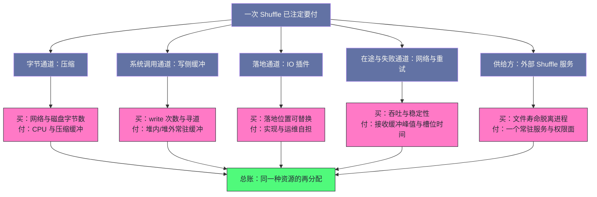
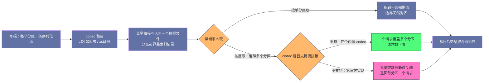
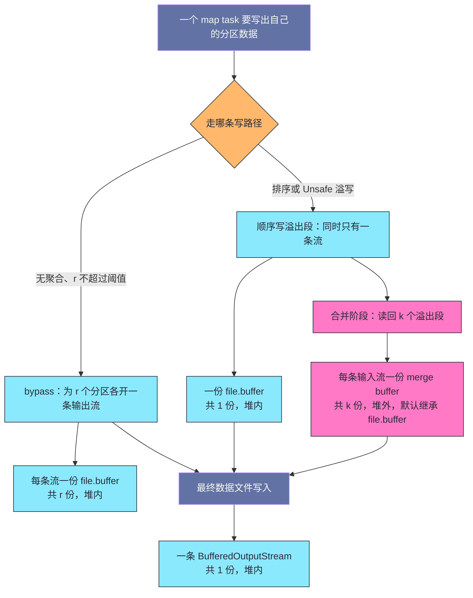
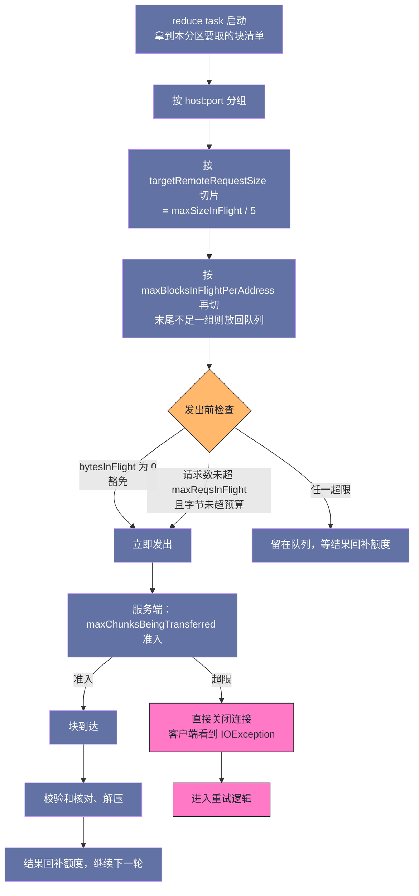
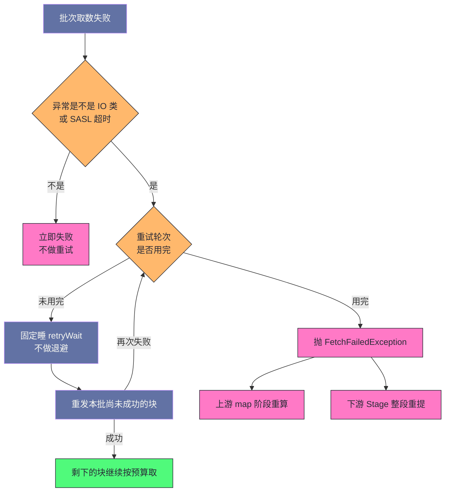
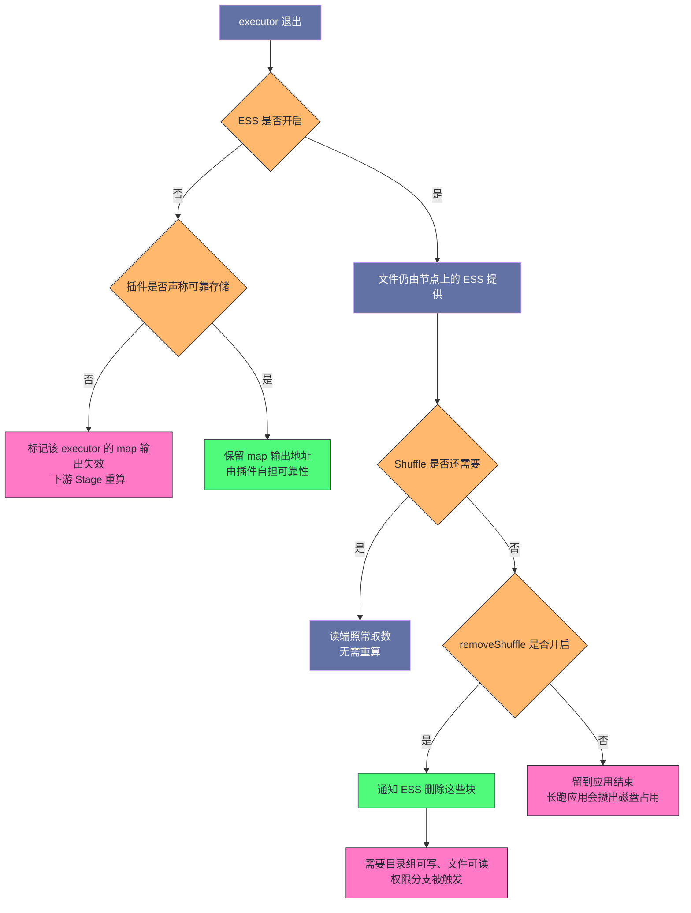

# 6. Spark Shuffle 性能调优：压缩、缓冲与传输面的参数账本

**摘要：**

Shuffle 的调优清单在中文技术圈流传了十年，其中相当一部分条目在 Spark 4.x 上已经改名、改了默认值，或者根本不再被任何一行代码读取。这篇文章把范围收窄到参数面与传输面：压缩与编解码器、写侧三组文件缓冲、Shuffle IO 插件、读侧的在途字节与在途请求、失败重试、外部 Shuffle 服务。文章坚持一条方法论：任何一个参数的开销，都要乘以它被复制的份数——每个 task 一份、每个分区一份、每个溢出段一份、每次请求再乘上重试轮数；脱离这个乘数去谈"调大一点总没坏处"，是绝大多数负优化的起点。

文中给出十余个旋钮在 4.3.0 下的默认值、源码里的读取位置，以及每张参数表都保留的"调大的代价"一列；也立了一张反例清单，把"调了等于没调"（`tungsten-sort` 与 `sort` 解析到同一个实现类、早已移除的 `memoryFraction`、被秒级换算截断的 `retryWait`）与"调了会更慢"（高并发下调大写缓冲、把在途字节当成带宽配额、给过载的 shuffle 服务加长重试）分开陈述。全文回答两个问题：这几个旋钮各自在买什么，以及什么时候最划算的动作是什么都不调。

本文的版本口径为 Spark 4.3.0（2026-10-30 发布，4.x 预编译 Scala 2.13）；凡涉及默认值与改名，以官方 Configuration 文档与对应版本源码为准，存疑处标注「以对应版本文档为准」。

**关键词（Keywords）**: Shuffle 压缩, **LZ4**, **Zstd**, **file.buffer**, **maxSizeInFlight**, **maxRetries**, External Shuffle Service, ShuffleDataIO, checksum

---

## 第 1 章 参数面：四层结构与三个乘数

### 1.1 一条 32KB 的默认值活了十一年

`spark.shuffle.file.buffer` 的默认值 32k 写进 Spark 1.4.0 之后，一直原封不动留到了 4.3.0；而它的孪生参数 `spark.shuffle.unsafe.file.output.buffer` 在 4.0 被改名为 `spark.shuffle.localDisk.file.output.buffer`，`spark.maxRemoteBlockSizeFetchToMem` 也在 3.0 搬进了 `spark.network` 命名空间（旧名作为别名保留，仍能生效）。默认值如此顽固，命名却反复搬迁，这两件事其实指向同一个事实：Shuffle 参数面里真正决定开销的机制十年没有大变，描述这些机制的词汇却一直在被校准。于是网上流传的调优清单，有相当一部分在 4.x 上已经指错了对象——不是建议错了，而是那个名字背后已经没有代码在听。

把范围界定清楚是第一步。笔者这里说的"Shuffle 调优"，不包括分区数该定多少、map 端聚合该不该开、广播连接能不能替代 join 这类结构性问题；那些动作改的是这次重排要不要发生、发生多大，而本文只讨论一件事：既然这次重排已经注定要付，那么它的字节、系统调用、落地位置与失败重传这四条通道上，分别有哪些旋钮，拧到头会发生什么。

### 1.2 四条通道与一个供给方

一次 Shuffle 的物理动作可以拆成四条彼此独立的通道，每条通道上都有自己的参数族。

第一条是字节通道，旋钮是压缩：`spark.shuffle.compress` 决定写出的分区块要不要过一遍编解码器，`spark.io.compression.codec` 决定用哪一个编解码器。它买的是网络与磁盘的字节数，付的是 CPU 与一块用于压缩的临时内存。

第二条是系统调用通道，旋钮是写侧缓冲：`spark.shuffle.file.buffer`、`spark.shuffle.localDisk.file.output.buffer`、`spark.shuffle.file.merge.buffer` 三个参数分别对应溢出文件的写、最终合并文件的写、合并阶段的读。它买的是"少几次 `write` 与少几次寻道"，付的是堆内或堆外的一块常驻缓冲。

第三条是落地通道，旋钮是 IO 插件：`spark.shuffle.sort.io.plugin.class` 决定这些字节最终交给谁来落、落到哪里、怎么提交。它买的不是速度，而是"落地位置可替换"，付的是一次实现与运维上的自担责任。

第四条是在途与失败通道，旋钮是网络参数与重试：`spark.reducer.maxSizeInFlight`、`spark.reducer.maxReqsInFlight`、`spark.reducer.maxBlocksInFlightPerAddress` 决定同一时刻有多少字节与多少个请求在路上，`spark.shuffle.io.maxRetries` 与 `spark.shuffle.io.retryWait` 决定失败之后愿意等多久。它买的是吞吐与稳定性，付的是接收缓冲的内存峰值与槽位时间。

四条通道之外还站着一个供给方：外部 Shuffle 服务（External Shuffle Service，ESS）。它不改变字节怎么走，改变的是"这些字节在写它的进程死掉之后还归谁管"。把它放进参数面讨论，是因为它与动态分配、与文件的删除时机绑在一起，牵动的是一整条运维链，而不是一个数字。

下面这张图把这四层与它们的代价方向并排放好，后面每一章都对应其中一支。



图里五条分支最后汇到同一个节点，这个汇合点就是本文的核心主张：**这些旋钮之间不存在"都调大就更优"的合力，它们只是在同一种资源池里换位置**，把 CPU 换成字节、把内存换成系统调用、把槽位时间换成确定性。

把四层与一个供给方摊成一张表，作为后文逐章展开的索引：

| 层面 | 它回答的问题 | 代表参数 | 计费单位 | 误调后的典型表现 |
|---|---|---|---|---|
| 字节通道 | 要搬的字节能不能少一点 | `spark.shuffle.compress`、`spark.io.compression.codec`、`spark.io.compression.zstd.level` | 每分区一条压缩流 | 写端 CPU 打满而字节没降多少，或读端解压成为热点 |
| 系统调用通道 | 落盘能不能少几次小写 | `spark.shuffle.file.buffer`、`spark.shuffle.localDisk.file.output.buffer`、`spark.shuffle.file.merge.buffer` | 每条输出流或每条输入流 | 缓冲按份数放大，堆或直接内存被吃掉 |
| 落地通道 | 字节最终交给谁、落在哪 | `spark.shuffle.sort.io.plugin.class` | 每个 map 输出 | 写出去却读不回，或换来的只是运维便利 |
| 在途与失败通道 | 同一时刻路上有多少字节与请求 | `spark.reducer.maxSizeInFlight`、`maxReqsInFlight`、`maxBlocksInFlightPerAddress`、`spark.shuffle.io.maxRetries` | 每 reduce 任务、每次请求、每轮重试 | 吞吐没涨，内存峰值与尾延迟先涨 |
| 供给方 | 文件在写它的进程死后归谁管 | `spark.shuffle.service.enabled`、`spark.shuffle.service.removeShuffle` | 每个节点上的常驻服务 | 稳定性没换来，先换来权限与端口问题 |

### 1.3 三个乘数：为什么单点收益会骗人

参数之所以容易被调坏，是因为它们的开销从不在"一个 task"这个尺度上体现，而在三个乘数上放大。

第一个乘数是并发度。任何一个"每个 task 一份"的缓冲，实际占用都要乘以同时运行的 task 数，再乘以每台机器上的 executor 数。32KB 乘以 8 个核是 256KB，看起来微不足道；可如果这个缓冲其实"每个分区一份"，而分区数是 2000，那就是每个 task 64MB，乘以 8 个核是半 GB。参数文档写的是"each shuffle file output stream"，读者脑子里想的却是"each task"，这一字之差就是十倍到百倍的差距。

第二个乘数是分段数。Shuffle 写侧的输出不是一个文件，而是"每分区一段"再拼成一个文件；一次溢出又是一个段。凡是挂在"每段"上的东西——索引条目、文件句柄、缓冲、校验和——它的总量都随分段数线性增长，而分段数由分区数与溢出次数共同决定，两者都不在任何单个参数的描述里。

第三个乘数是重试轮数。网络侧的开销不是一次请求的字节，而是"请求字节 × 同时在途的请求数 × 失败重发的轮数"。一个 9.6MB 的请求重发三次，代价不是"多等 15 秒"，而是"这条链路上多走了近 30MB，且占着接收缓冲的位置"。

### 1.4 一个贯穿全文的作业

后面的算术需要一个具体的着力点。笔者设一个电商日结作业 `gmv_daily`：从数仓读入当天的订单明细与商品维表，各按 200 个分区读入，按商品标识连接，再按品类汇总成交额，最后写回。两次 Shuffle，map 端任务数 m 与 reduce 端分区数 r 都是 200，也就是每次 Shuffle 有 200 个 map 输出、每个输出被切成 200 段。

这个作业不大，正合适：200×200 的网格让"每段一份"的乘数算得清楚，200 个并发 task 让"每 task 一份"的乘数不至于离谱，而两次 Shuffle 又足以让读者看出"同一套参数在连接与聚合上的效果并不一样"。

### 1.5 一个比喻与它的限定

调参这件事，像给一栋楼换窗户。单扇窗的隔热收益可以精确计算，可整栋楼的体感取决于朝向、楼层、穿堂风，以及你换的是不是那间真正漏风的屋子；参数的单点收益也一样，只有放回"份数 × 并发 × 重试"的语境里才有意义。

比喻的限定在于：窗户换错了最多不舒服，参数调错了会把作业从"慢"变成"跑不完"。上一段那个 2000 分区、8 核、每 task 64MB 的假设不是危言，而是把"each stream"读成"each task"之后必然算出来的数字。

---

## 第 2 章 压缩：拿 CPU 换字节的汇率

### 2.1 压缩发生在哪一段字节上

`spark.shuffle.compress` 默认 true，它做的事情比字面意思窄得多：它不让 Spark 去压缩"整个 Shuffle 文件"，而是让写端在把每个分区的记录序列化出去时，套一层压缩流。判断逻辑落在 `SerializerManager` 里：块标识是 `ShuffleBlockId`、`ShuffleBlockBatchId`、`TempShuffleBlockId` 之一时读 `spark.shuffle.compress`，是 `TempLocalBlockId` 时读的是另一个开关 `spark.shuffle.spill.compress`。这就意味着，一个 200 分区的 map 输出文件里躺着 200 条彼此独立的压缩流，每条流有自己的头部、结束标记与块结构。

这个"每分区一条流"的事实，后面会反复用到。它决定了三件事：压缩率与分区大小强相关（流越短，头部开销占比越高）、解压必须按流进行（读端拿到一段才能解一段）、以及编解码器的选择会与分区数耦合。

顺带把范围也说清楚：`spark.io.compression.codec` 是全局的，同一个值同时作用于 RDD 缓存、广播变量、事件日志与 Shuffle 输出。想只给 Shuffle 换编解码器是做不到的，能单独控制的只有"开"与"关"。唯一的例外是 `spark.shuffle.mapStatus.compression.codec`（默认 zstd，内部参数），它压缩的是 `MapStatus` 这种元数据，不是数据本身。

### 2.2 不压缩会怎样

把 `spark.shuffle.compress` 关掉，最直接的后果是写端落盘字节与读端搬迁字节都回到原始序列化大小。若这份数据是文本型订单宽表，重复的品类名、状态字符串、时间戳前缀都会被压缩器吃掉，比例相当可观；若它已经是二进制编码或加密字段，能压掉的只是零头。对前者，压缩是实打实的减法；对后者，压缩是在做无效功。

但反过来问一句：省下的那些字节，原本是不是瓶颈？在万兆网与本地盘的现代集群上，Shuffle 阶段真正卡住的地方常常是写端的排序比较、读端的反序列化与 GC，而不是网卡带宽。这也是为什么"关压缩省 CPU"在某些 CPU 密集作业上确实有效——它的前提是网络与磁盘都还有富余，而这个前提需要看监控，不能靠猜。

### 2.3 四个编解码器：结构决定取舍

4.3.0 提供四个内置编解码器：lz4（默认）、lzf、snappy、zstd，也可以用全限定类名接第三方实现。它们的差别不只是"快慢"，更在流的组织方式。

LZ4 走的是块式结构：`LZ4BlockOutputStream` 把输入切成固定大小的块（`spark.io.compression.lz4.blockSize`，默认 32k），每块单独压缩，每块自带一个 32 位校验值。块式的好处是解压不必等整条流结束，坏处是压缩窗口只有一块那么大，超出 32KB 的重复模式一概看不见；而 Spark 用的是 `fastCompressor()`，也就是快速档，没有"高压缩比档"可以拨。换句话说，**在 LZ4 上追求更高压缩率是做不到的，能调的只有块大小，而块大小同时是内存旋钮**。

Snappy 的结构与 LZ4 同族，也是块式（`spark.io.compression.snappy.blockSize` 默认 32k），实现依赖本地库，加载失败会在初始化时直接抛错而不是静默降级。它与 LZ4 的比率差异更多取决于数据本身的重复模式，而不是哪一个"更强"。

LZF 也按块走，比率通常比前两者高，压缩端更慢；4.0 起它默认开启并行压缩（`spark.io.compression.lzf.parallel.enabled` 为 true），用 `PLZFOutputStream` 多线程压，代价是线程与内存。

Zstd 是唯一走帧格式的：它有滑动窗口，能看到跨越块边界的重复，所以对"同一批商品编码反复出现""同一段 URL 前缀反复出现"这类长距离重复特别有效。它的档位也最全：默认级别 1（源码注释写得很直白——1 是"最快且比率尚可"的档），`spark.io.compression.zstd.level` 可以往上调；4.0 加了 `spark.io.compression.zstd.workers`（并行压缩线程数，默认 0 即单线程），4.1 加了 `spark.io.compression.zstd.strategy`（压缩策略），另有 `zstd.bufferSize`（默认 32k）与 `zstd.bufferPool.enabled`（默认 true，复用缓冲池）。

把四者的取舍收进一张表，最后一列专记"把强度拨高"要付的那笔账：

| 编解码器 | 流结构 | 可调档位 | 比率倾向 | 压缩侧 CPU | 调"更强"的代价 |
|---|---|---|---|---|---|
| lz4（默认） | 32k 固定块，每块自带校验 | 仅块大小 | 中等，块内可见 | 很低 | 块调大只提升内存与少量比率，算法强度不可调 |
| snappy | 32k 固定块 | 仅块大小 | 中等，与 lz4 同档 | 很低 | 同上，且依赖本地库，缺库直接失败 |
| lzf | 块式，4.0 起默认可并行 | 仅块大小与并行开关 | 较高 | 中等偏高 | 并行压缩吃线程与内存，写端延迟波动变大 |
| zstd | 帧格式，有滑动窗口 | 级别、并行线程、策略、缓冲 | 高，长距离重复有效 | 级别 1 时中等 | 每级递增都在加 CPU 与压缩内存，写端吞吐下降 |

### 2.4 一条容易被忽略的契约：压缩流要能被拼接

压缩发生在"每分区一条流"这个粒度上，于是 map 输出文件在物理上是"一条流接一条流"拼起来的。读端若按单分区取，取到的正好是一条完整流，边界天然对齐；可 Spark 还有一种批量取数模式（`ShuffleBlockBatchId`），一次请求要覆盖同一次 Shuffle 里连续的好几个分区，取回来的字节就是好几条压缩流的首尾相接。能不能把它们当成一条流读下去，取决于编解码器是否支持"序列化流拼接"。

`BlockStoreShuffleReader` 里有一段判定：批量取数要同时满足"序列化器支持对象重定位""压缩关闭或编解码器支持流拼接""未启用旧取数协议""未开启 IO 加密"四个条件。四个里任何一个不成立，批量取数会被静默关闭，日志里只有一行 debug。四个内置编解码器（lz4、lzf、snappy、zstd）都在支持名单里，所以默认配置下这条契约不会浮出水面；但一旦换成第三方 codec，它就成为一条隐藏契约——压缩率更好、速度也不差的实现，如果它的流不能首尾相接，取数会退回"每分区一个请求"，请求数按 m×r 升上去，作业变慢而配置看起来毫无问题。

下面这张图把压缩在写读两端的走向画出来，重点在右侧那个分叉。



图里那条红色的支路说明了一件事：**压缩参数的代价不只在 CPU 与字节上，它还会牵连取数方式**。换 codec 之前先确认三件事——它是否支持流拼接、是否在批量取数允许的名单里、以及在关闭压缩时作业会不会更慢；这三件事都不在 codec 的性能对比图表上。

### 2.5 zstd 的级别：一个容易被高估的旋钮

`spark.io.compression.zstd.level` 默认 1，往上调能换到更好的比率，代价写在文档里：更多的 CPU 与内存。这句话需要拆开看。

Shuffle 写端的热点是排序比较与序列化，压缩只是排在它们之后的第三道工序。把级别从 1 往上拨几档，压缩时间会成倍增长，而它只占写端总时间的一部分，所以整体收益是"字节数减少"与"写端时间增加"的乘积效应：网络与磁盘越紧张，这笔交易越划算；写端 CPU 越紧，这笔交易越亏。真正该被调高的场景其实很窄——数据从远端对象存储跨区读取、或者 Shuffle 要过一条带宽受限的专线，此时字节就是钱，CPU 反而便宜。

`spark.io.compression.zstd.workers` 是另一个方向的旋钮：大于 0 时开启异步多线程压缩，压缩更快但内存随线程数上涨。它在写端核数富余、单条流又足够大时有用；在 200 个分区、每分区只有几 MB 的场景里，线程调度与缓冲的开销会把收益吃掉。

### 2.6 压缩率其实取决于分区数

有一个不写在参数文档里的耦合：压缩率与分区大小相关。200 个分区、每个分区 50MB 时，头部开销完全可以忽略；可当分区数被调到 2000、每个分区只剩 5MB，甚至 5000 个分区、每分区 2MB 时，一条流里的头部、块表与结束标记就开始占百分点级的比例，而 LZ4 的每块 8 字节（压缩长度加校验值）在块数多时也会累积。

这条耦合解释了一个常见困惑：同一条 SQL、同样的数据，只把 `spark.sql.shuffle.partitions` 调大，Shuffle Write 的字节数反而略涨。涨的那部分不是数据，是流的骨架。

### 2.7 反例：什么时候压缩是真的在帮倒忙

有三种情形下，开着压缩比关掉更慢。其一，记录本身已经不可压缩：Parquet 里取出来的二进制列、加密过的字段、已经 gzip 过一遍的文本，压缩器在这些字节上做的全是无效功。其二，CPU 已经饱和：UDF 里在做正则匹配或 JSON 解析的作业，写端与读端都在抢核，压缩只是往火上添柴。其三，分区极小且数量极多：每分区几百 KB 时，流的头部与压缩器的初始化成本占比高到荒谬，此时关压缩或调小编解码器缓冲区反而更快。

不过这三条都有同一个前提——网络与磁盘确实有余量。把前提抽掉，压缩几乎总是赚的，这也是它默认开启的原因。

---

## 第 3 章 写侧缓冲：三个参数，三种份数

### 3.1 三个名字背后的三条路径

4.x 里与写侧缓冲相关的参数有三个，名字很像，位置完全不同。

`spark.shuffle.file.buffer`（1.4.0 引入，默认 32k）是"每条 shuffle 文件输出流"的内存缓冲，作用是减少写中间文件时的寻道与系统调用。它在四处被读取：`BypassMergeSortShuffleWriter`（bypass 路径）、`ShuffleExternalSorter`（Unsafe 溢写）、`ExternalSorter` 与 `ExternalAppendOnlyMap`（RDD 侧排序与聚合的溢写）。

`spark.shuffle.localDisk.file.output.buffer`（4.0.0 引入，默认 32k）是 4.x 的新名字，管的是最终的 shuffle 数据文件——`LocalDiskShuffleMapOutputWriter` 在写这个文件时套一层 `BufferedOutputStream`，缓冲大小就取这个值。它的旧名 `spark.shuffle.unsafe.file.output.buffer`（2.3.0 引入）自 4.0 起标注废弃，新参数通过回退配置继承旧值。

`spark.shuffle.file.merge.buffer`（4.0.0 引入，默认 32k，**堆外**）管的是合并阶段的输入流：`UnsafeShuffleWriter` 在把多个溢出文件合成一个输出文件时，只要压缩或加密是打开的（压缩默认打开），就会走流式合并那条路，为每条输入流准备一块缓冲，而这里的缓冲是堆外内存。官方文档特意加了一句"过大的缓冲应当避免"，原因就在份数上。

### 3.2 份数才是关键

三个参数最容易被忽略的差别，是"同时存在几份"。

bypass 路径会给每个 reduce 分区各开一条输出流，所以 `spark.shuffle.file.buffer` 在这个路径下的份数是 r，即分区数。r=200 时，一个 task 光是缓冲就占 200×32KB≈6.4MB 堆内内存；r=2000 时是 64MB；若一台机器上同时跑 8 个这样的 task，就是半 GB 的堆内存被缓冲吃掉——而这个数字在任何一份参数文档里都不会出现。这也解释了为什么高分区数配合 bypass 时，把 `file.buffer` 调大是一笔极差的交易：它没有让写入更快，只是让 GC 更忙。

排序与溢写路径的份数小得多。`ExternalSorter` 与 `ShuffleExternalSorter` 是"写一段、关一段"的顺序写，同一时刻只有一条流，所以份数是 1。同样 32KB，在这条路径上乘以并发度 8 也只有 256KB，调大到 128KB 也不过 1MB——这就是"调大 `file.buffer`"在某些作业里有效、在另一些作业里有害的全部原因：**份数不一样，同一个数字的含义就不一样**。

`spark.shuffle.localDisk.file.output.buffer` 的份数固定为 1，即每个 map task 的最终输出文件一份。它的作用很单纯：把 200 个分区依次写进同一个文件时，减少小 `write` 的次数。因为份数是 1，把它从 32KB 调到 1MB，一台 8 核机器的代价也只有 8MB，几乎可以忽略；但收益同样有限，因为写端的写放大来自溢出次数，不来自系统调用次数。把它当成"写放大的解药"是错位的。

`spark.shuffle.file.merge.buffer` 的份数是溢出段数 k。一次溢写产生一个段，k 由数据量与执行内存的比值决定，在大 Shuffle 里几十上百并不稀奇。它又是堆外内存，于是超限时的表现不是堆 OOM，而是直接内存耗尽或 Netty 分配失败——一种与堆监控完全脱节的事故形态。更隐蔽的一层是回退：这个参数的默认值继承自 `spark.shuffle.file.buffer`，所以**调大 `file.buffer` 会连带把合并缓冲一起拉大**，而后者是 k 份、堆外。一个看似温和的调整，就这样在另一条路径上放大了几十倍。

把三个参数的份数、归属与代价并排：

| 参数 | 谁在读它 | 同时几份 | 内存归属 | 调大的代价 |
|---|---|---|---|---|
| `spark.shuffle.file.buffer` | bypass 写、各类溢写 | bypass 为 r 份；排序溢写为 1 份 | 堆内 | bypass 高分区时按 r 倍增，挤压执行内存、抬高 GC |
| `spark.shuffle.localDisk.file.output.buffer` | 最终数据文件写入 | 1 份/输出文件 | 堆内 | 代价极小，收益也有限，只减少小 write 次数 |
| `spark.shuffle.file.merge.buffer` | 合并阶段的输入流 | k 份（k＝溢出段数） | 堆外 | 按 k 倍增直接内存，超限表现为直接内存 OOM；且默认继承 `file.buffer` |

把四条路径的份数摆在一起，能看出它们的差别其实不在参数名，而在"同时有几条流活着"。



图里蓝色节点占的是堆内、粉色节点占的是堆外，这个区分在事故现场很关键：堆内超限表现为 GC 时间飙升或堆 OOM，堆外超限表现为直接内存报错，后者不会出现在堆监控面板上，往往要等到 Netty 分配失败才被注意到。

### 3.3 一个比喻

写侧缓冲像仓库月台的装卸缓冲区。给一个月台配一块更大的缓冲区，只有在"货车来得又碎又密"的时候才划算；如果货物本来就是一车一车整批到，缓冲区再大也只是多占一块地。更麻烦的是，有的仓库是"每个出货口各配一块"，出货口一多，地就不够了——bypass 路径正是这种布局。

比喻的限定在于，月台的地是看得见的，缓冲的地是看不见的：它藏在堆里或堆外，直到 GC 时间或直接内存报错才暴露。

### 3.4 怎么落地

落地的方式不是"把三个都调大"，而是先确定作业走的是哪条写路径：有 map 端聚合、分区数不超过阈值，会落到排序路径或 Unsafe 路径，此时 `file.buffer` 只有 1 份，可以放心调到 64KB 甚至 128KB；没有聚合、分区数又在 200 上下，会走 bypass，此时 `file.buffer` 的份数是分区数，宁可保持默认甚至调小。

至于 `localDisk.file.output.buffer`，它是一个"顺手调一点无妨"的旋钮，因为份数固定为 1；而 `file.merge.buffer` 是一个"除非确认直接内存有余量否则不要碰"的旋钮，因为它乘的是溢出段数。三个参数的正确用法不是一起动，而是按份数决定谁可以动。

---

## 第 4 章 IO 插件：可替换的是落地，不是传输

### 4.1 一个只覆盖写侧的接口

`spark.shuffle.sort.io.plugin.class` 自 3.0.0 起存在，默认实现是 `LocalDiskShuffleDataIO`，对应接口 `ShuffleDataIO` 标注为 `@Private`，且只在基于排序的 shuffle 算法内生效；要换整个算法，得去实现 `ShuffleManager`。

这个接口的形状值得细看。它由两部分组成：`executor()` 返回 `ShuffleExecutorComponents`，只提供一个 `createMapOutputWriter`（外加一个可选的单文件优化），用来创建"把一个 map 任务的全部分区字节写出去"的写入器；`driver()` 返回 `ShuffleDriverComponents`，提供应用级初始化与清理、shuffle 注册与删除，以及一个很有意思的方法 `supportsReliableStorage()`。

也就是说，这个插件点覆盖的是写侧的落地与提交，以及 Driver 侧的元数据生命周期。读侧没有对应的插件接口：读仍然走 `BlockStoreShuffleReader`，从 `BlockManager` 取块，远端由 executor 自己的 Netty 服务或外部 Shuffle 服务供给。这条不对称，是理解插件边界的关键。

### 4.2 三条由此推出的边界

第一条边界：插件能改"字节落到哪里、怎么提交"，不能改"字节怎么被取回"。一个把数据写到对象存储的实现，如果不同时提供读回的途径（通常是一个自定义的 ShuffleManager，或一个能从对象存储取数的远端服务），作业会在下游 Stage 直接找不到数据。这也解释了为什么真正落地的远端 Shuffle 方案，几乎都不是"只换一个插件类"，而是"插件加服务"成套出现。

第二条边界：`supportsReliableStorage()` 会改动失败判定。`DAGScheduler` 在 executor 丢失时判断"map 输出是否随之失效"，条件是"插件不声称可靠存储，且要么整个 worker 丢了、要么外部 Shuffle 服务没开"。一个返回 true 的插件，等于告诉调度器"即使 executor 死了，那些字节也还在"；好处是不必重算上游，责任是**如果字节真的丢了，没有任何人会替你重算**。

第三条边界：插件不做压缩、不做缓冲。压缩在 `SerializerManager` 里，缓冲在具体 writer 内部，两者与插件正交。想靠换插件来提升吞吐，等于在错误的层上找收益。

### 4.3 一个 4.x 的实际用例

4.x 里的 `KubernetesLocalDiskShuffleDataIO` 说明了插件点真正擅长什么。在 Kubernetes 上，executor 以 Pod 为单位生灭，本地盘目录的清理时机与 Pod 生命周期绑定，默认的本地盘实现未必能在正确的时刻释放空间。这个插件改的不是"更快"，而是"清理时机与运行环境对齐"。

它顺带说明另一件事：插件点的价值多在"适配环境"，而不在"压榨性能"。把 `spark.shuffle.sort.io.plugin.class` 当成性能开关，是这一章最需要破除的误解。

| 能力 | 由谁提供 | 插件能否改变 |
|---|---|---|
| 每个分区字节写到哪里、如何提交 | `ShuffleExecutorComponents` | 能 |
| 压缩与否、用哪个编解码器 | `SerializerManager` 与 `spark.shuffle.compress` | 不能，二者正交 |
| 写侧缓冲大小 | 各 writer 内部读取的 buffer 参数 | 不能，插件实现可自行决定但不经这些参数 |
| 读侧如何取块 | `BlockStoreShuffleReader` 与 `BlockManager` | 不能，需另配 ShuffleManager 或远端服务 |
| executor 死亡后 map 输出是否失效 | `ShuffleDriverComponents.supportsReliableStorage` | 能，且要自担数据可靠性 |

---

## 第 5 章 网络三件套：在途字节、在途请求、单地址块并发

### 5.1 取数是编排出来的，不是发出去就完

读端的取数由一个迭代器编排：`ShuffleBlockFetcherIterator` 先把"要取的块"按目标地址分组，再按三道门槛把组切成请求、逐个发出，每收到一个结果就回补一次额度。三道门槛就是常说的三件套，它们的默认值都在 4.3.0 的文档里：`spark.reducer.maxSizeInFlight` 为 48m，`spark.reducer.maxReqsInFlight` 为 `Int.MaxValue`，`spark.reducer.maxBlocksInFlightPerAddress` 也为 `Int.MaxValue`。

第一道是字节预算。`maxSizeInFlight` 是"每个 reduce 任务同时在路上拉取的 map 输出总字节"，源码里还有一个派生量：单个请求的目标大小取 `maxSizeInFlight / 5`，注释解释了为什么是五分之一——留出让最多五个节点并行拉取的余地，而不是把额度一次性押在一台机器上。

```scala
// ShuffleBlockFetcherIterator：请求切片的目标大小
// 之所以除以 5，是为了让额度能同时铺到多个上游节点，而不是被单个地址吃掉
private val targetRemoteRequestSize = math.max(maxBytesInFlight / 5, 1L)
```

第二道是在途请求数。`maxReqsInFlight` 限制的是"同时有多少个请求没回来"，与字节无关。默认不限制，所以真正生效的通常是第一道。

第三道是单地址块并发。`maxBlocksInFlightPerAddress` 参与两件事：它既限制"同一个 host:port 上同时在途的块数"，又参与"把单地址的块序列切成多个请求"——分组时末尾不足一组的块会被放回队列等下一轮，避免产生一个很小的碎请求。

### 5.2 字节预算是软的

`maxSizeInFlight` 的判定里有一个豁免分支：当在途字节为 0 时，即使一个请求超过预算也允许发出。这条豁免的存在有现实理由——单个块比预算还大时，不允许发就会死锁；但它也意味着**预算不是硬上限**。文档里那句话说得更直白：每个输出都要创建一块接收缓冲，所以这个参数代表"每个 reduce task 的固定内存开销"。

于是一个常见的调优动作就露出了它的真面目：把 48m 调到 200m，在途字节变多，接收缓冲随之变多，网络往返变少。这笔交易在内存宽裕时划算，在内存紧张时会把执行内存挤出去，让聚合与排序更早溢出——网络账省下来的，从磁盘账上还回去了。

再看第三个参数的方向。`maxBlocksInFlightPerAddress` 默认不限制，官方文档建议在外部 Shuffle 服务被打穿时把它调小。这个建议是对的，但调小它的副作用常被忽略：它同时把"单地址的请求"切得更碎，往返次数上升，单地址上的并发下降。所以在"取数慢"的现场把它调小，往往是在给一个本来就不快的链路再加几道关卡。

| 参数 | 4.3.0 默认值 | 管什么 | 调大的代价 | 调小会怎样 |
|---|---|---|---|---|
| `spark.reducer.maxSizeInFlight` | 48m | 每 reduce 任务在途字节总量，并派生请求切片目标（÷5） | 接收缓冲按 task 数倍增，挤压执行内存，抬高溢出与 GC | 请求变多、往返增加，小块场景吞吐下降 |
| `spark.reducer.maxReqsInFlight` | `Int.MaxValue` | 同时在途的请求个数 | 单节点瞬时连接数与服务端线程压力上升，可能打穿 ESS | 取数退化为串行，长尾拉长 |
| `spark.reducer.maxBlocksInFlightPerAddress` | `Int.MaxValue` | 单 host:port 在途块数，并决定请求如何切分 | 单个对端被大量块请求压垮，可能 OOM 或拒绝服务 | 请求被切碎、往返增加，单地址并发下降 |
| `spark.network.maxRemoteBlockSizeFetchToMem` | 200m | 超过阈值的块落盘而非进内存 | 不是"调大更好"的参数：调大意味着更大的块进内存，堆峰值上升 | 更多块落盘，磁盘 I/O 上升但内存平稳 |
| `spark.shuffle.maxChunksBeingTransferred` | `Long.MAX_VALUE` | 服务端同时传输的块数硬闸门 | 服务端承载更多并发，内存与带宽被拉满 | 达到上限时新连接被直接关闭，客户端转入重试 |

### 5.3 三件套的相互关系

三者不是并列的三道闸，而是三个不同维度的约束：字节维度管"路上有多少数据"，请求维度管"路上有多少个包裹"，地址维度管"同一个收件人同时收几个包裹"。实际并发取三者同时满足的那一个，所以只调其中一个而另外两个仍是默认时，往往看不到任何变化——字节放开后请求数不受限，真正限制吞吐的可能是单地址的块并发，也可能是服务端的硬闸门。

真正的内存峰值出现在三者同时放宽的时候：字节预算给了 200m、请求数不限、单地址块数不限，于是每 task 可能同时持有几块大缓冲，叠加在统一内存管理的池子上，表现为"网络变快了，但作业变慢了"。

这一段值得配一张编排图，因为它解释了为什么"调一个参数"经常无效。



图里有两个值得记住的位置：一是"字节为 0 豁免"这条支路，它说明预算是软的；二是从服务端准入失败直接跳到重试的那条边，它说明**重试次数有时是被服务端逼出来的**，而不是客户端自己的选择。

### 5.4 被忽略的两档：同宿主读与元数据传输

把取数笼统说成"过网络"，会漏掉两档更便宜的路径。`spark.shuffle.readHostLocalDisk` 默认 true，含义是：如果某个块所在的 executor 与本任务在同一台机器上，就直接从磁盘读它的目录，不走网络；加上"完全本地"那一档，读路径其实有三档——本地、同宿主、远端。网络三件套管的是第三档，前两档根本不看它们。

这条区分在诊断时很有用。一个作业若把大部分块都落在同宿主或本地，网络参数怎么调都不会有变化；反过来，若同宿主读因为 executor 分布而大量退化为远端读，看到的现象是"网络参数忽然变得很敏感"。ESS 场景下这种退化尤其常见：executor 被频繁回收重组，同宿主的巧合变少，远端读的比例自然上升。

元数据同样在传输面上。`MapStatus` 承载的是"每个 map 输出有多大、每段多长"，它的压缩由 `spark.shuffle.mapStatus.compression.codec`（默认 zstd）决定；地址表小的时候随任务下发，超过 `spark.shuffle.mapOutput.minSizeForBroadcast`（默认 512k）就改用广播分发；Driver 侧响应地址查询的线程数由 `spark.shuffle.mapOutput.dispatcher.numThreads`（默认 8）控制。这些数字看起来与传输无关，可 m×r 到百万级时，地址表本身就是一份要反复分发、反复序列化的数据。

`spark.shuffle.accurateBlockThreshold`（默认 100MB）则是取数编排的准确性来源：超过这个阈值的块，尺寸会被精确记录而不是按分区均值估计。尺寸被低估的后果很直接——请求切片按错误的字节数编排，一个"以为只有 200KB"的请求实际拉回 2GB，接收缓冲瞬间被撑爆。

### 5.5 Netty OOM 时，在途预算会反过来变成停顿

`ShuffleBlockFetcherIterator` 里有一段不为多数人注意的逻辑：一旦 Netty 判定内存不足，`fetchUpToMaxBytes` 在有在途请求时会直接返回，不再发出任何新请求，直到在途字节归零才恢复发送。`spark.shuffle.maxAttemptsOnNettyOOM`（内部参数，默认 10）限制的是同一个块因 Netty OOM 被重试的次数，超过就抛取数失败。

把两段逻辑放在一起看，会得到一个反直觉的结论：**在途预算调得越大，Netty OOM 之后的停顿越长**。因为"等在途归零"这件事，在预算 48m 时要等的量，在预算 200m 时要等四倍。真正的缓解方向不在放宽预算，而在让大块不进内存——`spark.network.maxRemoteBlockSizeFetchToMem`（默认 200m）决定超过阈值的块落盘而非进内存；落盘路径上数据边收边写，不在内存里留驻，于是接收缓冲的峰值由单块在途数据决定，而不是由整批请求的字节数决定。由此可得，治 Netty OOM 的旋钮在"单块去哪"，不在"总量给多少"。

### 5.6 落地：先量再说

面对"Shuffle Read 慢"，先把三个数字量出来：单任务的在途字节是否长期贴着 48m、请求数是否远小于并发地址数、单地址的块数是否远大于 1。如果字节长期贴顶而请求数寥寥，说明限制在字节维度，此时加预算有意义；如果请求数已经很多而单请求很小，说明切片目标太小或块太小，加预算同样无用。

另一种情形是块数量极多而每块极小：200 个 map 任务、2000 个分区，每个块可能只有几十 KB。此时限制吞吐的不是字节预算，而是请求编排的固定成本，能动的只有"减少块数"（降分区）或"合并请求"（放宽单地址块数），而后者要配合服务端的承载能力一起改。还有一条常被漏掉的量：同一宿主读与远端读的比例，它决定了网络三件套对这次作业到底有没有发言权。

---

## 第 6 章 重试：固定间隔、整批语义与它的天花板

### 6.1 源码里的三行事实

`spark.shuffle.io.maxRetries` 默认 3，`spark.shuffle.io.retryWait` 默认 5s，这两个值在 4.3.0 里仍然由 `RetryingBlockTransferor` 读取，行为可以从源码里读出三条确定的事实。

第一条：**固定间隔，没有指数退避**。重试线程做的唯一一件事是睡固定的毫秒数再重发：

```java
// RetryingBlockTransferor.initiateRetry
// 每次重试都睡同一个 retryWaitTime，不做指数退避
executorService.submit(() -> {
  Uninterruptibles.sleepUninterruptibly(retryWaitTime, TimeUnit.MILLISECONDS);
  transferAllOutstanding();
});
```

第二条：**重试的粒度是"剩下没成功的整批块"**，不是单个失败的块。已经成功的块会从待取集合里移除，所以重发的是那一批里尚未成功的部分；但一个请求里若只有一块因连接抖动而失败，其余块在下一轮仍会被重新组织成请求。批量越大，重试的边际成本越高。

第三条：**只对 IO 类异常重试**。判定条件是异常本身或其 cause 是 `IOException`，外加 SASL 超时这一特例；其它异常立即向上抛。所以重试能吸收的是"抖动"，不是"消失"：文件被删、序列化不兼容、块被截断这类问题，重试多少轮都不会变好。

这三条合起来，把默认配置的总等待算清楚：3 乘以 5 秒，最多 15 秒。文档也是这么写的。

把这条链路画成一张决策图，能看清"重试"这个概念里其实藏着两个不同的动作：一个是"再试一次"，一个是"认输并升级"。



图下半部分被染成红色的几个节点是重试真正的代价所在：15 秒的等待只是序幕，一旦升级为 fetch failure，付出的是"上游重算加下游整段重提"。这也是判断"要不要调大重试"的唯一正确问法——调大它，是为了把一次可能的整段重算换成几轮等待；若现场根本没有重算风险（譬如失败只发生在作业开头、上游数据量很小），那这笔等待就是白付的。

### 6.2 一个被截断的单位

`retryWait` 在 `TransportConf` 里的换算方式是"按秒取整再乘 1000"：

```java
// TransportConf.ioRetryWaitTimeMs：键名常量展开后即 spark.shuffle.io.retryWait
// 先按秒换算（JavaUtils.timeStringAsSec），再乘 1000 得到毫秒
return (int) JavaUtils.timeStringAsSec(conf.get(SPARK_NETWORK_IO_RETRYWAIT_KEY, "5s")) * 1000;
```

这意味着任何亚秒级的设置都会被截断。写 `500ms` 得到的是 0 秒，也就是"立即重试、没有任何等待"；写 `1500ms` 得到的是 1 秒。想用"短间隔、多轮次"替代"长间隔、少轮次"的人，往往在这里得到的是完全相反的行为：一个没有间隔的重试风暴。

### 6.3 重试买的是什么

重试买的是"避免一次整段重算"。一次取数失败若发生在最后几轮，`FetchFailedException` 会触发上游 map 阶段重算加下游整段重提，代价可能是一个已经跑了四十分钟的 Stage 白跑。用 15 秒的等待换掉这种可能，在大多数长作业里都是划算的。

但重试也有它的天花板，而且天花板不在参数里，在语义里：它只能等，不能修。如果对端进程已经被杀、文件已经不存在、或者对端因为自身的 GC 而长时间不响应，重试只是把"失败"推迟到 15 秒之后。更糟的是，重试期间 task 一直占着 executor 槽位——调大重试次数，等于让每一个卡住的 task 多占若干份槽位时间，集群整体吞吐反而下降。

### 6.4 服务端也会制造重试

`spark.shuffle.maxChunksBeingTransferred` 默认是 `Long.MAX_VALUE`，也就是不限制；一旦被设为某个有限值，达到上限时新的连接会被直接关闭。客户端看到的是 IOException，于是按重试配置重试，重试耗尽后抛 fetch failure。文档把这个链条写得很清楚。

这条链路解释了一个反直觉现象：有些作业的 fetch failure 不是因为网络差，而是因为服务端在限流，而限流恰恰是被"给客户端加更多重试"这个动作喂大的——更多的客户端重试意味着更多的连接尝试，服务端更接近上限。

### 6.5 与邻居超时的关系

重试不是孤立存在的，它夹在几个超时之间。`spark.shuffle.io.connectionTimeout` 默认继承 `spark.network.timeout`（120s），管的是"已建立连接上多久没有流量就判定为空闲并关闭"；`spark.shuffle.io.connectionCreationTimeout`（3.2 起）默认继承前者，管的是建连超时；`spark.shuffle.registration.timeout`（5s）与 `spark.shuffle.registration.maxAttempts`（3）管的是 executor 向外部 Shuffle 服务注册。

| 参数 | 4.3.0 默认值 | 语义 | 调大的代价 |
|---|---|---|---|
| `spark.shuffle.io.maxRetries` | 3 | 失败后最多重发几轮，固定间隔 | 卡住的 task 占用槽位时间按轮数累加，Stage 尾延迟拉长 |
| `spark.shuffle.io.retryWait` | 5s | 每轮之间的固定等待，按秒截断 | 单次失败的总等待按乘积增长，长尾被放大 |
| `spark.shuffle.io.connectionTimeout` | 继承 120s | 通道无流量多久判定空闲 | 连接被占用的时间变长，对端资源释放变慢 |
| `spark.shuffle.io.connectionCreationTimeout` | 继承 connectionTimeout | 建连超时 | 建连失败被推迟暴露，task 卡在建连阶段 |
| `spark.shuffle.registration.timeout` | 5000 | 向外部 Shuffle 服务注册的超时 | 注册失败的暴露变晚，启动阶段变慢 |
| `spark.shuffle.registration.maxAttempts` | 3 | 注册重试次数 | 同上，且会叠加在启动风暴上 |

### 6.6 落地与反例

落地的顺序应该是：先确认失败类型，再决定是否加长重试。日志里看到 `IOException` 与 `Connection reset`，说明是对端抖动或限流；看到 `FileNotFoundException` 或反序列化异常，加再多轮次也没用。

反例有三个典型。其一是"照着旧文章把 maxRetries 调到 10、retryWait 调到 30s"，总等待变成 300 秒，每个卡住的 task 都要占五分钟槽位，作业表面上不再 fetch failure，实际吞吐掉了一半。其二是"用 retryWait=500ms 做快速重试"，被截断成 0，得到的是没有退避的重试风暴。其三是"把重试当成 GC 暂停的解药"，而对端 GC 期间不响应，重试只是把等待搬到客户端。

---

## 第 7 章 外部 Shuffle 服务：把文件的寿命从进程里拿出来

### 7.1 它改的不是传输路径

默认情况下，Shuffle 文件写在 executor 的本地盘上，由该 executor 的 BlockManager 提供读取。executor 一旦退出，那台机器上的所有块同时失效，下游只能重算。外部 Shuffle 服务（External Shuffle Service，ESS）是节点上长驻的辅助服务，代持这些文件：executor 死了，文件还在，读端仍能取到。

`spark.shuffle.service.enabled` 默认 false，开启后需要集群侧同步配置——YARN 上要在 `yarn.nodemanager.aux-services` 里加上 `spark_shuffle`，再用 `yarn.nodemanager.aux-services.spark_shuffle.class` 指向 `org.apache.spark.network.yarn.YarnShuffleService`，而服务名要与 `spark.shuffle.service.name`（默认 `spark_shuffle`）对齐。这一层配置对不上，作业不会报"参数没生效"，而是所有远端取数直接失败。

### 7.2 与动态分配的关系已经解耦

在 Spark 1.x 到 2.x 的很长时间里，动态分配必须依赖 ESS：executor 要能被安全地释放，就必须保证释放之后它的 Shuffle 文件仍可读。3.0 起 `spark.dynamicAllocation.shuffleTracking.enabled` 默认 true，情况变了：动态分配可以在没有 ESS 的情况下工作，条件是三个之一——开启 ESS、开启 shuffle 跟踪、或者开启 decommission。

两者的代价方向不同。ESS 的代价是一个需要运维的常驻服务，以及一套权限与端口配置；shuffle 跟踪的代价是 executor 会被"持有 Shuffle 数据"这件事钉住，回收变慢（`shuffleTracking.timeout` 默认 infinity，意味着只能等 Shuffle 依赖被清理），资源利用率下降。选哪条路，取决于集群更缺"运维余量"还是更缺"资源周转"。

### 7.3 removeShuffle：一个 4.x 改了默认值的参数

`spark.shuffle.service.removeShuffle` 的语义是：对那些不再需要的 Shuffle，由 Driver 通知 ESS 删除已释放 executor 上的块。不开的话，这些块会留在磁盘上直到应用结束。4.3.0 文档里它的默认值是 true，而 3.5.7 文档里是 false——**这个默认值在 4.0 被翻转了**，理由不难猜：留到应用结束的块，在长跑应用里就是一份缓慢增长的磁盘负债。

翻转让"文件泄漏"这个老问题默认消失，但带来两个成本。其一是权限面：一旦 ESS 与删除（或 `fetch.rdd.enabled`）同时开启，`DiskBlockManager` 会进入"需要改权限"的分支，把块目录改成组可写、把临时文件改成全局可读（对应源码注释里的 SPARK-37618），目的是让以不同用户身份运行的 Shuffle 服务能删、能读。在安全集群里，这是一次实实在在的安全姿态变更，不是纯性能问题。

其二是流量：Shuffle 一完成就多一轮"通知删除"的 RPC，Shuffle 依赖越多，这轮流量越可观。所以这个参数的默认值翻转，本质上是拿"少量 RPC 与一次权限调整"换"确定不会磁盘泄漏"。

### 7.4 其余几个参数的位置

`spark.shuffle.service.fetch.rdd.enabled` 默认 false，管的是"磁盘上持久化的 RDD 块要不要也由 ESS 代取"。不开的话，一个只持有磁盘缓存块的 executor 不能被当作空闲释放，动态分配的效果会被这些 executor 拖住。

`spark.shuffle.service.index.cache.size` 默认 100m，是 ESS 侧索引缓存的内存上限；索引条目数与 m×r 同阶，一个 200×200 的 Shuffle 就是四万条，大作业上把缓存调大能减少反复读索引文件的次数，代价是 ESS 进程的堆占用。

`spark.shuffle.service.db.enabled` 默认 true，只在 standalone 模式生效，`spark.shuffle.service.db.backend` 默认 ROCKSDB（LEVELDB 已废弃），作用是让 ESS 在重启后还能记住注册信息；YARN 模式下这个开关不起作用。

| 参数 | 4.3.0 默认值 | 作用 | 代价 |
|---|---|---|---|
| `spark.shuffle.service.enabled` | false | 启用外部 Shuffle 服务 | 一个常驻服务与配套的 aux-services 配置 |
| `spark.shuffle.service.name` | `spark_shuffle` | 与 NodeManager 侧的服务名对齐 | 名字不一致时表现为全部取数失败 |
| `spark.shuffle.service.port` | 7337 | ESS 监听端口 | 端口冲突或安全组不通时取数失败 |
| `spark.shuffle.service.removeShuffle` | true（4.0 起） | Shuffle 结束后删除已释放 executor 上的块 | 触发目录/文件权限调整，并多一轮 RPC |
| `spark.shuffle.service.fetch.rdd.enabled` | false | 让 ESS 代取磁盘持久化 RDD 块 | 开启后 ESS 承担更多读，且需权限调整 |
| `spark.shuffle.service.index.cache.size` | 100m | ESS 侧索引缓存上限 | 吃 ESS 进程堆内存 |
| `spark.shuffle.service.db.enabled` | true | standalone 下的注册信息持久化 | 只在 standalone 生效，YARN 下无意义 |

### 7.5 反例：ESS 不是性能优化

最常见的误解是把 ESS 当成"让 Shuffle 变快"的手段。它不做压缩、不做合并、不改传输协议，它只是把文件的供给方从"那个会死的进程"换成"那个不会死的服务"。开它买的是稳定性与动态分配的可行性，不是吞吐。

第二个反例是"开了 ESS 却继续依赖 shuffle 跟踪兜底"：两套机制同时开着，executor 仍然会被持有 Shuffle 数据这件事钉住，ESS 带来的回收灵活性被抵消了一半。

第三个反例是"关掉 removeShuffle 以防误删"：在长跑应用（ThriftServer、常驻结构化流）里，Shuffle 文件会随 shuffleId 增长一直累积，最后的失败形态与 Shuffle 毫无关系——磁盘满了。

下面这张图把 ESS 开启前后"executor 死亡"这条判定画清楚，它说明 ESS 改变的是调度器的判断，而不是数据的路径。



---

## 第 8 章 反例：调了等于没调，与调了会更慢

### 8.1 调了等于没调的那一类

`spark.shuffle.manager=tungsten-sort` 是典型。4.3.0 的短名解析表里，`sort` 与 `tungsten-sort` 都指向同一个实现类 `SortShuffleManager`，这个参数既没有文档字符串，默认值也是 `sort`。改它不会报错，也不会改变任何行为；把它当成"开启堆外内存"的开关，是对 2.0 那次合并的误读。

`spark.shuffle.memoryFraction` 与 `spark.shuffle.safetyFraction` 属于另一类：它们在统一内存管理接管之后就消失了，4.3.0 的配置定义里没有这两个键。设了它们不会报错，但没有任何代码读取。旧笔记里"把 memoryFraction 提到 0.4"的建议，在今天等于给配置文件加两行注释。

还有一类是"参数存在但作业不走那条路径"。`spark.shuffle.file.buffer` 只在有输出流被创建时才生效：若作业既没有溢出、也没有走 bypass，这个参数从头到尾没有被读过。同理，`spark.shuffle.io.numConnectionsPerPeer` 只在"连接复用不足以打满磁盘"的场景里才有意义，默认 1 在主机多、盘少的集群上完全够用。

### 8.2 调了会更慢的那一类

把 `spark.shuffle.file.buffer` 调大，在 bypass 路径上会按分区数放大（这一条在第 3 章算过账），在高分区数的作业里是纯粹的负优化。

把 `spark.reducer.maxSizeInFlight` 当成带宽配额调大，在内存紧张的 executor 上会挤压执行内存，让溢出变多。更隐蔽的是它会与 `spark.network.maxRemoteBlockSizeFetchToMem` 互动：后者决定多大的块进内存、多大的块落盘，两个参数一个管总量、一个管单块，只调前者会让"总量放开但单块落盘"的组合变成"更多块在排队等落盘"。

把 `maxReqsInFlight` 与 `maxBlocksInFlightPerAddress` 一起放开，在外部 Shuffle 服务上会形成瞬时连接风暴；服务端一旦达到 `maxChunksBeingTransferred` 就把连接关掉，客户端转入重试，于是"调大并发"变成"制造重试"。

把 `retryWait` 调成 30 秒而不同步收紧 `maxRetries`，会把单个 task 的最坏等待拉到 90 秒以上；在 Stage 尾部长尾上，这等于给最慢的几个 task 再挂上几分钟。

### 8.3 一个容易被忽略的"省不了多少"

`spark.shuffle.checksum.enabled` 默认 true，4.3.0 文档标注的引入版本是 3.2.0——它不是 4.x 的新增项，而是一个已经存在了几个版本、默认就开着的诊断能力。开启后写端为每个分区算一次校验和，落在独立的校验和文件里，聚合值还会进 `MapStatus`；读端在取块时用 `CheckedInputStream` 顺流计算并比对。

关掉它省下的是一次顺序校验的 CPU 与一个很小的校验和文件，代价是失去诊断能力：读端发现块损坏时，第一次会重试，第二次仍然损坏才抛失败；如果校验和可用，此时会去比对校验和文件，给出"是网络问题还是磁盘问题"的提示，若不可用，就只剩下一个 `FetchFailedException`。为这点 CPU 放弃定位能力，通常不划算。

与它相邻的还有 `spark.shuffle.detectCorrupt`（默认 true）与 `spark.shuffle.detectCorrupt.useExtraMemory`（默认 false）。后者开启后，读端会把解压后的前 `maxSizeInFlight / 3` 字节读进内存做早期损坏检测——注意这个数字与在途预算是绑定的，调大 `maxSizeInFlight` 会连带把这块额外内存也调大。

### 8.4 两个新的、还不该急着动的参数

4.3.0 出现了 `spark.shuffle.manager.incremental`，默认值 `streaming`，用于支撑"下游可以在上游产出过程中就开始读"的流水线化 Shuffle；它与常规的 `spark.shuffle.manager` 并存，按依赖类型分流。对它的态度应当是观察而非调优：它改变的是等待与占用的兑换方式，而不是本文这几个旋钮的取值范围。

另一个是 `spark.shuffle.push.enabled`（默认 false），推式 Shuffle 的客户端开关，需要服务端同时把 `spark.shuffle.push.server.mergedShuffleFileManagerImpl` 换成合并实现才有意义。单开客户端开关不会得到任何效果，这与 `tungsten-sort` 属于同一类"看起来能调"的陷阱。

### 8.5 版本口径：改名、默认值翻转与新旋钮

把这些年参数面的变动收成一张对照表，是为了让"照着老文章调参"这件事变得可以自查。表里的每一条都能在对应版本的 Configuration 文档或源码里对上：

| 项 | 3.x 口径 | 4.3.0 口径 |
|---|---|---|
| 输出文件缓冲参数名 | `spark.shuffle.unsafe.file.output.buffer`（2.3 起） | `spark.shuffle.localDisk.file.output.buffer`（4.0 起），旧名标注废弃，但仍是新名的回退来源 |
| 合并阶段缓冲 | 无独立参数，沿用 `file.buffer` | `spark.shuffle.file.merge.buffer`（4.0 起），默认继承 `file.buffer`，且为堆外 |
| 大块落盘阈值参数名 | `spark.maxRemoteBlockSizeFetchToMem`（2.x） | `spark.network.maxRemoteBlockSizeFetchToMem`（3.0 起），旧名作为别名仍生效 |
| ESS 删除已释放块 | `spark.shuffle.service.removeShuffle` 默认 false（见 3.5.7 文档） | 默认 true |
| 动态分配的前提 | 需要外部 Shuffle 服务 | 3.0 起 shuffle 跟踪默认开启，ESS 不再是唯一前提 |
| 编解码器新旋钮 | 无 | `zstd.workers`（4.0）、`zstd.strategy`（4.1）、`lzf.parallel.enabled`（4.0） |
| 管理器可选值 | `sort` 与 `tungsten-sort` 解析到同一个实现类 | 另增 `spark.shuffle.manager.incremental`，默认 `streaming`，与常规管理器并存 |
| 校验和 | `spark.shuffle.checksum.enabled` 自 3.2.0 存在，默认 true | 同左，并非 4.x 新增 |

读这张表要抓住三类变动。第一类是"名字变了、值没变"，譬如输出文件缓冲，这类变动不改变行为，只要求把配置里的键名换掉；第二类是"默认值翻转"，譬如 `removeShuffle`，这类变动会改变行为，升级时需要显式写回旧值才能保持原状；第三类是"新增旋钮"，譬如 `zstd.workers` 与 `zstd.strategy`，它们默认是关闭或保守取值，不写就不会生效——新旋钮的风险不在默认值，而在有人看到"新增"两个字就先去试。

还有一条边界：本表的对照以 4.3.0 与 3.5.7 的官方文档为准，若所用发行版是厂商定制版本，具体默认值以对应版本文档为准。

### 8.6 一张反例速查表

| 写法 | 结果 | 机制 |
|---|---|---|
| `spark.shuffle.manager=tungsten-sort` | 无变化 | 短名解析到与 `sort` 同一个实现类 |
| 设 `spark.shuffle.memoryFraction` | 无变化 | 配置键在统一内存管理后已移除，无代码读取 |
| bypass 作业把 `file.buffer` 调到 1MB | 更慢 | 缓冲份数等于分区数，按 r 放大后挤压执行内存 |
| `retryWait=500ms` | 无等待重试 | 换算按秒取整，亚秒值被截断为 0 |
| 只调大 `maxSizeInFlight` | 常常无感 | 限制可能落在请求数或单地址块并发上 |
| 同时放开三件套 | 更快或更慢 | 接收缓冲峰值抬高，且可能触发服务端限流与重试 |
| 关 `spark.shuffle.compress` | 通常更慢 | 网络与磁盘仍是多数集群的瓶颈 |
| 只换 IO 插件 | 无提速 | 插件改的是落地位置，不参与压缩、缓冲与传输 |
| 开 ESS 但未配 aux-services | 全部取数失败 | 服务名与端口对不上，客户端连不上 |
| `removeShuffle=false` 且应用长跑 | 磁盘被占满 | 已释放 executor 上的块留到应用结束 |

---

## 第 9 章 落点

回到本文开头那条活了十一年的默认值。32KB 之所以能活这么久，不是因为它最优，而是因为它足够小——小到无论乘以多少份都不会出事。这个事实本身就是一条方法论：**在份数不确定的地方，默认值应当按最坏份数来选，而调优的第一步是先把份数确定下来**。

由此得到一条判断顺序。看到 Shuffle 阶段慢，先问它慢在哪条通道：是字节太多（压缩与编解码器）、是系统调用太多（写侧缓冲）、是落地位置不对（插件与远端服务）、还是字节在路上与失败上耗掉了（在途参数与重试）。定下通道之后再算乘数：这个参数被复制成几份，乘上并发是多少，乘上重试又是多少。最后才动数字，并且一次只动一个。

这套顺序背后是同一个结论：压缩是在换汇率，缓冲是在买系统调用，在途参数是在提前消费内存，重试是在买时间，ESS 是在买确定性。五者花的是同一种资源池里的不同科目，任何一项的收益都要从另一项里扣。所谓"调优"，不过是把这笔账算清楚之后，选择在当下最不痛的那一栏里付钱。

版本口径值得单独记一笔：4.x 把 `spark.shuffle.unsafe.file.output.buffer` 改成了 `spark.shuffle.localDisk.file.output.buffer`，把 `spark.maxRemoteBlockSizeFetchToMem` 搬进了 `spark.network.*`，把 `removeShuffle` 的默认值翻成 true，并新增了 `spark.shuffle.manager.incremental`。老笔记里的参数名与默认值，都必须回到对应版本的 Configuration 文档核对一遍再用。

至于 4.3 的流水线化 Shuffle 会不会把这几条通道的账本整体改写，目前仍然言之尚早。它改的是"下游能否在上游还没写完时就开始读"，也就是把等待的时间成本换成资源的占用成本；但压缩要付 CPU、缓冲要占内存、重试要占槽位这些前提没有变，变的只是这些代价落在哪一端的账上。这笔新账划不划算，取决于集群当时的余量、作业的长短与失败的代价，而不取决于哪一种机制更新。

---

## 参考资料

1. Apache Spark 4.3.0 文档：Configuration，Shuffle Behavior、Compression and Serialization、Networking 各节的参数默认值与引入版本。https://spark.apache.org/docs/latest/configuration.html
2. Apache Spark 4.3.0 文档：Job Scheduling，动态资源分配与外部 Shuffle 服务的三种替代条件。https://spark.apache.org/docs/latest/job-scheduling.html
3. Apache Spark 源码（v4.3.0）：`core/src/main/scala/org/apache/spark/internal/config/package.scala`，`spark.shuffle.file.buffer`、`spark.shuffle.localDisk.file.output.buffer`、`spark.shuffle.file.merge.buffer`、`spark.shuffle.compress`、`spark.io.compression.*` 等配置的定义、版本与默认值。https://github.com/apache/spark/blob/v4.3.0/core/src/main/scala/org/apache/spark/internal/config/package.scala
4. Apache Spark 源码（v4.3.0）：`core/src/main/scala/org/apache/spark/io/CompressionCodec.scala`，四个编解码器的流结构、LZ4 块大小、zstd 级别与并行压缩参数。https://github.com/apache/spark/blob/v4.3.0/core/src/main/scala/org/apache/spark/io/CompressionCodec.scala
5. Apache Spark 源码（v4.3.0）：`core/src/main/java/org/apache/spark/shuffle/sort/io/LocalDiskShuffleMapOutputWriter.java`，最终 shuffle 数据文件的 `BufferedOutputStream` 与缓冲大小来源。https://github.com/apache/spark/blob/v4.3.0/core/src/main/java/org/apache/spark/shuffle/sort/io/LocalDiskShuffleMapOutputWriter.java
6. Apache Spark 源码（v4.3.0）：`core/src/main/java/org/apache/spark/shuffle/sort/UnsafeShuffleWriter.java`，合并阶段对 `spark.shuffle.file.merge.buffer` 的逐输入流使用。https://github.com/apache/spark/blob/v4.3.0/core/src/main/java/org/apache/spark/shuffle/sort/UnsafeShuffleWriter.java
7. Apache Spark 源码（v4.3.0）：`core/src/main/java/org/apache/spark/shuffle/sort/BypassMergeSortShuffleWriter.java` 与 `ShuffleExternalSorter.java`，bypass 路径按分区开流、以及 `spark.shuffle.file.buffer` 的读取位置。https://github.com/apache/spark/blob/v4.3.0/core/src/main/java/org/apache/spark/shuffle/sort/BypassMergeSortShuffleWriter.java
8. Apache Spark 源码（v4.3.0）：`core/src/main/scala/org/apache/spark/storage/ShuffleBlockFetcherIterator.scala`，请求切片、字节与请求数门槛、单地址块并发、校验和核对与损坏重试路径。https://github.com/apache/spark/blob/v4.3.0/core/src/main/scala/org/apache/spark/storage/ShuffleBlockFetcherIterator.scala
9. Apache Spark 源码（v4.3.0）：`common/network-shuffle/src/main/java/org/apache/spark/network/shuffle/RetryingBlockTransferor.java`，固定间隔重试、剩余批次语义与异常筛选。https://github.com/apache/spark/blob/v4.3.0/common/network-shuffle/src/main/java/org/apache/spark/network/shuffle/RetryingBlockTransferor.java
10. Apache Spark 源码（v4.3.0）：`common/network-common/src/main/java/org/apache/spark/network/util/TransportConf.java` 与 `common/utils-java/src/main/java/org/apache/spark/network/util/JavaUtils.java`，`retryWait` 的秒级换算与各类网络参数的键名。https://github.com/apache/spark/blob/v4.3.0/common/network-common/src/main/java/org/apache/spark/network/util/TransportConf.java
11. Apache Spark 源码（v4.3.0）：`core/src/main/java/org/apache/spark/shuffle/api/ShuffleDataIO.java` 与 `ShuffleExecutorComponents.java`，插件点的写侧范围与 Driver 侧生命周期方法。https://github.com/apache/spark/blob/v4.3.0/core/src/main/java/org/apache/spark/shuffle/api/ShuffleDataIO.java
12. Apache Spark 源码（v4.3.0）：`core/src/main/scala/org/apache/spark/storage/DiskBlockManager.scala`，`spark.shuffle.service.removeShuffle` 开启后的目录与文件权限调整分支（SPARK-37618）。https://github.com/apache/spark/blob/v4.3.0/core/src/main/scala/org/apache/spark/storage/DiskBlockManager.scala
13. Apache Spark 源码（v4.3.0）：`core/src/main/scala/org/apache/spark/scheduler/DAGScheduler.scala` 与 `TaskSetManager.scala`，executor 丢失时 map 输出是否失效的判定条件。https://github.com/apache/spark/blob/v4.3.0/core/src/main/scala/org/apache/spark/scheduler/DAGScheduler.scala
14. Apache Spark 源码（v4.3.0）：`core/src/main/scala/org/apache/spark/shuffle/ShuffleManager.scala` 与 `SparkEnv.scala`，`sort` 与 `tungsten-sort` 的短名解析、以及 `spark.shuffle.manager.incremental` 的并存方式。https://github.com/apache/spark/blob/v4.3.0/core/src/main/scala/org/apache/spark/shuffle/ShuffleManager.scala
15. Apache Spark 3.5.7 文档：Configuration，用于对照 `spark.shuffle.service.removeShuffle` 在 3.x 与 4.x 之间的默认值差异。https://spark.apache.org/docs/3.5.7/configuration.html

---

> [!note] 思考题
> 1. 本文把参数开销归结为三个乘数：并发度、分段数、重试轮数。若一个作业的并发度与分段数都很小、重试也从未发生，是否意味着这些参数都无关紧要？
> 2. `spark.shuffle.file.buffer` 在 bypass 路径上是 r 份、在溢写路径上是 1 份。如果只能看到一个作业的 Shuffle Write 字节数与分区数，如何判断它走的是哪条路径？
> 3. `retryWait` 的秒级截断会让 `500ms` 变成无退避重试。除了改配置值，还有哪些手段能在不放大重试风暴的前提下提高取数成功率？
> 4. 4.x 把 `removeShuffle` 的默认值翻成 true，代价是权限调整与额外 RPC。在安全要求较高的集群里，这个默认值应该保留还是改回去，判断依据是什么？
> 5. `spark.shuffle.checksum.enabled` 默认开启，用少量 CPU 换损坏时的归因能力。若一个作业明确跑在可信硬件与内网上，关掉它省下的那点 CPU 值得吗，还需要什么前提？