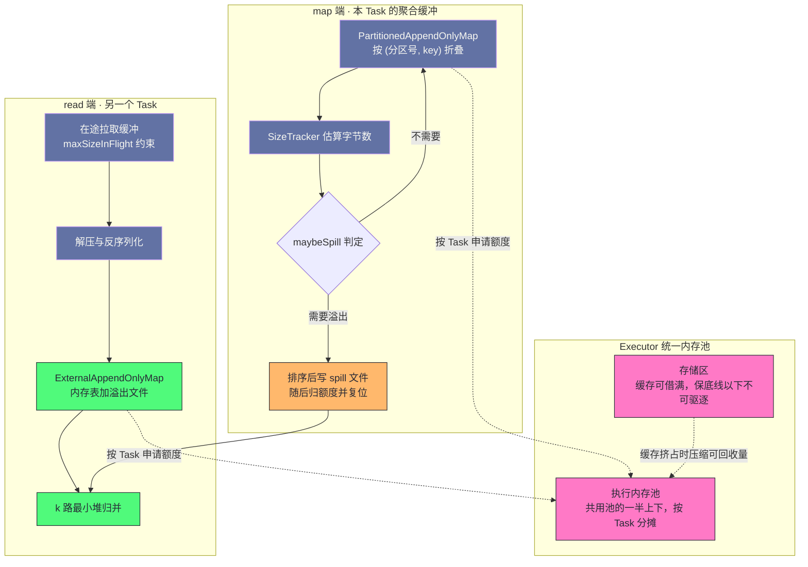
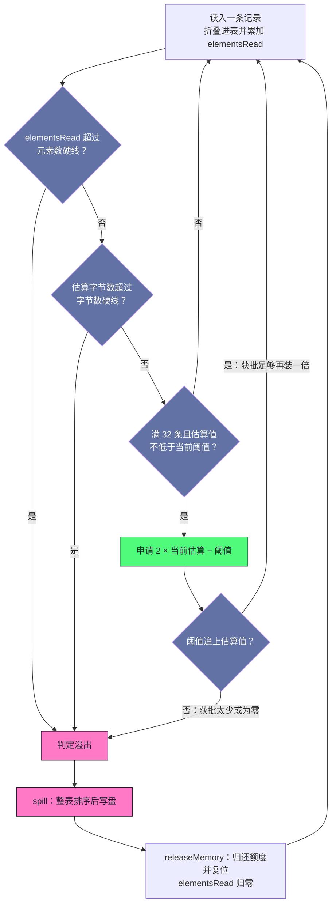
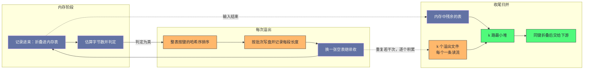
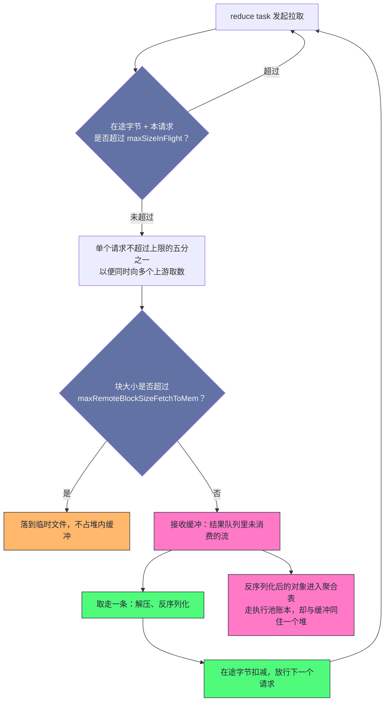
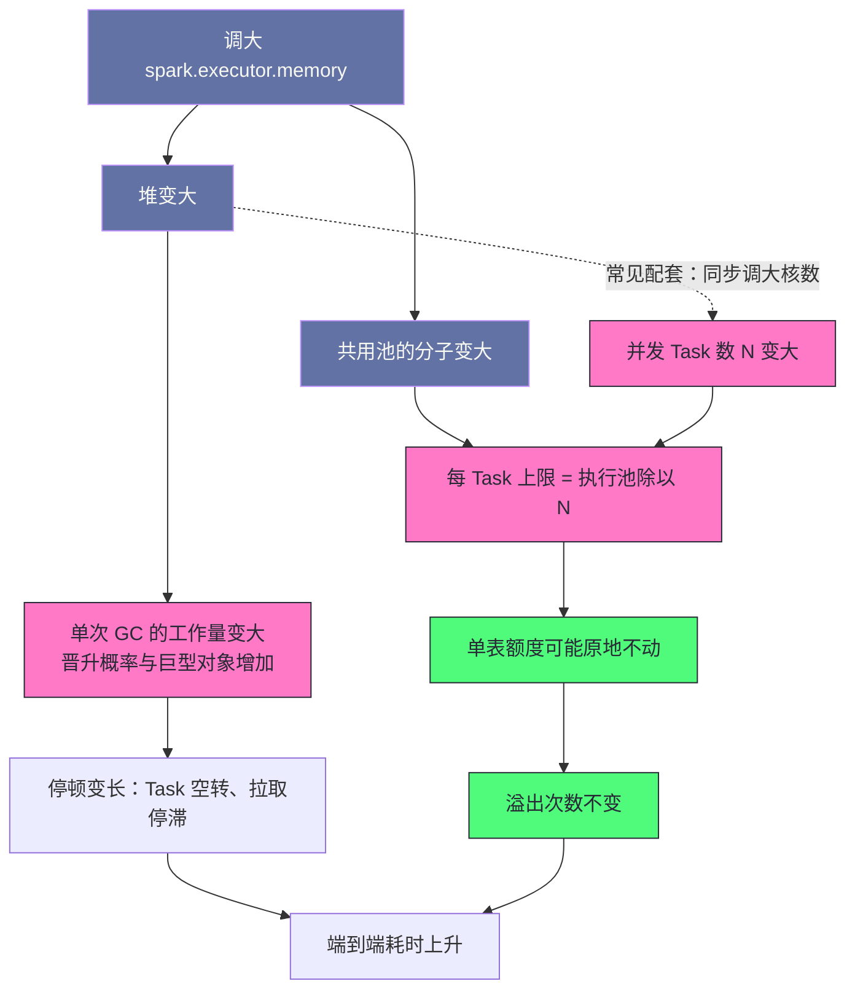

# 7. Spark Shuffle 内存调优：执行内存池、溢出判据与并发摊薄

**摘要：**

Spark 的 Shuffle 内存调优长期被一个已经失效的参数主导：`spark.shuffle.memoryFraction` 只在 1.5 及更早的静态内存模型里成立，1.6 引入统一内存管理之后它退化为"仅当 `spark.memory.useLegacyMode` 开启时才被读取"的遗留项，3.0 删掉静态内存管理器之后连配置项都从文档里消失，4.3.0 的配置表上已经没有这个名字。真正决定一张聚合表能用多少内存的，是三次除法：堆扣掉约 300MB 留白再乘 `spark.memory.fraction`，在存储与执行之间划一条软边界，最后由同 Executor 上并发运行的 task 数均分。这篇文章只算内存这一本账，沿五问推进：先界定 map 端聚合缓冲、read 端拉取缓冲与收尾归并缓冲三处开销，再逐层拆开额度的来源与 `ExecutionMemoryPool` 的 1/N 上限、1/2N 下限，接着逐条解释 `maybeSpill` 的三条判据、以及"申请两倍当前用量"为何使申请次数落在对数级，然后摊开 spill 之后的额度复位、多次溢出的归并代价与 read 端在途字节的内存含义，最后解释"加内存反而更慢"的两半原因——分母随并发一起变大、堆变大让 GC 停顿变长——并给出 JVM 堆溢出、执行内存申请失败与 spill 失败三种故障的分辨办法。全文口径为 Spark 4.3.0（4.x 预编译 Scala 2.13），参数是否生效以官方文档与源码为准。

**关键词（Keywords）**: maybeSpill, Spillable, 统一内存管理, ExecutionMemoryPool, ExternalAppendOnlyMap, maxSizeInFlight, storageFraction, 执行内存, 溢出归并, releaseMemory

---

## 第 1 章 三本账与一个信封

### 1.1 一次凌晨的溢出

凌晨两点，`traffic_rollup` 作业又一次在 reduce 阶段写出十几万行"spilling in-memory map of ... to disk"的日志。这个作业每天处理当天的曝光日志，按"广告位 + 小时"聚合曝光量与点击量，输入侧读 200 个分区，输出侧写 400 个分区，每个 Executor 分到 16 核、64GB 堆。值班的人照例先加内存，再找一个"Shuffle 内存比例"的参数往上抬，两招都没兑现：内存从 64GB 加到 128GB 之后，溢出次数几乎原地不动；那个比例参数在新版 Spark 里早已没有接线。

两次落空指向同一个事实——"内存不够"这句话在同一时刻指代着好几样东西。一次 Shuffle 里有多处内存在花，它们共享同一个信封，却不是同一本账；不先把账分开，任何加法都会加错地方。

### 1.2 三本账

第一本账在 map 端。每一个 ShuffleMapTask 在处理本分区数据的同时，还要把结果按目标分区归拢：有聚合函数时，它持有一张以 `(分区号, key)` 为键、边走边折叠的哈希表；没有聚合函数时，它持有的是逐条追加、不去重的定长缓冲区。表装不下就排一遍序写到磁盘，换一张空表继续收。这一处的开销由 key 的基数与聚合值的体积决定，与输入记录数只有间接关系——两百万条输入可能只对应五万个 key，但某个 key 的聚合值若持续膨胀，一张"本该很小"的表也能长到几个 GB。

第二本账在 read 端，但它的主体不是聚合表。reduce task 在开始折叠之前先要把上游的输出块拉过来，拉取是流水式的，任意时刻都有一批"请求已发出、流还没被消费完"的块占着接收缓冲，另有一批流已经到手、等待解压与反序列化。这一处的开销与"同时在途的块有多少、有多大"成正比，对应的旋钮是 `spark.reducer.maxSizeInFlight`。

第三本账在收尾。溢出过一次之后，内存里剩下的表要与磁盘上的若干个 spill 文件归并，k 条流并排推进，每条流有自己的一份读缓冲、一个解码器、一份堆内候选。这一处单项开销不大，但它与溢出次数成正比：溢出越多，收尾时要同时开着的流越多。

三本账的额度来自同一个地方——Executor 统一内存池里的执行内存（execution memory）。下图把三处开销与它们的公共来源画在一起；图中把 map 端与 read 端分开画，是因为两者通常不在同一个 stage 里同时活跃，但账都记在同一块池子上。



图中那块写着"执行内存池"的方块是全篇的唯一收款人：map 端与 read 端各自向它申请，它只认两个数字——池子里还剩多少、此刻有几个 task 在同时申请。把这个数字看懂，后面所有的溢出、OOM 与"加了内存没用"都能对上账。

### 1.3 边界：本文只算内存

口径要先收窄。本文只讨论内存这一本账：哪些结构在占内存、占多少、什么时候被收回、收回失败时以什么形式失败。压缩编码与网络重试不在其中——它们决定的是"同样多记录占多少字节"与"拉不到数据怎么办"，是另一条独立的账。JVM 的分代结构、收集器选型与堆外内存的分配方式也不展开，只在第 6 章解释"堆变大为什么会让停顿变长"时借用必要的结论。

收窄之后仍有足够的复杂度。Spark 4.3.0 里，一次带聚合的 Shuffle 从 map 端第一张表到最后一次归并，中间要经过统一内存管理器的三次除法、`Spillable` 的三条判据、`ExecutionMemoryPool` 的两条边界，以及 `ExternalAppendOnlyMap` 的一套批读与堆归并。每一处都在做取舍，每一处的取舍都能解释一类现场。

### 1.4 一个信封，三本账

可以把一个 Executor 的执行内存想成一个家庭共用的信封：每月工资打进这个信封，房租、菜钱、孩子的补课费都从里面出，谁先伸手谁先拿到，但每人每月能拿多少有一个默认的分法——不能一个人把信封掏空，否则别人连最低开销都凑不齐。信封的总额不是全部收入，先要扣掉固定开销（300MB 留白），再按一个比例（`spark.memory.fraction`）切出一块公用金，公用金里还要留出一部分给"能存东西的柜子"（存储区，缓存占用的下限），最后把剩下的按此刻在家的几个人（并发 task 数）均摊。

这个比喻能解释为什么要除以并发数，但要收住一处失真：家庭分法是事前约定，Spark 的分法是事中动态调整的——task 数随时在变，池子也可能被缓存借走再要回来，所以每个 task 手里的额度不是一个固定数，而是一个"最多不超过 1/N、至少先让它爬到 1/2N"的区间。额度是活的，这是后面所有异常现象的源头。

三本账的性质并排放，差异就清楚了：

| 账目 | 主体结构 | 额度来源 | 耗尽时的第一反应 | 现场可见的指标 |
|---|---|---|---|---|
| map 端聚合缓冲 | `PartitionedAppendOnlyMap` 或 `PartitionedPairBuffer`，经 `ExternalSorter` 挂到 `Spillable` | 执行内存池按 Task 申请 | 调用 `maybeSpill`，整表排序写盘 | Shuffle Spill (Memory) 与 (Disk)、spill 日志次数 |
| read 端拉取缓冲 | `ShuffleBlockFetcherIterator` 的结果队列与流包装 | 堆内普通对象，不走执行池账本 | 在途字节达到上限后暂停发起新请求 | 每 Task 的 shuffle read 字节、fetch 等待时间 |
| 收尾归并缓冲 | `ExternalAppendOnlyMap` 的 k 路最小堆与各流读缓冲 | 堆内普通对象，不走执行池账本 | 流数过多时文件句柄与缓冲叠加成压力 | spill 文件数、归并阶段耗时 |

表里有一处要盯住：只有第一本账记在统一内存管理的账本上，后两本账花的是堆，却不在 `peak execution memory` 里。这个错位正是第 7 章"估算不高却 OOM"的根源。

### 1.5 一段被误传的判断依据

有一个流传很广的判断依据，画成一幅流程图是这样的：16GB 的数据流进 32KB 的缓存区，缓存满了就写磁盘，于是磁盘 I/O 频繁、性能下降。这幅图描述的机制本身没错，但它画的是 `spark.shuffle.file.buffer`——每个 Shuffle 输出流写盘时用的内存缓冲，默认 32KB，作用是减少系统调用与磁盘寻道。它不是聚合表的额度，两者相差几个数量级，也不能互相顶替：调大它不会让表晚一点溢出，调小它也不会让表更早落盘。

把写盘缓冲当成聚合额度，是这一题最经典的起步错误，而且是一个自洽的错误——它给出的因果链非常顺：缓存小，所以频繁落盘，所以要把缓存调大。真实的因果链断在中间：落盘与否由聚合表的估算字节数与它获批的额度比较决定，而这个额度与 32KB 这个数字没有任何关系。**判断依据错了，后面每一次调参都只是在验证一个错误的直觉。**

---

## 第 2 章 额度从哪里来：三次除法

### 2.1 第一次除法：先扣留白，再乘比例

统一内存管理器拿到的第一个数字是 `spark.executor.memory`，也就是 JVM 堆上限。这个数字不会全部进入分配，源码里先扣掉一块固定的保留内存：`RESERVED_SYSTEM_MEMORY_BYTES`，取值 300MB，用途是留给 JVM 自身的元数据、字符串常量、用户代码里的临时对象以及估算误差。扣完之后剩下的部分再乘 `spark.memory.fraction`（默认 0.6），得到执行与存储共用的那个池子。

源码注释里给了一个便于记忆的例子：1GB 的堆，可用部分是 (1024 − 300) × 0.6 = 434MB。这个例子的用处在于它暴露了一个反直觉的比例关系——**给 Executor 加内存，进入共用池的并不是增加量的六成，而是要按"扣完留白再乘比例"重算一遍**。64GB 的堆，共用池是 (65536 − 300) × 0.6 ≈ 38GB；加到 128GB，共用池约 77GB，翻了一倍多一点，看上去很慷慨。慷慨的部分在后面两次除法里会被吃回去。

`spark.memory.fraction` 调高会把更多堆划进共用池，代价是留给用户对象与元数据的空间变薄。官方文档对这个参数的建议是"保持默认"，理由写在描述里：这块留白的用途正是为内部元数据、用户数据结构以及稀疏超大记录的估算误差兜底。把它调到 0.8，账面上每个 task 的额度立刻上涨三成，但一旦作业里存在大对象或估算低估，失败形态就从"有序溢出"变成"堆溢出"——代价在第 7 章会具体展开。

还有两个细节会改变第一次除法的结果。其一，堆内存的最小值有硬性校验：堆至少要大于保留区的 1.5 倍（450MB），否则直接拒绝启动，这是为了防止有人配出一个小到无法运行的 Executor。其二，4.x 引入了一类"非托管内存使用者"（unmanaged memory consumer），譬如流式状态存储用的 RocksDB，它们自己管理内存却要计入 Spark 的可用额度；`spark.memory.unmanagedMemoryPollingInterval`（4.1.0 引入，默认 0s 即关闭）开启之后，轮询到的用量会从可用额度里扣掉，这使得同一份堆在开启该功能后能分给 task 的部分变少。

### 2.2 第二次除法：0.5 与"不可驱逐"的真实含义

共用池内部还要划一条线，位置由 `spark.memory.storageFraction`（默认 0.5）决定。很多资料把它描述成"存储占 50%、执行占 50%"，这个说法在算术上对，在机制上错——它是一条**软边界**，两侧可以互相借用，只是借用的方向与归还的义务不对称。

存储侧可以借走执行侧的空闲内存：缓存一个 RDD 时，如果执行池当前没有占用，存储池会一路涨到接近共用池的上限。执行侧需要内存时再去要回来，回收的算法写在统一内存管理器里：

```scala
// 摘自 UnifiedMemoryManager.maybeGrowExecutionPool（4.3.0），注释是本文加的
val memoryReclaimableFromStorage = math.max(
  storagePool.memoryFree,                   // 存储池里还没被块占用的部分
  storagePool.poolSize - storageRegionSize) // 超出存储区、可以驱逐块拿回的部分
```

这个 `max` 是关键。执行能回收的上限是"存储池的空闲"与"存储池超出存储区的部分"两者中较大的那个，也就是说：**存储区以内的已用内存是不可驱逐的**，源码注释写得很直白——只有实际存储用量超出这个区域时，缓存块才会被驱逐。于是"存储 50%、执行 50%"更准确的表述是：存储最多可以借到全部空闲，但执行要回来时，只能把存储压回它那 50% 的保底线，压不回去的部分执行拿不到。

反过来的方向是单向的：执行内存从不被存储驱逐。源码注释解释了原因——实现上太复杂，所以干脆不做，后果是"缓存可能失败"：如果执行已经吃掉了大部分空间，新来的缓存块会立刻按存储级别被丢弃。这条不对称是理解"缓存把 Shuffle 挤住"的基础。

### 2.3 第三次除法：并发 task 数

共用池与两个分区都算完了，最后一步发生在 `ExecutionMemoryPool` 里，也是三次除法中唯一动态的一次。池子对每个来申请的 task 做两件事：给一个上限，给一个下限。

```scala
// 摘自 ExecutionMemoryPool.acquireMemory（4.3.0），注释是本文加的
val numActiveTasks = memoryForTask.keys.size            // N：此刻在这块池上有账的 task 数
val maxPoolSize = computeMaxPoolSize()                  // 计入可驱逐缓存之后的执行池上限
val maxMemoryPerTask = maxPoolSize / numActiveTasks     // 上限：任何 task 不得超过 1/N
val minMemoryPerTask = poolSize / (2 * numActiveTasks)  // 下限：先让每个 task 爬到 1/2N
val maxToGrant = math.min(numBytes, math.max(0, maxMemoryPerTask - curMem))
val toGrant = math.min(maxToGrant, memoryFree)          // 只给得起空闲的那一份
if (toGrant < numBytes && curMem + toGrant < minMemoryPerTask) {
  lock.wait()   // 够不到下限就等着，避免先到的 task 把池子吃干
}
```

这段代码里藏着三处工程决策。第一处是上限取 `maxPoolSize / N` 而不是 `poolSize / N`：`maxPoolSize` 把"驱逐缓存之后可能腾出的空间"也算进分母的分子，否则会出现 SPARK-12155 那类问题——池子明明可以靠驱逐缓存变大，却按当前的小尺寸把每个 task 卡死。第二处是下限取 `poolSize / (2N)`，它的作用是让后到的 task 也能爬到一个最低份额再开始干活；如果没有这条线，一个早期 task 可以先堆到接近 1/N，后来者只能在零头里反复溢出。第三处是那句 `lock.wait()`：**申请不到下限时不是立刻返回零，而是在锁上等**，等别的 task 归还内存。等待换来公平，代价是分配路径上出现阻塞，而阻塞时间不受申请方控制。

`computeMaxPoolSize()` 的算法也要看清，它决定了"上限"的分子：

```scala
// 摘自 UnifiedMemoryManager.computeMaxExecutionPoolSize（4.3.0）
val availableMemory = maxMemory - math.min(storagePool.memoryUsed, storageRegionSize)
math.max(0L, availableMemory - unmanagedMemory)
```

含义是：共用池总量减去"存储区里已被占用的部分"（但最多只扣到存储区的尺寸，超出的部分视为可驱逐，不扣），再减去非托管用量。所以缓存越多，这个分子越小，每个 task 的上限也跟着缩——**缓存与 Shuffle 争的不是一块静态蛋糕，而是一个会随缓存用量浮动的上限**。

### 2.4 把三次除法算成数字

把三层串起来，额度就是这样一层层被切出来的。下图把三次除法与它们各自的削减对象画在一起：第一次切的是堆与留白，第二次切的是存储的保底线，第三次切的是池子与人数。


把图里的三刀写成一条式子，就可以直接代入：

每 Task 执行内存上限 ≈ (堆 − 300MB) × `spark.memory.fraction` × (1 − 存储实际占用比) ÷ 并发 Task 数

取两组常见配置代入，差别立刻显形：

| 配置 | 堆 | 共用池 | 存储区 | 执行池（缓存未占时） | 并发 Task | 每 Task 上限 |
|---|---|---|---|---|---|---|
| A | 64GB | 约 38GB | 约 19GB | 约 19GB | 16 | 约 1.2GB |
| B | 128GB | 约 77GB | 约 38GB | 约 38GB | 32 | 约 1.2GB |
| C | 128GB | 约 77GB | 约 38GB | 约 38GB | 16 | 约 2.4GB |

表里的数字是按上面的式子手算出来的算术结果，不是某次实测；它要说明的是一件很朴素的事：A 与 B 的每 Task 额度基本相同，取整前的差别只来自保留区那 300MB 的固定项。把内存翻倍、同时把核数翻倍，账面上资源翻倍，分摊下来一分未涨，这正是"加内存不见效"最常见的形态。C 与 B 的差别只在一个分母，额度就翻了一倍——**在这道除法里，分母的权重与分子相同。**

需要提醒的是，这里的"并发 Task 数"是同一 Executor 上真正在申请执行内存的 task 数，通常等于 `spark.executor.cores`，但不完全等于：某个 task 若还没开始申请内存（例如还在读输入），它不会进入池子的账本；反过来，多个作业或流式批次叠加时，同时在跑的 task 可以超过核数所暗示的数量。判断现场时看 Executor 页的活跃 task 数与 `peak execution memory`，比看配置更可靠。

### 2.5 `spark.shuffle.memoryFraction` 的去向

现在可以正面回答那个最容易被记错的问题：这个参数今天还管不管用。

笔者把四个版本的文档存档逐个翻过，查证的结果是分阶段的。1.5 及更早，它确实是一个静态份额：文档把它定义为 Java 堆的一个比例（默认 0.2），限制"所有用于 shuffle 的内存 map 的总量"，超过就开始落盘；同一个时期的文档里还有 `spark.storage.memoryFraction`，两者是静态切分的两块地。1.6 引入统一内存管理之后，文档给它的标注变成了"(deprecated)"，并写明"仅当 `spark.memory.useLegacyMode` 开启时才被读取"——默认路径下它已经是一个空开关。2.0 起统一内存管理成为默认，遗留模式仍可通过该开关打开；3.0 删除了 `StaticMemoryManager`，`spark.memory.useLegacyMode`、`spark.storage.memoryFraction` 与 `spark.shuffle.memoryFraction` 一起从配置表中消失。到 4.3.0 的官方配置页，这三个名字一个都不剩。

与它一起退场的还有那个总开关本身。1.5 的文档里 `spark.shuffle.spill` 默认 true，含义是"通过把数据溢写到磁盘来限制 reduce 期间的内存用量"，而溢写阈值正是上一条静态份额——两个参数是一套机制的两半。1.6 的配置页上，`spark.shuffle.spill` 这个名字已经不在，只剩 `spark.shuffle.spill.compress`；到 4.3.0，与它同前缀的配置还剩六项：公开页上的 `spark.shuffle.spill.compress` 与 `spark.shuffle.spill.diskWriteBufferSize`，加内部配置里的 `spark.shuffle.spill.batchSize`、`spark.shuffle.spill.initialMemoryThreshold`、`spark.shuffle.spill.numElementsForceSpillThreshold`、`spark.shuffle.spill.maxSizeInBytesForSpillThreshold`，**没有一个是"是否允许溢出"的开关**。溢出现在是聚合路径上的必然动作，不是可以关掉的功能。

| 版本 | 内存划分方式 | `spark.shuffle.memoryFraction` 的实际地位 | Shuffle 额度的真实来源 |
|---|---|---|---|
| 1.4 及以前 | 静态切块 | 生效，默认 0.2，是所有 shuffle 内存 map 的总上限 | 静态 Shuffle 池 |
| 1.5 | 静态切块 | 生效，与 `spark.shuffle.spill` 配套 | 静态 Shuffle 池 |
| 1.6 | 统一管理（可选遗留） | 标注为 deprecated，仅在 `spark.memory.useLegacyMode=true` 时读取 | 执行内存池 |
| 2.0 至 2.4 | 统一管理（默认） | 同上，默认配置下不生效 | 执行内存池 |
| 3.0 起 | 统一管理（唯一实现） | 配置项已删除，写进参数里也不会被读取 | 执行内存池 |
| 4.3.0 | 统一管理 | 官方配置页无此项 | 执行内存池除以并发 Task 数 |

这个误解之所以顽固，有三层原因。其一，它曾经是对的，而且对了很多年，大量博客与课程录在它还有效的年代，之后没有再校对。其二，它的名字太贴合直觉——"shuffle 的内存比例"，看起来就该是一个能直接调的旋钮。其三，调大它之后作业有时真的会变快，但原因不是它生效了，而是同一次改动里往往还改了堆大小、并行度或缓存策略，功劳被记错了地方。**判断一个参数是否还活着，办法只有一个：查当前版本的配置表与源码里是否还有它的读取点，而不是找一个曾经给出过答案的博客。**

### 2.6 堆外为什么帮不上忙

还有一种常见的期待：开启堆外内存（`spark.memory.offHeap.enabled`）能不能让聚合表不受堆约束。答案是不能，原因写在类声明里——`Spillable` 继承 `MemoryConsumer` 时把模式写死为 `MemoryMode.ON_HEAP`，也就是说，无论堆外池开得多大，聚合缓冲的额度始终记在堆内执行池上。

这个设计不是疏漏。聚合表里装的是 JVM 对象（key、combiner、元组），它们本来就只能在堆上；把它们搬到堆外需要先序列化成字节，而那正是二进制形态的写端才能做的事，带聚合的路径做不到（要按 key 比较就必须能看见键的内容）。堆外内存能帮上忙的地方是 Tungsten 的排序页与部分缓存，与"聚合表能用多少内存"是两码事。**把堆外开关当成聚合额度的扩容按钮，等于给一个只在堆上记账的结构换了一个更大的仓库钥匙。**

---

## 第 3 章 `maybeSpill`：三条判据

### 3.1 判据的形态

`Spillable` 是 map 端与 read 端聚合表共用的一个特质，`ExternalSorter` 与 `ExternalAppendOnlyMap` 都混入它，各自实现自己的 `spill`。真正做判定的方法只有一个，4.3.0 的实现是这样：

```scala
// 摘自 Spillable.maybeSpill（4.3.0），注释是本文加的
val shouldSpill = if (_elementsRead > numElementsForceSpillThreshold
    || currentMemory > maxSizeForceSpillThreshold) {
  true                                              // 两条与内存池无关的硬线，先判
} else if (_elementsRead % 32 == 0 && currentMemory >= myMemoryThreshold) {
  val amountToRequest = 2 * currentMemory - myMemoryThreshold   // 要的是"再装一倍"
  val granted = acquireMemory(amountToRequest)
  myMemoryThreshold += granted                      // 只按实际获批的量抬高阈值
  currentMemory >= myMemoryThreshold                // 还是不够，说明池子不给更多了
} else {
  false
}
```

三条判据、三种性质。前两条是硬线：元素数超过阈值、估算字节数超过阈值，任一成立就无条件溢出，与池子的脸色无关；第三条是软线，向池子申请，申请不到才溢出。判据的顺序也有讲究——硬线放在最前面，意味着一旦有人把它们调成一个具体数字，它们就优先于内存申请生效。

### 3.2 两条硬线

元素数这条线的配置项是 `spark.shuffle.spill.numElementsForceSpillThreshold`，从 1.6.0 起存在，在 4.3.0 里被标记为内部配置（`.internal()`），因此不在公开配置页上，只看文档的人会以为它不存在。它的类型是整数，默认 `Integer.MAX_VALUE`，源码注释解释了这个默认值的含义：默认情况下永不强制溢出，直到撞上别的限制，譬如排序器里指针数组的最大页限制。

字节数这条线是 4.1.0 新增的，配置键是 `spark.shuffle.spill.maxSizeInBytesForSpillThreshold`，同样是内部配置，默认 `Long.MAX_VALUE`，语义是"内存中的估算字节数超过它就直接溢出"。它补齐了元素数那条线的盲区：有些记录条数不多但单条极大（聚合值是长字符串或大集合），元素数永远碰不到线，而字节数早已越界。

两条硬线的现实价值在于"估算失灵"的兜底。3.6 节会说明，估算值来自采样外推，它可能低估；一旦低估，软线会迟迟不触发，表在实际已超限的情况下继续收数据。此时把元素数或字节数设成一个具体值，等于给系统一条不依赖估算的刹车。代价是刹车点由人猜，猜小了溢出过频，猜大了没有保护；而且这两条线一旦触发就是无条件溢出，不再有"先试着申请一次"的缓冲。

### 3.3 软线：每 32 条检查一次

软线的第一个细节是那个取模条件：`_elementsRead % 32 == 0`。每读入 32 条记录才检查一次额度，而不是每条都查。这有点像超市结账时攒满一筐再看一眼屏幕，而不是每拿起一件商品就查一次价——理由不在节俭，而在查价这个动作本身要走一条比拿商品贵得多的路径。此处的"查价"就是一次内存申请：估算值越线之后要调用 `acquireMemory`，而申请会进入 `ExecutionMemoryPool` 的同步块、可能驱逐缓存、可能 `lock.wait()`。把这种操作放进每条记录的路径，聚合的吞吐会直接塌掉。

代价是最多晚 32 条记录才发现该溢出了。这个延迟在百万级的记录量面前可以忽略，但如果单条记录很大（譬如聚合值含长文本），32 条也可能是几十 MB 的超额。这是一个典型的小步长换吞吐的取舍，Spark 选了 32，没有把它做成可配置项。

### 3.4 软线：为什么申请"两倍当前用量"

第二个细节是 `amountToRequest = 2 * currentMemory - myMemoryThreshold`。这个式子不是"还差多少就补多少"，而是"一次要到能让表再装一倍"。这两种要法的差别，决定了申请次数的量级。

假设初始额度是 5MiB（内部配置 `spark.shuffle.spill.initialMemoryThreshold` 的默认值，五兆出头）。如果每次只申请差额，阈值会被抬到刚好盖住当前估算值，表再长一点点就又越线，申请次数与越线次数同阶——按每 32 条查一次算，一张百万条的表要走上万次申请，每次都要进一次锁、可能触发一次驱逐，这个成本与记录数成正比。而按"要到两倍"的算法：第一次越线时表约 5MiB，申请后额度抬到约 10MiB；下一次越线在 10MiB，申请后到约 20MiB；再下一次 40MiB、80MiB……额度按几何级数增长，达到 1GiB 只需要七八次申请。

**申请次数从线性降到对数，靠的不是更聪明的算术，而是把"够用多久"的粒度从一次检查抬到了一倍容量。** 这与哈希表扩容翻倍是同一个思路：单次动作变贵，次数指数级变少，摊还下来反而便宜。代价是获批的额度可能远超当下所需，一个只长到 6MiB 的表也可能持着 10MiB 的额度——不过这个代价被 1/N 上限挡住了，因为申请本身要被 `maxPoolSize / N` 截断。

`myMemoryThreshold += granted` 这一行同样要看清：阈值只按实际获批的量抬高。申请 100MB 只批了 20MB，阈值就只涨 20MB，表随即又撞线，再申请一次。所以池子紧张时并不会因为"申请过"就获得额度，判据会连续触发，直到判定 `currentMemory >= myMemoryThreshold` 成立——此时 `shouldSpill` 为真，溢出发生。这段逻辑没有重试的循环设计，原因写在注释里：池子已经给出答案了，再问一次不会变。

下图是三条判据合起来的判定路径。图中把两条硬线画在入口，是因为它们绕过了申请环节，与池子的状态无关。



### 3.5 溢出之后：把额度还回去

溢出不是一个终点动作，它后面跟着三件事：`spill(collection)` 把整张表排空写盘、`_elementsRead` 归零、`releaseMemory()` 归还额度。第三件事最容易被忽略，实现却很短：

```scala
// 摘自 Spillable.releaseMemory（4.3.0）
def releaseMemory(): Unit = {
  freeMemory(myMemoryThreshold - initialMemoryThreshold)  // 归还本次真正申请到的部分
  myMemoryThreshold = initialMemoryThreshold              // 阈值回落到 5MiB 级别的起点
}
```

归还的量是"当前阈值减初始阈值"，也就是这次实际申请到并仍被持有的部分；阈值随之复位到起点，下次攒数据时重新走一遍几何增长的申请路径。不归还的后果有两层：一层是别的 task 申请不到——一张已经清空的表还占着几百 MB 的账面额度，会把这个 Executor 的并发度整体卡住；另一层是本表自己的判据失真——如果阈值仍停在旧的高位，下一次越线要等到表重新长回那个尺寸，等于把溢出时机推迟了一倍，峰值内存随之翻倍。

还有一处与"强制溢出"相关的路径需要知道。当同一 Task 内别的内存消费者申请不到内存时，`TaskMemoryManager` 会遍历所有消费者，挑一个合适的对象强制它 spill，把空间让出来；聚合表实现的 `forceSpill()` 在 4.x 里还能处理"归并过程中"的状态——如果此刻正在归并，它会尝试把正在读的那条流也溢出去。这条路径说明溢出不仅是自己的判据决定的，也可能是被别人逼出来的；现场看到"没到阈值却溢出了"的日志，多数来自这里。

### 3.6 估算值不是内存占用

`maybeSpill` 的入参 `currentMemory` 是 `SizeTracker` 的估算值，它只覆盖被估算的那个结构本身：表数组、键、值。它不包含输入缓冲、反序列化产生的临时对象、序列化器内部的引用跟踪表、写盘缓冲，也不包含同一 Task 里别的结构。于是两个数字会长期对不上：Spark UI 上 `peak execution memory` 记的是申请到的额度，而进程的实际堆占用远高于它——差值就是这些没被记账的部分。第 7 章讲 OOM 时会回到这个差值。

---

## 第 4 章 溢出的代价

### 4.1 溢出的单位是整张表

`ExternalAppendOnlyMap` 溢出时的动作很干脆：把当前这张表按哈希值排一遍序，整张写到磁盘，然后换一张空表。**溢出的单位是"整张表"，不是"挤出一点余量"。** 这个选择决定了单次溢出的写盘量可能远超阈值——判据在越线那一刻成立，而此刻表里已经有 `currentMemory` 那么多数据，全部要写出去。

为什么不只溢出一部分？因为聚合表的结构不支持部分溢出：一张按开放寻址组织的哈希表没有天然的"前一半"边界，硬切会把同一个键的聚合值拆到两个地方，归并逻辑立刻复杂一倍。整表排空换来的是"溢出后内存彻底干净"这个简单性质，代价是写盘粒度粗、每次溢出的尾延迟明显。

写盘的过程本身有格式约定：数据按批写，每批最多 `spark.shuffle.spill.batchSize` 条（内部配置，默认 10000），每批在文件里形成一个独立的段，段长记在内存里。分批的理由有两个。写侧的考虑在源码注释里写得很清楚：一次序列化太多对象会让序列化器内部的引用跟踪表膨胀，批次小一些，那张表就小一些；读侧的好处是每批可以独立打开、独立关闭，归并时不必把整个文件摊进内存。**这条"批次"设计是溢出机制能在内存紧张时仍然工作的前提——它保证了读回一份溢出文件时，占用的内存与文件大小无关。**

### 4.2 多次溢出之后要归并

溢出若干次以后，手里的东西变成"一张内存表加 k 个已排序的溢出文件"。输出要求是按 key 折叠后的有序序列，所以必须做一次 k 路归并：把每个来源的迭代器都放进一个最小堆，堆顶永远是当前所有流里键最小的那一条，弹出、折叠、把该流的下一条重新入堆。

下图把一次溢出的完整链路与收尾归并画在一起。图中把"每次溢出"与"收尾归并"分成两块，是为了强调后者是前者的债务：溢出次数越多，收尾时要同时开着的流越多。



归并的排序口径也要说明：排出文件时用的是哈希序，不是用户给的 key 序。目的是让同键相邻，好让归并一趟扫完；判定相等仍要回到键的 `equals`，哈希相同只是把候选聚在一起。这套分工不改变内存账，但它决定了溢出文件的"有序"是给归并用的，不是给下游看的。

### 4.3 溢出次数与归并期内存的反比

现在把账算到反直觉的地方。溢出的初衷是省内存，但每多一个溢出文件，收尾归并时就要多开一条流：一条流的固定成本包括一个文件输入流、一个带缓冲的包装流、一个反序列化器、以及堆里当前那一组同哈希候选。单项都是 KB 级，可当 k 从 5 涨到 50，这部分开销就从"可以忽略"变成"值得看一眼"。

与此同时，每条流还要从文件里按段读取。`DiskMapIterator` 的做法是按预先记下的段长，一段一段地打开文件、限定读取长度、反序列化，读完一段关掉再开下一段——这是为了不把整个文件摊进内存，属于上一节说的内存与文件大小解耦。但它意味着每一段都要重新建立缓冲与解码器，归并的 CPU 成本随段数上升。

于是出现一个最优区间的概念：溢出次数太少，单次溢出的量太大、峰值内存不可控；溢出次数太多，归并期的流数与段数上升、CPU 与文件句柄吃紧，而且每次溢出的数据量小、写盘效率低。真正决定落点的，是"每个 Task 获批的额度"与"这个 Task 的总数据量"之比——这个比值的量级，通常用肉眼就能估出来，不需要精确测量：

| 一次溢出的成本项 | 与什么成正比 | 什么时候成为主导 |
|---|---|---|
| 整表排序 | 本次溢出的记录数 n log n | 单次溢出量很大时 |
| 写盘字节与系统调用 | 本次溢出的数据量 | 溢出频繁且每次量小时，固定开销占比升高 |
| 序列化器内部状态 | 每批条数（默认 10000） | 单条记录很大时 |
| 归并期的流数 | 溢出文件个数 k | k 超过几十时，句柄与缓冲开始显形 |
| 归并期的比较次数 | 总量 N × log k | k 很大而总量不变时缓慢上升 |

表里没有给出具体数字，因为这些成本取决于记录大小与磁盘，任何"每次溢出耗时 X 毫秒"的说法都不具备移植性。可移植的是方向：**溢出不是免费的省内存操作，它把内存压力换成了磁盘压力与归并压力，并且这两份压力都会随着次数累积而变重。**

### 4.4 写盘缓冲这一小块

还有一处与内存相关的小额开销：每次把表写到磁盘，都要经过一个带缓冲的输出流，缓冲大小由 `spark.shuffle.file.buffer`（默认 32KB）决定，另外还有一块磁盘写缓冲 `spark.shuffle.spill.diskWriteBufferSize`（2.3.0 起，默认 1MB 量级）。这些缓冲在溢出期间同时存在，属于"溢出动作本身的成本"，不是"聚合表的额度"。它们的调优属于文件与 IO 那条线，此处只记一笔，免得再次把它们与聚合额度混为一谈。

---

## 第 5 章 read 端：拉取缓冲是另一本账

### 5.1 在途字节上限

reduce task 开始工作时，手里只有一份"每个 map 输出在哪台机器、多大"的清单，数据要一块块拉过来。拉取不能无限并发：每块都要占接收缓冲，块一多，堆就被缓冲吃掉，聚合表还没开始建立就可能 OOM。限制由 `spark.reducer.maxSizeInFlight` 给出，默认 48MB，官方描述是"每个 reduce task 同时拉取的 map 输出的最大字节数"，并补了一句解释它的内存含义——每份输出都需要一块接收缓冲，所以它是每个 task 的固定内存开销。

实现上这个数字被切成两半用。一半是调度条件：发起新请求前检查"当前在途字节 + 下一个请求的大小"是否超过上限，超了就等；另一半是请求粒度：每个远程请求的体量被限制在上限的五分之一（`maxBytesInFlight / 5`），源码注释给的理由是让一个 task 能同时向最多五个上游并行取数，而不是卡在一个上游上。这两个用法合起来说明，48MB 不是一个预分配的缓冲池，而是一条**流水线的在途水位线**：已发请求、尚未消费完的数据总量超线就暂停发新请求，消费掉就放行。

消费的动作与水位线是联动的：每次调用方取走一个块，在途字节就相应扣减，下一次调度才有空间。所以真正决定峰值内存的不是"拉了多少"，而是"拉来之后多快被消费掉"——如果下游的反序列化或聚合很慢，在途的水位会长期贴着上限，缓冲就一直占着；反过来，消费得快，同样的上限只需要很小的实际占用。

### 5.2 三条内存去向

在途字节这条线背后，read 端的内存有三个去向，量级不同、可控性也不同。下图把它们与聚合表的位置画在一起，可以看出哪些走执行池的账本、哪些不走。



第一个去向是接收缓冲，也就是结果队列里那些还没被消费的流，它受在途字节上限约束。第二个去向是解压缓冲：流被包装成解压流之后，每个活跃的解码器都自带一块内部缓冲，大小与压缩块同量级，按流计；同时在解的流越多，这块开销越大。第三个去向是反序列化产生的对象：它们一产生就进入聚合表，所以算在聚合表那一本账上，而不是缓冲这一本。

还有一条分流规则：`spark.network.maxRemoteBlockSizeFetchToMem` 默认 200MB，超过这个尺寸的远程块不走内存，而是直接落到临时文件。它的存在是为了避免"一个巨型块把缓冲撑爆"——在途字节上限能限制总量，却限制不了单块大小，而单块超限时即使总量没到线也会瞬间吃掉一大块堆。这条规则是"默认值即防线"的例子：默认 200MB 已经足够挡住大多数巨型块，把它调大反而危险。

### 5.3 两本账共享的是堆，不是额度

read 端的缓冲与聚合表的关系，比"两份开销"更纠缠：它们不共用同一本账，却共用同一个堆。这个区别决定了两类故障的表现。

先看堆这一侧。一个 Executor 上同时有 N 个 reduce task，每个 task 的在途缓冲可能长期贴着 48MB 的水位，合计接近 N × 48MB 的堆占用；这些缓冲不在执行池的账本上，`peak execution memory` 也统计不到它们，但它们真实地占着堆。于是可能出现一种拧巴的现场：UI 上的执行内存只用了四成，进程却因为堆被撑满而失败——账本只记申请到的额度，不记堆上实际活着的对象。

再看账本这一侧。反过来也成立：堆还有大量空闲，执行池照样可以拒绝申请。原因是额度不按"堆还剩多少"发放，而按前面那两条边界发放——单个 task 到 1/N 就停，存储借走的部分要等驱逐才能收回。此时 `maybeSpill` 判定为真、表被倒出去，而堆的占用曲线看上去毫无压力。**"明明内存还有，却一直溢出"与"账面额度充足，却堆溢出"是同一副错位的两面，方向相反。**

分辨落在哪一面，看两个量就够：spill 出去的字节能占输入的多大比例，以及堆占用曲线是否随溢出周期性锯齿。前者高说明数据本身超量，后者陡说明账本外的东西在吃堆。`spark.reducer.maxSizeInFlight` 调小只对第二种里的"缓冲吃堆"有效，它压的是堆侧，不改变账本侧的任何一条边界；把它当成"扩大聚合额度"的手段，结果只会是 read 变长而溢出照旧。

### 5.4 校验路径上的额外内存

还有一个默认行为与内存相关：`spark.shuffle.detectCorrupt` 从 2.2.0 起默认开启，用于检测拉取到的块是否损坏。它的检测方式可以选择是否额外复制一份数据到内存里做解压校验，开关是 `spark.shuffle.detectCorrupt.useExtraMemory`（3.0.0 引入，默认 false）。默认关闭意味着校验走的是流式路径，不额外占用成块的内存；打开它会在每个被校验的流上多一份内存拷贝，换来的是更早发现损坏。

| read 端参数 | 默认值 | 内存侧的含义 | 动它之前先问 |
|---|---|---|---|
| `spark.reducer.maxSizeInFlight` | 48MB | 每个 reduce task 的在途接收缓冲水位 | 堆是否够、拉取是否已经很快 |
| `spark.reducer.maxReqsInFlight` | Int.MaxValue | 在途请求数，间接影响同时存在的流数 | 上游是否被并发连接压住 |
| `spark.network.maxRemoteBlockSizeFetchToMem` | 200MB | 超过此尺寸的块落盘而不进堆 | 是否有超大块把单点缓冲撑爆 |
| `spark.shuffle.detectCorrupt` | true | 开启校验路径 | 数据是否可能损坏、能否接受额外 CPU |
| `spark.shuffle.detectCorrupt.useExtraMemory` | false | 校验时是否额外复制一份数据 | 是否值得用内存换更早的损坏发现 |

这张表里没有任何一项能"提高聚合额度"，它们调的都是另一本账。把它们与 `spark.memory.fraction` 混在一起调，是现场最常见的操作失误：症状是溢出，动作却是去改拉取缓冲，结果溢出没变、read 变慢。

---

## 第 6 章 加内存为什么反而更慢

### 6.1 前半：分母跟着涨

第 2 章的三次除法已经给出了答案的一半。给 Executor 加内存时，最常见的配套动作是同步加核——否则一个 Executor 拿 128GB 却只跑 8 个 task，每个 task 名下的内存高得不像话，运维会觉得浪费，于是把核数一起调上去。核一加，并发 task 数 N 变大，而每个 task 的上限是 `maxPoolSize / N`，分子涨一倍、分母涨一倍，额度不变。第 2 章那张表里 A 与 B 两行的对比就是这个结果。

更细的一层在 `ExecutionMemoryPool` 的两条边界上。N 变大之后，`minMemoryPerTask = poolSize / (2N)` 会同步变小，意味着每个 task 起跑时能保住的最低份额更小；同时 `maxMemoryPerTask = maxPoolSize / N` 也更小，一个 task 想爬到原来那个尺寸要经历更多次越线与申请。每一次申请都可能触发 `lock.wait()`——而这把锁是整块池子共用的，N 越大，等锁的 task 越多，分配路径越长。于是"内存更多、并发更高"的组合，可能给出一个比原来更慢的结果：溢出频率不变，但每次申请都要排更久的队。

这种情形还有一个放大效应：同一 Executor 上多个 task 同时越线时，它们会互相成为对方"申请不到"的原因。A 申请时池子还有空闲，B 也在申请，两者都只获批一部分；A 的表因此更早溢出，释放额度，B 借此涨上去，然后 A 重新攒数据又越线。**在额度被切碎的情况下，溢出会呈现"此起彼伏"的形态，日志里看到的是溢出次数偏多、每次量偏小，而总内存占用并没有打满。**

### 6.2 后半：GC 停顿

另一半解释在堆的形状上。把堆从 64GB 加到 128GB，账面上的执行池翻倍，但 JVM 要管的对象也翻倍地多了起来：每次垃圾回收要标记、复制或整理的内存范围更大，一次并发标记周期要扫的 region 更多，混合回收要处理的候选区也更多。暂停时间的目标（`MaxGCPauseMillis` 一类设定）不会自动跟着放大，于是同样的目标越来越难达成，停顿的尾部长了出来。

第二个机制与对象寿命有关。溢出路径上会产生大量短命对象：迭代器、序列化缓冲、元组、装箱值。堆变大之后，新生代通常也随之变大，对象在新生代里存活的时间更长，更容易熬过晋升阈值进入老年代；老年代压力上升，又会推高并发标记的频率。这是一条不太直观的因果链——加内存本意是给数据更多空间，实际效果却是给垃圾更多存活时间。

第三个机制是巨型对象。聚合表扩容时一次要分配两倍长的数组，排序与页式分配也会要大块连续内存；在分区式收集器里，超过 region 一半的对象会被当作巨型对象单独处理，分配与回收都要走更重的路径，堆越大、region 越大，巨型对象的判定门槛越高，但单次分配造成的碎片与停顿也更难预测。

停顿本身的代价不只是"CPU 闲着"：read 端的在途数据停在缓冲里没人消费，水位贴着上限，新的拉取被挡住；map 端的表停在原尺寸，判据来不及执行；一个 task 的停顿还会通过共享的锁与池子传导给同 Executor 的其他 task。停顿长到超过上游对拉取的耐心时，拉取会失败重试，那是停顿的连带账单——账单的结算方式属于重试策略那条线，此处只记它由停顿开出。**这就是"加内存反而更慢"的另一半：额度没涨，停顿涨了，单位时间内做完的活少了。**

把两半原因画成一张回路图，可以看到"加内存"这一个动作同时踩下了两块踏板：一块抬高分子，另一块抬高分母与停顿；前者让额度上升，后者把上升抵消掉，还额外收走一段时间。



### 6.3 一个可以直接写在纸上的平衡式

把两半合起来，可以写成一个用于判断的式子：

每核执行内存 ≈ (堆 − 300MB) × `spark.memory.fraction` × (1 − 存储实际占用比) ÷ `spark.executor.cores`

这个式子的用处不是算出一个精确答案，而是判断一次"加内存"的动作会落在哪一种情形：分子涨、分母不变，则每核额度上升，溢出减少，但停顿变长，净效果要测；分子分母同涨，则额度基本不变，只是停顿变长，净效果大概率是变慢；分子不变而分母涨（加核不加内存），则额度下降，溢出增加。三种情形的处方完全不同，而现场最常见的错误是把第三种当成第一种来处理。

| 现场症状 | 更可能的归因 | 先查什么 | 处置方向 |
|---|---|---|---|
| 溢出次数多、每次溢出的量也大 | 每 task 额度不足或数据本身超量 | 每核额度、输入量、key 基数 | 加内存但保持核数，或降并行度换额度 |
| 溢出次数多、每次溢出的量极小 | 额度被并发切碎，或存在倾斜键 | 活跃 task 数、单 key 聚合值分布 | 减少并发或先处理倾斜 |
| 加内存后溢出不变、耗时变长 | 分母同步变大，且 GC 停顿变长 | 核数是否同步上调、GC 日志 | 回退核数，保持内存/核比例 |
| 溢出不多但任务频繁失败重启 | 堆溢出或拉取失败，不是额度问题 | 失败栈、堆占用曲线 | 查估算低估、拉取缓冲与超大块 |
| 缓存命中率下降、Shuffle 变慢 | 存储与执行互相挤占 | 存储实际占用、缓存块数 | 收敛缓存用量或调 `storageFraction` |

表里每一行都指向"先归因，再动手"。把这四种归因并排放，就能看清"看到溢出就去调比例"这条路径为什么失效：真正的额度不足只是其中一种，其余三种无论怎么调比例都不会动。

### 6.4 正确的加法

如果确认额度确实不足，加法有几个方向，代价各不相同。加内存而保持核数不变，是最直接的一种：每核额度按比例上升，溢出减少，代价是单机内存占用上升、停顿变长，需要同时观察 GC 是否还满足延迟要求。加内存并同步加核，只有在下游不是 Shuffle 聚合瓶颈时才划算——它买到的是并行度，不是额度。降低 `spark.executor.cores`、改用更多 Executor，同样能提高每 task 额度，代价是单机并发下降、调度开销上升，属于用并行度换内存。

还有两个方向不涉及资源。一是减少聚合表的 key 基数：预聚合、提前过滤、改变聚合粒度，都能让同一块额度装下更多有效数据；二是把 `spark.memory.fraction` 调高，直接扩大共用池，代价是留给用户对象与估算误差的余量变薄，堆溢出风险上升。两者都要比加内存更早考虑，因为它们改变的是"需要多少额度"，而不是"给多少额度"。

---

## 第 7 章 边界与反例

### 7.1 估算失真的两个方向

`SizeTracker` 的估算靠采样外推，误差是双向的，两个方向的后果并不对称。低估的情形更常见：聚合值本身在膨胀（譬如表类型的 combiner 每来一条就追加一个元素），而斜率还停留在条目增长的量级上，估算落后于真实占用；后果是软线迟迟不触发，表在实际超限的情况下继续收，最后的失败形态是一次真实的堆溢出。高估的情形代价小一些：采样点恰好落在一次大批量插入之后，斜率被抬高，后续估算提前越线，触发一次本不必要的溢出，多写一份文件、多一路归并。

实现上的取向是"宁肯低估"：低估有两条硬线兜底（元素数与字节数），高估则只是多写一次盘。这个不对称是有意的，但它把责任推给了配置——如果既没有设置硬线，又存在值膨胀的聚合，兜底就不存在。

### 7.2 倾斜：溢出退化为无效动作

倾斜不是估算失真的问题，而是数据形状让"分批溢出"这件事失去意义。当某一个键的聚合值长到几个 GB，整张表无论怎么溢出都绕不开它：溢出腾走的是其他键，那个键的值仍然要在内存里长，等它下一次再来一条记录，表又越线。于是出现一种奇怪的现象——溢出次数异常上升，每次带走的量却很小，写盘又快又碎。

**倾斜在聚合阶段的代价不是"慢"，而是把溢出从有序的后备路径变成了频繁的无效动作。** 此时调大额度只会推迟爆点，调小并行度只会让每个 task 都摊上倾斜键的概率上升。正确的方向在聚合之前：给倾斜键加盐打散、两阶段聚合、或者干脆把这类键的聚合改到不依赖单点累积的形态。

### 7.3 三种失败形态：OOM 与 spill 失败

现场日志里"OOM"是一个被滥用的词，它至少覆盖三种不同的东西：真的缺血、配额被拒、搬运途中箱子摔了。三者写在同一张病历上，病根却不在同一处，处置方式也完全不同。

第一种是真正的堆耗尽，错误是 `java.lang.OutOfMemoryError: Java heap space`。它意味着堆里活着的对象总量超过了上限，可能来自估算低估、用户代码里的巨型集合、序列化器的内部状态，也可能来自同一 Executor 上多个 task 的叠加。此时的执行池账本可能还很宽裕——因为账本只记申请到的额度，不记那些没走账本的对象。这种失败要用堆转储与 GC 日志定位，调参通常只是把爆点推后。

第二种是执行内存申请失败，抛的是 `SparkOutOfMemoryError`，语义是"这块池子给不出这么多额度"。它的出现往往不是堆满了，而是池子的分配规则拒绝了：单个 task 已经到达 1/N 上限、或者池子的空闲被缓存借走而暂时收不回来。这种失败里堆可能还有大量空闲，处置方向是调整并发、缓存占用或 fraction，而不是加堆。

第三种是 spill 失败。它最容易被误读：溢出动作本身要写文件，写文件可能因为磁盘满、目录被清理、通道被关闭而抛出 `IOException`；`TaskMemoryManager` 在处理消费者溢出时捕获了这类异常，并把它包装成 `SparkOutOfMemoryError`，附带一个"溢出时 OOM"的标识与原异常信息。源码里的这段包装只做一件事：把 IO 故障表达成 OOM 类错误，好让上层统一按资源不足重试。于是**一条磁盘写满的错误，在日志里长得像内存不足**；分辨的办法是看异常栈里有没有文件系统相关的 cause，而不是看错误类名。

处置顺序上有一条原则要先立住：稳定性优先于性能。先让作业跑通——收紧在途缓冲、降低并发、必要时给溢出留出更大的硬线余量；等它能稳定出结果了，再回头谈额度与吞吐。反过来，先追性能再修失败，往往连哪一次改动有效都测不出来。

这三种形态的分辨，可以按一条顺序走：先看错误类与 cause，区分堆溢出与执行池拒绝；再看溢出量占比，判断是"数据太多"还是"额度太碎"；最后看 key 分布与 GC 日志，判断是结构性问题是资源问题。顺序颠倒过来，就会先从"加内存"开始试，而这恰好是三种形态里最不常用的一招。

| 现象 | 常见误判 | 实际机制 |
|---|---|---|
| 调大 `spark.shuffle.memoryFraction` 毫无变化 | 参数没生效或版本不对 | 3.0 起配置项已删除，额度来自统一池 |
| 估算内存不高却堆溢出 | 估算算法有误差 | 估算只覆盖表本身，不含缓冲与临时对象 |
| 溢出时报 OOM | 内存不足 | 可能是 spill 写盘失败被包装成 OOM |
| 没到阈值却溢出了 | 判据失灵 | 被同 Task 其他内存消费者强制溢出 |
| 溢出若干次后堆占用仍高 | 溢出没生效 | 倾斜键或账本外的对象仍在吃堆 |
| 带缓存的作业 Shuffle 变慢 | Shuffle 本身有问题 | 缓存借走执行空闲，可回收量只剩超出存储区的那部分 |

### 7.4 还有一个反例：溢出不是越多越安全

把溢出判据调得很敏感（例如把元素数硬线设成一个很小的值），表面上"内存永远不会超"，实际会把作业拖进另一种病：每次溢出的数据量小，写盘的系统调用与排序的固定成本占比升高，归并的流数变多，CPU 花在整理数据上的比例上升。内存是安全了，吞吐没了。**溢出的合理位置不是"最早触发"，而是"在额度用满之后触发一次，且次数不要多到让归并成本显形"。**

---

## 第 8 章 落点

回到开头那两次落空。内存加到 128GB 之后溢出没变，因为核数也翻倍了，三次除法里的最后一次把增量吃干净了；那个比例参数调了没用，因为它从 3.0 起就不存在于配置表里，4.3.0 的实现里也没有任何一行读它。两个落空都不是"参数没调对"，而是"看错了账本"。

笔者想在这篇文字里立起来的是一个三层结构：第一层是额度的来源，堆减去留白、乘 fraction、划出存储区、再除以并发 task 数，四步里任何一步变化都会改写每个 task 能拿到多少；第二层是判定，`maybeSpill` 用两条与池子无关的硬线和一条"申请两倍"的软线，把"该不该落盘"变成一次有明确答案的询问，而申请次数之所以是对数级，靠的是把额度按倍数抬而不是按差额补；第三层是代价，溢出把内存压力换成磁盘与归并压力，次数越多这份压力越重，而 read 端那本不记账的缓冲又会在背后推一把。

至于"加内存反而更慢"，两半解释各自独立：一半是分母跟着分子一起涨，额度不变而排队变长；另一半是堆变大让停顿变长，单位时间做完的活变少。判断一次加内存值不值，不需要精确的模型，只需要在动手之前回答三个问题——核数会一起变吗、GC 现在还剩多少余量、溢出的字节数占总输入的多少。三个问题里有一个答不上来，这次加法就只是把问题挪到了下一个凌晨。

Spark 的内存管理从 1.6 的统一池到 4.x 的非托管内存计量，一路都在把"静态切块"换成"按需分配加公平仲裁"。这条路的方向很清楚：让更多结构共享同一块池子，让分配规则代替人工配额。代价是现场推理变难了——一个参数背后可能有三层除法，一个现象背后可能有两本账。真正有效的调优从来不是找到那个"正确的参数值"，而是把现象归到正确的账本上，再接受那一本账自己的取舍：额度、并发、停顿，三者之间没有同时占优的解，只有与当前作业形状匹配的那个点。

---

## 参考资料

1. Apache Spark 4.3.0 文档：Configuration，Memory Management 与 Shuffle Behavior 两节，含 `spark.memory.fraction`、`spark.memory.storageFraction`、`spark.reducer.maxSizeInFlight` 的官方描述。https://spark.apache.org/docs/latest/configuration.html
2. Apache Spark 源码（4.3.0）：`core/src/main/scala/org/apache/spark/memory/UnifiedMemoryManager.scala`，300MB 保留区、存储区回收公式与 `computeMaxExecutionPoolSize`。https://github.com/apache/spark/blob/v4.3.0/core/src/main/scala/org/apache/spark/memory/UnifiedMemoryManager.scala
3. Apache Spark 源码（4.3.0）：`core/src/main/scala/org/apache/spark/memory/ExecutionMemoryPool.scala`，1/N 上限、1/2N 下限与 `lock.wait()` 的公平性仲裁。https://github.com/apache/spark/blob/v4.3.0/core/src/main/scala/org/apache/spark/memory/ExecutionMemoryPool.scala
4. Apache Spark 源码（4.3.0）：`core/src/main/scala/org/apache/spark/util/collection/Spillable.scala`，`maybeSpill` 的三条判据、`releaseMemory` 复位与强制溢出入口。https://github.com/apache/spark/blob/v4.3.0/core/src/main/scala/org/apache/spark/util/collection/Spillable.scala
5. Apache Spark 源码（4.3.0）：`core/src/main/scala/org/apache/spark/util/collection/ExternalAppendOnlyMap.scala`，整表溢出、分批写盘与 k 路最小堆归并。https://github.com/apache/spark/blob/v4.3.0/core/src/main/scala/org/apache/spark/util/collection/ExternalAppendOnlyMap.scala
6. Apache Spark 源码（4.3.0）：`core/src/main/scala/org/apache/spark/util/collection/ExternalSorter.scala`，map 端聚合表与缓冲区挂到 `Spillable` 的方式。https://github.com/apache/spark/blob/v4.3.0/core/src/main/scala/org/apache/spark/util/collection/ExternalSorter.scala
7. Apache Spark 源码（4.3.0）：`core/src/main/java/org/apache/spark/memory/TaskMemoryManager.java`，消费者溢出循环与 spill 异常被包装为 `SparkOutOfMemoryError` 的处理。https://github.com/apache/spark/blob/v4.3.0/core/src/main/java/org/apache/spark/memory/TaskMemoryManager.java
8. Apache Spark 源码（4.3.0）：`core/src/main/scala/org/apache/spark/internal/config/package.scala`，`spark.shuffle.spill.*` 三个内部配置的定义与默认值（含 4.1.0 新增的字节数硬线）。https://github.com/apache/spark/blob/v4.3.0/core/src/main/scala/org/apache/spark/internal/config/package.scala
9. Apache Spark 源码（4.3.0）：`core/src/main/scala/org/apache/spark/shuffle/BlockStoreShuffleReader.scala` 与 `core/src/main/scala/org/apache/spark/storage/ShuffleBlockFetcherIterator.scala`，在途字节的调度条件与请求粒度。https://github.com/apache/spark/blob/v4.3.0/core/src/main/scala/org/apache/spark/storage/ShuffleBlockFetcherIterator.scala
10. Apache Spark 1.5.0 文档存档：Shuffle Behavior 一节，`spark.shuffle.spill` 与 `spark.shuffle.memoryFraction` 的原始描述。https://archive.apache.org/dist/spark/docs/1.5.0/configuration.html
11. Apache Spark 1.6.0 与 2.4.8 文档存档：`spark.shuffle.memoryFraction` 标注为 deprecated、仅 legacy 模式读取的表述，以及同一时期 `spark.shuffle.spill` 开关的消失。https://archive.apache.org/dist/spark/docs/1.6.0/configuration.html ；https://archive.apache.org/dist/spark/docs/2.4.8/configuration.html
12. Apache Spark 3.0.0 文档存档：配置表中 `spark.shuffle.memoryFraction`、`spark.storage.memoryFraction`、`spark.memory.useLegacyMode` 均已移除；同期源码中 `StaticMemoryManager.scala` 已不存在。https://archive.apache.org/dist/spark/docs/3.0.0/configuration.html

---

> [!note] 思考题
> 1. 三次除法里，`spark.memory.fraction` 与 `spark.executor.cores` 都能改变每 Task 额度，但两者的代价不同。如果一个作业的瓶颈确定在 Shuffle 聚合，你会先动哪一个，凭什么判断？
> 2. `maybeSpill` 申请"两倍当前用量"使申请次数落到对数级。如果把策略改成"每次申请当前用量的 1.5 倍"，申请次数的量级不变，但会多出哪一类成本？
> 3. 存储区被缓存占满时，执行只能回收超出存储区的部分。若一个作业同时缓存中间结果并做大量聚合，怎样在不放弃缓存的前提下缓解溢出？
> 4. spill 失败被包装成 `SparkOutOfMemoryError`。如果你只看到错误类名就按内存不足处理，可能做出哪些错误的动作，正确的第一步是什么？
> 5. read 端的在途缓冲不在 `peak execution memory` 的账本上，却和聚合表抢同一个堆。这个错位能否通过配置消除，还是只能靠容量规划与消费速度来平衡？