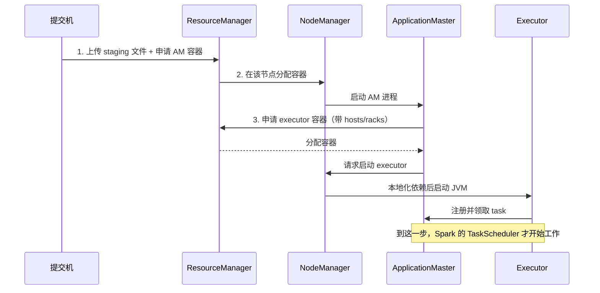
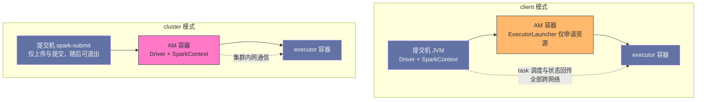
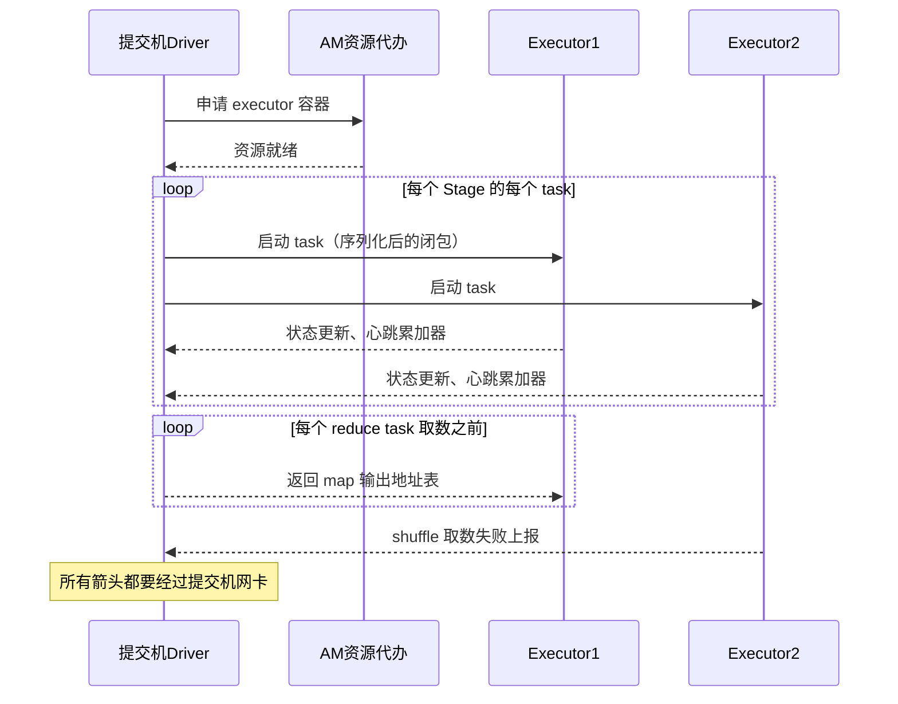
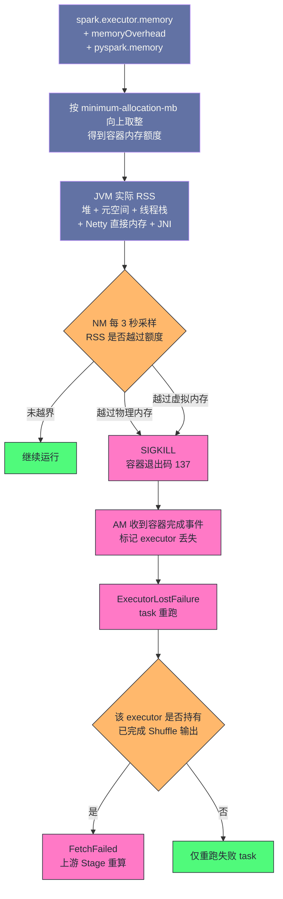
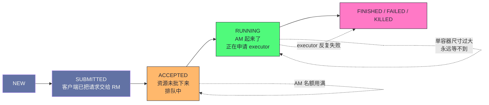
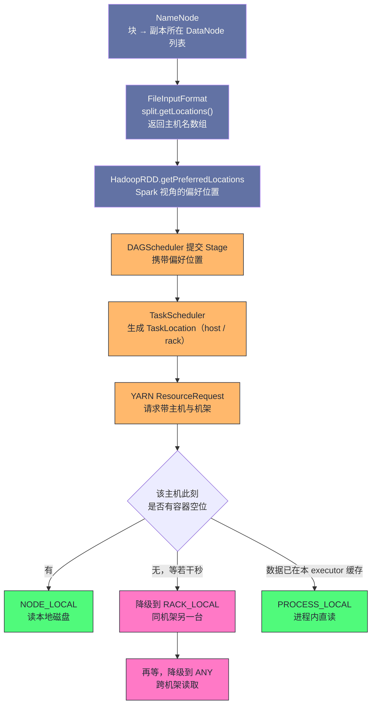

# 8. Spark on YARN 部署与资源约束：进程归属、容器边界与依赖分发

**摘要：**

Spark 的调度器只在 JVM 内部决定"哪个 task 去哪台机器"，而"那台机器上究竟还有没有容器空位"这个问题的答案，从来不在 Spark 手里。把 Spark 摆到 YARN 上，本质上不是给命令加一个 `--master yarn`，而是把进程归属、资源计量、容器边界、数据位置与依赖分发这五件事一并交给一个外部系统裁决；此后真正的调优，多半发生在 Spark 与 YARN 的接口上，而不是发生在 Spark 内部。

这篇文章沿五问推进：先界定 YARN 在这套组合里扮演的角色、它从 Spark 手里拿走了哪些决定权；再说明 client 与 cluster 两种模式到底把 Driver 放在了谁的机房里，以及由此派生的断连、网卡与退出码语义；然后把 YARN 的两个账本——虚拟核（vcore）与内存——与 `spark.executor.cores`、`spark.executor.memory` 的换算关系算清，说明容器数为什么由先见底的那一本账决定；接着把"容器被杀"这条链从 JVM 的堆外内存一路追到 exit 137 与 `ExecutorLostFailure`，并解释 `spark.yarn.maxAppAttempts` 带来的重启为什么不是断点续跑；随后落到数据本地性的三跳与 `spark.locality.wait` 的等待代价，以及 jar 与依赖分发为什么会"每次都要传"；最后把边界与反例摊开，包括那些从旧年代抄来、在 Java 17 上已经失效的参数。

文章口径为 Spark 4.3.0（2026-10-30 发布，4.x 预编译 Scala 2.13）；4.x 收紧了 JVM 与 Hadoop 的兼容要求，YARN 集成是否随发行版默认打包也因下载包而异，凡涉及打包与默认值处，以对应版本文档为准。

**关键词（Keywords）**: **client模式**, **cluster模式**, **memoryOverhead**, **exit 137**, **maxAppAttempts**, **spark.yarn.jars**, **数据本地性**, **stagingDir**, **vcore**, 队列

---

## 第 1 章 谁在替 Spark 做决定

### 1.1 一次提交动作里的三次交接

行文从一条最普通的命令开始。`spark-submit` 被执行的那一刻，看起来只是启动了一个 JVM，实际触发的是三次跨越进程边界的交接（Handover）。

第一次发生在提交机与 ResourceManager（RM）之间。客户端把作业的字节码、配置文件与依赖清单写进一个默认位于 HDFS 上的暂存目录（staging directory），再把"我要一个 ApplicationMaster（AM），它需要若干兆内存、若干 vcore、放在某个队列里"这层意愿翻译成资源请求，交给 RM。第二次发生在 RM 与某台 NodeManager（NM）之间：RM 按调度器的判断挑一个节点，让那台机器上的 NM 起一个容器，容器里跑的是 AM。第三次发生在 AM 与其余 NM 之间：AM 替应用向 RM 申请 executor 容器，拿到之后通过容器管理协议让对应的 NM 启动进程，这些进程启动起来、连回 Driver 报到、拿到 task，作业才真正开始计算。

这三次交接有一个共同点：它们的成败、快慢与落点，都不由 Spark 的调度器决定。Spark 内部那套 DAGScheduler 与 TaskScheduler 只在"容器已经属于我"之后才开始工作，在此之前的排队、等待、分配、落点，全由 YARN 说了算。因此当有人抱怨"作业慢"，第一步要分清慢在哪一段：是 task 跑得慢，还是 task 根本没被允许跑。

下面这张图把三次交接按时间顺序排开，注意每一次箭头跨越的都是进程边界，而 Spark 的调度代码只在最后一步之后才登场：



图中后两步（executor 注册、领取 task）之后，TaskScheduler 才算真正接管；此前的上传与分配都算外部条件。

### 1.2 为什么要把资源管理交出去

2013 年前后，Spark 面对的问题不是"能不能算得快"，而是"能不能跟别人共用一批机器"。Standalone 模式下的资源划分是静态的：每台 worker 报上来的内存与核数在进程启动那一刻就定死，之后谁闲谁忙全凭运气，一个作业把队列吃满，别的作业只能排队等着人工干预。YARN 把"机器上有多少可用资源"变成 RM 手里一本动态账，把"谁能用多少"变成队列配额，把"用完何时归还"变成容器的生命周期。这三件事恰好是计算框架最不愿意自己维护的部分。

反过来设想不交出去的代价：要实现同等效果，就得自己写多租户隔离、优先级、抢占、队列配额、节点故障探测与资源回收，而这些能力与"分布式计算"这件事本身几乎没有关系。把资源管理做成独立一层，让多种计算框架共用同一批机器，是 Hadoop 2 那次拆分留下的最大遗产；Spark 选择接入而不是重造，省下的是整个调度层的实现与运维成本。

不过交出去不是免费的。最直接的三条代价是：Spark 无法再假设"申请到的容器马上就到"，无法再假设"这台机器上的 executor 数量稳定"，也无法再假设"昨天放在本地的依赖今天还在"。后面几章讲的，几乎都是这三条假设被打破之后的连锁后果。

### 1.3 契约的五个条款

把 YARN 与 Spark 之间的约定拆开看，可以归成五个条款。每一条都有一方是决定者、一方是接受者，也都有违背之后的具体症状：

| 契约条款 | YARN 侧的决定者 | Spark 侧的旋钮 | 违背之后的症状 |
|---|---|---|---|
| 进程归属 | AM 由 RM 起在容器里；client 模式的 Driver 留在提交机 | `--deploy-mode` | 客户端断开则作业失败；Driver 侧资源不进队列账本 |
| 资源计量 | `yarn.nodemanager.resource.*`、`yarn.scheduler.*` | `spark.executor.cores`、`spark.executor.memory`、`spark.executor.instances` | vcore 先见底而内存闲置；容器请求被上限截断 |
| 容器边界 | NM 的物理内存与虚拟内存检查 | `spark.executor.memoryOverhead`、`spark.executor.memoryOverheadFactor` | exit 137、`ExecutorLostFailure`、task 反复重跑 |
| 位置偏好 | Capacity 或 Fair 调度器的延迟调度 | `spark.locality.wait` 及其分级参数 | task 以 ANY 级别启动，读数据跨机架 |
| 依赖分发 | 本地化缓存与 staging 目录 | `spark.yarn.jars`、`spark.yarn.archive`、`--jars`、`spark.yarn.stagingDir` | 每次提交上传数百 MB；跨用户提交被拒 |

这五条里，前三条决定了作业"能不能跑"和"能跑多大"，后两条决定了"跑起来以后快不快"。很多调优之所以无效，是因为把后面两条的手段用在了前面两条的问题上，譬如用加大 `spark.locality.wait` 去治一个容器根本起不来的作业。

### 1.4 一个贯穿全文的作业

后面的论述需要一个具体的着力点。笔者这里设一个电商数仓的夜间结算作业 `settle_daily`：从 HDFS 读入当天的订单明细与商品维表，各按 200 个分区读入，按商品标识连接、按品类汇总成交额，最后写回数仓的宽表。集群按 60 台节点估，单节点 16 vcore、64 GiB 内存，管理员把可分配额度划成 14 vcore 与 56 GiB；作业提交进 `etl` 队列，队列上限按 400 vcore 与 1.6 TiB 配。

初期这套作业用 client 模式提交，8 个 executor，每个 8 GiB 堆、4 vcore。随后一周里它连续暴露了几个问题：某个夜里运维重启跳板机，作业跑到一半整体失败；把核数从 4 调到 8 之后，容器开始被 YARN 杀掉；某次版本升级后，提交耗时从十几秒涨到一分多钟；还有一次，任务日志里大片显示 `ANY`，而数据明明就在本地。这几件事看似互不相干，却分别对应上面那张表的五行。

### 1.5 一个比喻：装修队与物业

Spark 像一支自带工具的装修队，YARN 是写字楼的物业。物业不管你怎么刷墙，只管三件事：给你哪几间房、每间房限多少电、几点进场几点清场。装修队手艺再好，房间没批下来也只能在楼下等；房间批下来了，还得按物业的总电表用电，超了直接拉闸；进场之前，工具箱要从仓库搬到楼里，搬一趟算一趟。

这个比喻可以一直用下去，因为三处偏差正好对应本文三章的内容。其一，"面积"是建筑面积不是使用面积——vcore 是虚拟核，物业给你 14 个工位不代表有 14 个工人同时干活。其二，"限电"按整间房的总表算——容器内存含堆内与堆外，所以堆设成 8 GiB 的容器往往要申请 9 GiB 才安稳。其三，"搬工具箱"每次进场都要做，除非提前放进楼里的公共仓库，这就是 `spark.yarn.jars` 要解决的问题。

---

## 第 2 章 两种部署模式：Driver 坐在谁家的机房里

### 2.1 三类进程与一个位置问题

一个跑在 YARN 上的 Spark 应用由三类进程组成：提交机上的客户端 JVM、集群里的 AM、集群里的若干 executor。三类进程里，executor 的位置由调度器随机决定，AM 的位置由 RM 挑，唯一会随配置改变的是 Driver 的位置——而 Driver 恰恰是这三者里唯一"有状态、要长期在线、且被所有 executor 反向连接"的角色。

cluster 模式下，Driver 就住在 AM 容器里。启动 AM 的 `ExecutorLauncher` 与 Driver 线程共处一个 JVM，AM 既向 RM 申请资源，也调度 task，角色合并成一个。client 模式下，Driver 留在提交机，AM 容器里跑的是一个精简版的 `ExecutorLauncher`，它唯一的工作是替远端的 Driver 向 RM 申请 executor 容器，自己不调度任何 task。

这句话值得重复一遍：**client 模式的 AM 不是 Driver，它只是一个替远端 Driver 跑腿的资源代办**。很多关于 client 模式的误解——譬如"client 模式没有 AM"——都源于把这层关系搞混了。

两种模式的进程归属画成图，差异一目了然：



图中的虚线连接才是关键：client 模式下，每一次 task 启动、每一次状态更新、每一次心跳都要穿过提交机与集群之间的那条链路；cluster 模式下这些流量全部在集群内网完成。

把两种模式按维度并排放好，选择就变成了查表：

| 维度 | client 模式 | cluster 模式 |
|---|---|---|
| Driver 所在进程 | 提交机上的 `spark-submit` JVM | AM 容器内的 JVM |
| AM 的职责 | 只向 RM 申请 executor 容器 | 既是 AM 又是 Driver |
| 客户端断开之后 | 作业失败，Driver 随之消失 | 作业继续，只是失去跟踪入口 |
| Driver 内存记在哪本账 | 提交机本地，不进队列配额 | 队列配额，占用一个 AM 容器 |
| 日志从哪里拿 | 提交终端直接可见 | History Server 或 `yarn logs -applicationId` |
| 提交进程何时退出 | Driver 结束即退出 | 由 `spark.yarn.submit.waitAppCompletion` 决定 |
| 典型用途 | 交互式调试、Spark Shell、短作业 | 生产批处理、长作业、无人值守调度 |

### 2.2 client 模式的三个后果

client 模式的第一个后果是**断连即失败**。Driver 是唯一持有作业状态的角色：stage 划分、task 队列、Shuffle 输出的地址表全在它的堆里。一旦提交机进程消失、或它与集群之间的网络断开，executor 的心跳与状态更新就无处可去，会一直重试到 `spark.network.timeout`（默认 120 秒）耗尽而被判定失联，AM 也会因联系不上 Driver 而结束应用。`settle_daily` 那次"跳板机重启导致作业失败"，错不在计算，而在记账的人被抬走了。

第二个后果是网卡流量。数据面（shuffle 取数）走 executor 之间的直连，不经过 Driver，但控制面全要过 Driver：task 启动与状态更新、`MapOutputTracker` 的地址查询（每个 reduce task 取数前都要问 Driver"这批输出在哪"）、取数失败上报、`collect`/`take` 的结果回传，以及广播表从 Driver 的 BlockManager 分发出去。这些消息单条都很小，但条数随 executor 数乘 task 数放大，一个几百 executor、几十万 task 的作业，控制面流量足以把一条千兆链路打满。

下面这张时序图把 client 模式下的往返流量摊开，注意循环体里的每一条消息都要出一次网关：



第三个后果比较隐蔽：**Driver 的资源不进队列账本**。队列统计的是 AM 与 executor 的容器，client 模式下 Driver 跑在提交机上，它吃掉多少内存、多少 CPU，YARN 完全不知道。这带来两个副作用：一是容量规划会低估实际消耗，网关机上同时跑五个 Driver 就可能互相把对方挤死；二是 Driver 的堆大小与 GC 行为不受任何集群侧策略约束，一个 `collect` 大结果集的作业可以在网关机上把 JVM 撑爆，而队列里看起来一切正常。

### 2.3 cluster 模式的两份代价

cluster 模式把 Driver 搬进 AM 容器，上面那三个后果一并消失，代价则落在另外两处。

第一处是调试成本。Driver 的 stdout、stderr、异常栈全在容器里，容器结束后日志被聚合到 YARN 的日志目录，要么等 History Server 抓取，要么用 `yarn logs -applicationId` 拉。`System.out.println` 这种在 client 模式下最顺手的排查手段，在这里要多等一个日志聚合周期。这不是致命缺陷，但它确实改变了开发循环的节奏：client 模式是"改一行、跑一次、立刻看到"，cluster 模式是"改一行、提交、等日志"。

第二处是重启成本。AM 容器一旦被杀，整个应用要从头再来一遍（第 5 章详述）。client 模式下 Driver 在提交机上，除非提交机出事，Driver 不会因为集群侧的容器回收而死；cluster 模式下 Driver 与 AM 同命，AM 被回收就是 Driver 被回收，作业重来。这条差异在"集群资源紧张、经常发生抢占"的环境里尤其要紧。

顺带纠正一处年代感：早期脚本里常见的 `--master yarn-cluster` 写法在 2.x 之后已经不再是推荐形态，现行写法是 `--master yarn --deploy-mode cluster`；同理 Spark Shell 用 `--master yarn --deploy-mode client`。照抄旧脚本时，这一处往往最先暴露出它所出自的年代。

### 2.4 `spark.yarn.submit.waitAppCompletion` 与退出码语义

cluster 模式下有一个参数直接决定"提交进程什么时候返回"，它就是 `spark.yarn.submit.waitAppCompletion`，默认 `true`。取 `true` 时，`spark-submit` 在提交完成之后并不退出，而是留在原地轮询应用状态，直到应用结束才返回，并把应用的成功与失败映射成退出码（成功为 0，失败为非 0）。取 `false` 时，提交进程在应用进入运行态之后就返回 0，此后作业是死是活，与它无关。

client 模式下这个参数没有实际意义：Driver 就是提交进程本身，它本来就要活到作业结束，谈不上"等不等"。

这条语义对上游调度系统是决定性的。DolphinScheduler、Azkaban、Oozie 这类工具判断一次提交成不成功，靠的几乎都是退出码。把 `waitAppCompletion` 设成 `false` 再用退出码判断，等于把所有失败都记成成功，结果要靠人工去翻 History Server；设成 `true`，提交进程会一直占着调度槽位到作业结束，长作业的调度并发因此受限——又是一处取舍，不是一处"正确配置"。

### 2.5 选择判据

把上面的差别收成一句判据：**需要人在回路里的场景用 client，不需要人、但需要活很久的场景用 cluster**。开发调试、Spark Shell、`collect` 回本地看结果的探索性分析，Driver 放在本地最方便；生产批处理、流式写入、由调度系统无人值守触发的作业，Driver 必须放进集群，否则一次网络抖动就能让整晚的账单重算。

中间情形也值得说清。要读提交机的本地文件时，client 是唯一选择，因为 cluster 模式的 Driver 在集群节点上，看不到提交机的磁盘；Driver 侧要做大量计算时，AM 容器的内存要留足，而那笔内存在吃队列配额；作业几分钟就跑完时，cluster 的 AM 启动与日志延迟可能超过计算本身，client 反而划算。

---

## 第 3 章 两个账本：vcore 不是核，内存不是堆

### 3.1 YARN 用两个数字描述一台机器

RM 眼里的一台机器，由两个数字刻画：能拿出多少内存（`yarn.nodemanager.resource.memory-mb`），能拿出多少个虚拟核（`yarn.nodemanager.resource.cpu-vcores`）。Hadoop 的默认口径是 8 GiB 与 8 个，实际集群里当然远不止这个量级，但默认值透露了设计意图：vcore 与内存是两本独立的账，互不换算。

请求侧还有四个约束：内存请求会被向上取整到 `yarn.scheduler.minimum-allocation-mb`（默认 1024）的整数倍；超过 `yarn.scheduler.maximum-allocation-mb`（默认 8192）的请求会被削到上限；vcore 请求以 `yarn.scheduler.minimum-allocation-vcores`（默认 1）为粒度；超过 `yarn.scheduler.maximum-allocation-vcores`（默认 4）的请求同样会被削到上限。这四个默认值里藏着两个很常见的坑：一是默认的单容器内存上限只有 8 GiB，`spark.executor.memory=16g` 的请求会被悄悄削成 8 GiB 并留一条警告；二是默认的单容器 vcore 上限只有 4，`--executor-cores 8` 的请求会被削到 4，而作业配置里写着 8。

vcore 之所以叫"虚拟"核，是因为它默认只是调度名额，不是被隔离的算力。没有 cgroups 之类 CPU 隔离时，14 个 vcore 完全可能压在 8 个物理核上跑，谁抢到谁算；管理员把 `yarn.nodemanager.resource.cpu-vcores` 设得比物理核多，等于声明"允许超卖"，设得少则是保守留余量。

还有一层更容易被忽略：调度器是否把 vcore 计入分配，取决于它用的是哪个资源计算器。Capacity 调度器的资源计算器默认是只比较内存的那一档，只有管理员显式换成按主导资源比较的实现，vcore 才真正参与排队；Fair 调度器则默认按主导资源比较。两边默认不同，于是同一个 `spark.executor.cores` 在两类集群上的效果可能完全不一样——这也是"照搬别人的参数不灵"的一个结构性原因。

### 3.2 从 Spark 参数到容器请求

Spark 侧的四个参数最终被翻译成 YARN 侧的一次容器请求，翻译关系是固定的：

| YARN 侧参数 | Hadoop 默认口径 | 约束的东西 | 对应的 Spark 参数 | 错配症状 |
|---|---|---|---|---|
| `yarn.nodemanager.resource.memory-mb` | 8192 | 单节点可分配内存总量 | `spark.executor.memory` + `spark.executor.memoryOverhead` | 节点内存用不尽，或容器起不来 |
| `yarn.nodemanager.resource.cpu-vcores` | 8 | 单节点可分配 vcore 总数 | `spark.executor.cores` | vcore 先见底而内存闲置 |
| `yarn.scheduler.minimum-allocation-mb` | 1024 | 内存请求的取整粒度 | 无（间接受堆与 overhead 影响） | 小容器造成成片浪费 |
| `yarn.scheduler.maximum-allocation-mb` | 8192 | 单容器内存上限 | `spark.executor.memory` + overhead | 请求被下调，堆被悄悄压小 |
| `yarn.scheduler.minimum-allocation-vcores` | 1 | vcore 请求粒度 | `spark.executor.cores` | 无（粒度已足够细） |
| `yarn.scheduler.maximum-allocation-vcores` | 4 | 单容器 vcore 上限 | `spark.executor.cores` | cores 写 8，实际只给 4 |
| `yarn.resourcemanager.am.max-attempts` | 2 | AM 尝试次数的全局上限 | `spark.yarn.maxAppAttempts` | 应用侧设得更大也被截断 |
| `yarn.scheduler.capacity.maximum-am-resource-percent` | 0.1 | AM 可占用的队列资源比例 | 无（只能由管理员调） | 队列有空闲，应用一直 ACCEPTED |

表右侧那列"错配症状"决定了排查入口。看到 executor 数只有预期一半，不要先怀疑调度器，先算两个除法：节点内存除以单容器内存、节点 vcore 除以单容器 vcore，看哪个商更小。

顺带把参数的生效层次说清。同一份配置可以从四个地方进来，优先级从高到低是：代码里的 `SparkConf`、`spark-submit` 的 `--conf` 与专用选项、`spark-defaults.conf`、Spark 内置默认值。YARN 侧的配置则走另一条路：属于客户端行为的可以经 `spark.hadoop.*` 前缀带进去（譬如 `spark.hadoop.fs.defaultFS`），属于 NM 与 RM 的配置（内存总额、vcore 总额、调度器资源计算器、AM 名额比例）根本无法由提交方修改，只能由集群管理员在服务端调整。把服务端参数写进 `--conf` 里，是一种很常见的无效努力。

### 3.3 一个算例：谁先见底

回到 `settle_daily`。每个 executor 8 GiB 堆、4 vcore，堆外按默认比例给：`spark.executor.memoryOverhead` 取 `max(384 MiB, 0.10 × 8192 MiB)`，即 819.2 MiB。容器内存请求是两者之和 9011.2 MiB，再按 1024 的粒度向上取整，得到 9216 MiB，也就是 9 GiB。于是 YARN 眼里这个容器是"9 GiB 内存 + 4 vcore"。

节点可分配额度是 14 vcore 与 56 GiB。按内存算，`56 ÷ 9 = 6.2`，能放 6 个；按 vcore 算，`14 ÷ 4 = 3.5`，能放 3 个。两个数字取小，实际每节点 3 个 executor，12 个 vcore 用掉，内存只用了 27 GiB，剩下 29 GiB 摆在那里无人可用。这就是"节点明明还有二十多 GiB 却排不进第四个 executor"的算术解释——**容器数由先见底的那本账决定，而不是由总量决定**。

把核数从 4 降到 2，vcore 侧变成 `14 ÷ 2 = 7`，内存侧仍是 6，于是内存先见底，每节点 6 个 executor，vcore 只用掉 12 个，反过来浪费 2 个。两条曲线在某个配比上交叉，交叉点附近才是两个账本同时见底的状态。这个配比可以算出来：设单容器内存为 `m`、vcore 为 `c`，希望 `56 ÷ m ≈ 14 ÷ c`，即 `m ÷ c ≈ 4`，也就是每 vcore 配 4 GiB 左右。这只是让两个账本同时见底的算术结论，不代表任务在这个配比下一定最快——真正决定快慢的还有任务的 I/O 密度与 GC 压力。

这里要补一句前面提过的事实：若集群的调度器只按内存比较，上面"vcore 先见底"的推导就不成立。调度器会按内存放下 6 个容器，每个容器仍声称占 4 vcore，于是一台 14 vcore 的节点上坐着 24 vcore 的申请量，物理核被三倍超卖。表现出来不是"容器放不下"，而是"容器都起来了，但每个 task 都变得很慢"，因为 CPU 在抢。同一个参数，在两种调度器下产生两种完全不同的症状，这是 YARN 侧调优最容易被误判的地方。

### 3.4 并行度从容器数长出来

能同时跑的 task 数，等于 executor 数乘以每 executor 的核数。乘法里有两个外部约束：3.3 节算出的容器数上限，以及队列允许多少应用同时跑。`spark.executor.instances`（命令行写作 `--num-executors`）只是"我要几个"，不是"我能拿到几个"；在 YARN 上它是一份申请，兑现与否取决于队列当时的余量。

动态资源分配（Dynamic Resource Allocation）常被当成"自动解决并行度"的银弹，它在 YARN 上有一个硬前提：必须启用外部 Shuffle 服务（External Shuffle Service，ESS）。原因不难推：executor 被缩掉之后，它写下的 Shuffle 文件仍要被下游读取，只有把这份数据的服务从 executor 搬到 NM 的辅助服务里，缩容才不带走数据。启用 ESS 要把 Spark 提供的 Shuffle 服务 jar 放进 NM 类路径、在 `yarn.nodemanager.aux-services` 里注册、重启 NM——集群级变更，不是提交时加个参数就能生效。很多"动态分配开了但 executor 数纹丝不动"的现场就卡在这一步。

两个账本算到这里，只能回答"能放几个容器"。容器放下来之后守不守得住，是另一本账——那也是下一章的入口。

---

## 第 4 章 容器被杀：exit 137 这条链的每一环

### 4.1 一行日志

现场最常见的一行日志，形如（措辞随版本略有出入）：

```
ExecutorLostFailure (executor 3 exited caused by one of the running tasks)
Reason: Container killed by YARN for exceeding memory limits.
52.6 GB of 50 GB physical memory used.
Consider boosting spark.yarn.executor.memoryOverhead.
```

这段文字拆开看有三层信息：被杀的是 executor 3；原因是"超过内存上限"，物理内存用了 52.6 GB 而上限是 50 GB；YARN 给出的建议是加大 `spark.yarn.executor.memoryOverhead`。三层信息里，第三层是最容易误导人的——它只说了一种可能，而实际的因果链要长得多。

### 4.2 链条的每一环

容器被杀这件事，从"应用多用了几个字节"到"task 重跑"，中间隔着五道环节，每一道都有自己的判据。

第一环是容器内存上限的确立。申请量等于 `spark.executor.memory` 加 `spark.executor.memoryOverhead`，用 Python 时还要加 `spark.executor.pyspark.memory` 预留的份额（未显式设置时，Python worker 的占用只能靠 overhead 兜着）。三者之和按 `yarn.scheduler.minimum-allocation-mb` 的粒度向上取整，就是 NM 记在这个容器头上的"额度"，额度里没有"堆外可以多占一点"的余地。

第二环是进程真实占用的增长。JVM 进程的常驻内存（Resident Set Size）远不止堆：元空间（Metaspace）随类加载增长，代码缓存随 JIT 编译增长，每个线程有独立的栈（`-Xss` 决定），Netty 为 RPC 与 Shuffle 分配的堆外直接内存随并发与数据量增长，此外还有 GC 自身的辅助结构、JNI 调用、内存映射文件。这些项目加起来，通常占堆的百分之几到十几，比例随核数、任务类型、序列化方式浮动。

第三环是 NM 的周期检查。NM 里有一个容器监控线程，按 `yarn.nodemanager.container-monitor.interval-ms`（默认 3000 毫秒）的节奏采样每个容器的资源使用，把它与额度比较。比较分两路：物理内存一路由 `yarn.nodemanager.pmem-check-enabled` 控制，虚拟内存一路由 `yarn.nodemanager.vmem-check-enabled` 控制，后者用的上限是额度乘以 `yarn.nodemanager.vmem-pmem-ratio`（默认 2.1）。两路都可能触发杀容器，日志措辞不同：前者是 "running beyond physical memory limits"，后者是 "running beyond virtual memory limits"。

第四环是信号。触发之后，NM 向容器进程发 SIGKILL（极少数情况是内核的 OOM killer 抢先动手，此时 NM 日志里没有上面那行，只能从系统日志里找）。SIGKILL 不可捕获、不可清理，进程当场消失；shell 记录的退出码是 128 加信号编号 9，即 137。

第五环是 Spark 侧的传导。executor 消失后，AM 把它标记为丢失，其中运行的 task 全部作废，`ExecutorLostFailure` 抛给 TaskScheduler，task 重新调度到别处。若这台 executor 恰好持有已完成的 Shuffle 输出，下游还会收到 `FetchFailed`，触发对应 Stage 的上游重算——一笔内存越界，最后可能演变成整段 Stage 重跑。

把五环连起来画，链条的形状很清楚：



链上只有一个地方是"用户可调"的，就是第一环。其余四环都是既定机制，不会因为改参数而消失。

### 4.3 为什么 overhead 是按比例给的

既然堆外开销与堆大小没有直接关系，为什么默认值要按堆的 10% 给，而不是给一个固定值？

答案是这些开销虽不与堆成正比，却与"executor 的规模"成正比：核数越多，并发 task 越多，线程栈与 Shuffle 缓冲越大；堆越大，单 task 处理的数据通常越多，Netty 直接内存与序列化缓冲也越大。按比例给是粗糙但方向正确的启发式，下限 384 MiB 用来兜住"堆很小而 JVM 本身要占几百兆"的极端情况。

Spark 3.3 之后这个比例本身也可配：`spark.executor.memoryOverheadFactor` 默认 0.10，按集群实测想要更贴合的系数（譬如 0.15）时用它，比逐个改写 `memoryOverhead` 省事。同族的 `spark.driver.memoryOverhead` 管 AM 容器的堆外份额，与 executor 那一份互不影响。

### 4.4 一个被忽略的放大器：核数

`settle_daily` 那次"把核数从 4 调到 8 之后容器开始被杀"，机制就藏在 3.1 与 4.2 的交叉处。核数翻倍带来三件事：同时运行的 task 翻倍，线程栈总量翻倍；Netty 为 Shuffle 与 RPC 分配的直接内存翻倍；单 executor 的堆内并发压力翻倍，GC 更频繁、元空间增长更快（每个 task 的闭包类都要加载）。三件事加起来，堆外开销很容易从 800 MiB 涨到 1.5 GiB 以上，而 overhead 仍按 10% 给，于是差额只能靠"越界"来结算。

这条因果链解释了一种看似矛盾的现象：**给 executor 加核，反而让作业更不稳定**。错不在加核，而在加核时只改了 `spark.executor.cores`，没同步调 overhead、没重算容器内存。YARN 按容器整体记账，容器内部资源此消彼长，它不关心你是堆不够还是堆外不够。

### 4.5 退出码速查

不只是一个 137，容器退出的方式有好几种，分辨它们比记住参数更重要：

| 退出码 | 信号 | 谁发出的 | 常见成因 | 判据 |
|---|---|---|---|---|
| 137 | SIGKILL（128+9） | NM 的容器监控，或内核 OOM killer | 物理内存越界、虚拟内存越界、节点整体内存压力 | AM 日志有 "exceeding memory limits" 或 "beyond virtual memory limits" |
| 143 | SIGTERM（128+15） | RM、NM 或外部命令 | 队列抢占、`yarn application -kill`、节点优雅下线、动态分配缩容 | 同一时刻有抢占或 kill 记录，容器日志正常收尾 |
| 1 | 无 | JVM 自身 | 应用异常、类找不到、`JAVA_HOME` 指错 | 容器 stderr 的第一行通常就是答案 |
| 0 | 无 | 正常退出 | 任务完成，或 executor 被主动优雅关闭 | 无需处理 |

137 与 143 的区分在排障时非常有用：137 是"被剥夺"，通常意味着资源不够；143 是"被要求退出"，通常意味着调度层做了决定。把 143 当成内存问题去加 overhead，是一类很常见的空转。

### 4.6 排查顺序

看到 `ExecutorLostFailure`，按下面的顺序走，比直接改参数省时间。

第一步，去 AM 日志里找那行 "Container killed by YARN"。找不到它，说明杀容器的不是 NM，要去系统日志里找 OOM killer，或者按 143 的路子查抢占。

第二步，看越界的幅度。52.6 GB 对 50 GB 这种"刚过线"，通常意味着某次尖峰（大 Shuffle、广播、`collect`、Python worker 批量拉取）撞上了额度，适度增加 overhead 或错开尖峰即可；80 GB 对 50 GB 这种量级差，说明堆内已经超配，加 overhead 只是把问题往后推，得回去查缓存与 Shuffle 的实际占用。

第三步，看被杀的是哪一类 executor。只有 Python 作业才需要关心 `spark.executor.pyspark.memory`；只有开了堆外缓存或 Netty 高并发的作业才需要关心直接内存；任务全是小对象、GC 频繁的作业，则要先怀疑堆的分配而不是堆外。

第四步，确认杀容器的是物理内存还是虚拟内存。虚拟内存越界在现代 JVM 上常是误伤：JVM 预留的地址空间远大于实际使用，而 `vmem-pmem-ratio` 默认只给 2.1 倍余量，于是"实际只用了一半内存"的容器也可能因虚拟地址超限被杀。这种情形加 overhead 未必有用，关掉 `yarn.nodemanager.vmem-check-enabled`（需管理员决策）才对症——那是拿掉一道保护换稳定，属于权衡而非修复。

### 4.7 加 overhead 的代价

overhead 不是白给的空间，它把容器整体撑大，带来三个连锁后果。

其一，单节点可放容器数下降：9 GiB 的容器在 56 GiB 节点上能放 6 个，加到 12 GiB 只剩 4 个。其二，队列配额吃紧：overhead 计入容器内存，也就计入队列消耗。其三，这部分内存永远用不上：堆外空间不会变成缓存，只会躺在那里等元空间与直接内存来消耗。

所以正确的做法不是"先加到 4 GiB 再说"，而是先按 4.6 的顺序定位，再按幅度给余量。经验上，给到"平常占用峰值再加两三成"就够；若发现需要给到一倍以上，说明容器内部的资源分配本身有问题，扩额度只是把 OOM 换成了低效。

### 4.8 一处年代感：从 PermGen 到 Metaspace

早期笔记里常见的一段配置是给 Driver 加 `-XX:PermSize=128M -XX:MaxPermSize=256M`，理由是"cluster 模式下 Driver 的永久代默认偏小"。这条经验在今天的集群上已经不能用：JDK 8 起永久代被元空间取代，该参数在 JDK 8 上只会被忽略并打一行警告，而在 JDK 17 上会被 JVM 当作无法识别的选项直接拒绝启动——Spark 4.x 要求 Java 17，于是从旧脚本里抄来的这一行，效果是让每个 AM 容器起不来。

元空间时代的对应物是 `-XX:MaxMetaspaceSize`，默认不限（受容器内存额度约束），需要限制时用 `spark.driver.extraJavaOptions` 或 `spark.executor.extraJavaOptions` 传入。4.x 与某些 Hadoop 3.x 集群之间还有一层版本错位：集群的 NM 可能仍以 Java 8 或 11 运行，而 Spark 4 的容器需要 Java 17，这时要给 AM 与 executor 分别指定 JDK（`spark.yarn.appMasterEnv.JAVA_HOME` 与 `spark.executorEnv.JAVA_HOME`）。这已经不属于 Spark 参数调优，而是 YARN 侧的环境约束，具体做法以对应版本文档为准。

---

## 第 5 章 重试与排队：那些"没报错但没结果"的等待

### 5.1 `spark.yarn.maxAppAttempts` 与 AM 重启

AM 是应用的"大脑"，它同样跑在容器里，同样可能被杀、可能因节点故障消失、可能自己 OOM。YARN 对此的兜底机制是重试：AM 挂掉之后，RM 在别的节点上再起一个 attempt，应用不因此立刻失败。

重试次数由两个数字共同决定。应用侧用 `spark.yarn.maxAppAttempts` 表达意愿，它的默认值取自集群侧的 `yarn.resourcemanager.am.max-attempts`（Hadoop 默认 2）。集群侧那个数字是全局上限，应用侧设得再大也会被 RM 截断——这一点与 `maximum-allocation-mb` 削请求是同一类机制，都是"服务端说了算"。

默认 2 的意思很朴素：允许一次重试。它背后有一层考虑——AM 重启不免费，每多一次 attempt 就多付一次"从头算"的代价。

### 5.2 重启不等于续跑

这是全章最需要记住的一句话。新的 attempt 起来之后，AM 容器里跑的是应用自己的 `main` 方法，从 `SparkSession` 的创建开始，一路重跑到最后一个 Action。上一个 attempt 里已经完成的 Stage、已经写出的中间文件、已经提交过的 task，没有一个能被继承——Spark 没有跨 AM 的 Driver 状态恢复机制（作业级的检查点与 Streaming 的恢复是另一回事，它们恢复的是数据源位置与批次进度，不是 Driver 的堆）。

由此派生出三类具体风险。

第一类是重复写入。写 HDFS 用 `SaveMode.Overwrite` 尚可（第二次覆盖第一次），用 `Append` 就会写两遍；写数据库、发消息、调外部接口的作业，第二次执行就是第二笔副作用。`settle_daily` 若在写 MySQL 的环节被重启，账目会被加两次。这类作业要么做幂等（按批次号去重、按主键 upsert），要么把 `maxAppAttempts` 设成 1，让失败就停在失败上，交给人工判断——两种选择各有代价，前者的复杂度在应用侧，后者的可用性在集群侧。

第二类是资源浪费。作业跑了两个小时、完成八成 Stage 时 AM 被杀，第二次 attempt 就要从头再跑一遍；集群本来就紧张的话，这次重启还会挤掉别人的作业。把 `maxAppAttempts` 从 2 调到 5，等于允许同一份计算被重复五遍。

第三类是诊断失真。History Server 里会出现多个 attempt 记录，只看最后一次看不到首次失败原因，只看首次又不知道最后怎么结束；排查时要把 attempt 序号（`appattempt_..._000001` 这类编号）看全。

### 5.3 AM 什么时候会挂

AM 挂掉的常见原因有四类，它们与 executor 被杀的原因高度重叠，但后果重得多。

其一是 Driver 侧内存超限。cluster 模式下 Driver 在 AM 容器里，额度是 `spark.driver.memory` 加 `spark.driver.memoryOverhead`；用 `collect` 拉回几千万行、把大表广播出去、维护巨大的累加器，都会把 AM 撑爆，而 client 模式下同样的代码撑爆的是提交机。

其二是 AM 容器的堆外不足。原因与 4.2 相同，只是被杀的是 AM 而不是 executor。AM 的堆外开销通常比 executor 小，但它在整个作业期间一直存活，元空间只增不减，长作业的 AM 反而更容易在这一项上出问题。

其三是节点故障与网络分区。AM 所在节点宕机、AM 与 RM 之间的心跳超时，都会让 RM 判定 attempt 失败。

其四是依赖与环境的初始化失败。classpath 里缺一个类、`JAVA_HOME` 指向不存在的路径、staging 目录权限不足，都会让 AM 在启动阶段就退出。这类失败往往连续复现，重试几次之后应用以 FAILED 收场，而日志里只有一行 `Exit code: 1`。

### 5.4 executor 反复失败的自杀机制

单个 executor 被杀，Spark 会重跑 task，作业继续；但如果同一个应用里 executor 连续失败太多次，Spark 会主动把应用判死。阈值由 `spark.yarn.max.executor.failures` 控制，默认取 `max(2 × executor 数, 3)`；此外还有一个失败有效期窗口（`spark.yarn.executor.failuresValidityInterval`），配了之后窗口之外的失败不计入。

这个机制的理由一句话能说清：作业若注定要在某个坏节点上反复失败，让它快速失败比无限重试更省集群；没有它，一个坏盘节点导致的 Shuffle 读失败会演变成整晚的空转。

副作用是它会把"偶发的、跨节点的问题"放大成"作业失败"。当一个应用因为 executor 失败次数超限而 FAILED 时，真正该看的不是失败次数，而是失败分布的节点——若集中在同一两台机器，问题在机器；若均匀分布，问题多半在作业本身（overhead 不足、内存超配）。

### 5.5 队列：从提交到运行

`spark.yarn.queue`（命令行 `--queue`）决定应用进入哪个队列，默认是 `default`。队列不是标签，而是配额与调度策略的载体：Capacity 调度器为每个队列划出容量下限与上限，Fair 调度器按权重分配。

把一个应用从提交到结束的过程按状态排开，能看清"卡住"到底卡在哪一段：



图中自环的三处，对应三种不同的"没报错但没结果"。第一种是队列配额不足：队列上限 400 vcore，已有作业占了 380，新应用要 100，它就只能等前面的作业释放。第二种是 AM 名额用满：`yarn.scheduler.capacity.maximum-am-resource-percent` 默认只允许队列资源的一成用于 AM，一个队列里并行提交几十个小应用时，AM 名额会先于总容量耗尽，表现为队列明明有空闲内存，应用却停在 ACCEPTED。第三种最隐蔽：单个容器请求的尺寸大于任何一个节点能腾出的连续空间，请求永远无法被满足，应用停在 RUNNING 且容器数为零，AM 日志里反复出现等待容器的提示。

这一种不违反任何配置，因为每个参数单看都合法。`settle_daily` 若把 executor 内存设成 64 GiB，而单节点可分配只有 56 GiB，就落进这个坑；判断方法很直接，拿单容器内存去比节点可分配内存，比不过就是无解。

### 5.6 提交侧的三类对策

队列拥堵不是 spark-submit 能解决的问题，能做的只有三件事，各自的代价都很明确：

| 对策 | 做法 | 换来什么 | 付出的代价 |
|---|---|---|---|
| 提交侧限流 | 用单线程池或信号量控制并发提交，同一时刻只放一个作业进去 | 避免多个作业互相把队列挤满 | 提交吞吐下降，排队转移到了提交系统里 |
| 快慢分队列 | 长作业与短作业分属不同队列，各自设定容量 | 短作业不被长作业堵住 | 需要队列规划，队列间资源不能完全共享 |
| 单应用吃满 | 只有一个作业在跑时，把内存与核数顶到队列允许的上限 | 单作业最快完成 | 资源独占，别人无法使用，浪费在空转上 |

这三条都不是"消除等待"，而是"把等待挪到一个更可控的位置"。提交侧限流的实现可以简单到几行代码：

```java
// 为什么用单线程而不是线程池扩容：并发提交只会把排队从提交系统搬到 YARN 队列里，
// 而 YARN 队列里的等待是不可观测、不可重排的，提交系统里的等待至少可以编排优先级
ExecutorService gate = Executors.newFixedThreadPool(1);
gate.submit(() -> submitSparkJob(jobSpec));
```

代码本身很朴素，关键在于承认它只是把排队位置换了，并没有让队列变大。

---

## 第 6 章 数据本地性：从 HDFS 块位置到容器位置的三跳

### 6.1 一个被传颂过度的原则

"移动计算而不是移动数据"被引用的次数，大概超过它被准确理解的次数。它说的是一个成本判断：把代码与配置搬到数据所在的机器，比把数据搬到代码所在的机器便宜几个数量级。但要在 Spark on YARN 上成立，得先解决一个前置问题——**调度器怎么知道数据在哪台机器上**。

答案是一条三跳的链路。第一跳在存储侧：客户端读取 HDFS 时，NameNode 返回每个块的位置列表（按网络距离排序，近的在前）。第二跳在输入格式侧：`FileInputFormat` 把若干块切成一个输入分片（split），分片的 `getLocations()` 返回这些块所在的主机名；`HadoopRDD` 把它包装成 `getPreferredLocations`，这就是 Spark 视角里的"数据在这几台机器上"。第三跳在调度侧：DAGScheduler 在提交 Stage 时把这些偏好位置交给 TaskScheduler，TaskScheduler 再把它翻译成 YARN 的资源请求——请求里带主机名与机架名，YARN 的调度器据此决定把容器放在哪。

把三跳画出来，两个环节的"信息衰减"一目了然：



第一处衰减发生在第一跳到第二跳之间：NameNode 给的是"三个副本分别在哪些 DataNode 上"，而 split 是一段字节区间，可能覆盖多个块，`getLocations()` 只保留前若干个块的位置，且去掉了"哪个副本更近"这层信息。第二处衰减发生在第三跳到第四跳之间：偏好位置只是"偏好"，不是"约束"，YARN 完全可以把容器放到别处——它要照顾的是整台机器的利用率与队列的公平性，而不是某一个 task 的读取成本。

### 6.2 为什么容器落点不是点菜

很多人对本地性的第一层误解，是以为"申请了主机 A，容器就会落在主机 A"。实际情形是：Spark 向 YARN 提交的资源请求里，主机名只是一个优先级标记；RM 的调度器先看有没有满足该主机的可用容器，没有的话按自己的策略处理。Capacity 与 Fair 调度器都有"延迟调度"（Delay Scheduling）的设计：当请求无法在原位满足时，不立刻放宽本地性，而是让这个请求等若干个调度周期，等不到再降级。这个等待的时长由集群侧参数控制，与 Spark 的 `spark.locality.wait` 是两套独立的计时器。

于是"数据在本地却按 ANY 跑了"有两种成因：一种是 Spark 侧等待太短，task 没等到本地容器就被降级派发；另一种是 YARN 的延迟调度没等到空位，容器被放到别的机器上，Spark 只能按容器位置运行。前者的旋钮是 `spark.locality.wait`，后者在集群侧，提交方改不动。

### 6.3 Spark 侧的等待与降级

Spark 的本地性分五级，从近到远是 `PROCESS_LOCAL`、`NODE_LOCAL`、`NO_PREF`、`RACK_LOCAL`、`ANY`。`TaskSetManager` 在派发 task 时按级别从近到远找可用资源，找不到就等，等的时间由 `spark.locality.wait`（默认 3 秒）与它的三个分级参数控制：

```scala
val sparkConf = new SparkConf()
  // 各级等待的基准值；不单独设置分级参数时，三者都沿用这个值
  .set("spark.locality.wait", "3s")
  .set("spark.locality.wait.process", "3s")   // 进程内：数据已在本 executor 的缓存里
  .set("spark.locality.wait.node", "3s")      // 节点内：本地磁盘或同节点另一 executor
  .set("spark.locality.wait.rack", "3s")      // 机架内：同机架另一台机器
```

三个分级参数的意义不同。`process` 一级通常没有争议，数据已在本地内存里，等一下几乎必然划算；`node` 一级要看数据量，读本地磁盘与读同机架另一台，差距可能只有一次网络往返；`rack` 一级最微妙，等到它说明前两级都没空位，继续等的机会成本开始上升。

Spark 3.x 之后还有一个 `spark.locality.wait.legacyResetOnTaskLaunch`，默认 `false`。它控制的是"每次有 task 启动时是否重置等待计时"，关掉之后等待时间不会因为别的 task 启动而反复刷新，行为更可预测。这个参数存在本身就说明，本地性等待的语义在历史上曾经模糊过。

### 6.4 本地性只对第一个 Stage 有意义

这条结论值得单独列出来，因为它是本地性调优里最容易搞错的一层。

`getPreferredLocations` 有意义的场景只有一个：task 的输入来自外部存储，且这个外部存储能报出数据位置。作业的第一个 Stage（读 HDFS 的那一批 task）符合这个条件，被 `cache()` 住的分区也符合（`PROCESS_LOCAL`），但从第二个 Stage 开始，task 的输入变成了上一个 Stage 写下的 Shuffle 输出。Shuffle 输出的位置由"哪个 executor 跑了哪个 map task"决定，它在逻辑上没有"数据应该在哪个节点"的概念，于是 `preferredLocations` 为空，调度器按"哪有空位去哪"派发。

换句话说，`spark.locality.wait` 对 join、聚合、排序这些阶段一点作用都没有。一个作业在 Shuffle 之后大量出现 `ANY`，不是参数没调好，而是这个阶段本来就不存在本地性。把等待时间从 3 秒加到 30 秒，唯一的效果是让 task 晚 30 秒启动。

### 6.5 错位的三个来源

除了"Shuffle 之后无本地性"这层结构性原因，还有三个具体来源会让本地性落空。

其一是副本数与节点数不匹配。三副本的 HDFS 在几十台节点的集群上，意味着数据只存在于三个节点；若这三个节点恰好都被别的应用占满，本地性请求只能落空。小集群上这个问题不明显，节点数上百之后，`NODE_LOCAL` 的命中率会明显下降。

其二是分片与块的边界。`FileInputFormat` 按 `dfs.blocksize`（常见 128 MiB 或 256 MiB）切分片，一个分片可能只覆盖某个块的尾部几百字节，`getLocations()` 仍会返回那个块所在的节点；反过来，一个跨越两个块的分片会返回两组位置，调度器取其中一个，另一半数据必然要跨网络读。这类边界效应在分片数很多时累积起来不可忽视。

其三是机架感知没配。RACK_LOCAL 依赖网络拓扑脚本（`net.topology.script.file.name` 之类）把节点映射到机架；没配的话所有节点都在同一个默认机架下，`RACK_LOCAL` 与 `ANY` 在物理上没有区别。

| 本地性级别 | 数据在哪 | 传输路径 | 何时出现 | 该不该等 |
|---|---|---|---|---|
| `PROCESS_LOCAL` | 同一 executor 的 BlockManager | 进程内 | 分区已被缓存，或读的就是本 executor 的 Shuffle 输出 | 值得等，但这一级由缓存布局决定，不是等来的 |
| `NODE_LOCAL` | 同节点的磁盘或另一个 executor | 本地磁盘 / 回环 | 输入分片的首选位置恰好是本节点 | 值得等一到三秒 |
| `NO_PREF` | 无位置偏好 | 视数据源而定 | 非 HDFS 源、Shuffle 之后的 Stage | 无可等，直接派发 |
| `RACK_LOCAL` | 同机架另一节点 | 机架内交换机 | 首选节点无空位，且机架感知已配置 | 视数据量而定 |
| `ANY` | 任意节点 | 跨机架 | 前几级等待超时，或 Shuffle 之后 | 数据量小或等待成本更高时接受 |

### 6.6 怎么读日志里的本地性

判断一个作业的本地性是否健康，最直接的办法是数日志。Spark 在派发 task 时会打印一行形如（旧版格式，新版字段略有差异）：

```
INFO scheduler.TaskSetManager: Starting task 0.0 in stage 0.0 (TID 0, sandbox, PROCESS_LOCAL, 1260 bytes)
```

把整个 Stage 的这类行按最后一个字段统计一遍，就得到本地性分布。经验判据是：读 HDFS 的 Stage 里，`PROCESS_LOCAL` 与 `NODE_LOCAL` 合计占多数算健康；若 `ANY` 占了大头，先按 6.5 的三个来源排查，再考虑调等待；若 Shuffle 之后的 Stage 里 `ANY` 占多数，那是常态，不必处理。

还要提醒一句：本地性等级高不等于快。`NODE_LOCAL` 读的是本地磁盘，若这块盘正被别的容器打满 I/O，它可能比跨机架读内存还慢。本地性只消除了网络成本，没消除存储成本；把本地性当成性能的充分条件，是这类调优最常见的过度归因。

---

## 第 7 章 依赖分发：jar 怎样到达节点，以及为什么每次都要传

### 7.1 三份东西

一个 Spark 应用要送到集群上的东西有三类，它们的分发路径不同，出问题的表现也不同。

第一类是 Spark 自身的运行时 jar，`$SPARK_HOME/jars` 下通常有两百多个文件、合计几百兆。第二类是应用自己的 jar，往往只有几十兆，但它依赖的第三方库可能又带出一批。第三类是数据文件与归档：词典、配置文件、Python 虚拟环境、模型权重，分别走 `--files` 与 `--archives`。

三类东西的共同点是：节点上原本都没有，都要在容器启动前被"本地化"（localize）到工作目录。差别在于作用域——Spark 运行时 jar 对所有人一样，应用 jar 只对本应用有意义，数据文件只对本次运行有意义。作用域决定了哪一类应该走共享路径，哪一类只能每次传。

打包方式在这里还牵着一根线。带 Hadoop 的发行包自带 Hadoop 运行时，为避免类冲突默认不把 YARN 的 classpath 灌进 Spark；不带 Hadoop 的包反过来必须灌，否则连 HDFS 客户端都没有，开关是 `spark.yarn.populateHadoopClasspath`。4.x 各发行包的处理与 3.x 并不一致，是否仍默认打包 YARN 集成要看具体下载包，以对应版本文档为准。

### 7.2 不配 `spark.yarn.jars` 时发生了什么

默认情况下，`spark-submit` 会把 `$SPARK_HOME/jars` 下的每一个 jar 上传到本次应用的 staging 目录，再由各节点的 NM 从 HDFS 拉到本地。这个动作发生在每一次提交里，与集群上是否已经有一份完全相同的 jar 无关。

"每次都传"的根源在于作用域：这批文件被登记为"本次应用的资源"，而不是"集群的共享资产"。YARN 的本地化缓存以资源为键，键里带着资源的修改时间与大小；两次提交各自上传一份副本，即便内容完全一致，在 YARN 看来也是两份不同的资源，缓存无法复用。此外，staging 目录在应用结束后默认会被清理（`spark.yarn.preserve.staging.files` 为 `false`），上一份副本连痕迹都不留。

后果有三层。最直接的是提交变慢：几百兆文件在跨机房链路上传一两分钟是常事。其次是 HDFS 压力：每个应用一份、每天成百上千次提交，小文件与写入流量都随之上涨。最后是启动变慢：每个节点的 NM 都要把两百多个文件从 HDFS 拉一遍。

### 7.3 配了之后发生了什么

把 jar 预先放到一个共享的 HDFS 路径，再让 Spark 直接用这个路径：

```properties
# spark-defaults.conf：指向集群共享路径，而不是提交机上的本地目录
spark.yarn.jars hdfs:///spark/jars/4.3.0/*
```

配置之后，`spark-submit` 不再上传本地 jar，而是把这批 HDFS 路径作为资源写进提交请求；NM 本地化时按资源的大小与修改时间判断缓存是否命中，命中就建符号链接，不重复下载。于是"每次提交传几百兆"变成了"每节点首次下载一次，之后一直复用"。

缓存的生命周期由 NM 管理，清理节奏由 `yarn.nodemanager.localizer.cache.cleanup.interval-ms` 与容量上限 `yarn.nodemanager.localizer.cache.target-size-mb` 共同决定。这两项是集群侧配置，提交方改不动；能做的只是保证共享路径稳定，让缓存尽量命中。

还有一个变体值得知道：`spark.yarn.archive` 接受一个 zip 包而不是一堆 jar 的路径。它把两百多个本地化条目压缩成一个，减少 RPC 与小文件开销，代价是每次升级要重新打包、无法增量替换。路径写成 `hdfs:///spark/spark-4.3.0-bin-hadoop3.zip` 这种形式即可。

### 7.4 `--jars`、`--files`、`--archives`

应用依赖走另一条路。`--jars` 里的每一项都会被单独登记为一个资源，也就意味着一个独立的本地化条目；十个 jar 就是十个条目，一百个就是一百个。`--files` 分发普通文件，`--archives` 分发归档（它会在工作目录下解压，Python 虚拟环境、conda 包通常走这条）。

这里有一个容易踩空的地方：从 HTTP 或 HTTPS 地址引用资源。容器节点未必能访问外网，即便能访问，让每个节点各自去下载也不划算。`spark.yarn.dist.forceDownloadSchemes` 就是为此存在的：把 `http,https` 填进去之后，Driver 先把远端资源下载到本地，再按普通文件上传分发，节点只从 HDFS 取。代价转移到提交机——几百兆的依赖在慢链路上会让提交时间变得不可接受。

### 7.5 staging 目录与权限

所有上传动作都落在一个暂存目录里，位置由 `spark.yarn.stagingDir` 决定；不配时默认取 `fs.defaultFS` 下当前用户的 home 目录（形如 `/user/<用户名>/.sparkStaging`）。这个目录以 0700 的权限创建，只允许提交用户自己访问——这个细节解释了一类很常见的报错。

当提交者与运行者不是同一个用户时，问题就来了。Livy 以服务账号提交用户请求、Oozie 以作业账号提交、调度平台以平台账号提交再切换到业务账号执行，都会撞上 `Permission denied` 或"目录已存在但不可写"。排查时先确认三件事：提交进程的 `HADOOP_USER_NAME` 或 Kerberos 主体是谁、`spark.yarn.stagingDir` 指向哪里、那个路径属主是谁。修法不是放宽到 777，而是给运行账号一个专属目录并显式配置。

另外两个参数值得配好。`spark.yarn.submit.file.replication`（默认 3）控制上传文件的 HDFS 副本数，小集群上可调低省空间，但要考虑故障时的可读性；`spark.yarn.preserve.staging.files` 设为 `true` 可保留 staging 目录，失败后能取原始 jar 与配置做取证，代价是 HDFS 上堆积文件。

### 7.6 一张对比表

把五种分发方式并排放在一起，选择就清楚了：

| 方式 | 作用域 | 首次成本 | 升级方式 | 典型失败模式 |
|---|---|---|---|---|
| 不配 `spark.yarn.jars` | 每个应用一份 | 每次提交上传，百兆级 | 无，跟随 `SPARK_HOME` | 提交慢、staging 目录膨胀、NameNode 压力 |
| `spark.yarn.jars` | 全集群共享目录 | 每节点首次下载一次 | 替换 HDFS 目录 | 忘记替换导致版本混跑 |
| `spark.yarn.archive` | 全集群共享单包 | 每节点首次下载一次 | 重新打包后替换 | 包内 jar 冲突、整包传输 |
| `--jars` | 每个应用 | 每个 jar 一个本地化条目 | 重新提交 | 条目过多、小文件 RPC 压力 |
| `--archives` | 每个应用 | 单个归档 | 重新提交 | 解压位置固定，需要自己拼 PATH |
| `spark.yarn.dist.forceDownloadSchemes` | 每个应用 | 提交机先下载再上传 | 重新提交 | 提交机带宽成为瓶颈 |

把前面几节的结论收成一份提交模板，清单本身比单个参数更有用：

```bash
# 8g 堆配 4 核：两个账本要同时见底（见 3.3 节）
# 堆外显式给足：默认的 10% 常年卡在临界点上
# maxAppAttempts 保持 2：重启即全量重跑，次数越多风险越大
$SPARK_HOME/bin/spark-submit \
  --master yarn --deploy-mode cluster \
  --queue etl \
  --executor-memory 8g --executor-cores 4 \
  --num-executors 24 \
  --driver-memory 4g \
  --conf spark.executor.memoryOverhead=1024m \
  --conf spark.yarn.jars=hdfs:///spark/jars/4.3.0/* \
  --conf spark.yarn.maxAppAttempts=2 \
  --conf spark.locality.wait=3s \
  --conf spark.yarn.submit.waitAppCompletion=true \
  --class com.example.SettleDaily application.jar
```

模板里每一行都能在正文找到出处，所以它比抄别人的脚本可靠：换集群时改的是数值，不是理由。

### 7.7 版本混跑：最贵的一次疏忽

共享路径带来的最大风险不是性能，而是一致性。集群升级到 4.3.0 之后，若 `spark.yarn.jars` 仍指向旧版本目录，提交机跑的是 4.3 的客户端，集群里跑的却是旧运行时。症状五花八门：`NoSuchMethodError`、序列化不兼容、Shuffle 读到一半格式对不上，有的干脆在 AM 启动阶段就报类找不到。而这些症状在"本地 IDE 里跑一遍"时都不会出现，因为本地用的是提交机上的 jar。

确认方法很直接：把 `spark.yarn.jars` 的路径打印出来，与 `spark-submit` 所在目录的版本号对齐；再看 AM 日志里打印的 Spark 版本行。两处不一致，就是这个坑。把版本号写进路径、升级时同步改配置、并在发布流程里加一条检查，比事后排查便宜得多。

---

## 第 8 章 边界与反例

### 8.1 "overhead 调大就治好了"

`ExecutorLostFailure` 的日志末尾自带一句 "Consider boosting spark.yarn.executor.memoryOverhead"，于是最常见的处理就是把 overhead 从默认值改成一个很大的数，反复提交直到不再被杀。这个做法在两类情形下有效：堆外确实存在一次尖峰，或者集群的虚拟内存检查在误伤。它在另外两类情形下有害。

一类有害是掩盖堆内超配：executor 堆里同时压着缓存与 Shuffle 缓冲时，真实占用会持续贴着上限涨，加 overhead 只是把撞墙时间往后推几分钟，代价是每节点容器数减少。另一类有害是掩盖泄漏：长驻应用（Thrift Server、结构化流）的元空间或直接内存持续增长，加 overhead 只延长了崩溃间隔。

判断的分界线在时间维度上：**若失败总是发生在作业启动后不久，多半是额度不够；若失败发生在运行了数小时之后，多半是持续增长**。前者调额度，后者查增长。

### 8.2 "本地性等得越久越好"

`spark.locality.wait` 的直觉是"等久一点总能等到本地容器"，这个直觉在小集群、空闲时段成立，在另外三种情形下失效。

其一，等待期间被空转的是已经分配到手的容器。task 没有启动，容器占着内存却不干活，集群利用率下降，若此时队列里还有别的应用在排队，等于用别人的等待换自己的本地性。其二，Shuffle 之后的 Stage 没有本地性可等，把等待时间调大，只是让每个 task 晚几秒启动。其三，短作业里单次等待的绝对值占比过高，一个本来 3 分钟跑完的作业，若每个 task 等 10 秒，总时长可能翻倍。

真正值得调的场景很窄：读 HDFS 的第一个 Stage、单 task 数据量大、集群 CPU 相对空闲、作业以小时计。四个条件同时满足时，把 `node` 一级的等待从 3 秒提到 10 秒才合理。

### 8.3 "cluster 模式永远优于 client"

cluster 模式在进程归属上更"干净"，但把它当成无条件的正确答案会踩三个坑。

第一个坑是 Driver 资源进入队列账本。常见现象是：作业在 client 模式下跑得好好的，切到 cluster 之后拿不到 executor，因为 AM 容器本身占掉了队列的一部分额度。Driver 要 8 GiB，AM 就要 9 GiB 左右的容器，这笔预算必须提前算进去。

第二个坑是 AM 重启的代价被放大。client 模式下 Driver 在提交机，集群侧的容器回收伤不到它；cluster 模式下 Driver 与 AM 同命，一次抢占就是一次全量重跑（第 5 章）。在抢占频繁的集群上，client 反而更稳，前提是提交机本身可靠。

第三个坑是调试成本。日志要多等一个聚合周期，`println` 要等作业结束才能看到，异常栈要从容器日志里翻。对一个还在调整逻辑的作业，这个成本不小。

选择本身没有高下，取决于作业的时长、集群的稳定性、以及人在回路的必要性。

### 8.4 "配了共享 jar 路径就一劳永逸"

`spark.yarn.jars` 配好之后确实省事，但它是"配置一次、维护终身"的那类参数，一旦没人管，就会在版本升级时变成事故源（7.7 节）。同类问题还有两处。

一处是参数的时代错位。早年笔记里常见的 `--master yarn-cluster`、`-XX:MaxPermSize`、`spark.yarn.executor.memoryOverhead`，今天分别对应已不推荐的写法、会让 Java 17 拒绝启动的选项、以及被取代的旧名；把废弃项当成正式项写进模板，等于给升级埋雷。

另一处是"参数写了就生效"的错觉。YARN 侧参数分两类：能由提交方通过 `spark.hadoop.*` 携带的客户端配置，与只能由管理员在 RM、NM 上修改的服务端配置。把 `yarn.nodemanager.resource.memory-mb` 写进 `--conf` 里，除了在日志里多一行无关紧要的记录，什么也不会发生。这类无效配置积累多了，会让人误以为"参数都调过了，没用"，从而放弃真正有效的排查。

### 8.5 一张反例速查表

| 现象 | 常见误判 | 实际机制 |
|---|---|---|
| 加了 overhead 仍被杀 | 参数没生效 | 尖峰来自并发升高（核数变大），或虚拟内存检查误伤 |
| executor 数少于预期 | 集群没资源 | 两个账本中先见底的那个决定容器数，或请求被服务端上限削掉 |
| 等待加长后作业更慢 | 参数方向反了 | 等待消耗的是已分配容器的空转时间 |
| 队列显示空闲却拿不到容器 | 调度器故障 | 单容器尺寸大于节点可分配量，或碎片化导致凑不出连续空间 |
| 提交秒回退出码 0 但作业失败 | 集群不稳定 | `waitAppCompletion=false` 时退出码不反映应用结果 |
| 升级后类找不到 | 应用代码有问题 | 共享 jar 路径仍指向旧版本目录 |
| AM 反复重启且每次都从零开始 | 可以断点续跑 | 新 attempt 重跑 `main`，Driver 状态不跨 attempt 保留 |
| 本地性统计里 RACK_LOCAL 与 ANY 不分 | 参数没调好 | 集群未配机架感知，所有节点落在同一默认机架 |

---

## 第 9 章 落点

回到开头的那句话：Spark 的调度器决定"哪个 task 去哪台机器"，而"那台机器上有没有空位"由 YARN 决定。把这个分工想清楚，本文的九章其实只是在回答一个问题——**当计算框架把资源管理交出去之后，它必须接受哪些它无法控制的前提**。

这些前提归成五条：进程归属决定 Driver 的死活与流量走向；资源计量决定容器数由哪本账先见底；容器边界决定 JVM 的哪一部分内存算数；位置偏好决定第一个 Stage 读数据要跨几跳网络；依赖分发决定每次提交要搬多少字节。前三条管"能不能跑"，后两条管"跑起来快不快"。

由此得到一条判断顺序：看到 YARN 上的作业不对劲，先分类它属于"没跑起来"还是"跑得慢"。没跑起来，去查状态机与容器（第 5 章）；跑得慢，先算容器数与两个账本（第 3 章），再看第一个 Stage 的本地性（第 6 章），最后才怀疑依赖分发与版本（第 7 章）。跳过分类直接调参数，成功与否基本靠运气。

至于取舍，本文反复出现的几个"两难"都没有标准答案：client 换来调试便利，付出的是断连即失败；cluster 换来无人值守，付出的是重启即重跑；overhead 给足换来稳定，付出的是容器数与利用率；共享 jar 路径换来提交速度，付出的是版本一致性的维护责任。**架构里没有免费的选项，只有被明确记在账上的代价**。

YARN 本身也在演进，Kubernetes 上的 Spark 正在分走一部分部署场景，但"资源由外部系统分配"这个前提没有变——换了编排器，五条契约还在，只是名称换了。计算框架与资源管理器之间的那道边界，永远值得先看清楚再动手。

---

## 参考资料

1. Apache Spark 4.3.0 文档：Running Spark on YARN，两种部署模式、`spark.yarn.jars`、`spark.yarn.archive`、staging 目录与 AM 重试。https://spark.apache.org/docs/latest/running-on-yarn.html
2. Apache Spark 4.3.0 文档：Configuration，`spark.executor.memoryOverhead`、`spark.executor.memoryOverheadFactor`、`spark.locality.wait*`、`spark.yarn.*` 各配置项与默认值。https://spark.apache.org/docs/latest/configuration.html
3. Apache Spark 源码（4.3.0）：`resource-managers/yarn/src/main/scala/org/apache/spark/deploy/yarn/Client.scala`，staging 目录创建与权限、jar 上传与资源登记、容器内存计算。https://github.com/apache/spark/blob/v4.3.0/resource-managers/yarn/src/main/scala/org/apache/spark/deploy/yarn/Client.scala
4. Apache Spark 源码（4.3.0）：`resource-managers/yarn/src/main/scala/org/apache/spark/deploy/yarn/YarnAllocator.scala`，容器请求、vcore 与内存额度、executor 失败计数与取消原因。https://github.com/apache/spark/blob/v4.3.0/resource-managers/yarn/src/main/scala/org/apache/spark/deploy/yarn/YarnAllocator.scala
5. Apache Spark 源码（4.3.0）：`core/src/main/scala/org/apache/spark/scheduler/TaskSetManager.scala`，本地性等待与逐级降级的实现。https://github.com/apache/spark/blob/v4.3.0/core/src/main/scala/org/apache/spark/scheduler/TaskSetManager.scala
6. Apache Spark 源码（4.3.0）：`core/src/main/scala/org/apache/spark/rdd/HadoopRDD.scala`，`getPreferredLocations` 与输入分片位置的传递。https://github.com/apache/spark/blob/v4.3.0/core/src/main/scala/org/apache/spark/rdd/HadoopRDD.scala
7. Apache Hadoop 文档：YARN Capacity Scheduler，队列容量、`maximum-am-resource-percent`、资源计算器与延迟调度。https://hadoop.apache.org/docs/stable/hadoop-yarn/hadoop-yarn-site/CapacityScheduler.html
8. Apache Hadoop 文档：`yarn-default.xml`，`yarn.nodemanager.resource.memory-mb`、`yarn.nodemanager.resource.cpu-vcores`、`yarn.scheduler.minimum-allocation-*`、`yarn.scheduler.maximum-allocation-*`、`yarn.resourcemanager.am.max-attempts` 的默认值。https://hadoop.apache.org/docs/stable/hadoop-yarn/hadoop-yarn-common/yarn-default.xml
9. Apache Hadoop 文档：Using CGroups with YARN，物理内存与虚拟内存检查、容器监控与 SIGKILL 的触发路径。https://hadoop.apache.org/docs/stable/hadoop-yarn/hadoop-yarn-site/NodeManagerCgroups.html
10. Apache Spark JIRA：SPARK-38194，将 memory overhead 比例改为可配置项 `spark.executor.memoryOverheadFactor`。https://issues.apache.org/jira/browse/SPARK-38194
11. Apache Spark JIRA：SPARK-48651，Spark 4.0 要求 Java 17 与 YARN 集群上的 JDK 配置指引。https://issues.apache.org/jira/browse/SPARK-48651
12. Apache Hadoop JIRA：YARN-4499，`yarn.scheduler.maximum-allocation-vcores` 默认值与文档不一致的讨论，涉及单容器 vcore 上限的实际取值。https://issues.apache.org/jira/browse/YARN-4499

---

> [!note] 思考题
> 1. client 模式下把 `spark.yarn.submit.waitAppCompletion` 设成 `false`，再用上游调度器的退出码判断成败，会在什么情况下把失败记成成功？
> 2. `settle_daily` 的每个 executor 是 8 GiB 堆、4 vcore，节点可分配 14 vcore 与 56 GiB。若把 cores 降到 2 而堆不变，哪本账先见底，容器数会怎么变？
> 3. 一行 137 的日志写着"52.6 GB of 50 GB"，另一行写着"80 GB of 50 GB"。这两个幅度在诊断上应当分别指向什么？
> 4. 把 `spark.yarn.maxAppAttempts` 从 2 调到 5，对一个要向 MySQL 写汇总结果的作业意味着什么？
> 5. 为什么 `spark.locality.wait` 对 join 所在的 Stage 几乎无效，而对读 HDFS 的第一个 Stage 有效？
> 6. 集群升级 Spark 版本时忘了改 `spark.yarn.jars` 的路径，会出现哪些症状，怎样用两步确认排除？
