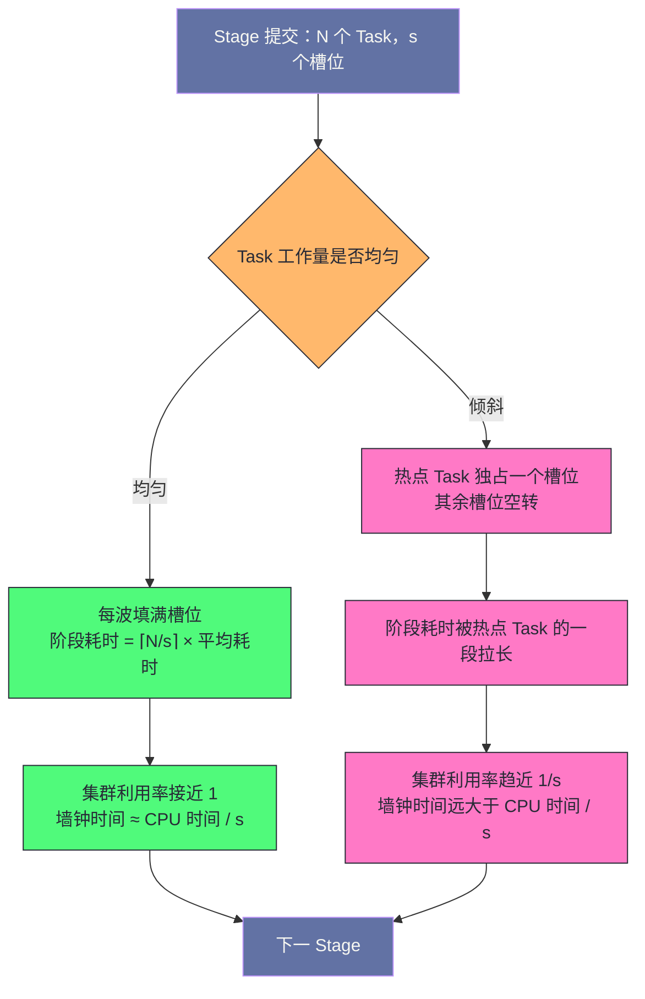
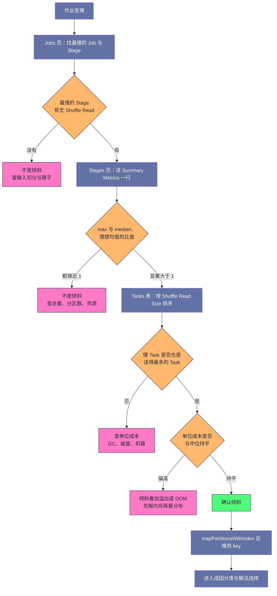
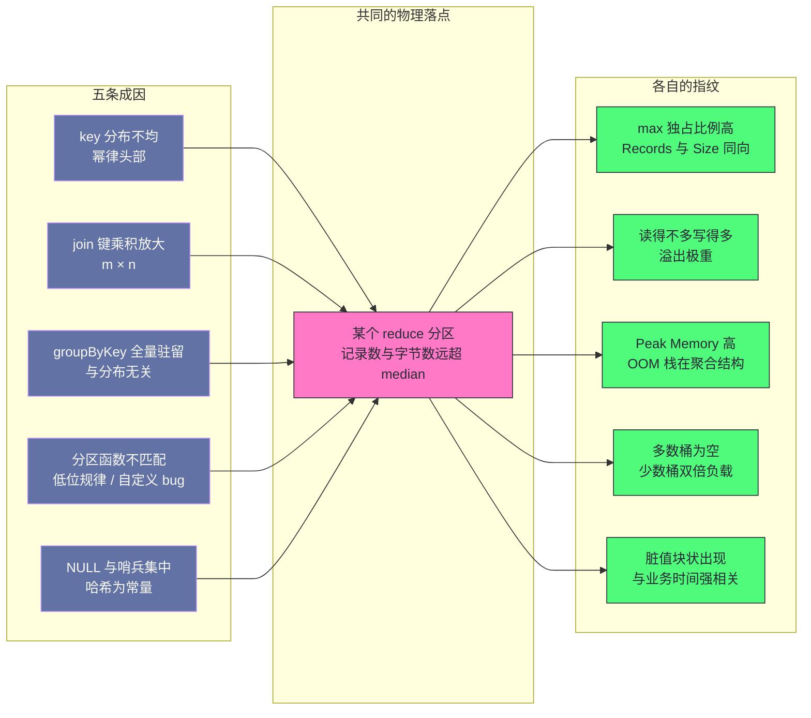
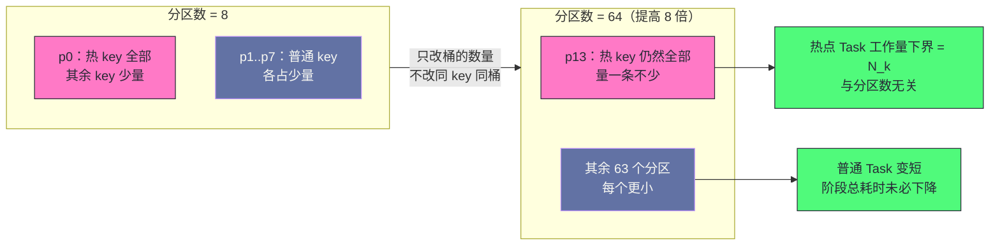
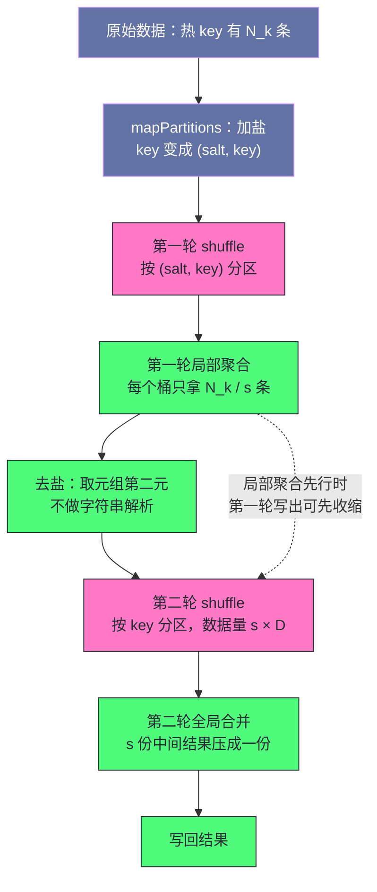
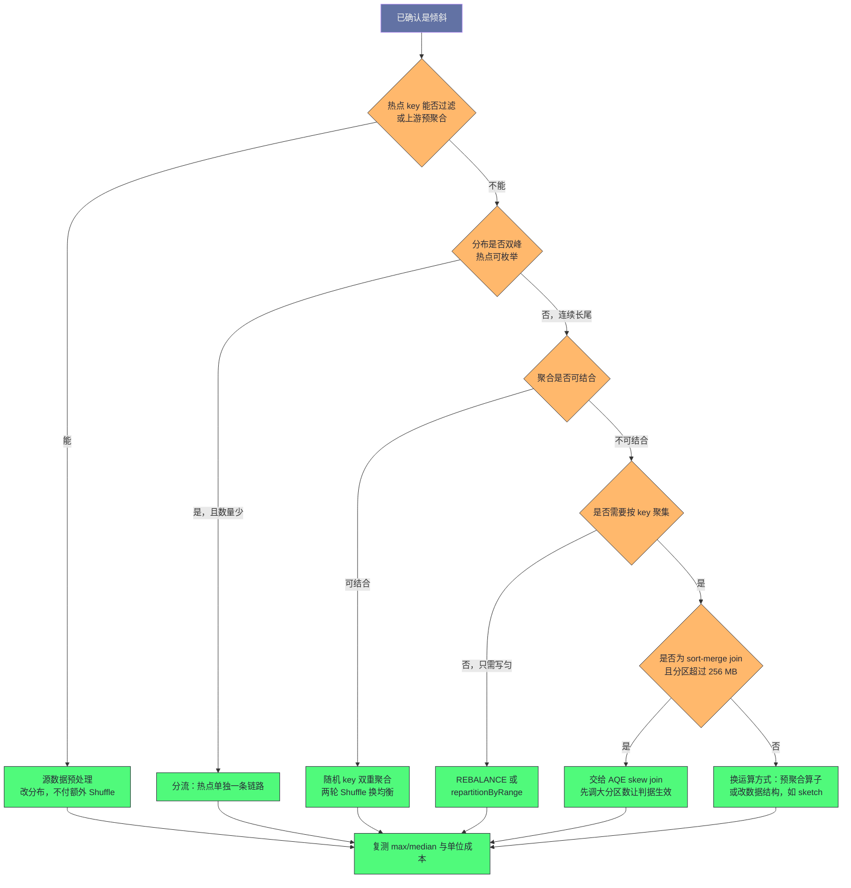

# 9. 数据倾斜的判定与通用解法：从 Task 分布到两轮聚合

**摘要：**

数据倾斜这四个字在排障现场被用得极滥：任何一个跑得慢的 Spark 作业，只要 Stages 页面上出现几个耗时长的 Task，就会被归到倾斜名下，接下来是一轮加盐、调并行度、开 AQE 的组合拳，跑完发现快了三成，却说不清是哪一拳起的作用。本文要把这件事拆开：先给倾斜一个可证伪的定义，再给一套从 Task 分布里读出倾斜的判据，以及一份把"长得像倾斜"的四种慢排除掉的清单。

文章沿五问推进。先界定倾斜是分布问题而非总量问题，并用"分区数除槽位数"的算术说明为什么单个 Task 的长尾会直接变成整个 Stage 的耗时。再进入判定：Shuffle Read Size 与 Records 的分布、max 与中位数和理想均值的三重比值、Duration 除以字节数的单位成本，以及 `FetchFailed` 在 Task 上的分布形状。接着做排除法，把数据量本身大、GC、单机磁盘与本地性、资源不足逐项与倾斜区分开，并指出"少数 Task 特别慢"只是必要条件。然后归因：key 分布不均、join 的笛卡尔放大、`groupByKey` 的同 key 全量、分区函数与实际分布不匹配、NULL 集中，五条路各有各的指纹。最后落到通用解法上，把源数据预处理、提高并行度、随机 key 双重聚合、按列重分区与 AQE 的运行时判据逐条摊开，每条都配一个不适用它的反例。

文章回答两个问题：怎么确认这确实是倾斜，以及在不改动 join 结构的前提下能做些什么。口径是 Spark 4.3.0（2026-10-30 发布，4.x 预编译 Scala 2.13）；参数默认值以官方 Configuration 与 SQL Performance Tuning 文档为准。

**关键词（Keywords）**: 数据倾斜, **Task 分布**, **中位数**, 长尾, GC 时间, FetchFailed, **幂律分布**, **加盐**, 双重聚合, RangePartitioner, REBALANCE, **AQE skew join**

---

## 第 1 章 界定：倾斜不是"慢"，是"不齐"

### 1.1 同一个作业，三天里跑出三个数

一个日结作业，昨天四十分钟，今天三个小时，输入数据量只涨了五个百分点，代码一行没动。这个时候有三类候选解释：资源侧（队列变挤、executor 被抢）、代码侧（某个算子退化成全量重算）、数据侧（某些 key 的记录数暴涨）。第三类里最常被点名的就是数据倾斜。

点名容易，说清楚难。因为"倾斜"这个词在口语里既指现象，也指成因，还指一整类解法，三者混在一起之后，任何一次变慢都能被它解释，也就等于什么都解释不了。要让它可证伪，得先把它缩到一个可以观测的形态上：**倾斜是并行单元之间的工作量分布出现长尾，且这条长尾由数据落点造成，而非由计算量本身造成**。

这个定义有三个要点。其一，比的是同一个 Stage 内 Task 之间的分布，跨 Stage 比较没有意义，因为各 Stage 的算子不同。其二，看的是分布而不是总量：总量问题加资源能解，分布问题加资源只会让空转的槽位更多。其三，长尾必须归因于数据落点，即某几条记录被哈希函数送进同一个分区；若算子写法本身让每个 Task 都做一遍全量工作，那是算子问题，加盐加不出结果。

### 1.2 一个 Stage 的耗时由谁决定

把机制算清楚，判据才有落点。设一个 Stage 有 N 个 Task，并发槽位是 s（executor 数乘每 executor 核数再除 `spark.task.cpus`），忽略调度开销要跑 ⌈N/s⌉ 个波次。每一波里所有 Task 同时开跑，何时结束取决于其中最慢的那个，下一波要等它腾出槽位。

在数据均匀的情形下，每个 Task 的耗时落在窄带里，阶段耗时约等于波次数乘以平均耗时，槽位始终被填满，利用率接近一。出现倾斜后形态就变了：热点 Task 的数据量是别人的几十上百倍，它一个占着槽位跑上半小时，其余槽位在它跑完之前全部空闲，**集群的有效利用率会掉到接近 1/s**——绝大部分算力在等一个 Task。

这个算术解释了一件事：倾斜之所以被称为性能杀手，不是因为它让总计算量变大了，而是因为它把可并行的计算强行串行化了一部分。总 CPU 时间可能只增加了百分之几，墙钟时间却翻了几倍，两者的差额全部记在闲置的槽位上。

把两种形态并排画出来，差距一目了然：



图中的分叉点只有一个判据：同一个 Stage 内，Task 的工作量是否落在同一个量级。往下的两条路各自指向不同的处置方式，而这一点恰恰是很多调优动作走错方向的起点——在右边那条路上加槽位，只是让更多槽位一起空转。

### 1.3 倾斜成立的三元组

把定义再往前走一步，可以得到一个更好用的结构。一次倾斜要成立，需要同时具备三样东西：

第一，**一次按 key 的重分布**。没有 Shuffle 就没有"把相同 key 送到同一个 Task"这个动作，也就没有倾斜的物理基础。`map` 链上的数据再不均匀，也只是某些分区大、某些分区小，各 Task 互不相干，不会出现"一个 Task 拖住全局"的形态——那种情形叫输入切分不均，性质不同。

第二，**一个不均匀的 key 分布，或者一个与分布不匹配的分区函数**。前者的典型形态是幂律：头部几个 key 占了总量的可观比例。后者更隐蔽，键本身的分布可能很均匀，但哈希取模之后全挤在少数几个桶里。

第三，**一条"同一个 key 的记录必须由同一个 Task 处理"的语义约束**。聚合要求同 key 的值聚到一起，分组要求同 key 的记录在一处，join 要求匹配的两侧记录能对上，这些语义在物理上都翻译成"不能拆"。如果某个运算不要求这个（譬如纯粹的 `map`），热点 key 再多也不会造成倾斜。

这三条构成一个诊断框架：任何一个倾斜现场，都能定位到三元组里哪一元出了问题，而后面所有解法本质上都在攻击其中某一元。源数据预处理改第二元（把分布改匀）与第一元（干脆不搬）；提高并行度只碰到第三元里"分区数"这一维，碰不到"同 key 同 Task"，所以对真倾斜无效；加盐把一个热 key 劈成 s 个，直接改第二元，代价是补一次重分布；AQE 则是在运行时给第三元开后门，把过大的分区拆成多个 Task。

### 1.4 一个贯穿全文的作业

后面的算术需要一组具体的数字，笔者这里设一个广告数仓的日结作业 `ad_rollup_daily`：从 HDFS 读入当天约八亿条曝光明细，按 `advertiser_id` 汇总曝光、点击与消耗，写回分区表。源表按天分区，读入后 2000 个分区；`spark.sql.shuffle.partitions` 设为 2000。假定其中有一个头部广告主占了全部曝光的 12%，另有一批 `advertiser_id IS NULL` 的自然流量记录占 3%。这组数字是假定的，但形状取自广告业务的常见分布——头部集中、长尾极长、脏值成块。

```scala
// 一次 shuffle，三个聚合；分区数 2000 是后面所有算术的分母
val ad = spark.read.parquet("hdfs:///dw/ad_exposure/dt=2026-11-19")

val rollup = ad
  .groupBy("advertiser_id")
  .agg(
    sum("impressions").as("imp"),
    sum("clicks").as("clk"),
    sum("cost").as("cost")
  )

rollup.write.mode("overwrite").parquet("hdfs:///dw/ad_rollup/dt=2026-11-19")
```

这段代码只有一次 Shuffle，也只有一个倾斜的着力点；它踩的坑——热 key、NULL 块、分区数与数据量不匹配——几乎是所有倾斜现场的公共部分。

### 1.5 一个被用错的比喻

把倾斜想成高速公路上的瓶颈路段，是中文技术圈最流行的说法：其他路段畅通，整个系统的吞吐被最堵的那一段限制。这个比喻的方向对，但有一处关键失真，而失真处恰好是最重要的地方。

高速公路上的拥堵会相互传导：一辆车慢下来，后面的车跟着慢。Spark 的 Task 之间没有这种传导——热点 Task 慢，其他 Task 该跑完的照样跑完，槽位照样空出来，只是没人接手，因为剩下的活全在那一个 Task 手里。真实的形态不是"二十条车道堵成一条"，而是"十九条空着，剩下一条上有一辆超宽车，而它不能拆"。

限定就在这里：Task 是调度的最小单位，框架不会把一个 Task 的数据切成两半分给两个槽位。只要这个约束在，多加车道就只是在给空车道铺沥青。

---

## 第 2 章 判定：从 Task 分布里读出倾斜

### 2.1 先看 Stage，不先看 Job

排障的入口选错，后面全是猜测。Jobs 页面给的是一个作业的总耗时，它把"读数据慢""Shuffle 慢""写出慢"揉成一个数字，看不出形状；Stages 页面给的是分布，同一个 Stage 里所有 Task 的指标并排铺开，形状就藏在那里。

定位的顺序是：在 Jobs 页找耗时异常的 Job，点进去找出最长的 Stage，确认它是否带 Shuffle Read。若最慢的 Stage 没有 Shuffle Read（纯 map 阶段），倾斜的可能性很低，更可能是输入切分不均。

确认了"慢在带 Shuffle Read 的 Stage"之后，进入 Stage 详情页，页面顶部的 Summary Metrics 一行是关键。它把该 Stage 的每一个指标按分位数摊开：最小值、25 分位、中位数、75 分位、最大值。倾斜的形状就看这一行。

### 2.2 六个指标各自说什么

只看 Duration 一列就下结论，是把结论建在结果上。要判断因，得看与它并列的几列，而它们各自的口径差别很大：

| 指标列 | 口径 | 说明什么 | 读它时容易踩的坑 |
|---|---|---|---|
| **Duration** | Task 从开始到结束的墙钟时间 | 最终结果，一切症状都会汇到这里 | 单看它分不清"数据多"与"算得慢" |
| **Shuffle Read Size** | 从上游拉取的字节数 | 数据落点的直接证据，倾斜的第一信号 | 宽行表里字节大不代表记录多 |
| **Shuffle Read Records** | 拉取的记录条数 | 与 Size 互补，定位"宽行"还是"多行" | 与 Size 背离时要两个都看 |
| **Spills (disk / memory)** | 溢出到磁盘的次数与字节 | 单 Task 内存压力的旁证 | 溢出多可能是数据多，也可能是聚合表太大 |
| **GC Time** | Task 线程在 GC 上花的时间 | 区分"数据多"与"内存形态差" | 倾斜会引发 GC，GC 高不构成对倾斜的否定 |
| **Peak Execution Memory** | 该 Task 的峰值执行内存 | 判断是否会 OOM、是否会触发溢出 | 只看峰值不看持续时间会高估 |

这六列里，判定倾斜的主力是中间两列。逻辑很朴素：倾斜的定义是"某个 Task 拿到的数据显著多"，那么它的 Shuffle Read 就该显著大；若一个 Task 的 Duration 是别人的十倍而 Shuffle Read 持平，慢的原因一定不在分布上。

### 2.3 三个比值，而不是一个

有了分布，还需要把它压成可判断的量。三个比值够用，而且各自回答不同的问题。

**第一个是长尾倍数**，max 除以中位数，回答"最慢的那个 Task 比典型 Task 多拿了多少数据"。用中位数而不用均值，是因为均值会被长尾自己拉高：2000 个分区里 10 个各拿 1 GB、其余各 1 MB，均值约 6 MB，max 除以均值只有 170 倍，而中位数仍是 1 MB，max 除以中位数是 1000 倍。中位数那一侧不会被长尾稀释，对小比例的热点更敏感。

**第二个是相对均匀度**，max 乘以分区数再除以总量，含义是"最重的桶是理想均分下的多少倍"，完全均匀时等于 1。它与长尾倍数的基准不同：中位数是"典型桶"的实测值，理想均值是"总量除以桶数"的理论值。当倾斜面很宽——譬如三成桶比其余七成大两个量级——中位数会落在小的那一侧，长尾倍数显得夸张，而相对均匀度不受分布形状影响。两个一起看，才分得清"少数极值"与"普遍不均"。

**第三个是单位成本**，Duration 除以 Shuffle Read Size，得到"每读一兆字节花多少时间"。这个比值是区分倾斜与硬件问题的刀口，下一节展开。

把三个比值排在一起，可以读出比单个数字多得多的信息：

| 长尾倍数（max/median） | 相对均匀度（max×N/总量） | 单位成本（Duration/Size） | 判断 |
|---|---|---|---|
| 显著大于 1 | 显著大于 1 | 与中位持平 | 典型的 key 倾斜：慢是因为读得多 |
| 显著大于 1 | 显著大于 1 | 明显偏高 | 倾斜叠加次生问题：溢出或 OOM 在拖慢它 |
| 接近 1 | 接近 1 但绝对值大 | 与中位持平 | 不是倾斜，是总量大或分区数不足 |
| 显著大于 1 | 接近 1 | 偏高 | 慢 Task 读得不多但算得慢，查 GC、磁盘、机器 |
| 接近 1 | 接近 1，绝对值很小 | 偏高 | 固定开销占比高，查调度与元数据 |

需要提醒一句口径：官方文档描述 AQE 的倾斜判据时用的基准是中位数，而不是理想均值。手工判定时用理想均值更稳，因为它不依赖"多数分区是正常的"这个前提；AQE 不得不用中位数，是因为运行期只拿得到分区大小的分布，拿不到"业务上期望的均匀值"。

### 2.4 Duration 除以字节数：把"慢"拆成两半

单看 Duration 高，得到的信息量很低。把 Duration 除以 Shuffle Read Size，可以把"慢"拆成两个可分辨的成分：读得多的慢，与读得不多的慢。

前者的单位成本与其他 Task 持平，说明每一兆字节都花了和别人一样的时间，总耗时长纯粹因为数据多，这就是倾斜。后者单位成本显著高于其他 Task，同样的数据量花了更多时间，原因要么在内存（频繁溢出、GC 暂停），要么在磁盘（本地盘慢、写入排队），要么在机器（宿主机上还有别的容器抢 CPU）。

这个除法还有一个附带好处：它把"数据量差异"从分母上消掉了，于是不同 Stage、不同作业之间也可以横向比较。若同一个作业昨天的单位成本是每兆 0.8 秒、今天是 2.4 秒，那今天的问题不是分布变了，而是环境变了。

### 2.5 反推热 key 的身份

知道了某个分区特别大，接下来自然想知道"是哪个 key"。最直接的办法是单独跑一次采样聚合，代价是一次额外的 Job。但在分区数远大于 key 基数偏离度的场景下，有一条几乎免费的路：当某个分区独自占了 12% 的数据量，而分区数是 2000，那么这 12% 极可能就是一个 key 的全部记录——一个分区里塞着的其他 key 加起来都填不满它。

这时候可以用 `mapPartitionsWithIndex` 只读那一个分区，在本地数一遍 top key，不必全表扫描：

```scala
// 只读最重的那个分区，把 top key 数出来；避免为定位再跑一次全量聚合
val hotPartition = 1371  // 从 Stage 页面的 Task 列表里读到的分区号

val topKeys = ad.rdd
  .mapPartitionsWithIndex { (idx, iter) =>
    if (idx != hotPartition) Iterator.empty
    else {
      // 单分区数据量可能仍然很大，用固定容量的堆估算 top 即可
      val counts = scala.collection.mutable.Map.empty[String, Long]
      iter.foreach { r =>
        val k = Option(r.getString(0)).getOrElse("__NULL__")
        counts(k) = counts.getOrElse(k, 0L) + 1L
      }
      counts.toSeq.sortBy(-_._2).take(20).iterator
    }
  }
  .collect()
```

这个技巧有前提：分区数要足够大，且热点程度要足以让一个 key 独占一个分区。若分区数只有 20，一个分区里混着几百个 key，反推就不成立，还是老老实实采样。反推出来之后，热点 key 的身份可以直接拿去写过滤条件、写分流规则，或者喂给上游的预聚合逻辑。

### 2.6 `FetchFailed` 与重试的分布形状

`FetchFailed` 是读端在取某一份 map 输出时失败抛出的异常，它天然带着 `(shuffleId, mapId, reduceId)` 三元组，因此它在 Task 列表上的分布本身就是线索。三种形状对应三种病因：

第一种，失败集中在一小批 Task 上，而这些 Task 要读的 map 输出集中在同一台主机。这说明问题在那台机器——它退出了，或者它的 Shuffle 文件所在的盘满了。处置是换机器或开外部 Shuffle 服务，与倾斜无关。

第二种，失败均匀散布在所有 Task 上。这说明上游有大批 map 输出同时失效，通常是上游 Stage 整段被重算或大量 executor 被回收，同样不是倾斜。

第三种，失败集中在最慢的那批 Task 上。这种形状值得多想一层：热点 Task 的 Duration 可能是别人的几十倍，它从启动到结束的窗口因此极长，撞上"某个上游 executor 被回收"的概率也越高。倾斜拉长了 Task 的生命周期，从而抬高 `FetchFailed` 的暴露概率，而一次 `FetchFailed` 会让这个已经很慢的 Task 从头再跑一遍，重试上限由 `spark.task.maxFailures`（默认 4）控制，撞满之后整个 Stage 失败，上游还要重算。

这条正反馈是"倾斜作业越跑越慢"的一种常见机制，它解释了一个看起来矛盾的现象：同一个作业，白天跑一小时，夜里跑三小时——夜里集群在做其他批处理，executor 被回收得更频繁，长 Task 的暴露窗口被踩中的概率更高。

### 2.7 把推测执行当成对照实验

还有一个几乎零成本的判定手段，很多人没有意识到它可以用在诊断上。`spark.speculation` 默认关闭，打开之后，Spark 会为跑得明显慢的 Task 额外启动一份副本，安排到另一台机器上，谁先完成用谁的结果。

从调优角度看这是"用资源换长尾"的手段，从诊断角度看它是一次免费的对照实验：同一个 Task 的同一批数据，被两份副本跑在两台不同的机器上。若两份副本都慢，慢的原因不可能是机器——数据量的嫌疑被坐实；若副本很快就跑完了，那么原来那份慢的原因在环境（机器、磁盘、GC），与数据分布无关。

代价是集群要多跑一份，收益是判定从"猜测"变成"观测"：跑一轮，比对两份副本的耗时，比读十页文档更快得到答案。

### 2.8 一条完整的判定路径

把前面几节串起来，判定的动作序列可以画成一条链。注意链上每一处判断依据的是哪一列指标：



图里有两个出口通向"不是倾斜"，它们比"确认倾斜"更常见。真实排障中，被叫成倾斜的慢多数最后都落在另外几类原因上，所以下一章专门做排除。

---

## 第 3 章 排除法：四种长得像倾斜的慢

### 3.1 数据量本身就大

第一种最好排除，也最容易被忽略：所有 Task 一起变慢，各自的数据量同比上涨，单位成本基本不变。这是总量问题，不是分布问题。

它的指标指纹很干净：median 与 max 接近，长尾倍数接近 1，相对均匀度也接近 1，只有 Shuffle Read Size 的绝对值比平时大。处置方向是减少数据或增加资源——裁剪用不到的列、把过滤条件下推、换更小的分区粒度、扩容。若在这种情形下加盐，会额外付一轮 Shuffle，把原本只慢一点的作业推得更慢。

总量上涨有时会伪装成倾斜，因为上涨本身并不均匀。判别方法是看"增量落在哪里"：把两天数据各跑一次 `groupBy(key).count()` 比较增量分布，若增量集中，说明上游的数据生成逻辑变了，处置对象是增量而不是存量。

### 3.2 垃圾回收

第二种是 GC，它的迷惑性最强，因为它与倾斜互为因果，很容易被拿来当替代解释。

判别方法是看两处。其一，Task 列表里的 GC Time 列：若多数 Task 的 GC Time 都占到 Duration 的可观比例，那是全局的内存形态问题（序列化格式、对象驻留、缓存策略），与分布无关。其二，Task 之间的对照：若只有最慢的那几个 GC 高、而它们的 Shuffle Read 也大，因果方向就是"倾斜 → 单 Task 内存压力 → 频繁 GC"，处置要回到分布上。

这里有一处口径要点：GC 高的 Task 若同时读得也多，不要去优化 GC 参数，先把数据处理小；调大堆只是把溢出的时刻往后推，推不过去就是 OOM。

### 3.3 单机磁盘慢与本地性降级

第三种是机器问题。它的指纹是"按机器聚集"：把 Task 列表按 Executor ID 排一下，若慢 Task 全部落在同一台或同一批 Executor 上，而它们的 Shuffle Read 并不比别人大，那问题在这批机器上——磁盘老化、写缓存策略不同、宿主机上还有别的重负载、网络带宽被邻居占满。

Spark UI 的 Stages 页支持按 Executor 聚合，这个视图在排查这类问题时比逐条看 Task 有效得多。另外看 Locality Level 一列：若 Task 的本地性从 `NODE_LOCAL` 降级成了 `ANY`，它要跨机读数据，慢就有了合理解释，而这种降级通常来自资源紧张时的调度妥协，不是数据分布。

### 3.4 资源不足与排队

第四种是资源，它最容易与倾斜混淆，因为两者的表现形式都是"结束时间参差"。

区分点在于看 Task 的**开始时间**。倾斜的 Task 是"同时开始、不同时结束"；资源不足的 Task 是"陆续开始、各自很快结束"。前者的问题在长度，后者的问题在数量。Event Timeline 视图把这两件事画得很清楚：倾斜表现为一条极长的色块，资源不足表现为一串彼此错开、长度相近的短色块。

另一个旁证是并发：Active Tasks 曲线若长期贴着槽位数上限、看不到明显下降段，说明任务在排队；若曲线在中后期掉得很低并维持一段，说明多数槽位已空闲、只剩零星几个在跑，那个形状才是倾斜。

### 3.5 排除的顺序为什么要紧

四种候选与倾斜的关系，可以用一张表压在一起：

| 候选原因 | 关键证据 | 与倾斜的分界 | 误判成倾斜的后果 |
|---|---|---|---|
| 数据量本身大 | median 与 max 同比上涨，长尾倍数接近 1 | 全体同比例变慢，单位成本稳定 | 白加一轮 Shuffle，作业更慢 |
| GC | 多数 Task 的 GC Time 占比高 | 若只有慢 Task 的 GC 高，则是倾斜的果 | 调堆参数，把 OOM 往后推而不解决 |
| 磁盘与本地性 | 慢 Task 按 Executor 聚集，Locality 降级 | 数据量不异常，纯环境差异 | 加盐无效，浪费时间与算力 |
| 资源不足 | 开始时间分散，Active Tasks 贴顶 | 是"数量不够"而非"长度不均" | 加分区只会让排队更长 |

顺序有讲究：先排全局性的（总量、资源），再排横向的（机器），最后判局部的（分布）。全局问题会把所有 Task 一起拉慢、抬高分母，让倾斜的形状变得不明显；在分母不干净的状态下判断倾斜，很容易把"整体变慢里的正常波动"读成长尾。先让分母干净，再看分子。

---

## 第 4 章 成因：五条通往同一个桶的路

### 4.1 一、key 分布本身不均

这是最经典的一条，也是最容易被想当然的一条。业务数据几乎从不均匀：头部广告主、头部店铺、头部品类、默认地址、测试账号，都会在某个维度上堆出远超平均的量。

判定的动作是数一遍分布：按目标 key 做一次 `groupBy(key).count()`，按降序取前若干名，看第一名占总量的比例。这个比例到 10% 以上、而分区数是几百上千的量级时，倾斜几乎必然发生，因为一个 key 只能进一个分区。若这个比例不到 1%，即使分布是长尾的，单个 Task 的绝对量也不至于压垮一个槽位。

这里有一处采样陷阱值得指出：用 `sample(0.01)` 估分布时，长尾尾部的 key 可能一条都采不到，于是"看起来没有热点"。安全的做法是对 key 做全量 `count`——这一次 Job 的代价远小于把整个作业重跑一遍的代价。若 key 基数极大、全量 count 太贵，退一步用近似算法时要注意方向：`approx_count_distinct` 数的是"有多少个不同的 key"，不是"每个 key 有多少条记录"，它解决不了这个问题。

### 4.2 二、join 键的笛卡尔放大

这一条的性质与前一条不同，它的问题不在"某一侧进得多"，而在"两侧一乘，出来得更多"。设左侧 key 有 m 条、右侧同 key 有 n 条，这个 key 的 join 输出就是 m 乘以 n 条。倾斜在这里不是线性放大，是乘积放大：两侧各自只有中等程度的集中，乘起来就是灾难。

它的指纹很特别：Task 的 Shuffle Read Records 可能并不夸张，但 Output Records 与溢出字节数极高，因为记录是在 join 之后才膨胀的。若看到"读得不算多、写得极多、溢出极频繁"，基本可以锁定这一类。

处置它需要两侧同时改造——一侧打散、另一侧扩容，把一次大匹配拆成若干次小匹配。这套改造的代价结构与单侧手段完全不同，它要在两侧都动数据，且必须保证结果不重复不遗漏，因此不在本文讨论的单侧通用手段范围内；本文的过滤、并行度、加盐对它只能算止血，救不了根。

### 4.3 三、`groupByKey` 的同一 key 全量

这一条与前两条都不同，它甚至不需要 key 分布不均就能成立。`groupByKey` 的语义是交出 `(K, Iterable[V])`，也就是"这个 key 的全部值"。为了凑出这个迭代器，读端必须把一个 key 的所有值攒齐；若某个 key 有一千万条记录，这个 Task 就要在内存里攒一千万条，与它的份额是否超过平均值无关。

所以它的判定不该看分布，而该看内存：Task 的 Peak Execution Memory 高、溢出频繁、或者直接 OOM，栈顶落在 `ExternalSorter`、`AppendOnlyMap` 这一类结构上，就是它。对照一下 `reduceByKey`：它的读端只需要为每个 key 维护一个中间结果，状态量是"不同 key 的个数"，热 key 的代价被压成一个常数。两者在 Shuffle 路径上的差距，前面算过，是收缩比 n 的量级——按品类聚合时 n 可以到十万，按订单号聚合时 n 等于 1。

`groupByKey` 并非总能被替代：要算中位数、要按序拼接、要把值列表原样输出时，语义确实要求看到全部值。此时能做的是控制单 key 的规模（过滤、拆分、限流），而不是假装它和 `reduceByKey` 一样便宜。

### 4.4 四、分区函数与实际分布不匹配

这一条最容易被说错。常见说法是"哈希碰撞导致倾斜"，这个说法把设计当成了故障。当 key 基数远大于分区数时，碰撞必然发生，而且是设计意图——r 个桶装 D 个 key，D 远大于 r，多个 key 落进一个桶是常态。真正的问题不是"有碰撞"，而是"碰撞之后桶与桶之间差了一个量级"。

三种不匹配值得分开看：

第一种是分区数太少。此时每桶都大，max 除以理想均值接近 1，表现为"整体慢"而非"长尾"。它属于粒度问题，处置是调大分区数，与分布无关。

第二种是 key 的哈希值低位有规律。这个问题在自增主键上很典型：`HashPartitioner` 用 `Utils.nonNegativeMod(key.hashCode, numPartitions)` 取模，若分区数取 2 的幂、而 hashCode 的低位恒为 0（譬如所有 id 都是 4 的倍数），取模之后能落到的桶只剩少数几个，其余全空。这不是"碰撞"，是"位模式的浪费"。

第三种是自定义分区器写错。把空值统一映射到 0 号分区、把异常值合并到同一个桶、分区函数依赖一个会漂移的配置，都会造出一个巨大的桶。这类错误在代码里看不出来，只在分布上体现。

三种的处置各不相同：第一种调分区数，第二种换分区数（取质数）或先做一次散列混合，第三种只能改代码。

### 4.5 五、NULL 与哨兵值集中

最后一条在 SQL 作业里极常见，而且危害被严重低估。SQL 侧对 `NULL` 做哈希时，得到的是一个确定的常量——`NULL` 的哈希值不会随记录变化，于是**所有 `NULL` 值必然落进同一个分区**。若表里有一批 `NULL` 的外键，它们会在同一个 Task 上叠成一座山。

更别扭的是，这些 `NULL` 在 join 里根本不参与匹配：`NULL = NULL` 的结果是 `NULL`，而 `NULL` 在 join 条件里按假处理。于是这批记录被搬过网络、落进一个桶、建进哈希表，然后一条都不匹配，被丢掉。纯亏损。

RDD 侧的情况还多一层坑：`HashPartitioner` 对 `null` key 会直接抛空指针，因为它要调 `key.hashCode`。所以 RDD 作业里通常先 `filter(_._1 != null)`，这一过滤恰好也消掉了 NULL 集中。

处置要分场景，边界很硬：在 `left join` 里，右表的 `NULL` 键可以提前过滤（它们本来就不会被匹配），左表的不能（过滤会改变左表的行数）；在聚合里，`NULL` 是一个合法的分组，过滤它会改变结果，除非业务确认不需要这个组。这两条边界搞反，会让一个性能优化变成一次数据事故。

### 4.6 五条路的共同落点

五条成因的物理落点完全相同：它们都让某一个桶里堆积了远超平均的记录。区别只在堆积的原因与指纹：



这张图解释了为什么"判定倾斜"与"定位成因"必须分成两步：落点是同一个，指纹才分得开。只做第一步就上手改，等于知道病人发烧却不查是哪种感染。

| 成因 | 主要识别信号 | 单侧通用手段是否有效 | 缘由 |
|---|---|---|---|
| key 分布不均 | 某一分区独占比例高，Records 与 Size 同向 | 部分有效 | 过滤、加盐、分流都能改分布 |
| join 乘积放大 | 读入不大但输出与溢出极大 | 基本无效 | 膨胀发生在 join 之后，需两侧同改 |
| `groupByKey` 全量 | Peak Memory 高，OOM 在聚合结构 | 间接有效 | 换成预聚合算子即可，与分布无关 |
| 分区函数不匹配 | 大量空分区，少数分区双倍 | 有效 | 换分区数或换分区函数 |
| NULL 集中 | 脏值块状，与业务批次相关 | 有效 | 过滤或替换哨兵值 |

---

## 第 5 章 源数据预处理：在搬动之前把桶改小

### 5.1 三种改法

预处理是唯一一类在 Shuffle 之前动手的手段，因此它省下的不只是尾任务的时间，还包括那一整批数据的搬运成本。它有三个子方向：过滤（把不该参与计算的记录拿掉）、预聚合（在上游把明细压成汇总）、分流（把热点单独走一条链路）。三者都能改变第二元（分布），差别在于代价落在谁身上。

### 5.2 过滤：先问语义，再问性能

过滤最便宜，也最容易出事。能不能过滤，取决于被过滤掉的 key 是否参与语义，这个问题只有业务能回答。

安全的情形有三类：join 的 `NULL` 键不参与匹配，过滤它不改变结果；明确的脏值，如 `-1`、空字符串、测试账号、埋点错误的哨兵值，它们对应的业务对象并不存在；已被业务确认可丢弃的异常流量。不安全的情形同样清楚：分组聚合里过滤会改变分组结果；`left join` 左侧过滤会改变行数；`count` 指标里过滤会改变分母。

过滤本身要判断"哪些 key 该过滤"，这需要一次扫描。若把这次扫描放在作业里，就变成两遍读；可行的做法是把阈值判断挪到上游，按天物化一张"热点 key 清单"的小表，下游广播这张小表再过滤，于是下游只有一次扫描加一次广播：

```scala
// 上游按天产出的小表，几十到几百行；下游广播它，避免为定位热点再扫一遍事实表
val hotKeys = spark.read.parquet("hdfs:///dw/hot_advertiser/dt=2026-11-19")
  .as[String].collect().toSet
val bc = spark.sparkContext.broadcast(hotKeys)

val cleaned = ad.filter(r =>
  r.getAs[String]("advertiser_id") != null &&   // NULL 不参与匹配，先摘掉省一次搬运
  !bc.value.contains(r.getAs[String]("advertiser_id"))
)
```

代价在于清单的时效性。热点 key 会漂移——大促当天换了另一个客户，硬编码的名单立刻失效。清单必须按批次生成，并且要有"生成失败时的兜底"，否则上游一旦没跑，下游就退化成不过滤。

### 5.3 预聚合：把倾斜推到时间切片里

预聚合的思路是改变数据的粒度：把明细层按 key 先压成汇总层，下游面对的桶本来就小。它的一个附带效果常被忽略——**时间切片天然稀释倾斜**。若上游按小时分片，某一个 key 全天的量占 12%，但在单个小时里它只占 12% 的小时量，绝对量被切成 24 份；下游如果按小时增量处理，每个批次的单 key 量都落在可承受的范围内。

代价有三笔：中间表的存储、多一个作业的运维，以及时效性下降。失效边界同样清楚：去重、UV、中位数都需要明细，预聚合会把信息丢掉；ad-hoc 查询无法预知维度，只能按最常用的几维预聚合，而维度一多中间表就爆炸。

### 5.4 分流：把双峰切开，而不是把长尾切开

分流是三种手段里最精细的一种：先采样定出热点 key 的集合 S，主链路处理 `key ∉ S` 的部分（此时分布已经均匀，正常并行即可），旁链路单独处理 `key ∈ S`，给它更高的并行度、或者直接换一种算子（广播匹配、加盐聚合），最后把两条链路的结果 `union` 起来。

它成立的前提是一个容易被忽略的分布假设：**倾斜必须是双峰的**，也就是"少数几个 key 特别大、其余都小"，中间有明确的分界点。若分布是连续长尾——没有哪个 key 特别突出，而是一路平滑地衰减下去——就不存在一个能把 S 切干净的分界点，切在哪儿都是任意决定，分流退化成"给一部分数据换条路"，收益有限而代码复杂度翻倍。

还有两处工程细节。其一，两条链路的输出 schema 必须严格一致，包括可空性与类型，否则 `union` 会静默转型或直接报错。其二，`union` 之后若还要按 key 再聚合，倾斜会原样复现，所以分流适合放在"写出"或"结果已聚合"的位置。

### 5.5 三种手段的取舍

| 手段 | 前提 | 省下的是什么 | 代价 | 不适用 |
|---|---|---|---|---|
| 过滤 | 被过滤的 key 不参与语义 | 那一批数据的搬运与计算 | 需要一次判定扫描，清单要维护 | 分组聚合、外连接左侧、count 分母 |
| 预聚合 | 聚合可结合，下游不要明细 | 下游 Shuffle 的数据量整体下降 | 存储、调度、时效性 | 去重、UV、中位数、任意维度的 ad-hoc |
| 分流 | 分布双峰，热点集合可枚举 | 热点不拖累主链路 | 两到三次扫描、代码复杂度 | 连续长尾、热点数量成百上千、热点漂移快 |

三种手段有一个共同的上限：它们都只改数据，不改计算结构。若计算结构本身（`groupByKey` 的全量驻留、join 的乘积放大）才是矛盾的来源，预处理只能缓解症状。

---

## 第 6 章 提高并行度：它治的是哪一种不均

### 6.1 一个不随分区数变化的下界

"倾斜就加并行度"是流传最广的一条经验，而它在真倾斜面前几乎必然失效，原因可以用一行不等式说清。

设热点 key 为 k，记录数为 N_k，分区函数为 h，分区数为 r。k 的全部 N_k 条记录都满足 `h(k) = p`，因此它们必然全部进入第 p 个分区，也必然由同一个 Task 处理。于是这个 Task 的工作量有一个下界：`work(p) ≥ N_k`，而这个下界与 r 完全无关。把 r 从 200 提到 2000，热点 Task 该拿的数据一条都没少，只是它周围的分区变多了、每个变得更小了。

形式上，阶段耗时 ≥ 处理 N_k 条记录所需的时间。这条下界是并行度手段的天花板，无法绕开。

下面这张图把两档分区数并排放，热点的位置一动没动：



图里没有标"分区数"这个数字本身，标的是"同 key 同桶"这条不变式。只要它不被打破，加桶就是无用功。

### 6.2 它真正有用的三种情形

并行度并非无用，只是它治的病不是倾斜。三种情形下增大分区数确有实效。

第一种，分区数偏少导致"整体粒度粗"。此时每桶都大、没有突出的长尾，只是每个 Task 都要跑很久，单 Task 数据量逼近内存上限。把 r 调大，每桶变小，溢出减少，尾任务变短。它的指纹是 max 除以理想均值接近 1 而绝对值大，与倾斜很像，处置却相反。

第二种，map 端倾斜。这一种常被误判成 reduce 端倾斜：某几个 map Task 特别慢，原因是输入切分不均——一个几 GB 的 gzip 文件不可分割，整个文件成了一个分区。此时调 `spark.sql.shuffle.partitions` 一点用都没有，因为 map 端的分区数由输入切分决定，与 shuffle 分区数无关，要动的是 `spark.sql.files.maxPartitionBytes`（默认 128 MiB），或者让上游别产出不可分割的压缩格式。

第三种，让 AQE 的判据有机会成立。AQE 判断倾斜的基准是中位数，若分区数太少，中位数本身就被抬高，倍数判据永远不满足，它于是始终不动手。先把 r 调大、把中位数压下去，AQE 才可能触发。这是并行度手段在 AQE 时代的新用途：它不再是直接解药，而是让自动机制能工作的前置条件。

### 6.3 增大的代价与两个默认值

分区数不是免费参数。每增加一个 reduce 分区，写端要多留一段数据与一条索引，读端要多编排一组请求，这些成本按 m×r 的面积增长，与数据量无关；输出文件数等于 r，r 过大时下游读取会开出一堆小 Task。

更要紧的是两个默认值不同源，混编作业会在这上面踩坑。SQL 侧的初始分区数是 `spark.sql.shuffle.partitions`（默认 200）；RDD 侧的 `reduceByKey`、`groupByKey` 无参版本走 `defaultPartitioner`，它在用户显式设置了 `spark.default.parallelism` 时用那个值，否则取父 RDD 的最大分区数。一个作业里 SQL 段与 RDD 段交替出现时，前者按 200、后者按父 RDD 的分区数走，两段的并行度可能差一个量级，而人在 Stages 页面上看到的是同一串 Stage，很难意识到它们用的是两套口径。

至于"并行度取核数的两三倍"这条经验，成立条件是 Task 耗时里有可观的固定成本——启动、取数编排、序列化。若 Task 大部分时间在处理数据上，这个倍数没有意义：槽位占满之后再加任务只是排队。它的本质是摊薄固定开销，不涉及分布，因此治不了倾斜。

### 6.4 一张判据表

| 现象 | 加分区数是否有效 | 原因 |
|---|---|---|
| 每桶都大，无突出长尾 | 有效 | 粒度粗，不是分布不均 |
| 少数 map Task 输入极大 | 无效 | map 分区由输入切分决定 |
| 少数 reduce 分区独占 10% 以上数据 | 无效 | 同 key 同桶，下界不变 |
| 分区数少到中位数被抬高 | 间接有效 | 让 AQE 的倍数判据能成立 |
| 槽位未占满、Active Tasks 贴顶 | 有效 | 并发不足，与分布无关 |

判据的核心只有一句话：看热点的绝对量能不能被"再分一次桶"分掉。能，就是粒度问题；不能，就是分布问题。

---

## 第 7 章 随机 key 双重聚合：两轮 shuffle 买均衡

### 7.1 机制：把一个大 key 劈成 s 个

随机 key 双重聚合（加盐）在概念上极简单：给每条记录的 key 加一个随机前缀，把一个 key 人为拆成 s 个，于是原本集中在一个桶里的 N_k 条记录被摊到 s 个桶里，每个桶只拿 N_k/s。局部聚合完成之后，把前缀去掉，再做一次聚合把 s 份中间结果合并成一份。

用三元组的框架看，它攻击的是第二元（分布），靠的是一次额外的重分布。它没有消掉 Shuffle，反而把 Shuffle 变成了两轮；换来的是第一轮的数据分布变匀，从而把"一个 Task 跑两小时"变成"s 个 Task 各跑几分钟"。

两轮的账要算清楚。设原始记录数为 N，不同 key 数为 D，盐数为 s：

第一轮写出的字节数约等于 N 条原始记录（若 map 端预聚合先行，可先收缩到 s 乘 D_k 的量级），读出同样量级；第二轮写出的是 s 乘 D 条中间结果，读出同样量级。总 Shuffle 量约等于 `2N + 2sD`。当 `sD` 远小于 N 时，第二轮几乎不花钱——这正是加盐划算的区间。反过来，若 key 基数极大、每个 key 只有一两条记录，`sD` 接近甚至超过 N，两轮的成本就翻倍了，而分布本来也不倾斜，这笔钱纯属白花。

### 7.2 盐数怎么定

盐数是这条路上唯一需要判断的参数，定小了打不散，定大了第二轮负担爆炸。可以按"把热点降到平均水位"来算：设平均每个 key 有 N/D 条记录，热点 key 有 N_k 条，目标是让 `N_k/s ≈ N/D`，于是

```
s ≈ N_k / (N / D) = N_k × D / N
```

也就是"这个 key 比平均 key 重多少倍，就用多少盐"。12% 的热点摊在 2000 个不同 key 上时平均份额是 0.05%，热点重 240 倍，盐数取 240 左右就能压到平均水位。实际取值可以打折——压到平均水位的两三倍通常已经足够，因为尾巴再短也没必要追求绝对均衡——于是几十到一百这个量级是常见的落点。

上界由第二轮与分区数共同约束：s 越大，第二轮的中间 key 数越接近 s 乘 D，若逼近原始记录数，加盐就失去了意义；同时第二轮分区数若仍按 r 走，会产生大量空分区。

### 7.3 实现上的三个坑

第一个坑是随机数的来源。在 `map` 里直接调 `math.random` 有两处问题：它背后是一个全局的 `scala.util.Random` 实例，在 executor 上会被多个 Task 线程共享，同一 JVM 内的并发取数会争抢内部的锁；而且它不可重现，出问题时没法复算。稳妥的写法是在 `mapPartitions` 里为每个分区建一个独立的 `Random`，种子取分区号或 task attempt id：

```scala
val salted = ad.rdd
  .mapPartitions { iter =>
    // 每个分区一个独立随机源：无锁争用，且种子可重现，便于复算
    val rnd = new scala.util.Random(TaskContext.getPartitionId().toLong * 31L)
    val salt = rnd.nextInt(NumSalts)
    iter.map(r => ((r.getString(0), salt), (r.getLong(1), r.getLong(2), r.getLong(3))))
  }
```

注意这里的盐是"每分区一个"，而不是"每条记录一个"。两种都可行，但按分区取盐更省（同一个 Task 内所有记录的盐一致，局部聚合表的 key 数不膨胀），代价是打散粒度变粗——若 s 远大于并发 Task 数，按分区取盐依然够用；若 s 很小而分区很多，每条记录一个盐能打得更匀。这是个需要按场景选的细节。

第二个坑是去盐方式。用字符串拼接再 `split` 解析（`s"${salt}_$key"` 然后 `split("_")`）有三个问题：key 里若含分隔符会解析错误；拼接与解析在热路径上产生可观的对象开销；字符串比较比元组比较慢。用复合键元组 `(salt, key)`，去盐时取 `_2`，零解析成本。SQL 侧则用两列而不是拼一列，或用 `substring` 按固定宽度截断，前提是盐的宽度固定。

第三个坑是盐的分布均匀性。`rand() * s` 取整在 s 很小时并不均匀，而若某个 Task 拿到的记录里同一个 key 的记录是连续出现的（这在按时间排序的输入里很常见），盐的随机性会被"连续块"放大成波动。盐数取到几十以上时这个问题基本消失。

### 7.4 可结合性：能加盐的运算比想象中少

加盐的合法性来自聚合函数的代数性质：只有满足结合律与交换律，"先按盐分批算局部、再合并"才与"一次算完全部"等价。这条约束筛掉了相当一部分看似可用的运算。

| 运算 | 能否加盐后合并 | 说明 |
|---|---|---|
| `sum` / `count` / `min` / `max` | 可以 | 典型可结合，最安全的场景 |
| `avg` | 需改写 | 先拆成 sum 与 count 两个可结合量，合并后再相除 |
| `collect_list` / `collect_set` | 可以但慎用 | 集合可合并，但顺序语义丢失，要保序得最后统一排序 |
| `count(distinct)` | **不可以直接相加** | 同一个值可能落在多个盐桶，相加会重复计数 |
| 中位数、分位数 | 不可以 | 不可结合，需要可合并的 sketch 结构 |
| `first` / `last` / 保序拼接 | 不可以 | 顺序敏感，加盐打乱了顺序语义 |

`count(distinct)` 那一行值得单独说。它看起来完全是"计数"，很容易被当成可加的；但加盐之后，同一个 `user_id` 可能在多个盐桶里各被数一次，把各桶的结果相加会把去重值重复计入，得到一个偏大的数。而这个错误不报错、不告警，只是让结果悄悄偏掉，被伪装成了一次成功的性能优化。可行的改写是先按 `(key, value)` 去重再做计数，多一轮 Shuffle 换正确性；或者换成可合并的基数估计结构（HyperLogLog 一类的 sketch 之间是可合并的，反而适合加盐）。

### 7.5 两轮聚合的完整形状



图中被染色的两个节点是需要付 Shuffle 的地方，其余都是窄依赖或本地计算。这张图也解释了它的性价比来源：第一轮的量与原始数据同阶，第二轮的量与 `s` 乘 key 基数同阶，后者通常小一到两个数量级，所以"多一轮"在多数量级的意义上并不等于"多一倍"。

### 7.6 什么时候不该用它

四种情形下加盐是负优化。其一，倾斜本不严重，长尾倍数在 3 以内，多一轮 shuffle 的固定成本远大于消掉的尾巴。其二，聚合不可结合。其三，下游还要按同一个 key 再做 join 或分组，加盐把聚集打散了，下游得重新 shuffle，省下的又还回去。其四，key 基数极大、每个 key 只有一两条记录，此时 `sD` 与 N 同阶，第二轮把成本翻倍，而分布本来均匀。

还有一条边界在语义上：加盐改变了输出分区的排布，若下游依赖顺序（有序写出、增量对齐、按分区对齐），要额外做一次排序或重分区，这笔钱得提前算进去。

---

## 第 8 章 重分区与 AQE：按列、按大小，还是按判据

### 8.1 `repartition` 的四种形态

"倾斜了先 repartition 一下"是一条被高估的建议，因为 `repartition` 不是一种操作，而是四种，物理各不相同。

`RDD.repartition(n)` 走的是 `coalesce(n, shuffle = true)`，物理上是一个 `ShuffledRDD` 配 `HashPartitioner`：按 key 哈希重新分桶，分区数改变，同 key 同桶这条不变式原样保留。于是它对倾斜无效，还白付一次 Shuffle。

`DataFrame.repartition(n)`（不给列）走的是 `RoundRobinPartitioning`：按行轮流发牌，每个分区拿到相近的**行数**。它对"分区大小不均"有效，因为行数被摊平了；但它把 key 的聚集彻底打散，若下游还要 `groupBy` 或 join，得再 shuffle 一次，前面的均衡白做。另外它均衡的是行数而不是字节数，宽行表里行数相等不代表字节相等。

`DataFrame.repartition(n, col)` 走 `HashPartitioning(col)`：等价于提前做一次按列的哈希分区。它对倾斜无效，因为同 key 还是同分区；它的用处是让后续的 join 或聚合复用这个分区器，从而省掉一次 Shuffle。

`repartitionByRange` 走 `RangePartitioner`：先采样估出分位数，按值的范围切分，目标是让每个分区拿到相近的**记录数**。这一点常被忽略——**范围分区对 key 分布的偏斜是有效的**，因为它按分位数切，热点值天然被切进少数几个窄区间，而不会把全部热点塞进一个桶。代价是三笔：采样要多跑一个 Job，边界精度依赖采样，以及后续若按 key 哈希聚合则分区器不匹配、又要 shuffle。

| 形态 | 物理分区器 | 均衡什么 | 对 key 倾斜 | 主要代价 |
|---|---|---|---|---|
| `RDD.repartition(n)` | `HashPartitioner` | 桶数 | 无效 | 一次完整 Shuffle |
| `df.repartition(n)` | `RoundRobinPartitioning` | 行数 | 只均衡大小，不解决聚集 | 打散 key，下游需再 shuffle |
| `df.repartition(n, col)` | `HashPartitioning` | 按列哈希 | 无效 | 一次 Shuffle，可被下游复用 |
| `repartitionByRange(n, col)` | `RangePartitioner` | 记录数（按分位） | 部分有效 | 采样 Job、边界误差、分区器不复用 |

这张表解释了一个常见困惑：同样是"重分区"，有人用着有效有人无效，差别不在参数而在分区器。

### 8.2 `REBALANCE`：按大小均分，并顺手切开残留的倾斜

SQL 侧还有一条不叫 `repartition` 的路。`REBALANCE` hint 的目标不是"分成 n 份"，而是"分成大小相近的若干份"：它参考运行期统计，按行数把数据均摊，再把过小的分区合并起来。与 `RoundRobinPartitioning` 的区别在于 `REBALANCE` 允许按列分组（`REBALANCE(c)` 会在保持 c 聚集的前提下尽量均分），因此它比"随机打散"多保留了一点局部性。

更关键的是 AQE 对它的补丁：`spark.sql.adaptive.optimizeSkewsInRebalancePartitions.enabled` 默认开启，它会在 `REBALANCE` 之后继续检查分区大小，把仍然过大的分区按目标大小切开。这条规则的意义在于，`REBALANCE` 解决的是"分得匀不匀"，而切分解决的是"匀完之后还有没有大块"——两件事分开做，各自都有明确的判据。

它的适用位置很明确：写文件之前的均衡，避免下游读到超大文件；或者后续不依赖 key 聚集的计算。反例同样明确：`REBALANCE` 之后立刻 `groupBy(key)`，前面的均分会被后面的哈希重排全部作废。

### 8.3 AQE 的倾斜处理：判据、默认值与三处失效

AQE 里的那条规则叫 `OptimizeSkewedJoin`，作用是在运行时把过大的 Shuffle 分区拆成多个 Task，必要时复制另一侧的数据来补齐。它的判据是两个条件的**与**：

- 分区大小大于中位数的 `spark.sql.adaptive.skewJoin.skewedPartitionFactor` 倍（默认 5.0）
- 且分区大小大于 `spark.sql.adaptive.skewJoin.skewedPartitionThresholdInBytes`（默认 256 MB）

两个条件是"且"而非"或"，这一点决定了它的三处失效。

**失效一：数据量小的作业永远不触发。** 分区再倾斜，只要没超过 256 MB 的绝对阈值，就不算倾斜。这条阈值的存在有它的道理——拆一个小分区带来的调度与复制开销可能超过收益——但它意味着中小规模的作业必须靠手工手段。

**失效二：分区数太少时，中位数被抬高。** 倍数判据的分母是中位数，若只有 20 个分区、其中 5 个是热点，中位数会被热点拉高，`max / median` 可能只有两三倍，够不到 5 倍的门槛。这也解释了第 6 章提到的那条间接用途：先把分区数调大，让中位数落回正常水平，AQE 才有机会识别出倾斜。判据是相对的，相对判据需要一个干净的基准。

**失效三：倾斜面很宽时不触发。** 若多数分区都比"正常值"大，中位数本身就在大的那一侧，倍数判据同样不满足。这类分布不是"少数极值"而是"普遍偏大"，处置方向回到总量与分区数。

除了三处失效，还有一处作用域限制：这条规则针对的是 sort-merge join。聚合造成的倾斜（`groupBy` 命中的热 key）不在它的射程内，`repartition` 与自定义分区器造成的同样不在。也就是说，本文第 5 到第 7 章的手段，在 AQE 全面默认开启之后依然是必需的，AQE 只是补上了 join 这一块。

参数与默认值收在下面这张表里，口径以 4.3.0 的官方文档为准：

| 参数 | 默认值 | 作用 | 调整时要注意什么 |
|---|---|---|---|
| `spark.sql.adaptive.enabled` | true | AQE 总开关（3.2 起默认开） | 关掉它等于放弃所有运行期判据 |
| `spark.sql.adaptive.skewJoin.enabled` | true | 倾斜 join 拆分开关 | 只覆盖 sort-merge join |
| `spark.sql.adaptive.skewJoin.skewedPartitionFactor` | 5.0 | 相对中位数的倍数门槛 | 分区数少时容易失效，先调大分区数 |
| `spark.sql.adaptive.skewJoin.skewedPartitionThresholdInBytes` | 256 MB | 绝对字节门槛 | 官方建议它应大于 advisory 分区大小 |
| `spark.sql.adaptive.advisoryPartitionSizeInBytes` | 64 MB | 拆分与合并的目标大小 | 决定拆成多细，直接换并行度 |
| `spark.sql.adaptive.forceOptimizeSkewedJoin` | false | 允许为拆倾斜额外引入 Shuffle | 打开意味着接受多一次重排换掉长尾 |
| `spark.sql.adaptive.coalescePartitions.enabled` | true | 合并连续小分区 | 与倾斜拆分是两条独立规则 |
| `spark.sql.adaptive.coalescePartitions.parallelismFirst` | true | 合并时优先保并行度 | **开着时 advisory 的 64 MB 在合并这一步并不生效** |

最后一行是一处容易读错的口径。`parallelismFirst` 默认开启，含义是在合并连续小分区时**忽略** `advisoryPartitionSizeInBytes` 指定的目标大小，只尊重 `minPartitionSize`（默认 1 MB）这条下限，为的是尽量保并行度、避免开启 AQE 反而变慢。所以"AQE 会把分区合并到 64 MB"这句话在默认配置下并不成立，64 MB 真正生效的地方是**拆分倾斜分区**与 `REBALANCE` 的切分目标。若要让合并也按 64 MB 走，得把这个开关显式关掉，代价是任务数下降、单任务变大。

### 8.4 从确认倾斜到选手段

把前面的手段按判据串起来，可以画成一张决策树。它的顺序刻意与三元组对齐：先看能不能改数据（第二元），再看能不能改变分区函数（第一元），最后才看运行时能否拆 Task（第三元）。



图里每一处分叉对应的都是"这一元能不能改"，而不是"哪个方案更流行"。走完整棵树的代价是几次判断，走错分支的代价是一轮白跑的作业。

---

## 第 9 章 边界与反例

### 9.1 "加盐总能把倾斜治住"

加盐的前提是可结合、可打散、下游不要再按同一个 key 聚集，三条任缺一条它就不是解药。`count(distinct)` 那条尤其危险：它把错误藏进结果里。另有一类场景加盐完全无效——倾斜来自 join 的乘积放大，加盐只打散一侧，另一侧的匹配量没变，输出照样爆炸。

### 9.2 "提高并行度总能缓解"

这句话在"粒度粗"的场景里对，在"分布不均"的场景里错。判据是热点的工作量能否被"再分桶"分掉：不能分掉的，加桶只会让空转的桶更多。连带损害也容易忽略——分区数调大之后 `m×r` 的索引条目与寻址成本同步上升，若瓶颈原本在元数据与编排上，加分区会让它更慢。

### 9.3 "倾斜就是 key 分布不均"

五条成因里只有第一条是"分布不均"，其余四条各有各的机制。`groupByKey` 的全量驻留在分布完全均匀时也会爆内存；分区函数不匹配的病根在函数而不在数据；NULL 集中的病根在语义与哈希实现的组合上。把成因简化成一条，就会把四分之三的现场往加盐这条路上带。

### 9.4 "开了 AQE 就不用管"

AQE 的倾斜处理有三个前提：数据量过绝对阈值、相对中位数够倍数、且发生在 sort-merge join 上。三者缺一它就不动手，而且不动手时没有任何告警，只是安静地把原计划执行完。最危险的情形是"以为它在管"，于是跳过判定，作业慢下去之后找不到原因。

### 9.5 反例速查

| 现象 | 常见误判 | 实际机制 |
|---|---|---|
| 慢 Task 的 Shuffle Read 与别人持平 | 数据倾斜 | 单位成本偏高，问题在 GC、磁盘或机器 |
| 加了盐整体没变快 | 盐没生效 | 倾斜不是主因，或第二轮成本抵消了收益 |
| 加盐后结果偏大 | 聚合写错了 | `count(distinct)` 被跨桶重复计数 |
| 调大分区数后更慢 | 参数没生效 | `m×r` 元数据与失败面上升，瓶颈不在并行度 |
| 开了 AQE 仍然长尾 | AQE 没开 | 倾斜在聚合侧或 map 侧，`skewJoin` 只覆盖 join |
| `repartition(n)` 之后仍倾斜 | 重分区没用 | 无列 repartition 均衡行数，不改变 key 聚集 |
| 过滤 NULL 后结果行数变了 | 过滤写错了 | 过滤了外连接左侧，行数随左表变化 |
| `repartitionByRange` 后精度下降 | 采样误差 | 边界由采样估出，尾部 key 可能被切错位置 |

---

## 第 10 章 落点

回到开头那个问题：怎么确认这确实是倾斜，以及确认之后能做什么。

确认这件事有一个可操作的次序：先看最慢的 Stage 有没有 Shuffle Read，再看 Summary Metrics 一行里 max 与中位数、与理想均值的比值，再看慢 Task 是否也是读得最多的 Task，最后用 Duration 除以字节数把"读得多"与"算得慢"分开。四步走完，"是不是倾斜"就不再是立场问题，而是一个有证据的判断。它把"少数 Task 特别慢"从终点变成了起点——长尾可以由机器、GC、磁盘、排队造成，也可以由分布造成，而这几种病因的处置方向彼此不相容。

倾斜之所以反复出现在调优清单上，是因为它的物理基础太硬：哈希函数把同一个 key 的记录送进同一个分区，分区是 Task 的分配单位，Task 是调度的最小粒度，这条链上没有任何一环允许"把一个 Task 拆开"。**只要"同 key 同桶"这条不变式不被打破，提高并行度能改变的只有桶的数量，改变不了最重那个桶里装了什么。** 这句话是所有解法的分界线：源数据预处理与加盐都在改"桶里装什么"，重分区在改"桶怎么分"，AQE 的倾斜处理则是在运行时给"Task 不可拆"这条约束开后门。

也正因为如此，没有任何一种手段是普适的：预处理要业务确认语义，加盐要求可结合，分流要求双峰，范围分区要付采样代价，AQE 要求数据量过阈值且发生在 join 上。每一条都精确定义了自己的适用面，把它们混成一套组合拳打出去，得到的就是开头那个场景：快了三成，说不清是哪一拳起的作用。

**落点在于权衡，而这个权衡是可以被量化的**：长尾倍数告诉你值不值得动手，单位成本告诉你该动数据还是动环境，两轮 shuffle 的账告诉你加盐的收益是否盖得过成本。有一个判断值得留在最后——倾斜处理最贵的部分往往不是那几行代码，而是"先确认、再动手"的耐心；跳过确认直接套方案，付出的代价通常不是慢一点，而是把一次性能问题改写成了一次正确性问题。

至于 4.x 把越来越多判断交给运行期这件事会怎么演进，目前仍然言之尚早。AQE 拿到的是运行期统计，所以它的判据只能建立在"分区大小分布"这种框架自己能观测的量上；而"这个 key 该不该被打散"终究是一个业务判断，框架观测不到。这一层判断暂时还得由人来下。

---

## 参考资料

1. Zaharia M., Chowdhury M., Das T., et al. Resilient Distributed Datasets: A Fault-Tolerant Abstraction for In-Memory Cluster Computing. NSDI 2012. https://www.usenix.org/system/files/conference/nsdi12/nsdi12-final138.pdf
2. Apache Spark 4.3.0 文档：SQL Performance Tuning，Adaptive Query Execution 与 Optimizing Skew Join 的判据、参数与默认值。https://spark.apache.org/docs/latest/sql-performance-tuning.html
3. Apache Spark 4.3.0 文档：Configuration，AQE、分区与推测执行相关配置项及默认值。https://spark.apache.org/docs/latest/configuration.html
4. Apache Spark 4.3.0 文档：Web UI，Stages 页 Summary Metrics 与 Task 指标列的口径。https://spark.apache.org/docs/latest/web-ui.html
5. Apache Spark 4.3.0 文档：Tuning Guide，并行度、内存与序列化的调优建议。https://spark.apache.org/docs/latest/tuning.html
6. Apache Spark 源码（4.3.0）：`sql/core/src/main/scala/org/apache/spark/sql/execution/adaptive/OptimizeSkewedJoin.scala`，倾斜分区的检测、拆分与对侧复制。https://github.com/apache/spark/blob/v4.3.0/sql/core/src/main/scala/org/apache/spark/sql/execution/adaptive/OptimizeSkewedJoin.scala
7. Apache Spark 源码（4.3.0）：`sql/core/src/main/scala/org/apache/spark/sql/execution/adaptive/OptimizeSkewsInRebalancePartitions.scala`，`REBALANCE` 之后对残留大分区的切分。https://github.com/apache/spark/blob/v4.3.0/sql/core/src/main/scala/org/apache/spark/sql/execution/adaptive/OptimizeSkewsInRebalancePartitions.scala
8. Apache Spark 源码（4.3.0）：`sql/core/src/main/scala/org/apache/spark/sql/execution/adaptive/CoalesceShufflePartitions.scala`，运行期分区合并与 `parallelismFirst` 的取舍。https://github.com/apache/spark/blob/v4.3.0/sql/core/src/main/scala/org/apache/spark/sql/execution/adaptive/CoalesceShufflePartitions.scala
9. Apache Spark 源码（4.3.0）：`sql/core/src/main/scala/org/apache/spark/sql/execution/exchange/ShuffleExchangeExec.scala`，`RoundRobinPartitioning`、`HashPartitioning` 与 `RangePartitioning` 的物理落点。https://github.com/apache/spark/blob/v4.3.0/sql/core/src/main/scala/org/apache/spark/sql/execution/exchange/ShuffleExchangeExec.scala
10. Apache Spark 源码（4.3.0）：`core/src/main/scala/org/apache/spark/Partitioner.scala`，`HashPartitioner` 与 `RangePartitioner` 的分区函数与采样切分。https://github.com/apache/spark/blob/v4.3.0/core/src/main/scala/org/apache/spark/Partitioner.scala
11. Apache Spark 源码（4.3.0）：`core/src/main/scala/org/apache/spark/util/Utils.scala`，`nonNegativeMod` 对取模结果的处理。https://github.com/apache/spark/blob/v4.3.0/core/src/main/scala/org/apache/spark/util/Utils.scala
12. Apache Spark 源码（4.3.0）：`sql/catalyst/src/main/scala/org/apache/spark/sql/catalyst/expressions/hash.scala`，`Murmur3Hash` 对 `NULL` 与各类型的哈希语义。https://github.com/apache/spark/blob/v4.3.0/sql/catalyst/src/main/scala/org/apache/spark/sql/catalyst/expressions/hash.scala
13. Apache Spark 源码（4.3.0）：`core/src/main/scala/org/apache/spark/rdd/RDD.scala`，`repartition`、`coalesce` 与 `defaultPartitioner` 的分区数口径。https://github.com/apache/spark/blob/v4.3.0/core/src/main/scala/org/apache/spark/rdd/RDD.scala
14. Apache Spark 源码（4.3.0）：`core/src/main/scala/org/apache/spark/scheduler/TaskSetManager.scala`，推测执行的任务选取与重复副本管理。https://github.com/apache/spark/blob/v4.3.0/core/src/main/scala/org/apache/spark/scheduler/TaskSetManager.scala
15. Apache Spark 源码（4.3.0）：`core/src/main/scala/org/apache/spark/executor/TaskMetrics.scala`，Shuffle Read、GC Time、Peak Execution Memory 等指标的定义。https://github.com/apache/spark/blob/v4.3.0/core/src/main/scala/org/apache/spark/executor/TaskMetrics.scala

---

> [!note] 思考题
> 1. 判定的核心是"慢 Task 是否也是读得最多的 Task"。若一批作业的数据分布完全均匀，但某个 Stage 的 Duration 分布仍有明显长尾，最可能的三种原因是什么？
> 2. AQE 用中位数作倾斜判据的基准，手工判定时用理想均值更稳。这两种基准各自在什么分布形状下会给出错误结论？
> 3. 提高并行度对"同 key 同桶"造成的倾斜无效，但对 map 端倾斜也无效。这两处无效的机制是否相同？
> 4. `count(distinct)` 加盐后直接相加会重复计数。若坚持用加盐方案，最少要增加几轮重分布才能保证正确，代价落在哪一笔账上？
> 5. `repartitionByRange` 对 key 分布偏斜有效，却很少被用作倾斜解法。它被忽略的原因里，哪些是技术性的，哪些是工程性的？
> 6. 若把热点 key 的判定从"按天静态产出清单"改成"运行期动态识别"，会引入哪些新的失败模式？