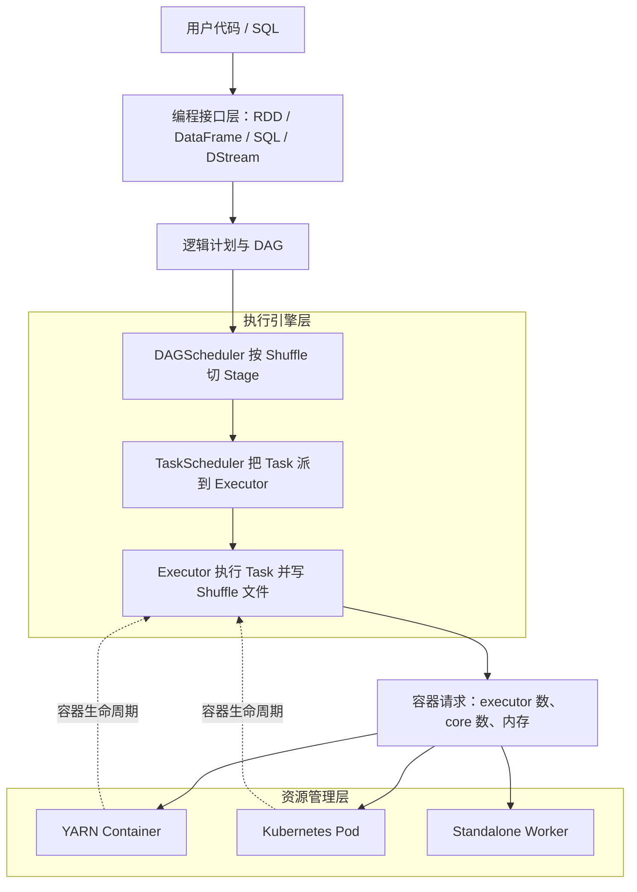
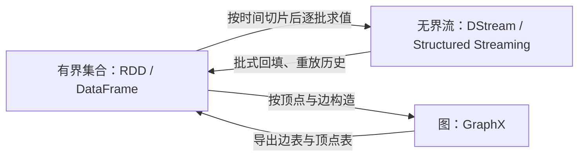
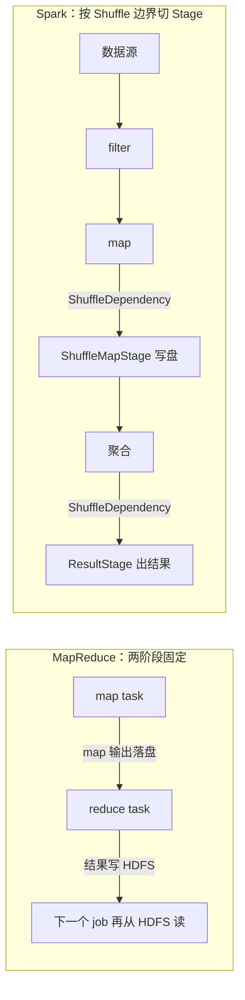
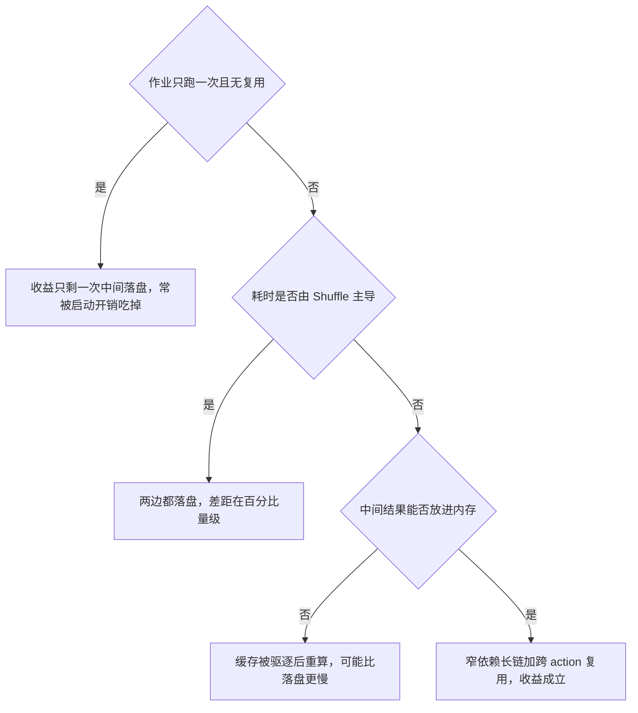
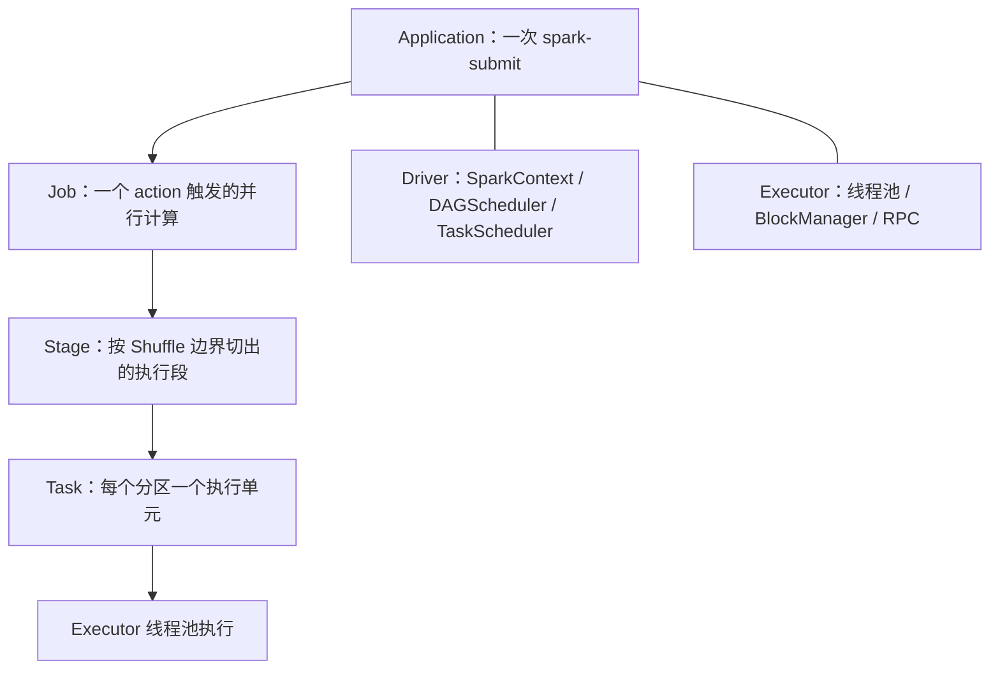
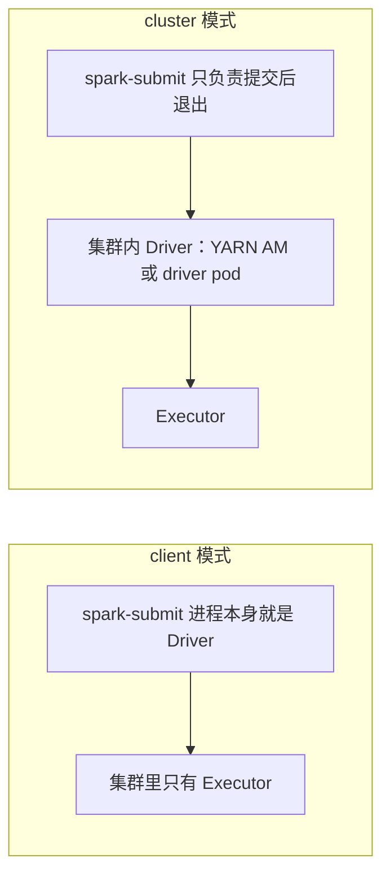

# 第1章 大数据处理框架概览

本章主要介绍大数据处理框架的基本概念，包括大数据的概念、大数据处理框架的概念及其发展历程。其中还介绍了大数据处理框架的编程模型和大数据应用运行时的四层结构，即用户层、分布式数据并行处理层、资源管理与任务调度层、物理执行层。在介绍这些技术内容的同时会总结相关的研究工作，扩充大数据处理框架的知识内容。

这一列按教材章节做体系化讲义，机制的源码级细节与专题结论留在专题专栏里，涉及处只给一句结论加一个双链：执行模型与调度见 [[大数据/Spark/读书笔记-spark内核/00 专栏导览|Spark 内核剖析]]，RDD 与算子语义见 [[大数据/Spark/Spark-RDD核心原理解析/00 专栏导览|RDD 核心原理解析]]；本篇只把概览这一层的地基立起来。

**摘要：**

这一章要给后面八章立骨架。教材把大数据处理框架切成用户层、分布式数据并行处理层、资源管理与任务调度层、物理执行层，这个切法沿着数据流经过的环节排，讲清一次作业经历了什么很顺手；但它把“资源从哪来”和“任务怎么排”压在同一层里，而这两件事在工程上以完全不同的速度演进，于是有了第二种切法——资源管理、执行引擎、编程接口三层，判据是能不能独立替换。按后一种切法看，Spark 的位置相当特殊：它不做资源管理，把容器交给 YARN、Kubernetes 或自带的 Standalone，却同时提供执行引擎与编程接口，这才是它与 MapReduce 的结构性差别，而不只是快慢。骨架之二是三种数据抽象：有界的批集合、无界的流、显式的图，按数据边界、时间语义与拓扑依赖分档，本篇给一张判据表，并交代 DataFrame 与 RDD 的关系。骨架之三是“Spark 比 MapReduce 快”这句话的拆解：快在避免落盘、DAG 融合、缓存复用，不快在 Shuffle 密集、单作业启动开销、内存不足退化，判据落在作业形态上而不是引擎名字上。最后交代 Application、Job、Stage、Task 四级执行模型与三个最容易混的概念，为第 2 章的部署与运行流程铺路。

---

## 1.1 大数据及其带来的挑战

大数据越来越成为工业界和学术界的重要研究对象。企业和科研机构需要收集和处理大量数据，进而从大数据中获取知识或经济效益。例如，搜索引擎每天都在收集、处理、分析海量的网页及多媒体数据，并对外提供数据查询服务；社交网站每天记录大量的用户数据，组织形成虚拟的人际网络，提供社交和通信等服务；商业智能公司分析企业生产和销售的数据，为企业提供商务决策支持；学术研究机构也在天文、地理、物理、化学、生命科学等领域不断积累大量的实验数据，并从中分析挖掘各种科学知识。

互联网、云计算、物联网等技术的发展使得数据的产生速度越来越快、数据规模越来越大、数据类型越来越多。例如，社交网站 Facebook 每天要处理约 25 亿条消息和 500+TB 的新数据，用户每天上传 3 亿张照片[1]。早在 2008 年，Google 每天就要处理约 20 000 TB（20PB）的数据[2]，在 YouTube 网站上用户每分钟会上传约 48h 的视频[3]。早在 2012 年，在 Twitter 上用户每天大约发布 1.75 亿条微博[4]。

在这样的背景下，大数据的概念被提出。大数据具有数据量大（Volume）、数据类型多样（Variety）、产生与处理速度快（Velocity）、价值高（Value）的“4V”特性[5]。这些特性对传统数据处理系统提出了新的挑战，使得传统数据处理系统难以在可接受的时间范围内对大数据进行高效处理。虽然出现在 21 世纪 70 年代的关系数据库解决了关系型数据的存储与 OLTP（On-line Transaction Processing，在线事务处理）问题，以及之后出现的数据仓库解决了数据建模及 OLAP（On-line analytical processing，在线分析处理）问题，但是在大数据环境下，传统的数据库和数据仓库都面临着可扩展性的问题。该问题导致这些传统软件难以处理大数据或者处理效率低下。为了解决这个问题，经过工业界和学术界十多年的探索和实践，多种可扩展的大数据处理框架应运而生。

## 1.2 大数据处理框架

为了高效处理大数据，工业界和学术界提出了很多分布式大数据处理框架。2004 年 Google 在计算机系统领域顶级会议 OSDI 上提出了基于分治、归并和函数式编程思想的 MapReduce 分布式计算框架[6]。这一框架受到了广泛关注，也获得了巨大成功。随后，Apache 社区对 Google File System[7] 和 MapReduce 进行了开源实现，并命名为 Hadoop[8]。经过多年发展，Hadoop 已经形成一个完整的生态系统，被工业界和学术界广泛使用，成为当时大数据存储和处理的实际标准。2007 年微软公司提出了 Dryad 分布式计算框架[9]。Dryad 的思路跟 MapReduce 有相似之处，但更加灵活。不同于 MapReduce 固定的数据处理流程，Dryad 允许用户将任务处理组织成有向无环图（Directed Acyclic Graph，DAG）来获得更强的数据处理表达能力。2012 年 UC Berkeley 的 AMPLab 提出了基于内存，适合迭代计算的 Spark 分布式处理框架[10,11]。该框架允许用户将可重用的数据缓存（cache）到内存中，同时利用内存进行中间数据的聚合，极大缩短了数据处理的时间。这些大数据处理框架拥有共同的编程模型，即 MapReduce-like 模型，采用“分治-聚合”策略来对数据进行分布并行处理。

## 1.3 大数据应用及编程模型

大数据应用一般是指为满足业务需求，运行在大数据处理框架之上，对大数据进行分布处理的应用，如 Hadoop MapReduce 应用和 Spark 应用。大数据应用在工业界和学术界广泛存在，如网页索引的构建、日志挖掘、大数据 SQL 查询、机器学习、社交网络图分析等。

针对不同的大数据应用，需要解决的问题是如何将其转化为可以运行在特定大数据处理框架之上的程序。为了解决这一问题，大数据处理框架为用户提供了简单且具有扩展性的编程模型。没有任何并行和分布式应用开发经验的用户也可以通过简单的编程模型来开发数据密集型应用。目前通用的大数据处理框架，如 Hadoop、Dryad 和 Spark，都是以 MapReduce 编程模型为基础的。MapReduce 编程模型可以被简单地表示为：

- **map 阶段**：`map<K1, V1> ⇒ list<K2, V2>`
- **reduce 阶段**：`reduce<K2, list(V2)> ⇒ list<K3, V3>`

在图 1.1 中，WordCount 应用使用 MapReduce 框架来统计一篇英文文章中每个单词出现的次数。我们首先将文章（Page）按行拆分为多个分块（input split），图 1.1 中的 Page 被拆分为 4 个分块，每个分块有两行，每行包含行号（lineNo）和该行的内容（line）。在 map 阶段，我们对每一行执行 map(K=lineNo, V=line) 函数。该函数对 line 进行分词，并统计 line 中每个 word (w) 出现的次数。例如，line 1 中包含 5 个 w1 和 2 个 w2，就输出两个键值对（record），即 `<w1, 5>` 和 `<w2, 2>`。在 reduce 阶段，我们将包含相同词的 record 聚合在一起，形成 `<word, list(count)>`。例如，将多个 `<w1, count>` record 聚合为 `<w1, list(5, 1, 9, 6)>`，之后对 list 中的值（Value）进行累加，得到并输出 `<w1, 21>`。

![[Pasted image 20260525195337.png]]
> [!NOTE] 图1.1 WordCount 应用的 MapReduce 执行流程  

从计算框架来说，Hadoop 支持标准的 MapReduce 编程模型，并得到了广泛使用。然而，MapReduce 编程模型也存在一些局限性。例如，该模型不能直接对多张表格数据进行 join()。为了提高 MapReduce 编程模型的通用性，Dryad 和 Spark 设计了一些更一般的、对用户更友好的操作符（operator），如 `flatMap()`、`groupByKey()`、`reduceByKey()`、`cogroup()` 和 `join()` 等。这些操作基于 `map()` 和 `reduce()` 的函数式编程思想构建，可以表达更复杂的数据处理流程。

除了基于如上所述的编程模型开发大数据应用，用户也可以借助构建于框架之上的高层语言或者高层库来开发大数据应用。例如，在 Hadoop MapReduce 之上，Yahoo! 开发了 SQL-like 的 Pig Latin 语言[12]，可以将 SQL-like 脚本转化成 Hadoop MapReduce 作业；Facebook 开发的分布式数据仓库 Hive[13] 构建在 Hadoop MapReduce 之上，也可以将类 SQL 查询分析语言转化成 Hadoop MapReduce 作业；Apache Mahout[14] 提供了基于 Hadoop MapReduce 的机器学习库；在 Spark 之上，GraphX[15] 提供了面向大规模图处理的库，MLlib[16] 提供了面向大规模机器学习的库，Spark SQL[17] 提供了基于 Spark 的 SQL 查询框架及语言。

## 1.4 大数据处理框架的四层结构

一个大数据应用可以表示为 `<输入数据, 用户代码, 配置参数>`。应用的输入数据一般以分块（如以 128MB 为一块）形式预先存储在分布式文件系统（如 HDFS[18]）之上。用户在向大数据处理框架提交应用之前，需要指定数据存储位置，撰写数据处理代码，并设定配置参数。之后，用户将应用提交给大数据处理框架运行。

大数据处理框架大体可以分为四层结构：用户层、分布式数据并行处理层、资源管理与任务调度层、物理执行层。以 Apache Spark 框架为例，其四层结构如图 1.2 所示。在用户层中，用户需要准备数据、开发用户代码、配置参数。之后，分布式数据并行处理层根据用户代码和配置参数，将用户代码转化成逻辑处理流程（数据单元及数据依赖关系），然后将逻辑处理流程转化为物理执行计划（执行阶段及执行任务）。资源管理与任务调度层根据用户提供的资源需求来分配资源容器，并将任务（task）调度到合适的资源容器上运行。物理执行层实际运行具体的数据处理任务。下面具体介绍每个层次的详细信息，以及工业界和学术界进行的一些相关工作。

![[Pasted image 20260525195406.png]]
> [!NOTE] 图1.2 大数据处理框架的四层结构  

### 1.4.1 用户层

用户层方便用户开发大数据应用。如前所述，我们将一个大数据应用表示为 `<输入数据, 用户代码, 配置参数>`。下面介绍用户在开发应用时需要准备的输入数据、用户代码和配置参数。

#### 1. 输入数据

对于批式大数据处理框架，如 Hadoop、Spark，用户在提交作业（job）之前，需要提前准备好输入数据。输入数据一般以分块（如以 128MB 为一块）的形式预先存储，可以存放在分布式文件系统（如 Hadoop 的分布式文件系统 HDFS）和分布式 Key-Value 数据库（如 HBase[19]）上，也可以存放到关系数据库中。输入数据在应用提交后会由框架进行自动分块，每个分块一般对应一个具体执行任务（task）。

对于流式大数据处理框架，如 Spark Streaming[20] 和 Apache Flink[21]，输入数据可以来自网络流（socket）、消息队列（Kafka）等。数据以微批（多条数据形成一个微批，称为 mini-batch）或者连续（一条接一条，称为 continuous）的形式进入流式大数据处理框架。

对于大数据应用，数据的高效读取常常成为影响系统整体性能的重要因素。为了提高应用读取数据的性能，学术界研究了如何通过降低磁盘 I/O 来提高性能。例如，PACMan[22] 根据一定策略提前将 task 所需的部分数据缓存到内存中，以提高 task 的执行性能。为了加速不同的大数据应用（如 Hadoop、Spark 等）之间的数据传递和共享，Tachyon[23]（现在更名为 Alluxio[24]）构造了一个基于内存的分布式数据存储系统，用户可以将不同应用产生的中间数据缓存到 Alluxio 中，而不是直接缓存到框架中，这样可以加速中间数据的写入和读取，同时也可以降低框架的内存消耗。

#### 2. 用户代码

用户代码可以是用户手写的 MapReduce 代码，或者是基于其他大数据处理框架的具体应用处理流程的代码。图 1.3 展示了在 Hadoop MapReduce 上实现 WordCount 的用户代码，其用于计算字符出现的次数。在 Hadoop MapReduce 上用户需要自定义 `map()` 和 `reduce()` 函数。除了 `map()` 和 `reduce()` 函数，用户为了优化应用性能还定义了一个“迷你”的 `reduce()`，叫作 `combine()`。`combine()` 可以在 `reduce()` 执行之前对中间数据进行聚合，这样可以减少 `reduce()` 从各个节点获取的输入数据量，进而减少网络 I/O 开销和 `reduce()` 的压力。`combine()` 和 `reduce()` 的代码实现一般是相同的。Hadoop MapReduce 提供的 `map()` 和 `reduce()` 函数的处理逻辑比较固定单一，难以支持复杂数据操作，如常见的排序操作 `sort()`、数据库表的关联操作 `join()` 等。为此，Dryad 和 Spark 提供了更加通用的数据操作符，如 `flatMap()` 等。图 1.4 展示了在 Spark 上实现 WordCount 的用户代码，对于同样的应用处理逻辑，基于 Spark 的用户代码比基于 Hadoop MapReduce 的用户代码要更加简洁。

![[Pasted image 20260525195418.png]]
> [!NOTE] 图1.3 在 Hadoop MapReduce 上实现 WordCount 的用户代码  

![[Pasted image 20260525195436.png]]

> [!note] 图1.4 在 Spark 上实现 WordCount 的用户代码  

在实际系统中，用户撰写用户代码后，大数据处理框架会生成一个 Driver 程序，将用户代码提交给集群运行。例如，在 Hadoop MapReduce 中，Driver 程序负责设定输入/输出数据类型，并向 Hadoop MapReduce 框架提交作业；在 Spark 中，Driver 程序不仅可以产生数据、广播数据给各个 task，而且可以收集 task 的运行结果，最后在 Driver 程序的内存中计算出最终结果。图 1.5 展示了在 Spark 平台上 Driver 程序的运行模式。

![[Pasted image 20260525195518.png]]
> [!NOTE] 图1.5 在 Spark 平台上 Driver 程序的运行模式  

除了直接依赖底层操作手动撰写用户代码，用户还可以利用高层语言或者高层库来间接产生用户代码。例如，在图 1.6 中用户可以使用类似 SQL 的 Apache Pig 脚本自动转化生成 Hadoop MapReduce 代码。通过这种方式生成的代码是二进制的，`map()` 和 `reduce()` 等函数代码不可见。一些高层库还提供了更简单的方式生成用户代码，如使用 Spark 之上的机器学习库 MLlib 时，用户只需要选择算法和设置算法参数，MLlib 即可自动生成可执行的 Spark 作业了。

![[Pasted image 20260525195528.png]]
> [!NOTE] 图1.6 使用类似 SQL 的 Apache Pig 脚本自动转化生成 Hadoop MapReduce 代码  

除了 Apache Pig 和 MLlib，工业界和学术界也提出了很多更简单、更通用的高层语言和高层库，使用户不用手写较为烦琐的 `map()` 和 `reduce()` 代码。Google 提出了 FlumeJava[25]，可以将多个 MapReduce 作业以流水线（pipeline）的形式串联起来，并提供了基本的数据操作符，如 `group()`、`join()`，使常见的编程任务变得简单。Cascading[26] 是用 Java 编写的，它是构建在 Hadoop 之上的一套数据操作函数库。与 FlumeJava 类似，Cascading 同样为用户提供了基本的数据操作符，可以方便用户构建出较为复杂的数据流程。Google 设计的 Sawzall[27] 是一种用于数据查询的脚本语言，偏向统计分析。Sawzall 脚本可以自动转化为 MapReduce 作业执行，使得分析人员不用直接写 MapReduce 程序就可以进行大数据分析。Google 还设计了 Tenzing[28]，该模块构建在 MapReduce 框架之上，支持 SQL 查询语言，并实现高效、低延迟的数据查询服务。微软研究院也设计了自己的用户层语言 DryadLINQ[29] 和 SCOPE[30]。DryadLINQ 将针对数据对象操作的 LINQ 程序转化成 Dryad 任务，再利用 Dryad 框架来并行处理数据。SCOPE 与 Sawzall 在一个层次上，可以将 SQL 脚本转化成 Dryad DAG 任务，同样利用 Dryad 框架来并行处理数据。SCOPE 和 Dryad 是使用 C#/C++ 实现的。

在用户代码的优化方面，PeriSCOPE[31] 根据 job pipeline 的拓扑结构对用户代码采用类似编译的优化措施，自动优化运行在 SCOPE 上的 job 性能。

#### 3. 配置参数

一个大数据应用可以有很多配置参数，如 Hadoop 支持 200 多个配置参数。这些配置参数可以分为两大类：一类是与资源相关的配置参数。例如，buffer size 定义框架缓冲区的大小，影响 map/reduce 任务的内存用量。在 Hadoop 中，map/reduce 任务实际启动一个 JVM 来运行，因此用户还要设置 JVM 的大小，也就是 heap size。在 Spark 中，map/reduce 任务在资源容器（Executor JVM）中以线程的方式执行，用户需要估算应用的资源需求量，并设置应用需要的资源容器个数、CPU 个数和内存大小。

另一类是与数据流相关的配置参数。例如，Hadoop 和 Spark 中都可以设置 `partition()` 函数、partition 个数和数据分块大小。`partition()` 函数定义如何划分 `map()` 的输出数据。partition 个数定义产生多少个数据分块，也就是有多少个 reduce 任务会被运行。数据分块大小定义 map 任务的输入数据大小。

由于 Hadoop/Spark 框架本身没有提供自动优化配置参数的功能，所以工业界和学术界研究了如何通过寻找最优配置参数来对应用进行性能调优。StarFish[32] 研究了如何选择性能最优的 Hadoop 应用配置参数，其核心是一个 Just-In-Time 的优化器，该优化器可以对 Hadoop 应用的历史运行信息进行分析，并根据分析结果来预测应用在不同配置参数下的执行时间，以选择最优参数。Verma 等[33,34] 讨论了在给定应用完成时限的情况下，如何为 Hadoop 应用分配最佳的资源（map/reduce slot）来保证应用能够在给定时限内完成。DynMR[35] 通过调整任务启动时间、启动顺序、任务个数来减少任务等待时间和由于过早启动而引起的任务之间的资源竞争。MROnline[36] 根据任务执行状态，使用爬山法寻找最优的缓冲区大小和任务内存大小，以减少应用执行时间。Xu 等[37] 研究了如何离线估计 MapReduce 应用内存用量，采用的方法是先用小样本数据运行应用，然后根据应用运行信息来估算应用在大数据上的实际内存消耗。SkewTune[38] 可以根据用户自定义的代价函数来优化数据划分算法，在保持数据输入顺序的同时，减少数据倾斜问题。

### 1.4.2 分布式数据并行处理层

分布式数据并行处理层首先将用户提交的应用转化为较小的计算任务，然后通过调用底层的资源管理与任务调度层实现并行执行。

在 Hadoop MapReduce 中，这个转化过程是直接的。因为 MapReduce 具有固定的执行流程（map — Shuffle — reduce），可以直接将包含 map/reduce 函数的作业划分为 map 和 reduce 两个阶段。map 阶段包含多个可以并行执行的 map 任务，reduce 阶段包含多个可以并行执行的 reduce 任务。map 任务负责将输入的分块数据进行 `map()` 处理，并将其输出结果写入缓冲区，然后对缓冲区中的数据进行分区、排序、聚合等操作，最后将数据输出到磁盘上的不同分区中。reduce 任务首先将 map 任务输出的对应分区数据通过网络传输拷贝到本地内存中，内存空间不够时，会将内存数据排序后写入磁盘，然后经过归并、排序等阶段产生 `reduce()` 的输入数据。`reduce()` 处理完输入数据后，将输出数据写入分布式文件系统中。

与 Hadoop MapReduce 不同，Spark 上应用的转化过程包含两层：逻辑处理流程、执行阶段与执行任务划分。如图 1.7 所示，Spark 首先根据用户代码中的数据操作语义和操作顺序，将代码转化为逻辑处理流程。逻辑处理流程包含多个数据单元和数据依赖，每个数据单元包含多个数据分块。然后，框架对逻辑处理流程进行划分，生成物理执行计划。该计划包含多个执行阶段（stage），每个执行阶段包含若干执行任务（task）。微软的大数据编程框架 DryadLINQ 也提供类似的编译过程，可以将用户编写的大数据应用程序（LINQ）编译为可分布运行的 Dryad 执行计划和任务。

为了将用户代码转化为逻辑处理流程，Spark 和 Dryad 对输入/输出、中间数据进行了更具体的抽象处理，将这些数据用一个统一的数据结构表示。在 Spark 中，输入/输出、中间数据被表示成 RDD（Resilient Distributed Datasets，弹性分布式数据集）。在 RDD 上可以执行多种数据操作，如简单的 `map()`，以及复杂的 `cogroup()`、`join()` 等。一个 RDD 可以包含多个数据分区（partition）。parent RDD 和 child RDD 之间通过数据依赖关系关联，支持一对一和多对一等数据依赖关系。数据依赖关系的类型由数据操作的类型决定。如图 1.7 所示，逻辑处理流程是一个有向无环图（Directed Acyclic Graph，简称 DAG 图），其中的节点是数据单元 RDD，每个数据单元里面的圆形是指 RDD 的多个数据分块，正方形专指输入数据分块。箭头是在 RDD 上的一些数据操作（也隐含了 parent RDD 和 child RDD 之间的依赖关系）。

![[Pasted image 20260525195625.png]]
> [!NOTE] 图1.7 Spark 应用转化与执行流程

为了将逻辑处理流程转化为物理执行计划，Spark 首先根据 RDD 之间的数据依赖关系，将整个流程划分为多个小的执行阶段（stage）。例如，图 1.7 中逻辑处理流程被划分为 3 个执行阶段。之后，在每个执行阶段形成计算任务（task），计算任务的个数一般与 RDD 中分区的个数一致。与 MapReduce 不同的是，一个 Spark job 可以包含很多个执行阶段，而且每个执行阶段可以包含多种计算任务，因此并不能严格地区分每个执行阶段中的任务是 map 任务还是 reduce 任务。另外，在 Spark 中，用户可以通过调用 `cache()` 接口让框架缓存可被重用的中间数据。缓存的作用对象是具体的 RDD 实例而不是 job 的输出——同一个 RDD 被两个以上的 action 使用时，第二个 action 才能省掉重算；跨 action 复用同一份中间结果，正是 Spark 与 MapReduce 在数据流设计上的分歧所在。

### 1.4.3 资源管理与任务调度层

从系统架构上讲，大数据处理框架一般是主-从（Master-Worker）结构。主节点（Master 节点）负责接收用户提交的应用、处理请求，并管理应用运行的整个生命周期；从节点（Worker 节点）负责执行具体的数据处理任务（task），并在运行过程中向主节点汇报任务的执行状态。

以 Hadoop MapReduce 为例（见图 1.8），在主节点运行的 JobTracker 进程首先接收用户提交的 job，然后根据 job 的输入数据和配置等信息将 job 分解为具体的数据处理任务（map/reduce task），最后将 task 交给任务调度器调度运行。任务调度器根据各个从节点的资源总量与资源使用情况，将 map/reduce task 分发到合适的从节点的 TaskTracker 中。TaskTracker 进程会为每个 map/reduce task 启动一个进程（在 Hadoop MapReduce 中是 JVM 进程）执行 task 的处理步骤，每个从节点可以同时运行的 task 数目由该节点的 CPU 个数等资源状况决定。

> [!NOTE] 图1.8 Hadoop MapReduce 框架的部署图，其中不同 job 的 task 可以分布在不同机器上

另外，大数据处理服务器集群一般由多个用户共享。如果多个用户同时提交了 job 且集群资源充足，那么集群会同时运行多个 job，每个 job 包含多个 map/reduce task。在图 1.8 中，Worker 1 节点上运行了 3 个 map task 和 1 个 reduce task，而 Worker 2 节点上运行了 2 个 map task 和 1 个 reduce task；Worker 1 上的 map task 与 Worker 2 上的 map task 可以分别属于不同的 job。

Spark 支持不同的部署模式，如 Standalone 部署模式、YARN 部署模式和 Mesos 部署模式等。其中 Standalone 部署模式与 Hadoop MapReduce 部署模式基本类似，唯一区别是 Hadoop MapReduce 部署模式为每个 task 启动一个 JVM 进程运行，而且是在 task 将要运行时才启动 JVM，而 Spark 是预先启动资源容器（Executor JVM），然后当需要执行 task 时，再在 Executor JVM 里启动 task 线程运行。

在运行大数据应用前，大数据处理框架还需要对用户提交的应用（job）及其计算任务（task）进行调度。任务调度的主要目的是通过设置不同的策略来决定应用或任务获得资源的先后顺序。典型的任务调度器包含先进先出（FIFO）调度器、公平（Fair）调度器等。先进先出（FIFO）的任务调度器如图 1.9 所示，它有两种类型的调度器：一类是应用调度器，决定多个应用（app）执行的先后顺序；另一类是任务调度器，决定多个任务（task）执行的先后顺序。例如，Spark 中一个 stage 可能包含多个 map task，任务调度器可以根据数据本地化等信息决定这些 task 应调度到的执行节点。

> [!NOTE] 图1.9 先进先出（FIFO）的任务调度器

传统的资源管理与任务调度层只针对某一种类型的应用进行资源管理和任务调度，而有一些新的研究对此进行了拓展。例如，UC Berkeley 提出将资源管理和任务调度模块构造为一个统一的集群资源管理系统，称为“集群操作系统”[39]，该系统可以集中调度多个不同大数据处理框架中的 job。再例如，第二代 Hadoop 的资源管理与调度框架 YARN[40] 能够同时为集群中运行的多种框架（如 Hadoop MapReduce、Spark）提供资源管理服务，用户可以直接将应用提交给 YARN，并在提交应用时指定应用的资源需求，如 CPU 个数和内存空间大小等。UC Berkeley 提出的 Mesos[41] 与 YARN 类似，可以对集群上各种应用进行资源分配与任务调度，支持 MapReduce 作业、Spark 作业、MPI[42] 作业等。尽管 YARN 和 Mesos 提供了比较成熟的资源管理策略，可以统一分配、管理和回收不同节点上的计算资源，然而它们有一个共同的局限，即资源分配策略的执行依赖用户提供的资源需求与当前集群资源的监控信息，而不能根据应用的实际场景自动动态地调整资源分配。

### 1.4.4 物理执行层

大数据处理框架的物理执行层负责启动 **task**，执行每个 task 的数据处理步骤。在 Hadoop MapReduce 中，一个应用需要经历 **map**、**Shuffle**、**reduce** 三个数据处理阶段。而在 Spark 中，一个应用可以有更多的执行阶段（**stage**），如迭代型应用可能有几十个执行阶段，每个执行阶段也包含多个 task。另外，这些执行阶段可以形成复杂的 DAG 图结构。在物理执行时首先执行上游 stage 中的 task，完成后执行下游 stage 中的 task。

在 Hadoop MapReduce 中，每个 task 对应一个进程，也就是说每个 task 以 **JVM**（Java 虚拟机）的方式来运行，所以在 Hadoop MapReduce 中 task 的内存用量指的是 JVM 的堆内存用量。在 Spark 中，每个 task 对应 JVM 中的一个线程，而一个 JVM 可能同时运行了多个 task，因此 JVM 的内存空间由 task 共享。在应用未运行前，我们难以预知 task 的内存消耗和执行时间，也难以预知 JVM 中的堆内存用量。

从应用特点来分析，我们可以将 task 执行过程中主要消耗内存的数据分为以下三类：

1. **框架执行时的中间数据**。例如，`map()` 输出到缓冲区的数据和 reduce task 在 Shuffle 阶段暂存到内存中的数据。
2. **框架缓存数据**。例如，在 Spark 中，用户调用 `cache()` 接口缓存到内存中的数据。
3. 用户代码产生的中间计算结果。例如，用户代码调用 `map()`、`reduce()`、`combine()`，在处理输入数据时会在内存中产生中间计算结果。

很多大数据处理框架在设计时就考虑了内存的使用问题，并进行了相应的优化设计。例如，Spark 允许用户把中间数据以缓存的形式驻留在内存中，这种设计能够有效地提高交互型 job 和迭代型 job 的执行效率。驻留是显式缓存的结果，而不是执行的默认形态。

由于大数据应用的内存消耗量很大，所以当前许多研究关注如何改进大数据处理框架的内存管理机制，以减少应用内存消耗。例如：

- **UCSD** 提出了 **ThemisMR** [43]，重新设计了 MapReduce 的数据流及内存管理方案，有效地将中间数据磁盘读写次数降低为两次，从而提高了 job 的执行性能。
- **Tachyon** 构造了一个基于内存的分布式数据存储系统，主要用于在不同 Hadoop/Spark 应用之间共享数据。用户可以将不同应用产生的中间数据缓存到 Tachyon 中而非直接缓存到框架中，以降低框架的内存消耗。
- **FAÇADE** [44] 提供了用于降低用户代码内存消耗的代码编译和执行环境。FAÇADE 的设计目的是将数据存储和数据操作分开，方法是将数据存放到 JVM 的堆外内存中，将对堆内对象的数据操作转化为对 FAÇADE 的函数调用。
- 对于 Java 对象本身产生的 **overhead**（也就是 Java 对象自身所需的 header 和 reference），**Bu 等** [45] 提出了一些优化方法，如将大量数据对象（record object）合并为少量的大的数据对象。
- **Lu 等** [46] 提出了基于对象生命周期的内存管理机制，可以根据数据对象类型和生命周期，将对象分配到不同队列进行分配和回收。
- **Xu 等** [47] 针对 Hadoop/Spark 等大数据框架经常出现的垃圾回收时间长、频繁等问题，通过实验分析主流 Java 垃圾回收算法在大数据环境下存在的性能缺陷，提出了垃圾回收算法的三种改进方法。
- **Yak** [48] 提出了一种混合 GC 算法，将堆内存划分为控制流区域和数据流区域，前者使用传统 GC 算法回收控制流代码的内存对象，后者使用基于时域区域（epoch-based region）的内存管理，并根据数据对象生命周期来回收内存。
- **Spark 社区** 采用堆外内存管理机制和基于堆外内存的 Shuffle 机制，提出了**钨丝计划** [49]。

另外，如何预测大数据应用的执行时间也被一些研究人员关注。如果能够预测出 job 的执行时间可以为任务调度器提供决策依据，则方便用户了解 job 的执行进度。

- **华盛顿大学** 的研究人员提出了 **KAMD** [50] 和 **ParaTimer** [51]，可以根据 job 执行的历史信息并结合正在运行的 job 处理的数据量，使用启发式方法来估算 job 剩余的执行时间。
- **UIUC** 的研究人员提出了 **ARIA** [33]，细粒度地分析了单个 MapReduce job 的执行阶段，并提出了基于上下界的时间估算公式，可以通过 job 的历史信息或调试信息来估算执行时间。
- **华盛顿大学** 的研究人员后来又提出了 **PerfXplain** [52]，通过对比两个包含同样处理逻辑的 job 的性能指标，来解释两个 job 执行效率不同的原因。

> [!INFO] 物理执行层的关键点
> - Task 在 Hadoop MapReduce 中是进程，在 Spark 中是线程。
> - 内存消耗分为三类：中间数据、缓存数据、用户代码计算结果。
> - 多项研究致力于内存管理优化与执行时间预测。

---

## 1.5 另一种切法：资源管理、执行引擎与编程接口

教材的四层按“一份数据从读入到写出经过哪些环节”排，讲清全过程很顺手，但它把两种变化频率不同的东西钉在了同一层：资源从哪来由集群环境决定，任务怎么排由计算模型决定。工程上讨论“哪一部分能换掉”时用的是另一种切法——资源管理、执行引擎、编程接口三层，切在变更边界上。四层回答“经过哪些环节”，三层回答“什么变了要改哪里”，Spark 的取舍只有后者才看得清。

### 1.5.1 从四层到三层

教材第三层把“资源管理与任务调度”合成一层，这在 MapReduce 第一代是写实的：JobTracker 既是资源仲裁者又是任务调度者，资源被切成固定的 map slot 与 reduce slot，一类 slot 闲着而另一类排队时谁也借不到谁。第二代把它拆成 YARN 的 ResourceManager 与每个作业一个的 ApplicationMaster，slot 随之消失。这不是版本更新，是一次分层修正。

判据有两条：变更驱动因素不同，资源层随集群环境走，执行引擎随计算模型走，接口层随用户习惯走，三者节奏差一个量级；以及可替换，换掉一侧不改变另一侧语义。边界也不会彻底干净，Shuffle 的本地性让 Spark 在 YARN 上依赖 External Shuffle Service，在 Kubernetes 上要靠持久卷或 Remote Shuffle Service 补回，缝隙只能用 `ResourceProfile` 这种带语义的请求去填。

### 1.5.2 三层的职责与契约

一句话分工：接口层把人的意图翻译成计划，执行引擎层把计划翻译成 task 跑完，资源管理层让 task 有地方可跑。每层的对外契约都写得比它实际能做的更窄，窄到下一层不需要理解上一层的业务。

| 层 | 输入 | 输出 | 对外契约只保证什么 | 失败域 |
| :--- | :--- | :--- | :--- | :--- |
| 资源管理层 | 容器请求与约束 | 容器及其生命周期 | 容器里能起进程或线程，不解释 task 语义 | 容器丢失后重新申请，不负责重算数据 |
| 执行引擎层 | 逻辑计划或 DAG，加容器句柄 | task 结果、Shuffle 数据、作业状态 | 向上只要求算子是分区上的函数，向下只要求容器里能起线程 | task 重试、stage 重算、Shuffle 文件丢失后重算上游 |
| 编程接口层 | 用户代码与 SQL | 逻辑计划 | 能被翻译成引擎认识的算子，翻不动的在分析期报错 | 编译期与分析期错误，不消耗集群资源 |

契约在代码里有名字：`ClusterManager` 要资源，`SchedulerBackend` 派 task，`ExecutorBackend` 执行 task，换部署模式换的就是这三个实现，上面的 `TaskScheduler` 一行不改。

接口层的契约有两套，松紧截然不同。RDD 只要求 `compute(split, context)` 与 `getDependencies`，允许塞进任意函数，极松，代价是优化器只看到黑盒闭包；Catalyst 只允许用表达式与逻辑算子描述意图，很紧，所以能重排、下推、生成代码。契约有多紧，优化空间就有多大。

### 1.5.3 判据：这三层为什么要分开

三条判据，缺一条就不值得付分层的代价。演进独立：集群三年一换、计算模型五年一变，分开之后换 YARN 只动资源层，换 RDD 只动接口层。复用方向不同：一套 YARN 同时接 MapReduce、Spark、Flink，一套引擎被五种语言入口复用，一层被复用的方向越多就越该独立，否则每接一个入口都要动内核。失败域不同：容器丢失是资源事件，处置是重新申请；task 失败是计算事件，处置是重试或重算上游；schema 错误是编译事件，处置是让用户改代码。混在一层的典型后果是“用重启容器的方式处理代码 bug”，判据落到实践是一句提问：这条错误该由谁兜底。

### 1.5.4 Spark 站在哪一层

把三层当坐标：MapReduce 第一代三层合一，JobTracker 兼任资源仲裁与任务调度；第二代把资源层拆给 YARN，执行引擎仍是固定两阶段，每个 job 一个 ApplicationMaster；Spark 同样把资源层交出去，但引擎与接口都是自己的，一个 application 申请一批常驻 Executor。Standalone 只是 Spark 自带的最小实现，开发测试够用，生产上资源交给 YARN 或 Kubernetes——`spark.executor.instances` 是请求而不是分配结果，这也解释了为什么 Spark 的资源问题常要回到队列或命名空间那边解决。

与 MapReduce 的结构性差别有三条，都不在“内存还是磁盘”上。资源申请粒度从 job 变成 application，启动开销摊薄；执行流程不再固定，stage 由数据依赖在运行时切出来；接口层可选，同一引擎上能架 RDD、SQL、流三种写法。三条合起来解释了为什么 Spark 作业能在三种部署模式之间平移，而 MapReduce 的部署形态基本被 YARN 定死。

---

## 1.6 三种数据抽象：有界集合、无界流与图

教材用 RDD 一个概念覆盖输入、输出与中间数据，这是它最漂亮的地方。但用户真正打交道的抽象有三类，边界性质完全不同；混着用是建模阶段最常见的错误，代码上往往看不出来，要到运行时以延迟、状态膨胀或分区倾斜的形式暴露。

### 1.6.1 有界集合：RDD 与 DataFrame

有界集合的语义是“对已知全集求一次值”。有界带来三条能力：分区数在提交时就能确定，task 数可以事先算出来；元数据在开始时就完整，可以先规划再执行；终点存在，排序、全局聚合、`collect` 这类全局操作才有定义。流的场景里这三条全部失效，这是批与流在引擎层必须分家的根本原因。

RDD 与 `DataFrame` 的差别在信息量：RDD 只知道“有一堆元素”，`DataFrame` 知道列名、类型与可空性，于是优化器能裁列、下推、估行宽。分区数的来源是“有界”在工程上的体现：文件源按 split 大小算，表源按文件列表算，`parallelize` 按 `numSlices` 算。

### 1.6.2 无界流：DStream 与 Structured Streaming

`DStream` 是离散化流，本质是一串按批间隔生成的 RDD，作用在 `DStream` 上的 `transformation` 等于作用在每一个 RDD 上；跨批状态靠 `updateStateByKey`、`mapWithState` 维护，要落到 checkpoint 才能容错，默认语义是至少一次，做到精确一次得靠幂等或事务型的 sink。

Structured Streaming 换了模型：输入是一张不断追加的无界表，查询是对它的增量计算，引擎把查询翻译成一串微批。它引入事件时间与水位线，水位线决定多晚到的数据还算数、多旧的状态可以丢，输出模式有追加、更新、完整三种，在 checkpoint 与可重放源都具备时端到端可做到精确一次。差别不在 API 新不新，而在优化器看不看得见：`DStream` 上是黑盒闭包，Catalyst 无从介入；Structured Streaming 复用 `DataFrame` 与 Catalyst，下推、裁列、代码生成都能生效，代价是继承了微批的延迟下限——一次作业规划加一次 task 下发，通常在百毫秒到秒的量级（量级示意），要进亚秒只能走长期标注为实验性的持续处理路径。

### 1.6.3 图：GraphX

GraphX 的属性图由 `VertexRDD` 与 `EdgeRDD` 拼成，接口是 Pregel 风格的批量同步并行：每轮顶点接收邻居消息、更新自身、再向邻居发消息，直到收敛；常用算子还有 `aggregateMessages`、`joinVertices` 与内置的 `pageRank`、`connectedComponents`。

为什么不直接用 RDD 表达图算法？一轮顶点更新在 RDD 上就是“顶点表 join 边表再按目标顶点聚合”，两者都是宽依赖；图算法动辄几十轮，Shuffle 次数与轮数成正比，而每轮搬的邻接表几乎同一份。GraphX 把图分区一次，顶点按需复制并为跨分区边建路由表，此后每轮只在分区内与少量跨分区边上通信。边界也清楚：收益只在沿边传播的迭代上出现，只拿边表做 join 时 `DataFrame` 更快；GraphX 算子集小、没有 Catalyst，需要更丰富语义时社区多转向 GraphFrames。

### 1.6.4 该用哪个：一张判据表

| 判据 | 有界集合 | 无界流 | 图 |
| :--- | :--- | :--- | :--- |
| 数据有没有终点 | 有，提交时已知 | 没有，持续到达 | 通常是一次快照，本身有界 |
| 结果是否随时间推进 | 否，一次求值 | 是，每批或每个窗口推进 | 否，迭代收敛后输出 |
| 主要结构是元素还是邻接 | 元素与字段 | 事件与窗口 | 顶点与边 |
| 优化器能否介入 | RDD 不能，DataFrame 能 | DStream 不能，Structured Streaming 能 | 基本不能 |
| 主要代价 | 一次全量扫描加 Shuffle | 常驻资源、状态存储、checkpoint | 图分区开销与多轮迭代 |
| 典型失败形态 | 拉取失败、Executor OOM | 状态膨胀、checkpoint 变慢 | 超级顶点导致分区倾斜 |

判断按三步问：先问数据有没有终点，有终点就用批；再问结果要不要随时间推进，要推进（累积、窗口、去重留存）才是流；最后问算法要不要沿边传播，要传播才值得上图。反例都是“看起来对、代价很大”的写法：用流跑每天一次的全量报表，资源常驻而状态没有意义；用批模拟秒级告警，延迟下限由批间隔决定。

### 1.6.5 DataFrame 与 RDD 的关系

`DataFrame` 是 `Dataset[Row]`，逻辑上等于“RDD[Row] 加一份 schema”，物理上是 `InternalRow`（Tungsten 的二进制行）组成的 RDD，由代码生成产生的循环直接消费。这句等式是“为什么 `DataFrame` 更快”的起点，但只记住等式会漏掉关键：schema 不只是元数据，它是优化器介入的许可证。

三条能力都从 schema 派生：列的存在让优化器能做列裁剪与谓词下推，算子树的形态让它能重排连接、合并相邻算子、把表达式编译成字节码，二进制行的布局让取值从“逐字段建对象”变成“按偏移读字节”。这三条在 RDD 上一条都不成立，因为 RDD 的 `compute` 收到的是迭代器加一个黑盒函数。由此得到一条实用判据：只要出现 `df.rdd`、`mapPartitions` 里套闭包、`selectExpr` 里塞自定义函数，这段逻辑就退回 RDD 世界，性能上限从“优化器能给多少”变成“用户代码写得多好”。

---

## 1.7 Spark 相对 MapReduce 的三处变化

教材把改进概括成三句话：内存计算、DAG 执行、统一引擎。三句都对，但每一句都有被讲坏的版本，而讲坏的版本流传得比原意更广。这一节把三句话各拆一次，重点不在复述结论，而在界定每句话成立的条件。

### 1.7.1 内存计算：被误读最深的一条

先把 MapReduce 的落盘时刻表摊开：map 端输出先进环形缓冲区，达到阈值后按分区排序并溢写，多个溢写文件再合并；reduce 端通过 HTTP 拉取对应分区，内存放不下时同样溢写，归并排序后交给 `reduce()`，输出写进 HDFS。于是一个 job 至少落两次盘，多个 job 串联时每两个 job 之间还要过一次 HDFS 读写，这张时刻表写死在框架里。

Spark 改的正是这张时刻表，而不是“是否落盘”这个开关。未缓存的窄依赖在同一个 task 内以迭代器方式流过，中间结果不物化——这是 pipeline，不是缓存；Shuffle 依然落盘，写到 Executor 本地磁盘；只有显式 `persist()` 或 `cache()` 的 RDD 才可能驻留内存。准确的说法是：Spark 是可缓存的、以内存为优先级的执行引擎，不是全内存执行引擎，一条流水线里同时存在内存中的记录与磁盘上的 Shuffle 文件。

存储级别是这件事的控制面板，`StorageLevel` 的五个维度是 `useDisk`、`useMemory`、`useOffHeap`、`deserialized` 与 `replication`，组合出的常用级别有六种。

| 存储级别 | 数据放在哪 | 适合的场景 | 调大或调小的代价 |
| :--- | :--- | :--- | :--- |
| `MEMORY_ONLY` | 堆内，反序列化对象 | 重算代价高、内存充裕 | 内存不够就丢分区并重算，可能比落盘更贵 |
| `MEMORY_ONLY_SER` | 堆内，序列化字节 | 对象大、想多放几个分区 | 省内存，但每次读都要反序列化 |
| `MEMORY_AND_DISK` | 内存优先，放不下溢写磁盘 | 稳妥的默认选择 | 磁盘 IO 增加，换来不重算 |
| `MEMORY_AND_DISK_SER` | 序列化后内存优先，放不下溢写 | 内存紧张但仍要复用 | 序列化开销与磁盘 IO 同时存在 |
| `DISK_ONLY` | 只落盘 | 数据量大、复用次数少 | 与 MapReduce 落盘等价，收益消失 |
| `OFF_HEAP` | 堆外内存 | 想绕开 GC 暂停 | 需要额外堆外预算，管理更复杂 |

后缀 `_2` 表示两份副本，代价是双倍存储与一次网络复制；RDD 的 `cache()` 等价于 `persist(MEMORY_ONLY)`，而 `DataFrame`/`Dataset` 的 `cache()` 等价于 `persist(MEMORY_AND_DISK)`。缓存该不该加有一条判据：一个 RDD 被两个以上 action 使用且重算路径上有 Shuffle，才值得缓存；把链上每个 RDD 都缓存会挤占 Execution 内存，溢写与 GC 上升，比不缓存更慢——“全在内存”的说法正来自这类无差别缓存。细节在 [[大数据/Spark/读书笔记-spark内核/04_存储与容错机制/3. Spark_数据缓存机制|数据缓存机制]]。

### 1.7.2 DAG 执行：从两阶段到按边界切分

MapReduce 把执行流程一并固定：一个 job 只有 map 与 reduce 两个阶段，中间隔着一次 Shuffle。固定有好处——调度器极简、容错成本极低；代价是需要多轮的计算必须拆成多个 job，由框架外的编排工具串起来，job 之间只能通过 HDFS 交接数据。

Spark 把“阶段”降级为实现细节。`transformation` 只构造 DAG，`action` 才提交 job；`DAGScheduler` 从最终 RDD 反向遍历依赖链，遇到 `ShuffleDependency` 就切一刀，切出的每一段是一个 stage，段内全是窄依赖，可以 pipeline 执行。线性血缘里 stage 数等于 Shuffle 数加一：前面若干个 `ShuffleMapStage` 产出 Shuffle 数据，最后一个 `ResultStage` 算出 action 要的结果。

收益的边界必须画准：pipeline 只发生在 stage 内部，跨 stage 依然是一次完整的 Shuffle，所以 DAG 融合省的是窄依赖链上的中间物化。融合也有条件：RDD 侧融迭代器链，SQL 侧融 WholeStageCodegen 生成的循环，两者都融不了黑盒函数，Python UDF 要跨进程执行。迭代型作业的多轮复用靠缓存，DAG 只省单轮内部的物化。

### 1.7.3 统一引擎：一份执行引擎承载四类负载

MapReduce 时代，批处理、SQL、机器学习、流处理是四套系统：Hive 把 SQL 编译成 MapReduce 作业，Mahout 把算法写成 MapReduce 作业，流处理另有 Storm 之类，每套系统有自己的资源池与监控。Spark 把这四类负载放进同一个执行引擎，底下共用调度器、内存池、Shuffle 实现、序列化、指标与事件日志，收益是显性的：一条技术栈、一套权限、一套监控、一份排障经验，批与流甚至可以共用同一份 `DataFrame` 代码。

代价分四条。优化器可见度决定性能上限：RDD 闭包与 Python UDF 让 Catalyst 失效，写成 SQL 与写成 UDF 差一个量级是常态。延迟下限：微批与作业规划的常数开销决定了秒级以下进不去。资源形态冲突：批作业要短时大内存的 Executor，流作业要长期驻留的小 Executor，混跑要么队列隔离，要么打标签分池。版本耦合：升级引擎同时影响 SQL、流、机器学习三条线。判据因此很朴素：负载谱宽、团队小、维护成本敏感，统一引擎划算；负载谱窄、单点指标要求高，专用引擎划算。路线差异在 [[大数据/读书笔记-大数据概览/08 Apache Spark：核心架构与执行模型|Spark 的生态位与选型]] 里更细。

---

## 1.8 “Spark 比 MapReduce 快”这句话的拆解

这句话在 2014 年前后是对的，也确实改变了整个行业的选型方向。但它是一个条件命题，条件被省略之后就成了口号；把条件补回去，要回答两个问题：快在哪三处，以及什么作业其实不更快。

### 1.8.1 快在三处

第一处是避免不必要的落盘：只有一个 job 的批作业可以全程不落中间结果，MapReduce 至少要落一次 map 输出、写一次 HDFS 输出。第二处是 DAG 的算子融合与 pipeline：多个窄依赖算子合成一个 task 里的循环，中间不构造集合、不落盘，SQL 侧表达式被编译成字节码，连虚函数分派都省了。第三处是内存缓存的跨 action 复用：同一个 RDD 被多个 action 使用时只算一次血缘，迭代算法里这一处收益最大。

| 场景 | MapReduce 侧的 IO | Spark 侧的 IO | 省下的量 |
| :--- | :--- | :--- | :--- |
| 单 job、1 TB 输入、纯映射加聚合 | map 输出落盘再读回，加结果写出 | 无中间落盘 | 约 1 TB 写加 1 TB 读 |
| 3 轮迭代、每轮中间 200 GB | 每轮落盘再读回，合计约 1.2 TB | 首轮落盘一次，后续从内存读 | 约 1 TB 级 IO |
| 10 个窄算子串联 | 不手工串接则每 job 一次落盘 | 融合成一次扫描 | 省 9 次中间物化 |

表里的数字是示例推算，用来比较数量级而不是给基准结论；按单机 100 MB/s 量级的磁盘吞吐、集群上百个 task 并行折算，1 TB 读写大约在分钟量级。内存与磁盘的差距是数量级层面的：顺序吞吐差一到两个数量级，随机延迟差四到五个数量级。

### 1.8.2 不快在哪

Shuffle 密集的作业是最常见的反例：大表 join 大表、全局排序、`groupByKey` 之后的聚合，耗时主要由 Shuffle 决定，而 Spark 与 MapReduce 的 Shuffle 同源——分区、排序、溢写、合并、拉取一样不少，DAG 融合只省窄依赖段，在这里帮不上忙。单次简单作业是第二个反例：Spark 的规划链更长，解析、优化、物理规划、stage 切分、task 下发每一环都是常数开销，还要加 Executor 申请与 JVM 预热，而 MapReduce 每个 job 起 ApplicationMaster 也贵。内存不足导致的退化是第三个反例：`MEMORY_ONLY` 的分区被驱逐后按血缘重算，若重算路径上有 Shuffle，代价可能超过落盘。

### 1.8.3 判据：什么作业 Spark 不比 MapReduce 快

| 作业形态 | 收益消失的原因 | 结论 |
| :--- | :--- | :--- |
| 单次、纯扫描加聚合、无复用 | 只省一次中间落盘，被规划与启动开销吃掉 | 差距落在噪声范围内 |
| 大表 join 大表、全局排序 | Shuffle 主导，两边都落盘 | 差距在百分比量级 |
| 中间结果远超内存且必须缓存 | 分区被驱逐后重算，退化为更贵的落盘 | Spark 可能更慢 |
| 分钟级以下的高频短作业 | 规划与调度的常数开销占比过高 | 固定流程的 MapReduce 反而简单 |
| 存量多 job 编排的批 ETL | 迁移改造收益小于风险 | 通常保留原状 |

这套判据的用处不在于给 Spark 挑毛病，而在于避免把性能问题误判成引擎问题：作业慢时先分类，Shuffle 主导就查数据分布与分区策略，缓存失效就查存储级别与内存池。

---

## 1.9 执行模型的基本概念

后面几章会反复出现四个词：一个 Application 里可以有多个 Job，一个 Job 按 Shuffle 边界切成若干 Stage，一个 Stage 按分区数切成若干 Task。Job 由 action 触发，Stage 由 Shuffle 边界切分，Task 是最小执行单元；task 数由 stage 末尾 RDD 的分区数决定。失败域逐级收窄：Application 级失败是 Driver 挂掉，Job 级靠 stage 重试，Stage 级靠重算上游，Task 级靠重试（默认上限 4 次）。

进程角色只有两个，职责差别极大。Driver 是决策中心，持有 `SparkContext`，里面装着 `DAGScheduler`（切 stage）、`TaskScheduler`（派 task）与 `SchedulerBackend`（与资源层对话）；Executor 是执行单元，一个 JVM 进程里跑一个线程池（一个 task 一个线程）、一个 BlockManager 与一个 RPC 端点。小结果走 RPC 回传，大结果通过 BlockManager 拉取。Driver 怎么起来、Executor 怎么注册，是第 2 章与 [[大数据/Spark/读书笔记-spark内核/02_系统架构与运行机制/4. Spark_Driver启动与Master交互|Driver 的启动与注册]] 的内容。

---

## 1.10 三个容易混的地方

这一节处理三个反复出现、每次都有人理解偏差的概念，它们的共同点是“说法都对，但都有一个不成立的边界”。

### 1.10.1 transformation 的惰性

判据只有一条，看返回值：返回 RDD 或 `DataFrame` 的是转换，是惰性的；返回数值、集合或 `Unit` 的是动作，会立刻提交 job。`cache()` 与 `persist()` 也在这个规则里，它们只是给 RDD 打了一个标记，真正的物化发生在第一次 action 里。这条规则的意义在于，转换只构造血缘与 DAG，不执行任何计算，于是框架能在动手之前看到整条链，才有优化与 stage 切分的余地。

惰性带来的易错形态有两类最常见。一类是把缓存打在临时对象上：对 `df.filter(...)` 的返回值调 `cache()` 却把结果赋给别的变量，或每次循环都基于原始 `DataFrame` 重新 filter 再 cache，缓存始终不命中。另一类是报错时机的错位：schema 与类型检查提前到分析期，“构建时就报错”是常态，“执行到一半才报错”通常是数据问题。

### 1.10.2 宽窄依赖的判定

判据一句话：child RDD 的每个分区，是否只依赖 parent RDD 的固定几个分区。这个依赖关系在规划期就能确定，是窄依赖，同 stage 内可以 pipeline；需要按 key 把数据重新分布到目标分区，是宽依赖，必须在 stage 之间插一次 Shuffle。

四个易混点值得澄清。`join` 不必然是宽依赖：两个 RDD 已有相同 partitioner 且分区数一致时，`CoGroupedRDD` 的 `getDependencies` 返回 `OneToOneDependency`，join 不发生 Shuffle。`repartition(n)` 一定是宽依赖，而 `coalesce(n, shuffle = false)` 是窄依赖，它把多个分区并到一个，不搬数据，代价是并行度下降。`union` 是窄依赖但会改变分区数。`distinct` 是宽依赖，内部是映射加 `reduceByKey`。还要分清：Shuffle 决定 stage 边界，分区数决定 task 数；`rdd.dependencies` 给依赖类型，`toDebugString` 给血缘树。

### 1.10.3 Driver 在两种部署模式下的位置

同一个程序，Driver 可以跑在两个完全不同的地方，这件事对运维的影响远大于对性能的影响。

| 维度 | client 模式 | cluster 模式 |
| :--- | :--- | :--- |
| Driver 所在位置 | 提交端的 JVM 进程里 | 集群内：YARN 的 ApplicationMaster、K8s 的 driver pod、Standalone 的 Worker |
| `spark-submit` 能否退出 | 不能，退出即作业失败 | 能，提交完就退出 |
| 适用场景 | 交互式分析、Notebook、调试 | 生产作业、被调度系统托管 |

选用判据看三条：客户端与集群之间的网络是否稳定、作业是否要跑几十分钟以上、有无外部调度系统托管。网络不稳时 client 模式的 Driver 是单点，连接一断作业与结果一起丢。反过来，`spark-shell`、`pyspark` 这类交互场景只能用 client 模式，因为 Driver 必须在用户手里才能交互。

---

## 1.11 错误容忍机制

由于不能避免系统和用户代码的 Bug、节点宕机、网络异常、磁盘损坏等软硬件可靠性问题，分布式文件系统在设计时一般都会考虑错误容忍机制，在实现时也会针对各种失效情况采取相应措施。分布式大数据并行处理框架也不例外，设计了各种针对 Master 节点失效、task 执行失败等问题的错误容忍机制。然而，对于 task 的执行失败问题，框架的错误容忍机制比较简单，只是选择合适节点重新运行该 task。对于某些可靠性问题引起的 task 执行失败，如内存溢出等，简单地重新运行 task 并不能解决问题，因为内存溢出的问题很有可能会重复出现。现有框架的另一个局限是，一般用户在出错时很难找到真正的出错原因，即使是十分熟悉框架运行细节的用户，在缺乏分析诊断工具的情况下，也难以快速找到出错原因。

下面我们总结分析一下在错误容忍机制方面的前沿工作。

### 1.11.1 大数据应用错误分析

- **Li 等** [53] 研究了 250 个 SCOPE 作业（运行在微软的 Dryad 框架之上）的故障错误，发现错误发生的主要原因是未定义的列、错误的数据模式、不正确的行格式等。
- **Kavulya 等** [54] 分析了 4100 个在 Yahoo! 管理的集群上执行失败的 Hadoop 作业，发现 36% 的故障是数组访问越界造成的，还有 23% 的故障是因为 I/O 异常。
- **Xu 等** [55] 研究了 123 个 Hadoop/Spark 应用中的内存溢出错误，发现内存溢出的主要原因包括应用配置异常、数据流异常、代码空间复杂度过高和框架内存管理缺陷等。

### 1.11.2 大数据应用错误诊断

- **Titian** [56] 通过记录 Spark 应用中全部中间数据和数据依赖关系来追踪出错的数据路径。
- **BigDebug** [57] 为 Spark 应用提供了断点、观察点、细粒度数据追踪等调试功能。
- **Xu 等** [58] 设计实现了 Hadoop MapReduce 的内存溢出错误诊断工具 **Mprof**，它可以建立执行任务内存用量与数据流量的定量关系。在此基础上，Mprof 设计了多种内存溢出错误诊断规则，这些规则根据应用配置、数据流量与任务内存用量的关联关系来定位内存溢出错误的相关代码、数据，以及不恰当的配置参数。

### 1.11.3 大数据应用错误修复

- **Interruptile Tasks** [59] 改进了现有的 task，使得 task 具备一定的错误容忍能力。当 task 在运行时遇到内存用量过大或者内存溢出的问题时，Interruptile Tasks 会暂停当前 task 的运行，回收部分运行数据及中间结果，并将不能回收的结果溢写（spill）到磁盘上，然后执行用户定义的 interrupt 逻辑，等到内存用量下降到一定程度后，再让 task 继续运行。

> [!WARNING] 错误容忍机制的局限
> 简单重试无法解决内存溢出等重复性错误；用户缺乏有效的错误诊断工具。

---

## 1.12 其他大数据处理框架

除了本章介绍的分布式处理框架 MapReduce、Spark 和 Dryad，Yahoo! 还提出了 **Map-Reduce merge** [60] 框架，通过在 reduce 阶段后面加入 merge 阶段，提高了 MapReduce 对二维表的关系代数处理能力。UC Berkeley 提出了 **MapReduce Online** [61]，改进了从 map 阶段到 reduce 阶段的数据流动方式，使得 mapper 输出的数据可以更快地流入 reducer 中，提高 MapReduce 对数据的在线处理能力。UCI 的 **Bu 等** 提出了 **HaLoop** [62]，提高了 MapReduce 迭代型任务的执行性能。NYU 提出的面向内存计算应用的分布式计算编程模型 **Piccolo** [63] 可以提供 Key-Value 表的操作接口。与 MapReduce 相比，Piccolo 能够轻松地访问中间状态及中间数据。**Spark Structured Streaming** [64] 和 **Apache Flink** 统一了批式处理与流式处理的执行流程。

---

## 1.13 本章小结

本章的任务是给后面八章铺路，不追求把任何机制讲透，只把坐标系立正。四层结构回答一次作业经过哪些环节，三层切法回答哪些部分能独立替换；按后者看，Spark 只占执行引擎与编程接口两层，资源管理交给外部的 YARN、Kubernetes 或 Standalone，这是它与 MapReduce 最本质的差别。三种数据抽象按边界性质分档，“Spark 比 MapReduce 快”被拆成三处收益与三处失效，四级执行模型与三个易混概念则是最小的公共词汇。

---

## 1.14 扩展阅读

除了支持基本的 RDD 数据结构，Spark 还支持在 RDD 基础上扩展的、面向结构化数据（主要是表格数据）的高级数据结构 [65]，即 **DataSet** 和 **DataFrame**。使用 DataSet、DataFrame 开发的应用可以更好地执行各种 SQL 操作，并利用 Spark SQL 引擎中的优化技术来对执行计划进行优化。读者可以参考 **Spark: The Definitive Guide** [66] 了解 DataSet、DataFrame 数据结构的使用方法。

本书主要讨论基于 RDD 数据结构的 Spark 应用，因为这些应用更为基础，也更有助于在分布式层面理解数据和计算任务的划分，以及生成规则。读者在理解这些应用的执行原理后，可以进一步参考 Spark SQL 论文和 **《Spark SQL 内核剖析》** [67] 学习 Spark SQL 引擎中的优化技术。

另外需要注意的是，基于 RDD 应用的逻辑处理流程和物理执行计划与 Spark SQL 应用的 Logical plan 和 Physical plan 有所不同：

- **基于 RDD 应用**：逻辑处理流程指的是一系列 RDD 操作形成的输入/输出、中间数据及数据之间的依赖关系；物理执行计划指的是具体的执行阶段（stage）和执行任务（task）。
- **Spark SQL 应用**：Logical plan 指的是将 SQL 脚本转化后的逻辑算子树，包含各种 SQL 操作，如 `Project()`、`filter()`、`join()` 等；Physical plan 指的是对逻辑算子树进行转化后形成的物理算子树，树中的节点可以转化为 RDD 及其操作，也可以直接生成实现 `Project()`、`filter()`、`join()` 等操作的 Java 代码。

更多的介绍可以参考参考文献 [67]。

就本列的阅读顺序而言，[[大数据/大数据处理框架Apache Spark设计与实现/2.0 第2章 Spark系统部署与应用运行的基本流程|第 2 章]]讲 Spark 如何部署与运行，[[大数据/大数据处理框架Apache Spark设计与实现/3.0 第3章 Spark逻辑处理流程|第 3 章]]讲逻辑处理流程的生成，[[大数据/大数据处理框架Apache Spark设计与实现/4.0 第4章 Spark物理执行计划|第 4 章]]讲逻辑计划如何落到物理执行计划，本篇的四层结构、三层切法与四级执行模型会在那三章里逐一展开。横向对照见 [[大数据/读书笔记-大数据概览/00 专栏导览|大数据技术栈概览]]。

---

## 参考资料

正文中方括号内的编号沿用原书本章的参考文献编号，这里只列本篇实际引用、可直接访问的来源。

1. Dean J, Ghemawat S. MapReduce: Simplified Data Processing on Large Clusters. OSDI 2004. https://research.google/pubs/mapreduce-simplified-data-processing-on-large-clusters/
2. Zaharia M, et al. Resilient Distributed Datasets: A Fault-Tolerant Abstraction for In-Memory Cluster Computing. NSDI 2012. https://www.usenix.org/conference/nsdi12/technical-sessions/presentation/zaharia
3. Zaharia M, et al. Discretized Streams: Fault-Tolerant Streaming Computation at Scale. SOSP 2013. https://people.eecs.berkeley.edu/~matei/papers/2013/sosp_spark_streaming.pdf
4. Armbrust M, et al. Spark SQL: Relational Data Processing in Spark. SIGMOD 2015. https://people.eecs.berkeley.edu/~matei/papers/2015/sigmod_spark_sql.pdf
5. Gonzalez J E, et al. GraphX: Graph Processing in a Distributed Dataflow Framework. OSDI 2014. https://www.usenix.org/conference/osdi14/technical-sessions/presentation/gonzalez
6. Armbrust M, et al. Structured Streaming: A Declarative API for Real-Time Applications in Apache Spark. SIGMOD 2018. https://people.eecs.berkeley.edu/~matei/papers/2018/sigmod_structured_streaming.pdf
7. Apache Spark 文档：RDD Programming Guide. https://spark.apache.org/docs/latest/rdd-programming-guide.html
8. Apache Spark 文档：Cluster Mode Overview. https://spark.apache.org/docs/latest/cluster-overview.html
9. Apache Spark 文档：Tuning Guide. https://spark.apache.org/docs/latest/tuning.html
10. Apache Spark 文档：Structured Streaming Programming Guide. https://spark.apache.org/docs/latest/structured-streaming-programming-guide.html
11. Apache Spark 文档：GraphX Programming Guide. https://spark.apache.org/docs/latest/graphx-programming-guide.html
12. Apache Hadoop 文档：Apache Hadoop YARN. https://hadoop.apache.org/docs/stable/hadoop-yarn/hadoop-yarn-site/YARN.html

---

> [!note] 思考题
> 1. 如果把三层切法里的“任务调度”重新划回资源管理层，MapReduce 第一代的 slot 利用率问题会以什么形态重现？
> 2. 同一个 join 在 co-partitioned 时是窄依赖、默认情况是宽依赖，这个差别如何改变作业的 stage 数量与失败重算范围？
> 3. 中间结果装不进内存，换成落盘又让耗时翻倍时，你会先改分区策略、存储级别还是重写算子？依据是什么？
> 4. 用 DStream 与 Structured Streaming 实现同一个窗口聚合，哪些优化在其中一者上失效、在另一者上生效？
> 5. 团队准备在一年内引入四类新负载，统一引擎与专用引擎的分界线该画在哪里？
