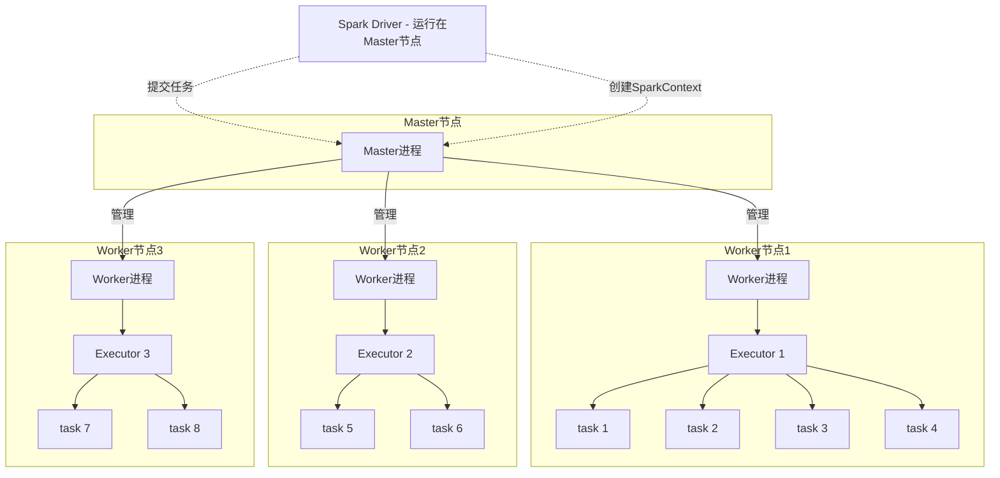
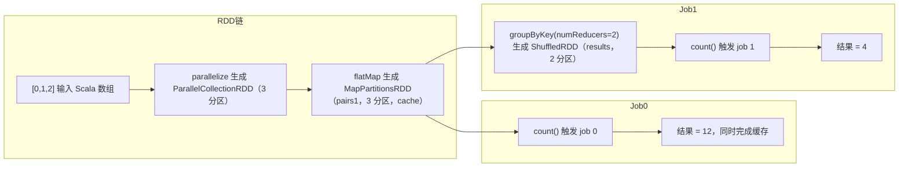
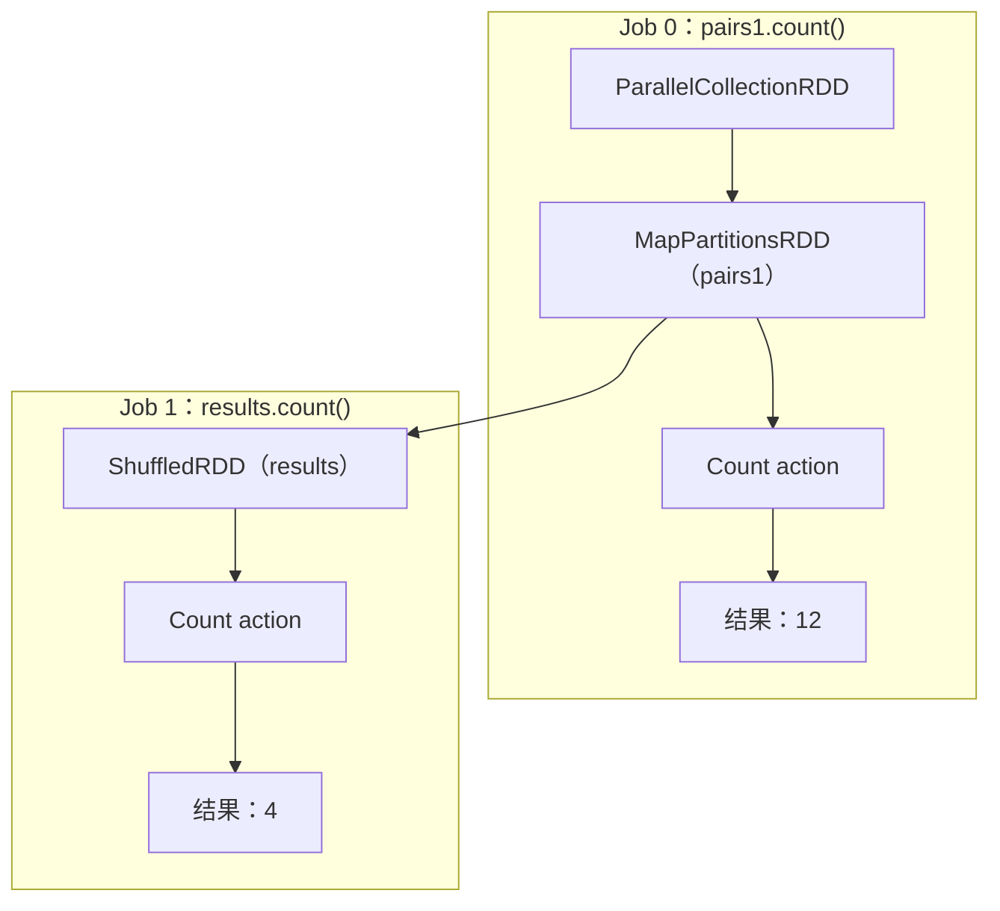
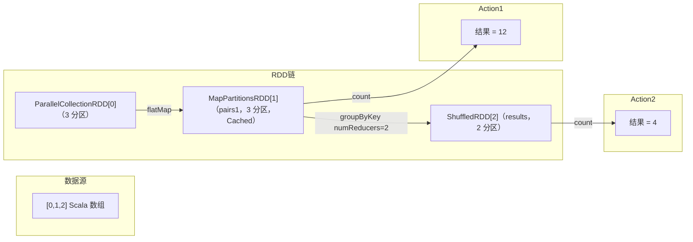
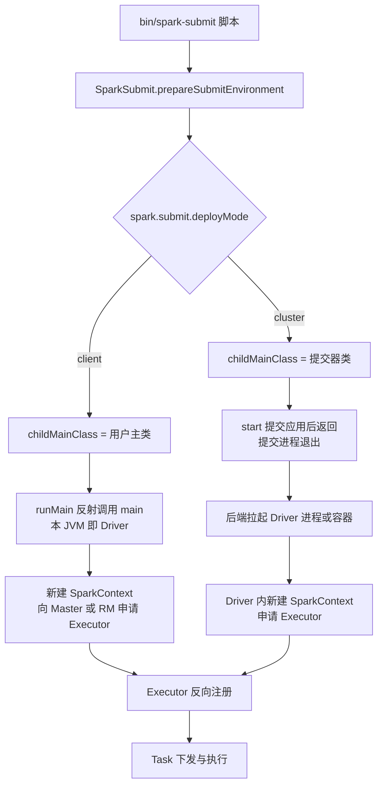
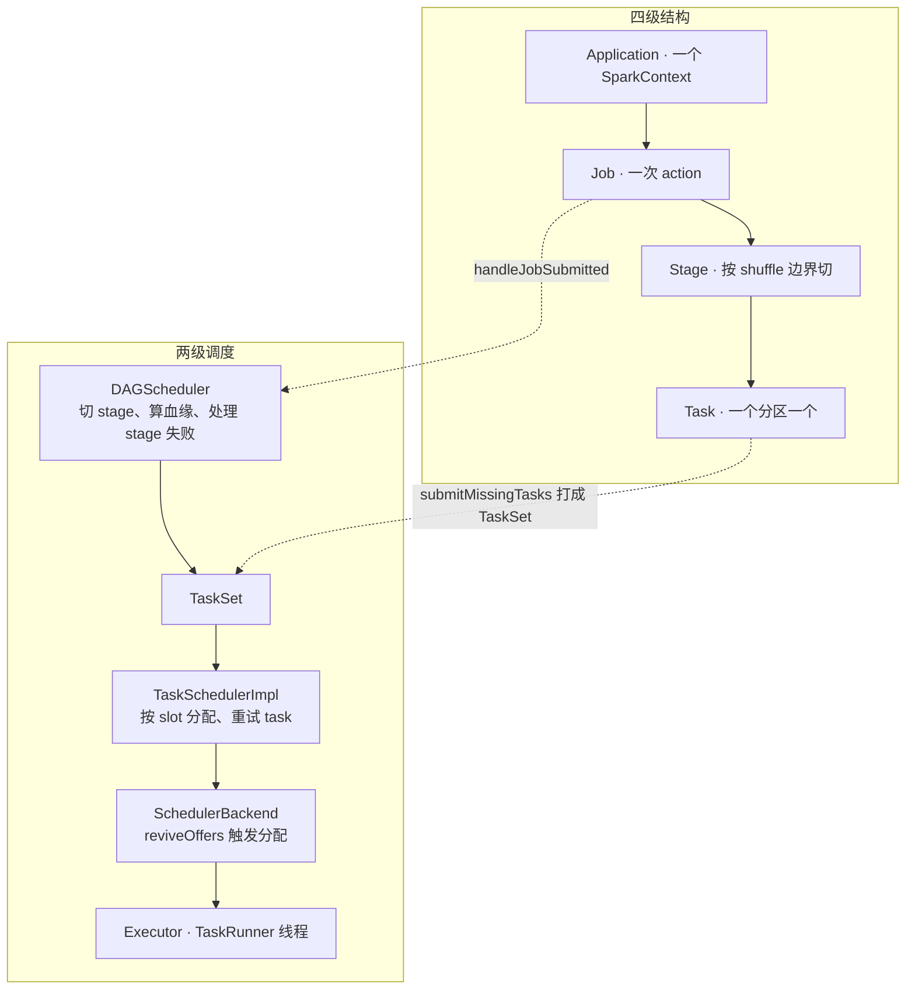

# 第2章 Spark系统部署与应用运行的基本流程

> [!info] 边界声明
> 本章是教材章节的骨架，讲的是一次应用从 `spark-submit` 到 Task 跑完中间经过的几个进程与几层调度；调度器的内部实现、参数调优与症状定位在 [[大数据/Spark/Spark-调度系统与执行模型深度解析/00 专栏导览|调度系统与执行模型]] 与 [[大数据/Spark/读书笔记-spark内核/00 专栏导览|Spark 内核剖析]] 两列里已经逐组件拆过，本章涉及处只给一句结论并双链指过去，不重复展开。

**摘要：**

一个 Spark 应用从 `spark-submit` 到第一个 Task 跑完，中间要跨过三样东西：进程、上下文、调度层级。它们的归属由两个开关决定，`--deploy-mode` 决定 Driver 是提交节点上的 JVM 还是集群里的容器，`--master` 决定资源由 Spark 自管还是交给 YARN、Kubernetes。这两处选择在功能上等价，在可用性上完全不同：前者一断连应用就结束，后者把 Driver 交给资源管理器托管，代价是日志与调试都在远端。本章沿一次提交的时间轴走完这段路：先看 `SparkSubmit` 如何解析参数、准备 classpath、挑出 `ChildMainClass`，再走两条截然不同的分支；然后进入 `SparkContext` 的构造链，看 `SparkEnv` 里那组组件按什么顺序立起来；接着把 Application、Job、Stage、Task 四级结构与 `handleJobSubmitted → createResultStage → submitStage → submitMissingTasks` 这条调用链对齐，并交代 `DAGScheduler` 与 `TaskScheduler` 的分工；最后落到资源侧的 Executor 申请、反向注册与 cores 配比，以及为什么申请的粒度是 Executor 而不是 Task。后半程处理三处最容易踩的地方：`--jars` 与 `--files` 各自分发到哪里、`spark.yarn.archive` 省掉哪一段启动开销、`SparkContext` 为什么在一个 JVM 里只能有一个。全文回答两个问题：Driver 崩了会不会重来，以及启动时间花在了哪几段。

---

## 2.1 Spark安装部署

在运行Spark应用之前，我们首先要在集群上安装部署Spark。Spark官网[68]上提供了多个版本，包括Standalone、Mesos、YARN和Kubernetes版本。这几个版本的主要区别在于：Standalone版本的资源管理和任务调度器由Spark系统本身负责，其他版本的资源管理和任务调度器依赖于第三方框架，如YARN可以同时管理Spark任务和Hadoop MapReduce任务。为了方便探讨和理解Spark本身的系统结构和运行原理，我们选择Standalone版本安装。这里选择Spark-2.4.3版本安装部署在9台机器上，1台机器作为Master节点，8台机器作为Worker节点。由于官网和一些博客已经提供了详细的Spark安装过程，这里不再赘述。虽然Spark的版本在不断更新中，但其设计原理变化不大，因此本书的分析具有一定的通用性。

"部署版本"与"运行流程"不是同一件事。Standalone、YARN、Kubernetes 指的是资源由谁分配，而提交端解析、Driver 启动、上下文构造、Stage 切分、Task 下发这套流程在三种后端上是同一套代码，差别只集中在三个接缝：Driver 由谁拉起、容器由谁创建、依赖怎么送到容器里。2.5 至 2.8 节讲与后端无关的部分，2.9 节把接缝列成表。

> [!NOTE] 配置注意事项
> 在安装时需要配置很多资源信息，包括CPU、内存等，在接下来的章节中会有一些涉及。读者如果想详细了解各种配置参数的含义，可以参考官网上的配置说明。另外，如果没有集群环境，但是想运行Spark用户代码，则可以直接下载IntelliJ IDEA集成开发环境，在IDEA中通过Maven包管理工具添加Spark包（Package），然后直接编写Spark用户代码，并通过local（本地）模式运行。与集群版Spark的区别是，所有的Spark任务和main()函数等都运行在本地，没有网络交互等。

local 模式不是"简化版"而是"退化版"：一个 JVM 同时扮演 Driver 与 Executor，后端换成 `LocalSchedulerBackend`，offer 来自虚拟 Executor，槽数就是 N，于是反向注册、容器申请、依赖分发全部短路。只跑过 local 模式，很容易以为这些环节不存在。

## 2.2 Spark系统架构

如第1章所介绍，与Hadoop MapReduce的结构类似，Spark也采用Master-Worker结构。如果一个Spark集群由4个节点组成，即1个Master节点和3个Worker节点，那么在部署Standalone版本后，Spark部署的系统架构图如图2.1所示。简单来说，Master节点负责管理应用和任务，Worker节点负责执行任务。

**图2.1 Spark部署的系统架构图**



我们接下来先介绍Master节点和Worker节点的具体功能，然后介绍一些Spark系统中的基本概念，以及一些实现细节。

### Master节点和Worker节点的职责

- **Master节点**上常驻Master进程。该进程负责管理全部的Worker节点，如将Spark任务分配给Worker节点，收集Worker节点上任务的运行信息，监控Worker节点的存活状态等。
- **Worker节点**上常驻Worker进程。该进程除了与Master节点通信，还负责管理Spark任务的执行，如启动Executor来执行具体的Spark任务，监控任务运行状态等。

启动Spark集群时（使用Spark部署包中`start-all.sh`脚本），Master节点上会启动Master进程，每个Worker节点上会启动Worker进程。启动Spark集群后，接下来可以提交Spark应用到集群中执行，如用户可以在Master节点上使用：

```bash
./bin/spark-submit --class org.apache.spark.examples.SparkPi --master spark://master:7077 examples/jars/spark-examples_2.11-2.4.3.jar 10
```

来提交一个名为SparkPi的应用。Master节点接收到应用后首先会通知Worker节点启动Executor，然后分配Spark计算任务（task）到Executor上执行，Executor接收到task后，为每个task启动1个线程来执行。这里有几个概念需要解释一下。

### Spark系统核心概念

- **Spark application**，即Spark应用，指的是1个可运行的Spark程序，如`WordCount.scala`，该程序包含main()函数，其数据处理流程一般先从数据源读取数据，再处理数据，最后输出结果。同时，应用程序也包含了一些配置参数，如需要占用的CPU个数，Executor内存大小等。用户可以使用Spark本身提供的数据操作来实现程序，也可以通过其他框架（如Spark SQL）来实现应用，Spark SQL框架可以将SQL语句转化成Spark程序执行。

- **Spark Driver**，也就是Spark驱动程序，指实际在运行Spark应用中main()函数的进程，官方解释是"The process running the main() function of the application and creating the SparkContext"，如运行SparkPi应用main()函数而产生的进程被称为SparkPi Driver。在图2.1中，运行在Master节点上的Spark应用进程（通常由SparkSubmit脚本产生）就是Spark Driver，Driver独立于Master进程。如果是YARN集群，那么Driver也可能被调度到Worker节点上运行。另外，也可以在自己的PC上运行Driver，通过网络与远程的Master进程连接，但一般不推荐这样做，一个原因是需要本地安装一个与集群一样的Spark版本，另一个原因是自己的PC一般和集群不在同一个网段，Driver和Worker节点之间的通信会很慢。简单来说，我们可以在自己的IntelliJ IDEA中运行Spark应用，IDEA会启动一个进程既运行应用程序的main()函数，又运行具体计算任务task，即Driver和task共用一个进程。

- **Executor**，也称为Spark执行器，是Spark计算资源的一个单位。Spark先以Executor为单位占用集群资源，然后可以将具体的计算任务分配给Executor执行。由于Spark是由Scala语言编写的，Executor在物理上是一个JVM进程，可以运行多个线程（计算任务）。在Standalone版本中，启动Executor实际上是启动了一个名叫`CoarseGrainedExecutorBackend`的JVM进程。之所以起这么长的名字，是为了不与其他版本中的Executor进程名冲突，如Mesos、YARN等版本会有不同的Executor进程名。Worker进程实际只负责启停和观察Executor的执行情况。

- **task**，即Spark应用的计算任务。Driver在运行Spark应用的main()函数时，会将应用拆分为多个计算任务，然后分配给多个Executor执行。task是Spark中最小的计算单位，不能再拆分。task以线程方式运行在Executor进程中，执行具体的计算任务，如map算子、reduce算子等。由于Executor可以配置多个CPU，而1个task一般使用1个CPU，因此当Executor具有多个CPU时，可以运行多个task。例如，在图2.1中Worker节点1有8个CPU，启动了2个Executor，每个Executor可以并行运行4个task。Executor的总内存大小由用户配置，而且Executor的内存空间由多个task共享。

上面四个概念里，Driver 与 Executor 的关系最容易被讲混。它们不是主从进程，而是编排者与执行者：Driver 持有全部元数据——RDD 血缘、Stage 划分、每个分区的输出落点，这些只存在 Driver 的堆内存里。这解释了后面几件事：Driver 一死元数据就没了，应用必然结束；新 AM 接不上前一个 AM 记下的账，只能从头重跑；Executor 死了不要紧，Driver 手里有血缘。Executor 物理上是 `CoarseGrainedExecutorBackend` 跑起来的 JVM，与 Worker 是父子进程，但逻辑上不受 Worker 指挥。

### 直观类比理解Master、Worker、Driver、Executor、task的关系

如果上述解释不够清楚，那么我们可以用一个直观例子来理解Master、Worker、Driver、Executor、task的关系。例如，一个农场主（Master）有多片草场（Worker），农场主要把草场租给3个牧民来放马、牛、羊。假设现在有3个项目（application）需要农场主来运作：第1个牧民需要一片牧场来放100匹马，第2个牧民需要一片牧场来放50头牛，第3个牧民需要一片牧场来放80只羊。每个牧民可以看作是一个Driver，而马、牛、羊可以看作是task。为了保持资源合理利用、避免冲突，在放牧前，农场主需要根据项目需求为每个牧民划定可利用的草场范围，而且尽量让每个牧民在每个草场都有一小片可放牧的区域（Executor）。在放牧时，每个牧民（Driver）只负责管理自己的动物（task），而农场主（Master）负责监控草场（Worker）、牧民（Driver）等状况。

这个类比里有一处值得保留的细节：牧民（Driver）虽然只管理自己的动物，但他必须一直待在现场，因为哪匹马在哪片草场上，只有他自己记得。农场主（Master）知道草场租给了谁，但不知道每匹马的位置。这个不对称正是 Driver 成为单点、需要被特别讨论的原因。

### Spark为什么让task以线程方式运行而不以进程方式运行

回到Spark技术点讨论，这里有个问题是Spark为什么让task以线程方式运行而不以进程方式运行。在Hadoop MapReduce中，每个map/reduce task以一个Java进程（命名为Child JVM）方式运行。这样的好处是task之间相互独立，每个task独享进程资源，不会相互干扰，而且监控管理比较方便，但坏处是task之间不方便共享数据。例如，当同一个机器上的多个map task需要读取同一份字典来进行数据过滤时，需要将字典加载到每个map task进程中，则会造成重复加载、浪费内存资源的问题。另外，在应用执行过程中，需要不断启停新旧task，进程的启动和停止需要做很多初始化等工作，因此采用进程方式运行task会降低执行效率。为了数据共享和提高执行效率，Spark采用了以线程为最小的执行单位，但缺点是线程间会有资源竞争，而且Executor JVM的日志会包含多个并行task的日志，较为混乱。更多关于内存资源管理和竞争的问题将在后续章节进行阐述。

以线程为单位还有一个后果：task 之间没有故障隔离。一个 task 触发 `OutOfMemoryError`，死掉的是整个 Executor 进程，同机并行的其他 task 一起作废，Driver 侧收到的是 `ExecutorLostFailure` 而非 `TaskKilled`。MapReduce 的 Child JVM 更稳，代价是每个 task 付一次 JVM 启动成本。

### 图2.1中的实现细节

在图2.1中还有一些实现细节：

- 每个Worker进程上存在一个或者多个ExecutorRunner对象。每个ExecutorRunner对象管理一个Executor。Executor持有一个线程池，每个线程执行一个task。
- Worker进程通过持有ExecutorRunner对象来控制`CoarseGrainedExecutorBackend`进程的启停。
- 每个Spark应用启动一个Driver和多个Executor，每个Executor里面运行的task都属于同一个Spark应用。

## 2.3 Spark应用例子

了解了Spark的系统部署之后，我们接下来先给出一个Spark应用的例子，然后通过分析该应用的运行过程来学习Spark框架是如何运行应用的。

### 2.3.1 用户代码基本逻辑

我们以Spark自带的example包中的`GroupByTest.scala`为例，这个应用模拟了SQL中的GroupBy语句，也就是将具有相同Key的`<Key, Value>` record（其简化形式为`<K, V>` record）聚合在一起。输入数据由GroupByTest程序自动生成，因此需要提前设定需要生成的`<K, V>` record个数、Value长度等参数。假设在Master节点上提交运行GroupByTest，具体参数和执行命令如下：

```bash
./bin/spark-submit --class org.apache.spark.examples.GroupByTest --master spark://master:7077 --num-executors 2 --executor-cores 4 --executor-memory 512m examples/jars/spark-examples_2.11-2.4.3.jar 3 4 1000 2
```

该命令启动GroupByTest应用，该应用包括3个map task，每个task随机生成4个`<K, V>` record，record中的Key从[0,1,2,3]中随机抽取一个产生，每个Value大小为1000 byte。由于Key是随机产生的，具有重复性，所以可以通过GroupBy将具有相同Key的record聚合在一起，这个聚合过程最终使用2个reduce task并行执行。这里虽然指定生成3个map task，但需要注意的是我们一般不需要在编写应用时指定map task的个数，因为map task的个数可以通过"输入数据大小/每个分片大小"来确定。例如，HDFS上的默认文件block大小为128MB，假设我们有1GB的文件需要处理，那么系统会自动算出需要启动1GB/128MB=8个map task。reduce task的个数一般在使用算子时通过设置partition number来间接设置。更多的例子会在第3章中看到，我们这里主要关注应用的基本运行流程。

GroupByTest具体代码如下，为了方便阅读和调试进行了一些简化。

```scala
import org.apache.spark.sql.SparkSession
import scala.util.Random

object GroupByTest {
  def main(args: Array[String]) {
    val spark = SparkSession.builder.appName("GroupByTest").getOrCreate()
    val sc = spark.sparkContext

    val numMappers = if (args.length > 0) args(0).toInt else 3
    val numKVPairs = if (args.length > 1) args(1).toInt else 4
    val valSize = if (args.length > 2) args(2).toInt else 1000
    val numReducers = if (args.length > 3) args(3).toInt else 2

    val pairs1 = sc.parallelize(0 until numMappers, numMappers)
                  .flatMap { p =>
                    val ranGen = new Random
                    val arr1 = new Array[(Int, Array[Byte])](numKVPairs)
                    for (i <- 0 until numKVPairs) {
                      val byteArr = new Array[Byte](valSize)
                      ranGen.nextBytes(byteArr)
                      arr1(i) = (ranGen.nextInt(4), byteArr)
                    }
                    arr1
                  }.cache()

    println("pairs1.count() = " + pairs1.count())

    val results = pairs1.groupByKey(numReducers)

    println("results.count() = " + results.count())

    spark.stop()
  }
}
```

阅读代码后，对照GroupByTest代码和图2.2，我们分析一下代码的具体执行流程。

**图2.2 GroupByTest应用的计算逻辑图**



图 2.2 里不再把 `count()` 标成 stage：action 触发的是 job，stage 是 job 内部按 shuffle 边界切出来的段。把 action 画成 stage 是常见的混淆，2.7 节会把四级结构讲清。

**代码执行流程分析：**

1. **初始化SparkSession**：这一步主要是初始化Spark的一些环境变量，得到Spark的一些上下文信息`sparkContext`，使得后面的一些操作函数（如`flatMap()`等）能够被编译器识别和使用，这一步同时创建GroupByTest Driver，并初始化Driver所需要的各种对象。
2. **设置参数**：`numMappers=3`，`numKVPairs=4`，`valSize=1000`，`numReducers=2`。
3. 使用`sparkContext.parallelize(0 until numMappers, numMappers)`将[0,1,2]划分为3份，也就是每一份包含一个数字`p={p=0, p=1, p=2}`。接下来`flatMap()`的计算逻辑是对于每一个数字p（如p=0），生成一个数组arr1：`Array[(Int, Byte[])]`，数组长度为`numKVPairs=4`。数组中的每个元素是一个`(Int, Byte[])`对，其中Int为[0,3]上随机生成的整数，Byte[]是一个长度为1000的数组。因为p只有3个值，所以该程序总共生成3个arr1数组，被命名为`pairs1`，`pairs1`被声明为需要缓存到内存中。
4. 接下来执行一个action()操作`pairs1.count()`，来统计`pairs1`中所有arr1中的元素个数，执行结果应该是`numMappers * numKVPairs = 3 × 4 = 12`。这一步除了计算count结果，还将每个`pairs1`中的3个arr1数组缓存到内存中，便于下一步计算。需要注意的是，缓存操作在这一步才执行，因为`pairs1`实际在执行action()操作后才会被生成，这种延迟（lazy）计算的方式与普通Java程序有所区别。action()操作的含义是触发Spark执行数据处理流程、进行计算的操作，即需要输出结果，更详细的含义在第 3 章展开。
5. 执行完`pairs1.count()`后，在已经被缓存的`pairs1`上执行`groupByKey()`操作，`groupByKey()`操作将具有相同Key的`<Int, Byte[]>` record聚合在一起，得到`<Int, list(Byte[1000], Byte[1000], ..., Byte[1000])>`，总的结果被命名为`results`。Spark实际在执行这一步时，由多个reduce task来完成，reduce task的个数等于`numReducers`。
6. 最后执行`results.count()`，`count()`将results中所有record个数进行加和，得到结果4，这个结果也是`pairs1`中不同Key的总个数。

### Spark编程与普通语言编程的区别

在探讨GroupByTest应用如何在Spark中执行前，我们先思考一下使用Spark编程与使用普通语言（如C++/Java/Python）编写数据处理程序的不同。使用普通语言编程时，处理的数据在本地，程序也在本地进程中运行，我们可以随意定义变量、函数、控制流（分支、循环）等，编程灵活、受限较少，且程序按照既定顺序执行、输出结果。在Spark程序中，首先要声明SparkSession的环境变量才能够使用Spark提供的数据操作，然后使用Spark操作来定义数据处理流程，如`flatMap(func).groupByKey()`。此时，我们只是定义了数据处理流程，而并没有让Spark真正开始计算，就像在一个画布上画出了数据处理流程，包括哪些数据处理步骤，这些步骤如何连接，每步的输入和输出是什么（如`flatMap()`中的`=>`）。至于这些步骤和操作如何在系统中并行执行，用户并不需要关心。这有点像SQL语言，只需要声明想要得到的数据（`select`，`where`），以及如何对这些数据进行操作（`GroupBy`，`join`），至于这些操作如何实现，如何被系统执行，用户并不需要关心。在Spark中，唯一需要注意声明的数据处理流程在使用action()操作时，Spark才真正执行处理流程，如果整个程序没有action()操作，那么Spark并不会执行数据处理流程。在普通程序中，程序一步步按照顺序执行，并没有这个限制。Spark这样做与其需要分布式运行有关，更详细的内容在后续章节中介绍。

### 2.3.2 逻辑处理流程

了解了Spark应用的计算逻辑后，我们接下来研究Spark应用如何执行的问题。正如第1章介绍的，Spark的实际执行流程比用户想象的要复杂，需要先建立DAG型的逻辑处理流程（Logical plan），然后根据逻辑处理流程生成物理执行计划（Physical plan），物理执行计划中包含具体的计算任务（task），最后Spark将task分配到多台机器上执行。这条从用户代码到逻辑计划的转换链，教材在 [[大数据/大数据处理框架Apache Spark设计与实现/3.0 第3章 Spark逻辑处理流程|第 3 章]] 里逐层拆解，本章只借用其结论。

为了获得GroupByTest的逻辑处理流程，我们可以使用`toDebugString()`方法来打印出`pairs1`和`results`的产生过程，进而分析GroupByTest的整个逻辑处理流程。在这之前，我们先分析GroupByTest产生的job个数。由于GroupByTest进行了两次action()操作：`pairs1.count()`和`results.count()`，所以会生成两个Spark作业（job），如图2.3所示。接下来，我们分析`pairs1`和`results`的产生过程，即这两个job是如何产生的。

**图2.3 GroupByTest应用生成的两个job**



**1. `pairs1.toDebugString()`的执行结果**

第一行的"(3) MapPartitionsRDD[1]"表示的是`pairs1`，即`pairs1`的类型是MapPartitions-RDD，编号为[1]，共有3个分区（partition），这是因为`pairs1`中包含了3个数组。由于设置了`pairs1.cache`，所以`pairs1`中的3个分区在计算时会被缓存，其类型是CachedPartitions。那么`pairs1`是怎么生成的呢？我们看到描述"MapPartitionsRDD[1] at flatMap at GroupByTest.scala:41"，即`pairs1`是由`flatMap()`函数生成的，对照程序代码，可以发现确实是`input.parallelize().flatMap()`生成的。接着出现了"ParallelCollectionRDD[0]"，根据描述是由`input.parallelize()`函数生成的，编号为[0]，因此，我们可以得到结论：`input.parallelize()`得到一个ParallelCollectionRDD，然后经过`flatMap()`得到`pairs1`：MapPartitionsRDD。

**2. `results.toDebugString()`的执行结果**

同样，第1行的"(2) ShuffledRDD[2]"表示的是`results`，即`results`的类型是ShuffledRDD，由`groupByKey()`产生，共有两个分区（partition），这是因为在`groupByKey()`中，设置了`partition number = numReducers = 2`。接着出现了"MapPartitionsRDD [1]"，这个就是之前生成的`pairs1`。接下来的ParallelCollectionRDD由`input.parallelize()`生成。

我们可以将上述过程画成逻辑处理流程图，如图2.4所示。

**图2.4 GroupByTest的逻辑处理流程图**



图2.4展示了从input到最终结果的数据处理流程，即需要进行哪些操作，生成哪些中间数据，以及这些数据间的关联关系。Spark在执行到action()操作时，会根据程序中的数据操作，自动生成这样的数据流程图，这里我们根据图2.4进一步解释GroupByTest生成的两个job，并探讨其中涉及的概念。

**第1个job，即`pairs1.count()`的执行流程如下所述：**

- `input`是输入一个`[0,1,2]`的普通Scala数组。
- 执行`input.parallelize()`操作产生一个ParrallelCollectionRDD，共3个分区，每个分区包含一个整数p。这一步的重要性在于将input转化成Spark系统可以操作的数据类型ParrallelCollectionRDD。也就是说，input数组仅仅是一个普通的Scala变量，并不是Spark可以并行操作的数据类型。在对input进行划分后生成了ParrallelCollectionRDD，这个RDD是Spark可以识别和并行操作的类型。可以看到input没有分区概念，而ParrallelCollectionRDD可以有多个分区，分区的意义在于可以使不同的task并行处理这些分区。RDD（Resilient Distributed Datasets）的含义是"并行数据集的抽象表示"，实际上是Spark对数据处理流程中形成的中间数据的一个抽象表示或者叫抽象类（abstract class），这个类就像一个"分布式数组"，包含相同类型的元素，但元素可以分布在不同机器上。例如，ParrallelCollectionRDD中的每个元素是一个整数，这些元素具有3个分区，最多可以分布在3台机器上。RDD还有一些其他特性，如不可变性（immutable），这些特性会在后续章节中介绍。
- 在ParrallelCollectionRDD上执行`flatMap()`操作，生成MapPartitionsRDD，该RDD同样包含3个分区，每个分区包含一个通过`flatMap()`代码生成的arr1数组。
- 执行`pairs1.count()`操作，先在MapPartitionsRDD的每个分区上进行`count()`，得到部分结果，然后将结果汇总到Driver端，在Driver端进行加和，得到最终结果。
- 由于MapPartitionsRDD被声明要缓存到内存中，因此这里将里面的分区都换成了黄色表示。缓存的意思是将某些可以重用的输入数据或中间计算结果存放到内存中，以减少后续计算时间。

**第2个job，即`results.count()`的执行流程如下所述：**

- 在已经被缓存的MapPartitionsRDD上执行`groupByKey()`操作，产生了另外一个名为ShuffledRDD的中间数据，也就是`results`，产生这个RDD的原因会在后面章节中讨论。这里我们将ShuffledRDD换了一种颜色表示，是因为ShuffledRDD与MapPartitionsRDD具有不同的分区个数，这样MapPartitionsRDD与ShuffledRDD之间的分区关系就不是一对一的，而是多对多的了，是多对多关系的原因会在后续章节中讨论。
- ShuffledRDD中的数据是MapPartitionsRDD中数据聚合的结果，而且在不同的分区中具有不同Key的数据。
- 执行`results.count()`，首先在ShuffledRDD中每个分区上进行`count()`的运算，然后将结果汇总到Driver端进行加和，得到最终结果。

经过以上分析，我们会有很多疑问，如RDD到底是一个什么概念？为什么要引入RDD？为什么会产生各种不同的RDD，如ParrallelCollectionRDD、MapPartitionsRDD？这些RDD之间又有什么区别？为什么RDD之间的依赖关系有一对一、多对多，等等？这些问题我们将会在后续章节中详细解释。

这里我们只关心一个问题：有了这个逻辑处理流程图是不是就可以执行计算任务，算出结果了？答案是否定的，这个逻辑处理流程图只是表示输入/输出、中间数据，以及它们之间的依赖关系，并不涉及具体的计算任务。当然，我们可以简单地将每一个数据操作，如`map()`、`flatMap()`、`groupByKey()`、`count()`，都作为一个计算任务，但是执行效率太低、内存消耗大，而且可靠性低。我们在第4章会详细分析该方案的问题。接下来，我们分析一下Spark是怎么根据逻辑处理流程图生成物理执行计划，进而得到计算任务的。

### 2.3.3 物理执行计划

在分析了 GroupByTest 应用的逻辑处理流程后，我们明白该处理流程图表示的是输入/输出、中间数据及其之间的依赖关系，而不是计算任务的执行图。那么 Spark 是如何执行这个处理流程，即如何生成具体执行任务的呢？

Spark 采用的方法是根据数据依赖关系，将逻辑处理流程（Logical plan）转化为物理执行计划（Physical plan），包括执行阶段（stage）和执行任务（task）。转换规则本身——`SparkPlanner` 的策略集合、`Exchange` 的插入时机、`WholeStageCodegen` 的折叠——属于 [[大数据/大数据处理框架Apache Spark设计与实现/4.0 第4章 Spark物理执行计划|第 4 章]] 的内容，这里只看它产出的三类东西：几个 job、每个 job 几个 stage、每个 stage 几个 task。具体包括以下 3 个步骤：

1. 首先确定应用会产生哪些作业（job）。在 GroupByTest 中，有两个 `count()` 的 `action()` 操作，因此会产生两个 job。
2. 其次根据逻辑处理流程中的数据依赖关系，将每个 job 的处理流程拆分为执行阶段（stage）。如图 2.4 所示，在 GroupByTest 中，job 0 中的两个 RDD 虽然是独立的，但这两个 RDD 之间的数据依赖是一对一的关系。因此，如图 2.5 所示，可以将这两个 RDD 放在一起处理，形成一个 stage，编号为 stage 0。在 job 1 中，MapPartitionsRDD 与 ShuffledRDD 之间是多对多的关系，Spark 将这两个 RDD 分别处理，形成两个执行阶段 stage 0 和 stage 1。为什么这样拆分，以及对于一般的应用怎么拆分，将在后续章节中详细介绍。
3. 最后，对于每一个 stage，根据 RDD 的分区个数确定执行的 task 个数和种类。对于 GroupByTest 应用来说，job 0 中的 RDD 包含 3 个分区，因此形成 3 个计算任务（task）。如图 2.5 所示，首先，每个 task 从 input 中读取数据，进行 `flatMap()` 操作，生成一个 arr1 数组，然后，对该数组进行 `count()` 操作得到结果 4，完成计算。最后，Driver 将每个 task 的执行结果收集起来，加和计算得到结果 12。对于 job 1，其中 stage 0 只包含 MapPartitionsRDD，共 3 个分区，因此生成 3 个 task。每个 task 从内存中读取已经被缓存的数据，根据这些数据 Key 的 Hash 值将数据写到磁盘中的不同文件中，这一步是为了将数据分配到下一个阶段的不同 task 中。接下来的 stage 1 只包含 ShuffledRDD，共两个分区，也就是生成两个 task，每个 task 从上一阶段输出的数据中根据 Key 的 Hash 值得到属于自己的数据。图 2.5 中，stage 1 中的第 1 个 task 只获取并处理 Key 为 0 和 2 的数据，第 2 个 task 只获取并处理 Key 为 1 和 3 的数据。从 stage 0 到 stage 1 的数据分区和获取的过程称为 **Shuffle 机制**，也就是数据经过了混洗、重新分配，并且从一个阶段传递到了下一个阶段。关于 Shuffle 机制如何设计和实现将在后续章节中介绍。stage 1 中的 task 将相同 Key 的 record 聚合在一起，统计 Key 的个数作为 `count()` 的结果，完成计算。Driver 再将所有 task 的结果进行加和输出，完成计算。有关 task 的更多细节，如 task 的种类，将在后续章节中介绍。

> [!figure] 图 2.5 GroupByTest 的物理执行计划
> （图片占位符：展示 job 0 和 job 1 的 stage 划分与 task 执行流程，图中标注了每个 stage 包含的 RDD、分区数、task 数以及 Shuffle 数据流向。）
> [图像 128 on Page 45]

生成执行任务 task 后，我们可以将 task 调度到 Executor 上执行，在同一个 stage 中的 task 可以并行执行。

至此，我们基本明白了 Spark 是如何根据应用程序代码一步步生成逻辑处理流程和物理执行计划的。然而，物理执行计划中还有很多问题我们没有探讨，如：

*   为什么要拆分为执行阶段？
*   如何有一套通用的方法来将任意的逻辑处理流程拆分为执行阶段？
*   task 执行的时候是否会保存每一个 RDD 的中间数据？
*   Shuffle 机制如何实现？

这里我们讨论一下第 1 个问题，其他问题会在后续章节中详细讨论。

**为什么要拆分为执行阶段？**

在 2.3.2 节中我们讨论过，如果将每个操作都当作一个任务，那么效率太低，而且错误容忍比较困难。将 job 划分为执行阶段 stage 后，有以下好处：

1.  **任务大小适中且同构**：stage 中生成的 task 不会太大，也不会太小，而且是同构的，便于并行执行。
2.  **流水线处理提高效率**：可以将多个操作放在一个 task 里处理，使得操作可以进行串行、流水线式的处理，从而提高数据处理效率。
3.  **方便错误容忍**：stage 可以方便错误容忍，如一个 stage 失效，我们可以重新运行这个 stage，而不需要运行整个 job。

在后续章节中，我们将会看到，如果 stage 划分不当，则会带来性能和可靠性的问题。

### 2.3.4 可视化执行过程

我们在 2.3.2 节和 2.3.3 节中分析了 GroupByTest 应用的执行过程，手工画出了该应用的逻辑处理流程和物理执行计划。这个过程费时费力，而且对于更复杂的应用来说，自己画出的逻辑处理流程和物理执行计划不一定正确。那么如何快速获得一个 Spark 应用的逻辑处理流程和物理执行计划呢？答案是根据 Spark 提供的执行界面，即 job UI 来进行分析。

对于 GroupByTest 应用，我们通过分析用户代码可以知道有两个 `action()` 操作，会形成两个 job。我们也可以通过 Spark 的 job UI（应用运行输出提示 Spark UI 地址）看到生成的 job。接下来我们来观察这两个 job 生成的 stage。

**分析 job 0 及其包含的 stage**：单击 job UI 中的"count at GroupByTest.scala：52"进入 Details for job 0 界面。如图 2.6 所示，可以看到 job 0 包含一个 stage，该 stage 执行了两个操作 `parallelize()` 和 `flatMap()`。

> [!figure] 图 2.6 GroupByTest 中 job 0 包含的 stage
> （图片占位符：Spark UI 中 job 0 的 stage 视图，显示一个 stage，包含两个操作）
> [图像 131 on Page 46]

为了进一步分析该 stage 中的数据关联关系和生成的 task，我们可以单击图 2.6 中的"count at GroupByTest.scala：52"进入 Details for stage 0 界面。如图 2.7 所示，发现 stage 0 中包含两个 RDD，`parallelize()` 操作生成了 `ParallelCollectionRDD`，`flatMap()` 操作生成了 `MapPartitionsRDD`，并对该 RDD 进行缓存。**cached** 说明该 RDD 已经被缓存到内存中。这里没有显示这些 RDD 有几个分区，但是我们看到该 stage 有 3 个 task，可以断定分区个数为 3。task 中还有一些属性，如 Attempt、Locality Level、GC Time 等，我们在后续章节中再详细讨论。

> [!figure] 图 2.7 job 0 中 stage 0 的逻辑处理流程和生成的 task
> （图片占位符：stage 0 的 DAG 图，展示两个 RDD 节点，MapPartitionsRDD 标记为 cached；下方表格显示 3 个 task 及其属性）
> [图像 132 on Page 46]

**分析 job 1 及其包含的 stage**：单击 Spark job 页面（见图 2.3）中的"count at GroupByTest.scala：56"进入 Details for job 1 界面。如图 2.8 所示，可以看到 job 1 包含两个 stage，其中 stage 1 执行了两个操作 `parallelize()` 和 `flatMap()`，stage 2 执行了一个操作 `groupByKey()`。

> [!figure] 图 2.8 job 1 中 stage 1 包含的两个 stage
> （图片占位符：Spark UI 中 job 1 的 stage 视图，显示两个 stage）
> [图像 141 on Page 50]

对于 stage 1，单击图 2.8 中的"flatMap at GroupByTest.scala：41"进入 Details for stage 1 界面。如图 2.9 所示，发现 stage 1 中包含的两个 RDD 与上一个 job 中 stage 0 包含的 RDD 相同。与我们在 2.3.2 节中给出的 GroupByTest 的逻辑处理流程图相比，这里多了一个 `ParallelCollectionRDD`。这里多出现一个 RDD 是因为 `paris1: MapPartitionsRDD` 是由 `input.parallelize().flatMap()` 得到的，也就是先生成 `ParallelCollectionRDD`，然后再生成 `MapPartitionsRDD`。在执行 job 1 时，`MapPartitionsRDD` 是已经被缓存的。在真正计算时，`ParallelCollectionRDD` 没有参与计算，因此我们在 2.3.2 节的图 2.4 中没有再次画出 `ParallelCollectionRDD`。假设 `MapPartitionsRDD` 没有被缓存，我们就需要画出 `ParallelCollectionRDD`。

> [!question] 为什么在没有缓存的情况下，第 2 个 job 又从 `ParallelCollectionRDD` 开始计算了呢？
> 这是因为 Spark 需要用户自己设定中间数据是否被缓存，如果没有被缓存，则会利用数据依赖关系计算得到所需数据，即先计算得到 `ParallelCollectionRDD`，再计算得到 `MapPartitionsRDD`。更多的细节将在后续章节中介绍。

> [!figure] 图 2.9 job 1 中 stage 1 的逻辑处理流程和生成的 task
> （图片占位符：stage 1 的 DAG 图，展示两个 RDD 节点，MapPartitionsRDD 标记为 cached；下方表格显示 3 个 task 及其属性，包括 Input Size/Records、Write Time、Shuffle Write Size/Records）
> [图像 146 on Page 52]

对于 stage 1 生成的 task，发现相比 stage 0 和 stage 1 中的 3 个 task 多了 **Input Size/Records**、**Write Time** 和 **Shuffle Write Size/Records** 3 个属性。这是因为：

*   stage 1 中的 task 是从缓存（`MapPartitionsRDD`）中读取数据进行处理的，所以有 Input Size 属性。
*   stage 0 中的 task 是根据数字 `p` 自动生成其他数据的，没有真正的读取动作，所以没有 Input Size。
*   同样，stage 0 中的 task 的结果直接通过网络返回给 Driver 端，没有磁盘写入和 Shuffle 动作，也就没有 Write Time 和 Shuffle Write Size 等属性。
*   前面介绍过，stage 1 中的 task 需要进行 Shuffle，把具有不同 Hash 值的数据 Key 写入不同的磁盘文件中，因而有 Write Time 和 Shuffle Write Size。

对于 stage 2，单击图 2.8 中的"count at GroupByTest.scala：56"进入 Details for stage 2 界面，得到图 2.10。与我们在 2.3.2 节中给出的逻辑处理流程一致，在进行 `groupByKey()` 操作后生成了 `ShuffledRDD`。stage 2 包含两个 task，每个 task 包含一个 **Shuffle Read Size** 的属性，表示从 stage 1 的输出结果中 Shuffle Read 的数据。每个 task 获取了 6 个 record，与我们画出的物理执行计划一致。

> [!figure] 图 2.10 job 1 中 stage 2 的逻辑处理流程和生成的 task
> （图片占位符：stage 2 的 DAG 图，显示 ShuffledRDD 节点；下方表格显示 2 个 task，包含 Shuffle Read Size 属性）
> [图像 150 on Page 53]

至此，我们已经学会利用 Spark 界面给出的图示来分析 Spark 应用的逻辑处理流程和物理执行计划了。与我们在 2.3.2 节和 2.3.3 节中手工画出的图的区别是，Spark 界面给出的图不能展示出每个 RDD 产生的具体数据。为了让读者更容易理解逻辑处理流程图，我们在手工画出的图中加入了每个 RDD 应该会产生的数据，而在实际运行时 Spark 并不关心这些数据具体是什么，也不会存储每个 RDD 中的数据，所以也就无法图示出 RDD 中的数据。当然，我们可以用一些强制输出的办法输出其中我们感兴趣的 RDD 中的数据，具体方法将在后续章节中介绍。

---

## 2.4 Spark 编程模型

在 2.3.1 节中我们讨论了使用 Spark 编程与使用普通 C++/Java/Python 语言编写数据处理程序的不同。这里我们想进一步讨论一下大数据编程模型的演变过程。第 1 章给出的"资源管理 / 执行引擎 / 编程接口"三层划分，落到编程接口这一层，就是从 `map`/`reduce` 两个函数演进到一组带类型的集合操作，参见 [[大数据/大数据处理框架Apache Spark设计与实现/1.0 第1章 大数据处理框架概览|第 1 章]]。

2014 年 Google 发表了 MapReduce 论文，将大数据的编程模型抽象为 **map** 和 **reduce** 阶段，核心是 `map()` 和 `reduce()` 函数。通过组合这两个函数可以完成一大部分的数据处理任务（主要是可以被分治处理的粗粒度任务）。对于用户来说，给定一个数据处理任务，需要解决的问题就是如何设计这两个函数来实现任务。这样的好处是用户并不需要关心系统是怎么分布运行的，而坏处是用户需要按照固定的 map-reduce 计算流程去设计。

对于一个复杂的数据处理流程，也就是一个 workflow，用简单的 `map()`/`reduce()` 函数去实现这个 workflow 会很困难。例如：

*   需要自己设计生成多少个 job，每个 job 只包含 `map()` 函数，还是 `map()` 和 `reduce()` 函数都包含。
*   job 之间的数据如何存放、连接等。
*   例如，为了实现 `join()`，用户需要设计两种 `map()` 函数，一个处理第 1 张表，另一个处理第 2 张表，还需要精心设计 `reduce()` 函数，使得能够分辨来自不同表的数据，进行最后的 `join()`。

说到底，编程较为困难，就像使用没有库函数的 C 语言来编程。

为了解决这个问题，研究人员的想法是，提供更高层的操作函数来屏蔽 MapReduce 的实现细节。那么如何设计这些高层函数呢？我们通过回想普通语言来研究。例如，Java 是怎么方便编程的？Java 语言通过提供常用的数据结构，如 Array、HashMap 等来方便用户组织数据，并在数据结构上提供常用函数来方便进行数据操作。

根据这个思想，Google 在 MapReduce 编程模型之上设计了 **FlumeJava**，提供了典型数据结构来表示输入/输出和中间数据，如提供的 `PCollection<T>` 类似于 Java 中 `Collection<T>`，提供的 `PTable<T>` 是 `PCollection<T>` 的子类，类似一个二维表。这些数据结构表示了分布在不同机器上的数据。在这些数据结构上提供常见的数据操作，如 `parallelDo()`、`groupByKey()`、`join()` 等。这样，用户在设计数据处理流程时，可以更关注需要多少处理步骤，每一步进行什么样的数据操作及得到什么样的数据，而不是关注怎样用两个函数 `map()` 和 `reduce()` 实现数据处理流程。

微软的研究人员也提出了类似的高层语言 DryadLINQ，提供 `IEnumerable<T>`、`DryadTable<T>` 等数据结构，以及类似 SQL 的 `select()`、`GroupBy()`、`join()` 等操作。

Spark 借鉴了这两种编程模型，并提出了 RDD 的数据结构，以及相应的数据操作。第 3 章将详细讲述该数据结构和常用的数据操作。

---

## 2.5 从 spark-submit 到 Driver 启动：SparkSubmit 的两条路径

前面几节讲的是提交前后的静态结构，中间那段动态过程最容易被跳过。同一个 jar 本地跑得好好的、上集群却报 `ClassNotFoundException`，或者提交完终端一关作业就死了，根源几乎都在这一段。

`bin/spark-submit` 只是一个 shell 脚本：找到 `SPARK_HOME`、把 `SPARK_SUBMIT_OPTS` 拼进命令行、以 `org.apache.spark.deploy.SparkSubmit` 为主类调用 `bin/spark-class`。真正的逻辑在 `SparkSubmit.main` 那一句 `doSubmit(args)` 里。

`doSubmit` 把整件事切成两半：`prepareSubmitEnvironment` 备料，`runMain` 点火。前者返回四元组 `(childArgs, childClasspath, sparkConf, childMainClass)`，后者的行为完全取决于 `childMainClass`。这四个字段像一张报关单——货物、随行清单、申报事项、收件人都写在上面，但报关单本身不送货，怎么送货由 `--deploy-mode` 决定。

### 2.5.1 参数解析与依赖归位

备料分五段：

1. 解析参数。`SparkSubmitArguments` 把命令行与 `spark-defaults.conf` 合并，命令行优先；`spark.submit.deployMode` 与 `spark.master` 在这里被固定，后面所有分支都读这两个值。
2. 定位主资源与主类。主类取 `--class`，没有则读 jar 清单里的 `Main-Class`，两者都没有时直接报错退出。
3. 依赖归位。`--jars` 并入 `spark.jars`，`--files` 并入 `spark.files`，`--archives` 落到后端对应的归档配置，`--packages` 交给 Ivy 解析后连同传递依赖并入。这一步只记账，分发发生在下一步与执行期。
4. 后端特定准备。YARN 上主资源与依赖被上传到 `spark.yarn.stagingDir`，`conf` 打成 `__spark_conf__` 一起分发，自身依赖怎么送由 `spark.yarn.jars` 与 `spark.yarn.archive` 决定。Kubernetes 上依赖写进 driver pod 的 init container 或挂载。
5. 决定 `childMainClass`：client 模式下就是用户主类，cluster 模式下换成一个提交器类。规则见表 2.1。

表 2.1 `childMainClass` 的取值

| 部署模式 | 后端 | `childMainClass` | Driver 最终在哪 |
| :--- | :--- | :--- | :--- |
| client | 任意 | 用户主类（`--class` 或 jar 清单） | 提交进程自身的 JVM |
| cluster | Standalone | `RestSubmissionClientApp`（早期版本为 `ClientApp`） | Master 分配的 Worker 进程 |
| cluster | YARN | `org.apache.spark.deploy.yarn.YarnClusterApplication` | ApplicationMaster 容器内 |
| cluster | Kubernetes | `org.apache.spark.deploy.k8s.submit.KubernetesClientApplication` | driver pod 内 |

两种模式的执行方式完全不同。client 模式把 `childClasspath` 挂到当前线程的类加载器上，反射调用用户主类的 `main`，这个进程本身就是 Driver，`main` 不返回它就不能退出。cluster 模式调用的是一个 `SparkApplication` 实现，`start` 只负责提交，返回即退出——终端关了、SSH 断了都不影响作业。

还有一处容易忽略的差别：client 模式下 `--jars` 的本地路径真实可用，因为 driver 就在本机；cluster 模式下 driver 在别的节点，提交节点的本地路径对它没有意义，所以 `--jars` 只接受全节点可访问的 URI，主资源是例外，它会被上传。

### 2.5.2 两条路径的进程拓扑

把分支画成图，差别一目了然：client 模式的提交进程与 Driver 是同一个 JVM，cluster 模式的 Driver 落在 Worker 进程或 AM 容器里。

**图2.11 SparkSubmit 的两条路径**



### 2.5.3 两种模式的判据

选 client 还是 cluster，不是"哪个更先进"，而是"提交节点能不能被当成一个长生命周期的组件来信任"。表 2.2 按维度拆开。

表 2.2 client 与 cluster 的判据

| 维度 | client 模式 | cluster 模式 |
| :--- | :--- | :--- |
| Driver 所在进程 | 提交命令自身的 JVM | 资源管理器拉起的容器或进程 |
| 提交节点的本地路径 | 可用 | 只接受全节点可访问的 URI |
| 提交节点断开 | 应用立即结束 | 无影响 |
| Driver 日志 | 提交终端或重定向文件 | AM 容器日志或 driver pod 日志，需 `yarn logs` 或 History Server |
| 资源隔离 | Driver 在队列之外，不占额度也不受约束 | Driver 作为容器占队列额度，受容量与 ACL 约束 |
| 调试体验 | 断点、stdout、classpath 都对得上 | 改一行要重新提交一轮 |
| 适用场景 | 交互式探索、notebook、开发联调、分钟级短作业 | 生产批处理、小时级以上长作业 |

判据收成一句：提交节点是用完即弃的终端时用 client，必须随时可以消失时才用 cluster。把生产作业按 client 模式提交到跳板机上，等于把整批作业的可用性挂在一条 SSH 连接上。提交阶段卡住时的日志切分见 [[大数据/Spark/Spark-调度系统与执行模型深度解析/01 任务提交全链路：从用户代码到 RDD 动作的触发细节|任务提交全链路]]。

### 2.5.4 Driver 崩了：重算还是重启

这个问题在不同模式下答案相反。

client 模式下 Driver 就是提交进程。进程一死，`SparkContext`、`DAGScheduler`、`MapOutputTracker` 里那套账全部消失，Executor 因连接断开被回收，应用结束。这里没有 Driver 级容错，也没有"重算"可言——重算的前提是有人还记得该算什么。

cluster 模式（以 YARN 为例）下 Driver 跑在 ApplicationMaster 容器里，YARN 把它当作一次 application attempt。AM 失败后 ResourceManager 按 `spark.yarn.maxAppAttempts` 决定是否再起一次，这个参数默认取自 `yarn.resourcemanager.am.max-attempts`，社区默认值为 2，即首次之外还允许一次重试。新 AM 重建 `SparkContext`、重新申请 Executor、重新提交应用，从输入开始再跑一遍。

两个边界必须说清。其一，AM 重启不等于断点续跑：前一个 attempt 的 `MapOutputTracker` 登记表与 stage 完成状态都在已死的 Driver 内存里，新 AM 一无所知，已完成的 stage 不会复用；外部 Shuffle Service 保住的是"Executor 退出后 shuffle 文件还在"，省得掉下游重新 shuffle，省不掉上游重新计算。其二，重启要求输出幂等：写 HDFS 用临时目录加提交，写数据库要有幂等键。

还有两个更弱的边界。`spark.yarn.maxAppAttempts=1` 等于关掉重启；Standalone 的 `spark.deploy.recoveryMode` 恢复的是 Master 元数据，属于集群级高可用；Kubernetes 上 driver pod 默认不会被重建。

## 2.6 SparkContext 的初始化链

`new SparkContext(conf)` 是应用里最长的一条同步调用链。它要在一个进程里把通信层、序列化层、内存层、存储层、调度层依次立起来，任何一层失败都会让应用停在"还没开始算"的状态。顺序不能乱，因为后装的组件要拿前装组件的引用。

### 2.6.1 SparkEnv 里建了什么

构造链的第一段是 `SparkEnv.createDriverEnv` 内部的 `SparkEnv.create`，它按固定顺序创建表 2.3 里的组件。

表 2.3 SparkEnv 组件与职责

| 组件 | 一句话职责 | 建在哪一侧 | 出错时的症状 |
| :--- | :--- | :--- | :--- |
| `RpcEnv` | 端点与消息的传输层，Driver 侧名 `sparkDriver` | 两侧 | 端口冲突或主机名反解失败 |
| `SerializerManager` | 决定哪些数据走序列化、哪些按原始字节搬运 | 两侧 | 序列化异常、Kryo 注册冲突 |
| `MemoryManager` | execution 与 storage 的额度划分与动态借用 | 两侧 | 比例配置不生效、频繁 spill |
| `BlockManager` | 存储层门面，管内存、磁盘、堆外 block；Driver 侧另有 `BlockManagerMaster` | 两侧 | 缓存不生效 |
| `BroadcastManager` | 广播变量的创建与分块分发 | 两侧 | 大广播变量拖慢首个 stage |
| `MapOutputTracker` | 记录每个 shuffle 的 map 输出落点 | 两侧 | `FetchFailedException`、stage 反复重算 |
| `ShuffleManager` | 选 shuffle 的写读实现，默认 `SortShuffleManager` | 两侧 | shuffle 写失败、bypass 未生效 |
| `OutputCommitCoordinator` | 保证同一输出分区只有一个 task 能完成提交 | Driver 侧 | 输出目录出现重复文件 |

这些组件的细节分散在本列后面几章：内存见第 9 章、缓存见第 7 章、shuffle 见第 6 章；调用链见 [[大数据/Spark/读书笔记-spark内核/03_调度与执行机制/2. SparkContext深度剖析|SparkContext 深度剖析]] 与 [[大数据/Spark/读书笔记-spark内核/02_系统架构与运行机制/3. Spark_ExecutorBackend_启动原理|Executor 启动与注册链路]]。

### 2.6.2 从 SparkEnv 到调度器

`SparkEnv` 就绪之后，构造链按下面的顺序推进：

1. `createTaskScheduler` 按 `--master` 造后端与调度器：Standalone 是 `StandaloneSchedulerBackend`，YARN 是 `YarnSchedulerBackend`，local 是 `LocalSchedulerBackend`，都配 `TaskSchedulerImpl`。`TaskSchedulerImpl` 构造时按 `spark.scheduler.mode` 建 `SchedulableBuilder`，FIFO 与 FAIR 的分支在这里定型。
2. `new DAGScheduler(this)`，构造时接过 `TaskScheduler` 的引用，因为 Task 完成事件最终要回到它这里处理。
3. `_taskScheduler.start()`。排在 DAGScheduler 之后，源码有注释解释原因：后端一启动就注册 Executor，注册会触发调度事件，此时 DAGScheduler 必须已就位。
4. 绑定 WebUI。`spark.ui.port` 被占用时按固定步长往后找，实际端口只在日志里能查到，`4040` 打不开不代表 UI 没起。
5. 登记为当前活动 context、注册 JVM 关闭钩子。

### 2.6.3 启动慢在哪

从提交到"Created Spark context"之间，日志往往只有两三行，归因只能靠症状倒推。表 2.4 按症状倒推阶段。

表 2.4 启动阶段的判据

| 症状 | 最可能的阶段 | 机制 | 怎么确认 |
| :--- | :--- | :--- | :--- |
| 提交后长时间没有任何输出 | 依赖分发 | 主资源与 jar 正在上传，Ivy 正在解析 | 提交端日志的上传记录 |
| 日志停在 `Created Spark context` 后不动 | Executor 注册等待 | 注册比例未达阈值 | UI 的 Environment 页看已注册数 |
| 提交进程直接退出、日志为空 | classpath 或主类问题 | 主类不在主资源里、依赖未到 driver 侧 | 退出码与 stderr 第一行 |
| 应用起来了但 UI 打不开 | WebUI 绑定 | 端口冲突或防火墙 | 日志里实际绑定的端口 |

## 2.7 四级调度结构：Application、Job、Stage、Task

调度在 Spark 里被拆成两层：一层负责"算什么"，一层负责"谁来算"。`DAGScheduler` 按 shuffle 边界切 Stage，`TaskSchedulerImpl` 按资源把 Task 分给 Executor，四级结构是两层共同的坐标系，图 2.12 把它们叠在一起。

**图2.12 四级结构与两级调度器**



### 2.7.1 四级的对应关系

四级结构不是四个并列概念，而是四种粒度递减的容器。表 2.5 按"谁定义、多少个、谁创建、失败怎么办"对齐。

表 2.5 四级结构对照

| 层级 | 由什么定义 | 数量由什么决定 | 谁创建 | 失败后的处理 |
| :--- | :--- | :--- | :--- | :--- |
| Application | 一次 `SparkContext` 的生命周期 | 恒为 1 | 提交端 | cluster 换 Driver 重提；client 结束 |
| Job | 一次 action | action 的个数 | `DAGScheduler.runJob` | `JobWaiter` 失败结束，应用可继续下一 job |
| Stage | shuffle 边界 | 宽依赖个数加一 | `DAGScheduler.createResultStage` | 整个 stage 重提，受 `spark.stage.maxConsecutiveAttempts` 约束 |
| Task | 一个分区 | stage 的分区数 | `submitMissingTasks` | `TaskSetManager` 重试，受 `spark.task.maxFailures` 约束 |

### 2.7.2 DAGScheduler 与 TaskScheduler 的分工

两个调度器最容易混，因为名字里都有 scheduler。借一个类比记住：`DAGScheduler` 是设计院，出施工图、定工序；`TaskSchedulerImpl` 是现场派工，谁空着就派谁上。表 2.6 把职责拆开。

表 2.6 两个调度器的分工

| 关注点 | `DAGScheduler` | `TaskSchedulerImpl` |
| :--- | :--- | :--- |
| 抽象单位 | Stage | TaskSet 与 Task |
| 切分依据 | shuffle（宽）依赖 | 资源 slot |
| 资源视角 | 不看 slot，只看父 stage 是否完成 | 逐个 Executor 看空闲 slot 数 |
| 失败处理 | stage 级重提，处理 `FetchFailed` 引发的上游重算 | task 级重试，超限则整个 TaskSet 失败 |
| 本地性 | 不参与 | `TaskSetManager` 按 locality level 延迟派工 |
| 产出 | 一个 `TaskSet` | 若干 `TaskDescription` 交给后端 |

一个对照能说明边界：map task 因 Executor 崩溃而失败，`TaskSchedulerImpl` 换个 Executor 重试即可；下游 stage 报 `FetchFailed`，说明上游输出找不到了，它只能把事件抛给 `DAGScheduler`。前者是换个人干同一件事，后者是前置条件没了、得重做前置条件。

### 2.7.3 handleJobSubmitted 到 submitMissingTasks

`SparkContext.runJob` 把 `JobSubmitted` 事件投进 DAGScheduler 的事件队列，事件线程调用 `handleJobSubmitted`：

第一步，`createResultStage`。调 `getShuffleDependencies` 找出 `finalRDD` 往上最近的一批宽依赖，对每个递归调用 `getOrCreateShuffleMapStage` 造出父 stage，再把最后一层包成 `ResultStage`。stage 图自底向上长出来，提交顺序却是自顶向下传的。

第二步，记账。`_jobIdToStageIds` 与 `_stageIdToJobIds` 被更新，供取消 job 与定位受影响的 job。

第三步，`submitStage(finalStage)`。先调 `getMissingParentStages` 检查父 stage：有缺失就把缺失的父 stage 逐个 `submitStage`，并把自己放进 `waitingStages`；没有缺失才调 `submitMissingTasks`。这一句是"stage 边界即屏障"的代码体现——父 stage 没跑完，子 stage 一个 task 都不会下发。

第四步，`submitMissingTasks`。算出要算哪些分区（`ResultStage` 看未完成分区，`ShuffleMapStage` 看 map 输出未登记的分区），按分区生成 `ResultTask` 或 `ShuffleMapTask`，用 `closureSerializer` 把 `(rdd, func)` 序列化成 `taskBinary`，连同 stageId、attemptId 打成 `TaskSet` 交给 `taskScheduler.submitTasks`。`taskBinary` 只序列化一次、所有 task 共用，因为同 stage 内 task 的差别只在分区号，而分区号不在二进制里。

第五步，`TaskSchedulerImpl.submitTasks`。它为 `TaskSet` 建 `TaskSetManager`，按 `spark.scheduler.mode` 插进 FIFO 队列或 FAIR 池，然后调 `backend.reviveOffers()`。提交动作到此为止，分配是另一条由资源事件驱动的路径。

### 2.7.4 resourceOffers 与 reviveOffers

`reviveOffers` 是"有资源或有权重新分配了"的信号。`CoarseGrainedSchedulerBackend` 收到后把所有 Executor 的空闲核收集成一组 `WorkerOffer(executorId, host, cores)`，交给 `TaskSchedulerImpl.resourceOffers`；后者逐个询问 `TaskSetManager` 要不要 task，要则扣减可用核、分配 taskId、组装 `TaskDescription`，由 `launchTasks` 发到对应 Executor。

触发它的时机有四个：新 Executor 注册、task 完成释放 slot、新 TaskSet 提交、资源规格变化。这解释了另一个常见现象：集群明明有空闲核，任务却停在 pending，多半不是没有资源，而是没有事件触发这一轮 offer，或者 `TaskSetManager` 正在等本地性降级。消息时序见 [[大数据/Spark/Spark-调度系统与执行模型深度解析/04 调度后端（SchedulerBackend）：Spark 与资源管理器（YARN，K8s）的对接细节|调度后端]]。

### 2.7.5 FIFO 与 FAIR 的判据

`spark.scheduler.mode` 只有两个取值：FIFO 按提交顺序排队，前一个 `TaskSet` 吃满所有 slot；FAIR 把 `TaskSet` 分进池，按 `minShare`、`weight` 与当前占用算公平份额。表 2.7 是对照。

表 2.7 FIFO 与 FAIR 判据

| 维度 | FIFO | FAIR |
| :--- | :--- | :--- |
| 是否默认 | 是 | 否，需显式设置 |
| 排序依据 | jobId 先后，同 job 内 stageId 小者优先 | 池权重与最小份额，池内仍按 FIFO |
| 适用场景 | 单一批处理应用，各作业语义等价 | 多租户共享常驻 context，如 notebook、ThriftServer、Spark Connect |
| 主要代价 | 长作业会饿死后面的短作业 | 池配置写错（所有任务落默认池）等于没开；多一层排序开销 |
| 关键配置 | 无 | `spark.scheduler.allocation.file`、`spark.scheduler.pool`（线程本地） |

判据也可以反过来读：只有当同一个 context 里同时存在不同归属的作业时，FAIR 才有意义。单应用批处理开 FAIR 却没给 `spark.scheduler.pool` 分明池，所有作业仍落在默认池，行为与 FIFO 接近。多租户判据见 [[大数据/Spark/Spark-调度系统与执行模型深度解析/05 调度算法深度剖析：FIFO 与 FAIR 策略的实现原理与应用场景|FIFO 与 FAIR]]。

## 2.8 资源申请与 Executor 的生命周期

前面几节都在 Driver 内部打转，本节走到资源侧。有一条贯穿始终的原则：申请的单位是 Executor，不是 Task。理解它，才能解释"几千个 task 排队、集群却有闲核"这种矛盾现象。

### 2.8.1 申请的粒度是 Executor

一个 Executor 请求是一个完整规格包：`spark.executor.cores` 个虚拟核、`spark.executor.memory` 加 `memoryOverhead` 的内存、若干端口与本地目录。YARN 上对应一个 container，Kubernetes 上对应一个 pod，Standalone 上对应 Worker 拉起的 `CoarseGrainedExecutorBackend`。Spark 从不为单个 task 申请资源，也不会把一个 Executor 拆给两个应用。

这个粒度带来两个后果。分配是整包匹配：节点上还剩 2 个核，请求 4 核的 Executor 就一个也塞不进去，哪怕总体空闲核数远超需求。扩缩容的时间常数是容器级而不是任务级：多来一批 task，必须先等新 Executor 起来并注册，task 才能真正开跑。

静态与动态的差别就在"什么时候发出这个整包请求"，表 2.8 把两者与代价列在一起。

表 2.8 静态与动态资源申请的对照

| 维度 | 静态申请 | 动态申请 |
| :--- | :--- | :--- |
| 开启方式 | 默认 | `spark.dynamicAllocation.enabled=true` |
| 数量来源 | `spark.executor.instances`；Standalone 改用 `spark.cores.max` | `ExecutorAllocationManager` 按 backlog 增减 |
| 前提 | 无 | 外部 Shuffle Service，或 `spark.dynamicAllocation.shuffleTracking.enabled` |
| 优点 | 行为可预测，容量规划简单 | 空闲时归还资源，共享集群友好 |
| 代价 | 峰值过后资源空转，其他应用排队 | 抖动风险、Shuffle Service 成为额外组件、空闲超时与批间隔不匹配时反复扩缩 |

Standalone 忽略 `spark.executor.instances` 常被误解为 bug，其实是取舍：Standalone 按核申请，`spark.cores.max` 是总核数上限，`spark.executor.cores` 是单 Executor 核数，个数由两者相除得出。代价是从 YARN 迁来的作业里 `--num-executors` 会静默失效。

### 2.8.2 为什么资源申请慢

资源申请慢通常不是"申请得不对"，而是链路上任何一段的等待被放大。按发生顺序有五个来源：

- 队列容量。队列满时请求只能排队，等待时间取决于别人的作业何时释放，Spark 侧没有任何日志。
- 容器尺寸与碎片。整包匹配要求节点有连续的 4 核与 8GB，而非"总体有"，大规格 Executor 在碎片化集群里排队更久。
- 本地性请求的降级。请求带节点或机架偏好，资源管理器先按偏好找，找不到再逐级放宽，偏好越强等得越久。
- 容器启动与依赖本地化。节点要先下载 jar、解压归档，再起 JVM，这一段与 2.10 节直接相关。
- 注册等待阈值。DAGScheduler 等的是 `spark.scheduler.minRegisteredResourcesRatio`（YARN 默认 0.8，Standalone 默认 1.0），最长等 `maxRegisteredResourcesWaitingTime`（默认 30 秒）。Standalone 上设成 1.0，只要有一个 Executor 起不来，作业就永远不开始。

### 2.8.3 Executor 起来之后：反向注册

Executor 的启动路径与"先分配后启动"的直觉相反，它是"先启动再报到"。资源管理器拉起 `CoarseGrainedExecutorBackend` 进程，进程建好 `RpcEnv`、创建 `Executor`，然后主动向 Driver 的 `CoarseGrainedSchedulerBackend` 发 `RegisterExecutor`，消息里带 executorId、端点、主机名、核数与资源规格。Driver 校验通过回 `RegisteredExecutor`，不通过回 `RegisterExecutorFailed`，Executor 自行退出。

为什么必须反向注册？因为 Driver 只知道"我请求了 N 个 Executor"，不知道容器何时被拉起、落在哪台机器上；中间还可能有重复注册、启动失败的容器、被回收的容器。让 Executor 主动报到，是把资源管理器的事实转成调度器账本的唯一办法，注册比例阈值等的正是这个过程。

注册完成后 Executor 进入执行循环：收到 `LaunchTask` 就为每个 task 建一个 `TaskRunner` 交给线程池，`TaskRunner.run` 先按需拉取依赖（`updateDependencies`，把 `--jars` 与 `--files` 落到本地并挂进类加载器），再反序列化 `taskBinary`、调用 `task.run`，用 `TaskMetrics` 采集指标，最后把 `StatusUpdate` 发回 Driver。结束有三种形态：`StopExecutor`、空闲超时、进程崩溃；前两种优雅退出，第三种留下 `ExecutorLostFailure` 并触发该 Executor 上所有 task 的重试。

### 2.8.4 cores 与 Task 并发

"一个 core 一个 Task 槽"大致正确，准确的说法是：可并发 task 数等于 `spark.executor.cores` 除以 `spark.task.cpus`。后者默认是 1，所以默认一核一槽；设成 2，一个 task 占两个核，并发减半。

Executor 侧的线程池大小就是 `spark.executor.cores`，有上限而非无界，并发上限在启动时钉死；`runningTasks` 里泄漏一个未收尾的 task 就会永久占用一个槽，表现为"Executor 明明活着，槽却越来越少"。线程池模型见 [[大数据/Spark/Spark-调度系统与执行模型深度解析/07 执行器（Executor）底层机制：任务运行环境、线程池管理与资源隔离|Executor 底层机制]]。

核数同时牵动并发上限、单 task 可用内存与故障影响面：核数乘 4，并发乘 4，但同一 Executor 的堆内存被 4 倍数量的 task 摊薄，一个 task 触发 OOM 时陪葬的也从 1 个变成 4 个。表 2.9 是这个权衡的量化面。

表 2.9 `spark.executor.cores` 与内存配比的代价

| 配置方向 | 调大的代价 | 调小的代价 | 经验区间 |
| :--- | :--- | :--- | :--- |
| `spark.executor.cores` | 单 task 内存被摊薄，GC 压力上升，崩溃波及更多 task | 并发上限降低，需要更多容器与 JVM 开销 | 4 到 6 |
| `spark.executor.memory` | 容器规格变大，碎片化后更难凑齐；单次 GC 停顿绝对值变大 | 频繁 spill 甚至 OOM，重算放大 | 每核 2 到 4 GB 起步，按 spill 指标调整 |
| `spark.executor.memoryOverhead` | 容器整体变大，同上 | 堆外 OOM，容器被资源管理器杀，日志只留一行 | 不低于堆内存的 10%，Python 场景更高 |
| `spark.task.cpus` | 并发下降，只适合确实需要多核的算子 | 需要更多槽，调度更碎 | 除特殊算子外保持 1 |

原书 2.3.1 节那条 `--executor-cores 4 --executor-memory 512m` 就是典型的教学配置：512MB 堆扣掉框架开销再分给 4 个并发 task，每个 task 的 execution 内存不足百兆，跑 `groupByKey` 必然 spill。演示流程没问题，照搬到生产就是 2.11 节的反例。

## 2.9 三种部署模式的对照

三种模式的差别不在 Spark 代码里，而在"资源由谁分配、容器由谁创建、数据在哪台机器上"。表 2.10 把它们摊开。

表 2.10 三种部署模式的资源管理差异

| 维度 | Standalone | YARN | Kubernetes |
| :--- | :--- | :--- | :--- |
| 资源抽象 | Worker 的核与内存，`spark.cores.max` 限额 | Container，队列容量与 ACL 约束 | Pod，命名空间配额 |
| 动态分配 | 支持，需在 Worker 启用 `ExternalShuffleService` | 支持，Shuffle Service 是 NodeManager 的 aux-service，最成熟 | 依赖 `shuffleTracking` 或 Remote Shuffle Service |
| Shuffle Service | 需手工部署 | 原生支持，配 `spark.shuffle.service.enabled` | 无内置，靠 Remote Shuffle Service 补齐 |
| 数据本地性 | 知道 Worker 与 Executor 位置，可做节点级本地性 | 最好，节点与机架信息由 NodeManager 上报 | 只有节点选择器与亲和性 |
| Driver 位置 | 提交节点（client）或 Master 分配的节点 | 提交节点（client）或 AM 容器 | 本地进程（client）或 driver pod |
| 多租户 | 弱，无队列概念 | 强，队列、用户、ACL 齐备 | 中，靠命名空间与配额 |
| 运维手段 | 手工脚本 | `yarn application`、`yarn logs` | `kubectl`、Operator |

三个判据直接从表里读：动态分配看有没有可靠的外部 Shuffle Service，本地性看资源管理器是否上报数据位置，Kubernetes 默认不关心 HDFS 块在哪。

选型顺序通常是：已有 YARN 且作业以批处理为主，用 YARN；已有 Kubernetes 且追求弹性与统一编排，用 Kubernetes，同时为 shuffle 与本地性付出额外设计；学习、测试或极小规模集群才用 Standalone。容器环境下的替代方案见 [[大数据/Spark/Spark-on-Kubernetes工程实践/06 存储与 Shuffle：PVC、HostPath 与 Remote Shuffle Service|Spark on K8s 的存储与 Shuffle]]。

## 2.10 部署时的三个认知障碍

有些问题不是配置错了，而是概念被想错了。下面三个都能解释一批"明明配了却不生效"的工单。

### 2.10.1 --jars 与 --files 谁分发到哪

这两个参数长得像，语义完全不同。`--jars` 是类路径语义：jar 要进类加载器，`Class.forName` 才找得到；`--files` 是工作目录语义：文件放到每个容器的工作目录，用户代码用 `SparkFiles.get(name)` 取绝对路径自己读。表 2.11 是完整对照。

表 2.11 依赖分发选项对照

| 选项 | 落到哪里 | 谁去读 | 是否进类路径 | cluster 模式的差别 |
| :--- | :--- | :--- | :--- | :--- |
| `--jars` | 各容器工作目录，路径记在 `spark.jars` | Driver 类加载器与 Executor 的 `TaskRunner` | 是 | Driver 侧类路径由后端决定，主类必须在主资源里 |
| `--files` | 各容器工作目录，路径记在 `spark.files` | 用户代码经 `SparkFiles.get` 取绝对路径 | 否 | 需给全节点可访问的 URI |
| `--archives` | 解压到各容器工作目录 | 用户代码按相对路径访问 | 否 | 需后端支持归档 URI |
| `--packages` | Ivy 缓存，连同传递依赖进类路径 | 两侧类加载器 | 是 | 各节点需能访问仓库 |

最容易踩的两处：把配置文件用 `--jars` 传、在代码里 `new File("app.conf")`，必然找不到；cluster 模式下用提交节点的本地路径传 `--jars`，driver 在别的节点上，表现为 `ClassNotFoundException`。根源是把"分发"想成一个动作，其实它是两套机制。

### 2.10.2 spark.yarn.archive 与 spark.yarn.jars

Spark 自身那几百兆依赖怎么送到每个容器，是 YARN 上启动开销的大头：

- 两个都不配。`SparkSubmit` 把本地 `$SPARK_HOME/jars` 打包上传到 `spark.yarn.stagingDir`，每次提交一次。
- 配 `spark.yarn.jars`。指向 HDFS 上已放好的 jar 目录（也接受本地路径），HDFS 路径不参与上传。
- 配 `spark.yarn.archive`。指向 HDFS 上已打好的 zip，容器启动时下载并解压一次。

官方推荐 `spark.yarn.archive`，理由是它比 jar 目录少一次目录遍历与多次文件本地化——一个 zip 是一次顺序读，一个目录是几百次小文件读取。两者互斥，同时配置时 archive 生效。代价是那份 archive 成了要维护的制品：升级版本、加第三方 jar、换 Scala 版本都要重新打包上传，否则容器里跑的还是旧依赖。

### 2.10.3 SparkContext 在一个 JVM 里只能有一个

这条约束是进程级的：`SparkContext` 用两个静态字段把门，`activeContext` 记录当前活动实例，`contextBeingConstructed` 阻止并发构造，构造时若发现已有活动实例就抛出那句著名的 "Only one SparkContext should be running in this JVM (see SPARK-2243)"。早期版本留过 `spark.driver.allowMultipleContexts` 的后门，3.0 起被移除，理由是多个 context 并存会让静态状态互相覆盖，错误表现随机且难以复现。

影响集中在三个场景。单元测试：前一个 case 忘了 `stop()`，后一个直接抛异常，正确写法是 `beforeEach`/`afterEach` 成对调用。常驻服务：ThriftServer、Spark Connect、notebook 网关都采用"一个常驻 context 加多个 session"的形态。命令行：一次提交一个应用。

## 2.11 量化：启动耗时构成与三个反例

本节的数字是推算模型，用于给出量级感，不是基准测试结果。

### 2.11.1 启动耗时的五段构成

把 2.5 到 2.8 节的环节按时间轴排开，一次冷启动的耗时由五段组成，见表 2.12。

表 2.12 启动耗时的构成（示例推算）

| 阶段 | 包含什么 | 量级 | 主要可变因素 |
| :--- | :--- | :--- | :--- |
| 参数解析与依赖分发 | 参数合并、Ivy 解析、jar 上传 | 秒级到分钟级 | `--packages`、archive 是否就绪 |
| 资源申请排队 | 队列等待、容器尺寸匹配、本地性降级 | 毫秒级到分钟级 | 队列容量、Executor 规格 |
| 容器与 JVM 启动 | 依赖本地化、JVM 启动、类加载 | 秒级 | 镜像大小、jars 数量、堆内存 |
| Executor 注册 | RPC 注册与注册比例等待 | 毫秒级到 30 秒级 | 注册比例阈值、Executor 个数 |
| 首个 task 下发 | TaskSet 提交、`resourceOffers`、本地性等待 | 毫秒级到秒级 | 调度模式、`spark.locality.wait` |

分发开销可以粗略推算：总耗时约等于"字节数除以有效带宽"加上"文件数乘以单次元数据往返"。第二项常被低估——几百个小 jar 的传输字节可能只值几秒，但每个文件的创建、复制、校验都要一次往返，串起来就把这一段拉到几十秒量级。

### 2.11.2 反例一：client 模式跑生产

症状是作业跑着跑着突然消失，Driver 日志停在中途，Executor 日志显示与 Driver 连接断开，YARN 上甚至查不到这个应用——因为 Driver 不在 YARN 里。成因很直接：Driver 依赖一条从终端到集群的长连接，跳板机重启、VPN 掉线、CI runner 回收，任何一个都会让进程退出。更隐蔽的是资源账：Driver 在队列之外，不占额度也不受 ACL 约束，审计时查不出来。正确做法是生产作业一律 cluster 模式。

### 2.11.3 反例二：spark.yarn.jars 没配

症状是每次提交都要等一段"莫名其妙"的时间才开始申请资源，期间只有上传提示。成因是默认行为：两个参数都不配时，每次提交把整个 `$SPARK_HOME/jars` 上传一遍，一天的提交量乘以这个开销，就是可观的时间与 NameNode 压力。缓解办法是 2.10.2 节的两条：依赖放 HDFS、用 `spark.yarn.archive` 指过去，并把"升级时重建 archive"写进发布流程。

### 2.11.4 反例三：cores 与 memory 配比失衡

症状分两类。偏"多核少内存"时，task 频繁 spill、GC 占比高、Executor 因堆外内存超限被杀；偏"少核多内存"时，一个 Executor 只跑一两个 task，JVM 与 GC 开销随并发线性增长。成因是把两个参数当独立旋钮，它们实际是同一个比值：每核可用内存等于 `spark.executor.memory` 除以 `spark.executor.cores`，再乘 `spark.memory.fraction`。调参顺序是先定每 task 内存需求，乘核数得到 Executor 内存，最后用 overhead 补足堆外。

## 2.12 本章小结

本章从部署形态出发，把一次应用的运行过程拆成三段：提交端的 `SparkSubmit` 与它的两条路径、Driver 内部的 `SparkContext` 构造链与两级调度、资源侧的 Executor 申请与注册。三段之间靠两个开关串起来——`--deploy-mode` 决定 Driver 的归属，`--master` 决定资源由谁分配。四级结构 Application、Job、Stage、Task 是这两层调度共同的坐标系，`DAGScheduler` 负责"算什么"，`TaskSchedulerImpl` 负责"谁来算"。

下一章进入逻辑处理流程，看用户代码如何被翻译成 RDD 组成的 DAG。

---

## 参考资料

1. Apache Spark. Submitting Applications. <https://spark.apache.org/docs/latest/submitting-applications.html>
2. Apache Spark. Cluster Mode Overview. <https://spark.apache.org/docs/latest/cluster-overview.html>
3. Apache Spark. Job Scheduling. <https://spark.apache.org/docs/latest/job-scheduling.html>
4. Apache Spark. Configuration. <https://spark.apache.org/docs/latest/configuration.html>
5. Apache Spark. Running Spark on YARN. <https://spark.apache.org/docs/latest/running-on-yarn.html>
6. Apache Spark. Running Spark on Kubernetes. <https://spark.apache.org/docs/latest/running-on-kubernetes.html>
7. Apache Spark. Tuning Spark. <https://spark.apache.org/docs/latest/tuning.html>
8. Apache Spark JIRA. SPARK-2243: Support multiple SparkContexts in the same JVM. <https://issues.apache.org/jira/browse/SPARK-2243>
9. Apache Spark JIRA. SPARK-26362: Remove `spark.driver.allowMultipleContexts`. <https://issues.apache.org/jira/browse/SPARK-26362>
10. Apache Spark 源码：`org.apache.spark.deploy.SparkSubmit` 与 `org.apache.spark.SparkContext`。 <https://github.com/apache/spark/tree/master/core/src/main/scala/org/apache/spark>

---

> [!note] 思考题
> 1. client 模式下 Driver 崩了应用就结束，cluster 模式下 AM 重启却是从头重跑——那么"Driver 容错"实际解决的问题是什么，它没有解决什么？
> 2. 把 `spark.scheduler.minRegisteredResourcesRatio` 设为 1.0，在什么样的集群规模与故障率下会让作业长期起不来？
> 3. `--files` 分发的文件可以用 `SparkFiles.get` 取到路径，`--jars` 为什么不提供同样的接口，而是必须走类加载器？
> 4. Standalone 忽略 `spark.executor.instances` 这一设计，会让从 YARN 迁过来的作业出现什么静默变化？
> 5. 一个 JVM 只能有一个 `SparkContext`，这条约束对单元测试的组织方式与常驻服务的设计分别意味着什么？