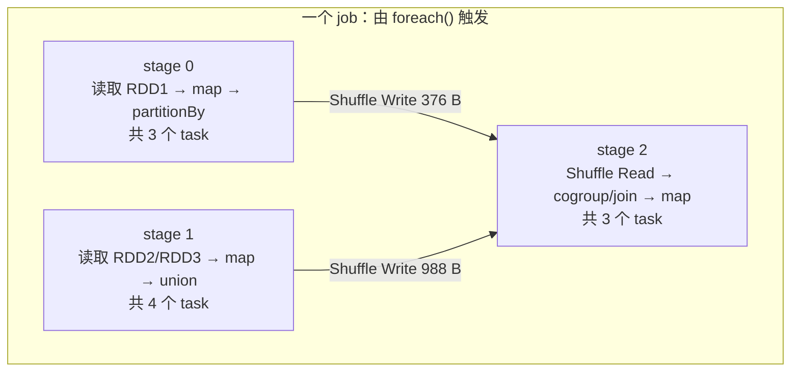
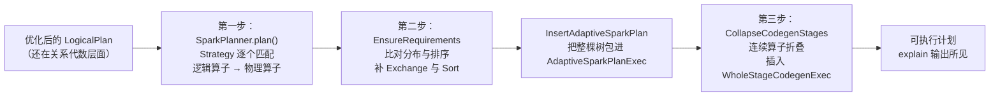
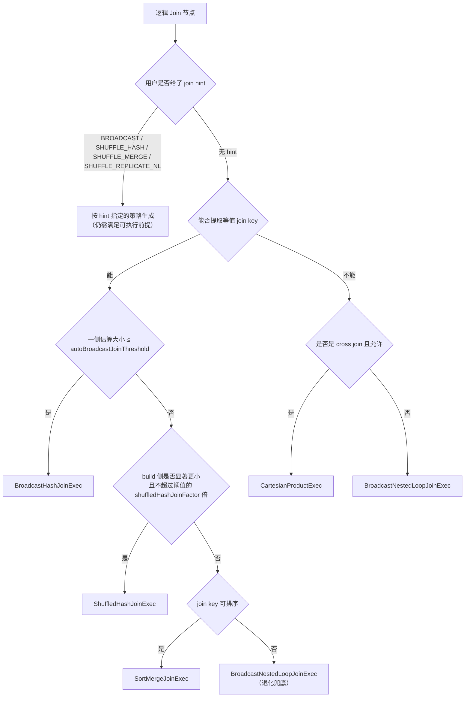
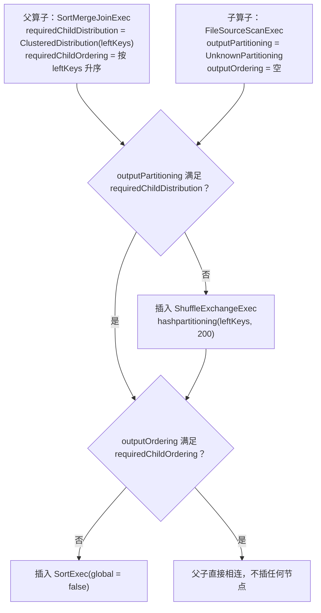
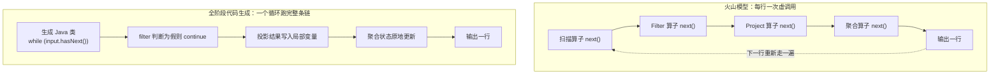
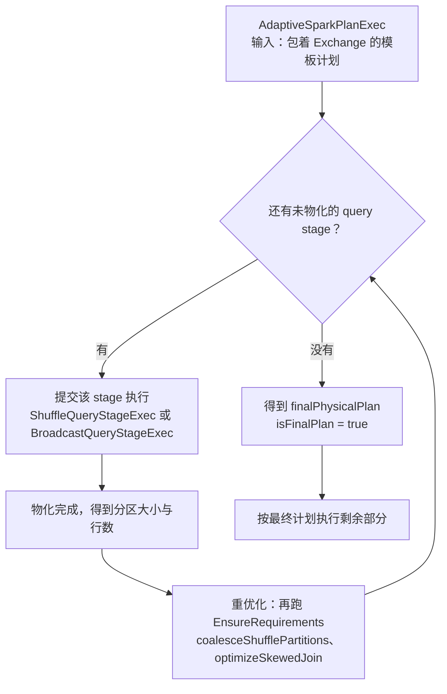

# 第4章 Spark物理执行计划

**摘要：**

逻辑计划只说明“要算什么”，物理执行计划才回答“在哪台机器上、分几批、以什么顺序算”。本章沿 Spark 的两条计划生成路径展开：先是 RDD 时代以 `ShuffleDependency` 为界的 job、stage、task 三级切分，它决定任务的并行粒度与中间数据落盘的位置；再是 Spark SQL 时代从 `LogicalPlan` 到 `SparkPlan` 树的转换，`SparkPlanner` 用一组 `Strategy` 把逻辑算子映射为物理算子，`EnsureRequirements` 把缺失的分区与排序补齐，`CollapseCodegenStages` 最后把连续的算子折叠成一段生成代码。三条主线交织在一起，一条是切分，把 DAG 切成可以独立调度的 stage；一条是补约束，为每个算子补齐它要求的数据分布；一条是融合，把逐行虚调用的火山模型换成整段编译的循环。教材视角的取舍在于：切分决定并行度，补约束决定 shuffle 次数，融合决定每行开销，任何一环失手都会被数量级地放大，而三者的调优手段彼此牵制，只能放在一起看。笔者会给出 `JoinSelection` 的完整决策树、`EnsureRequirements` 插入 `Exchange` 的三种触发条件、`WholeStageCodegen` 能快一个量级的原因与它失效的边界，以及 `explain` 输出里三个最容易被误读的记号。读完这一章，面对一个物理计划应当能回答三件事：shuffle 有几次、每次为什么插、哪些算子被编进了同一段代码。

> [!info] 本篇边界
> 这一列按教材顺序铺章节骨架，源码级细节与专题结论留给专题专栏：Catalyst 的解析与规则优化见 [[大数据/Spark/Spark-SQL深度解析与性能调优/02 Catalyst 解析与分析：从 AST 到 Analyzed LogicalPlan|Catalyst 解析]]，物理规划的代价选择见 [[大数据/Spark/Spark-SQL深度解析与性能调优/05 Physical Planning：从逻辑计划到物理算子的策略选择|物理规划]]，AQE 与全阶段代码生成的深挖分别见 [[大数据/Spark/Spark-SQL深度解析与性能调优/06 AQE：运行时自适应查询优化|AQE]] 与 [[大数据/Spark/Spark-SQL深度解析与性能调优/07 Whole-Stage CodeGen：JVM 字节码级别的性能飞跃|Whole-Stage CodeGen]]。本章只回答“为什么这么切、为什么这么补、为什么这么快”，涉及处给一句结论并标注去处。

## 4.1 Spark物理执行计划概览

在[[大数据/大数据处理框架Apache Spark设计与实现/3.0 第3章 Spark逻辑处理流程|第3章]]中，我们详细讨论了 Spark 应用生成的逻辑处理流程，本章我们讨论如何将应用的逻辑处理流程转化为物理执行计划，使得应用程序可以被分布执行。逻辑计划与物理计划的区别，类似于建筑图纸与施工组织方案的差别：图纸只规定房间的位置和尺寸，施工方案才规定先浇哪层楼板、几台塔吊同时作业、材料从哪里进场；同一张图纸可以对应很多套施工方案，好坏取决于场地、机具与工期，而不取决于图纸本身。

Spark 应用生成的逻辑处理流程多种多样，为了方便讨论，我们首先构建一个较为复杂但比较典型的逻辑处理流程，然后以该流程为例讨论如何将其转化为物理执行计划。如图4.1所示，我们构建了一个 ComplexApplication 应用，该应用包含 `map()`、`partitionBy()`、`union()` 和 `join()` 等多种数据操作。

*图4.1 ComplexApplication应用的逻辑处理流程*

ComplexApplication 应用的示例代码：

```scala
// 示例代码(假设)
val rdd1 = sc.parallelize(/* ... */)
val rdd2 = sc.parallelize(/* ... */)
val rdd3 = sc.parallelize(/* ... */)
val mappedRDD1 = rdd1.map(/* func */)
val mappedRDD2 = rdd2.map(/* func */)
val mappedRDD3 = rdd3.map(/* func */)
val unionRDD = mappedRDD2.union(mappedRDD3)
val shuffledRDD = mappedRDD1.partitionBy(new HashPartitioner(3))
val joinedRDD = shuffledRDD.join(unionRDD) // 内部生成CoGroupedRDD等
val resultRDD = joinedRDD.map(/* func */)
resultRDD.foreach(/* action */)
```

本章的核心问题是如何将逻辑处理流程转化为物理执行计划。MapReduce、Spark 等大数据处理框架的核心思想是将大的应用拆分为小的执行任务，那么面对这么复杂的数据处理流程，Spark 如何将其拆分为小的执行任务呢？

想法 1：一个直观想法是将每个具体的数据操作作为一个执行阶段，也就是将前后关联的 RDD 组成一个执行阶段，图4.1中的每个箭头都生成一个执行任务。对于 2 个 RDD 聚合成 1 个 RDD 的情况（见图4.1中的 ShuffledRDD、UnionRDD、CoGroupedRDD），将这 3 个 RDD 组成一个 stage。这样虽然可以解决任务划分问题，但会带来两个性能问题：第 1 个是任务数量太多，图4.1 中有 36 个箭头，即便把指向 child RDD 同一个分区的箭头合并为一个 task、让一个 task 从多个 parent 分区取数，仍然会有 21 个任务，调度压力很大；第 2 个是中间数据太多，每个任务都要把结果存到磁盘或者内存中供下游读取，36 个箭头意味着 36 份中间结果，内存和磁盘都撑不住。

想法 2：既然想法 1 的任务过多会造成中间数据量过大，第 2 个想法是减少任务数量。中间数据（RDD）产生以后只用于下一步计算（图4.1中的箭头），下一步算完它就可以被删除。那么，一个大胆的想法是把这些计算操作串联起来，用一个执行阶段跑完串联的多个操作，让上一步在内存中生成的数据被下一步处理完就及时回收。

基于这个串联思想，接下来需要解决的两个问题分别是：

1. 每个 RDD 包含多个分区，那么需要生成多少个任务计算？如图4.2所示，我们观察到 RDD 中每个分区的计算逻辑相同，可以独立计算，因此我们可以将每个分区上的操作串联为一个 task，也就是为最后的 MapPartitionsRDD 的每个分区分配一个 task。
2. 如何串联操作？遇到复杂依赖关系（如 ShuffleDependency）如何处理？因为 `cogroup()`、`join()` 这类操作的输入数据可以有多个，而输出一般只有一个，串联的顺序只能从后往前：从最后的 MapPartitionsRDD 开始向前卷，遇到 ShuffleDependency 就把该分区依赖的上游数据与操作都纳入同一个 task。代价是 task 过大且会重复计算，图4.2 中从 rdd2 到 UnionRDD 的所有数据与操作都被卷进 task0，其他 task 还得把同一段数据再算一遍；靠缓存可以避免重算，但缓存既占空间，又让 task0 与其他 task 无法并行。

*图4.2 一种物理执行计划的生成方法*

想法 3：想法 2 的缺点是 task 会变得很大，降低了并行度。问题根源是遇到 ShuffleDependency 时会出现重复计算，不能有效地划分任务。既然 ShuffleDependency 包含复杂的多对多的依赖关系，导致任务划分困难，为何不对该 ShuffleDependency 关系进行划分呢？如将 ShuffleDependency 前后的计算逻辑分开，形成不同的计算阶段和任务，这样就不会出现 task 过大的情况。Spark 实际上就是基于这个思想设计的，下面我们详细讨论 Spark 的划分方案。

这三种想法的取舍其实是一条主线：任务粒度越细，调度与中间存储的代价越高；任务粒度越粗，重复计算与并行度损失越严重。Spark 选择在两种极端之间找一个可以机械判定的分界点，这个分界点就是数据的物理重分布（ShuffleDependency），只要数据不需要跨机器重新划分，就没有拆分阶段的必要。

## 4.2 Spark物理执行计划生成方法

### 4.2.1 三个步骤：job、stage、task

Spark 具体采用 3 个步骤来生成物理执行计划：首先根据 `action()` 操作顺序将应用划分为作业（job），然后根据每个 job 的逻辑处理流程中的 ShuffleDependency 依赖关系，将 job 划分为执行阶段（stage），最后在每个 stage 中，根据最后生成的 RDD 的分区个数生成多个计算任务（task），具体如下所述。表 1 先把这三级的对应关系摆清楚，后文的讨论都围绕这张表展开。

表 1　job、stage、task 的三级切分

| 层级 | 切分依据 | 数量由谁决定 | 交付给下一级的东西 |
| :--- | :--- | :--- | :--- |
| job | 一次 `action()` 调用 | 应用里 `action()` 的个数 | 一张从数据源到结果 RDD 的 DAG |
| stage | `ShuffleDependency` 边界 | DAG 中被宽依赖切开的段数 | 若干可独立调度的 task 集合 |
| task | 一个分区上的一段流水线 | stage 末尾 RDD 的分区数 | 一个分区的计算结果（落盘或回传 Driver） |

#### （1）根据 `action()` 操作顺序将应用划分为作业（job）

这一步主要解决何时生成 job，以及如何生成 job 逻辑处理流程的问题。当应用程序出现 `action()` 操作时，如 `resultRDD.action()`，表示应用会生成一个 job，该 job 的逻辑处理流程为从输入数据到 resultRDD 的逻辑处理流程。例如，在示例代码中，我们在 `join()` 之后使用了 `foreach()` 这一 `action()` 操作，因此，Spark 会生成图4.3这样的逻辑处理流程（这里添加了输入数据的表示 Data blocks，因为一般的 job 是从分布式文件系统读取数据的）。如果应用程序中有很多 `action()` 操作，那么 Spark 会按照顺序为每个 `action()` 操作生成一个 job，每个 job 的逻辑处理流程也都是从输入数据到最后 `action()` 操作的。

`action()` 与 job 是一对一的，这意味着相邻两个 `action()` 之间即使共用同一批上游 RDD，也不会自动共享计算结果；除非这中间的数据被显式缓存，否则第二个 job 会把第一条链路重算一遍。[[大数据/大数据处理框架Apache Spark设计与实现/7.0 第7章 数据缓存机制|第7章]]讨论的缓存机制正是为此而存在：它在某个 RDD 处剪断血缘，让后续 job 直接读已物化的分区。

#### （2）根据 ShuffleDependency 依赖关系将 job 划分为执行阶段（stage）

对于每个 job，从其最后的 RDD（图4.3中连接 results 的 MapPartitionsRDD）往前回溯整个逻辑处理流程，如果遇到 NarrowDependency，则将当前 RDD 的 parent RDD 纳入，并继续往前回溯。当遇到 ShuffleDependency 时，停止回溯，将当前已经纳入的所有 RDD 按照其依赖关系建立一个执行阶段，命名为 stage i。如图4.3所示，首先从 results 之前的 MapPartitionsRDD 开始向前回溯，回溯到 CoGroupedRDD 时，发现其包含两个 parent RDD，其中一个是 UnionRDD。因为 CoGroupedRDD 与 UnionRDD 的依赖关系是 ShuffleDependency，对其进行划分，并继续从 CoGroupedRDD 的另一个 parent RDD 回溯，回溯到 ShuffledRDD 时，同样发现了 ShuffleDependency，对其进行划分得到了一个执行阶段 stage 2。接着从 stage 2 之前的 UnionRDD 开始向前回溯，由于都是 NarrowDependency，将一直回溯到读取输入数据的 RDD2 和 RDD3 中，形成 stage 1。最后，只剩余 RDD1 成为一个 stage 0。

*图4.3 ComplexApplication应用生成的物理执行图*

把这条回溯规则画成图，可以得到图4.4这样的形态：切分点只出现在数据需要跨机器重排的地方，其余算子都被卷进同一个 stage。



图4.4　物理执行图的骨架：stage 0 与 stage 1 并行，stage 2 等两者完成

#### （3）根据分区计算将各个 stage 划分为计算任务（task）

执行第 2 步后，我们可以发现整个 job 被划分成了大小适中（相比想法 2 中的划分方法）、逻辑分明的执行阶段 stage。接下来的问题是如何生成计算任务。我们之前的想法是每个分区上的计算逻辑相同，而且是独立的，因此每个分区上的计算可以独立成为一个 task。Spark 也采用了这个策略，根据每个 stage 中最后一个 RDD 的分区个数决定生成 task 的个数。如在图4.3的 stage 2 中，最后一个 MapPartitionsRDD 的分区个数为 3，那么 stage 2 就生成 3 个 task。如图4.3中粗箭头所示，在 stage 2 中，每个 task 负责 ShuffledRDD 到 CoGroupedRDD 到两层 MapPartitionsRDD 中一个分区的计算。同样，在 stage 1 中生成 4 个 task，前 2 个 task 负责 Data blocks 到 RDD2 到 MapPartitionsRDD 到 UnionRDD 中 2 个分区的计算，后 2 个 task 负责 Data blocks 到 RDD3 到 UnionRDD 中 2 个分区的计算。在 stage 0 中，生成 3 个 task，负责 Data blocks 到 RDD1 的计算。

### 4.2.2 三个执行问题

经过以上 3 个步骤，Spark 可以将一个应用的逻辑处理流程划分为多个 job，每个 job 又可以划分为多个 stage，每个 stage 可以生成多个 task，而同一个阶段中的 task 可以同时分发到不同的机器并行执行。看起来已经很完美了，但还有 3 个执行方面的问题：一个应用生成了多个 job、stage 和 task，如何确定它们的计算顺序？task 内部如何存储和计算中间数据？前后 stage 中的 task 间如何传递和计算数据？

#### （1）job、stage 和 task 的计算顺序

job 的提交时间与 `action()` 被调用的时间有关，当应用程序执行到 `rdd.action()` 时，就会立即将 `rdd.action()` 形成的 job 提交给 Spark。job 的逻辑处理流程实际上是一个 DAG 图，经过 stage 划分后，仍然是 DAG 图形状。每个 stage 的输入数据要么是 job 的输入数据，要么是上游 stage 的输出结果。因此，计算顺序从包含输入数据的 stage 开始，从前到后依次执行，仅当上游的 stage 都执行完成后，再执行下游的 stage。在图4.3中，stage 0 和 stage 1 由于都包含了 job 的输入数据，两者都可以先开始计算，仅当两者都完成后，stage 2 才开始计算。stage 中每个 task 因为是独立而且同构的，可以并行运行没有先后之分。

这套顺序依赖的落地形式是 `DAGScheduler` 里的事件循环：stage 提交、`ShuffleMapTask` 完成、下游 stage 被唤醒，全由事件驱动，调度细节在 [[大数据/Spark/Spark-调度系统与执行模型深度解析/02 DAGScheduler 核心逻辑：Stage 划分算法与逻辑计划生成|DAGScheduler 核心逻辑]] 中有完整展开，本章只需记住一条：stage 之间的等待是“全部上游分区完成”这种粗粒度的屏障。

#### （2）task 内部数据的存储与计算问题（流水线计算）

讨论完 job、stage、task 的执行顺序后，我们聚焦在 task 内部，讨论 task 如何计算每个 RDD 中的数据。在想法 2 中，我们提出的解决方案是每计算出一个中间数据（也就是 RDD 中的一个分区）就将其存放到内存中，等下一个操作处理完成并生成新的 RDD 中的一个分区后，回收上一个 RDD 在内存中的数据。这种方案虽然可以减少内存空间，但当某个 RDD 中一个分区个数太多时，仍然会占用大量内存。为了解决这个问题，进一步观察 RDD 分区之间的关系，发现上游分区包含的 record 和下游分区包含的 record 之间经常存在一对一的数据依赖关系。例如，在图4.5中的第 1 个计算模式（pattern）中，`f()` 和 `g()` 函数每次读取一个 record，计算并生成一个新 record，这类型的操作包括 `map()`、`filter()` 等。`f()` 在算 record1 时并不需要知道 record2 是什么，`g()` 在算 record1′ 时也只要求 `f()` 先输出 record1′，因此这两个函数可以交替推进，形成“流水线”式的计算。

- 读取 record1，经 `f(record1)` 得到 record1′，再经 `g(record1′)` 输出 record1′′
- 读取 record2，经 `f(record2)` 得到 record2′，再经 `g(record2′)` 输出 record2′′
- 读取 record3，经 `f(record3)` 得到 record3′，再经 `g(record3′)` 输出 record3′′

“流水线”式计算的好处是可以有效地减少内存使用空间，在 task 计算时只需要在内存中保留当前被处理的单个 record 即可，不需要保存其他 record 或者已经被处理完的 record。例如，在第 1 个 pattern 中，没有必要在执行 `f(record1)` 之前将 record2 和 record3 提前算出来放入内存中。

*图4.5 task内部中间数据的4种计算模式，即根据上游数据计算下游数据的不同方式*

对于其他类型的操作，是否还可以采用“流水线”式计算呢？第 2 个 pattern 中的 `g()` 函数、第 3 个 pattern 中的 `f()` 函数、第 4 个 pattern 中的 `f()` 和 `g()` 函数都需要一次性读取上游分区中所有的 record 来计算。这样的函数主要出现在 `mapPartitions(func f)`、`zipPartitions(func g)` 等操作中。举个例子，`f()` 和 `g()` 函数可以是第3章中介绍的 `mapPartitions(func)`，具体代码如下，其中 iter 是读取上游分区中 record 的迭代器。

```scala
// 示例:mapPartitions(func) 的简化示意
val resultRDD = rdd.mapPartitions { iter =>
  // 函数内部可能需要一次性读取所有record
  iter.map(/* ... */)
}
```

在第 2 个 pattern 中，由于 `f()` 函数仍然是一一映射的，所以仍然可以采用“流水线”式计算：`f()` 每生成一条 record′，就立即送进 `g()` 函数中的 `iter.next()` 参与计算，`g()` 函数自行在内存里暂存这些中间结果，等输入耗尽后再一条条输出。有些 `g()` 函数逻辑简单，甚至不需要用数据结构保存中间结果，譬如求 record 的 max 值，只需记住当前最大值即可。

第 3 个 pattern 断开了流水线：由于 `f()` 函数需要读完全部 record 才能算出三个 record′，只能先执行 `f()`、再执行 `g()`。`f()` 的输出必须完整保存在内存中，而 `g()` 每算完一个 record′ 并得到 record′′ 之后，就可以回收对应的 record′。

第 4 个 pattern 更不能流水线：`f()` 与 `g()` 都要求一次性读完整批上游数据，两者只能依次执行，流水线退化为“计算—回收”模式，每执行完一个操作回收一次中间结果。

> [!note] 流水线的边界
> Spark 采用“流水线”式计算来提高 task 的执行效率，减少内存使用量，这也是 Spark 可以在有限内存中处理大规模数据的原因。但流水线并不是无条件的：只要有一个算子需要看完整批数据（`sortByKey()` 的排序、`groupByKey()` 的聚合、`mapPartitions()` 里把迭代器 `toList` 的写法），这段链路的流水线就会在那里断开，退化成“先算完、再回收”。

#### （3）task 间的数据传递与计算问题

讨论了 task 内部数据计算后，还有一个问题是不同 stage 之间的 task 如何传递数据进行计算。回顾一下，stage 之间存在的依赖关系是 ShuffleDependency，而 ShuffleDependency 是部分依赖的，也就是下游 stage 中的每个 task 需要从 parent RDD 的每个分区中获取部分数据。ShuffleDependency 的数据划分方法包括 Hash 划分、Range 划分等，也就是要求上游 stage 预先将输出数据进行划分，按照分区存放，分区个数与下游 task 的个数一致，这个过程被称为“**Shuffle Write**”。按照分区存放完成后，下游的 task 将属于自己分区的数据通过网络传输获取，然后将来自上游不同分区的数据聚合在一起进行处理，这个过程被称为“**Shuffle Read**”。总的来说，不同 stage 的 task 之间通过 Shuffle Write 与 Shuffle Read 传递数据，至于如何具体进行 Shuffle 操作、分区数据是写内存还是磁盘、如何对这些数据进行聚合，这些问题将在[[大数据/大数据处理框架Apache Spark设计与实现/6.0 第6章 Shuffle机制|第6章]]详细介绍，实现层面的取舍见 [[大数据/Spark/Spark-Shuffle与内存管理机制深度解析/01 为什么 Shuffle 是分布式计算的命门|为什么 Shuffle 是分布式计算的命门]]。

### 4.2.3 stage 与 task 的命名

在 MapReduce 中，stage 只包含两类：map stage 和 reduce stage，map stage 中包含多个执行 `map()` 函数的任务，被称为 map task；reduce stage 中包含多个执行 `reduce()` 函数的任务，被称为 reduce task。而在 Spark 中，stage 可以有多个，有些 stage 既包含类似 `reduce()` 的聚合操作又包含 `map()` 操作，所以一般不区分是 map stage 还是 reduce stage，而直接使用 stage i 来命名，只有当生成的逻辑处理流程类似 MapReduce 的两个执行阶段时，我们才会依据习惯区分 map/reduce stage。虽然在 Spark 中一般不区分 map/reduce stage，但可以对 stage 中的 task 使用不同的命名，如果 task 的输出结果需要进行 Shuffle Write，以便传输给下一个 stage，那么这些 task 被称为 **ShuffleMapTasks**；而如果 task 的输出结果被汇总到 Driver 端或者直接写入分布式文件系统，那么这些 task 被称为 **ResultTasks**。如图4.3所示，stage 0 和 stage 1 中的 task 是 ShuffleMapTasks，stage 2 中的 task 是 ResultTasks，直接输出结果。

两套命名的背后是两套结果处理路径：`ShuffleMapTask` 返回 `MapStatus`，记录下游每个分区到哪取数；`ResultTask` 的返回值要么汇总到 Driver，要么直接写外部存储。也正因为不再向下游交付分区，`ResultTask` 所在的 stage 才是链路终点。

### 4.2.4 在 Spark UI 上核对物理执行计划

理解了生成过程之后，面对一个新应用，反过来用 Spark UI 的三级信息核对是最快的办法。ComplexApplication 只含一个 `foreach()`，因此只有一个 job，如图4.6；进入 Details for job 0 可以看到它包含 3 个 stage，如图4.7：stage 0 有 3 个 task、Shuffle Write 376.0B，stage 1 有 4 个 task、Shuffle Write 988.0B，stage 2 有 3 个 task、Shuffle Read 1364.0B，正好等于前两者之和。点开 DAG Visualization 能看到 stage 之间的依赖，如图4.8，但那个图把 RDD 画成黑色实心圆圈，stage 0 指向 stage 2 的箭头还穿过了 stage 1，容易误读；进入单个 stage 的页面反而更清楚，如图4.9，它列出了每个操作生成的 RDD（如 `join()` 生成 CoGroupedRDD 及两个 MapPartitionsRDD），代价是看不到 stage 之间的连接。

*图4.6 至图4.9　job 信息、stage 信息、stage 依赖图与单 stage 结构图*

Details for stage i 页面则下钻到 task 级：stage 0 的 3 个 task 各 Shuffle Write 2 到 3 个 record，stage 1 的 4 个 task 各写 2 个 record，stage 2 的 3 个 task 各从上游读 5 到 6 个 record，如图4.10与图4.11。这些数字之所以有用，是因为它们互相校验：上游各 stage 的 Shuffle Write 之和应当等于下游 stage 的 Shuffle Read 总量，对不上就说明有 task 重试或推测执行产生了重复写。

*图4.10、图4.11　stage 0 与 stage 1、stage 2 的 task 级信息*

## 4.3 常用数据操作生成的物理执行计划

4.2节我们讨论了 Spark 划分 stage 和 task 的一般原则，那么具体到每个常用的数据操作，如何进行划分呢？我们首先回顾一下 NarrowDependency 和 ShuffleDependency 数据依赖关系，然后探讨相关的 stage 划分原则，最后挑选一些具有代表性的数据操作来详细说明。

先回顾一下数据依赖关系，宽依赖（`ShuffleDependency`）和窄依赖（`NarrowDependency`）的区别是 child RDD 的各个分区中的数据是否完全依赖其 parent RDD 的一个或者多个分区。完全依赖指 parent RDD 中的一个分区不需要进行划分就可以流入 child RDD 的分区中。如果是完全依赖，那么数据依赖关系是窄依赖。如果是不完全依赖，也就是 parent RDD 的一个分区中的数据需要经过划分（如 `HashPartition` 或者 `RangePartition`）后才能流入 child RDD 的不同分区中，那么数据依赖关系是宽依赖。

再看一下 NarrowDependency 和 ShuffleDependency 的 stage 划分原则。对于 NarrowDependency，parent RDD 和 child RDD 的分区之间是完全依赖的，我们可以将 parent RDD 和 child RDD 直接合并为一个 stage。在合成的 stage 中，对于 `OneToOneDependency`，每个 task 读取 parent RDD 中的一个分区，并计算 child RDD 中的一个分区；对于 `ManyToOneDependency` 或者 `ManyToManyDependency`，每个 task 读取 parent RDD 中多个分区，并计算出 child RDD 中的一个分区。对于 ShuffleDependency，将 parent RDD 和 child RDD 进行划分，形成两个或多个 stage，每个 stage 产生多个 task，stage 之间通过 Shuffle Write 和 Shuffle Read 来传递数据。下面，我们将常用数据操作归类到这几种依赖关系中，并举例详细介绍其物理执行计划。表 2 把四种窄依赖形态与它们的 task 划分放在一处对照。

表 2　NarrowDependency 的四种形态与 task 划分

| 依赖形态 | 代表操作 | 每个 task 读几个 parent 分区 | stage 数 | task 数 |
| :--- | :--- | :--- | :--- | :--- |
| OneToOneDependency | `map()`、`flatMap()`、`filter()`、`mapPartitionsWithIndex()` | 1 个 | 1 | 等于 child 分区数 |
| RangeDependency | `union()` | 1 个（来自任一 parent） | 1 | 等于 child 分区数 |
| ManyToOneDependency | `coalesce(shuffle=false)`、`zipPartitions()` | 多个 | 1 | 等于 child 分区数 |
| ManyToManyDependency | `cartesian()` | 两个 parent 各一个分区 | 1 | 等于 child 分区数 |

### 4.3.1 OneToOneDependency 类型的操作

`flatMap()` 和 `mapPartitionsWithIndex()` 都是典型的一对一依赖：两个操作都只生成一个 stage，stage 中不同颜色的箭头表示不同的 task，每个 task 负责处理一个分区，进行流水线计算，且计算逻辑清晰。这两个操作唯一不同的是 `flatMap()` 每读入一条 record 就处理和输出一条，而 `mapPartitionsWithIndex()` 等到全部 record 都处理完后再输出 record。以 `mapPartitionsWithIndex()` 计算每个分区中奇数的和及偶数的和为例，task 内部先把分区内的 record 全部消费完，才一次性输出两个聚合值，这个差异决定了它在流水线断点表里的位置。

### 4.3.2 RangeDependency 类型的操作

一般情况下 `union()` 操作将两个 RDD 合并为一个 RDD，只生成一个 stage，stage 中不同颜色的箭头表示不同的 task，每个 task 负责处理一个分区。`RangeDependency` 的特点是 child 分区的编号区间与 parent 分区的编号区间之间存在固定的偏移映射，因此 `union()` 不需要移动任何数据，只要把父 RDD 的迭代器按区间拼接起来即可。这也是 `union()` 代价极低的原因：它不产生 shuffle，也不产生新的数据副本，只是把两个迭代器首尾相连。

### 4.3.3 ManyToOneDependency 类型的操作

`coalesce(shuffle=false)`、特殊情况下的 `union()`（见第3章的说明），以及 `zipPartitions()` 操作对应的数据依赖关系都是 `ManyToOneDependency`，child RDD 中的每个分区需要从 parent RDD 中获取所依赖的多个分区的全部数据。由于 `ManyToOneDependency` 是窄依赖，所以 Spark 将 parent RDD 和 child RDD 组合为一个 stage，该 stage 生成的 task 个数与最后 RDD 的分区个数相等。与 `OneToOneDependency` 形成的 task 相比，这里每个 task 需要同时在 parent RDD 中获取多个分区中的数据。`coalesce()` 之所以能在不 shuffle 的前提下减少分区数，靠的正是这种多对一关系：它让一个 task 直接从多个上游分区拉数据，代价是并行度下降，而且被合并的那几个上游分区必须位于同一台机器上的同一个 Executor 里，否则就要跨网络读取。

### 4.3.4 ManyToManyDependency 类型的操作

`cartesian()` 操作对应的数据依赖关系是 `ManyToManyDependency`，child RDD 中的每个分区需要从两个 parent RDD 中获取所依赖的分区的全部数据。虽然 `ManyToManyDependency` 形似 `ShuffleDependency`，却属于 `NarrowDependency`，因此 Spark 将 parent RDD 和 child RDD 组合为一个 stage，该 stage 生成的 task 个数与最后 RDD 的分区数相等。与 `ManyToOneDependency` 形成的 task 相比，这里每个 task 需要同时在多个 parent RDD 中获取分区中的数据。`cartesian()` 的分区数等于两侧分区数之积，数据量则是两侧行数之积，这个乘积一旦失控，代价会以平方级放大，所以它通常只用在其中一侧足够小的场景。

### 4.3.5 单一 ShuffleDependency 类型的操作

`aggregateByKey()` 和 `sortByKey()` 操作形成的是单一的 `ShuffleDependency` 数据依赖关系，也就是只与一个 parent RDD 形成 `ShuffleDependency`。根据划分原则，Spark 将 parent RDD 和 child RDD 分开，分别形成一个 stage，每个 stage 中的 task 个数与该 stage 中最后一个 RDD 中的分区个数相等。为了进行跨 stage 的数据传递，上游 stage 中的 task 将输出数据进行 Shuffle Write，child stage 中的 task 通过 Shuffle Read 同时获取 parent RDD 中多个分区中的数据。与 `NarrowDependency` 不同，这里从 parent RDD 的分区中获取的数据是划分后的部分数据。`aggregateByKey()` 还会在 Shuffle Write 端先做一次 map 端聚合（combine），把同一个分区内相同 key 的多个 value 先合并一次再落盘，这一步能把落盘数据量压掉一个数量级，第6章会展开它的实现。

### 4.3.6 多 ShuffleDependency 类型的操作

`join()` 操作在不同配置下会生成多种不同类型的数据依赖关系，表 3 把四种典型形态列在一起。

表 3　`join()` 在四种分区器配置下的 stage 划分

| 形态 | 两侧分区器关系 | 产生的依赖 | stage 数 | 说明 |
| :--- | :--- | :--- | :--- | :--- |
| （a） | 两侧都与结果分区器不同 | 多个 `ShuffleDependency` | 3 | 两侧各写一次 Shuffle，join 侧再读一次 |
| （b） | 一侧相同、一侧不同 | `OneToOneDependency` 加 `ShuffleDependency` | 2 | 只有不满足分区器的一侧需要重分布 |
| （c） | 同上，另一侧不同 | `OneToOneDependency` 加 `ShuffleDependency` | 2 | 与（b）对称 |
| （d） | 两侧已是同一个分区器 | `ManyToOneDependency` | 1 | 无 shuffle，join 退化为分区内的归并 |

- 形态（d）中 `rdd1`、`rdd2` 与 CoGroupedRDD 共用同一个 `partitioner`，parent 与 child 之间只有 `ManyToOneDependency`，因此只有一个 stage。
- 形态（b）（c）同时包含 `OneToOneDependency` 与 `ShuffleDependency`，只对后者切分，得到两个 stage，下游 task 既读上游分区，也处理窄依赖过来的数据。
- 形态（a）包含多个 `ShuffleDependency`，每个都要切，得到 3 个 stage，下游要等上游全部完成才能开始。

表 3 第（d）行揭示了一个前提：join 本身不必然产生 shuffle，产生 shuffle 的是“两侧分区方式与 join key 不一致”。调优建议里说的“先 `partitionBy` 再 `join`”省掉的正是这一次重分布，代价是上游多做一次 `partitionBy`，值不值得看数据在该分区方式下还会被复用几次。

## 4.4 从逻辑计划到物理计划的三步

以上讨论的是 RDD 层面的物理执行计划：给定一棵由 RDD 依赖构成的 DAG，如何把它切成 stage 和 task。到了 Spark SQL 时代，同样的工作换了一套表示法：用户的 SQL 或 DataFrame 操作先被解析成 `LogicalPlan`，经过 Catalyst 的规则优化之后，再由一组规则把它转成由 `SparkPlan` 节点组成的物理计划树，最后由 `DAGScheduler` 把这棵树翻译成 RDD 的 DAG。也就是说，第4.2节讲的三级切分并没有消失，它只是变成了物理计划树下沉到执行层时的那一步。

第3章及本章前半部分介绍的逻辑处理流程和物理执行计划，是完全根据用户定义的 RDD 操作顺序和数据依赖关系生成的。这样存在的一个问题是用户自己定义的数据处理流程可能不是最优的，如将用户代码 `rdd1.join(rdd2).map(func)` 中的操作调整顺序后形成的 `rdd1.map(func).join(rdd2)` 的执行效率可能更高；再如在某个数据集上先进行分区再进行 `join()` 的效率要比直接进行 `join()` 的效率高。数据库领域早就有一整套优化技术来处理这件事，包括基于规则的优化、基于性能模型的优化和基于自适应的优化，Spark SQL 把它们引了进来：用规则优化做谓词下推、算子组合、常量折叠，用代价模型选择物理计划，用自适应执行在运行时动态调整计划。逻辑计划如何被解析与改写，在 [[大数据/Spark/Spark-SQL深度解析与性能调优/02 Catalyst 解析与分析：从 AST 到 Analyzed LogicalPlan|Catalyst 解析]] 与 [[大数据/Spark/Spark-SQL深度解析与性能调优/03 Catalyst 逻辑优化：Rule-Based Optimizer 的核心规则|逻辑优化]] 两篇里有完整展开，本章从优化后的逻辑计划接手。

从优化后的 `LogicalPlan` 到可执行的 `SparkPlan`，中间只有三步，但这三步各自解决的问题完全不同，把它们混在一起谈是读物理计划时最常见的混乱来源。



图4.12　物理计划生成的三步，以及 AQE 的插入位置

第一步由 `SparkPlanner` 完成。`SparkPlanner.plan(plan: LogicalPlan): Iterator[PhysicalPlan]` 持有一组 `Strategy`，逐个尝试把当前逻辑计划节点替换成物理计划节点，第一个返回非空结果的策略胜出；对于有子节点的算子，策略内部用 `planLater(child)` 生成一个 `PlanLater` 占位符，递归下降到子树，最终整棵树上的占位符都会被真实计划替换。`PlanLater` 让策略只需关心自己负责的那一个节点，不必关心子树如何变成物理计划；策略集合的顺序也有意义，4.5 节展开这一点。

第二步由 `EnsureRequirements` 完成。它只做一件事：遍历物理计划树，对每个节点比较“子节点实际提供的数据分布与排序”和“本节点要求子节点提供的数据分布与排序”，不满足就在中间插入一个负责搬运的节点，分布不满足插 `ShuffleExchangeExec` 或 `BroadcastExchangeExec`，排序不满足插 `SortExec`。这一步只保证正确性，不判断值不值得，因此它是“多余 shuffle”的主要来源，也是本章后半部分的重点。

第三步由 `CollapseCodegenStages` 完成。它同样遍历物理计划树，把连续的支持代码生成的算子折叠进一个 `WholeStageCodegenExec`，遇到不支持的算子就用 `InputAdapter` 包一层作为边界。这一步不改变语义，只改变执行形态，却带来了一个量级的性能差异。

三步在 `QueryExecution` 里的实际顺序值得记住：`PlanSubqueries` 先展开子查询，`EnsureRequirements` 补分布，`InsertAdaptiveSparkPlan` 把计划包成 `AdaptiveSparkPlanExec`，`CollapseCodegenStages` 再做融合，最后是 `ReuseExchange` 与 `ReuseSubquery` 复用重复子树。自适应执行看到的因此是“已补齐分布、尚未融合”的计划，而每次重优化得到的最终计划都要再走一遍融合。

一个具体的例子可以把三步串起来。对 `SELECT a, sum(b) FROM t GROUP BY a` 这样一条查询，优化后的逻辑计划只是“对 t 做聚合、按 a 分组”，物理计划却有三层：

```text
== Physical Plan ==
AdaptiveSparkPlan isFinalPlan=false
+- HashAggregate(keys=[a#12], functions=[sum(sum#21L)])
   +- Exchange hashpartitioning(a#12, 200), ENSURE_REQUIREMENTS, [plan_id=41]
      +- HashAggregate(keys=[a#12], functions=[partial_sum(b#13)])
         +- *(1) Filter (isnotnull(b#13) AND (b#13 > 0))
            +- *(1) FileScan parquet default.t[a#12,b#13] ...
```

（示例输出经过删节，字段编号与 plan_id 随查询而异。）第一层的 `HashAggregate` 是最终聚合，`partial_sum` 是 map 端的部分聚合，中间那个 `Exchange` 正是 `EnsureRequirements` 补上的，因为最终聚合要求“相同 key 的数据在同一分区”，而扫描算子只保证按文件切块。`*(1)` 则说明过滤与扫描被折叠进了同一段生成代码。三层结构分别对应三步：扫描与聚合的拆分来自 `Aggregation` 策略，`Exchange` 来自 `EnsureRequirements`，`*(1)` 来自 `CollapseCodegenStages`。

## 4.5 Strategy：一个逻辑算子能落到哪些物理算子

`Strategy` 在 Spark 源码里是一个从 `LogicalPlan` 到 `Seq[SparkPlan]` 的偏函数，它的输入是一个逻辑节点，输出是若干候选物理计划——注意是若干，因为有些策略确实能给出多套方案，虽然 Spark 默认只取第一个，并不做代价比较（基于代价的选择发生在逻辑优化阶段的 CBO，以及运行时的 AQE）。表 4 把 `SparkPlanner` 里常用的策略与它们的职责列出来。

表 4　`SparkPlanner` 中常用 Strategy 的职责

| 策略 | 负责的逻辑算子 | 典型产出 | 说明 |
| :--- | :--- | :--- | :--- |
| `DataSourceV2Strategy` | v2 数据源的 `Scan`、`WriteToDataSourceV2` | `BatchScanExec`、`WriteToDataSourceV2Exec` | 把下推的过滤器、列裁剪、分区裁剪交给数据源实现 |
| `FileSourceStrategy` | 文件表扫描与 `InsertIntoHadoopFsRelationCommand` | `FileSourceScanExec`、`DataWritingCommandExec` | 把分区裁剪、列裁剪、谓词下推变成扫描节点的构造参数 |
| `Aggregation` | `Aggregate` | `HashAggregateExec`、`ObjectHashAggregateExec`、`SortAggregateExec` | 通常会拆成部分聚合与最终聚合两段，中间必然有 `Exchange` |
| `JoinSelection` | `Join` | 四类 join 物理算子 | 决策顺序见 4.6 节 |
| `BasicOperators` | `Project`、`Filter`、`Union`、`Limit`、`Sort`、`TakeOrdered` 等 | `ProjectExec`、`FilterExec`、`UnionExec`、`CollectLimitExec`、`SortExec` 等 | 一一对应的“默认实现”，兜住大部分普通算子 |

`Aggregation` 策略是“一个逻辑算子对应多个物理算子”最典型的例子。同样一个 `Aggregate`，聚合函数都能增量更新时走 `HashAggregateExec`，用哈希表按 key 累加，最快但要求函数支持原地更新；聚合函数是 `TypedImperativeAggregate`（如 `collect_list`）时走 `ObjectHashAggregateExec`，用对象保存中间状态；两者都不支持时只能走 `SortAggregateExec`，先按 key 排序再顺序扫描。切换依据是聚合函数的实现类型，而不是数据量。

`Join` 是另一个典型，一个逻辑 join 可以落到四类物理算子上，表 5 把它们的前提与代价并列。

表 5　一个 `Join` 逻辑算子可落到的物理算子

| 物理算子 | 前提 | 数据移动 | 内存压力 | 主要风险 |
| :--- | :--- | :--- | :--- | :--- |
| `BroadcastHashJoinExec` | 一侧估算大小不超过广播阈值 | 小表广播到每个 Executor | 小表大小乘以副本数 | 阈值设大导致 Driver 与 Executor OOM |
| `ShuffledHashJoinExec` | 两侧都做完 shuffle，build 侧显著更小 | 两侧都 shuffle | build 侧整表进哈希表 | build 侧估算失真导致 spill 或 OOM |
| `SortMergeJoinExec` | join key 可排序 | 两侧都 shuffle 并排序 | 只需当前行与少量缓冲 | 排序开销固定，数据倾斜时单分区很慢 |
| `BroadcastNestedLoopJoinExec` | 无等值条件，且一侧可广播 | 小表广播，大表逐行扫描 | 小表副本 | 复杂度是两侧行数之积，条件写错会爆炸 |

四类算子的差别不在语义，而在“数据怎么分布、比较怎么做”：广播哈希把比较变成哈希查找，代价是把小表搬到每个 Executor；排序归并把比较变成归并，代价是两侧都要排序；嵌套循环不做任何预处理，代价是逐对比较。选择依据是统计信息，这也解释了为什么统计信息不准时物理计划会选得很难看。

## 4.6 JoinSelection 的决策顺序

`JoinSelection` 是物理计划生成阶段决策最密集的一个策略，也是实际调优时最常被追问的一个：为什么这个 join 变成了广播、那个 join 变成了 sort merge。它的判断顺序是固定的，可以用图4.13这棵决策树概括。



图4.13　`JoinSelection` 的决策顺序

把这棵树展开成自然语言的顺序，就是先看能不能广播，再看 join key 是否可排序，再看表大小，最后兜底到嵌套循环：

1. **hint 优先**。`/*+ BROADCAST(t) */`、`/*+ SHUFFLE_HASH(t) */`、`/*+ SHUFFLE_MERGE(t) */`、`/*+ SHUFFLE_REPLICATE_NL(t) */` 会直接指定策略，hint 的存在是为了让用户覆盖统计信息，所以它的优先级高于一切自动判断。
2. **广播判断**。没有 hint 时，先看两侧的估算大小是否不超过 `spark.sql.autoBroadcastJoinThreshold`（默认 10MB），能广播就生成 `BroadcastHashJoinExec`。这一层排在最前面，原因是广播的收益最大：它把 join 的一侧完全消掉，省掉一次 shuffle。
3. **可排序判断**。如果两侧都太大不能广播，就看 join key 是否可排序，可排序则 `SortMergeJoinExec` 是默认选择，因为它对内存的要求最温和，不怕数据量。
4. **表大小判断**。在走 sort merge 之前，还有一个 `ShuffledHashJoinExec` 的机会：当 build 侧的估算大小不仅小于广播阈值，而且还比另一侧小到 `spark.sql.shuffledHashJoinFactor` 倍以上时，哈希 join 会比排序归并更快，因为它省掉了排序。
5. **兜底**。没有等值条件的 join 只能走 `BroadcastNestedLoopJoinExec`；如果是显式的 cross join 且允许，则走 `CartesianProductExec`。

表 6 把这条链路上会改结果的配置集中列出，并给出调大调小的代价。

表 6　影响 join 物理算子选择的配置

| 配置 | 默认值 | 作用 | 调大的代价 | 调小的代价 |
| :--- | :--- | :--- | :--- | :--- |
| `spark.sql.autoBroadcastJoinThreshold` | 10MB | 广播侧大小的上限 | Driver 收集与各 Executor 副本的内存压力同步上升，超过实际内存就 OOM | 更多 join 退化为 shuffle join，多一次数据重分布 |
| `spark.sql.broadcastTimeout` | 300s | 等待广播完成的超时 | 掩盖广播链路的真实瓶颈，故障恢复变慢 | 大表广播直接失败，任务重试 |
| `spark.sql.shuffledHashJoinFactor` | 3 | build 侧比另一侧小多少倍才允许哈希 join | 更容易选中哈希 join，build 侧内存风险上升 | 更多 join 走排序归并，多一次排序 |
| `spark.sql.adaptive.autoBroadcastJoinThreshold` | 与静态阈值相同 | AQE 重优化时使用的广播阈值 | 运行期才发现表比预估大时仍可能硬广播 | 运行期放弃部分可广播的 join |
| `spark.sql.crossJoin.enabled` | true | 是否允许显式 cross join | 无 | 合法的笛卡尔积查询直接报错 |

这棵树里容易被忽略的一点是：判断依据是“估算大小”，而估算值来自表或列的统计信息。没执行过 `ANALYZE TABLE` 时，它可能只是基于文件大小的粗略猜测；`spark.sql.cbo.enabled` 默认关闭，代价模型也不参与决策。于是“小表没广播”“大表被广播”都不稀奇，前者多是 `Project` 或 `Filter` 丢了统计信息，后者多是估算严重偏低。判断入口始终是 `explain` 里 join 那一行。

## 4.7 EnsureRequirements 与多余的 Exchange

`EnsureRequirements` 是“插入 Exchange”的唯一负责人，理解它的判据，就理解了 shuffle 次数为什么是现在这个数字。它的工作方式是一个两两比较的循环：每个节点声明要求子节点提供什么（`requiredChildDistribution` 与 `requiredChildOrdering`），同时暴露自己能提供什么（`outputPartitioning` 与 `outputOrdering`），规则从根往下遍历，不匹配就插入搬运节点。



图4.14　EnsureRequirements 的一次比对：分布不满足插 Exchange，排序不满足插 Sort

判断“满足”的标准是 `Distribution.satisfies(partitioning)` 与排序前缀匹配。分布层面的判据是分区方式与分区键的集合关系，例如 `HashPartitioning(Seq(a), 200)` 能满足要求“按 a 聚簇”的 `ClusteredDistribution(Seq(a))`，因为按 a 哈希之后相同 a 必然同分区；但 `HashPartitioning(Seq(a, b), 200)` 不能满足 `ClusteredDistribution(Seq(a))`，因为按 a 和 b 的联合键哈希会把相同 a 打散到不同分区。排序层面的判据是前缀匹配，要求按 `(a, b)` 排序时，实际按 `(a, b, c)` 排序也能满足。

具体到执行，触发插入的情况可以归为三类，表 7 把它们与插入的节点对应起来。

表 7　三类触发条件与插入的节点

| 触发条件 | 典型场景 | 判据 | 插入的节点 |
| :--- | :--- | :--- | :--- |
| 分区数变了 | 下游要求 `Repartition(100)`，上游是 200 分区 | 分区数不等于要求值 | `ShuffleExchangeExec` 加 `RoundRobinPartitioning` 或 `HashPartitioning` |
| 分区键变了 | 两个 join 的 key 不同，或聚合键与 join 键不同 | `Partitioning.satisfies` 为假 | `ShuffleExchangeExec` 加新 key 的 `HashPartitioning` |
| 排序要求变了 | `SortMergeJoin` 两侧都要求按 join key 有序 | `outputOrdering` 不覆盖要求的前缀 | `SortExec(global = false)`，必要时先插 Exchange 再排序 |
| 要求广播 | `BroadcastHashJoinExec` 要求 build 侧是一个广播 | 子节点不是广播分布 | `BroadcastExchangeExec` |

这三类情况之所以“各插一次”，根源在于 `EnsureRequirements` 做的是逐节点、布尔式判定：满足就满足，不满足就插一个，不存在“部分满足、折中一下”的中间态，于是同一份数据先后被两个键不同的算子使用时就会重分布两次。`SELECT * FROM a JOIN b ON a.id = b.id JOIN c ON a.id = c.id` 看着像能共用一次按 id 的分区，但只要两侧分区数不同、或者中间隔了 `Project` 换了属性引用，`canonicalized` 比较就通不过，`ReuseExchange` 也复用不了。

这种**局部最优**、全局未必最优的特性，是读物理计划最需要建立的直觉：`EnsureRequirements` 不认识“成本的全局图景”，只认识“这个节点要求什么”。所以优化 shuffle 的思路不是改规则，而是让提供方与需求方对齐：`repartition` 到相同的键与分区数、统一 join 键、在 `groupBy` 之前先 `filter`。`Exchange` 落盘后的数据怎么写出与拉取属于第6章与 [[大数据/Spark/Spark-Shuffle与内存管理机制深度解析/04 Shuffle Write 深度解剖：排序、合并与索引文件|Shuffle Write 深度解剖]] 的内容，本章只关心它被插在哪一层。

## 4.8 `spark.sql.shuffle.partitions` 的作用点与判据

`spark.sql.shuffle.partitions`（默认 200）在这条链路上只影响一个地方：`EnsureRequirements` 在构造 `ShuffleExchangeExec` 时，用它决定 `HashPartitioning` 或 `RoundRobinPartitioning` 的分区数。也就是说，由 `EnsureRequirements` 主动插入的 `Exchange`（`shuffleOrigin` 为 `ENSURE_REQUIREMENTS`）分区数由它决定；用户显式写了 `repartition(100)` 或 `repartitionByRange(100)` 的，分区数由用户代码决定。

200 是 Spark 早期沿用下来的默认值，在小集群时代是合理的，放到今天既不合适于小数据，也不合适于大数据。表 8 给出按数据量分档的判据。

表 8　`spark.sql.shuffle.partitions` 的取值判据

| 场景 | 症状 | 建议区间 | 调大的代价 | 调小的代价 |
| :--- | :--- | :--- | :--- | :--- |
| 单次 shuffle 输出小于数 GB | 每个 task 处理不到几 MB，任务启动与调度开销占主导，UI 上 task 的耗时集中在毫秒级 | 总核数的 2 到 4 倍 | 空 task 增多，调度心跳与结果汇报开销上升 | 单分区变大，可能触发 spill |
| 单次 shuffle 输出数百 GB 以上 | 单分区达到 GB 级，出现长尾、GC 时间飙升、频繁 spill | 按输出字节除以 128MB 到 200MB 估算，通常上千 | 小文件与拉取连接数暴增，Shuffle Read 端压力上升 | 单分区过大，内存放不下，落盘放大 |
| 数据倾斜明显 | 少数分区比中位数大一个数量级以上 | 先处理倾斜，再考虑分区数 | 只能稀释倾斜，治标 | 倾斜被放大 |
| 与 AQE 同时启用 | 初始 stage 的分区数由它决定，后续被合并 | 可保留默认值，由 AQE 收尾 | 初始阶段多开 task，合并开销略增 | 初始并发不足 |

判据的核心是一个除法：目标分区大小取 128MB 到 200MB（社区调优文档常用的经验区间），分区数约等于 shuffle 输出字节除以目标大小，同时保证分区数不小于集群总核数，否则 CPU 用不满。这个公式的粗糙之处在于它需要预先知道输出大小，而输出大小恰恰是运行时才知道的量，这正是自适应执行要解决的问题。

## 4.9 AQE 介入的位置

自适应查询执行（Adaptive Query Execution，AQE）从 Spark 3.0 引入，`spark.sql.adaptive.enabled` 从 3.2 起默认为 true。它解决的问题很直接：物理计划在生成时只能依据静态统计信息，而静态统计信息经常是错的或者干脆没有；既然运行到一半已经知道每个 shuffle 分区的真实大小，那就没有必要继续按错误的估算走到底。

AQE 的介入位置可以精确到一个规则：`InsertAdaptiveSparkPlan`。它在 `EnsureRequirements` 之后、`CollapseCodegenStages` 之前执行，把整棵已经补齐分布的物理计划包进一个 `AdaptiveSparkPlanExec` 节点。这个位置不是随意的：太早则看不到 Exchange，无法按 stage 切分；太晚则代码已经融合完毕，无法在 stage 之间重优化。

AQE 生效的前提是计划里存在 `Exchange` 或者子查询：完全没有 shuffle 的查询没有“阶段”可切，`AdaptiveSparkPlanExec` 会被跳过。

表 9　AQE 的三条杠杆

| 能力 | 解决的问题 | 关键配置 | 生效时机 |
| :--- | :--- | :--- | :--- |
| `coalesceShufflePartitions` | 200 个分区里大量分区只有几 MB，task 调度开销大于计算开销 | `spark.sql.adaptive.coalescePartitions.enabled` 默认 true，`advisoryPartitionSizeInBytes` 默认 64MB，`minPartitionSize` 默认 1MB | 上游 shuffle stage 物化之后，合并相邻小分区 |
| `optimizeSkewedJoin` | 少数分区的数据量是其他分区的几倍，join 出现长尾 | `spark.sql.adaptive.skewJoin.enabled` 默认 true，`skewedPartitionFactor` 默认 5，`skewedPartitionThresholdInBytes` 默认 256MB | 两侧 shuffle stage 都物化之后，把大分区拆成多个子分区 |
| 本地化与计划裁剪 | 分区数据本来就在本地，却仍然走网络拉取；空分区参与计算 | `spark.sql.adaptive.localShuffleReader.enabled` 默认 true | 重优化时把远端读改写为本地读，并用 `ConvertToLocalRelation` 把可本地求值的子计划折叠掉 |

三条杠杆之外，AQE 还会用运行时统计重跑一次 `EnsureRequirements`，因此它既能增加 `Exchange`，也能删掉 `Exchange`：当 shuffle 之后的聚合结果又按相同的键分区时，重优化会发现第二次重分布是多余的。这就是同一个查询开关 AQE 后 `explain` 里 `Exchange` 数量不同的原因。

需要提醒的是，三条杠杆都作用在 shuffle 边界上，对没有 shuffle 的窄依赖链路无能为力：全窄依赖的链路慢，要么是算子写得不好，要么是并行度不够，调 AQE 参数不会有效果。`explain` 里没有 `Exchange` 的查询，就不必往 AQE 上找原因。

## 4.10 SparkPlan 的两个执行入口

`SparkPlan` 是物理计划树的节点基类，对外只有一个入口 `execute()`，返回 `RDD[InternalRow]`；对内有两个执行入口，一个解释执行，一个生成代码，两者的分工是全阶段代码生成的前提。

第一个入口是 `doExecute()`，返回 `RDD[InternalRow]`。这是**火山模型**（Volcano model）的实现方式：每个算子的 `doExecute` 里拿到子节点的 `RDD`，在 `RDD.compute` 的实现中调用 `child.execute().iterator` 逐行拉取，处理完一行就交给下游。整棵树执行时，每一行数据要穿过每一个算子，每穿过一次就发生一次虚方法调用、一次 `InternalRow` 接口调用、一次字段位置的解析。这种设计的优点是简单、通用、内存占用可控，缺点是每行的处理开销与算子数量成正比。

第二个入口是 `doConsume()`，签名大致是 `doConsume(ctx: CodegenContext, input: Seq[ExprCode], row: ExprCode): String`，它不返回数据，而是返回一段 Java 源代码字符串。也就是说，在代码生成路径上，一个算子不再“处理一行数据”，而是“生成处理数据的代码”。上游的产出不是 `InternalRow`，而是一组 `ExprCode`，每个 `ExprCode` 代表一个已经算好的局部变量；算子要做的事情是把这个变量名嵌入自己生成的代码里。两条路径的分岔可以用图4.15表示。



图4.15　火山模型与全阶段代码生成的执行路径对比

两个入口不是二选一，而是“能生成就生成、不能生成就解释”。`CodegenSupport` 提供的 `doProduce` 负责把子节点的 `doConsume` 串起来；把一棵 row 构成的子树接进 codegen 链则靠 `InputAdapter`，它只有一个子节点，作用是把“逐行产出”翻译成“生成代码”，因此永远出现在 codegen 段的边界上，也永远不参与融合。

## 4.11 WholeStageCodegen 的机制

`CollapseCodegenStages` 这条规则的逻辑很短：自底向上遍历物理计划，遇到支持代码生成的算子就尝试把它并进当前这段，遇到不支持的算子就断开，用一个 `WholeStageCodegenExec` 把已经并进来的这一段包起来。折叠的结果是，一棵由十几个算子组成的树，在 `explain` 输出里会变成两三个 `*(n)` 段，这也是**全阶段代码生成**这个名字的由来。

`WholeStageCodegenExec` 本身只有一个子节点，但它额外记录了两样东西：一个是代码生成阶段的编号（`explain` 里 `*(n)` 的那个 n，用于区分不同的生成类），一个是 `span`，即折叠进来的算子数量。多个算子共享同一个编号，说明它们被编进了同一个 `Java` 类的同一个方法里。

它的执行过程分三段：代码生成阶段，`doExecute` 调用 `CodeGenerator` 沿计划树收集各算子贡献的片段，拼成一个 Java 类，类里的 `processNext()` 方法体是一个 `while (input.hasNext())` 循环；编译阶段，Spark 用 Janino 把源字符串编译成字节码，这一步与数据量无关；执行阶段，生成类的实例被当作 `Iterator` 使用，每调一次 `next()` 走到 `processNext()`，直到产出一行有效数据。

关于它为什么能快一个量级，可以拆成四笔账。第一笔是虚调用：解释执行时，每一行在每一个算子上都要经历一次接口分派，而这种分派点在 JVM 里是 megamorphic 的，无法内联，也就无法被 JIT 优化。第二笔是对象分配：解释执行时，算子之间传递的是 `InternalRow` 实例，每一行每一层都要构造一次、读取字段时还要做类型判断与拆箱，这些对象很快变成垃圾，给 GC 制造压力。第三笔是过滤的收益：`filter` 与后续算子编进同一个循环，判断为假的行直接 `continue`，不再构造对象，而解释执行必须先构造行记录才能判断。第四笔是局部性：中间结果保存在局部变量里，可以被 JIT 分配到寄存器，而对象字段必须经过内存访问。

把这四笔账量化成一组示例推算：假设一条链路有 8 个算子，处理 1000 万行，解释执行下每行每算子额外花 30 纳秒在虚调用、行对象分配与字段解析上，总开销约为 8 乘 1000 万乘 30 纳秒，即 2.4 秒；全阶段代码生成把这部分开销压缩到接近零，剩下的是表达式求值本身。这个数字只给量级一个参照，真实差距取决于算子数量、表达式复杂度、字段宽度与数据能否放进缓存，不能当成基准结论。

代码生成同样有它的失效边界，表 10 把相关配置与失效形态列出。

表 10　代码生成相关配置与失效形态

| 配置 | 默认值 | 作用 | 调大或调小的代价 |
| :--- | :--- | :--- | :--- |
| `spark.sql.codegen.wholeStage` | true | 是否启用全阶段代码生成 | 设为 false 等于全局退回火山模型，通常没有必要 |
| `spark.sql.codegen.fallback` | true | 编译失败时是否静默退回解释执行 | 设为 false 会让编译失败直接抛错，便于定位但风险高 |
| `spark.sql.codegen.maxFields` | 100 | 一行中允许参与代码生成的字段数（含嵌套字段） | 调大则宽表也能生成，但生成代码体积与编译时间上升；调小则更多算子退出融合 |
| `spark.sql.codegen.hugeMethodLimit` | 65535 | 生成方法字节码的上限，对应 JVM 单个方法 64KB 的限制 | 调大没有意义，JVM 的硬限制在编译期就会拒绝 |

什么时候代码生成反而更慢，判据有三条。表达式太复杂时，生成的 `Java` 方法超过 64KB，Janino 编译会报方法过大，若 `spark.sql.codegen.fallback` 为 true，Spark 会安静地退回解释执行，性能回到起点而计划里看不出变化，只有日志里一行警告。字段太多时，一行字段数超过 `maxFields`（默认 100），该算子不再参与代码生成，宽表因此变慢，迹象同样只是某些算子前面没有 `*`。数据量太小时，编译一次生成类要几十到几百毫秒，一个 stage 只处理几千行时编译开销远大于运行开销，此时全阶段代码生成是净亏损，而 Spark 并没有为这条做自动判断。

宽表的失效边界最隐蔽：一个三百列的表做 `select *`，扫描算子输出字段数超过 100，`CollapseCodegenStages` 就不会把它并进后面的段，扫描之后的所有算子各自解释执行，性能下降但计划结构看不出异常。判断方法是在 `explain` 里看扫描那一行有没有 `*`；对策不是调大 `maxFields`（生成代码会膨胀），而是把 `select *` 换成真正需要的列。

## 4.12 三个 Exchange 的实现

物理计划里带 `Exchange` 字样的节点有三种，它们的名字相近但职责完全不同，混为一谈是排查 shuffle 问题时最常见的错误。

`ShuffleExchangeExec` 是真正落盘的 shuffle。它在 `doExecute` 里把子节点的 `RDD[InternalRow]` 包上一层 `ShuffleDependency`，依赖里带着目标分区方式与分区数，然后返回一个新的 `RDD`，下游从这份 `RDD` 读到的数据已经是按目标分区组织好的。它还有一个 `shuffleOrigin` 字段，记录这次重分布是谁要求的：`ENSURE_REQUIREMENTS` 表示由 `EnsureRequirements` 自动插入，`REPARTITION_BY_NUM` 与 `REPARTITION_BY_RANGE` 表示来自用户显式的 `repartition`。这个字段把“规则补的”和“用户写的”分开，排查“shuffle 是谁加的”时非常有用。

`BroadcastExchangeExec` 是广播。它的执行入口不是 `doExecute` 而是 `doExecuteBroadcast`，返回的是 `Broadcast[InternalRow]` 而不是 `RDD`：build 侧的数据先被收集成一个数组，再由广播机制分发到每个 Executor，每个 Executor 只保留一份，所有 task 共享。这个过程受 `spark.sql.broadcastTimeout`（默认 300 秒）约束，超时会抛异常。它不落盘、不按分区组织，与落盘重分布是**两套机制**。

`ReusedExchangeExec` 是复用。它本身不搬运任何数据，只是把已经物化好的结果换个名字再暴露一次。它由 `ReuseExchange` 规则在物理计划准备阶段生成：规则扫描整棵树，把 `canonicalized` 相同的 `Exchange` 记下来，第二次遇到同样的 `Exchange` 时就替换成 `ReusedExchangeExec`。判定条件是“同一个输入、同样的分区方式、同样的分区数”，只要中间隔了一个会改变属性引用的算子，`canonicalized` 比较就会失败，复用也就不成立。表 11 把三者并列对照。

表 11　三种 Exchange 的对比

| 节点 | 谁生成 | 数据流向 | 主要代价 | 失效形态 |
| :--- | :--- | :--- | :--- | :--- |
| `ShuffleExchangeExec` | `EnsureRequirements` 或用户 `repartition` | 各上游分区写盘，下游按分区拉取 | 序列化、落盘、网络、反序列化 | 分区数不合理、数据倾斜 |
| `BroadcastExchangeExec` | `EnsureRequirements`，为广播 join 准备 build 侧 | Driver 收集后广播到各 Executor | Driver 内存与网络分发 | 阈值过大导致 OOM 或超时 |
| `ReusedExchangeExec` | `ReuseExchange` 规则 | 不搬运，直接引用已物化结果 | 几乎为零 | 属性引用变化导致复用失败 |

三者的共同点是数据都要跨节点重组，区别在重组方式：落盘、广播、复用。看到 `Exchange` 时先确认是哪一种，再讨论它值不值得。

用一组示例推算给 Exchange 的代价一个量级：一次 shuffle 写出 100GB 数据，按常见的压缩比 0.3 估算，落盘与跨网络传输各在 30GB 量级；单机 10Gbps 网卡的理论上限约 1.25GB/s，假设某台机器要承担 30GB 的传输量，仅这一项就要 24 秒量级，而这 24 秒与 CPU 计算完全串行，再叠加序列化、磁盘写入与下游反序列化，一次 Exchange 常常吃掉分钟级的时间。对比之下，同样 100GB 数据在一条全窄依赖的链路上只是内存里的一次遍历，秒级即可完成。两者差了两个数量级，这正是“优化物理计划先减 Exchange，再谈算子内部”的算术依据；这些数字是量级推算而非实测，真实值随压缩比、网络与磁盘而变。

## 4.13 AdaptiveSparkPlanExec 的执行循环

`AdaptiveSparkPlanExec` 把物理计划切成若干查询阶段（query stage），每个阶段对应一次 shuffle 或一次广播，阶段内部仍是普通物理计划。它包装两种阶段节点：`ShuffleQueryStageExec`（包 `ShuffleExchangeExec`）与 `BroadcastQueryStageExec`（包 `BroadcastExchangeExec`），两者都实现了物化语义，`materialize()` 提交执行并返回 future，完成后即可读取每个分区的字节数与行数。

它的执行循环可以概括为图4.16：找到第一个尚未物化的阶段，提交它，等它完成，用它的真实统计信息重优化剩余的计划，然后继续找下一个阶段，直到所有阶段都物化完毕，得到最终计划。



图4.16　AdaptiveSparkPlanExec 的执行循环

这个循环解释了三个平时觉得奇怪的现象：同一个 stage 在 UI 上出现两次，因为模板与物化后的计划各算一次；`explain` 的输出随执行进度变化，因为 `isFinalPlan` 为 false 时看到的是模板；开了 AQE 之后 `Exchange` 数量会变，因为重优化里的 `EnsureRequirements` 既可能新增也可能删掉重分布。

代价同样实在：每个阶段物化后都要重跑一遍优化规则，规则本身是内存操作、开销不大，但阶段之间多了一道同步屏障，下游必须等上游全部完成后才能开始重优化。对于只有一两个阶段、数据量又不大的查询，这份调度开销可能抵不过收益，小查询上关掉 AQE 有时反而更快，原因就在这里。

## 4.14 读物理计划的三个认知障碍

`explain` 的输出是一棵树加一堆标记，初看时最容易误读的有三处，表 12 把它们与正确读法放在一起。

表 12　`explain` 输出中的记号与读法

| 记号 | 含义 | 常见误读 |
| :--- | :--- | :--- |
| `*` 前缀 | 该算子参与了全阶段代码生成 | 误以为性能好，其实只说明它被融合了 |
| `*(n)` 中的 n | 代码生成阶段的编号，同一编号属同一段生成代码 | 误以为是算子序号或折叠算子数 |
| `+-`、`:-` 缩进 | 计划树的层级，`:-` 表示该节点有多个子节点的第一个 | 误以为是同一层的并列关系 |
| `Exchange` 所在层级 | 每出现一个就代表一次跨节点重分布 | 误以为一个 join 只会有一次 shuffle |
| `hashpartitioning(k#3, 200)` | 分区方式、分区键与分区数，200 来自 `spark.sql.shuffle.partitions` | 误以为是数据量或文件数 |
| `AdaptiveSparkPlan isFinalPlan=false` | 计划还是模板，尚未完成自适应重优化 | 误以为计划已经固定，据此判断调优无效 |

`*` 这个记号值得纠正一个流行的说法：它表示“这段算子被编进了同一段代码”，不表示“这段代码快”。被融合的代码完全可能因为表达式复杂、字段太多而在运行期退回解释执行，此时 `*` 仍在，性能却没改善。判断代码生成是否生效，要看日志里有没有 fallback 或者方法过长的警告。

`+-` 与 `:-` 的区别也常被忽略：`+-` 表示父节点只有一个子节点，`:-` 表示这是多个子节点里的一个。读 join 的计划时，两个 `:-` 分支就是 join 的两侧，各自下面有几个 `Exchange`，决定了这次 join 要 shuffle 几次：两侧各有一个 `Exchange` 就是两次 shuffle，一侧是 `BroadcastExchange` 就只有一次广播。

第三个障碍是 `Exchange` 的层级。同一个查询里出现多个 `Exchange` 时，要区分它们是同一次重分布在不同层级的重复出现，还是真的多次重分布，判断方法是看包裹的子树与分区方式是否相同：相同说明复用没生效，不同说明真的多了一次。前者该去查属性引用与 `canonicalized`，后者该去查 join key 与分区数的对齐。

## 4.15 三处参数踩错的形态

把前面几节的机制放到反面看，可以列出三类最常见、也最容易被误判的配置失误。

第一类是广播阈值调得过大。`spark.sql.autoBroadcastJoinThreshold` 从 10MB 调到 1GB，表面上是在“多利用广播”，实际上把 `BroadcastExchangeExec` 的 build 侧推到了 Driver 上：Driver 要把这一侧的数据收集成数组（`executeCollect`），1GB 的数据在 Driver 堆里就是 1GB 的数组加上反序列化开销，再叠加每个 Executor 一份副本，结果是 Driver OOM 或者广播超时。正确的做法不是把阈值调大，而是让统计信息准确、让 join 的 build 侧真正小，或者用 hint 精确指定要广播哪一张表。

第二类是 `spark.sql.shuffle.partitions` 一直保持默认的 200。小数据上它产生几百个只处理几 MB 的任务，时间全花在调度上；大数据上它让单分区达到 GB 级，出现 spill、GC 时间飙升与严重长尾，内存侧的机制见 [[大数据/大数据处理框架Apache Spark设计与实现/9.0 第9章 内存管理机制|第9章]]。两个症状看起来完全不同，前者像“集群不干活”，后者像“某个节点特别慢”，不知道 200 的作用点，就容易往资源不足或数据倾斜的单一方向上排查。

第三类是宽表忽略了 `maxFields`。字段数超过 100 之后，扫描算子退出代码生成，整条链路退回火山模型，性能下降而计划里只是少了几个 `*`。这类问题诊断成本高：CPU 不饱和、GC 正常、IO 正常，就是整体慢，唯一入手点是 `explain` 里扫描那一行有没有 `*`。

三处失误有共同的结构：都把“一个**局部参数**”当成了“**全局开关**”。广播阈值不是越大越好，分区数不是越大越好，代码生成不是有就一定快，每一个都有明确的失效边界，越过之后收益反向。取值取决于数据规模、字段宽度、集群内存与网络，没有普适答案，物理执行计划这件事最终要落到的正是权衡。

## 4.16 本章小结

本章沿着两条路径讲了物理执行计划：RDD 侧以 `ShuffleDependency` 为界把 job 切成 stage、把 stage 切成 task，切分的粒度决定了调度开销与中间数据规模；Spark SQL 侧用 `Strategy` 把逻辑算子映射成物理算子，用 `EnsureRequirements` 补齐分布与排序，用 `CollapseCodegenStages` 把连续算子融合成一段生成代码。三步之间的分工是理解物理计划的主线：第一步决定“用什么算子”，第二步决定“数据怎么摆放”，第三步决定“代码怎么执行”。多出来的 shuffle 来自第二步的逐节点布尔判定，一个量级的性能差异来自第三步的融合，而 AQE 在第二步与第三步之间插入了一个可以重优化的包裹层，让静态估算的误差有机会在执行过程中被修正。

至此，给定一个 Spark 应用，读者可以分析出其逻辑处理流程与物理执行计划。至于 task 如何在集群中运行、Shuffle 的数据如何写出与拉取、迭代应用的计划有什么不同，留待后续章节。

## 参考资料

1. Apache Spark 官方文档，SQL Performance Tuning（广播阈值、分区数、AQE 与代码生成相关配置的权威说明）：https://spark.apache.org/docs/latest/sql-performance-tuning.html
2. Apache Spark 官方文档，Configuration（本文引用的全部 `spark.sql.*` 参数及其默认值）：https://spark.apache.org/docs/latest/configuration.html
3. Spark 源码 `SparkStrategies.scala`（`Strategy` 集合与 `JoinSelection` 的决策顺序）：https://github.com/apache/spark/blob/master/sql/core/src/main/scala/org/apache/spark/sql/execution/SparkStrategies.scala
4. Spark 源码 `EnsureRequirements.scala`（分布与排序的比对与 `Exchange` 插入逻辑）：https://github.com/apache/spark/blob/master/sql/core/src/main/scala/org/apache/spark/sql/execution/exchange/EnsureRequirements.scala
5. Spark 源码 `WholeStageCodegenExec.scala`（`CollapseCodegenStages` 规则与全阶段代码生成的实现）：https://github.com/apache/spark/blob/master/sql/core/src/main/scala/org/apache/spark/sql/execution/WholeStageCodegenExec.scala
6. M. Zaharia et al., Resilient Distributed Datasets: A Fault-Tolerant Abstraction for In-Memory Cluster Computing, NSDI 2012：https://www.usenix.org/system/files/conference/nsdi12/nsdi12-final138.pdf
7. M. Armbrust et al., Spark SQL: Relational Data Processing in Spark, SIGMOD 2015：https://people.csail.mit.edu/matei/papers/2015/sigmod_spark_sql.pdf

> [!note] 思考题
> 1. 如果一个 join 的两侧都很大、join key 又不可排序，`JoinSelection` 最终会落到哪个物理算子？这个算子的复杂度与什么成正比？
> 2. `EnsureRequirements` 做的是逐节点的布尔判定，为什么这个设计会在“两次 join 用不同键”时产生多余的 `Exchange`？`ReuseExchange` 为什么救不了它？
> 3. 宽表查询变慢但 CPU、GC、IO 都正常，你会从 `explain` 的哪个记号入手？`spark.sql.codegen.maxFields` 调大是不是一个好办法？
> 4. AQE 的三条杠杆都作用在 shuffle 边界上，一条全窄依赖的慢查询为什么调 AQE 参数没有效果？
> 5. 广播阈值从 10MB 调到 1GB 时，代价具体落在哪几个角色上？为什么问题常常先在 Driver 上暴露？