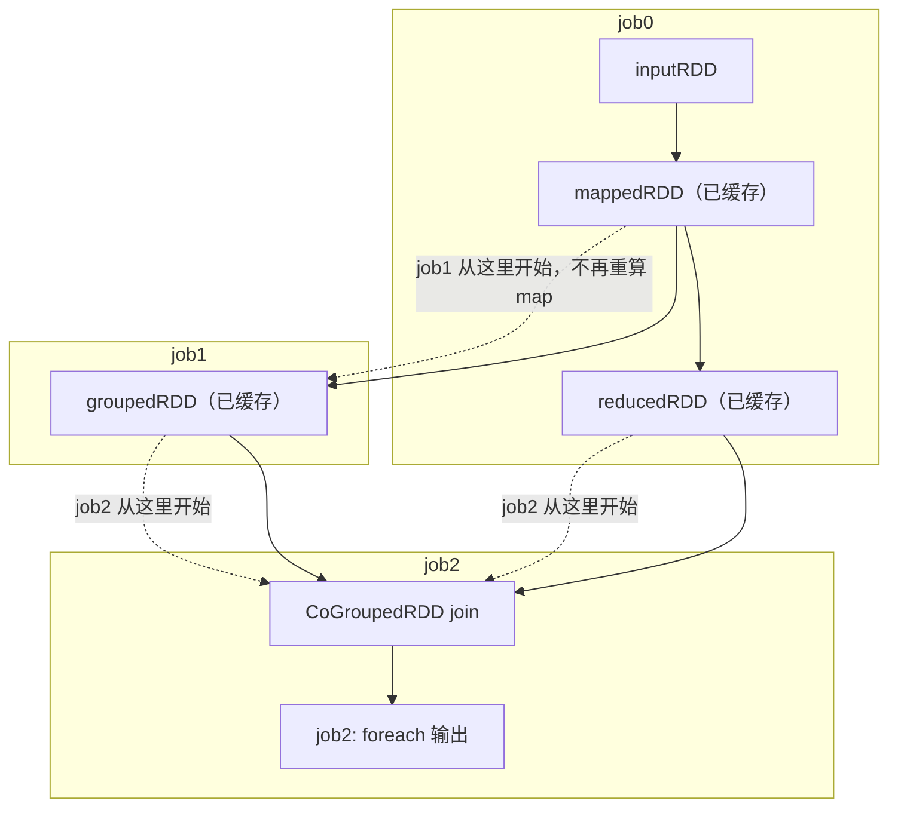
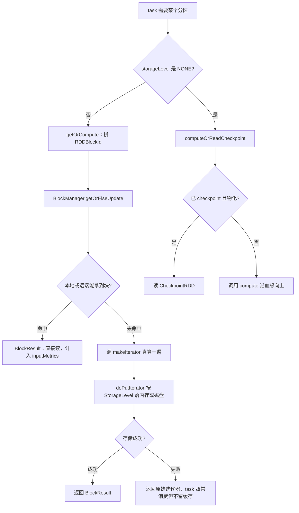
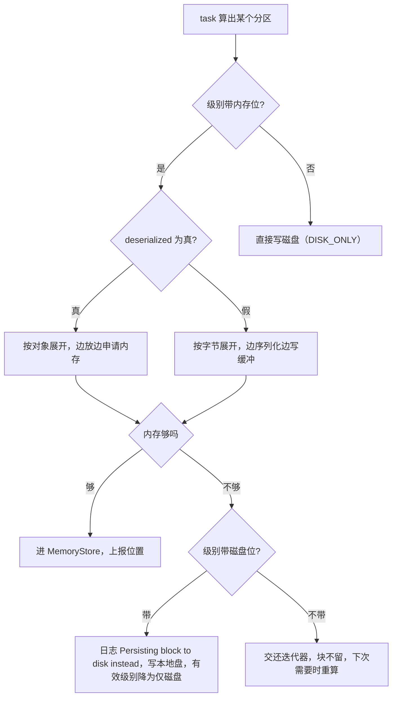
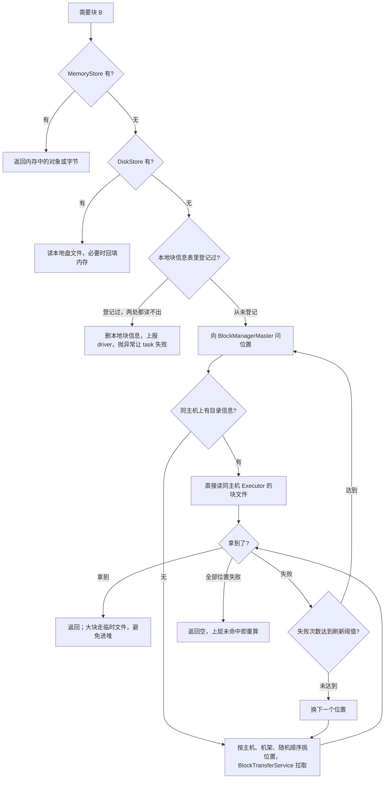
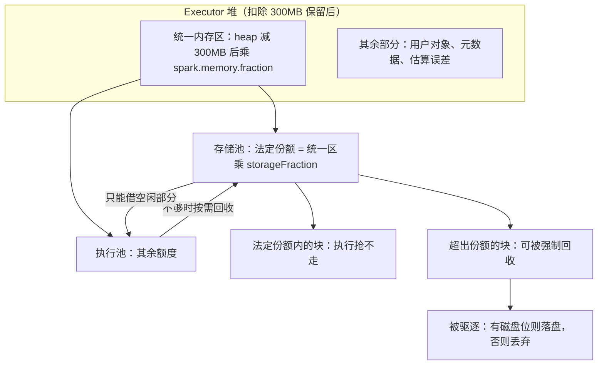
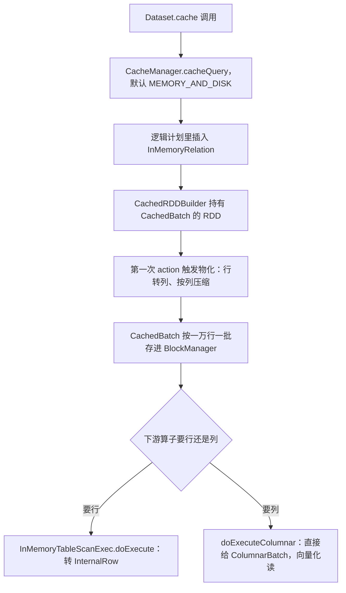

# 第7章 数据缓存机制

**摘要：**

一份要跑十轮的训练作业，每轮开头都要把同一批样本从原始日志重新算一遍，而中间的 `map`、`filter`、`join` 每一轮做着一模一样的事。缓存（cache）就是为了抹掉这种重复：把某个 RDD 的结果留在内存或磁盘上，下次不必再算。但 `rdd.cache()` 到底改变了什么？答案在 `RDD.iterator` 的分岔里——`persist` 没有改动依赖关系，也没有在物理计划里插入"读缓存"的算子，它只是写上一个 `StorageLevel` 字段，让这个 RDD 被再次计算时先去 `BlockManager` 找现成的块。所以缓存切断的是"重算"而不是"血缘"（lineage）：块丢了，上游照样得重算；真正截断血缘的是 `checkpoint`（检查点）。

第二个问题：这份数据还值不值得留。留，要占内存或磁盘，要在内存不足时被驱逐。本章沿这条线索走，从执行计划的削减讲到 `StorageLevel` 的五维排列，再到 `BlockManager` 的读写路径与 `BlockManagerMaster` 的元数据账本，最后讨论驱逐、`unpersist` 与生命周期，并把广播变量与 `DataFrame` 缓存放回同一张图上比较。落点不在"缓存能加速"，而在"什么时候该留、留在哪、什么时候该扔"。

> [!note] 本章的边界
> 本列是教材的章节骨架，按"逻辑计划 → 物理计划 → Shuffle → 缓存 → 容错 → 内存"的顺序把 Spark 的设计铺开，机制的源码级推导与专题结论留在对应的专题专栏里。存储层五维的完整拆解见 [[大数据/Spark/Spark-RDD核心原理解析/08 缓存与持久化：StorageLevel 策略、BlockManager 协作与堆外内存实践|缓存与持久化]]，内存池的借用与驱逐见 [[大数据/Spark/Spark-Shuffle与内存管理机制深度解析/07 Execution 与 Storage 的动态边界|Execution 与 Storage 的动态边界]]，血缘截断的工程权衡见 [[大数据/Spark/Spark-容错与状态管理深度解析/03 RDD Checkpoint：截断 Lineage 的工程权衡|RDD Checkpoint]]。本章在每处只给结论与判据，不重复它们的推导。

---

## 7.1 缓存的边界与它真正回答的问题

2012 年，加州大学伯克利分校在 NSDI 上发表了 RDD 的论文，把"弹性分布式数据集"定义为可重建、只读的分区集合，并用"血缘"这个说法解释它为什么能容忍节点失效。这个定义里藏着一个不太起眼的推论：既然数据可以由血缘重建，那么重建的代价就成了系统必须公开面对的一笔账。缓存机制正是针对这笔账设计的——它不改变"数据可以从血缘重建"这个前提，只是让系统有机会选择"不重建"。

教材里那个例子最能说明问题。程序先对输入做一次 `map()` 得到 `mappedRDD`，然后在这个 `mappedRDD` 上分别执行 `reduceByKey().foreach()` 与 `groupByKey().foreach()`。两个 `foreach()` 就是两个 job，而由于用户没有声明缓存，Spark 认为这两个 job 都得以 `inputRDD` 为起点重新算一遍：第 2 个 job 会把第 1 个 job 里已经做过的 `map()` 再做一次。从系统视角看，这两次 `map()` 的结果一模一样，第二次纯属浪费；从用户视角看，他知道这份中间结果会被用到，却没有语言可以表达"请把它留下"。

### 7.1.1 不缓存会怎样

反过来说更清楚。假如 Spark 完全不提供缓存，会发生三件事。第一，凡是被多个 action 共享的中间结果，都要按 action 的个数重复计算，集群的有效算力被一次次用来生产同一份数据。第二，重复计算的代价会随血缘长度放大——`mappedRDD` 的上游如果还有几层 `join` 和聚合，重算一次的开销远不止一次 `map()`。第三，用户会被迫用"把中间结果写到 HDFS 再读回来"这种笨办法来避免重算，而这一步的 I/O 代价往往比缓存高出一个数量级，因为它要落持久化存储、要冗余、要跨网络。

把这三件事合起来看，缓存要解决的不是"快一点"，而是"同一份数据在一个应用内被要求生产两次以上"这个结构性问题。教材把适用场景归为迭代型与交互式两类：前者每轮迭代都要读同一份输入（训练样本、图结构），后者每次查询都要扫同一张表；两者的共同点是重复读取远超一次、改动极少，而只读语义恰好是 RDD 的前提之一。

### 7.1.2 三条缓存判据与它们的代价

教材给出三条判据：会被重复使用、数据不宜过大、不做重复缓存。这三条放到工程里需要各自补一句代价说明，否则很容易被当成口号。

第一条说的是"被多个 job 共享"。共享的次数越多，缓存越划算，这条没有争议；但要注意"共享"的单位是 job 而不是 task，一个 job 内部的多个 task 各自读自己那份分区，不构成共享。第二条说"数据不宜过大"，理由不只是内存装不下——数据大到一定程度，缓存会把执行内存挤走，让 Shuffle 频繁溢写，总时间反而变长；这一点在 7.5 节会看到具体机制。第三条"非重复缓存"是教材里最容易忽略的一条：如果已经缓存了 `mappedRDD`，就不该再缓存 `inputRDD`，因为后者的全部内容都能由前者沿窄依赖还原，两份缓存只是把同一批字节在内存里放了两遍。只有当另有 job 绕过 `mappedRDD` 直接用 `inputRDD` 时，第二份缓存才有意义。

> [!tip] 判断"值不值得留"的三个追问
> 一问这份数据还会被几个 job 读到，只有一个就不要再想缓存；二问重算它要花多少时间，如果只是一次 `map` 加一，重算比读磁盘还快；三问它要占多大空间，占掉的空间是从执行内存里借来的，借出去就要还利息。

还有一层边界必须说清：Spark 的缓存只在应用内部有效，缓存数据在 job 之间共享，应用与应用之间不能共享。用户提交的 WordCount1 算出的 RDD 即使缓存了，也不能被另一个 WordCount2 直接读到。这不是实现缺陷，而是 `BlockManager` 的生命周期绑在 `SparkContext` 上的必然结果——上下文结束，Executor 侧的存储随之释放。跨应用共享内存数据是另一个层面的问题，Alluxio 这类分布式内存文件系统就是为它而生的。教材在第 9 章还会讨论 task 计算结果与广播数据的缓存，本章只把广播变量作为对照组放到 7.7 节。

## 7.2 缓存的语义本质：切断的是重算，不是血缘

前面说缓存让第 2 个 job 从 `mappedRDD` 开始算，这个说法容易引起一个误解：好像 Spark 把 DAG 改短了。其实没有。依赖关系一动也没动，`reducedRDD` 的父 RDD 依然是 `mappedRDD`，`mappedRDD` 的父 RDD 依然是 `inputRDD`。变的只是"当有人向 `mappedRDD` 要一个分区的数据时，先看有没有现成的"。

### 7.2.1 persist 只写了一个字段

`RDD.persist` 的实现短得不像一个核心机制。它先检查：如果这个 RDD 已有存储级别、新级别又不一样，并且不是允许覆盖的场景，就抛异常，文案直白地写着不能在赋值之后再改存储级别。否则，若是第一次标记，就把自己注册进 `SparkContext` 的持久化列表，并交给 `ContextCleaner` 做一个弱引用登记；最后把 `storageLevel` 字段赋成新值。整个方法没有一个字提到数据，也没有触发任何计算。

这正是"缓存是惰性（lazy）操作"的源码依据：`cache()` 等价于 `persist(MEMORY_ONLY)`，`persist()` 等价于 `persist(StorageLevel.MEMORY_ONLY)`，而 `persist` 做的全部事情就是打标记加登记。真正的数据挪动发生在后面某个 action 触发 job、task 在 Executor 上把这个 RDD 的分区算出来的那一刻。

`SparkContext` 侧的那本账同样简单：`persistRDD` 把 RDD 按 id 存进一个 map，`unpersistRDD` 把它从 map 里删掉，同时通知 `BlockManagerMaster` 删掉对应的块，并给事件总线发一条 `SparkListenerUnpersistRDD`。换句话说，一个 RDD 被缓存之后，它就一直在 `SparkContext` 的持久化列表里，直到被显式 `unpersist` 或者上下文结束——它的生命周期不是"最后一个读它的 job 结束"，而是"上下文结束"。这一点在 7.6 节会展开。

### 7.2.2 执行计划怎么被削减

既然 DAG 结构没变，为什么物理执行计划里的 stage 会变少？教材给出的生成规则分三步：先假设没有任何缓存，按第 3 章的规则生成完整的逻辑处理流程；然后从第 2 个 job 开始，把 cached RDD 之上的祖先 RDD 从这一轮要计算的范围里去掉，得到一个削减后的流程；最后按第 4 章的规则把削减后的流程翻译成物理执行计划。

注意第二步的措辞是"这一轮要计算的范围"，而不是"依赖图"。被去掉的只是"这次要重算哪些 RDD"，依赖图本身一字未改，因为 `getOrCompute` 在缓存未命中时还要沿着它找回上游。这就是本章反复强调的那句话的来源：缓存切断的是重算这条路径，血缘这条路径一直在。

下面这张图把三个 job 与缓存边界的对应画出来。为了便于对照，仍用教材的 CacheTest：`mappedRDD`、`reducedRDD`、`groupedRDD` 三处 `cache()`，共三个 job。

图 7.1 中实线是依赖，点线是"这个 job 的起点被上移到了缓存边界"。`inputRDD => mappedRDD` 那段 `map()` 只在一个 job 里真正执行过，后面两个 job 都在读缓存。

stage 的削减发生在调度层，而不是物理计划层。`DAGScheduler` 收集父 stage 时有一个判断：只有当一个 RDD 还有未缓存的分区，才继续沿依赖往上找父 stage；一个 RDD 的分区全部命中缓存，递归就在这里停住，上游那些本该被调度起来重算的 shuffle map stage 根本不会被创建。教材说这个应用无缓存时产生 8 个 stage、有缓存后实际运行 6 个，少掉的两个正是被这个判断截住的递归分支。

**表 7.1 缓存对 stage 的影响（以 CacheTest 为例）**

| Stage | 所属 job | 无缓存时要做的事 | 有缓存时 | 缓存省掉的部分 |
| :--- | :--- | :--- | :--- | :--- |
| s0 | job0 | 从 `inputRDD` 及其上游算出 `mappedRDD` | 照常运行，并把分区写进缓存 | 无 |
| s1 | job0 | `mappedRDD` 落盘（`reduceByKey` 的 shuffle write） | 照常运行 | 无 |
| s2 | job0 | shuffle read 加聚合得到 `reducedRDD` | 照常运行并缓存 | 无 |
| s3 | job1 | 从 `inputRDD` 重算到 `mappedRDD` | 整个 stage 不必调度 | 一次 `map()` 及其上游 |
| s4 | job1 | `mappedRDD` 上的 shuffle write（`groupByKey`） | 照常运行，但输入来自缓存 | 无 |
| s5 | job1 | shuffle read 得到 `groupedRDD` | 照常运行并缓存 | 无 |
| s6 | job2 | 从 `inputRDD` 分别重算 `reducedRDD` 与 `groupedRDD` 两路 | 整个 stage 不必调度 | 一段 `map` 加两次 Shuffle 的写端 |
| s7 | job2 | join 与输出 | 照常运行 | 无 |

表 7.1 里价值最大的是 s5 与 s6。省掉 s6 的价值远大于省掉 s3，因为它省掉的是一次完整的 Shuffle——包括上游 task 的聚合、写盘、下游 task 的拉取与合并。这也解释了一个常见现象：缓存一个 Shuffle 之后的 RDD，收益通常比缓存 Shuffle 之前的大，除非 Shuffle 之前那段计算本身就极贵；Shuffle 本身的代价构成见 [[6.0 第6章 Shuffle机制]]。

反过来，如果有缓存之后 stage 数没有变化，那就说明缓存的位置选错了——它可能缓存了一个只被单个 job 使用的 RDD，或者缓存了宽度很窄、重算极便宜的中间结果。

### 7.2.3 读取缓存的唯一入口

所有读取都收敛到一个方法上。`RDD.iterator` 判断存储级别：如果是 `NONE`，直接走 `computeOrReadCheckpoint`；否则走 `getOrCompute`。`getOrCompute` 先把 `rddId` 与 `partitionId` 拼成一个块标识，再调用 `BlockManager` 的 `getOrElseUpdateRDDBlock`，把"怎么算这个分区"作为一个函数传进去。这个函数体内做的正是 `computeOrReadCheckpoint`，也就是"真的去算"。

`getOrElseUpdate` 这个名字把语义写得很清楚：有就拿，没有就算完再放进去。命中时返回一个 `BlockResult`，未命中时先算出迭代器、尝试存储、再把同一份迭代器返回给 task 消费。返回值是 `Either[BlockResult, Iterator]`——左边表示"块已就位"，右边表示"存储失败，这是你的迭代器，你自己消费吧"。

图 7.2 里有两条容易被忽略的边。一条是右下角的"读 CheckpointRDD"：`computeOrReadCheckpoint` 这个名字里"or"的含义是，如果这个 RDD 已经可靠物化到检查点，就不再调 `compute`，而是直接读检查点数据。另一条是"未命中"分支：它没有报错，而是安静地算一遍。

这条安静的分支带来一个后果：缓存失效在 Spark 里通常表现为**变慢**，而不是报错。性能问题不报错，排查的难度就上来了，7.4 节会给出几个具体的观察点。

### 7.2.4 缓存块丢了，为什么要重算上游

这是"缓存没切断血缘"的直接推论，值得拆细。现象是：一个缓存过的 RDD 在某次 stage 重试中重新计算了，连带它的上游也重新算了一遍。原因是缓存块本身只是一份可用可无的副本，`getOrCompute` 在找不到块时唯一能做的事就是调用传进去的那个函数，而那个函数只有一条路——沿血缘向上。

细分下去有两种情形。第一种是块被正常驱逐或从未成功写入，块信息也没了，`get` 直接返回空，走"未命中"分支，静默重算，job 不失败。第二种是元数据还在、数据却读不到：本地块信息表说这个块归我管，但内存里没有、磁盘文件也打不开。这种情形会进入一条专门的失败处理路径，先把块信息删掉，再向 driver 报告这个块不可用，然后抛异常，让 task 失败、由上层重试。前者是"慢"，后者是"错"，两者在日志里的长相完全不同，这是排查时第一件要分清的事。

如果不想让上游跟着重算，唯一的办法是让上游不必存在——那就要动用 `checkpoint`。

### 7.2.5 真正切断血缘的是 checkpoint

`checkpoint` 的语义与缓存有一处根本差别：它把计算结果写进一个可靠的、独立于血缘的存储（通常是 HDFS），并且告诉这个 RDD"你以后不必再靠父 RDD 了"。物化完成后，这个 RDD 的依赖会被清掉，读取路径整体切换到检查点数据上。

源码层面的关键在三个地方。`RDD.checkpoint()` 本身只是登记一个 `ReliableRDDCheckpointData`，同样不立即执行；真正的写盘发生在紧随其后的第一个 job 跑完时，由 `RDDCheckpointData` 触发一个额外的 job 把数据写到检查点目录。物化完成后，RDD 进入"已检查点且已物化"状态，此时它的 `dependencies` 不再返回原始父 RDD，而是返回一个指向检查点 RDD 的窄依赖，`computeOrReadCheckpoint` 里那个"or"就生效了：直接读检查点，完全不碰上游。

这里有一处非常容易踩错的时序：`checkpoint()` 之后的第一个 action 才会触发物化，而触发物化的那个 job 本身仍然要沿血缘算一遍。也就是说，写完检查点的这一次执行一点也没省，省的是第二次以后。把 `checkpoint` 写在循环内部、每轮都调用，是典型的误用——它每轮都要额外跑一个写检查点的 job，代价比不写还高。

把两者放在一张表里对照，判据就清楚了。

**表 7.2 缓存与 checkpoint 的完整判据**

| 维度 | `persist` / `cache` | `checkpoint` |
| :--- | :--- | :--- |
| 血缘 | 完全保留，父 RDD 一个不少 | 物化后清空，父 RDD 可以不再被保留 |
| 存储位置 | Executor 的 `MemoryStore` / `DiskStore`，走 `spark.local.dir` | 可靠存储，通常为 HDFS 路径，跨节点、跨应用可见 |
| 失败恢复 | 块丢了就沿血缘重算；上游缺一个环节就一起失败 | 直接读检查点，不依赖上游；上游 RDD 甚至可以不被缓存 |
| 写入开销 | 每个 task 在算完自己那份分区时顺手写，几乎没有额外调度 | 额外触发一个 job 全量写一遍，写的是持久化存储，带副本与网络开销 |
| 生命周期 | 绑在 `SparkContext` 上，上下文结束即失效 | 数据在存储系统里，生命周期由用户与存储策略管理，应用结束仍在 |
| 触发时机 | 惰性标记，第一个用到它的 job 里顺带完成 | 惰性标记，第一个 job 结束后单独跑一个 job 物化 |
| 适用场景 | 同一应用内多次复用、重算代价高但血缘仍可承担 | 血缘过长导致重算代价不可接受，或需要跨应用复用 |

表 7.2 的最后一行其实是选择的起点：如果重算的代价还能忍，缓存的性价比远高于检查点，因为缓存是"**顺手写**"，检查点是"**专门写一遍**"。当血缘长度到了重算要跑几十分钟的量级，或者中间结果要跨应用使用时，才轮到检查点出场。可靠检查点与本地检查点的差别、以及物化流程见 [[8.0 第8章 错误容忍机制]]，此处只留判据。

两者叠加时还有一层顺序关系值得记住：一个 RDD 如果既有缓存又有检查点，读取路径上先看块，块命中就不必碰检查点；块没命中才走 `computeOrReadCheckpoint`，这时才去读检查点。缓存是更快的那一层，检查点是更可靠的那一层，两层各管一件事。

## 7.3 StorageLevel：五个维度的排列组合

既然"留在哪里"是一个可以选择的决定，Spark 就把这个决定拆成了五个开关：是否用磁盘、是否用内存、是否用堆外内存、是否以反序列化对象的形式存、备份几份。`StorageLevel` 这个类的字段就是这五个，构造函数接收五个参数，其余方法全部围绕它们展开。

教材说 Spark 最终把缓存级别分为 12 类，这个数字取决于版本与计法：`StorageLevel` 单例对象里定义了 `NONE`、`DISK_ONLY` 及其两份、三份版本、`MEMORY_ONLY` 及其变体、`MEMORY_AND_DISK` 及其变体、`OFF_HEAP`，Java API 的 `StorageLevels` 里也是一一对应的十三个常量。数目本身并不重要，重要的是任意一个级别都能被还原成五元组，而五元组决定了这个块之后会经历什么。

### 7.3.1 五元组矩阵

**表 7.3 StorageLevel 的五维矩阵**

| 级别 | useDisk | useMemory | useOffHeap | deserialized | replication | 一句话语义 |
| :--- | :--- | :--- | :--- | :--- | :--- | :--- |
| `NONE` | 假 | 假 | 假 | 假 | 1 | 不缓存，`isValid` 为假 |
| `DISK_ONLY` | 真 | 假 | 假 | 假 | 1 | 只落本地盘，落盘必须序列化 |
| `MEMORY_ONLY` | 假 | 真 | 假 | 真 | 1 | 堆内对象，装不下就丢 |
| `MEMORY_ONLY_SER` | 假 | 真 | 假 | 假 | 1 | 堆内字节，装不下就丢 |
| `MEMORY_AND_DISK` | 真 | 真 | 假 | 真 | 1 | 先进堆内，装不下落盘 |
| `MEMORY_AND_DISK_SER` | 真 | 真 | 假 | 假 | 1 | 先存字节，装不下落盘 |
| `OFF_HEAP` | 真 | 真 | 真 | 假 | 1 | 堆外字节，装不下照样落盘 |
| `MEMORY_AND_DISK_DESER` | 真 | 真 | 假 | 真 | 1 | Python 侧别名，取值同 `MEMORY_AND_DISK` |

这张表有三处读法需要点破。

第一处，前三个开关不是三个独立落点。`useMemory` 表示"进 `MemoryStore`"，`useOffHeap` 表示"这个 `MemoryStore` 用堆外介质"，两者是介质与容器的关系而非并列关系。所以 `OFF_HEAP` 的取值是内存为真、堆外为真、磁盘为真——它在堆外池里放字节，堆外池不够时照样往 `spark.local.dir` 落盘。教材与官方文档里"类似 `MEMORY_ONLY_SER`"的说法只描述了"序列化字节加内存优先"这一半，容易被读成"绝不落盘"，于是在 Storage 页看到 `Size on Disk` 有值时会怀疑配置没生效。

第二处，`deserialized` 这一位在磁盘上没有意义。写盘一定要序列化，所以 `DISK_ONLY` 的 `deserialized` 只能是假；同理，堆外存储只接受序列化形式，`OFF_HEAP` 的 `deserialized` 位恒为假。

第三处，`isValid` 的判定只看两件事：内存或磁盘至少占一个，并且份数大于零。这解释了一个细节：往 `BlockManagerMaster` 上报块时，用的是"当前有效存储级别"，如果某个级别被判为无效，上报就等于"删除位置"。驱逐与落盘的每一步都在改这个有效级别，7.5 节会看到它是怎么被改写的。

`StorageLevel` 还提供两个描述方法，日志里见到的是后者：`toString` 打成 `StorageLevel(disk, memory, deserialized, 1 replicas)` 的样子，`description` 则打成 `Disk Memory Deserialized 1x Replicated` 这样的短语，堆外版本会把 `Memory` 写成 `Memory (off heap)`。在 `toDebugString` 里，缓存过的 RDD 后面跟的方括号内容就是 `description`，下一行再补一行 `CachedPartitions: N; MemorySize: ...; DiskSize: ...`。这两个字符串是排查缓存问题最省事的一手证据，因为它们同时告诉你"什么级别"和"实际落在哪"。

### 7.3.2 装不下时会发生什么

教材在这个问题上给了两条结论：`MEMORY_ONLY` 下分区放不下就不缓存，下次要重算；`MEMORY_AND_DISK` 下溢写到磁盘。源码里这两条来自同一个分岔点，值得看清楚。

写入路径先把数据往内存放。存放分两条实现：反序列化级别走"展开对象"的路径，把迭代器里的对象一个个塞进数组，边塞边申请内存；序列化级别走"展开字节"的路径，边序列化边写进一块缓冲区。两条路径都可能在中途发现空间不够——放之前并不知道这个分区要占多少空间，只能边放边申请。

一旦内存路径返回失败，代码只做一件事：看这个级别的磁盘位。如果磁盘位为真，就把刚才那个还没放完的迭代器接着往下写，序列化到磁盘文件里，日志留一行 `Persisting block ... to disk instead.`；如果磁盘位为假，就把迭代器原样交还给调用方，让 task 自己消费，块就此不留。

这条分岔解释了三个常被混淆的现象。其一，丢弃的粒度是整块，不存在"半个分区留在内存里"的中间态——展开失败时那条路径申请过的内存会被释放，块的元信息根本不会建立。其二，`MEMORY_ONLY` 下"放不下"不代表这个 RDD 完全没缓存，而是逐个分区各判各的：小分区进得去就进，大分区进不去就丢，于是同一个 RDD 可能一半有缓存一半没有，`toDebugString` 的 `CachedPartitions` 会显示一个介于零和总分区数之间的数。其三，`MEMORY_AND_DISK` 的溢写是"**整块换介质**"，不是"块内分层"——不存在一个块的前半截在内存、后半截在磁盘。

图 7.3 里"有效级别降为仅磁盘"这一步常被忽略。一个 `MEMORY_AND_DISK` 的块被写到磁盘之后，它在元数据里的级别就不再含内存位了；`BlockManagerMaster` 那边的内存占用归零、磁盘占用增加，Storage 页上这个 RDD 的 `Size in Memory` 会往下掉。所以"缓存了 `MEMORY_AND_DISK`"不等于"数据在内存里"，它只等于"数据一定在某个地方，优先在内存"。

### 7.3.3 序列化与反序列化的取舍

`_SER` 后缀换来的是空间，付出的是 CPU。反序列化形式把分区存成 Java 对象数组，读的时候直接把对象交给下游算子，没有转换成本；序列化形式存成一段连续字节，读的时候要先反序列化回对象，才能进入 `map` 或 `filter`。这条账在一次性读取时看不出来，反复读取时会被放大。

压缩可以叠加在序列化形式之上。`spark.rdd.compress` 默认关闭，打开后序列化后的分区在存储前再过一道 `spark.io.compression.codec` 指定的编码。它的文档里写明了适用范围：Scala 侧对应 `MEMORY_ONLY_SER` 这类序列化级别，Python 侧对应 `MEMORY_ONLY`——因为 PySpark 的数据在 JVM 侧本来就是序列化的字节，Python 的 `MEMORY_ONLY` 其实就是 Scala 的 `MEMORY_ONLY_SER`。这处跨语言的不对称很容易误导人，7.3.5 节单独说。

> [!warning] 序列化级别的两笔代价
> 一是 CPU：每次读都要走一遍反序列化，反复扫描同一份缓存的作业，这一步的累计开销可能超过省下来的 GC 时间；二是额外的拷贝：序列化与反序列化都要经过 `SerializerManager`，开了压缩或加密后还会多几次缓冲区拷贝。切到 `_SER` 之前，先比一下这两笔账。

反过来，反序列化级别的代价主要在 GC。堆内堆着上亿个对象，年轻代很快被填满，Minor GC 的频率随着缓存量线性上升，而每个对象头、每个引用、每个对齐填充都是实打实的开销。用教材的说法，这类开销是"存储代价"的一部分，只不过它体现在 GC 日志里而不是 Storage 页上。

### 7.3.4 备份两份防的是什么

`replication` 这一位是唯一一个"多花空间换可靠性"的维度。为 2 时，块在主副本写成功、位置上报给 driver 之后，`BlockManager` 会把本地块取出来序列化成字节，通过 `BlockTransferService` 上传给另一个 Executor 的 `BlockManager`，让对方按同样的级别再存一份。

它的代价是三重的：存储翻倍、写带宽多一份、副本写入失败还要重试。`spark.storage.maxReplicationFailures` 默认只允许失败一次，失败后日志里会留一行"只复制到了 n 个 peer"的告警，块本身不会因此丢失，只是副本数不达标。

它防的是什么，需要说准。默认的副本放置策略是 `RandomBlockReplicationPolicy`，从存活 peer 里随机挑，不做主机或机架级的离散约束；想按拓扑挑，得另外配 `spark.storage.replication.policy` 与拓扑映射。所以"两份"只保证分布在两个 `BlockManager` 上，不保证分布在两台物理机上——在单机多 Executor 的部署里，两份完全可能落在同一个宿主机、同一块盘上，一次掉电就一起没了。它也不是持久化：副本随 Executor 生命周期存亡，应用结束即消失，跨应用复用无从谈起。

真要说它防住了什么，防的是"单个 Executor 进程失联导致某个块暂时读不到"。这个场景在动态资源回收、Executor 被 YARN 或 K8s 杀掉时很常见，代价是那个块要让读它的 task 走一遍远端拉取或重算。配置项 `spark.storage.replication.proactive` 默认打开，它的作用是：当某个副本因为 Executor 失联而丢失、但还有其他存活副本时，主动把副本数补回初始值。所以副本机制实际是一个"写了就尽量维持"的过程，而不是"写完就固定"的一次性动作。

### 7.3.5 一处跨语言的不对称

PySpark 的 `storagelevel.py` 里，`MEMORY_ONLY`、`MEMORY_AND_DISK` 这些常量的 `deserialized` 位全部为假，与 Scala 侧相反；此外还多出一个 `MEMORY_AND_DISK_DESER`，取值为磁盘真、内存真、堆外假、反序列化真。原因在 Python 侧的数据表示：Python 对象以 pickle 字节的形式进入 JVM，如果 JVM 再把它当对象反序列化一次，等于白白多一层包装，所以除 `MEMORY_AND_DISK_DESER` 之外的常量都按序列化字节存。

这处不对称有两个实践含义。其一，同样的 `MEMORY_ONLY`，PySpark 作业的内存占用接近 Scala 的 `MEMORY_ONLY_SER`，按 Scala 的经验估空间会低估。其二，PySpark 另给了一个 `MEMORY_AND_DISK_DESER`，把反序列化位打开，用于需要 JVM 侧以对象形式持有 Python 字节的情形；Scala 侧没有这个名字，`fromString` 的映射表里也没有它。

### 7.3.6 选级别的判据

把五个维度合起来看，选级别其实是在回答三个问题：内存够不够、CPU 富不富余、能不能容忍丢一份。

**表 7.4 各缓存级别的选用判据**

| 场景 | 推荐级别 | 理由 | 代价 |
| :--- | :--- | :--- | :--- |
| 数据能装进内存，下游算子 CPU 密集 | `MEMORY_ONLY` | 零反序列化开销，读得最快 | 分区放不下就整块丢，下次重算；GC 压力最大 |
| 数据偏大，内存只装得下一部分 | `MEMORY_ONLY_SER` | 同样内存能装更多分区，命中率更高 | 每次读要反序列化，CPU 换空间 |
| 数据明显超过内存，且必须保证不重算 | `MEMORY_AND_DISK` | 内存不够时落盘，读取路径最省心 | 落盘后读盘比内存慢一个量级；磁盘空间要留够 |
| 数据超内存且 CPU 不紧张 | `MEMORY_AND_DISK_SER` | 内存利用率最高，落盘字节直接复用 | 反序列化开销叠加磁盘 I/O |
| 内存是稀缺资源，堆外额度富余 | `OFF_HEAP` | 不吃堆，GC 压力小 | 额度要单独配置，序列化开销仍在，溢出照样落盘 |
| 重算极贵、内存又完全不够，且读取次数不多 | `DISK_ONLY` | 省下内存给别的缓存，落盘比重新计算快 | 读盘带宽常是瓶颈；磁盘写满会连带 Shuffle 失败 |
| Executor 不稳定，需要抗进程级丢失 | 任意级别加 `_2` | 单进程失联后仍有一份可读 | 存储与写带宽翻倍，且不保证跨机架 |

表 7.4 的最后一列其实在说同一件事：缓存级别没有最优解，只有与当前瓶颈匹配的解。内存不够就先降到 `_SER`，还是先把级别换成带磁盘位，取决于这台机器的 CPU 与磁盘谁更闲。

## 7.4 BlockManager：一个 Executor 一套存储

数据的"留在哪"在级别层面只是声明，真正执行这件事的是一个叫 `BlockManager` 的组件。它是 Executor 侧的存储管家：每个 Executor 进程有且只有一个 `BlockManager`，进程内所有 task 共享它，块标识在全应用内唯一，因此不同 Executor 上的同名块天然构成多个副本。

### 7.4.1 四个内部组件

`BlockManager` 自己不碰数据，它把活分给四个组件。

`MemoryStore` 管内存中的块。内部是一张 `LinkedHashMap`，键是块标识，值是 `MemoryEntry`——反序列化形式存的是对象数组，序列化形式存的是字节缓冲。这张 map 在构造时把访问顺序（accessOrder）设为真，于是每次读或写都会把对应条目挪到链尾，链头自然成为最久未使用的位置。教材说"Spark 直接利用了 `LinkedHashMap` 自带的 LRU 功能"，指的正是这个参数，它省掉了一整套双向链表与索引的代码。

`DiskStore` 管磁盘上的块，一个块对应一个文件，文件名由块标识编码而来。文件放哪由 `DiskBlockManager` 决定：先按块名的哈希值对 `spark.local.dir` 里的目录数取模，选出本地目录；再对 `spark.diskStore.subDirectories`（默认 64）取模，选出该目录下的二级子目录，子目录名是两位十六进制。这种两级哈希是为了避免单个目录下堆上百万个文件，把 inode 撑爆。读磁盘块时还有一层优化：块大小超过 `spark.storage.memoryMapThreshold`（默认 2 MiB）就用内存映射读，小文件走流式读，因为对页大小附近的文件做映射，开销比直接读还大。

`BlockTransferService` 管跨网络搬运。默认实现基于 Netty，既负责把本地的块上传给请求方（副本写入也走它），也负责从远端拉取块。它是块传输的统一出口，`BlockManager` 只调它的接口，不关心底层是 TCP 还是别的。

`BlockInfoManager` 管并发。每个块都有一把读写锁，读块要拿读锁，写块或驱逐块要拿写锁；task 结束时这个 task 持有的锁会被统一释放。7.5 节的驱逐逻辑会用到"拿不到写锁就跳过"这个细节。

### 7.4.2 两本账：块在哪、块多大

Executor 侧存数据，Driver 侧存"谁知道数据在哪"。`BlockManagerMaster` 是 Driver 上的元数据中心，真正的实现是 `BlockManagerMasterEndpoint`，它维护两张表：一张以 `BlockManagerId` 为键，记录每个 Executor 的存储端点、最大堆内与堆外额度、剩余额度，以及它持有的每个块的状态；另一张以块标识为键，记录这个块当前出现在哪些 `BlockManager` 上。

两侧的交互只有几种消息：Executor 启动时向 master 注册；块写入成功、被驱逐、被删除时上报状态；读块时如果本地没有，向 master 询问位置。上报的处理逻辑很短：如果上报的存储级别有效，就把这个 `BlockManager` 加进位置集合；如果无效，就把它从集合里去掉；集合空了，就把这个块标识的条目整个删掉。位置集合因此始终表示"此刻哪些地方还有这个块"。

> [!info] master 不存数据，只存"账"
> 一种常见的误解是 driver 上有一份全局的块目录，读不到就去 driver 要数据。`BlockManagerMaster` 只有元数据：块的标识、它落在哪些 Executor、占了多少内存与磁盘。数据本身只在 Executor 的 `MemoryStore` 或 `DiskStore` 里，driver 自己的 `BlockManager` 只在 local 模式下才承担存储职责。

### 7.4.3 读一个块的完整路径

`BlockManager.get` 只有两段：先本地，后远端。本地这一段又是两级：先看级别是否带内存位且 `MemoryStore` 里有这个块，有就直接把对象数组或字节缓冲交出去；没有再看级别是否带磁盘位且 `DiskStore` 里有这个块，有就把文件读出来，反序列化后交给调用方。两头都没有，进入一个专门的失败处理：删掉本地的块信息，向 driver 报告不可用，然后抛异常。前面 7.2.4 节说的"第二种情形"就是这里。

远端这一段有几个反直觉的设计，值得逐个说。

第一，问 master 要位置时，请求里带了自己的主机名。master 返回的不只是位置列表和块状态，还包括"同主机上某个持有该块的 Executor 的本地目录列表"。有了这个列表，读块的一方可以绕过网络，直接去读同主机另一个 Executor 写在 `spark.local.dir` 里的块文件——同为块文件格式，路径可推算，读到就是赚到。也就是说，"跨 Executor 读缓存"未必是"跨网络读缓存"，在单机多 Executor 的部署里，大量所谓的远端读其实是本地磁盘读。

第二，位置列表会被重新排序：**同主机优先**，其次同机架（依赖拓扑信息），最后才是其他；每一组内部，普通 Executor 优先于外部 Shuffle 服务。排序前还会先随机打乱，避免所有读请求都压到同一个副本上。

第三，拉取失败会重试，重试的对象是"下一个位置"。同一个位置连续失败到 `spark.block.failures.beforeLocationRefresh`（默认 5）次，就向 master 重新拉一次位置列表，因为这些位置里可能混着已经失联的 Executor。总失败次数以位置个数为上限，全部试完仍拿不到就返回空，交给"未命中即重算"的分支。

第四，块很大时不会拉进内存。超过 `spark.network.maxRemoteBlockSizeFetchToMem` 这个阈值，拉取会落到一个临时文件管理器上，边下载边写临时文件，避免一个超大块把 Executor 的堆顶穿。

图 7.4 把"读不到"分成了两个结局：一个分支在问遍位置之后返回空，最终表现为重算，job 继续跑；另一个分支抛异常，task 失败、stage 重试。这两条路的日志完全不同，前者只在 `toDebugString` 的命中数上留下痕迹，后者会在 Executor 日志里出现明确的块读取失败堆栈。

写一个块的路径对称但更短：`doPut` 先拿写锁，按级别决定走内存还是磁盘，写成功后拿当前有效级别向 master 上报，最后如果是多副本级别，再取本地块字节复制给 peer。整个过程的顺序是"先本地落定、再上报、再复制"，所以副本晚于主副本可见，读方在复制完成之前只会看到一个位置。

### 7.4.4 命中率低时看哪里

缓存"看起来没生效"是生产里最常见的疑问之一，而 Spark 并没有一个叫"缓存命中率"的官方指标。要判断，得把几个侧面拼起来看。

**表 7.5 缓存命中率低的排查点**

| 观察到的现象 | 可能的根因 | 验证手段 |
| :--- | :--- | :--- |
| Storage 页内存占用远小于预期 | 分区放不下被整块丢弃，或已被驱逐 | 看 `toDebugString` 的 `CachedPartitions` 是否等于总分区数 |
| 内存占用不小，但 task 仍反复重算 | 块在别的 Executor 上，每次都要远端拉取 | 看 task 的输入字节数与网络指标，对照块位置表 |
| 缓存后 GC 时间显著上升 | 反序列化级别对象太多，年轻代被填满 | 对比 `MEMORY_ONLY` 与 `MEMORY_ONLY_SER` 的 GC 时间 |
| 同一 RDD 反复出现在重算路径上 | 缓存被后续 job 的 `unpersist` 或驱逐清掉 | 看 Storage 页该 RDD 的分区数是否随时间下降 |
| 内存占用稳定但作业仍慢 | 缓存位置选错，缓存了重算极便宜的 RDD | 对比有无缓存两种情况下省下的 stage 数量 |

表 7.5 的第二行值得多说一句。块在远端时，读它的成本包括序列化、网络、反序列化三段；如果这块数据本来只需一次便宜的 `map` 就能重算，从远端拉反而更慢——远端拉取比本地磁盘更接近"不如重算"那条边界。

## 7.5 内存不足时的驱逐

内存装不下是常态，所以缓存机制必须自带一套"腾地方"的规则。教材把这件事拆成两个问题：先淘汰谁，以及淘汰多少才开始放新数据。

### 7.5.1 淘汰谁：一次遍历加三个过滤条件

申请空间的方法是 `MemoryStore.evictBlocksToFreeSpace`，它接收三个参数：要申请的块标识、需要的字节数、内存模式。函数体是一次对 `LinkedHashMap` 的遍历，从链头开始，累加选中块的字节数，直到凑够为止。

遍历期间有三道过滤。第一道看内存模式，堆内与堆外两本账分开算，不会拿堆外的块去腾堆内的空间。第二道看块属不属于"正在申请的这个 RDD"：如果申请方本身是一个 RDD 分区，那么同一个 RDD 的其他分区一律不动。教材在缓存替换那一节的末尾提过这条规则，说的是"不能用 `newRDD` 的 partition0 和 partition1 去换 partition2"，源码里的判断就是比对两个块标识里的 RDD 编号。

第三道看这个块是不是正在被读。候选块要拿一次写锁，且这次拿锁是非阻塞的，拿不到就跳过——正在被某个 task 读的块不能被驱逐，否则那个 task 读到一半数据没了。这条规则是"驱逐不会让正在跑的任务失败"的保证，代价是并发读多的时候可驱逐的候选变少，驱逐可能凑不够数。

凑不够时函数不做部分驱逐，而是把已经选中的块全部解锁、返回零。也就是说，驱逐是"要么一次性凑够，要么一块都不动"，不存在"腾了一点但还是不够，于是新块和旧块都没了"的中间状态。

凑够了才开始真正删。删的动作交给 `BlockManager` 的 `dropFromMemory`，而它做的第一件事不是删，而是判断能不能落盘。

### 7.5.2 落到哪：整块换介质还是彻底丢弃

`dropFromMemory` 的逻辑只有两条主分支。如果这个块的级别带磁盘位、且磁盘上还没有这个块的副本，就把它写到 `DiskStore`：反序列化形式的分区要序列化成流再写，序列化形式的分区直接写字节。写完再把它从 `MemoryStore` 里移除，重新计算当前有效级别——此时内存位为假、磁盘位为真，向 master 上报一次，内存占用减去这块、磁盘占用加上这块。

如果级别不带磁盘位，就没有第二条路，直接移除，块信息一并删掉。这时驱逐等于丢弃，下次需要它只能重算。

这正是 `MEMORY_ONLY` 与 `MEMORY_AND_DISK` 在运行期的真正区别：写入阶段两者都先试内存，区别在失败后的处理；驱逐阶段两者都会被选中，区别在删除后的归宿。前一处决定"新块能不能留下"，后一处决定"旧块能不能留下"，合起来才构成"整块丢弃"与"溢写到磁盘"的完整对照。

驱逐还有一个容易忽略的回填动作。`MEMORY_AND_DISK` 的块被驱逐到磁盘之后，下次读它会走磁盘路径，而磁盘路径在读完之前会尝试把它塞回 `MemoryStore`：还放得下就顺手放回去，把级别改回带内存位，同时释放刚读出的磁盘数据；放不下就照常读盘，不改变任何状态。这就是"**读一次就回温**"的机制，它让被驱逐的块有机会自己回到内存，而不必等下一次重算。

### 7.5.3 storageFraction 保护的是什么

驱逐的边界由 `spark.memory.storageFraction` 划定。这个配置项的官方描述值得逐字读：它是"不受驱逐影响的存储内存量"，以 `spark.memory.fraction` 划出的区域为基数，值越高，"可用于执行的工作内存越少，task 越容易溢写磁盘"。

换句话说，它不是一个"给缓存多少"的分配比例，而是一个"缓存最少保住多少"的**保护下限**。执行内存可以抢存储内存，但只能抢到这条线以上；线以下的缓存块不会被执行抢走。这就是为什么调大它并不能"让缓存不被驱逐"——它保护的是份额，不是具体某些块；在份额之内的块仍然会按 LRU 被自己的新块挤掉。

执行侧抢内存的算式把这件事写得很直白。执行池不足时会尝试从存储池回收，可回收的量取两者之大：存储池的空闲字节，以及存储池超出其法定区域的部分。前者是"你反正没用"，后者是"你借了我的"。回收动作按需取用，不够就把存储池整个压到法定区域为止。反过来，存储池向执行池借的时候只能借"空闲"的部分，因为执行内存里装的是正在运行的 task 的哈希表与排序缓冲，动它就等于让 task 失败。

图 7.5 的两条箭头方向不同，重量也不同。执行向存储借是"强制回收"，存储向执行借是"只能借空闲"，这个不对称是统一内存管理（UnifiedMemoryManager）能保证执行不被打断的根本原因。两池的账本、并发 task 之间的分摊方式以及 `spark.memory.fraction` 的语义见 [[9.0 第9章 内存管理机制]]，此处只留四个数：保留 300MB、统一区占比默认 0.6、存储法定份额默认 0.5、以及"可强制回收量 = 取空闲与超份额之大者"。

> [!warning] 调 storageFraction 不能治"缓存被驱逐"
> 它调整的是保护下限，不是具体块。缓存反复被驱逐时，真正该动的是三个地方：把级别降到 `_SER` 让同样内存装下更多分区、扩大堆或扩 Executor 数、或者接受"这份数据本来就不该常驻"这个判断。

## 7.6 unpersist 与缓存的生命周期

缓存是"留"，`unpersist` 是"扔"。教材在这一节给出了三个位置实验，结论很有价值，但其中一句关于默认参数的说法已经过时，需要先纠正。

### 7.6.1 默认是异步的

教材写"`unpersist(blocking=true)` 表示同步阻塞，这也是 Spark 的默认设定"。这句话在 3.0 之前的版本里成立，当前版本里不成立：`unpersist` 的签名是 `blocking: Boolean = false`，默认异步。异步的含义是发出删除请求就返回，不等各 Executor 真的删完，调用方可以立刻往下走。`Dataset.unpersist` 的无参版本同样是异步。

这个默认值带来一个实际影响：写完 `unpersist()` 紧接着写下一段逻辑时，不能假设块已经消失。若下一段逻辑依赖"内存已释放"这个前提，就要显式传 `blocking = true`，让 driver 等各 Executor 确认删除后再返回。同步的代价是 driver 多等一轮 RPC；异步的代价是删除完成时间不确定，会出现"调了 `unpersist` 但 Storage 页还有块"的短暂窗口。

`unpersist` 的语义还包括一件事：它把 RDD 的 `storageLevel` 改回 `NONE`，把它从 `SparkContext` 的持久化列表里摘掉，并给事件总线发一条事件。改回 `NONE` 意味着这个 RDD 之后可以被重新 `persist`，因为 7.2.1 节那道"不能改级别"的检查此时不再命中。

### 7.6.2 三个位置实验

教材用同一个程序演示了三种位置的结果，正好把"标记"与"执行"的时序差演示清楚。

第一种，把 `mappedRDD.unpersist()` 放在第一个 `foreach()` 之前。此时 `cache()` 与 `unpersist()` 都在同一个 action 之前执行完，等于刚打上标记又立刻摘掉，最终不会缓存任何东西，Web UI 的 job 里看不到任何绿色圆点。

第二种，放在 `reducedRDD` 之后、第二个 `foreach()` 之前。第一个 job 已经正常把 `mappedRDD` 缓存了，但第二个 job 启动前执行了这一句，块被立刻删掉，于是第二个 job 读不到缓存，需要重算 `mappedRDD`。

第三种，放在整个程序末尾。两个 job 都正常命中缓存，结束后块被回收。如果后面还有 job 且不再使用 `mappedRDD`，这个位置就是合理的。

三个实验的共同点是：`unpersist` 是立即生效的，而 `persist` 是延迟生效的，两者的时序不对称。写代码时如果把 `unpersist` 放在"看起来逻辑上该结束的地方"而不是"真的用完之后"，就会得到第二种那样的结果——缓存建了又拆，白付一次序列化与存储的代价。

### 7.6.3 自动清理与一个已经消失的参数

教材提到 `spark.cleaner.ttl` 与 `ContextCleaner` 的自动清理。前者是 1.x 时代的参数，用于给 RDD 与元数据设定一个存活时长，超时就清掉；在当前版本的配置清单里已经找不到这个名字，取而代之的是弱引用加周期 GC 的组合。

`ContextCleaner` 的机制是这样的：`persist` 时 RDD 会被登记为一个弱引用，指向清理任务；同时启动一个守护线程轮询引用队列。当用户代码里那个 RDD 变量被回收（不再有强引用指向它），弱引用进入队列，守护线程就被唤醒，执行对应的清理——通知 `BlockManagerMaster` 删掉这个 RDD 的所有块、通知调度器清理相关的 shuffle 数据与检查点数据。为了让"已死但未判定"的对象尽快被判定，还有周期性的 `System.gc()`，间隔由 `spark.cleaner.periodicGC.interval` 控制，默认 30 分钟。

这套机制的适用边界要说清楚。它解决的是"用户忘了 `unpersist`，但变量确实已经不用了"这种情况；如果变量还在作用域里被引用，弱引用不会被回收，块就一直留着。在一个长生命周期的 driver 程序里（交互式分析、流式应用），把 RDD 存在一个长期存活的集合里，等于永久放弃自动清理——这也是交互式场景更容易把内存吃满的原因。

### 7.6.4 什么时候该主动 unpersist

判据按情形分档，都围绕"这份数据还值不值得留"。

**表 7.6 主动 unpersist 的判据**

| 情形 | 是否该 unpersist | 说明 |
| :--- | :--- | :--- |
| 长作业切换阶段，上一阶段的中间结果不再被后续 job 使用 | 该 | 阶段边界是最可靠的"用完"信号，晚放一秒都在占额度 |
| 缓存的是临时探查用的样本，用完即弃 | 该 | 这类 RDD 往往在交互式环境里被随手缓存，最容易被忘掉 |
| 后续 job 还要读同一份数据 | 不该 | 重建的代价通常高于留着的空间代价 |
| 缓存的数据量已经接近存储池上限，且后续还有更大的数据要缓存 | 该，且要排优先级 | 主动扔掉低价值的，避免高价值的在写入时被 LRU 挤掉 |
| 应用即将结束 | 不必 | `SparkContext` 结束时块随之释放，没必要多一轮 RPC |

表 7.6 里第四条是唯一需要"**排优先级**"的场景：驱逐是 LRU，而 LRU 只看访问时间，不看这份数据还有没有价值。已经确定不会再用的 RDD，如果刚好最近被读过一次，反而会被 LRU 判为"新鲜"而留下，把真正要用的块挤掉。主动 `unpersist` 是唯一能表达"这份数据不再值钱"的手段。

## 7.7 广播变量与缓存的分工

广播变量（broadcast variable）常被当成"缓存的另一种用法"，两者确实共用 `BlockManager`，但共用的方式与生命周期并不相同。

### 7.7.1 广播块怎么进 BlockManager

广播的实现叫 `TorrentBroadcast`，名字取自 BitTorrent：它不把整份数据发给每个 Executor，而是切成块互相传。过程分两步。

第一步在 driver 上把值存进自己的 `BlockManager`，级别固定为 `MEMORY_AND_DISK`，并且明确不上报位置。随后把这个值序列化、按 `spark.broadcast.blockSize`（默认 4096 KiB）切成若干片，每片以"广播标识 + piece 序号"为块标识单独存一份，级别是 `MEMORY_AND_DISK_SER`，这一次要上报位置——因为这些分片正是要给别的 Executor 拉的，driver 需要知道它们在哪。

第二步在 Executor 上重组。取分片的顺序是随机的，每一片先看本地有没有（之前的拉取可能已经带到），没有就按位置向 driver 或任意已持有分片的 Executor 拉，拿到后立刻写进本地 `BlockManager`。这一步让分片像种子一样在集群里扩散：越往后，一个新 Executor 越可能从邻居而不是 driver 那里取到数据，driver 的出口带宽不再是瓶颈。

源码在这里留了一句注释，大意是"这些分片都存在 BlockManager 里并上报给 driver，所以其他 Executor 也能从这个 Executor 拉"。这句话解释了广播为什么不占用 `StorageLevel` 的用户接口：它用的级别是硬编码的，用户在 `broadcast()` 上没有级别参数可选，能调的只有块大小、是否压缩、是否校验和这几个与传输有关的开关。

### 7.7.2 与 RDD 缓存的三处不同

第一处不同在位置管理。RDD 缓存块的每个副本都上报给 master，读方靠位置表找块；广播的整份值不上报，只有分片上报，重组逻辑也不依赖 master 找"完整值在哪"，而是按分片序号逐个拉。后果是广播对 driver 的依赖更弱，driver 忙时仍然能靠 Executor 之间的扩散完成。

第二处不同在生命周期。RDD 缓存跟 `SparkContext` 走，广播跟 `Broadcast` 对象走：`destroy()` 会删除各 Executor 上的分片与重组结果，`unpersist` 对它无效。反过来，`unpersist` 一个 RDD 也不会碰广播。两者混用时容易疏漏：以为某次清理已经释放了广播，实际上它要到上下文结束才彻底消失。

第三处不同在容错。RDD 缓存丢了可以重算，广播丢了只能从头再传；这也是广播不设多副本、而靠分片扩散来降低"某一份丢失"概率的原因。

### 7.7.3 该用哪个

**表 7.7 广播与 RDD 缓存的判据**

| 数据形态 | 选择 | 理由 |
| :--- | :--- | :--- |
| 维表、词典、配置、小模型参数，要在每个 task 里查 | `broadcast` | 每 Executor 一份，task 直接读本地副本，不参与 Shuffle，也不占 RDD 缓存的额度 |
| 需要被多个 job 当输入反复扫描的中间结果 | `persist` | 按分区缓存，读的时候按分区取，符合 RDD 的并行粒度 |
| 大表与小表 join | 广播小表 | 小表广播后 join 走广播哈希，省掉一次 Shuffle |
| 要被反复计算的大宽表 | `persist` | 广播要求整份数据能放进每个 Executor 的内存，大表放不下 |
| 中间结果需要跨应用复用 | 两者都不行 | 都在 `SparkContext` 生命周期内，出不了应用边界 |

表 7.7 第二行与第四行其实在说同一件事：广播适合"每处都要、每处只用一点"的数据，缓存适合"某几处要用、每次用很多"的数据。判断的依据不是数据大小，而是访问模式——广播的读放大发生在"每个 task 都要一份引用"，缓存的读放大发生在"同一份分区被多个 job 读"。

## 7.8 DataFrame 的缓存与 RDD 的缓存有什么不同

`Dataset.cache()` 与 `RDD.cache()` 名字一样，默认行为却不同。前者的默认级别是 `MEMORY_AND_DISK`，后者是 `MEMORY_ONLY`。这个差异不是随手写的，缓存管理器的源码注释解释了原因：与 `RDD.cache()` 不同，这里默认用 `MEMORY_AND_DISK`，因为重算底层表的列式内存表示太贵。

"太贵"具体贵在哪，要理解列式缓存做了什么。`Dataset.persist` 把查询交给 `CacheManager`，后者把这个逻辑计划包装成一个"内存关系"节点，替换掉后续查询里对同一份计划的引用；这个关系持有一个构建器，构建器里最终是一个 `RDD[CachedBatch]`。真正物化发生在第一次 action 时：行式数据被逐批转成列式，每批默认一万行（`spark.sql.inMemoryColumnarStorage.batchSize`），每列独立编码，且默认按列的统计信息自动选压缩编码（`spark.sql.inMemoryColumnarStorage.compressed` 默认打开）。

图 7.6 的最后一个分岔是列式缓存的关键收益点。下游算子如果支持列式输入，数据可以一路以 `ColumnarBatch` 的形式流转，直到必须逐行处理的地方才展开；而 RDD 缓存只认行，任何读取都要先还原成一行一行的对象。

省内存的机制有三层。第一层是列存本身：同一列的值类型一致、分布相近，压缩编码的压缩率远高于行式记录。第二层是表示紧凑：`InternalRow` 的二进制形式把字段紧挨着排、不做逐字段装箱，没有每个对象十几字节的对象头，也没有引用指针。第三层是批量：一万行一起处理，压缩与解压的头部开销被摊薄。除此之外还有一层 RDD 缓存拿不到的好处——**列裁剪**：查询只用到三列时，`InMemoryTableScanExec` 只读这三列，其余列连解压都不必做；RDD 缓存没有列的概念，用了三列也得把整行读出来。

**表 7.8 `RDD.cache()` 与 `Dataset.cache()` 的差别**

| 维度 | `RDD.cache()` | `Dataset.cache()` |
| :--- | :--- | :--- |
| 默认级别 | `MEMORY_ONLY` | `MEMORY_AND_DISK` |
| 存储形态 | 按分区的行式记录，对象或字节 | 按批的列式缓冲，逐列压缩 |
| 读路径 | `getOrCompute` 直接读块 | 先由列式扫算子还原成行或列 |
| 列裁剪 | 不支持 | 支持，只读需要的列 |
| 重算代价 | 重算分区即可 | 要重新做行转列与压缩，明显更贵 |
| 回收方式 | `rdd.unpersist()` | `ds.unpersist()`，经缓存管理器撤销计划节点 |
| 触发物化 | 第一个用到该 RDD 的 job | 第一个用到该查询计划的 action |

表 7.8 第五行与第一行是互为因果的：正因为重算列式表示更贵，默认级别才选了带磁盘位的那个——宁可多花磁盘，也不愿承担一次重新物化。

## 7.9 与 Hadoop MapReduce 的缓存机制对比

教材在章末做了一次横向对比，结论放到今天依然成立。Hadoop MapReduce 也有一个叫 DistributedCache 的机制，但它缓存的不是中间结果，而是 job 运行所需的文件：jar 包、map task 要读的辅助文件（譬如一部词典）、一些文本文件，且放在每个 worker 的本地磁盘上，不是内存里。

差异来自执行模型的形状：MapReduce 的一个 job 只有 map 与 reduce 两个固定阶段、中间数据直接落盘，没有"中间结果被下一个 job 复用"这个概念，缓存只能服务于输入侧的附属文件；Spark 的一个应用是一张 DAG，同一个中间 RDD 会被多个 job 读到，于是"缓存中间数据"才有意义，且必须支持内存、按级别落盘与驱逐。

教材同时点了三个不足：缓存数据只读、不能按生命周期自动替换、应用之间不能共享。第一条是只读语义的必然结果；第二条在 7.6.3 节的弱引用清理里算部分缓解——变量被回收就能清理，但"逻辑上不再需要"系统仍然不知道；第三条是架构边界，于是有了 Alluxio 这类分布式内存文件系统来补位。

## 7.10 四则反例与一组示例推算

前面几节铺完了机制，这里换成症状视角，把最常见的四类误用摆出来。

第一则是把 `cache()` 当成"保证在内存"。`cache()` 只是 `MEMORY_ONLY`，而 `MEMORY_ONLY` 的语义是"分区放不下就整块丢"，丢的时候不报错、不告警，只在 `toDebugString` 的命中分区数上留个差额。用户看到代码里写了 `cache()`，就以为读取是内存速度，实际可能每一次都在重算。判据很简单：缓存之后去 Storage 页看这个 RDD 的 `Size in Memory` 与分区数，两者对不上就说明有分区没进去。

第二则是给大 RDD 挂 `MEMORY_ONLY`。这类作业的典型曲线是：第一轮变快，第二三轮开始变慢，GC 时间占比一路上升，最后比不缓存还慢——缓存把年轻代塞满，大分区进不去又反复重算，两头付代价。换 `MEMORY_ONLY_SER` 或 `MEMORY_AND_DISK` 通常能立刻缓解，因为前者提高命中率，后者把"装不下的部分"从重算换成读盘。

第三则是缓存了却从不 `unpersist`。短作业里这没什么后果，上下文一结束块就释放了；但在长驻的 driver 里（交互式分析、常驻服务、流式作业的每一批），缓存会一份份累积，直到存储池长期处于高位、执行内存被压缩、溢写频率上升。症状是"作业越跑越慢，重启就好"，而重启之所以有效，正是因为上下文连同缓存一起换掉了。

第四则是缓存打在错误的 RDD 上。把 `cache()` 打在一个只被单个 job 用到、且重算极便宜的窄依赖中间结果上，等于白占空间：命中省下的那点计算，抵不过它挤掉的别的缓存。判据是 7.2.2 节那张 stage 表——缓存前后 stage 数没有变化，就说明这个位置没有价值。

最后给一组量化的示例推算，用来说明级别之间的差距量级。设定是同一条两千万行的记录，三个字段（长整型、平均四个汉字的字符串、双精度浮点），分区数 200。以下数字是按对象布局与典型压缩率推算的示例，不是实测值，用途只在比较量级。

**表 7.9 各缓存级别的内存占用示例推算（两千万行，推算值）**

| 级别 | 存储形态 | 每行估算 | 总量估算 | 说明 |
| :--- | :--- | ---: | ---: | :--- |
| `MEMORY_ONLY` | 堆内对象 | 约 96 至 110 字节 | 约 2.0 GB | 对象头、引用、字符串对象、装箱浮点各自占一份 |
| `MEMORY_ONLY_SER` | 堆内字节 | 约 32 至 40 字节 | 约 0.7 GB | 省掉对象开销，读时反序列化 |
| `_SER` 加 `spark.rdd.compress` | 堆内压缩字节 | 约 12 至 18 字节 | 约 0.3 GB | 再换一段 CPU 时间 |
| `MEMORY_AND_DISK` | 堆内加本地盘 | 内存部分同上，超出部分落盘 | 内存按可用额度，磁盘约 0.7 GB | 装不下不再丢块 |
| `DISK_ONLY` | 本地盘 | 约 32 至 40 字节 | 磁盘约 0.7 GB | 读盘带宽是瓶颈 |
| `Dataset` 列式缓存 | 列式加逐列压缩 | 约 12 至 20 字节 | 约 0.3 至 0.4 GB | 列裁剪后实际读得更少 |

表 7.9 里从 2.0 GB 到 0.3 GB 的落差，解释了为什么"缓存级别"这一维度的收益常常大于"缓存与否"这一决策本身的收益：留同样的数据，换个存法能省下六分之五的空间，而省下的空间直接转化成命中率。

## 7.11 配置旋钮的两头代价

散在各节的参数收在一处，每个旋钮的两头都能算清楚。

**表 7.10 缓存相关配置项与调参代价**

| 配置项 | 默认 | 作用 | 调大的代价 | 调小的代价 |
| :--- | :--- | :--- | :--- | :--- |
| `spark.memory.fraction` | 0.6 | 统一内存区占（堆减 300MB）的比例 | 用户对象与元数据被挤，易 OOM | 存储与执行都更小，溢写更频繁 |
| `spark.memory.storageFraction` | 0.5 | 存储池不受驱逐的保护下限 | 执行内存变少，Shuffle 溢写增加 | 缓存更早被强制回收 |
| `spark.rdd.compress` | 关 | 序列化分区存储前压缩 | 压缩吃 CPU | 同样内存装下的块更少 |
| `spark.block.failures.beforeLocationRefresh` | 5 | 拉块失败几次后刷新位置表 | 刷新少，过期位置带来无效重试 | 刷新频繁，driver 压力上升 |
| `spark.sql.inMemoryColumnarStorage.batchSize` | 10000 | 列式缓存每批的行数 | 压缩率上升，OOM 风险也上升 | 批更小，头部开销占比上升 |

## 7.12 本章小结

缓存机制的每个设计都能回溯到同一个问题：这份数据还值不值得留。`persist` 只写一个级别字段，因为它要表达的是"留"的意愿而不是"留"的动作；`StorageLevel` 的五个维度是"留在哪、怎么留、留几份"的可选空间；`BlockManager` 与 `BlockManagerMaster` 把"留"拆成数据面与元数据面两本账；驱逐与 `unpersist` 是"不留"的两种执行方式，一种由系统按 LRU 决定，一种由用户按阶段决定。

贯穿其中的是那条容易被忽略的界线：缓存切断的是重算，血缘一直在。它带来两个后果——块丢了只能重算上游，所以缓存永远无法替代 `checkpoint`；块丢了不报错只变慢，所以缓存的问题必须靠观测而不是靠异常来发现。理解了这条界线，再去看 `DataFrame` 缓存为什么默认带磁盘位、广播为什么走另一套扩散协议，就不再是零散的知识点，而是同一个权衡在不同数据形态上的展开。

---

## 参考资料

1. Zaharia M., Chowdhury M., Das T., et al. Resilient Distributed Datasets: A Fault-Tolerant Abstraction for In-Memory Cluster Computing. NSDI 2012. <https://www.usenix.org/system/files/conference/nsdi12/nsdi12-final138.pdf>
2. 《Spark 大数据处理：技术、应用与性能优化》，机械工业出版社。本章的章节骨架与 CacheTest 示例来自该书第 7 章。
3. Apache Spark Tuning Guide: Memory Management Overview 与 Data Serialization. <https://spark.apache.org/docs/latest/tuning.html>
4. Apache Spark Configuration: `spark.memory.fraction`、`spark.memory.storageFraction`、`spark.rdd.compress`、`spark.storage.*`. <https://spark.apache.org/docs/latest/configuration.html>
5. Apache Spark 源码：`core/src/main/scala/org/apache/spark/storage/BlockManager.scala`、`MemoryStore.scala`、`BlockManagerMasterEndpoint.scala`、`memory/UnifiedMemoryManager.scala`、`rdd/RDD.scala`、`broadcast/TorrentBroadcast.scala`. <https://github.com/apache/spark/tree/master/core/src/main/scala/org/apache/spark/storage>
6. Alluxio 项目文档：跨应用共享的分布式内存存储层. <https://docs.alluxio.io/>

---

> [!note] 思考题
> 1. `persist` 不改变 DAG 结构，那为什么缓存之后 stage 数会减少？被去掉的究竟是"依赖"还是"要重算的范围"？
> 2. 一个 `MEMORY_AND_DISK` 的块被驱逐到磁盘后，下次读取时会发生什么？这个机制对命中率的影响有多大？
> 3. `spark.memory.storageFraction` 调大，能不能保证某个 RDD 的缓存不被驱逐？如果能，是靠什么机制；如果不能，它保护的到底是什么？
> 4. `replication = 2` 在单机多 Executor 的部署里能防住什么故障，防不住什么故障？`spark.storage.replication.proactive` 补的是哪一环？
> 5. `Dataset.cache()` 默认带磁盘位而 `RDD.cache()` 不带，请从"重算代价"的角度解释这个默认值的合理性。
> 6. 如果让你给"缓存命中率"设计一个可观测指标，你会从 `BlockManagerMaster` 的哪几张表里取数，为什么 task 的输入字节数不适合做这个指标？
