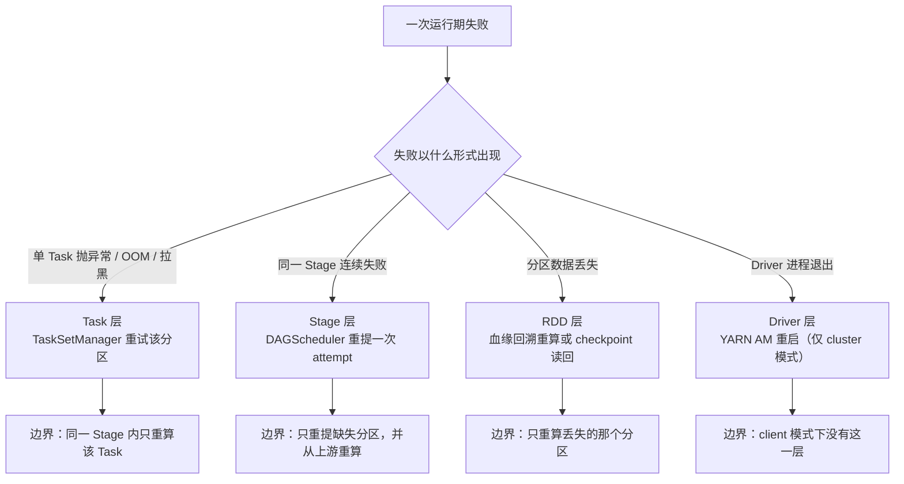
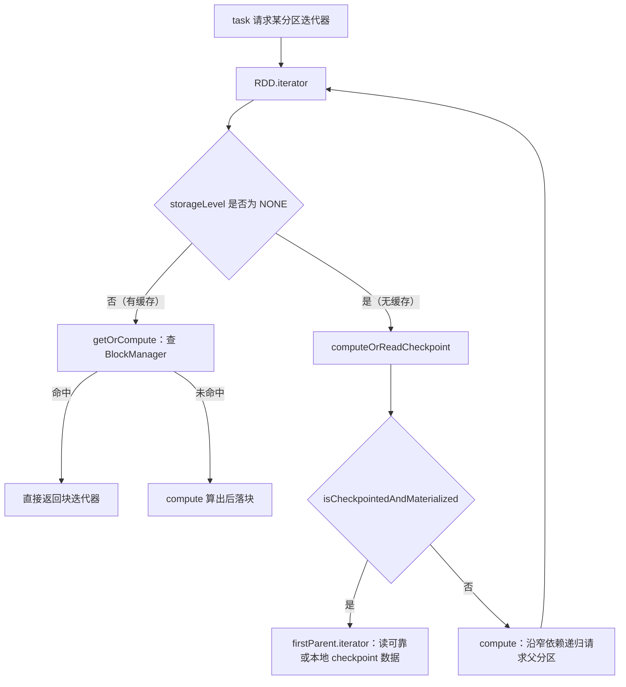
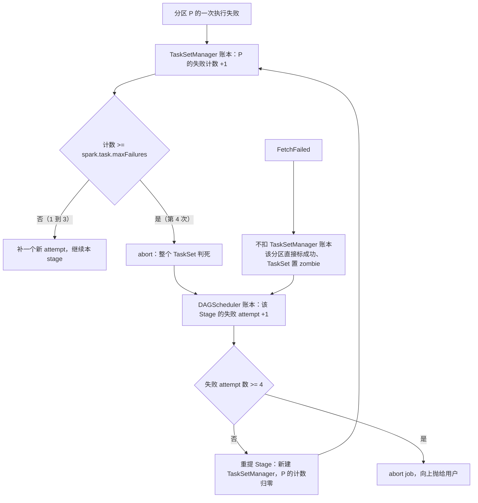
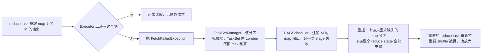
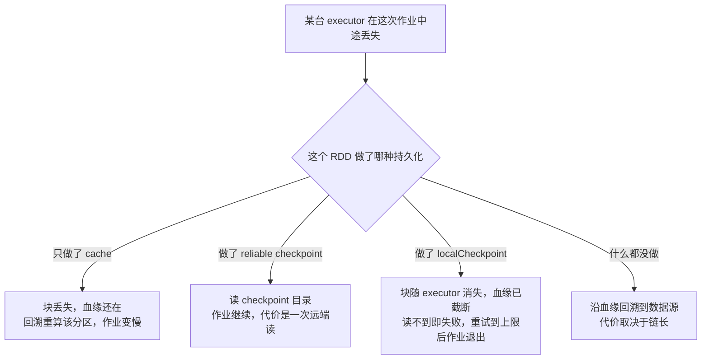
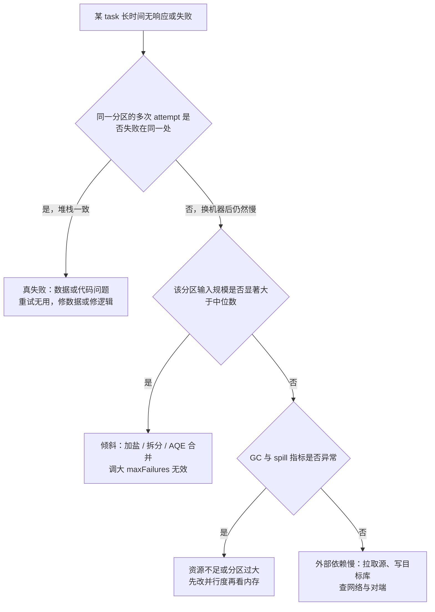

# 第8章 错误容忍机制

**摘要：**

容错在 Spark 里不是一个开关，而是四层各自记账的机制。Task 层的账本在 `TaskSetManager` 里，按分区计连续失败，四次之后整个 TaskSet 判死；Stage 层的账本在 `DAGScheduler` 里，按连续 attempt 计，四次之后 job 中止；RDD 层不按 attempt 计量，它按分区计量，分区丢了就沿血缘回溯重算，或者从 checkpoint 读回；Driver 层只有 YARN 的 AM 重启，client 模式下这一层不存在。四层的边界不同，代价也不同：`FetchFailed` 不扣 task 预算，它直接作废整个下游 stage 并从上游重算丢失的 map 分区，所以 shuffle 失败比普通失败贵一个量级；`checkpoint` 分可靠与本地两种，都切断血缘，差别在 executor 丢了之后能不能读回；推测执行把"慢"从"失败"里摘出来，代价是外部存储可能被写两遍。四层之间既有包含关系，也有正交关系，混着讲就会把调参变成碰运气。分层的用处首先在于定位：一次失败先在日志里判断它落在哪一层，再决定调哪个阈值，而不是一上来就调 `spark.task.maxFailures`。本章把这些边界、账本与代价摊成表，也把三种常见误读逐一拆掉；文中数字除特别说明外均为示例推算。

本章是教材第 8 章的骨架整理，讲"四层容错各自管什么、边界在哪"；机制的源码推导与调优判据在专题专栏里，涉及处只给一句结论并双链。

## 8.1 错误容忍机制的意义及挑战

Spark等大数据处理框架运行在分布式环境下，在使用集群对大数据进行处理时，不可避免会受到软硬件故障的影响，如节点宕机、磁盘损坏、网络阻塞、内存溢出等。同时，用户开发的应用及Spark系统本身也可能出现bug。这些软硬件故障会导致任务执行失败、数据丢失等状况。错误容忍机制就是在应用执行失败时能够自动恢复应用执行，而且执行结果与正常执行时得到的结果一致。

如果Spark等大数据处理框架没有错误容忍机制，那么应用出现问题后只能停止运行，或者再次提交运行。然而在企业中，很多Spark应用需要执行几个小时甚至几天，重新运行代价太高，而且不能保证不会再次出现问题。因此，错误容忍是分布式软件系统需要解决的一个重要问题。具体地，对于Spark等大数据处理框架，错误容忍需要考虑以下两方面的问题。

（1）作业（job）执行失败问题：Spark在执行job时，可能因为软硬件环境、配置、数据等因素的影响，导致job执行失败。如图8.1的右图所示，具体表现有task长时间无响应、内存溢出、I/O异常、数据丢失等。问题原因多种多样，既包括硬件问题，如节点宕机、网络阻塞、磁盘损坏等；也包括软件问题，如内存资源分配不足、partition配置过少导致task处理的数据规模太大、partition划分不当引起的数据倾斜，以及用户和系统Bug等。对于内存溢出问题，Xu等[55]分析了大数据应用内存溢出错误的原因及修复方法。

（2）数据丢失问题：Spark job在执行过程中，会读取输入数据、生成中间数据、输出结果。由于软硬件故障，如节点宕机，会导致某些输入/输出或中间数据丢失。例如，task的输入数据既可以来自分布式文件系统，也可以通过Shuffle获取，如果在Shuffle机制中数据丢失怎么办？如果对一些重要数据进行缓存后，缓存数据由于节点宕机等故障丢失怎么办？另外，一个应用经常包含多个job，当前job的输出数据是下一个job的输入数据，那么当前job的输出数据丢失怎么办？

> [!figure] 图8.1 Spark应用在运行时出现的错误（如task长时间无响应、内存溢出、I/O异常、数据丢失等）

以上问题说明Spark job在运行时可能出现各种类型的错误，原因也很复杂。按照一般的错误诊断和修复逻辑，应该在出错时先定位错误找出出错阶段，然后进行错误诊断找出错误原因，最后有针对性地进行错误修复。然而，由于错误种类和原因的多样性，而且有些还与用户的配置、代码和数据相关，Spark难以对每种错误都进行容忍和修复，所以，设计一个与用户无关、自动化且能覆盖多种错误类型的错误容忍机制，是一个难题。

> [!note] 注意：本章不具体区分故障、错误、异常、失效等几个术语的区别，它们都指代应用不能正常运行时出现的问题。

## 8.2 错误容忍机制的设计思想

实际上，Spark并没有很好的方法去解决上一节提到的各种类型错误。既然不能做到对每种错误都进行诊断和修复，那么Spark优先解决一类较为简单的错误：由于执行环境改变而引发的应用执行失败，如由于节点宕机、内存竞争、I/O异常导致的任务执行失败。这类执行任务失败的共同特点是可以通过重新计算来尝试修复的。例如，节点突然宕机后，可以通过重新将计算任务调度到其他节点上，并继续执行。再例如，内存竞争会导致当前没有足够资源执行计算任务，这时可以将计算任务提交到另外一台内存充足的机器上去执行。当然，如果其他节点也是内存不足，那么重新执行也会继续导致出错。

对于数据丢失问题，实际上在数据库中已经有了一些方案，如写日志、数据持久化、复制备份等。Spark采用的是数据检查点持久化方案，即checkpoint机制。

总的来说，Spark错误容忍机制的核心方法有以下两种。

1. 通过重新执行计算任务来容忍错误。当job抛出异常不能继续执行时，重新启动计算任务，再次执行。
2. 通过采用checkpoint机制，对一些重要的输入/输出、中间数据进行持久化。这可以在一定程度上解决数据丢失问题，而且能够提高任务重新计算时的效率。

两种方法组合起来，才形成本章的四层结构：重算的粒度决定"重做多少"，持久化的位置决定"哪些不必重做"，而两者都要挂到一个具体的失败信号上——异常、OOM、`FetchFailed`、心跳超时、Driver 进程退出，这些信号由不同组件捕获，也就落在不同的层。

四层的分工可以从下图看起。图的左侧是失败信号，右侧是每一层的处理动作与它管到哪儿为止。

## 8.3 重新计算机制

上节提到Spark使用重新计算的方法来解决软硬件环境异常造成的作业失败问题。这种方法类似于"重启大法"，简单且容易自动化。然而，由于Spark应用和执行流程的复杂性，如何设计更精确、更高效的重新计算机制，还需要考虑如下的正确性和性能等问题。

### 8.3.1 重新计算是否能够得到与之前一样的结果

如果一个task正确计算出了结果但在输出时失败，那么再次执行该任务时，还能否得到与之前一致的结果？如果不能得到一致的结果，那么重新计算就没有意义。要保证一致性，需要task的输入数据和计算逻辑满足以下3个特性。

（1）重新计算时，task输入数据与之前是一致的。

对于map task，其输入数据一般来自分布式文件系统或者上一个job的输出。由于分布式文件系统上的数据是静态可靠的，所以task再次执行时仍然能够读取到相同的数据。同样，如果已经对上一个job的输出进行了持久化，那么task再次执行时仍然可以获得相同的数据。

对于reduce task，其输入数据通过Shuffle获取，由于在Shuffle Write时一般使用确定性的partition（）函数来对数据进行划分，所以每个reduce task获取的数据也是确定性的，如reduce task 0只获取Hash（Key）为0的record即可。然而，由于计算延迟和网络延迟，在Shuffle Read过程中不能保证接收到的record的顺序性，可能先接收到来自map task 2的record，后接收到来自map task 1的record，因此，reduce task再次运行时的输入数据与之前的数据是部分一致的，即接收到的数据集合与上次task一样，只是里面的record顺序可能不一样。这时，需要task满足下面两个特性才能得到一致的结果。

（2）task的计算逻辑需要满足确定性（deterministic）。确定性的意思是如果输入数据是确定的，那么计算得到的结果也是确定的。假设task在计算时调用了一个随机函数，这个结果就是不确定的了，会导致task重新执行时得到不一致的结果。

（3）task的计算逻辑需要满足幂等性（idempotent）。幂等性是指对同样数据进行多次运算，结果都是一致的。在（1）中我们提到reduce task通过Shuffle获取到的<K，V>record是无序的，即使通过对Key进行排序，也无法保证相同Key的record是有序的。那么，task的处理逻辑需要满足交换律和结合律才能得到一致的结果。例如，reduce task使用聚合函数func（）对<K，list（V1，V2，V3）>record进行处理，假设处理顺序为V1→V2→V3，那么计算结果为V′=func（func（V1，V2），V3）。如果该task失效，第2次运行时处理顺序为V3→V2→V1，那么计算结果为V′′=func（func（V3，V2），V1）。只有func（）满足交换律和结合律，V′与V′′的结果才是一致的，否则，将会出现不一致的结果。例如，在图8.2中，func（）将list（V）中的Value按照下画线连接，如果record的顺序不同，则会得到不同的聚合结果，即使按照Key进行排序后，结果也是不同的。Xiao等[102]详细讨论了在func（）不满足交换律和结合律时，MapReduce类型的作业会出现多种类型的执行结果的错误。

> [!figure] 图8.2 Spark中reduce task在不同的Shuffle顺序下得到的不同计算结果（注意：红色部分与绿色部分的数字顺序有差别。）

总的来说，重新计算机制有效的前提条件：task重新执行时能够读取与上次一致的数据，并且计算逻辑具有确定性和幂等性。

### 8.3.2 从哪里开始重新计算

Spark运行应用时会按照action（）操作的先后顺序提交job，每个job被分为多个stage，每个stage又包含多个task，task是最小的执行单位。根据重新计算思想，当某个job中的task运行出错时，需要重新执行该task，那么是否还需要执行其上游stage中的task呢？另外，根据流水线机制，每个task一般会连续计算多个RDD，那么每个RDD都需要重新计算吗？还有，第7章提到过缓存数据如果丢失也需要重新计算，那么该从哪里开始计算呢？

要回答上述3个问题，本质上是要解决如何对数据和计算追根溯源的问题。我们先以第4章给出的复杂应用为例，讨论上面这3个问题的解决方案，然后再给出一般化的解决方案。

（1）重新执行失效的task时，是否还需要执行其上游stage中的task？

如图8.3所示，stage 0和stage 1中的task的输入数据来自分布式文件系统上的固定数据，这些task重新计算时直接读分布式文件系统即可。下游stage 2中的task通过Shuffle Read读取上游输出，如果stage 2中某个task执行失败，重新运行时需要再次读取stage 0和stage 1的输出结果，如何避免对上游task重新计算？Spark采用"延时删除策略"，即上游stage的Shuffle Write结果写入本地磁盘后，只在当前job完成后才删除。这样即使stage 2中某个task失败，也能再次通过Shuffle Read读到同样的数据。所以根据ShuffleDependency切分出的stage既保证了task的独立性，也方便了错误容忍的重新计算。

（2）一个task一般会连续计算多个RDD，那么每个RDD都需要重新被计算吗？

这个问题的答案取决于应用是否存在缓存数据。对于没有缓存数据的情况，每个RDD都需要重新被计算。在图8.3中，如果stage 1中的task3执行失败，那么需要重新计算Data blocks => RDD2 => MapPartitionsRDD => UnionRDD中相应的分区数据；如果task5执行失败，那么需要重新计算Data blocks => RDD3 => UnionRDD中相应的分区数据。在stage 2中，task7或task8重新计算时需要计算ShuffledRDD => CoGroupedRDD => MapPartitionsRDD => result: MapPartitionsRDD => Output results。对于有缓存的情况，如在stage 1中的task4，RDD2中相应的分区数据已经被缓存，那么直接从RDD2开始计算即可。同样，在stage 2中，CoGroupedRDD的第3个分区数据已经被缓存，task9直接从CoGroupedRDD计算即可。

> [!figure] 图8.3 一个复杂的Spark应用的物理执行计划（黄色圆圈代表已被缓存的partition）

（3）缓存数据如果丢失也需要重新计算，那么从哪里开始计算呢？

如图8.3所示，如果RDD2的第2个分区的缓存数据丢失，那么需要再次启动task4，读取Data blocks数据，计算该分区数据。如果CoGroupedRDD的第3个分区的缓存数据丢失，那么再次启动task9，通过Shuffle Read数据计算ShuffledRDD => CoGroupedRDD对应的分区数据。

通过以上举例分析可知，上述3个问题的解决方案都不难，然而统一实现起来就会很复杂，需要考虑各种情况和问题：如task是否需要Shuffle Read？stage中的计算步骤是什么？计算路径上的数据是否包含缓存数据？缓存数据是如何计算出来的？等等。

为了使用更通用的方法解决上述问题，Spark采用了一种称为lineage的数据溯源方法。这个方法的核心思想是在每个RDD中记录其上游数据是什么，以及当前RDD是如何通过上游数据（parent RDD）计算得到的。例如，在图8.3中，ShuffledRDD的parent RDD是通过Shuffle Read得到的RDD1；CoGroupedRDD的parent RDD是通过Shuffle Read+聚合得到的ShuffleRDD和UnionRDD。这样在错误发生时，可以根据lineage追根溯源，找到计算当前RDD所需的数据和操作，所以lineage更通俗的意思就是计算链（computation chain）。如果计算链上存在缓存数据，那么从缓存数据处截断计算链，即可得到简化后的操作。不管当前RDD本身是缓存数据还是非缓存数据，都可以通过lineage回溯方法找到计算该缓存数据所需的操作和数据。

### 8.3.3 血缘重算的执行路径

“沿血缘回溯”在教材里是比喻，落到代码上是几行分叉。task 要某个分区的迭代器，请求从 `RDD.iterator` 进来：有存储级别走 `getOrCompute` 去 `BlockManager` 找块，命中直接返回，未命中就调 `compute` 算出来顺手落块；没有存储级别直接进 `computeOrReadCheckpoint`，已物化就转去读 `firstParent`（checkpoint RDD），否则调 `compute`。

这张图说明"缓存不切断血缘"落在哪一行：缓存在 `getOrCompute` 这一支，块丢了只影响这次取数，血缘还在；checkpoint 在 `computeOrReadCheckpoint` 这一支，一旦物化，`firstParent` 成了唯一父，回溯路径就地掐断。把"算"与"读"放进同一函数的两个分支，调用方不必知道自己拿到的是重算结果还是 checkpoint 结果；代价是"重新计算"失去统一拦截点，shuffle 输出丢失要走 `FetchFailed`、块丢失要走 `BlockManager` 补块，四层容错难梳理的根源就在这里。

递归发生在 `compute` 内部：窄依赖链上每个 parent 被依次请求一次 `iterator`，直到命中缓存、命中 checkpoint，或走到 `HadoopRDD` 这类数据源。宽依赖处相反，`ShuffledRDD.compute` 不递归上游，它向 `BlockManager` 要 shuffle 块，块不在就抛 `FetchFailedException`，把事情交给 Driver。

### 8.3.4 重新计算机制小结

Spark采用了最朴素的重新计算机制来解决由于软硬件环境改变引发的错误问题，但是重新计算机制要求task的计算逻辑满足确定性、幂等性。虽然Shuffle Read的数据不能保证顺序性，但一般应用并不要求结果有序（或者只要求Key有序），因此，当前的重新计算机制是可行的。

重新计算需要面对各种各样的情况，Spark采用了lineage来统一对RDD的数据和计算依赖关系进行建模，使用回溯方法解决从哪里重新计算，以及计算什么的问题。

## 8.4 四层容错的边界

上一节把"重算"从一个比喻讲成了一条函数路径，但只说清了"怎么重算"，没说清"谁来决定重算、记几次账"。这两件事分属不同组件，也就分出了不同的层。

### 8.4.1 四层容错的边界

| 层 | 故障 | 恢复方式 | 边界 |
| :--- | :--- | :--- | :--- |
| Task | 单 Task 抛异常 / OOM | `TaskSetManager` 重试（`spark.task.maxFailures` 默认 4） | 同一 Stage 内重算该 Task |
| Stage | 某 Stage 连续失败 | `DAGScheduler` 重试（`spark.stage.maxConsecutiveAttempts` 默认 4） | 从上游 Stage 重算 |
| RDD | 分区丢失（Executor 挂） | 血缘重算 / checkpoint 读回 | 只重算丢失分区 |
| Driver | Driver 进程挂 | YARN AM 重启（cluster 模式） | client 模式无 |

这张表最容易读错的地方，是把四行当成四个独立开关。前三行是嵌套关系：一次 Stage attempt 内含若干 Task attempt，一次 application attempt 内含若干 Stage attempt；第四行不在同一条嵌套链上，RDD 层按分区计量，与 attempt 计量正交。前三层回答"重做多少个调度单元"，RDD 层回答"重做哪些数据"。

更麻烦的是，一次故障常常同时消耗几层的预算：某台 executor 被杀掉，正在跑的 task 以 `ExecutorLostFailure` 回到 Driver，这是一次 task 失败；这台机器上的 shuffle 输出没了，下游拉取时拿到 `FetchFailed`，这是一次 stage 失败；上面缓存的块也没了，下次访问要血缘重算，这是一次 RDD 层动作。日志上看起来是"一个 task 失败"，账单上是三段成本。

### 8.4.2 四层的计数为什么互相独立

Task 层的账本住在 `TaskSetManager` 实例里，是以分区号为下标的整数数组，每次 `handleFailedTask` 给对应下标加一，成功一次清零。加到与 `spark.task.maxFailures` 相等时，执行的不是"放弃这个分区"，而是 `abort` 把整个 `TaskSet` 判死，整个 stage attempt 结束。四次失败不是"这个分区不管了"，而是"这批任务全部作废"。

Stage 层的账本住在 `Stage` 对象里，是记录失败 attempt 编号的集合。`stageAbortReason` 拿集合大小去比 `maxConsecutiveAttempts`，超了就中止 job，否则把 stage 放进 `failedStages` 等待重提；集合在 stage 成功结束时由 `clearFailures()` 清空，所以语义确实是"连续失败"。另有一个只增不减的 attempt 编号，由 `spark.stage.maxAttempts`（3.5.0 引入，默认不设上限）兜底，判断时取两个上限的较大值。

把两个账本放在一起，才能看出那个常被引用的乘法：`TaskSetManager` 是每个 stage attempt 新建一个对象，意味着每次 Stage 重提，task 的失败计数全部归零，同一分区又拿满四次机会。于是单分区的最坏尝试次数是 4 乘 4 等于 16，而不是 4 加 4 等于 8。这个乘法不是谁刻意设计的，它是"预算存在对象里、对象随 attempt 重建"的自然结果；理解之后就会明白，调大 `spark.task.maxFailures` 动的是乘法的第一个因子，第二个因子在同一份作业里照样会被消耗。

图里右下角那条支路是 `FetchFailed`：它绕过 task 账本，直接扣 stage 预算，这也是"task 明明只失败两次、作业却挂了"的来源。

### 8.4.3 为什么 shuffle 失败比普通失败贵

普通 task 失败的成本结构很干净：一个分区重算一遍，输入从 HDFS 重读，产出重新落块，其他分区不受影响。`FetchFailed` 不是这样，它在 `handleTaskCompletion` 里被单独处理，主干动作有四个：核对失败的 attempt 是不是该 stage 的最新 attempt（过期的直接忽略，因为同一 stage 可能并发收到好几条）；把这次失败记进 stage 的失败 attempt 集合；用 `mapOutputTracker.unregisterMapOutput` 注销"那个 map 分区在这台机器上的输出"，而不是作废整份 shuffle 结果；最后把失败的 result stage 与对应的 map stage 一起放进 `failedStages`，等 `resubmitFailedStages` 重提。

这四个动作解释了前两段成本。第一段是下游全废：reduce stage 以 attempt 为单位提交，一次 fetch 失败让这次 attempt 整体判死，已跑完的 reduce task 成果不能保留，下次 attempt 全部重跑；stage attempt 是原子的，Spark 不做"部分 reduce 结果有效"这种细粒度保留，原因是下游输出是对全部分区做聚合的函数，缺一个 map 分区，剩下的结果就是错的。第二段是上游要重算：被注销的 map 分区在 `MapOutputTracker` 里已无可用输出，重提时 `findMissingPartitions` 把它们找出来，只重算这几个分区。所以"FetchFailed 会重算整个 map 阶段"这个通行说法并不准确，准确的说法是"重算丢失的 map 分区，外加把整个下游 stage 重做一遍"。

第三段成本只在 executor 整体丢失时出现。上游 shuffle 输出只有一份，落在 executor 的本地盘上，机器死掉，上面所有 map 分区的输出一起消失，重算范围从"一个分区"扩大到"这台机器上的全部分区"。若集群启用了外部 shuffle 服务，输出能活过 executor 的退出，这一段成本就从"重新计算"变成"重新注册"。

### 8.4.4 四层的配置与代价

| 配置项 | 默认值 | 管什么 | 调大的代价 | 调小的代价 |
| :--- | :--- | :--- | :--- | :--- |
| `spark.task.maxFailures` | 4 | 单分区连续失败几次后判死整个 TaskSet | 确定性失败暴露延迟，毒分区多烧几轮重算 | 一次抖动即上升为 Job 失败 |
| `spark.stage.maxConsecutiveAttempts` | 4 | 同一 stage 连续失败几次后中止 job | 单次故障的墙钟成本成倍放大，最长可到数小时 | 偶发掉线即作业失败，长跑作业尤其脆弱 |
| `spark.stage.ignoreDecommissionFetchFailure` | true | 退役 executor 引起的 fetch 失败是否计入 stage 预算 | 调小后滚动缩容就会消耗 stage 重试额 | 调大会掩盖真正的数据丢失类失败 |
| `spark.yarn.maxAppAttempts` | 跟随 YARN 全局值 | AM 可以重起几次 | 同一份作业整段重跑的遍数成倍放大 | 一次 AM 故障即应用丢失 |

`spark.task.maxFailures` 与黑名单的配比值得单独记一笔：黑名单给同一分区在同一台 executor 上一次机会（`spark.excludeOnFailure.task.maxTaskAttemptsPerExecutor` 默认 1），而 task 预算给同一分区四次机会。前者是"路线"，后者是"预算"，路线不通时预算再多也只是在同一批坏机器上反复烧，机制推导见 [[大数据/Spark/Spark-容错与状态管理深度解析/02 Task 与 Stage 的多级重试机制|Task 与 Stage 的多级重试机制]]。

## 8.5 checkpoint机制的设计与实现

理论上，重新计算机制可以用于解决数据丢失问题。当输入/输出或中间数据丢失时，可以重新启动任务计算这些数据，就像缓存数据丢失时可以再重新计算得到一样。然而，重新计算存在一个缺点是，如果某个数据（RDD）的计算链过长，那么重新计算该数据的代价非常高。例如，对于迭代型应用，假设迭代了100轮才计算出的中间数据突然丢失了，那么重新计算该数据的代价太高了。因此，为了提高重新计算机制的效率，也为了更好地解决数据丢失问题，Spark采用了检查点（checkpoint）机制。该机制的核心思想是将计算过程中某些重要数据进行持久化，这样在再次执行时可以从检查点执行，从而减少重新计算的开销。虽然checkpoint机制的思想很简单，但与Spark重新计算机制结合使用时，还面临多个问题，下面具体介绍这些问题。

### 8.5.1 哪些数据需要使用checkpoint机制

既然checkpoint机制的目的是对重要数据持久化以减少重新计算的时间，那么从直观上来说，应该对计算耗时较高的数据进行持久化。具体地，我们通过分析单个job和多个job的情况来总结哪些数据需要使用checkpoint机制。

（1）单个job的情况。以图8.3为例，假设没有数据缓存（黄色的partition变为白色），我们分析该job的每个stage中哪些数据需要使用checkpoint机制。在stage 0中RDD1的计算代价较低，task直接读取分布式文件系统上的数据块，进一步计算就得到RDD1，因此不需要对RDD1进行checkpoint。相比RDD1，stage 1中的UnionRDD的计算代价中等，需要运行更多的task、经过更多的计算步骤才能得到，如果UnionRDD的数据量不大的话，则可以考虑对其进行checkpoint。在stage 2中，对RDD1进行Shuffle Read直接得到ShuffledRDD，ShuffledRDD的计算代价较低，而CoGroupedRDD需要对ShuffleRDD和上一阶段的UnionRDD聚合得到，依赖数据较多，计算较为复杂耗时。所以，建议对CoGroupedRDD进行checkpoint，这样当task7、task8或task9执行出错再次运行时，可以从CoGroupedRDD直接开始计算，不需要进行Shuffle Read。

这里可能有一个观点：CoGroupedRDD不需要checkpoint，因为RDD1和UnionRDD的结果已经Shuffle Write到本地磁盘，重跑task7、task8或task9只需Shuffle Read再加计算，代价并不高。该观点忽略的是本地磁盘并不可靠：一旦节点宕机，那份只有一份的Shuffle Write数据就没了，重新计算时要重跑task0～task6。因此对于数据依赖较多、经过复杂计算才能得到的RDD，可以用checkpoint持久化。

这里再补充一点：对于图8.3中的应用来说，CoGroupedRDD由Spark生成，对用户不可见，因此用户如果想要checkpoint CoGroupedRDD的话，则可以考虑对其可见的parent RDD和child RDD进行checkpoint。

（2）多个job的情况。相比单个job，多个job的情况需要考虑job之间传递的数据是否需要checkpoint。在应用中存在多个job，尤其是在多个job串联执行的情况下，每执行完一个job后，Spark会将该job中上游stage的Shuffle Write数据清空，以减少占用的磁盘空间。如图8.6所示，一个迭代型应用每轮迭代都可能执行一个job，每执行完一个job都会将该job中的Shuffle Write数据清空，只留下被缓存的数据，如cached RDD1、cached RDD2和cached RDD3。当然，由于缓存替换机制，旧的缓存数据（如cached RDD1）也可能被清除。当不断被清除的缓存数据和清除的Shuffle Write数据会导致下游task重新计算时，则要从更加上游的地方开始，从而增加了计算量。

> [!figure] 图8.6 迭代型应用的逻辑处理流程和物理执行计划

在图8.6中，假设task t运行节点和cached RDD2中第1个分区所在的节点是同一个，那么当该节点宕机时，需要重新执行第1轮迭代的job1以获得RDD2，之后再重新执行task t。所以，对于串联执行的job，尤其是迭代型job，需要每隔几个job（或者每迭代m轮）就对一些中间数据进行checkpoint，这样在出错时，可以从最近的checkpoint数据恢复执行。

总的来说，需要被checkpoint的RDD满足的特征是，RDD的数据依赖关系比较复杂且重新计算代价较高，如关联的数据过多、计算链过长、被多次重复使用等。

### 8.5.2 checkpoint数据的写入及接口

了解哪些数据需要使用checkpoint机制后，我们还要解决checkpoint数据的存放位置问题。checkpoint的目的是对重要数据进行持久化，在节点宕机时也能够恢复，因此需要可靠地存储。另外，checkpoint的数据量可能很大，因此需要大的存储空间。所以，一般采用分布式文件系统，如HDFS来存储。当然，如果内存空间足够大，且想加速存储与读取过程，则也可以选择基于内存的分布式文件系统Alluxio。

在Spark中，提供了`sparkContext.setCheckpointDir(directory)`接口来设置checkpoint的存储路径。同时，提供`rdd.checkpoint()`来实现checkpoint。具体用法如下。

示例1：一个简单的checkpoint应用，对中间数据进行checkpoint。

按照第4章介绍的物理执行计划生成方法，示例1程序生成了两个job。如图8.7所示，第1个job计算count（）结果，并将pairs: MapPartitionsRDD所有的partition checkpoint到HDFS中。第2个job首先从checkpoint文件中读取pairs: RDD，然后进行groupByKey（）和foreach（）计算。查看checkpoint目录（见图8.8），pairs的3个partition以 `part-0000*` 形式存放，内容经过序列化，用文本编辑器打开是乱码。

> [!figure] 图8.7 示例的逻辑处理流程

> [!figure] 图8.8 示例1应用在checkpoint目录存放的序列化后的RDD数据

对于示例1应用，根据图8.7的物理执行计划，我们认为只会产生两个job。然而，查看该应用实际生成的job信息，则会发现实际生成了3个job，如图8.9所示。此处的job 0相当于图8.7中的第1个job，此处的job 2相当于图8.7中的第2个job，那么为什么会多一个job 1呢？我们接下来通过研究checkpoint的时机及计算顺序来回答这个问题。

> [!figure] 图8.9 示例1应用生成的3个jobs（job 2中的map（）操作是用来读取checkpoint数据的）

### 8.5.3 checkpoint时机及计算顺序

根据8.5.2节的分析，我们的问题是，在job运行过程中，什么时候进行checkpoint？checkpoint与其他操作计算的顺序是什么？在上一章中，我们介绍了缓存机制的计算顺序，对于需要缓存的RDD，每计算出其中的一个record，就将其缓存到内存或磁盘中。假设我们仍然用该方法来进行checkpoint：如图8.7所示，每计算出pairs: RDD的一个record，就将其持久化到分布式文件系统HDFS上，所有record持久化完毕后执行count（）操作，count（）从HDFS上读取record进行计算。该job完成后，第2个job从HDFS上读取pairs数据进行计算。

该方案是可行的，但是效率很低。首先，checkpoint将数据持久化到分布式文件系统（如HDFS）时需要写入磁盘，而且一般需要复制3份进行跨节点存储，且写入时延高。同时，后续操作需要从HDFS中读取数据，读取代价也很高。如果需要checkpoint的RDD包含的数据量很大，则将会严重影响job的执行时间，造成很高的磁盘I/O代价。那么，如何提高checkpoint的效率呢？

其实Spark也没有好的解决方案，权宜之计是一种比较简单粗暴的方法：用户设置`rdd.checkpoint()`后只标记某个RDD需要持久化，计算过程也像正常一样计算，等到当前job计算结束时再重新启动该job计算一遍，对其中需要checkpoint的RDD进行持久化。也就是说，当前job结束后会另外启动专门的job去完成checkpoint，需要checkpoint的RDD会被计算两次。

如图8.7所示，用户设置pairs.checkpoint（）后，Spark将pairs: RDD标记为需要被checkpoint，然后正常执行第1个job。执行完以后，重新执行该job，计算rdd1 => pairs，每计算出pairs中的一个record，就将其持久化写入HDFS。当所有record写入完成后，job结束，不需要执行后续的count（）操作。这就是为什么实际执行时会多了一个job1。第3个job读取存储在HDFS上的pairs数据中，并正常执行groupByKey（）操作。

显然，checkpoint启动额外job来进行持久化会增加计算开销。为了解决这个问题，Spark推荐用户将需要被checkpoint的数据先进行缓存，这样额外启动的任务只需要将缓存数据进行checkpoint即可，不需要再重新计算RDD，可以在一定程度上提高效率。

这个"额外启动一个 job"的时机在代码里是固定的：`SparkContext.runJob` 在 job 结束后调最后一个 RDD 的 `doCheckpoint()`，后者带 `doCheckpointCalled` 标志防止重复进入，再沿依赖递归。所以 `checkpoint()` 必须写在 action 之前；写在之后，标记赶不上这次 `doCheckpoint()`，永远不会被消费。

### 8.5.4 checkpoint数据的读取

checkpoint数据存储在分布式文件系统（HDFS）上，读取方式与从分布式文件系统读取输入数据没什么太大区别，都是启动task来读取的，并且每个task读取一个分区。只有以下2个不同点。

1. checkpoint数据格式为序列化的RDD，因此需要进行反序列化重新恢复RDD中的record。
2. checkpoint时存放了RDD的分区信息，如使用了什么partitioner。这样，重新读取后不仅恢复了RDD数据，也可以恢复其分区方法信息，便于决定后续操作的数据依赖关系。例如，决定之后的join（）操作应该采用的数据依赖关系是OneToOneDependency还是ShuffleDependency。

### 8.5.5 checkpoint数据写入和读取的实现细节

上面几节介绍了checkpoint的写入和读取原理，在checkpoint的实现中还有几个细节问题需要在这里说明。

在实现中，RDD需要经过 Initialized → CheckpointingInProgress → Checkpointed 这3个阶段才能真正被checkpoint。

1. Initialized：当应用程序使用 `rdd.checkpoint()` 设定某个RDD需要被checkpoint时，Spark为该RDD添加一个 `checkpointData` 属性，用来管理该RDD相关的checkpoint信息。如图8.10所示，当程序执行到 `pairs.checkpoint()` 时，对 `pairs.checkpointData` 对象初始化，该对象保存了pairs的checkpoint的路径及 Initialized 状态。

   > [!image] 图8.10 初始化pairs：RDD的checkpoint状态为Initialized

2. CheckpointingInProgress：当前job结束后，会调用该job最后一个RDD（finalRDD）的 `doCheckpoint()` 方法。该方法根据finalRDD的computing chain回溯扫描，遇到需要被checkpoint的RDD就将其标记为 CheckpointingInProgress。在图8.11中，将 `pairs.checkpointData.cpState` 标记为 CheckpointingInProgress。之后，Spark会调用 `runJob()` 再次提交一个job完成checkpoint。

   > [!image] 图8.11 将pairs：RDD的checkpoint状态设置为CheckpointingInProgress

3. Checkpointed：再次提交的job对RDD完成checkpoint后，Spark会建立一个 `newRDD`，类型为 `ReliableCheckpointRDD`，用来表示被checkpoint到磁盘上的RDD。newRDD即 Checkpointed pairs：RDD，保留分区信息但截断lineage——数据已在可靠存储上，不必再保留它是怎么算出来的。注意，newRDD的分区类型为 `CheckpointedRDDPartition`，表示该分区已经被持久化。

   > [!image] 图8.12 checkpoint过程中生成的newRDD，表示Checkpointed RDD

生成newRDD后，Spark需要把pairs与它关联起来，后续job读取pairs时就去读newRDD。如图8.13所示，Spark把newRDD记在 `pairs.checkpointData` 的 `checkpointRDD` 字段上，`cpRDD` 由此从空变为Some（newRDD）；同时 `markCheckpointed()` 把pairs的数据依赖清空（本来用OneToOneDependency依赖 `inputRDD`），并把原来的依赖对象塞进一个 `WeakReference` 留给调试用，`partitions_` 与 `deps` 一起置空。此后访问pairs即访问newRDD，而newRDD不需要依赖任何RDD。这一步完成后 `pairs.checkpointData.cpState` 置为 Checkpointed，写入过程结束。

> [!image] 图8.13 将newRDD作为pairs的一个属性，读取pairs即读取newRDD

下面我们通过 `val result = pairs.groupByKey()` 的计算链来看一下Checkpointed RDD的读取过程。如下所示，job读取 `pairs：MapPartitionsRDD` 时，会读取 `newRDD：ReliableCheckpointRDD`。

总的来说，checkpoint的写入过程不仅对RDD进行持久化，而且会切断该RDD的lineage，将该RDD与持久化到磁盘上的Checkpointed RDD进行关联。这样，读取该RDD时，即读取Checkpointed RDD。

### 8.5.6 checkpoint语句位置的影响

了解了checkpoint的设计和实现原理后，本节讨论几种复杂写法：在一个应用中checkpoint多个RDD、把语句放到 `action()` 之后、以及在一个job中对两个RDD同时checkpoint。

#### （1）checkpoint多个RDD

在 `foreach()` 之前再加一句 `result.checkpoint()`，checkpoint目录下会多出 `rdd-1` 与 `rdd-3`，分别对应pairs与result；`rdd-3` 还带一个 `_partitioner` 文件记录result的Hash划分，读取时数据与分区信息一并还原。计算流程上会多出一个job 3（见图8.15），但job 3里的stage 4被忽略：job 2完成后没有删除stage 2与Shuffle Write的数据，留到job 3结束才删，因此job 3可以直接读stage 2的输出做groupByKey()。一般job完成后就会删掉上游stage与Shuffle Write数据，这里是checkpoint场景的特殊处理。

> [!image] 图8.14 checkpoint两个RDD后的写入文件信息

> [!image] 图8.15 checkpoint两个RDD后生成的4个job，其中job 1和job 3用于checkpoint

#### （2）checkpoint语句放置在action()语句之后

把checkpoint语句放在 `count()` 与 `foreach()` 之后，两个RDD都不会被checkpoint（见图8.16）；去掉 `pairs.count()` 后pairs又能被checkpoint（见图8.17）。原因是标记与消费的先后：job跑完之后 `doCheckpoint()` 已经走完，再标记也等不到下一次消费，8.5.3节讲的那段时机在这里表现为"写在action之后等于没写"。

> [!image] 图8.16 checkpoint语句放到action之后生成的job，没有生成用于checkpoint的job

> [!image] 图8.17 去掉 `pairs.count()` 语句后生成的job，生成了用于checkpoint pairs的job 1

#### （3）在一个job中对多个RDD进行checkpoint

在一个job里同时标记 `pairs` 和 `result`，实际只有 `result` 被持久化。这对应 `doCheckpoint()` 里的一个分支：只有 `checkpointAllMarkedAncestors` 为真，它才先递归父 RDD 再处理自己，源码注释写得很直白——"先 checkpoint 父节点，因为我们自己 checkpoint 之后血缘就被截断"。这个键是 local property（`spark.checkpoint.checkpointAllMarkedAncestors`），默认不开：流式场景每批都同时标记 RDD 与父 RDD，若每次先回溯父节点，父节点永远等不到自己那一轮，血缘永远截不断，最终以 OOM 收场（注释引的是 SPARK-6847）。所以"一个 job 里只有最下游的 RDD 被 checkpoint"不是待修的缺陷，而是留了开关的默认取舍。

> [!image] 图8.18 在同一个job中对两个RDD都进行checkpoint时，只有result被持久化

> [!INFO] 注意：本小节的例子和描述较为晦涩，读者可以自行调整示例代码中的语句顺序，结合Web UI观察在不同情况下checkpoint和action()对job执行的影响。

### 8.5.7 cache+checkpoint

前面介绍过Spark建议在checkpoint的同时缓存，两者连用时的顺序是先缓存，再由一个新job读缓存写checkpoint。

示例4：`pairs：RDD` 既缓存又checkpoint。应用生成3个job：job 1由 `count()` 触发并顺带缓存pairs；job 2读缓存并对pairs做checkpoint；job 3里stage 2读缓存做Shuffle Write、stage 3做 `groupByKey()` 输出。读取时优先读缓存而非checkpoint，`result RDD` 的lineage上 `CachedPartitions` 之下才是 `ReliableCheckpointRDD`，说明两者并存且缓存优先。

> [!image] 图8.20 同时对pairs：RDD进行缓存和checkpoint生成的3个job

示例5：两个RDD既缓存又checkpoint。只缓存时job 2的lineage会拉得很长，包含整个应用的RDD与操作，因为缓存不切断lineage——缓存数据不可靠，丢了还得按lineage重算（见图8.21、8.22，stage 4与stage 6被忽略）。加上checkpoint后job数变为5（见图8.23），两个RDD各由一个专门job持久化，最后job 4读两个缓存RDD做 `join()`。

对比可见：checkpoint切断lineage，使最后的job不必再背着整张依赖图；原因是RDD已落到可靠存储，不必再保留它是怎么算出来的。迭代型应用lineage很长，及时checkpoint能明显降低后续job的复杂度。

> [!image] 图8.21 只包含cache()的逻辑处理流程

> [!image] 图8.22 只包含cache()而不包含checkpoint语句时生成的3个job

> [!image] 图8.23 示例5应用同时存在缓存数据和checkpoint时生成的job

### 8.5.8 两种checkpoint：reliable与local

`rdd.checkpoint()` 与 `rdd.localCheckpoint()` 在代码里都是一行，语义却分属两个世界。两者都走同一个基类流程，最后都调 `markCheckpointed()` 把 `dependencies_` 置空——两种 checkpoint 都切断血缘，"local 不切断血缘"是一个流传很广的误读。

| 维度 | `checkpoint()`（reliable） | `localCheckpoint()`（local） |
| :--- | :--- | :--- |
| 落盘位置 | checkpoint 目录指定的可靠存储 | executor 的块存储（本地盘，可带内存副本） |
| 血缘 | 物化后切断（`dependencies_` 置空） | 同样切断（同一套 `markCheckpointed()`） |
| executor 丢失后 | 从可靠存储读回，作业继续 | 块随 executor 消失，读不到即作业失败 |
| 额外 job | 总要跑一个写盘 job（重算一遍再写） | 只对缺失分区跑一个只做计数的 job |
| 存储级别 | 序列化后写外部存储 | 必须带磁盘（`useDisk = true`），否则被强制改写 |
| 与动态资源分配 | 无冲突 | 不安全，需调大 `spark.dynamicAllocation.cachedExecutorIdleTimeout` |
| 是否用 checkpoint 目录 | 是 | 否，`setCheckpointDir` 对它不起作用 |

可靠模式那一列还有一处常被想当然。`ReliableRDDCheckpointData` 的目录是"给定目录 + `rdd-<id>`"，数据确实留在 HDFS 上；但下次运行能不能用上，取决于 Driver 内存里那个 RDD 对象的 `checkpointData` 标记，而标记属于当前这个 `SparkContext`。这就是"配了 checkpoint 目录、AM 重启之后从 checkpoint 恢复"站不住的原因：新 Driver 从头执行用户代码、构造新的 RDD 对象，不会去认领上一轮留下的 `rdd-N` 目录。

本地模式另有三处细节。`LocalRDDCheckpointData.doCheckpoint()` 先断言存储级别带磁盘（`assume(level.useDisk)`），因为纯内存的块一旦被驱逐，"本地检查点"就成了空承诺：没设级别时用默认的 `MEMORY_AND_DISK`，设了纯内存级别时用 `transformStorageLevel` 把 `useDisk` 强行改真。接着补齐分区：有些 action 并不计算全部分区（`take()` 是典型），它先数一遍 `BlockManager` 里哪些块已存在，缺的用一个只统计大小的 `runJob` 补算。最后才返回 `new LocalCheckpointRDD(rdd)`，这个 RDD 不存数据，只把读请求指回原 RDD 的块。它不使用 `setCheckpointDir`，在开启动态资源分配的集群上不安全。

选型用三问收束。这个 RDD 在应用内读几次？一次的话 checkpoint 收益为零。丢了能接受回溯吗？能、只是不想每次重算，`cache` 就够。能付出一次写可靠存储的代价吗？能，`checkpoint()`；不能但能接受"executor 掉了就失败"，`localCheckpoint()`。三问顺序不能颠倒，颠倒之后最常见的产物就是"用 local 顶替 reliable"。

### 8.5.9 checkpoint的配置项

| 配置项 | 默认值 | 管什么 | 调大 / 打开的代价 | 调小 / 关闭的代价 |
| :--- | :--- | :--- | :--- | :--- |
| `spark.checkpoint.dir` | 空（4.0.0 起可作为默认值） | 可靠 checkpoint 的默认目录，可被 `setCheckpointDir` 覆盖 | 指向对象存储：省本地容量，写入时延成倍 | 不设就必须在代码里调 `setCheckpointDir`，否则 `checkpoint()` 抛异常 |
| `spark.checkpoint.compress` | true（2.2.0 起） | 物化写盘是否压缩，编解码用 `spark.io.compression.codec` | 打开省字节，代价是 CPU 与编解码绑定 | 关闭后写盘字节放大，大 RDD 会拖长 checkpoint job |
| `spark.checkpoint.checkpointAllMarkedAncestors` | false（local property） | `doCheckpoint()` 是否先递归父 RDD 再处理自己 | 打开后一个 job 里的多个标记都能落地，代价是流式场景可能饿死父节点 | 保持关闭时，一个 job 里只有最下游的 RDD 会被 checkpoint |
| `spark.cleaner.referenceTracking.cleanCheckpoints` | false | RDD 对象被 GC 后是否顺手删 checkpoint 文件 | 打开后省存储，但只覆盖"对象被 GC"这一种情形 | 关闭时长跑应用的 checkpoint 目录只增不减 |

`spark.checkpoint.compress` 的默认值在版本演进中翻转过，不少内部 wiki 上写的仍是"默认关闭、按需打开"。照抄这类文档会得到相反的行为：以为在省 CPU，实际是在为一份默认已压缩过的产物解压。

## 8.6 checkpoint与数据缓存的区别

数据缓存和checkpoint的用法、存储与读取过程确实很相似，但也有不少区别，下面总结说明一下。

1. 目的不同。数据缓存的目的是加速计算，即加速后续运行的job。而checkpoint的目的是在job运行失败后能够快速恢复，也就是说加速当前需要重新运行的job。
2. 存储性质和位置不同。数据缓存是为了读写速度快，因此主要使用内存，偶尔使用磁盘作为存储空间。而checkpoint是为了能够可靠读写，因此主要使用分布式文件系统作为存储空间。
3. 写入速度和规则不同。数据缓存速度较快，对job的执行时间影响较小，因此可以在job运行时进行缓存。而checkpoint写入速度慢，为了减少对当前job的时延影响，会额外启动专门的job进行持久化。
4. 对lineage的影响不同。对某个RDD进行缓存后，对该RDD的lineage没有影响，这样如果缓存后的RDD丢失还可以重新计算得到。而对某个RDD进行checkpoint以后，会切断该RDD的lineage，因为该RDD已经被可靠存储，所以不需要再保留该RDD是如何计算得到的。
5. 应用场景不同。数据缓存适用于会被多次读取、占用空间不是非常大的RDD，而checkpoint适用于数据依赖关系比较复杂、重新计算代价较高的RDD，如关联的数据过多、计算链过长、被多次重复使用等。

还有一层区别在失效行为上：缓存失效是"变慢"，本地 checkpoint 失效是"失败"。缓存与 `unpersist`、cancel 的交互见 [[大数据/大数据处理框架Apache Spark设计与实现/7.0 第7章 数据缓存机制|第 7 章 数据缓存机制]]。

## 8.7 推测执行：把"慢"从失败里摘出来

前面几节的容错都在处理"已经失败"的任务，但集群上更常见的现象是任务没失败、只是特别慢。慢到一定程度，它会以失败的形式出现在日志里：executor 被判超时、心跳丢失，或者拖太久把整个 stage 的槽位占死。推测执行处理的就是这一类：它不修复失败，它复制慢任务，让先跑完的那一份作数。

### 8.7.1 判定条件

一个 task 要被标记为"可推测"，需要同时满足几个条件。教材与早期文档给的口径是两个数：某 stage 已完成的 task 数达到总量的 `spark.speculation.quantile`（旧默认 0.75），并且某个仍在运行的 task 已跑时长超过"已完成 task 时长中位数"的 `spark.speculation.multiplier` 倍（旧默认 1.5），此时为它启动副本。前者决定"何时开始找"，后者决定"多慢算慢"：前者避免样本不可靠时就动手，后者避免把正常长尾当异常。

现行版本的默认值已经不是这一组，`multiplier` 提到 3、`quantile` 提到 0.9，理由是旧阈值在倾斜常见的集群上误判太多、副本开销抵不上收益。此外还有三个新面孔：`spark.speculation.minTaskRuntime`（3.2.0 引入，默认 100 毫秒）作为绝对时长下限，防止给毫秒级短任务补副本；`spark.speculation.efficiency.enabled`（3.4.0 起默认开启）在时长之外再过一道吞吐筛子，只有处理速率低于同 stage 已完成 task 平均速率乘以 0.75 的才算低效，把"数据多但算得快"排除在外；`spark.speculation.task.duration.threshold` 提供绕过比例判定的直通路径，按绝对时长触发，但只在小 stage 上有效，官方限定是当前 stage 的 task 数不超过单 executor 的槽位数。

阈值方向需要说清：调大 `multiplier` 或 `quantile`，判定变迟钝、副本变少，收益下降但资源浪费减少；调小则相反。`interval` 是 Driver 侧扫描 TaskSetManager 的周期，默认 100 毫秒，只影响"多久发现一次"。

### 8.7.2 什么时候推测执行有害

推测执行有一个前提：任务可以重放。这个前提一旦不成立，副本就从保险变成事故源。

| 有害场景 | 判据 | 具体后果 |
| :--- | :--- | :--- |
| 写外部存储且非幂等 | 写出的是 `INSERT` 而非覆盖写 / `MERGE` | 两份副本各写一份，作业成功但数据翻倍 |
| shuffle 的 map 任务被复制 | 该 stage 是 shuffle map stage | 副本与原任务同时写盘，IO 放大 |
| 分区本身因倾斜而慢 | 不同 attempt 换机器后一样慢 | 复制出来的是同样慢的活，白占槽位 |
| 副本落在不稳定节点 | 同一分区的失败计数被副本推高 | 撞上 `spark.task.maxFailures` 更早，表现为"开了推测反而更容易 abort" |
| 需要精确一次的外部写入 | 下游按至少一次语义消费 | 重复数据被当成真实数据消费 |

前两行的共同点是副作用不可去重：Spark 只保证"一个分区只有一个 attempt 的结果被采纳"，不保证"只有一份副作用被提交"。写 HDFS 这类由 `OutputCommitCoordinator` 按 attempt 提交的路径没问题，写外部数据库或消息队列就不在协调范围内。第四行最隐蔽，它在日志上的表现与推测无关，只有把"副本失败也计入该分区预算"串起来，才发现是推测把预算提前烧完了。

处置上有一条硬规则：确定有非幂等副作用的作业直接关闭推测执行，并写进配置注释。`spark.speculation` 是应用级配置，不能在一个应用内按 job 分别设置，所以"计算作业开、写出作业关"必须落在两个应用上。

判定的源码路径、zombie 状态的绕过、与黑名单的交互见 [[大数据/Spark/Spark-调度系统与执行模型深度解析/08 推测执行（Speculative Execution）：分布式环境下长尾任务的自动修复机制|推测执行]]。

## 8.8 Driver的容错边界

前三层的容错都在 Driver 进程内部完成，Driver 自己死了，这些机制一个都不剩。所以第四层要回答的不是"怎么重算"，而是"重算这件事还有没有人来发起"。

### 8.8.1 client与cluster的差别

| 维度 | client 模式 | cluster 模式 |
| :--- | :--- | :--- |
| Driver 位置 | 提交作业的机器 | YARN 的 ApplicationMaster 容器内 |
| Driver 挂掉 | 应用结束，作业失败 | YARN 重新拉起 AM（受 `spark.yarn.maxAppAttempts` 约束） |
| 客户端断开 | 应用通常跟着结束 | 应用继续，客户端只丢日志 |
| Spark 内部的重试 | 全部失效 | task / stage / RDD 三层照常工作 |
| 恢复的粒度 | 无 | 整个 application 重跑一次 |

client 模式下没有第四层，后果值得展开：Driver 是这些账本与注册表的唯一持有者，`MapOutputTracker` 的 shuffle 输出位置表在它内存里，`DAGScheduler` 的 stage 与 job 状态在它内存里，executor 的注册关系也在它内存里。进程一退这些结构一起消失，集群上还活着的 executor 会在心跳超时后退出。所以"给 client 模式配 checkpoint 目录能不能防 Driver 挂"的答案是：数据会在，但没有进程去认领它。

### 8.8.2 AM重启到底恢复了什么

cluster 模式下 Driver 挂在 AM 里，AM 挂了由 ResourceManager 决定要不要再拉一次。这一层的特殊之处是判断与动作都不在 Spark 进程里：Spark 已经死了，没有代码在跑，RM 只是按提交时请求的尝试次数再起一个容器，新一轮的 `main()` 从头执行。

所以准确的表述是：这一层能恢复"应用继续运行"，不能恢复"应用接着跑"。新 AM 拿到全新 JVM 与全新的 Driver 状态，血缘、stage 记录、shuffle 输出位置表一概不保留；除非用户代码自己实现了"从外部状态重新开始"（如把中间结果写成表、把迭代轮次记在外部存储），否则前面算完的 stage 全部作废。

两个误解在这里合流。其一，"AM 重启是断点续跑"，机制上不成立，它就是换容器重跑 `main`，代价接近整段作业。其二，"配了 checkpoint 目录就能恢复"，8.5.8 节已拆过：认领标记在 RDD 对象上，属于旧的 `SparkContext`。真正能跨进程续跑的是 Structured Streaming 那套由 `offsets/` 与 `commits/` 组成的日志账本，且必须由用户代码用同一个 checkpoint 位置重新构造查询，见 [[大数据/Spark/Spark-容错与状态管理深度解析/04 Structured Streaming 容错模型：Offset 与 Checkpoint|Streaming 容错模型]]。

计数上还有两处坑。`spark.yarn.maxAppAttempts` 的默认值就是 RM 侧的全局值 `yarn.resourcemanager.am.max-attempts`（社区默认 2），应用侧只能往小调，往大调会被 RM 静默压回上限——提交不失败，日志里只有一条含糊提示。`spark.yarn.am.attemptFailuresValidityInterval` 做的是另一件事：AM 稳定运行超过该时长后失败计数清零，于是"跑满一小时再挂"不会累积到上限，代价是重复出现的同一处故障被掩盖。

### 8.8.3 配置与代价

| 配置项 | 默认值 | 管什么 | 调大的代价 | 调小的代价 |
| :--- | :--- | :--- | :--- | :--- |
| `spark.yarn.maxAppAttempts` | 跟随 `yarn.resourcemanager.am.max-attempts`（社区默认 2） | AM 最多重起几次 | 同一份作业整段重跑的遍数成倍，AM 配额被长期占用 | 一次 AM 故障即应用丢失 |
| `spark.yarn.am.attemptFailuresValidityInterval` | 不启用 | AM 稳定运行多久后失败计数清零 | 反复出现的同一处故障被掩盖 | 长跑应用的偶发重启累计到上限，正常作业被误杀 |
| `spark.yarn.am.waitTime` | 100s | cluster 模式下 AM 等 SparkContext 初始化的时长 | 启动慢的应用能撑过冷启动，代价是失败判定延迟 | 初始化稍慢就被判失败，白消耗一次 AM 尝试 |

`spark.yarn.am.waitTime` 的键名值得单独记一笔。社区文档里能见到 `spark.yarn.applicationMaster.waitTries` 与 `spark.yarn.applicationMaster.waitForSparkContextInitialization` 两种写法：前者是 1.0 时代按次数计的老键，早已被 `spark.yarn.am.waitTime` 取代；后者在现行文档里根本不存在。设了不存在的键不会报错，Spark 对未知配置项只字不提，于是"我明明调了等待时间"和"作业还是启动失败"可以同时为真。

Kubernetes 模式下这一层更薄：driver pod 退出不会被自动重建，除非集群里有 operator 之类的组件替它重建；即使重建，拿到的也是新 pod 与新的 Driver 状态。本章的四层框架在 K8s 上要改成"三层加一个外部重建动作"，差异属于部署模式范畴，见 [[大数据/大数据处理框架Apache Spark设计与实现/2.0 第2章 Spark系统部署与应用运行的基本流程|第 2 章 部署与运行流程]]。

## 8.9 数据倾斜造成的"假失败"

值班时最容易判错的一类现象：作业卡在 99%，某个 task 长时间 running，最后因为 executor 超时或 OOM 失败，日志里的原因五花八门，但没有一个是根因。根因是数据倾斜——某个分区的数据量是其他分区的几十倍，它算得慢是正常的，慢到把资源耗光是被拖出来的。

真失败与倾斜的判据不在错误信息上，而在"重试落在哪里"上：

| 判据 | 真失败 | 倾斜 |
| :--- | :--- | :--- |
| 失败 attempt 的分布 | 同一分区反复失败，堆栈一致 | 不同 attempt 落在不同 executor，都一样慢 |
| 换机器后 | 机器相关的故障可能就此好了，数据相关的依然失败 | 换到哪个 executor 都一样慢 |
| 输入规模 | 与同 stage 其他分区相当 | 显著大于中位数（UI 的 Summary Metrics 可直接看） |
| 失败形态 | 异常、序列化失败、文件不存在 | OOM、GC 占比高、spill 巨大、fetch 超时 |
| 重试的效果 | 有概率成功 | 重试不改变结果，只是多花时间 |

这张图要防的是最常见的动作——看到 task 反复失败就调大 `spark.task.maxFailures`。判据就在上表第一行：失败是否落在同一个位置。倾斜本身的处置（加盐、拆分大 key、AQE 的 skew join）见 [[大数据/Spark/读书笔记-spark内核/06_性能调优实战/9. 数据倾斜解决方案_上|数据倾斜解决方案]]。

## 8.10 三个容错配置的认知障碍

第一个障碍是把 `spark.task.maxFailures` 当成稳定性旋钮。默认值 4 是经验值，前提是"故障偶发、彼此独立、与数据无关"。调大它改变的不是单次失败的代价，而是允许失败的总次数：每次尝试都要排队、重算、重新拉数据，一次确定的失败会被摊成 N 次。真需要调大的场景很窄：原因已确认与机器相关且偶发，并且黑名单已开启、配比正确。

第二个障碍是低估 `FetchFailed` 的代价。它不扣 task 的预算，直接扣 stage 的预算，而 stage 的预算只有四次；它作废的是整个下游 stage，重算的是丢失的 map 分区。把它归到"一次普通的 task 失败"，会导致两个判断错误：估恢复时间时按"重跑一个 task"来估，实际按"重跑一整段 reduce"来走；排查时盯着失败的 reduce，根因其实在丢输出的那台 map 机器上。

第三个障碍是那句"`localCheckpoint()` 不切断血缘"。实际是它切断血缘、但不落可靠存储，所以 executor 一丢就是作业失败而不是变慢。两种说法在"能不能防 executor 全挂"上答案一样：都不能。差别在后续推理——按误读去推，会认为 local 之后还能回溯重算，把 executor 丢失当成可恢复的慢；按实际机制去推，会知道那是已经踩过线的失败，得重新提交。

## 8.11 三个反例

### 反例一：只checkpoint不cache

只写 `rdd.checkpoint()` 而不 `cache`，是本章反例里最常见的一个。后果不是"checkpoint 没生效"，而是"上游被算了两遍"：第一遍是正常 job，第二遍是专门为写 checkpoint 而重跑的那个 job，两遍都要走完整血缘，迭代作业里会被放大到每一轮。正确写法是 `rdd.persist(); rdd.checkpoint()`，让第二个 job 直接从缓存读块、写盘——缓存省的是"多算的那一遍"，checkpoint 省的是"以后再算"。

### 反例二：开着推测执行写外部存储

`spark.speculation=true` 加上"任务里直接写外部数据库"，出问题的形态很安静：作业成功，数据翻倍，监控全绿。推测执行的语义是"同一分区的多个 attempt 里只有一份结果被采纳"，不是"只有一份副作用被提交"；写 HDFS 有 `OutputCommitCoordinator` 把关，写外部系统没有。要开推测，就把副作用收敛到由 Spark 协调的写出路径上，或者把写出类作业单独跑在关掉推测的应用里。这一条危险在于它不产生失败信号，只产生一份看起来正常、实际错了的数据。

### 反例三：把maxFailures调到100

把 `spark.task.maxFailures` 从 4 调到 100，动机通常是"作业老失败，先让它多试几次"。这个改动带来两件事：确定性失败（脏数据、序列化 bug、文件不存在）的暴露时间变成原来的 25 倍；stage 的失败预算并未同步放大，task 层面看起来"还有九十多次机会"，stage 层可能在第四次失败时就把 job 中止了——明明加到 100，还是第四轮退出。

## 8.12 量化：重试与checkpoint的成本

以下数字均为示例推算，用来说明量级关系，不是任何集群的实测值。

先看一次 `FetchFailed` 的账。假设一个 stage 有 200 个 reduce task、平均每个 40 秒，另有一个 500 分区的 map stage、丢失了 20 个 map 分区的输出。一次 fetch 失败作废整个 reduce stage，作废量是 200 × 40 = 8,000 task·秒；上游重算 20 个 map 分区，按每个 30 秒计是 600 task·秒；重跑后 200 个 reduce task 要把整份 shuffle 数据重新拉一遍，若每个输入 200 MB，读放大是 40 GB。两段 task·秒的量级差说明：这次失败的成本由下游决定，上游那点重算可以忽略。

再看 checkpoint 的账。假设物化一个压缩后 80 GB 的 RDD、三副本、集群侧写入带宽 200 MB/s，写入 240 GB 物理数据约需 20 分钟；如果它来自一条十轮迭代才得到的链，省下的是"下次失败时重算十轮"的时间，按每轮 8 分钟计是 80 分钟。两边的量级关系可以写成一句：checkpoint 的收益从第二次使用开始兑现，而它本身不保护首次计算。

| 成本项 | 示例量级 | 主要放大因子 | 能提前看见的位置 |
| :--- | :--- | :--- | :--- |
| Task 重试一次 | 单分区耗时，数十秒 | 分区大小、排队延迟 | Stage 页的 task 时间线 |
| Stage 重提一次 | 缺失分区之和，分钟级 | 下游 stage 是否全量重做 | Stage 的 attempt 编号 |
| 一次 `FetchFailed` | 整个下游 stage 作废 | reduce 数 × 平均时长 + shuffle 读量 | 日志中集中的 fetch failure 与 stage 重提 |
| 一次 checkpoint 物化 | 副本数 × 数据量 / 带宽 | 数据量、副本数、带宽 | 多出来的那个 job |
| AM 重启一次 | 整段作业墙钟，小时级 | 应用总时长 | application attempt 编号 |

## 8.13 阅读路径

本章是教材的骨架，几处展开在相邻篇目里：Shuffle 输出为什么能被复用、`FetchFailed` 的上游那一半机制见 [[大数据/大数据处理框架Apache Spark设计与实现/6.0 第6章 Shuffle机制|第 6 章 Shuffle 机制]]；缓存不切断血缘、`unpersist` 与 cancel 的关系见 [[大数据/大数据处理框架Apache Spark设计与实现/7.0 第7章 数据缓存机制|第 7 章 数据缓存机制]]；client 与 cluster 下 Driver 的位置见 [[大数据/大数据处理框架Apache Spark设计与实现/2.0 第2章 Spark系统部署与应用运行的基本流程|第 2 章 部署与运行流程]]；迭代应用里 checkpoint 落点怎么选见 [[大数据/大数据处理框架Apache Spark设计与实现/5.0 第5章 迭代型Spark应用|第 5 章 迭代型 Spark 应用]]。专题侧，血缘的观察与裁剪见 [[大数据/Spark/Spark-容错与状态管理深度解析/01 RDD Lineage 血缘容错：分布式计算的重建之道|RDD Lineage 血缘容错]]，四层重试的配比见 [[大数据/Spark/Spark-容错与状态管理深度解析/02 Task 与 Stage 的多级重试机制|Task 与 Stage 的多级重试机制]]，checkpoint 的盈亏平衡式见 [[大数据/Spark/Spark-容错与状态管理深度解析/03 RDD Checkpoint：截断 Lineage 的工程权衡|RDD Checkpoint]]；源码级推导在 [[大数据/Spark/读书笔记-spark内核/04_存储与容错机制/5. Spark错误容忍机制|Spark 错误容忍机制]]。

## 8.14 本章小结

Spark 的可靠性问题分两类：作业执行失败与数据丢失，应对是两条主线——重新计算与持久化。

两条主线合起来把容错分成四层，计量单位各不相同：Task 层按分区记连续失败，Stage 层按 attempt 记连续失败，由于 `TaskSetManager` 随 attempt 重建，两层相乘才是单分区的最坏尝试次数；RDD 层按分区记缺失，与 attempt 计量正交；Driver 层按 application 记尝试，client 模式下这一层不存在。shuffle 失败之所以贵，是因为 `FetchFailed` 绕过 task 账本直接扣 stage 预算，作废整个下游 stage，并从上游重算丢失的 map 分区。

checkpoint 分可靠与本地两种，都切断血缘，差别在数据落哪儿：可靠模式写分布式文件系统，executor 丢了能读回；本地模式写 executor 的块存储，executor 丢了就是作业失败。checkpoint 在 job 结束后触发，上游会被多算一遍，`cache` 与 `checkpoint` 连用正是为了省掉这一遍。推测执行把"慢"从"失败"里摘出来，代价是副本可能把非幂等的副作用写两遍。至于 Driver 层，准确的说法是它能恢复"应用继续运行"，不能恢复"应用接着跑"。

## 参考资料

1. Apache Spark 文档：Configuration（`spark.task.maxFailures`、`spark.stage.maxConsecutiveAttempts`、`spark.stage.maxAttempts`、`spark.speculation.*`、`spark.checkpoint.*` 的默认值与含义）。<https://spark.apache.org/docs/latest/configuration.html>
2. Apache Spark 文档：Running Spark on YARN（`spark.yarn.maxAppAttempts`、`spark.yarn.am.attemptFailuresValidityInterval`、`spark.yarn.am.waitTime`）。<https://spark.apache.org/docs/latest/running-on-yarn.html>
3. Apache Spark 文档：RDD Programming Guide（`checkpoint` 与 `localCheckpoint` 的语义差别、必须先设 checkpoint 目录）。<https://spark.apache.org/docs/latest/rdd-programming-guide.html>
4. Apache Spark 4.3.0 源码：`core/src/main/scala/org/apache/spark/rdd/RDD.scala`（`iterator`、`computeOrReadCheckpoint`、`checkpoint`、`localCheckpoint`、`doCheckpoint`、`markCheckpointed`）。<https://github.com/apache/spark/blob/v4.3.0/core/src/main/scala/org/apache/spark/rdd/RDD.scala>
5. Apache Spark 4.3.0 源码：`RDDCheckpointData.scala`、`ReliableRDDCheckpointData.scala`、`LocalRDDCheckpointData.scala`（三态流转、`assume(level.useDisk)`、缺分区补算）。<https://github.com/apache/spark/blob/v4.3.0/core/src/main/scala/org/apache/spark/rdd/LocalRDDCheckpointData.scala>
6. Apache Spark 4.3.0 源码：`scheduler/DAGScheduler.scala`（`FetchFailed` 处理、`failedAttemptIds`、`resubmitFailedStages`、`clearFailures`）。<https://github.com/apache/spark/blob/v4.3.0/core/src/main/scala/org/apache/spark/scheduler/DAGScheduler.scala>
7. Apache Spark 4.3.0 源码：`scheduler/TaskSetManager.scala`（`numFailures`、`effectiveMaxTaskFailures`、FetchFailed 时的 zombie 处理）。<https://github.com/apache/spark/blob/v4.3.0/core/src/main/scala/org/apache/spark/scheduler/TaskSetManager.scala>
8. Apache Spark JIRA：SPARK-47720（`spark.speculation.multiplier` 与 `spark.speculation.quantile` 的默认值调整）。<https://issues.apache.org/jira/browse/SPARK-47720>
9. Apache Hadoop 默认配置：`yarn.resourcemanager.am.max-attempts` 与 `spark.yarn.maxAppAttempts` 的约束关系。<https://hadoop.apache.org/docs/stable/hadoop-yarn/hadoop-yarn-common/yarn-default.xml>

> [!note] 思考题
> 1. 一个分区在同一个 stage attempt 里失败三次，stage 重提之后又失败三次，此时它的 task 预算还剩几次，stage 预算还剩几次？把两个账本的计数关系画出来。
> 2. 为什么 `FetchFailed` 在 `TaskSetManager` 里被记成"成功"？如果把它改成计入 task 失败预算，会带来什么后果？
> 3. `checkpoint()` 与 `localCheckpoint()` 都切断血缘，为什么前者能在 executor 丢失后继续，后者不能？如果集群启用了外部 shuffle 服务，这个结论会变吗？
> 4. 一个作业的 checkpoint 目录里躺着上一次运行留下的 `rdd-12`，为什么新提交的作业不会去认领它？要让作业"接着上次跑"，需要哪几样东西？
> 5. 某 stage 卡在 99%，一个 task 跑了四十分钟，日志里没有任何失败。你会先看哪三个指标，才能判断这是倾斜、是真失败还是外部依赖慢？