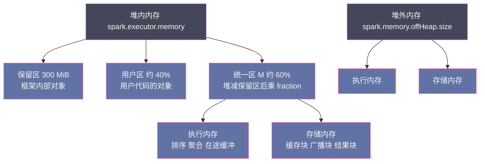
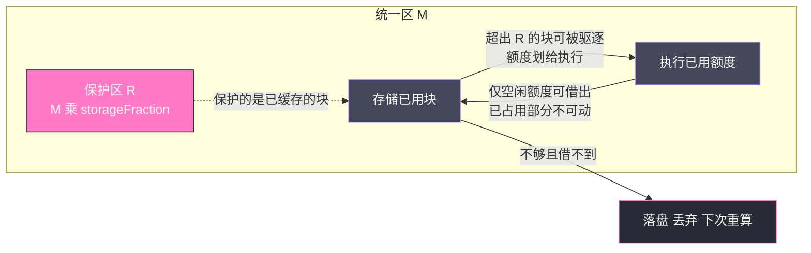
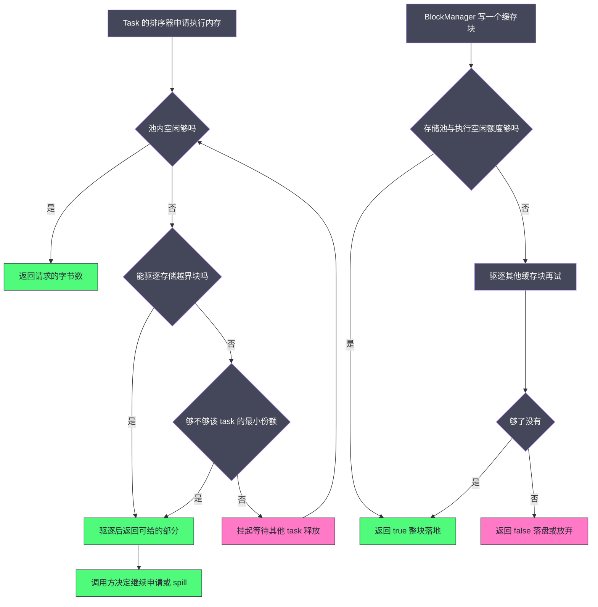
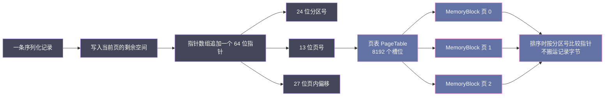
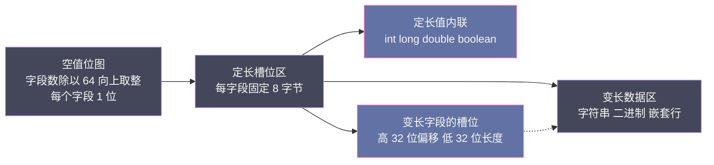

# 第9章 内存管理机制

> [!info] 本列的边界
> 本列按教材的顺序走"逻辑计划 → 物理计划 → Shuffle → 缓存 → 容错 → 内存"，本章给的是内存管理的骨架与账本；Execution 与 Storage 的现场判据在 [[大数据/Spark/Spark-Shuffle与内存管理机制深度解析/07 Execution 与 Storage 的动态边界|Execution 与 Storage 的动态边界]]，堆外内存的四类用途与排查路径在 [[大数据/Spark/Spark-Shuffle与内存管理机制深度解析/09 堆外内存与 Tungsten Unsafe 内存世界|堆外内存与 Tungsten]]，Spill 的触发与文件格式在 [[大数据/Spark/Spark-Shuffle与内存管理机制深度解析/08 Spill 机制：从内存到磁盘的安全阀|Spill 机制]]，涉及处只给一句结论并给出双链。

**摘要：**

本章讨论 Spark 在一个 Executor JVM 里如何分配与回收内存。Spark 把内存消耗分成三份——用户代码的中间对象、Shuffle 的排序与聚合缓冲、缓存的 RDD 分区，三者在同一个堆里争夺同一块空间，这是内存管理要解决的原始矛盾。从 1.6 起，静态划分（Storage 60%、Execution 20%、User 20% 的硬边界）被统一内存管理取代：堆扣掉 300 MiB 保留区后，按 `spark.memory.fraction`（默认 0.6）切出统一区，由 Execution 与 Storage 两个池子共享；`spark.memory.storageFraction`（默认 0.5）在统一区里划出保护区，执行侧可以驱逐存储侧越界的部分，反向则不行，这条不对称的规则解释了缓存为何会莫名消失。本章的路线是：消耗来源、分区模型、借还规则、MemoryManager 的两种返回语义、TaskMemoryManager 的页表、Tungsten 的二进制行格式、Shuffle 与缓存各自的账，最后落到诊断算式与三种配错现场。贯穿全章的是一个 8 GiB 的 Executor：它先缓存一张 3 GiB 的表，再做 join，两个消费者在同一块池子里抢。全章要回答两个问题：这块池子为什么必须由两个消费者共享，以及共享的规则为什么是不对称的。

---

## 9.1 一个池子，两个消费者

把计算搬进内存之后，内存就从"运行时自己会管好的东西"变成了需要显式分配的资源。Hadoop MapReduce 用一个 task 一个 JVM 的办法绕开了这个难题：每个 task 在自己的进程里独占一个堆，抢也抢不到别人头上，代价是进程启动与 JVM 预热的开销，以及 task 之间无法共享任何数据。Spark 走的是相反的方向，task 以线程形式住在同一个 Executor JVM 里，启动开销被摊薄，缓存可以跨 task、跨 job 复用，但整个堆也随之变成一块**公地**。

公地的问题不在于总量小，而在于没有天然边界。一个 Executor 里同时活跃的 task 数在 0 到 CPU 核数之间浮动，每个 task 什么时候申请内存、申请多少、拿到的内存活多久，由数据决定而不是由配置决定。配置能给的只是一个比例，运行时要解决的是比例之外的冲突。内存管理机制的本质，是把一块没有围墙的空地变成有规则的合用空间，而规则要同时满足三件事：不饿死任何一方、不让某一方把地占死、在任何一方都不够时给出一个可预期的退路。

Spark 面临的挑战可以归成三条。第一条是消耗来源多种多样，Shuffle 用类似 HashMap 的结构做聚合、用数组做排序，缓存在内存里囤 RDD 分区，用户代码在 `map()`、`flatMap()` 的闭包里自建集合，三类对象的生命周期、大小、可观测性都不同，很难用一套统一口径去管。第二条是消耗动态变化且难以预估，一次 Shuffle 的内存用量取决于数据量、分区数、聚合函数，用户代码的用量取决于闭包的空间复杂度，这些量在 task 启动前都算不出来。第三条是 task 之间共享内存，同一台机器上十个 task 同时申请执行内存，谁该多拿、谁该等、等多久，都是 MapReduce 不需要回答而 Spark 必须回答的问题。

后面所有机制都可以看成对这三条挑战的回应。为了讲得具体，笔者用一个 8 GiB 的 Executor 贯穿全章：这个 Executor 先缓存一张约 3 GiB 的 orders 表，随后用这张表与 items 做 join，join 的 Shuffle Write 与 Shuffle Read 分别需要数 GiB 的缓冲。缓存与 Shuffle 在同一台机器上抢的是同一个池子，缓存多了 Shuffle 就少，Shuffle 多了缓存就可能被赶走。同一份配置，在只做缓存的 job 上和在缓存加 Shuffle 的 job 上，表现会完全不同。

顺着这个场景，本章先看内存消耗从哪里来（9.2），再看 Spark 用什么模型把三者装进一块空间（9.3），然后拆开模型的三个部件：分配接口（9.4）、页表（9.5）与二进制行格式（9.6），接着回到 Shuffle 与缓存各自的账（9.7、9.8），最后给出诊断算式、三种常见的配错现场与反例（9.9、9.10）。

## 9.2 内存消耗的三个来源

讨论管理之前先要定义"消耗"的计量对象。在 Hadoop MapReduce 里，task 是进程，应用的内存消耗就是各 task 进程的内存消耗。在 Spark 里，task 是线程，所以微观上可以说"某个 task 线程消耗了多少内存"，宏观上则是"Executor JVM 消耗了多少内存"。由于一个 JVM 里同时跑多个 task，微观口径的消耗之和并不等于宏观口径，中间还夹着 JVM 自身、序列化缓冲、网络缓冲这些不属于任何 task 的部分。

教材把单个 task 的内存消耗分成三份：用户代码（User code）、框架执行（Shuffle Write/Read 的中间数据）与数据存储（cached RDD）。三份消耗在可控性上差别很大，表 9.1 把它们放在一起对比。

表 9.1 三类内存消耗来源的可控性对照

| 消耗来源 | 框架能否实时监控 | 能否在 task 启动前估算 | 不足时的处置 |
| :--- | :--- | :--- | :--- |
| 用户代码中间对象 | 只能看到堆的总体占用，看不到归属 | 不能，取决于闭包的空间复杂度 | 无处置，只能 OOM 或调大用户区 |
| Shuffle 中间数据 | 能，数据结构自己上报申请量 | 只能按数据量与分区数粗估 | 申请不到就 spill 到磁盘 |
| 缓存数据 | 能，按块计账 | 只能按输入数据量粗估 | 驱逐旧块、落盘或放弃缓存 |

### 9.2.1 用户代码

用户代码指用户写的数据操作与其中的函数，譬如 `map(func)`、`reduceByKey(func)`。它们的内存使用模式大致分两种。一种是读一条处理一条、不保留中间结果，譬如 `filter(record => record > 10)`，读入的 record 大于 10 就输出，否则丢弃，内存消耗可以忽略。另一种是在函数内部保留中间结果，下面这段 GroupByTest 的片段就属于后者，`flatMap()` 里新建了一个长度 1000 的数组来暂存计算结果，这个数组在函数返回前一直活着。

```scala
// 用户代码自己制造的内存消耗：数组随分区数放大
val pairs = data.flatMap { record =>
  val arr1 = new Array[(Int, Int)](1000) // 每个输入 record 都新建一个数组
  for (i <- 0 until 1000) {
    arr1(i) = (i, i * 2)
  }
  arr1
}
```

这段代码的消耗不好估，因为输入侧的信息框架拿得到——`map()` 读了多少条 record、`groupByKey()` 从 Shuffle Read 拉了多少条，这些都有计数——但"每条 record 会派生出多大的中间结果"由闭包的空间复杂度决定，框架看不见。更麻烦的是这类对象的生命周期由 GC 决定，不由 Spark 决定：一个在 `flatMap` 里创建的数组，函数返回后立刻变成垃圾，但它可能活到下一次年轻代回收才被清掉，这段滞留期里它仍然占着堆。

### 9.2.2 Shuffle 中间数据

Shuffle 是执行内存的主要消费者。Shuffle Write 端要按分区号给 record 分组，需要时还要用哈希表做 map 端聚合、用数组做排序；Shuffle Read 端要先缓冲拉回来的 record，再做聚合与排序。这两个阶段的中间数据结构都是"边写边长大"的，开始时只有几十 KB 的缓冲，数据一多就膨胀到几百 MB 甚至 GB 级。

消耗量取决于三件事：Shuffle 方式（是否需要 map 端聚合、是否需要按 Key 排序）、Shuffle 数据量、聚合函数的空间复杂度。`sortByKey()` 不需要聚合，消耗主要在排序数组上；`reduceByKey(func)` 需要聚合，消耗主要在哈希表上；如果 `func` 自己还持有大对象，聚合结果的体积会再上一层。这些量在 task 启动前同样估不出来，所以 Spark 的做法是边跑边量：数据结构自己记录已申请的内存，逼近限额时先扩容、再 spill。

### 9.2.3 缓存数据

缓存的动机是切断血缘。迭代型应用与多 job 应用会把反复使用的 RDD 留在内存里，下一轮直接从内存读，省掉重算。教材在迭代型应用那一章里给过例子：PageRank 缓存输入图，每轮迭代省下一次重算；机器学习应用缓存训练集，省掉反复读盘与解析。

缓存的内存消耗由 RDD 大小、存储级别、是否序列化决定，同样无法提前预知，只能写入时动态计量。缓存还有一层别的消耗来源没有的性质：它可以被替换、被驱逐、被丢弃。也就是说缓存占用的不是一笔固定账，而是一笔"最高水位"的账，任务进行中它会随驱逐而缩小。

把三份消耗放在同一个堆里，问题就从"谁用多少"变成了"谁先让"。用户代码不归框架管，框架只能给它留一块；Shuffle 与缓存都归框架管，才谈得上动态调配。这就是下一节模型设计的起点。

## 9.3 从静态划分到统一管理

### 9.3.1 静态内存管理：三个分区与硬边界

最直觉的做法是按来源切三块，每块负责一类消耗。Spark 1.6 之前的静态内存管理（`StaticMemoryManager`）就是这么做的：数据缓存空间约 60%，框架执行空间约 20%，用户代码空间约 20%，比例由 `spark.storage.memoryFraction` 与 `spark.shuffle.memoryFraction` 这类参数设定，运行期不再变动。

静态划分的优点是角色分明、实现简单，每一方都能算出自己的上限；缺点是这个上限同时也是死线。一个 `groupBy()` 或 `join()` 的 job，执行空间需要几个 GB，缓存空间几乎不用，但静态模型只给它 20%，多出来的需求只能靠 spill 消化，磁盘 I/O 一上去，作业就慢了；反过来，一个不缓存任何数据、闭包里却自建大数组的 job，用户代码空间同样被钉死在 20%，于是 `java.lang.OutOfMemoryError: Java heap space` 来得毫无道理——堆里明明还有一半是空的，只是不归你用。

有人会提议把比例调成适合自己作业的值，但内存用量在运行过程中是变的，一个 job 的两个 stage 对执行内存的需求可以差十倍，任何静态比例都只能对某一段有效。静态模型的根本问题在于它假设"需求是稳定的"，而 Spark 的负载恰恰不稳定。

### 9.3.2 统一内存管理：一块池子与两个比例

1.6 起，Spark 换成了统一内存管理（`UnifiedMemoryManager`），思路是把 Shuffle 与缓存这两个"框架自己管得住"的消费者放进同一个池子，让它们按需互相借还；用户代码那一块仍然单独留出，因为框架监控不到它的真实用量，动态调整没有依据。

如图 9.1 所示，Executor 的内存先扣掉一块**保留区**（Reserved Memory），剩下的按比例切成用户区与统一区，统一区再由**执行内存**（Execution Memory）与**存储内存**（Storage Memory）共享；堆外内存走另一套池子，但划分规则相同。



图 9.1 Spark 统一内存管理对 Executor 内存的划分

三个部分与两个参数的关系，可以用一句话说清：保留区先扣，剩下的乘 `spark.memory.fraction`（默认 0.6）得到统一区，统一区再按 `spark.memory.storageFraction`（默认 0.5）划出存储侧的保护区。

保留区固定 300 MiB，装的是 Spark 框架自己的对象，譬如 Executor 对象、`TaskMemoryManager` 对象、各种元数据容器。这个值在源码里是常量，测试配置 `spark.testing.reservedMemory` 可以改，生产环境没有理由动它。为什么保留区要单独扣：这些对象在 task 运行时一直被引用，把它们算进任何一方的额度里都不合适，索性先扣掉，让两个池子的账都从干净的地基上算起。

用户区默认拿到剩下的 40%，装用户代码创建的对象。官方文档在解释这个比例时补了一句：剩下的部分同时要容纳用户数据结构、框架内部元数据，以及稀疏或异常宽记录带来的估算误差，所以它不是纯粹留给用户的。它的比例是配置里唯一不能动态调的，原因是框架看不到闭包内部的对象图，估不出真实用量，给一个固定额度反而是最不容易出错的选择。用户区的额度不是硬保护——用户代码真要超，JVM 不会拦——所以它是"预留"而不是"隔离"，这一点后面讲 OOM 形态时会再回来。

统一区 M 的计算有一个细节容易记错：`spark.memory.fraction` 乘的是"堆减去保留区"，不是整个堆。常见说法"0.6 的堆给框架"是近似，8 GiB 的堆实际给出来的是 (8192 - 300) × 0.6 ≈ 4735 MiB，不是 4915 MiB。差的不多，但在算容器账的时候，几百 MiB 的误差足以解释一次莫名其妙的 spill。表 9.2 把四个部分的归属与默认值列在一起。

表 9.2 统一内存管理的四个部分

| 部分 | 大小 | 装什么 | 不足时 |
| :--- | :--- | :--- | :--- |
| 保留区 | 固定 300 MiB | 框架内部对象与元数据 | 无处置，属于框架自身开销 |
| 用户区 | (堆 - 300 MiB) × 0.4 | 用户闭包里的对象、算子临时对象 | 只能 OOM 或调大堆 |
| 执行内存 | 统一区 M 中的动态份额 | 排序数组、聚合表、在途缓冲、页 | spill 到磁盘，返回值可能小于请求 |
| 存储内存 | 统一区 M 中的动态份额 | 缓存分区、广播块、task 结果 | 驱逐旧块、落盘或放弃缓存 |

表 9.3 是同一个公式在几档常见堆大小上的展开，所有数字都是示例推算，实际以运行时 `MemoryManager` 打出的日志为准。

表 9.3 统一区的算例（单位 MiB，示例推算）

| `spark.executor.memory` | 堆 | 扣保留区后 | 统一区 M | 用户区 | 保护区 R |
| :---: | ---: | ---: | ---: | ---: | ---: |
| 4g | 4096 | 3796 | 2277 | 1518 | 1138 |
| 8g | 8192 | 7892 | 4735 | 3157 | 2367 |
| 16g | 16384 | 16084 | 9650 | 6434 | 4825 |
| 32g | 32768 | 32468 | 19481 | 12987 | 9740 |

**保护区** R 就是 `storageFraction` 划出来的那条线，取统一区的一半。它的名字容易让人误解为"存储侧保底的一半空间"，后面会看到，它保护的是"已经缓存在里面的块"，而不是"这块地皮属于存储"。

### 9.3.3 借还的两个方向

两个池子共享一块统一区，规则只有两条，但两条的方向并不对称。

第一条：执行内存不够时，可以向存储内存借，借的方式是先拿存储侧的空闲额度，再驱逐存储侧"超出保护区"的那部分块。驱逐调用的是 `MemoryStore.evictBlocksToFreeSpace`，它会挑不被本次请求保护的块，释放后把额度从存储池划到执行池。保护区 R 以内的块不在驱逐范围内。

第二条：存储内存不够时，只能吃执行侧的空闲额度，拿不到已被 task 占用的那部分。存储侧没有任何手段要求正在跑 task 交出内存，它拿不到就返回失败，由调用方决定落盘还是放弃缓存。

这两条规则的差别，用一句话概括就是：执行侧拿走的是使用权，存储侧借到的是随时会被赎回的临时额度。图 9.2 画的就是这两条箭头，注意其中只有一条是可以随时收回的。



图 9.2 执行内存与存储内存的借还方向

为什么不对称，理由不在于偏心，而在于两种内存的"状态"不同。执行内存里装的是正在被 task 使用的对象，一个排序数组可能刚写到一半，一个聚合表可能正被迭代，一个指针数组里存着指向页内偏移的地址；收回这类内存，必须让 task 先停在一个可以被回滚的位置，把数据 spill 到磁盘，再把指针改掉。这套流程需要 task 自己配合，而发起借用的那一侧（BlockManager 的写缓存线程）既不知道哪个 task 持有内存，也没有让 task 让路的协议，所以"强制收回执行内存"在实现上没有出口。

存储内存里的块则天然可丢。缓存块丢了，下次访问时按血缘重算或者从磁盘读回来，代价是有界的：一次重算最多等于当初算这个分区的开销，不会污染任何正在进行的计算。换句话说，驱逐缓存的代价可以提前计入模型，驱逐执行内存的代价无法预估——它可能让一个跑了四十分钟的 task 重来。两害相权，规则只能是**单向**的。

这里还藏着一个常见的误读：`storageFraction` 描述的是缓存的**免驱逐区**，而不是存储池的体积下限。当存储侧完全空闲时，执行侧可以直接把这块空闲额度划走，存储池的体积可以缩到 R 以下——因为没有块需要驱逐，划走额度并不会丢数据。所以这个参数既不是存储的上限（存储可以在执行空闲时吃满整个 M），也不是存储的下限（空闲额度随时可被划走），它只保证一件事：已经落进 R 以内的块不会被执行侧赶走。判断"缓存为什么消失"时，要看的是存储已用量有没有越过 R，而不是 `storageFraction` 配得够不够大。这条判据的现场用法，见 [[大数据/Spark/Spark-Shuffle与内存管理机制深度解析/07 Execution 与 Storage 的动态边界|动态边界]] 第 3 章。

### 9.3.4 一次波峰里的两区时序

把规则放进时间轴，才能看清"两区大小随负载动态变化"是什么意思。仍用 8 GiB 的 Executor，统一区 4735 MiB，保护区 2367 MiB。表 9.4 是四个时刻的账（示例推算，假设缓存与 Shuffle 各自贴着自己的需求走）。

表 9.4 一次负载波峰里的两区占用（单位 MiB，示例推算）

| 时刻 | 发生了什么 | 执行已用 | 存储已用 | 池内动作 |
| :--- | :--- | ---: | ---: | :--- |
| T0 | job 启动，缓存 orders | 0 | 4600 | 存储借用执行空闲额度，越界 2233 |
| T1 | join 的 Shuffle Write 起来 | 2368 | 2367 | 执行驱逐越界块，存储正好压回 R |
| T2 | Shuffle 高峰 | 2368 | 2367 | 执行拿不到更多，R 以内不可驱逐，转 spill |
| T3 | Shuffle 结束，task 释放 | 0 | 2367 | 额度空出，存储不会自动填回 4600 |

这张表解释了一件在生产上反复出现的事：缓存"莫名其妙消失"。T0 时用户看到 `Fraction Cached` 是 100%，存储吃了 4600 MiB；T1 执行内存一进来，越界的 2233 MiB 被连块带额度收走，缓存掉到 R 附近。用户第二天在 UI 上只看到"缓存少了一半"，看不到中间那一步，于是怀疑是不是缓存级别配错、是不是 BlockManager 淘汰策略有问题，实际上只是执行侧在同一时刻要了内存。

时序还说明第二件事：T2 阶段执行侧的上限不是 M，而是 M - R。保护区里的缓存不能动，执行峰值就被压在 2368 MiB 左右，超出的需求只能 spill。所以 `storageFraction` 调大，挨打的是执行侧；调小，挨打的是缓存命中率。它不改变池子总量，只改变两个消费者在冲突时的胜负。

把四个时刻连成一条线，占用水位是锯齿状的而不是平台状的，如图 9.3 所示。


图 9.3 一次负载波峰里两区占用的时序

## 9.4 MemoryManager 的两个 acquire

模型讲完，接着看它是怎么被调用的。所有申请最终都经过 `MemoryManager` 这层抽象，它有三个实现关注点：谁来申请、申请多少、申请不到怎么办。看懂这一层的接口语义，才能理解为什么"缓存要么整块进、要么干脆不进"，而"排序缓冲可以只要一半"。

### 9.4.1 接口全貌

`MemoryManager` 是抽象类，堆内存与堆外内存各有一套池子，方法都带一个 `MemoryMode` 参数区分走哪套。核心方法只有四组，签名如下。

```scala
// 执行内存：要一段，可能只给一部分；必要时阻塞
def acquireExecutionMemory(numBytes: Long, taskAttemptId: Long, memoryMode: MemoryMode): Long
// 存储内存：要么整块给，要么不给；返回值就是结论
def acquireStorageMemory(blockId: BlockId, numBytes: Long, memoryMode: MemoryMode): Boolean
// 展开分区时按块追加，语义与存储一致
def acquireUnrollMemory(blockId: BlockId, numBytes: Long, memoryMode: MemoryMode): Boolean
// 归还：执行侧按 task 归还，存储侧按字节归还
def releaseExecutionMemory(numBytes: Long, taskAttemptId: Long, memoryMode: MemoryMode): Unit
def releaseStorageMemory(numBytes: Long, memoryMode: MemoryMode): Unit
```

表 9.5 把方法、返回值与调用方列在一起，重点在第三列——返回值的形状本身就是设计决定。

表 9.5 MemoryManager 的方法与返回语义

| 方法 | 返回 | 语义 | 典型调用方 |
| :--- | :--- | :--- | :--- |
| `acquireExecutionMemory` | `Long`，实际拿到的字节数 | 可能小于请求，可能为 0，必要时挂起等待 | 排序器、聚合表、Shuffle 在途缓冲 |
| `acquireStorageMemory` | `Boolean` | 全给或不给，不给时不占用任何字节 | BlockManager 写缓存块 |
| `acquireUnrollMemory` | `Boolean` | 展开分区时按批追加，每批一次判断 | 缓存展开流程 |
| `releaseExecutionMemory` | 无 | 把字节数还给对应 task 的额度 | task 结束或数据结构收缩 |
| `releaseStorageMemory` | 无 | 把字节数还给存储池 | 块被驱逐或被移除 |
| `releaseAllExecutionMemoryForTask` | `Long` | task 结束时一次性回收该 task 全部额度 | TaskRunner |

### 9.4.2 一个返回字节数，一个返回布尔

两种返回语义对应两种数据结构形态。执行内存的消费者是**流式**的：排序器一页一页地要，聚合表一次扩容要一倍，Shuffle Read 的在途缓冲按块累积。它们都能在"只拿到一部分"的情况下继续工作——少拿一点就少缓存几页、多 spill 几次，逻辑不会错。所以接口给的是一个数值，调用方拿这个数值去决定下一步是继续申请还是触发 spill，循环往复。

存储内存的消费者是**整块**的：一个缓存块要么完整放进内存，要么整体落盘，不存在"半个块在内存里"的状态。所以接口给的是一个布尔值，`false` 就是全部失败的信号，调用方据此把块写到磁盘或直接放弃缓存，不需要处理中间态。这个语义差别不是风格问题，如果存储侧也返回"部分成功"，BlockManager 就必须处理半块数据的分裂与回收，复杂度会扩散到整个缓存路径。

两种语义背后还有一层调度差别。执行侧的申请可能阻塞：当池子里没有足够空闲，而又不足以让本次申请拿到一个最小份额时，线程会挂起等待其他 task 释放（等待期间不占 CPU）。这条规则的作用是防止某个大 task 一次性吃掉整个池子——把活跃 task 数记为 N，每个 task 能拿到的上限约为池子的 1/N，而"这次申请值不值得放行"的下限是池子的 1/(2N)；拿不到下限就等，等到了再继续。副作用是当并发 task 很多时，单个 task 的缓冲长得慢，spill 次数反而变多。

存储侧不阻塞，它只有三个动作：吃空闲、驱逐自己的旧块、失败返回。失败返回是安全的，因为缓存本来就是"加速器"，不加也能跑。把两个接口合起来看，一次申请在运行时只有三种结局：全额满足、部分满足（只可能出现在执行侧）、拒绝（存储侧返回 false，执行侧则以挂起的形式表现）；三种结局对应三条完全不同的后续动作，这也是为什么调用方必须按接口约定编码，而不能假设"申请多少就有多少"。图 9.4 把两条路径画在一起，可以看到执行侧有一条"等待"回路，存储侧没有。



图 9.4 两个 acquire 的返回路径与等待回路

### 9.4.3 useLegacyMode：回到静态划分

统一内存管理之外，Spark 保留了 `spark.memory.useLegacyMode`（默认 false）这个开关，打开它会退回 `StaticMemoryManager`，用 `spark.storage.memoryFraction`（默认 0.6）与 `spark.shuffle.memoryFraction`（默认 0.2）做固定划分，两个池子之间不再借还。

什么时候该开它？判据几乎只有一种：需要复现早期版本的行为来做对照实验。生产上没有理由打开，因为静态划分的所有缺点都在，而它存在的唯一价值是"可预测"——某些极端定制化的场景确实希望一块内存永远不被别人动，用固定划分能换来确定性，代价是把另一侧的浪费制度化。

这个开关在 Spark 4.x 的官方配置文档里已经查不到，4.x 的运行时仍然保留着兼容代码，但新应用不该依赖它。查不到这件事本身就是信号：统一内存管理已经是唯一的默认路径，所有调优经验都建立在它之上。

## 9.5 TaskMemoryManager 与页表

统一区解决了"两个消费者怎么分"的问题，接下来要解决"分到手的字节怎么用"。Spark 在这中间加了一层：`TaskMemoryManager`。每个 task 在启动时创建一个自己的实例，这个实例替 task 统一申请、记账、释放，task 内部的所有内存消费者（排序器、聚合表、哈希表）都通过它要空间，而不是直接碰 `MemoryManager`。

### 9.5.1 每个 Task 一本账

多这一层的原因是隔离与回收。`MemoryManager` 只知道"某个 taskAttemptId 申请了多少字节"，不知道这些字节被谁用、还用不用得着；`TaskMemoryManager` 知道，因为它给每次分配发了凭证。凭证是一个 `MemoryBlock`，里面记着页号、页内偏移与长度，task 结束时 `TaskRunner` 调用一次 `releaseAllExecutionMemoryForTask`，所有凭证一次性作废，额度全部归还。这套机制让"task 失败后内存不泄漏"变成默认行为，不需要每个消费者自己写 `finally`。

`TaskMemoryManager` 还有另一个职责：把逻辑地址翻译成物理地址。上层数据结构拿到的不是裸指针，而是页号加偏移；要读数据时通过页号查表拿到 `MemoryBlock`，再加上偏移。这层间接性是分页能工作的前提，也是 Tungsten 能在堆内与堆外之间切换实现的原因——同一套逻辑地址，换一个分配器就换了物理位置。

### 9.5.2 页表：把不连续翻译成连续

**页表**（`PageTable`）是一个按页号索引的数组，容量由页号的位宽决定，能登记 8192 页。每次 `allocatePage` 申请一整页，分配器返回一个 `MemoryBlock`，页表在空闲槽位登记它的页号，上层拿到的是一个逻辑页号。释放时按页号反查，把 `MemoryBlock` 还给分配器。

页号与偏移的**位宽**是设计出来的，不是随手取的：页号 13 位、偏移 27 位，两者拼进一个 64 位长整型，则单页可寻址 128 MiB，一个 task 的页表覆盖 8192 × 128 MiB 共 1 TiB 的逻辑空间。这个位宽同时约束了上层：单条记录必须落在单页之内，所以序列化后的单条记录有 128 MiB 的上限，超过就只能退回按对象排序的路径。Serialized Shuffle 能把分区号也塞进同一个 64 位指针——24 位分区号、13 位页号、27 位偏移——靠的就是三条位宽互不重叠。

一个分区动辄几 GB，页只有几 MB，怎么装？答案是不装：分区从不整块分配，记录一条条流进来，当前页写满了就再申请一页，指针数组里记下每条记录的三元组（分区号、页号、页内偏移），排序时排的是指针而不是记录本身。图 9.5 是这个结构的示意，它同时也是 Serialized Shuffle 写端的核心机制。



图 9.5 页表、指针数组与大分区拆页

这样设计换来三件事。第一，内存不需要连续，页可以是任意位置，碎片也能用上；第二，排序只动指针，比较的是 8 字节的指针而不是整条记录，缓存友好；第三，spill 时把页按分区号整理后整页写出，不需要先拼成一个大数组。代价是每读一条记录都要做一次页表查表与指针解引用，访问局部性比连续数组差，这也是 Tungsten 的读写路径要用 `Unsafe` 直接算地址、绕开对象访问的原因。

### 9.5.3 页从哪来：分配器与页大小

页本身由 `MemoryAllocator` 分配，Spark 有两个实现。`HeapMemoryAllocator` 在堆上申请 `long[]`，把数组对象和偏移包进 `MemoryBlock`；`UnsafeMemoryAllocator` 用 `Unsafe.allocateMemory` 直接向操作系统要内存，`MemoryBlock` 里的对象引用为空，访问走绝对地址。同一个 `MemoryBlock` 抽象同时表达两种位置，区别只在对象引用是否为空——这是 Tungsten 能"堆内堆外一套代码"的关键。

页大小不是固定的。`spark.buffer.pageSize` 没有设置时，运行时会按池容量与核数推算一个值：池容量除以核数，再除以一个安全系数，向上取到 2 的幂，夹在 1 MiB 到 64 MiB 之间。按安全系数取 16 来示例推算，8 GiB 堆、8 核的 Executor 算出来 37 MiB 左右，向上归整后直接撞上 64 MiB 的上限；换成一个只开 2 GiB 堆外池、8 核的执行器，页就只有 16 MiB；池子更小或核数更多时还会一路退到 4 MiB、2 MiB，最后停在下限 1 MiB。这解释了一件反直觉的事：同一份堆配置换到核数更多的机器上，页会变小、页数变多，页表与元数据开销随之上升，扩执行器规格时页大小是被顺带改掉的那个量。这个值决定分配的粒度，也间接决定 spill 的频率：页越大，一次申请占用越多，尾隙浪费越大；页越小，页表项与元数据越多，跨页的记录也越多。表 9.6 把与页相关的量列在一起，代价列是重点。

表 9.6 页与页表相关的量与代价

| 项 | 取值 | 决定什么 | 调大的代价 | 调小的代价 |
| :--- | :--- | :--- | :--- | :--- |
| 页大小 | 未设时按池容量与核数推算，1 到 64 MiB | 单次分配粒度、尾隙比例 | 小数据结构整页占着，利用率下降 | 页数变多，页表与元数据开销上升 |
| `spark.buffer.pageSize` | 未设置 | 显式覆盖页大小 | 与分析占用不匹配时浪费加剧 | 同上 |
| 页表容量 | 8192 页，位宽写死 | 一个 task 最多同时持有的页数 | 不可调，属于格式约束 | 不可调 |
| `spark.memory.offHeap.size` | 0 | 堆外池大小，页从这里分配 | 必须同步加 `memoryOverhead`，否则容器被杀 | 堆外收益消失 |

堆外内存的账要单独算。它的好处是绕开 GC：堆外的页不参与垃圾回收扫描，对象头与引用指针都不存在，记录以纯字节形态存放，回收靠显式释放而不是 GC。它的代价有三条。第一条是不受 GC 管但受操作系统管，堆外泄漏表现为进程 RSS 上涨，OOM 时拿不到堆转储，只剩一个被内核杀掉的进程。第二条是分配与释放的逐次成本高于堆内，小对象高频分配的场合可能倒亏。第三条最容易被忽略：`spark.memory.offHeap.size` 不计入 `spark.executor.memory`，它要占容器的额外内存，必须由 `memoryOverhead` 覆盖，否则容器一定被杀。

## 9.6 Tungsten：把对象换成字节

内存管理的最后一块拼图在数据形态上。前面所有机制假设"数据是 Java 对象"，而 Java 对象的开销恰恰是内存效率的大头：每个对象一个头，每个字段一个引用，字段间还要对齐填充。Tungsten 项目的三件事——二进制行格式、`Unsafe` 操作、表达式代码生成——都是在削这笔开销。代码生成在物理执行计划那一章已经展开，这里只讲它与内存的关系，重点放在 `UnsafeRow` 的布局与省下来的空间。

### 9.6.1 UnsafeRow 的二进制布局

`UnsafeRow` 把一行数据压成一段连续字节，分三段：空值位图、定长槽位、变长数据区。位图按字段数向上取整到 8 字节的整数倍，每个字段一位，置位表示 null；定长槽位每个字段固定 8 字节；变长数据排在最后，槽位里存的是"偏移与长度"打包成的 8 字节。三段的排列如图 9.6 所示。

定长值（int、long、double、boolean）直接内联在自己的槽位里，用不满 8 字节就补零；变长值（字符串、二进制、decimal、嵌套行、数组、map）不在槽位里，槽位存的是高 32 位偏移、低 32 位长度，偏移是相对这段字节区起点的相对地址。所以读一个字符串字段要先读槽位、再算地址、再按长度取字节，比读一个对象字段多一次算术，但少了两次指针跳转。



图 9.6 UnsafeRow 的空值位图、槽位与变长数据区

这个布局有一个直接后果：行内的字段是定长的 8 字节槽位，行与行之间可以按固定长度切分，排序、哈希、比较都能直接对字节做。比较两个 `UnsafeRow` 的某个键，比的是两段字节的字典序，不需要解引用对象、不需要调用 `compareTo`、不需要装箱。这也是 Tungsten 排序快的原因，但它的前提是所有字段都编码进这套格式，任何跨到对象世界的转换都要付一次序列化或拷贝。

### 9.6.2 省下来的空间从哪来

把 `UnsafeRow` 与等价的 Java 对象放在一起，省下来的空间可以逐项拆开，表 9.7 是这份分解。

表 9.7 UnsafeRow 与 Java 对象的内存分解

| 组成项 | Java 对象 | UnsafeRow |
| :--- | :--- | :--- |
| 对象头 | 每个对象 12 到 16 字节 | 无，整行共用一段字节区 |
| 字段引用 | 每个引用 4 或 8 字节 | 无，值直接内联进槽位 |
| 基本类型装箱 | 包装类各带一个对象头 | 定长值直接写进 8 字节槽位 |
| 对齐填充 | 按 8 字节补齐，字段顺序影响浪费 | 只在变长区尾部补齐 |
| 字符串 | String 对象加字符数组，两份头 | 字节直接进变长区 |
| 空值表达 | null 引用，仍占一个引用位 | 位图 1 位 |
| 容器 | HashMap 的桶数组与节点对象 | 哈希表本身也是页结构，无节点对象 |

省下来的比例随行宽变化。窄行省得多，因为对象头的开销在总量里占比高；宽行省得少，因为变长数据本身就占了大头。表 9.8 用一个最常见的三字段行做示例推算，JVM 按 64 位、开启压缩指针计算，字符串内容是 5 字节。

表 9.8 一行三字段的两种表示（单位字节，示例推算）

| 组成部分 | Java 对象 | UnsafeRow |
| :--- | ---: | ---: |
| 空值位图 | 0 | 8 |
| 对象头 | 16 | 0 |
| long 字段 | 8 | 8 |
| 字符串引用与槽位 | 4 | 8 |
| double 字段 | 8 | 8 |
| 对齐填充 | 到 8 的倍数 | 0 |
| 字符串内容 | String 头 24 加字符数组头 16 加 10 | 5 |
| 合计 | 约 88 | 约 37 |

约 **2.4 倍**的差距，落在一亿行的规模上就是几个 GB 的内存差。不过这只是示例推算，换一个字段更多、字符串更长的行，比例会完全不同；反过来，一行里只有一个 `int` 的场景，`UnsafeRow` 的位图与槽位开销让它几乎没有优势。判断该不该用二进制行，先看行宽与字段类型分布，再看算子是不是 SQL 引擎内部的。

### 9.6.3 codegen 与内存的关系

表达式代码生成与内存的关系只有一句话：它省的是**临时对象**，不是行本身。把 `filter`、`project` 这类表达式编译成一段 Java 源码再运行，中间值可以直接用局部变量与原始类型，不必为每个中间结果创建一个包装对象，也不必走虚函数调用；整个算子链融合成一个 `WholeStageCodegen` 之后，行也不再需要一次次物化成 `InternalRow` 再传下去。省掉的这部分内存是"过程性"的，体现在 GC 压力与分配速率上，不体现在缓存的体积上。行本身的体积由 `UnsafeRow` 的布局决定，两者是两笔账。代码生成的机制见第 4 章与 [[大数据/大数据处理框架Apache Spark设计与实现/4.0 第4章 Spark物理执行计划|物理执行计划]]，这里不做展开。

## 9.7 执行内存：Shuffle 的四个写端与三个读端

回到统一区里的第一个消费者。执行内存的消耗集中在 Shuffle，而 Shuffle 的内存用量取决于它选了哪种写法和哪种读法。[[大数据/大数据处理框架Apache Spark设计与实现/6.0 第6章 Shuffle机制|第 6 章 Shuffle 机制]]按"是否需要 map 端聚合、是否需要按 Key 排序、分区数多少"把 Shuffle Write 分成四种，表 9.9 是这四种方式各自的内存结构。

表 9.9 四种 Shuffle Write 方式与内存结构

| 写法 | map 端聚合 | 排序 | 分区数 | 内存结构 | 序列化 |
| :--- | :---: | :---: | :---: | :--- | :--- |
| `BypassMergeSortShuffleWriter` | 否 | 否 | 不超过 200 | 每分区一个写出缓冲 | 否 |
| `UnsafeShuffleWriter` | 否 | 否 | 大于 200 | 分页数组加指针数组 | 是 |
| `SortShuffleWriter`（键有序） | 否 | 是 | 不限 | 分区数组 | 否 |
| `SortShuffleWriter`（map 端聚合） | 是 | 可选 | 不限 | 哈希表 | 否 |

第一种写法是缓冲式的。map 端输出按分区号进不同缓冲，缓冲填满就溢写到对应的分区文件，缓冲大小由 `spark.shuffle.file.buffer`（默认 32 KiB）决定。它的内存消耗是 `32 KiB × 分区数`，看起来很小，但这是每个 task 的量，乘上并发 task 数就不可忽略，200 个分区、16 个并发 task 就是 100 MiB 起步。适用上限由 `spark.shuffle.sort.bypassMergeThreshold`（默认 200）控制，超过这个分区数就换写法。

第二种是 Tungsten 的序列化路径，也是 9.5 节页表机制的主场。记录序列化后写进页，指针数组记三元组，排序时按分区号比较指针，页写满或指针数组满就再申请，申请不到就 spill。它的内存消耗由页数乘页大小、指针数组、排序临时空间三部分构成，总量被单个 task 的限额压住。使用它有四个前提：不需要 map 端聚合、不需要按 Key 排序、序列化器支持序列化值的重定位、分区数小于 2 的 24 次方且单条记录小于 128 MiB。之所以能省内存，是因为记录以字节形态存放，没有对象头；之所以有上限，是因为 24 位分区号与 27 位偏移就是位宽能表达的极限。

第三种与第四种走对象路径。键有序的写法用分区数组暂存 `(分区号, 键, 值)` 三元组，排完序后写一个文件加分区索引；map 端聚合的写法用哈希表，键是分区号加 Key，值是聚合结果，聚合表能扩容但如果还放不下就排序后 spill。这两条路径的内存消耗都是实打实的 Java 对象，且只能用堆内内存，对象头与引用让同样的数据占更多空间，GC 压力也更大。

Shuffle Read 侧同理，按是否需要聚合、是否需要排序分三种，表 9.10 是它们的对照。

表 9.10 三种 Shuffle Read 方式与内存结构

| 方式 | 聚合 | 排序 | 典型算子 | 内存结构 |
| :--- | :---: | :---: | :--- | :--- |
| 直通 | 否 | 否 | `partitionBy()` | 固定大小的拉取缓冲 |
| 排序 | 否 | 是 | `sortByKey()` | 分区数组 |
| 聚合 | 是 | 可选 | `reduceByKey()` | 外部聚合表 |

直通方式的内存消耗最简单，每个 reduce task 只有一个拉取缓冲，大小由 `spark.reducer.maxSizeInFlight`（默认 48 MiB）决定，它限制的是同时在途的字节数，不是总量。排序方式用一个分区数组接收拉回来的 record，按 Key 排完再输出；聚合方式用外部聚合表，键不同的记录进表，键相同的直接合并。后两种都可以扩容，也都可以 spill，最终与磁盘上的部分做归并。

多个 task 共享执行内存，调度规则就是 9.4.2 讲的那套：每个活跃 task 的上限约为池子除以活跃 task 数，争抢激烈时申请会挂起等待。这条规则对 Shuffle 的影响很具体：并发 task 越多，单个 task 能拿到的页越少，越早触发 spill。表面上把并发调高能提升 CPU 利用率，实际上可能把作业从"内存里排序"推成"磁盘上归并"。这也是执行内存的调优很少能靠单一参数解决的原因——它同时受池子大小、并发数、单 task 数据量三个变量影响挪动。

## 9.8 存储内存：缓存、广播与结果

统一区里的另一个消费者。存储内存装三类数据：RDD 缓存分区、广播变量、task 的计算结果，另外还有一些临时空间，譬如把迭代器展开成数组的展开缓冲、Netty 传输用的直接缓冲。

与执行内存不同，存储内存没有"每个 task 限额"的概念。缓存块是全局共享的，哪个 task 先写进来就归哪个块，块的大小由分区大小决定，没有按 task 均分的规则。它不足时的处置也不是 spill，而是驱逐旧块、落盘或直接放弃。表 9.11 是常见的存储级别。

表 9.11 常见存储级别与内存形态

| 存储级别 | 位置 | 序列化 | 副本 | 内存不足时 |
| :--- | :--- | :---: | :---: | :--- |
| `MEMORY_ONLY` | 堆内 | 否 | 1 | 分区直接丢弃，下次重算 |
| `MEMORY_AND_DISK` | 堆内加磁盘 | 否 | 1 | 换到磁盘 |
| `MEMORY_ONLY_SER` | 堆内 | 是 | 1 | 分区丢弃 |
| `MEMORY_AND_DISK_SER` | 堆内加磁盘 | 是 | 1 | 换到磁盘 |
| `OFF_HEAP` | 堆外 | 是 | 1 | 分区丢弃或换出 |

`MEMORY_ONLY` 系列的实现是往 `memoryStore` 里写一个条目，键是 `(rddId, partitionId)`，值是一个持有 record 引用的容器，记录以普通 Java 对象形态存放。`MEMORY_ONLY_SER` 系列把记录序列化后放进不连续的字节块容器（`ChunkedByteBuffer`），用不连续空间的原因是序列化后的分区可能几 GB，堆里未必找得到一整块连续空间。`OFF_HEAP` 走堆外池，形态与序列化版本一样，只是位置在堆外。

`memoryStore` 内部用一个双向链表挂住所有缓存块，链表顺序就是访问顺序，驱逐时从最久没有被访问的那一头开始，这条规则在 [[大数据/大数据处理框架Apache Spark设计与实现/7.0 第7章 数据缓存机制|第 7 章]] 里已经讲过，这里只关心它对内存账的影响。非序列化条目的载体是 `DeserializedMemoryEntry`，里面按分区内记录的顺序存着这批记录的引用，一个条目就对应一个分区的全部记录；序列化条目的载体是 `SerializedMemoryEntry`，内容是一段字节，长度就是记录序列化后的总大小。两者的差别不只是省不省空间：前者占多少内存要看对象图，后者可以精确到字节，所以后者的容量判断更准，代价是每次读都要反序列化。

广播数据走 `TorrentBroadcast`。Driver 端把要广播的值切成 `spark.broadcast.blockSize` 大小的块，每块给一个 `BroadcastBlockId(id, "piece" + i)`，Executor 按块拉取后放进存储内存的 `ChunkedByteBuffer`，缓存级别是 `MEMORY_AND_DISK_SER`，块丢了就按 blockId 回去补拉，所以广播块的内存占用是序列化后的总大小，而这批块是被所有 task 共享的，不做按 task 均分。

这三类数据里，缓存最容易被执行内存挤掉，广播与结果的处置路径不同。广播块是 `MEMORY_AND_DISK_SER`，内存不足时落盘，块本身按 `spark.broadcast.blockSize`（默认 4 MiB）切块分发，所以它的内存占用是序列化后的总大小。task 结果只在 `collect()` 这类把结果收回 Driver 的场景出现，结果超过 `spark.task.maxDirectResultSize`（内部配置，默认 1 MiB）时先写进 BlockManager 再转发，总量受 `spark.driver.maxResultSize`（默认 1g）约束，单个结果过大时先撑爆的是 Executor 的存储内存。

缓存写进来还有一步"展开"：分区在写入前要以记录为单位展开，展开过程需要额外内存，为避免一次申请过大，存储侧按 `spark.storage.unrollMemoryThreshold`（默认 1 MiB）起步，边展开边追加申请，追加失败就把已展开的部分落盘或放弃。所以缓存一个分区时，瞬时占用可能超过分区本身的体积，这一点在分区远大于可用存储空间时会表现为"缓存一直失败但内存看起来没满"。

缓存与执行内存的交互在 9.3 已经讲过，这里只补一句结论：缓存能不能留住，取决于它有没有越过保护区 R，以及同一时刻执行侧有没有需求。调大 `storageFraction` 让缓存活得更久，代价是执行侧的峰值被压低、spill 更多；调小则相反。缓存失效、驱逐与替换的完整机制见 [[大数据/大数据处理框架Apache Spark设计与实现/7.0 第7章 数据缓存机制|第 7 章 数据缓存机制]]，作业级的判定见 [[大数据/Spark/Spark-Shuffle与内存管理机制深度解析/07 Execution 与 Storage 的动态边界|动态边界]] 第 4 章。

## 9.9 诊断：三个算式与三种死法

前面讲的是机制，这一节讲怎么把它用在现场。内存问题的诊断之所以难，是因为同一个症状可能来自三个完全不同的层：池子里的比例不对、容器账没算平、对象的形态不经济。三层各有各的算式。

### 9.9.1 池子有多少

第一个算式回答"框架到底能用到多少堆"。从 `spark.executor.memory` 出发，先减 300 MiB 保留区，再乘 `spark.memory.fraction`，得到的就是统一区；用户区是剩下的部分。以 16 GiB 的 Executor 为例，(16384 - 300) × 0.6 ≈ 9650 MiB，约 9.4 GiB，占堆的 59%；用户区约 6.3 GiB，占 38%。两个数加起来不到 100%，差额就是保留区。

这个算式最常见的误用是把 `spark.executor.memory` 当成可用堆。16 GiB 的 Executor 里，框架能动态分配的只有 9.4 GiB，用户代码另有 6.3 GiB 的额度但框架管不住它，剩下 300 MiB 是框架自身开销。当用户说"我给了 16 GiB 为什么还 OOM"，答案往往在用户区：闭包里的对象吃掉了 6.3 GiB 还不够，于是向统一区借，最终表现成执行或缓存的问题。

### 9.9.2 容器账有没有算平

第二个算式回答"这台机器到底要申请多少内存"。容器里装的不只是堆，还有堆外池、JVM 自身（元空间、代码缓存、线程栈）、Netty 直接缓冲、原生库。YARN 与 Kubernetes 上，容器大小的算法是 `spark.executor.memory` 加上 `spark.executor.memoryOverhead`。overhead 的默认值在 3.x 里写作 `max(384 MiB, 0.1 × spark.executor.memory)`；4.0 把它拆成两个配置，`spark.executor.memoryOverheadFactor`（默认 0.10）决定比例，`spark.executor.minMemoryOverhead`（默认 384 MiB）决定下限，最终取两者中较大的一个。这个值只在 YARN 与 Kubernetes 上生效，local 模式没有容器账。

关键的一点是堆外池不在这条算式里自动出现。`spark.memory.offHeap.size` 设成 4g，容器就得在堆加 overhead 之外再加 4g，因为那 4g 是向操作系统要的本地内存，YARN 记在 physical memory 上，Kubernetes 记在容器的 RSS 上。表 9.12 是几组配置的容器账，全部为示例推算。

表 9.12 不同配置下的容器账（单位 MiB，示例推算）

| 配置组合 | 堆 | overhead | 堆外池 | 容器应申请 | 只按堆加 overhead 会怎样 |
| :--- | ---: | ---: | ---: | ---: | :--- |
| 8g，不开堆外 | 8192 | 819 | 0 | 9011 | 正确 |
| 8g，堆外 2g | 8192 | 819 | 2048 | 11059 | 差 2048，容器被 kill |
| 16g，不开堆外 | 16384 | 1638 | 0 | 18022 | 正确 |
| 16g，堆外 4g | 16384 | 1638 | 4096 | 22118 | 差 4096，容器被 kill |

第二行与第四行是生产上最常见的死法：配置里只写了 `spark.executor.memory` 与 `spark.memory.offHeap.size`，容器大小却按"堆加默认 overhead"申请，进程一跑起来 RSS 就超限。YARN 的做法是发一条 `Container killed by YARN for exceeding memory limits`，Kubernetes 的做法是 OOMKilled、退出码 137，两种情况下日志里都没有 `OutOfMemoryError`，因为进程不是被 JVM 杀的。

### 9.9.3 死法有三种

第三个算式其实不是算式，是**分诊**。内存不足的表现形态有三种，判别依据在日志与退出码里，表 9.13 是这份对照。

表 9.13 三种内存死法的判别

| 形态 | 典型信息 | 谁杀的 | 现场证据 | 主要方向 |
| :--- | :--- | :--- | :--- | :--- |
| 堆内耗尽 | `java.lang.OutOfMemoryError: Java heap space` | JVM | 堆转储、GC 日志显示回收后仍高位 | 用户区或缓存体积 |
| GC 徒劳 | `java.lang.OutOfMemoryError: GC overhead limit exceeded` | JVM | GC 时间占比极高、回收收益极低 | 分配速率与对象形态 |
| 容器超限 | `Container killed by YARN`、OOMKilled、退出码 137 | YARN 或内核 | 无堆转储、RSS 高于限额 | 堆外与 overhead 的计算 |

三种死法的处置方向完全不同，判别错了会做无用功。堆内耗尽说明对象确实太多，要么调大堆，要么少缓存、少在闭包里造对象；GC 徒劳说明不是空间不够而是分配太快，JVM 花了 98% 的时间回收却只回收出不到 2% 的空间，处置方向在分配速率与对象形态（序列化、二进制行、减少中间集合），单纯加堆往往只是把崩溃推迟；容器超限说明死在堆外，堆的大小与它无关，要去核 overhead 与堆外池的账。

还有一种介于其间的情形：堆外模式下越界时，Spark 抛出的是自己的 `SparkOutOfMemoryError`，消息里带执行内存与页的信息，与 JVM 的 `java.lang.OutOfMemoryError` 是两条路径。看到它不必去找堆转储，因为出问题的不是堆。堆外这一路的排查路径见 [[大数据/Spark/Spark-Shuffle与内存管理机制深度解析/09 堆外内存与 Tungsten Unsafe 内存世界|堆外内存与 Tungsten]] 第 6 章。

### 9.9.4 参数与代价

把与内存相关的参数收在一张表里，重点仍在两个代价列：每个参数调大调小都有对应的一方在挨打，没有单向的优化。表 9.14 是这份清单。

表 9.14 内存相关参数与代价

| 参数 | 默认 | 决定什么 | 调大的代价 | 调小的代价 |
| :--- | :--- | :--- | :--- | :--- |
| `spark.memory.fraction` | 0.6 | 统一区占堆的比例 | 用户区被压缩，闭包对象与框架元数据更早 OOM | 统一区变小，缓存与执行同时更早落盘 |
| `spark.memory.storageFraction` | 0.5 | 保护区 R 的大小 | 执行峰值被压低，Shuffle 更早 spill | 缓存更容易被赶走，命中率下降 |
| `spark.executor.memory` | 1g | 堆总量，池子的分母 | 单实例 GC 停顿变长，节点可放实例变少 | 池子变小，同一份缓存放不下 |
| `spark.memory.offHeap.size` | 0 | 堆外池大小 | 容器账要同步加，否则被杀 | 堆外收益消失，仍回堆内互抢 |
| `spark.executor.memoryOverhead` | 按比例与下限取大 | 容器里堆以外的部分 | 容器申请变大，资源利用率下降 | 容器被杀，且日志无 OOM |
| `spark.memory.useLegacyMode` | false | 是否退回静态划分 | 恢复硬边界，两侧浪费制度化 | 无代价，本就该关 |

## 9.10 三种配错现场与反例

机制与算式都有了，最后看三个真实形状的错误。三个现场的共同点是参数都"调对了方向"，只是彼此的账没有对齐。

第一种现场是开了堆外却没加 overhead。配置里写着 `spark.memory.offHeap.enabled=true`、`spark.memory.offHeap.size=4g`，`spark.executor.memory=16g`，容器按 16g 加一个默认 overhead 申请。任务跑起来内存曲线很健康，堆内一直用不满，然后进程在某次 Shuffle 高峰被内核杀掉，退出码 137，日志停在最后一行。判据很直接：堆没有 OOM、GC 日志正常、进程非正常退出，就说明死的不是堆。这类错误的处置不是调 JVM 参数，是把容器申请改成堆加 overhead 加堆外池，或者把堆外池缩到 overhead 能覆盖的范围里。

第二种现场是把 `spark.memory.fraction` 调到 0.8。调的人的逻辑是"框架多用点内存，Shuffle 就不会 spill"，前半句成立，后半句只在 Shuffle 是瓶颈时成立。统一区从 60% 涨到 80%，用户区从 40% 掉到 20%，而 20% 要装的不只是用户闭包的对象，还有框架自己的元数据、序列化缓冲、以及每次 `collect()` 收上来的中间结果。症状是 Shuffle 的 spill 少了，但 `GC overhead limit exceeded` 出现了，或者某个 `mapPartitions` 里建集合的算子突然 OOM。官方文档对 `spark.memory.fraction` 的措辞是"建议保持默认"，理由就在这里：这个比例不是性能旋钮，它是给用户数据与元数据留的缓冲垫，动了它要同时动 GC 配置。真要给执行内存腾空间，先缩小缓存集，再考虑调堆大小，最后才动比例。

第三种现场是缓存占满存储，执行内存抢不到，频繁落盘。作业里 `persist` 了几张中间表，存储用量贴着保护区 R，随后 join 的执行侧要几个 GB 的排序缓冲。执行侧能驱逐的只有 R 以外的部分，而缓存恰好都在 R 以内，于是执行侧上限被压在 M - R，只能反复 spill。这个现场最容易被误判成"内存不够"，实际是"内存够，但分配给了缓存"。判据是同时看三个数：缓存已用量、统一区大小、spill 字节；如果缓存已用量长期贴着 R 而 spill 字节同时在涨，问题就不是总量。处置有两条路，一是把不必要的缓存释放掉或降到 `MEMORY_AND_DISK`，二是把 `storageFraction` 调小让保护区缩一点，代价是缓存命中率下降。

三个现场之外，还有几个反复出现的误判值得单列成反例。

第一个反例是把 `storageFraction` 当成存储侧的硬上限。它既不是上限（执行空闲时存储能长到整个 M），也不是下限（空闲额度可被划走），只保证 R 以内的块不被执行侧驱逐。按"存储应该占一半"去核对监控面板，会得出完全错误的结论。

第二个反例是给 `memoryOverhead` 配一个"看起来够了"的比例，却没算 PySpark、RocksDB、Netty、原生库这些不在 Spark 池子里的占用。overhead 的默认值只覆盖 JVM 自身与少量直接缓冲，凡是引入了堆外组件或子进程的负载，都要在这个默认值上手算一遍。

第三个反例是相信"加内存一定更快"。堆变大，统一区绝对值变大，但单个 task 的执行份额也变大，Shuffle 的峰值随之抬高，越过 R 的缓存被赶得更快；同时单实例 GC 停顿变长。内存加到某个点之后，作业时长可能反而变长，这条曲线在现场并不罕见。

第四个反例是拿旧版本的调优经验套新版本。1.6 之前的静态划分经验、2.x 时代的 `spark.storage.memoryFraction`、4.0 之后拆分过的 overhead 配置，这些参数的语义都变过，照抄旧配置最常见的结果是配置不生效而没人发现。

## 9.11 本章小结

Spark 的内存管理，本质是在一块没有围墙的空地上立规矩。用户代码、Shuffle 中间数据、缓存数据三个消费者共用同一个 Executor 堆，而前者的用量框架看不见、后两者的用量可以计量，于是模型选择先把看不见的那一块固定切出来，再把看得见的两块放进同一个池子按需调配。这个选择决定了后面所有的形状：`spark.memory.fraction` 决定池子的大小，`spark.memory.storageFraction` 决定保护区的宽度，两个池子的借还规则决定冲突时的胜负。

规则的不对称来自两种内存的性质差异。执行内存正被 task 使用，收回要打断计算，没有可回滚的协议，所以只能单向流出；存储内存的块丢了只是重算，代价有界，所以可以被驱逐。`storageFraction` 因此描述的是"已缓存块的免驱逐区"，而不是"存储的地盘"——它既不封顶也不兜底，只决定哪些块安全。缓存"莫名消失"的真相，多数时候是缓存长在了借用来的空间里。

分配接口的两种返回语义同样来自形态差异：执行内存的消费者是流式的，可以只拿一部分，拿不到还会等待公平份额；存储内存的消费者是整块的，要么全给要么不给，失败了就去落盘。`TaskMemoryManager` 在中间加了一层页表，把逻辑地址翻译成页号加偏移，让不连续的内存可以当连续用，也让堆内与堆外共用一套访问路径。Tungsten 的 `UnsafeRow` 再把行压成字节，省掉对象头与引用；代码生成省的是临时对象，两者是两笔账。

诊断则落在三个算式上：可用池是堆减保留区再乘比例，容器账是堆加 overhead 加堆外池，死法分堆内耗尽、GC 徒劳与容器超限。三种死法的处置方向互不相同，先分诊再动手，比先调参数有效率。至于三个配错现场，它们的共同点不是参数错，而是**账没有对齐**——比例、容器、负载三者只要有一处没对上，另一处再精调也没有用。

## 参考资料

1. Apache Spark 官方文档，Memory Management Overview（Tuning Guide）：https://spark.apache.org/docs/latest/tuning.html#memory-management-overview
2. Apache Spark 官方文档，Spark Configuration（`spark.memory.*`、`spark.executor.memoryOverhead` 等默认值）：https://spark.apache.org/docs/latest/configuration.html
3. Apache Spark 源码，`UnifiedMemoryManager.scala`：https://github.com/apache/spark/blob/master/core/src/main/scala/org/apache/spark/memory/UnifiedMemoryManager.scala
4. Apache Spark 源码，`TaskMemoryManager.scala`（页表与页号位宽）：https://github.com/apache/spark/blob/master/core/src/main/scala/org/apache/spark/memory/TaskMemoryManager.scala
5. Apache Spark 源码，`UnsafeRow.java`（位图与槽位布局）：https://github.com/apache/spark/blob/master/sql/catalyst/src/main/java/org/apache/spark/sql/catalyst/expressions/UnsafeRow.java
6. Databricks Engineering Blog，Project Tungsten: Bringing Apache Spark Closer to Bare Metal（2015）：https://www.databricks.com/blog/2015/04/28/project-tungsten-bringing-spark-closer-to-bare-metal.html

---

> [!note] 思考题
> 1. 一个 16 GiB 的 Executor 上，统一区约 9.4 GiB，保护区约 4.7 GiB。如果缓存长期停在 4.6 GiB，Shuffle 高峰期最多能拿到多少执行内存？这个数字和"调大 `storageFraction` 让缓存更稳"的建议之间是什么关系？
> 2. 为什么 `acquireStorageMemory` 返回布尔值而不是字节数？如果让它返回部分成功的字节数，BlockManager 需要额外处理哪些状态？
> 3. 页号 13 位、偏移 27 位的位宽设计，分别给上层带来了什么约束？如果偏移改成 31 位，页表容量与单记录上限会怎么变？
> 4. 一个作业在开了 `spark.memory.offHeap.size=4g` 之后容器频繁被 kill，但堆内 GC 日志一切正常。请给出三条判别依据，并说明为什么这时候看堆转储没有意义。
> 5. `spark.memory.fraction` 从 0.6 调到 0.8 之后，Shuffle 的 spill 字节下降了，作业总时长却没变甚至更长。可能的原因有哪些？
