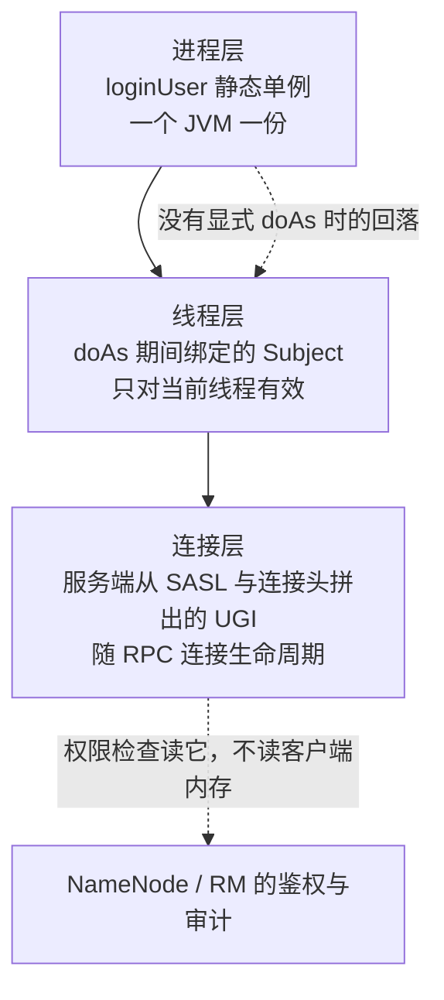
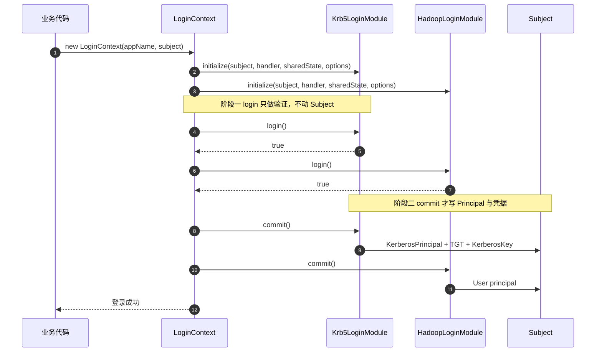
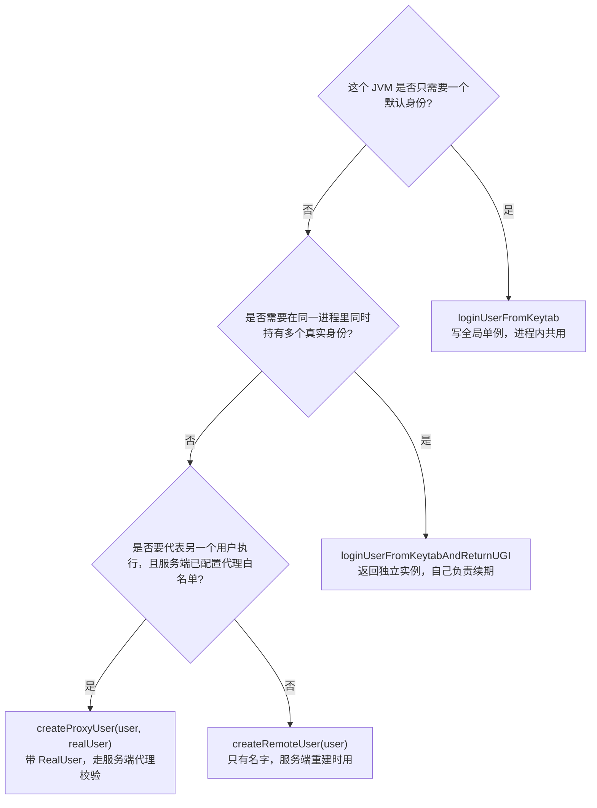
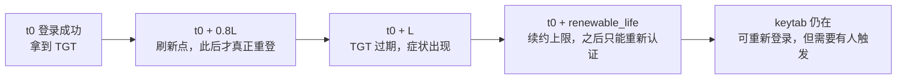
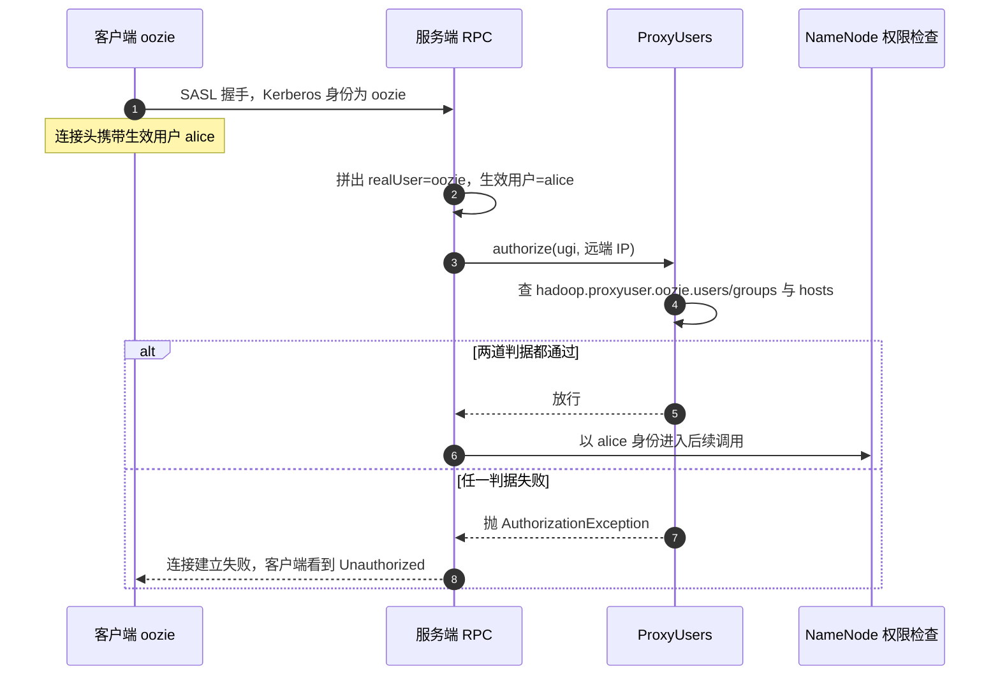
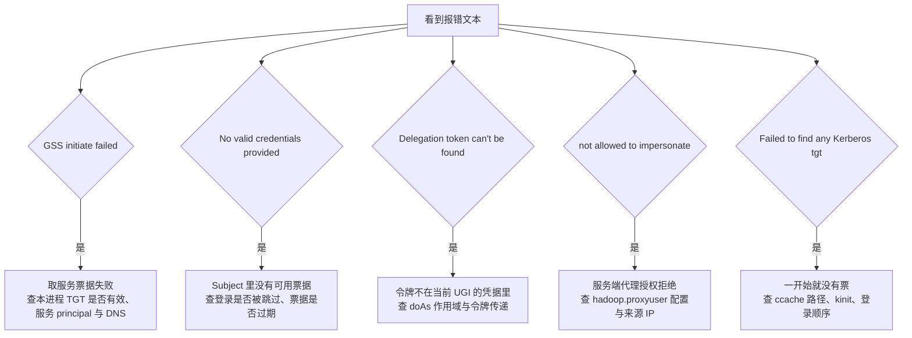

**摘要：**

`UserGroupInformation`（UGI）的位置很容易被误解：它常被当成"Hadoop 的 Kerberos 客户端"，也被当成"一整套权限框架"。真实的职责要窄得多——它是 Hadoop 在**一段执行期**里对"我是谁"这件事的记账员，背后站着 Java 认证与授权服务（Java Authentication and Authorization Service，JAAS）的 `Subject`、`Principal` 与凭据模型。本文从 JAAS 的骨架讲起，拆开 `Subject` 的三个集合与 `LoginContext`/`LoginModule` 的两阶段提交，再落到 UGI 的三种登录方式：写全局单例的 `loginUserFromKeytab`、只返回实例的 `loginUserFromKeytabAndReturnUGI`、以及没有任何凭据的 `createRemoteUser`。三者的差别决定了同一个 JVM 里能不能同时存在两个身份，也决定了代理用户能否成立，而把 `loginUserFromKeytab` 放进 `doAs` 里使用，会让整个进程的默认身份被悄悄换掉。文章的重心是 `doAs` 的三重边界：它只作用于当前线程，它在 JDK 18 之后随安全管理者（Security Manager）退场而换了实现，它原本"收窄或放大权限"的语义在现代 JDK 上已经不存在。最后给出票据续期的时间窗、组解析的缓存代价、五类身份故障的判据，以及一组能被代码评审直接抓住的反例。全文的判据都尽量落在可观测的事实上：一行登录日志、一次 `klist` 的输出、一个续期计数器的走向。

---

## 第 1 章 名字不是身份

### 1.1 一句环境变量换来的超级用户

分布式系统里的"你是谁"这个问题，在 Hadoop 的早期版本里被处理得近乎随意。Simple 模式下，客户端在连接头里报一个用户名，服务端就采信，代码里连一行校验都没有：

```java
// 早期 Hadoop 的 Simple 模式：名字即身份
System.setProperty("HADOOP_USER_NAME", "hdfs");   // 声称自己是超级用户
FileSystem fs = FileSystem.get(conf);            // 于是拿到了 hdfs 的全部权限
```

一个能连上 NameNode 端口的进程，改一个环境变量就可以读写整片数据湖。这不是某个实现里的疏漏，而是那个年代的设计前提：集群被假定跑在可信内网里，认证交给网络边界去做。等到多租户、跨部门数据共享、外包人员进场这些场景压上来，这个前提就碎了。

Hadoop 在 1.0 前后引入安全模式，把身份认证交给 Kerberos，把"以谁的身份执行"交给 JAAS，UGI 则是这两套东西在 Hadoop 生态里的统一门面。理解 UGI 之前，先要把两件事分开：**认证**回答"这个连接背后是不是它声称的那个人"，**身份上下文**回答"当前这段代码正在以谁的名义做事"。前者由 Kerberos 与 SASL 完成，后者才是 UGI 的主场。混淆这两件事，是后面绝大多数排查走错方向的起点。

### 1.2 一个进程只有一个登录用户

UGI 最硬的一条约束，是把"登录用户"做成了进程级静态状态。源码里它是 `AtomicReference<UserGroupInformation>`：

```java
// UserGroupInformation.java（trunk 简化）
private static final AtomicReference<UserGroupInformation> loginUserRef =
    new AtomicReference<>();

public static UserGroupInformation getLoginUser() throws IOException {
  ensureInitialized();
  UserGroupInformation loginUser = loginUserRef.get();
  if (loginUser == null) {
    UserGroupInformation newLoginUser = createLoginUser(null);
    do {
      if (loginUserRef.compareAndSet(null, newLoginUser)) {
        loginUser = newLoginUser;
        // 只有赢得 CAS 的那个 loginUser 会挂上续期线程
        loginUser.spawnAutoRenewalThreadForUserCreds(false);
      } else {
        loginUser = loginUserRef.get();
      }
    } while (loginUser == null);
  }
  return loginUser;
}
```

一个 JVM 进程里的 `getLoginUser()` 永远只返回那一个对象，DataNode、NodeManager、Spark Driver 都是如此。这条约束带来三个容易被低估的后果。

第一，`getLoginUser()` 是**惰性触发**的，第一次调用就完成登录，用的却是当时进程里已有的配置。第二，它不只在显式调用时发生，`FileSystem.get()`、`UserGroupInformation.getCurrentUser()`、甚至任何一条 RPC 建立连接时的 SASL 握手，都可能把它拉起来。第三，这个全局值可以被替换，但替换的动作很不显眼——`loginUserFromKeytab` 每次调用都会把静态引用换成一个新的 UGI，见第 4 章。

### 1.3 UGI 的三层作用域

把 UGI 的作用域画成三层，后面所有"为什么这个身份没生效"的问题都能归位。



进程层管"默认身份"，线程层管"这次的临时身份"，连接层是**服务端**那一侧重建出来的身份。三层各有各的初始化时机与失效条件，把它们当成一件事，就会写出那种"本地跑得好好的、上集群就报 `Permission denied: user=oozie`"的代码。

---

## 第 2 章 JAAS 的骨架：Subject、Principal 与凭据

### 2.1 Subject 是执行期身份的容器

JAAS 的 `Subject` 代表"请求访问资源的实体"，可以是一个人，也可以是一个服务账号。它不保存密码，也不自带认证能力，只用三个集合描述一个实体的安全画像：

| 集合 | 放什么 | 典型内容 | 谁能读 |
|---|---|---|---|
| `Set<Principal>` | 身份标签，"我是谁" | `KerberosPrincipal`、Hadoop 的 `User`、`RealUser` | 任何人 |
| `Set<Object> publicCredentials` | 可公开的证明 | Kerberos 票据（TGT 与服务票据）、`TokenIdentifier` | 任何人 |
| `Set<Object> privateCredentials` | 需要保护的秘密 | `KerberosKey`（来自 keytab）、Hadoop 的 `Credentials`（内含各类 Token）、`KerberosTicket` | 受 `PrivateCredentialPermission` 约束 |

这里要先纠正一个流传很广的简化说法：所谓"凭据 = KerberosTicket + KeyTab + DelegationToken"，把 keytab 当成了 Subject 里的一种凭据。keytab 本身从不进入 Subject，它是登录时用来向 KDC 换取票据的**种子文件**。登录成功后真正落到 Subject 里的是三样东西：`KerberosPrincipal`（名字）、`KerberosTicket`（TGT，公开凭据）、以及从 keytab 解出来的 `KerberosKey`（私密凭据，仅当登录模块设置了 `storeKey=true`）。Hadoop 的 `HadoopConfiguration` 恰恰默认给 keytab 登录设了 `storeKey=true`，所以 `klist` 看不到的那份长期密钥，其实就躺在进程的 Subject 私有集合里。

Delegation Token 的位置也跟着清楚了：它以 `org.apache.hadoop.security.token.Token` 的形式被塞进 Subject 的私有凭据里，外面再包一层 Hadoop 自己的 `Credentials` 对象。它不属于 JAAS 标准，是 Hadoop 在标准模型上自己加的一层。

> [!info] 为什么要拆公开与私密
> 公开凭据可以被服务端验证而不泄露长期密钥，私密凭据被 `PrivateCredentialPermission` 挡住，只有拿到权限的代码才能读。这个分层是 Java 安全模型里少数几个至今仍然有效的部分，因为它的价值不在权限检查，而在防止凭证被无关代码顺手读走。

### 2.2 Principal 是同一个实体的多重投影

`java.security.Principal` 只有一个方法 `getName()`，但它在 Subject 里可以出现多次，代表同一个实体在不同体系里的身份。Hadoop 的 UGI 内部通常同时挂两个：Kerberos 侧的 `KerberosPrincipal("alice@EXAMPLE.COM")`，和 Hadoop 自定义的 `User("alice")`。后者才是 `getUserName()` 的实际来源，也是 `auth_to_local` 规则作用的对象——Kerberos principal 太长、带 realm、大小写敏感，不适合直接拿去和 Linux 用户名比对。

代理用户会往同一个集合里再加一个 `RealUser`，它是 UGI 的私有内部类，持有真实用户的 UGI 引用。三个 Principal 并存的 Subject，就是"alice 由 oozie 代理"这件事在内存里的完整表示。

### 2.3 LoginContext 与 LoginModule：可插拔的两阶段提交

Subject 只是个容器，往里填东西的是 `LoginContext` 和 `LoginModule`。前者的职责是按配置挑模块、按顺序驱动、按控制标志决定整体成败；后者是对接具体认证后端的实现，Kerberos 用 `Krb5LoginModule`，操作系统账号用 `UnixLoginModule`，Hadoop 自己则写了一个 `HadoopLoginModule`，负责在认证完成后把用户名补成 Hadoop 的 `User` principal。

JAAS 的提交分两阶段，这个细节决定了失败时 Subject 的状态是否干净：



只要有一个 `REQUIRED` 或 `REQUISITE` 模块的 `login()` 失败，`LoginContext` 就会改走 `abort()`，已经写入临时状态的部分全部丢弃。Hadoop 在这里还多做了一步：`HadoopConfiguration` 给 Kerberos 模块的控制标志是**有条件**的——初次默认登录没有指定 principal 时用 `OPTIONAL`，允许回落到本地 OS 用户；一旦显式给了 principal（也就是显式登录与所有重登场景），立刻变成 `REQUIRED`。这就是为什么"没配 keytab 也能起进程、配错了 keytab 却直接抛异常"这两种行为的差异不是 bug，而是控制标志在起作用。

### 2.4 doAs：把 Subject 绑到一段执行期

认证完成后，Subject 里已经有名字和票据，但代码还不知道"我现在是谁"。绑定这件事由 `Subject.doAs(subject, action)` 完成：它把 Subject 与当前线程的一段执行期关联起来，在这段期间内，任何读取"当前 Subject"的代码都会拿到它，退出后恢复原样。

历史上它走的是一条路，现在走的是另一条。JDK 17 及以下的 `Subject.doAs` 通过 `AccessController.doPrivileged` 把 Subject 装进一个新的访问控制上下文，读取端用 `Subject.getSubject(AccessController.getContext())`；JDK 18 及以上的实现换成了 `Subject.callAs`，用 `ScopedValue` 绑定当前 Subject，读取端用 `Subject.current()`。两条路在 JDK 18 到 20 之间是并存的（`current` 内部仍委托给旧 API），从 JDK 21 开始编译器报废弃警告，到 JDK 23 之后旧路径直接抛异常。Hadoop 的 UGI 在两种实现上都必须能读出"当前是谁"，这件事在版本升级时变成了真正的地雷，第 5 章陷阱三会展开。

> [!warning] 一个常被忽略的结果
> 在 JDK 17 及以下，`Subject.doAs` 会顺带把 Subject 放进一个可被子线程继承的访问控制上下文；在 JDK 22 及之后，普通 `new Thread()` 不再继承它。这条变化把"线程池里 doAs 不生效"这个老问题，从"取决于池子什么时候创建 worker"变成"一律不生效"。

### 2.5 只读 Subject 与重登的临界区

`loginUserFromKeytab` 在 `finally` 块里会尝试把 Subject 设为只读。只读之后，Subject 的 Principal 集合与凭据集合都不能再增删，任何"往当前用户身上补一个 Token"的写法都会抛 `IllegalStateException`。这个设计把"登录完成"与"凭据可变"两件事隔开了：登录期间的修改是允许的，登录之后只允许整体替换。

于是重登不能是"往旧 Subject 里塞一张新票"。Hadoop 的做法是：在同一把锁里先 `logout()` 清掉 Kerberos 状态，再用同一个 Subject 构造一个新的 `HadoopLoginContext` 并 `login()`。`HadoopLoginContext` 之所以要自己保存 `appName` 与 `HadoopConfiguration`，就是为了在重登时能原样复现第一次登录的模块组合——这也是它继承 JDK `LoginContext` 的真实动机，而不只是类加载器隔离。

这把锁用的是 Subject 的私有凭据集合对象本身，粒度是"按 Subject"，不是"按进程"。含义有两个：并发重登只会有一次真正执行，其余线程排队后发现已经重登过就直接返回；重登期间所有需要读票据的线程都要等这把锁，KDC 一旦变慢，取票线程会被一起拖住。

> [!note] 一个易被误读的现象
> `logout()` 只清 Kerberos 凭证，**不清 Token**。所以重登期间委托令牌不受影响，已经在用令牌工作的任务不会因为一次 keytab 重登而中断。反过来说，如果某个任务的身份正确、令牌却失效，问题几乎一定不在重登，而在令牌本身的签发与传递。

---

## 第 3 章 UGI 的结构与初始化

### 3.1 一个 Subject 的包装器

UGI 的实例字段只有两个：`Subject subject` 与 `User user`。后者是从 Subject 的 `User` principal 里取出来的只读缓存，注释写得很直白——所有非静态字段都必须是来自 Subject 的只读缓存。这个约束保证了 UGI 实例之间不会出现"用户名和票据对不上"的状态：名字永远从 Subject 读，票据也永远从 Subject 读。

一个 keytab 登录后的 Kerberos UGI，Subject 大致长这样：

```text
Subject
  Principals
    User("alice", auth=KERBEROS)
    KerberosPrincipal("alice@EXAMPLE.COM")
  PublicCredentials
    KerberosTicket（TGT）
  PrivateCredentials
    KerberosKey（keytab 里的长期密钥，storeKey=true 时存在）
    Credentials（Hadoop 的 Token 容器，可能为空）
```

`AuthenticationMethod` 描述的是"这份身份是怎么来的"，取值有 `SIMPLE`、`KERBEROS`、`TOKEN`、`CERTIFICATE`、`KERBEROS_SSL`、`PROXY` 六种。`PROXY` 只在代理用户上出现，它的意思是"这份身份本身没有凭据，去问 realUser"。反过来说，看到 `PROXY` 就知道接下来必然有一次 realUser 查找，这也是审计日志里区分"谁在做事"的依据。

### 3.2 HadoopConfiguration 决定模块组合

UGI 不读外部的 `jaas.conf`，它自己实现了一个 `javax.security.auth.login.Configuration`，按当前参数动态拼模块列表。拼装规则比多数人想的更细：

| 场景 | 模块组合 | 关键选项 |
|---|---|---|
| Simple 模式 | OS 登录模块 + `HadoopLoginModule` | 无 Kerberos 参与 |
| Kerberos + keytab | `Krb5LoginModule` + `HadoopLoginModule` | `useKeyTab=true`、`keyTab=<path>`、`storeKey=true`、`doNotPrompt=true`、`refreshKrb5Config=true` |
| Kerberos + ticket cache | `Krb5LoginModule` + `HadoopLoginModule` | `useTicketCache=true`、`renewTGT=true`、`ticketCache=<path>` |
| Kerberos + 未指定 principal | OS 登录模块 + `Krb5LoginModule`（`OPTIONAL`）+ `HadoopLoginModule` | 允许回落到本地用户 |

`refreshKrb5Config=true` 这个选项值得单独提一句：它让每次登录都重新读取 `krb5.conf`，代价是每次登录多一次文件读取，收益是改完 `krb5.conf` 不必重启进程就能生效。对一年重启不了几次的长驻服务，这个交换是划算的；对每次请求都新建 UGI 的短生命周期客户端，它意味着每次登录都要摸一次磁盘。

`HadoopLoginModule` 的 `commit()` 里还有一条回落链：优先用 Kerberos principal；没有就用 `HADOOP_USER_NAME` 环境变量或同名系统属性；再没有就用操作系统账号。这条链解释了为什么在 Simple 模式下伪造 `HADOOP_USER_NAME` 就能换身份，也解释了为什么**安全模式下它完全无效**——Kerberos principal 已经存在，回落链根本不会往下走。

### 3.3 惰性初始化：一个不带配置的默认值

`ensureInitialized()` 是 UGI 里最容易忽视的一处：

```java
private static void ensureInitialized() {
  if (!isInitialized()) {
    synchronized (UserGroupInformation.class) {
      if (!isInitialized()) {
        initialize(new Configuration(), false);   // 注意这里
      }
    }
  }
}
```

任何线程第一次碰到 UGI，而进程还没有调用过 `setConfiguration(conf)`，UGI 就会用一个刚 `new` 出来的 `Configuration` 初始化自己。这个 `Configuration` 会去读 classpath 上的 `core-site.xml`，看起来无害，但它和你精心构造的那个 `conf` 是两个对象；如果你在构造 `conf` 时改过 `hadoop.security.authentication`、组映射实现、`auth_to_local` 规则，这些改动都不会出现在这次初始化里。

更麻烦的是，`setConfiguration` 之后也不会重新登录：

```java
public static void setConfiguration(Configuration conf) {
  initialize(conf, true);   // 只更新静态字段，不碰 loginUserRef
}
```

于是会出现一种很难读的组合状态：`isSecurityEnabled()` 返回 `true`（配置已经是 kerberos），而 `getLoginUser()` 返回的仍是初始化时那个 Simple 模式的 UGI（手里没有票）。这时候报错往往不是"认证失败"，而是更下游的 `No valid credentials provided` 或者干脆以错误身份一路成功。第 4 章的反例与第 10 章的判据都会回到这一点。

### 3.4 两个配置层的分工

UGI 的静态状态分两层：一层是进程级的配置（认证方式、组映射、重登间隔、续期开关），由 `setConfiguration` 一次性写入；另一层是实例级的 Subject，由登录动作产生。配置层可以在运行时改，实例层不会跟着改。判断一个"配置改了没生效"的问题时，先问它是哪一层：改了 `hadoop.security.authentication` 属于改配置层，而票据有没有、是谁的，属于实例层。

### 3.5 auth_to_local：principal 到短名的翻译

Kerberos principal 与 Linux 用户名不是一回事。`alice@EXAMPLE.COM`、`alice/admin@EXAMPLE.COM`、`hdfs/namenode1.example.com@EXAMPLE.COM` 这些形态都需要被翻译成一个短名，翻译规则由 `hadoop.security.auth_to_local` 给出，默认规则等价于"去掉 realm，去掉第一个 `/` 之后的部分"。翻译结果就是 `getShortUserName()`，而这个短名会被三处使用：组解析的输入、ACL 里用户名的匹配、代理白名单配置键的拼装。写过 `hadoop.proxyuser.oozie.hosts` 的人其实一直在跟这个规则打交道。

规则按书写顺序匹配，第一条命中的胜出，所以 `RULE` 的排列顺序本身就是语义。规则写得不匹配时，登录阶段就会失败，抛出的异常类型是 `NoMatchingRule`（继承自 `IOException`），而不是"保留原名继续走"。这个失败点很靠前，通常表现为进程启动失败或客户端第一次建连失败，而不是运行中偶发。

两个现场经验：AD 域的 realm 习惯用大写，规则里写小写就匹配不上；把 `auth_to_local` 配成 `DEFAULT` 之外的自定义规则时，务必同时覆盖服务 principal（带 `/host` 的形态），否则 DataNode、NodeManager 这类以服务身份登录的进程能起来，但拿到的短名会带着主机名。

---

## 第 4 章 三种登录方式与判据

这一章是全文的核心。三种登录方式的签名很像，语义差别却大到能决定架构成败。

### 4.1 loginUserFromKeytab：把身份写进全局单例

```java
public static void loginUserFromKeytab(String user, String path) throws IOException {
  if (!isSecurityEnabled()) return;                    // 非安全模式下是空操作
  UserGroupInformation u = loginUserFromKeytabAndReturnUGI(user, path);
  if (isKerberosKeyTabLoginRenewalEnabled()) {
    u.spawnAutoRenewalThreadForKeytab();               // 只在开关打开时挂续期线程
  }
  setLoginUser(u);                                     // 替换全局单例
  LOG.info("Login successful for user {} using keytab file {}. Keytab auto"
      + " renewal enabled : {}", user, new File(path).getName(),
      isKerberosKeyTabLoginRenewalEnabled());
}
```

四个要点，每一个都在生产里制造过问题。

安全模式没开时，它是**空操作**。很多"本地测试一切正常、上集群就报错"的差异，源于本地 `hadoop.security.authentication` 是 `simple`，这一行直接 return，keytab 根本没被读过。反过来，如果集群是安全的而客户端以为不是，也会静默跳过登录，最后拿着一个 Simple 身份去连 Kerberos 端口。

它**替换**全局单例，不是"只设置一次"。这一点纠正了流传很广的说法"首次登录后无法重置"——`setLoginUser` 是 `@InterfaceAudience.Private @VisibleForTesting` 的公开静态方法，`loginUserFromKeytab` 每次调用都会换掉它。可以重置，但重置是全局的：所有正在使用 `getLoginUser()` 的代码路径，会突然指向另一个 Subject，而那些已经把 UGI 引用抓到局部变量里的代码，还在用旧的。这种"一半新一半旧"的状态比不能重置更危险。

它的续期线程**默认不挂**。`hadoop.kerberos.keytab.login.autorenewal.enabled` 在 Apache Hadoop 3.3.x 的 `core-default.xml` 里默认是 `false`。也就是说，默认配置下 keytab 登录的进程没有后台重登线程，靠的是每次取票时的惰性检查，见第 6 章。

它的日志行是最好的观测点。`Login successful for user ... Keytab auto renewal enabled : false` 这一行同时告诉你三件事：登录成功、用的是哪个 keytab 文件名（不是全路径）、续期开关开着还是关着。排查"票据为什么没续"时，先去日志里找这一行。

### 4.2 loginUserFromKeytabAndReturnUGI：只给你一个实例

```java
public static UserGroupInformation loginUserFromKeytabAndReturnUGI(
    String user, String path) throws IOException {
  if (!isSecurityEnabled()) {
    return UserGroupInformation.getCurrentUser();
  }
  LoginParams params = new LoginParams();
  params.put(LoginParam.PRINCIPAL, user);
  params.put(LoginParam.KEYTAB, path);
  return doSubjectLogin(null, params);       // 新 Subject，新 LoginContext
}
```

它创建了一个全新的 Subject 与 `HadoopLoginContext`，返回给调用方，**不改** `loginUserRef`。注意两个细节。

第一，返回的 UGI 是带 LoginContext 的，所以 `reloginFromKeytab()` 在它身上是有效的；它缺的不是重登能力，而是**没人替它重登**。全局续期线程只挂在 `loginUser` 上，这个实例的票据过期后不会有人管，必须由持有者自己调 `checkTGTAndReloginFromKeytab()`。

第二，非安全模式下它返回的是 `getCurrentUser()` 而不是新实例。这个分支让代码在 Simple 模式下"看起来能用"，实际上拿到的身份和你请求的那个用户名毫无关系——一个典型的静默降级。

适用场景很明确：同一个 JVM 里需要并行使用多个身份，而这些身份的寿命由业务自己掌握。譬如一个多租户的数据同步服务，同时持有五个租户的 keytab，每次同步用对应租户的 UGI 执行；又譬如测试代码里要模拟"alice 与 bob 同时操作"。在这些场景里，`loginUserFromKeytab` 是错的，因为它会让最后登录的那个人成为整个进程的默认身份，而其他线程的 `getLoginUser()` 也会跟着变。

### 4.3 createRemoteUser：只有一个名字

```java
public static UserGroupInformation createRemoteUser(String user) {
  return createRemoteUser(user, AuthMethod.SIMPLE);
}

public static UserGroupInformation createRemoteUser(String user, AuthMethod authMethod) {
  Subject subject = new Subject();
  subject.getPrincipals().add(new User(user));    // 只有名字
  UserGroupInformation result = new UserGroupInformation(subject);
  result.setAuthenticationMethod(authMethod);
  return result;                                  // 没有任何凭据
}
```

它造出来的 Subject 里只有一个 `User` principal，没有票据、没有 Token、没有 realUser。方法注释说得很清楚：它是给 RPC 里的远端用户用的，因为远端用户本来就不带凭据。**它不产生代理链**，这一点是全书最容易搞错的地方：用 `createRemoteUser("alice")` 造一个 UGI，然后拿它去发 RPC，在 Kerberos 模式下 SASL 认证的仍然是当前进程真实持有的身份（登录用户），服务端拼出来的 UGI 是"以 loginUser 认证、名字是 alice"，而 alice 与 loginUser 之间没有任何被授权的代理声明。服务端的代理校验看到 realUser 为空，会直接跳过——但认证成功后，NameNode 的权限检查仍然按真实身份做，于是一个想冒充 alice 的调用，最后要么被当成服务账号执行，要么在别处被拒。

它真正的用途有三类：服务端在 RPC 层把 SASL 认证出的用户名重建成 UGI；工具与测试里指定一个名字（配合 Simple 模式或测试用的组映射）；以及 `getBestUGI` 在只给了用户名时的回落路径。

### 4.4 createProxyUser：带 realUser 的代理

```java
public static UserGroupInformation createProxyUser(String user,
    UserGroupInformation realUser) {
  Subject subject = new Subject();
  Set<Principal> principals = subject.getPrincipals();
  principals.add(new User(user, AuthenticationMethod.PROXY, null));
  principals.add(new RealUser(realUser));     // 真实身份挂在 principal 里
  return new UserGroupInformation(subject);
}
```

它与 `createRemoteUser` 的差别只有一个：多了一个 `RealUser` principal，认证方式变成 `PROXY`。但这一个差别决定了服务端能不能做代理授权判断——没有 realUser，服务端连"谁在代理"都不知道，也就无从比对 `hadoop.proxyuser.*` 的白名单。第 7 章会完整走一遍这条链。

### 4.5 判据：什么时候用哪个

把四个 API 放在一张表里，判据就成型了：

| API | 是否写全局 `loginUser` | 是否自带凭据 | 是否挂 LoginContext（可否 relogin） | 是否有 realUser | 适用判据 |
|---|---|---|---|---|---|
| `loginUserFromKeytab` | 是，替换 | 是（TGT + 密钥） | 是，且可能挂续期线程 | 否 | 进程只有一个身份，所有 Hadoop 客户端共用 |
| `loginUserFromKeytabAndReturnUGI` | 否 | 是（TGT + 密钥） | 是，但无自动续期 | 否 | 同一 JVM 多身份并存，寿命由调用方管理 |
| `createRemoteUser` | 否 | 否 | 否 | 否 | 服务端重建远端用户、工具指定名字 |
| `createProxyUser` | 否 | 否（借 realUser 的） | 否 | 是 | 已获服务端授权的跨用户代理 |



还有三条不那么显眼的登录入口，值得一并记住：`getUGIFromTicketCache(ticketCache, user)` 用 ccache 文件登录并返回新实例；`getUGIFromSubject(subject)` 接管一个外部构造好的 Subject，此时 Hadoop 不挂 LoginContext，续期责任完全在外部；`getBestUGI(ticketCachePath, user)` 是个分派器——给了 ccache 就走 ccache 登录，只给用户名就 `createRemoteUser`，都不给就 `getCurrentUser()`。命令行工具里那句 `--principal` 与 `--keytab` 的解析，落点就在这三个方法上。

### 4.6 反例：在 doAs 里调 loginUserFromKeytab

这是本文最想让人记住的一个反例，因为它符合直觉却完全错误：

```java
// 错误：希望"以 alice 的身份"访问，于是在 doAs 里换登录用户
oozie.doAs((PrivilegedExceptionAction<Void>) () -> {
    UserGroupInformation.loginUserFromKeytab("alice@EXAMPLE.COM", "/etc/security/alice.keytab");
    FileSystem fs = FileSystem.get(conf);
    fs.listStatus(new Path("/user/alice"));   // 身份确实是 alice，但代价是全局的
    return null;
});
```

这段代码"能用"，所以它能活到生产。它的问题不在 `doAs` 里，而在 `loginUserFromKeytab` 换掉的是进程级静态引用：从这一行执行之后，整个 JVM 的默认身份都变成了 alice，其他线程、其他连接池、其他组件的 `getLoginUser()` 全部跟着变。`doAs` 结束后 Subject 恢复了，但全局单例回不去了——除非你再调一次 `loginUserFromKeytab` 换回来，而这中间的任何并发请求都可能落在错误的身份上。

正确写法有两种：需要长期以 alice 身份工作时，用 `loginUserFromKeytabAndReturnUGI` 拿到独立实例再 `doAs`；只是偶尔代 alice 执行时，用 `createProxyUser("alice", getLoginUser())` 走代理，把授权交给服务端判断。

---

## 第 5 章 doAs 的语义与三个陷阱

### 5.1 语义：绑定一段执行期，不是切换一个全局开关

`UGI.doAs` 的实现只有两行有内容：记一条 trace 日志，然后调 `SubjectUtil.doAs(subject, action)`。Hadoop 在 trunk 上用 `SubjectUtil` 这层适配包住了 JDK 的版本差异：JDK 18 及以上走 `Subject.callAs`，JDK 17 及以下走 `Subject.doAs`。它的语义是"在这段执行期内，当前线程的当前 Subject 是它"，不是"把这个 UGI 设成全局默认"。这两者的区别就是第 4.6 节那个反例的根源。

读取端在 `getCurrentUser()`：

```java
public static UserGroupInformation getCurrentUser() throws IOException {
  ensureInitialized();
  Subject subject = SubjectUtil.current();
  if (subject == null || subject.getPrincipals(User.class).isEmpty()) {
    return getLoginUser();          // 读不到就回落到全局身份
  } else {
    return new UserGroupInformation(subject);
  }
}
```

这个回落是理解所有"身份错乱"问题的钥匙：**doAs 没生效时不会报错**，而是静默地使用 `loginUser`。于是症状很少是"认证失败"，更多是"权限被拒"或者"写到了不该写的目录"，而且在日志里看到的用户名是服务账号而不是你以为的那个用户。

关于开销，可以做一次示例推算（量级判断，非基准测试）：一次 `doAs` 的成本是一次 Subject 绑定加一次 `try/finally` 恢复，在 JDK 18 之后走的是 `ScopedValue` 绑定，量级落在纳秒到微秒之间；一次 HDFS RPC 往返在毫秒量级，两者至少差三个数量级。所以"每个操作外面包一层 doAs"本身不是性能问题，真正贵的是在 doAs 里重新创建 UGI——每次 keytab 登录都要和 KDC 换票，那是一次网络往返加一次密码学运算，按百毫秒到秒计。需要频繁切换身份时，正确做法是启动阶段把 UGI 一次建好、循环复用，而不是在请求路径上反复登录。

### 5.2 陷阱一：线程池

最经典的形态是"外层 doAs 了，内层在线程池里执行"：

```java
// 错误：doAs 包住了提交动作，没包住执行动作
proxyUser.doAs((PrivilegedExceptionAction<Void>) () -> {
    Future<?> f = pool.submit(() -> {
        // 这里的身份是 loginUser，不是 proxyUser
        fs.listStatus(new Path("/user/alice"));
    });
    f.get();
    return null;
});
```

`doAs` 的作用域是调用它的那个线程。提交任务这个动作发生在 doAs 内，任务体执行发生在 doAs 外，两者之间没有任何身份传递。要修，有两个位置可选：

```java
// 修法一：把 doAs 挪到真正执行的地方
Future<?> f = pool.submit(() -> proxyUser.doAs(
    (PrivilegedExceptionAction<Void>) () -> {
        fs.listStatus(new Path("/user/alice"));
        return null;
    }));

// 修法二：先捕获 UGI，再在线程内重放（适合无法改调用点的情况）
UserGroupInformation captured = UserGroupInformation.getCurrentUser();
Future<?> g = pool.submit(() -> captured.doAs(...));
```

关于"新线程会不会继承身份"，需要按 JDK 版本分开说，这是很多文章含糊过去的地方。JDK 17 及以下，`Subject.doAs` 把 Subject 放进访问控制上下文，而线程在**构造**时会捕获父线程的继承上下文；所以在线程池首次提交任务、懒创建 worker 的那一刻，如果正好发生在 doAs 内部，这个 worker 反而会带上父线程的身份，而且这个身份会跟着 worker 一辈子。JDK 22 及之后，普通线程不再继承 Subject，Hadoop 在 `SubjectUtil` 里用一个自己管理的 `InheritableThreadLocal` 把老版本的级联行为补了回来。两种行为都不适合作为设计依据，唯一可靠的写法是显式传递：要么让任务体自己 `doAs`，要么把 UGI 当成参数传进去。

> [!warning] 虚拟线程的额外边界
> Hadoop 的补丁注释里明确写了：`Thread.ofVirtual().start(...)` 默认不继承线程局部变量，所以即使在新版 Hadoop 上，虚拟线程也不会看到父线程的 Subject。用虚拟线程跑 Hadoop 客户端时，`doAs` 必须写在虚拟线程内部。

### 5.3 陷阱二：doAs 与 doAsPrivileged

历史上这两个方法的区别在访问控制上下文：`doAs` 在**调用者**的上下文之上叠加 Subject，`doAsPrivileged` 用一个全新的（或指定的）上下文替换掉调用者的，前者继承调用者的权限，后者把权限收窄到只剩这个 Subject 自己的。

| 维度 | `Subject.doAs` | `Subject.doAsPrivileged` |
|---|---|---|
| 访问控制上下文 | 继承调用者，叠加 Subject | 传入新的或 `null`（全新上下文） |
| 权限效果 | 调用者原有权限仍然可用 | 调用者的权限被切断，只剩新上下文 |
| 典型用途 | 以某身份执行、保留通道权限 | 服务端处理不可信代码，防止越权 |
| JDK 17 及以下的差异 | 有 | 有 |
| JDK 18 之后的差异 | 无（两者都退化为 `callAs`） | 无（`AccessControlContext` 参数被忽略） |

在 JDK 17 及以下，这个区别是真实的安全边界：一个服务端如果用 `doAs` 而不是 `doAsPrivileged` 来处理客户端提交的代码，客户端代码就能借着服务端的权限去读本不该读的东西。JDK 18 之后，`doAsPrivileged` 不再看那个上下文参数，两者行为一致——"收窄权限"这个能力随着安全管理者一起消失了。这意味着任何依赖 `doAsPrivileged` 做隔离的设计，在现代 JDK 上都已经没有隔离效果，必须在进程或容器层面重新划边界。

### 5.4 陷阱三：JDK 18 之后，getSubject 换了天地

这是本篇最重要的一条版本事实，因为它会让一整条调用链在没有改任何业务代码的情况下突然全崩。

```text
JDK 8 ～ 17    Subject.getSubject(AccessController.getContext()) 可用
               Subject.doAs 基于 AccessControlContext
JDK 18（JEP 411）
               安全管理者与 getSubject/doAs/doAsPrivileged 一起被标记废弃
               新增 Subject.current() 与 Subject.callAs()
JDK 18 ～ 20   current() 内部仍委托给旧 API，新旧都能用
JDK 21         仍可工作，但编译器开始报 deprecation 警告
JDK 22         普通线程是否继承 Subject 开始取决于安全管理者是否启用
JDK 23         未允许安全管理者时 getSubject 抛 UnsupportedOperationException
JDK 24（JEP 486）
               安全管理者被永久禁用，连 -Djava.security.manager=allow 也不再被接受
JDK 25 及以后   getSubject 一律抛 UnsupportedOperationException
               doAs / doAsPrivileged 退化为 callAs，忽略 AccessControlContext
```

对应到 Hadoop：3.3.x 的 UGI 在 `getCurrentUser()` 里直接调用 `Subject.getSubject(AccessController.getContext())`，在 JDK 23 上会抛 `UnsupportedOperationException: getSubject is supported only if a security manager is allowed`。社区为此开了两个 JIRA：HADOOP-19293（在新 JVM 上避开 `Subject.getSubject`）与 HADOOP-19212（把 UGI 迁到替代 API），trunk 上的最终形态就是第 5.1 节提到的 `SubjectUtil` 适配层——用方法句柄探测 `Subject.callAs`/`current` 是否存在，存在就优先用，不存在才回落到旧 API。具体哪个 3.x 补丁版本带上了这个修复，以对应版本的发行说明为准。

给"现在该怎么做"的几条落点：

- 客户端与服务端不要自己调 `Subject.getSubject`，统一走 `UserGroupInformation.getCurrentUser()`。Hadoop 已经替你处理了版本差异，自己调等于绕过适配层。
- 需要拿当前身份的框架代码（调度器、任务容器、连接池），用 `Subject.current()`（JDK 18 及以上）或 `UGI.getCurrentUser()`，两条路都能跨版本工作。
- 在 JDK 23 及以上跑老的 Hadoop 3.3.x，先确认该版本是否已合入适配层；没有的话，回到 3.3.x 官方支持的 JDK 8 或 11 是成本最低的选择，而不是去开 `-Djava.security.manager=allow` 续命——那个开关在 JDK 24 上已经不存在了。17 及以上属于能跑但不在支持矩阵里的地带，升级前先用第 9.3 节那段代码自检。
- 别再把 `doAsPrivileged` 当隔离手段。它现在的行为与 `doAs` 相同，隔离要靠进程、用户、容器或内核能力去做。

`Subject.getSubject` 之外还有一处容易被忽略的连带影响：`Subject` 一旦被设为只读（部分版本的登录实现会在完成时调用 `setReadOnly`），任何试图往 Subject 里加 principal 或凭据的旧代码都会抛 `IllegalStateException`。从 JDK 17 升到 21 再升到 25，这类"以前能跑"的隐匿路径会一批一批地暴露出来，逐个改比整体升级更省事。

---

## 第 6 章 票据的生命周期

### 6.1 时间窗与 80% 刷新点

Kerberos 票据的寿命由 KDC 策略决定，不是协议里的固定值。AD 域里常见的策略是 10 小时有效期、7 天可续期上限；其他 KDC 实现给出的值可能是 24 小时之类，取决于 `maxlife` 与 `renew_life` 的实际配置。这两个数字写在 KDC 侧，客户端只能读，不能改。

UGI 在判断"该不该重登"时，用的是票据起点加上有效期窗口的 80%：

```text
示例推算（量级判断，非基准测试）：
  TGT 有效期 L = 10 小时，起点 t0
  刷新点 = t0 + 0.8 × L = t0 + 8 小时
  t0 + 8h 之前的 checkTGTAndReloginFromKeytab() 是空操作
  t0 + 8h ～ t0 + 10h 之间是唯一的补救窗口
  超过 t0 + renewable_life（常见 7 天）之后，keytab 也只能重新认证，不能再续约旧票
```

这段推算说明了一个反直觉的事实：票据真正过期的那一刻并不是故障发生的时刻，故障发生在"最后一次成功重登 + L"这个时刻。如果续期线程在第 4 小时就死了，故障会在第 10 小时才出现，中间 6 小时监控上一切正常。这也是 Kerberos 相关故障总在变更之后的某天凌晨集中爆发的原因。



### 6.2 自动续期线程

`loginUserFromKeytab` 只在 `hadoop.kerberos.keytab.login.autorenewal.enabled=true` 时挂续期线程。这个开关在 Apache Hadoop 3.3.x 的 `core-default.xml` 里默认是 `false`，所以默认配置下 keytab 登录的进程没有后台重登线程。

打开之后，线程名是 `TGT Renewer for <principal>`，逻辑是一个循环：算出下次刷新时间，睡到那时，调 `reloginFromKeytab()`，然后重算。失败处理有几个分支值得记住，因为它们就是日志里的原话：

| 日志 | 触发条件 | 含义 |
|---|---|---|
| `No TGT after renewal. Aborting renew thread for <user>` | 重登后 Subject 里仍无 TGT | 线程直接退出，不再重试 |
| `TGT is destroyed. Aborting renew thread for <user>` | 票据对象已被销毁 | 线程退出，进程还活着 |
| `TGT is expired. Aborting renew thread for <user>` | 重试时间已经越过票据结束时间 | 线程退出，票据彻底过期 |
| `Exception encountered while running the renewal command for <user>` | 重登抛 IOException | 按指数退避重试，退避基数是 `hadoop.kerberos.min.seconds.before.relogin` |

这四种退出的共同点是：**线程死了，进程不会死**。于是故障被推迟到票据真正过期那一刻才爆发，中间没有任何立即报错。观测上唯一可靠的信号是日志里有没有 `TGT Renewer` 线程的告警，以及 UGI 的 metrics 里 `RenewalFailures` 这类计数器是否在涨。

### 6.3 惰性重登与 60 秒防抖

默认不挂线程时，重登靠的是取票路径上的惰性检查。`checkTGTAndReloginFromKeytab()` 的逻辑是：如果当前 TGT 还没到刷新点，直接返回；到了刷新点才真正重登。这条路径对"请求不断"的服务很友好，因为每次取票都是一次检查机会；对"静默很久突然要干活"的进程很不友好，因为静默期间没人检查，等需要票据时才发现已经过期。

重登有一个防抖：`hadoop.kerberos.min.seconds.before.relogin`（默认 60 秒）。间隔内的重登请求会被静默跳过，只留一行 warn：

```text
Not attempting to re-login since the last re-login was attempted less than 60 seconds before. Last Login=...
```

这里有一个源码级的细节，是很多教科书不会提的：`lastLogin` 是在**尝试重登之前**写入的，不是成功之后。也就是说，一次失败的重登同样会把时间戳刷新，接下来 60 秒内的重登请求都会被这行 warn 拦掉。KDC 抖动 30 秒、keytab 刚好被轮换，这类"短暂失败"在这 60 秒里得不到任何重试机会，而它恰好可能落在票据过期前的最后窗口里。

绕开这个防抖有两个入口，用途完全不同。`forceReloginFromKeytab()` 是公开 API，明确跳过 `lastLogin` 的限制直接重登，适合"KDC 恢复之后立刻补救"的场景，但调用得比 60 秒更密，等于把 KDC 当成可以随便打的靶子。`setShouldRenewImmediatelyForTests(true)` 是 `@VisibleForTesting` 的测试开关，它同时让刷新点判断与防抖失效，每次检查都真正重登——只该出现在单测里，一旦被打进生产包，就是一个持续向 KDC 发请求的隐患。

### 6.4 ccache 登录的续期与一个配置名的澄清

用 ticket cache 登录（`getUGIFromTicketCache`、`useTicketCache=true`）时，Hadoop 会为登录用户挂一个基于 `kinit` 命令的续期线程，命令由 `hadoop.kerberos.kinit.command` 指定（默认就是 `kinit`，要求它在 PATH 里）。这条路径的续期不是"再登一次"，而是执行 `kinit -R` 去续约——所以它能不能成功，取决于 KDC 是否允许续约、ccache 文件是否还可写。

关于配置名，这里要澄清一处常见的记错：社区版 Apache Hadoop 3.3.x 与 trunk 的 `core-default.xml` 里都没有 `hadoop.login.ccache.relogin` 这个键，控制 ccache 重登的是登录方式本身加上 `hadoop.kerberos.min.seconds.before.relogin` 与 `hadoop.kerberos.kinit.command`。某些发行版可能会加自己的开关，遇到时以该发行版的文档为准，不要把它当成人人适用的标准键去搜索。

### 6.5 症状与它们的时间位置

把票据故障归到时间轴上，判据会清楚很多：`Failed to find any Kerberos tgt` 是"一开始就没有票"，通常发生在登录阶段就失败；`No valid credentials provided` 是"手里有 Subject，但里面没有可用票据"，发生在票据过期或登录被跳过之后；`GSS initiate failed` 是"取服务票据这一步失败"，可能是本地 TGT 过期，也可能是服务端 principal 与 DNS 对不上。三者的排查入口完全不同，第 10 章会给一张对照表。

### 6.6 重登的原子性与偶发尖刺

重登本身是原子的：先登出、再新登入，整个过程在 Subject 的锁内完成。但读票据的代码并不会去拿同一把锁——`getTGT()` 只是从 Subject 的私有凭据里筛出 `KerberosTicket`。这意味着在重登的那一瞬间，一个正好来取票的线程可能看到"已登出、尚未登入"的中间态，表现为偶发的一次 `No valid credentials provided`，紧接着的下一次请求又正常了。

这类尖刺的判据是"频率与 KDC 延迟相关"：KDC 响应正常时重登只要几十毫秒，撞上的概率极低；KDC 慢到秒级时，尖刺就会变成肉眼可见的周期性失败。遇到这种形态，先看 KDC 的响应时间与重登日志的间隔，不要一头扎进客户端代码找并发 bug。

---

## 第 7 章 代理用户：客户端只是声明

### 7.1 为什么需要代理

调度服务 Oozie 以 `oozie` 账号运行，用户 alice 提交的工作流要以 alice 的身份读写 HDFS。让 Oozie 持有 alice 的 keytab 违反最基本的凭证管理原则，于是 Hadoop 提供了代理机制：服务账号在获得授权的前提下，代表另一个用户执行，审计日志里同时记录"谁在代理"和"代理成谁"。

### 7.2 客户端的结构

客户端做两件事：造一个 `createProxyUser("alice", oozieUgi)`，然后用它 `doAs`。这个 UGI 的 Subject 里没有票据，只有 `User("alice", PROXY)` 与 `RealUser(oozie)` 两个 principal。RPC 发起时，生效用户是 alice，而真正完成 SASL 认证的是 oozie 的票据——两件事必须分开看。

### 7.3 服务端的两道判据

服务端拿到连接后，先从 SASL 结果确定真实身份（oozie），再从连接头里的生效用户构造出带 realUser 的 UGI，然后调 `ProxyUsers.authorize(ugi, 远端 IP)`。默认实现是 `DefaultImpersonationProvider`，它做两道检查：

```text
判据一：目标用户是否被允许
  取 realUser 的短名作为 key，拼出 hadoop.proxyuser.<user>.users / .groups
  用 AccessControlList 判断"生效用户"是否在名单里
  失败 → AuthorizationException: User: oozie/xxx@REALM is not allowed to impersonate alice

判据二：来源 IP 是否被允许
  取 hadoop.proxyuser.<user>.hosts，用 MachineList 判断远端地址
  失败 → AuthorizationException: Unauthorized connection for super-user: oozie from IP x.x.x.x
```

两个失败消息指向完全不同的配置项，这是现场最省时间的判据：看到 `is not allowed to impersonate` 就去查 `.users` 与 `.groups`；看到 `Unauthorized connection for super-user` 就去查 `.hosts`。

有几个配置上的坑值得单独说。白名单是**按 realUser 的短名**索引的，所以 AD 域里 principal 写成 `oozie@EXAMPLE.COM`，配置键仍是 `hadoop.proxyuser.oozie.*`。`.users` 与 `.groups` 至少要配一个：只配了 `.hosts` 而没有 `.users`/`.groups` 时，`DefaultImpersonationProvider` 在初始化阶段压根不会为这个 realUser 建立 ACL，校验时 `acl == null` 直接判失败——现象是"我明明配了 hosts，为什么还是被拒"。`.groups` 匹配的是**目标用户**的组，不是代理者的组。`.hosts` 支持通配，`*` 表示不限制来源，这在共享网关场景里等于把代理授权开到最大。

还有一条容易忽略的路径：`authorize()` 在 realUser 为空时**直接返回**，不做任何检查。这就是 `createRemoteUser` 造出来的 UGI 能通过代理校验的原因——它根本没有代理链。反过来说，安全上真正的门在 SASL 认证，代理校验只是第二道；把"客户端能不能伪造名字"当成安全边界，方向就反了。



### 7.4 createRemoteUser 冒充为什么不成立

把上一节读透，这个问题自然有答案。客户端用 `createRemoteUser("alice")` 造一个 UGI 去发 RPC，在 Kerberos 模式下会发生三件事：SASL 用进程真实持有的票据完成认证，服务端据此确定 realUser；连接头里的生效用户是 alice；服务端拼出的 UGI 是"realUser=真实登录用户、生效用户=alice"。如果这个真实登录用户不是被授权的代理者，代理校验会抛 `is not allowed to impersonate`；如果恰好它就是被授权的服务账号（譬如 Oozie 进程本身），那么这次调用在语义上就是一次代理，而不是冒充——因为身份链条是完整的，审计日志里也记录得明明白白。

真正属于"冒充"的场景只有一个：Simple 模式。Simple 模式下没有 SASL 认证，服务端直接采信连接头里的用户名，`createRemoteUser` 造什么名字就是什么身份。这也是为什么安全模式对 Simple 模式是替代关系而不是增强选项。

### 7.5 代理只有一跳

代理链里只有一层 realUser。A 代理 B、B 再代理 C 这种链式代理不被支持：服务端只认连接上那一个 realUser，第二层要么退化成普通用户，要么直接被拒。这条限制在网关场景里很关键——网关以服务身份接入，向 Hadoop 发起时代理成最终用户，只有一次代理；如果中间还有一层组件想再代理一次，它必须自己持有被授权的关系。

多跳不成立也解释了为什么代理白名单要按"每一对被授权关系"来配：`hadoop.proxyuser.hive.*`、`hadoop.proxyuser.oozie.*` 是两套独立配置，前者不会因为后者存在而生效。

### 7.6 getBestUGI：分派逻辑藏在名字里

`getBestUGI(ticketCachePath, user)` 在命令行工具里被大量调用，判据是"给了什么就用什么"：给了 ccache 路径就走 ccache 登录并返回新实例；只给了用户名就 `createRemoteUser`（无凭据）；什么都没给就 `getCurrentUser()`。第三种情况在安全模式下意味着使用登录用户，在 Simple 模式下意味着使用 OS 用户名——同一个方法，两种模式下拿到的东西性质完全不同。这也是为什么同一份命令行工具，在安全集群与非安全集群上的行为要分开验证。

---

## 第 8 章 组解析：两台机器上的两份解析

### 8.1 组不是从 NameNode 取的

一个常见的误解是"客户端向 NameNode 要自己的组"。实际情况是：每个进程各自用 `hadoop.security.group.mapping` 配置的映射提供方，把用户名解析成组列表；客户端调 `getGroups()` 时用的是客户端的映射，NameNode 做权限检查时用的是 NameNode 的映射。组不会沿着 RPC 传过去。

默认提供方是 `org.apache.hadoop.security.JniBasedUnixGroupsMappingWithFallback`：JNI 可用时走本地库，不可用时回落到 `ShellBasedUnixGroupsMapping`，后者执行 `bash -c groups` 之类的 shell 命令去查。此外还有 `LdapGroupsMapping`（对接 LDAP/AD，支持 `memberOf` 属性、posixGroup、层级搜索）、`CompositeGroupsMapping`（把多个提供方组合，`hadoop.security.group.mapping.providers.combined=true` 时取并集，为 `false` 时按顺序取第一个有结果的）。

### 8.2 缓存与负缓存

组解析的结果会缓存，默认 300 秒。这段缓存是"加组之后不生效"这类问题的最常见原因。

| 配置 | 默认值 | 调大的代价 | 调小的代价 |
|---|---|---|---|
| `hadoop.security.groups.cache.secs` | 300 | 组成员变更的可见延迟变长，最长等于该值 | 每次解析都可能打到底层（LDAP 或 shell），组查询变成热点 |
| `hadoop.security.groups.negative-cache.secs` | 30 | 不存在的用户被反复查询时压力更大 | 一次瞬时解析失败会让合法用户在缓存期内持续被拒 |
| `hadoop.security.groups.cache.background.reload` | false | 打开后刷新在后台线程池里做，请求不阻塞，但要多 3 个线程 | 保持关闭则刷新发生在请求线程上，偶发延迟尖刺 |
| `hadoop.security.groups.cache.warn.after.ms` | 5000 | 告警阈值变松，慢查询更容易被忽略 | 告警变多，但能更早发现 LDAP 抖动 |
| `hadoop.security.groups.shell.command.timeout` | 0s（无限等） | 不设超时时，一个卡住的 shell 会一直占着解析线程 | 设得太小会把正常但较慢的查询判成空结果 |

最后一行是隐蔽的坑：超时之后返回的是"空组列表"，不是异常。空组在 ACL 判断里等价于"什么组都不在"，于是一个本来有权限的用户被判成无权限，日志里只有一条 `Error getting groups for user` 之类的 warn。

### 8.3 两侧不一致的形态

客户端与服务端都配置了组映射，但配置源不同——客户端用 OS 的 `/etc/group`，NameNode 用 LDAP——同一个用户在两侧的组就不一样。典型形态是：客户端 `getGroups()` 能看到 `hadoop` 组，以为自己有权限；NameNode 解析出来的组里没有 `hadoop`，于是 `AccessControlException`。排查时先确认两侧的 `hadoop.security.group.mapping` 是否为同一实现，再看两侧缓存是否刚刚刷新过。

还有一层：`UserGroupInformation.getGroups()` 在解析失败时会**返回空列表**而不是抛异常，并在 debug 级别记一条日志。这个"吞异常"的设计让组解析故障在默认日志级别下完全静默，直到 ACL 拒绝才暴露。

---

## 第 9 章 观测：看什么日志定位身份问题

### 9.1 四组开关

| 开关 | 打开方式 | 输出什么 | 代价 |
|---|---|---|---|
| `sun.security.krb5.debug` | JVM 参数 `-Dsun.security.krb5.debug=true` | AS-REQ/AS-REP 的字段、加密类型、KDC 地址与错误码 | 输出极大，密钥材料会出现在日志里，只能短时开启 |
| `sun.security.jgss.debug` | JVM 参数 `-Dsun.security.jgss.debug=true` | GSS 上下文建立过程，能看出是取票失败还是校验失败 | 同样噪音大，适合复现单次失败 |
| `HADOOP_JAAS_DEBUG` | 环境变量 `export HADOOP_JAAS_DEBUG=true` | `HadoopConfiguration` 会把 `debug=true` 传给 LoginModule，打印模块选择与 commit 细节 | 相对温和，适合常开在预发环境 |
| UGI 自身的 debug | 把 `org.apache.hadoop.security.UserGroupInformation` 这个 logger 调到 DEBUG（3.x 没有程序化的 `setDebug` 开关） | `doAs` 的 trace、登录用户、Token 列表 | 生产环境不宜常开，trace 里有调用栈 |

### 9.2 日志对照表

| 现象 | 先看哪条日志 | 说明 |
|---|---|---|
| 进程起来了但所有 RPC 都失败 | `Login successful for user ... Keytab auto renewal enabled` | 没有这一行说明 keytab 登录根本没执行，先查安全配置与调用顺序 |
| 票据在某天集中过期 | `TGT Renewer for ...` 相关告警 | 续期线程在票据过期前就死了，日志里有 `Aborting renew thread` |
| 身份变成服务账号 | `getCurrentUser` 的 debug 输出 | 说明 doAs 没生效，回落到 loginUser |
| 代理被拒 | `is not allowed to impersonate` 或 `Unauthorized connection for super-user` | 前者查 users/groups，后者查 hosts |
| 组不对 | `Error getting groups for user` | 组解析失败被吞成空列表，或缓存未刷新 |
| 认证失败但客户端以为有票 | `Auth failed for ...` 与 `Auth successful for ...` | 服务端 AUDITLOG 里成对出现，能定位是哪个连接、哪个用户 |

### 9.3 一次自检

比读日志更快的办法，是在出问题的进程里直接打印状态：

```java
UserGroupInformation ugi = UserGroupInformation.getCurrentUser();
System.out.println("user      = " + ugi.getUserName());
System.out.println("auth      = " + ugi.getAuthenticationMethod());
System.out.println("realUser  = " + ugi.getRealUser());
System.out.println("fromKeytab= " + ugi.isFromKeytab());
System.out.println("security  = " + UserGroupInformation.isSecurityEnabled());
System.out.println("kerbCreds = " + ugi.hasKerberosCredentials());
// 注意：不要在生产里直接打印 getSubject()，私密凭据可能被一起打出来
```

这段输出的判读顺序是：先看 `security` 与 `fromKeytab` 是否与预期一致，再看 `realUser` 是否为空（代理场景下不该为空），最后才看票据。把这段代码放进健康检查端点，比事后翻日志有效得多。Hadoop 另外提供了 `UserGroupInformation.logAllUserInfo(ugi)`，一次把 current、real、login 三个身份连同各自的 Token 列表打进 DEBUG 日志，做现场取证比自己拼 `println` 完整。

### 9.4 klist 与指标：把"有没有票"变成可读事实

`klist` 的输出要按三个字段读：`Valid starting` 与 `Expires` 决定这张票还剩多久，`renew until` 决定还能续约到什么时候，`Default principal` 决定它是谁的票。加上 `-e` 可以看到加密类型，排查"KDC 与 JVM 支持的加密类型不匹配"时必看；加上 `-c <路径>` 可以指定 ccache 文件，排查"进程读的到底是哪个 cache"时必看。要注意的是，keytab 登录的进程根本不写 ccache，`klist` 在那种机器上是空的，拿空输出当"没有票"的证据会误判——先用第 9.3 节那段代码确认票据是在内存里的 Subject 中还是根本不存在。

指标侧的入口在 UGI 自己的 metrics 里：`ugi.LoginSuccess` 与 `ugi.LoginFailure` 记录登录次数与耗时，`ugi.GetGroups` 记录组解析延迟（可以按分位看），`ugi.RenewalFailures` 与 `ugi.RenewalFailuresTotal` 记录续期失败。前两者按"有没有在涨"判断登录是否在反复发生，后两者按"有没有归零"判断续期线程是否健康——一次成功重登会把 `RenewalFailures` 归零，长期不归零说明它一直在失败重试。

---

## 第 10 章 五类身份故障的判据



| 故障形态 | 直接原因 | 判据 | 处置方向 |
|---|---|---|---|
| `GSS initiate failed` | 客户端取不到目标服务的服务票据 | 本进程 TGT 是否有效；服务 principal 是否与 DNS 正反解一致 | 先修票据，再核对 `_HOST` 与 DNS |
| `No valid credentials provided` | Subject 存在但没有可用票据 | 票据到期时间；登录是否在 `setConfiguration` 之前被触发 | 修正初始化顺序，或显式重登 |
| `Delegation token can't be found` | 当前 UGI 的凭据集合里没有该令牌 | 令牌是挂在 loginUser 上还是挂在 doAs 的 UGI 上 | 把令牌取到后再 `addToken`，或让任务体在正确的 UGI 作用域内执行 |
| `Failed to find any Kerberos tgt` | 登录阶段就失败，或 ccache 里没有票 | `KRB5CCNAME` 与 `klist`；keytab 是否存在且可读 | 重新登录；检查 keytab 权限与 principal 拼写 |
| `is not allowed to impersonate` | 服务端代理白名单不认这次代理 | realUser 短名对应的 `hadoop.proxyuser.*.users/groups` | 补白名单；确认配置写在服务端而非客户端 |

五个形态的排查顺序建议固定下来：先判断是"没有票"还是"有票但取不到服务票"，再判断是客户端侧还是服务端侧，最后才看权限与代理。把顺序搞反，最容易发生的错误是拿着 `GSS initiate failed` 去查 Ranger 策略——那是完全不同的层。

### 10.1 一次走完判据的推演

把五种形态放进一个具体场景里走一遍，判据才真正好记。某个 Spark 长跑作业在第三天凌晨开始报 `Delegation token can't be found`，而前 48 小时一直正常，期间没有发布。

第一步看时间位置：报错出现在"第三天"，而作业启动时就完成了 keytab 登录，说明登录本身没问题，问题在令牌。第二步看是谁的令牌：作业提交时由 Driver 向 HDFS 申请令牌并分发给 Executor，令牌挂在 Driver 的 UGI 上；如果某个 Executor 的任务体在别的线程里执行，`getCurrentUser()` 会回落到 launch 容器的 loginUser，那个 UGI 上没有这批令牌。第三步看为什么前两天没事：令牌在有效期内时，容器里可能用的是缓存的 FileSystem 实例，或者前两天的任务量小、没有触发新的建连；到第三天缓存实例被回收、重新建连时才去查令牌，于是才暴露。

这个推演的价值在于它同时否定了两个直觉答案。第一个直觉是"令牌过期了"——如果只是过期，报错会是令牌失效而不是找不到，而且过期时间通常在日志里有迹可循。第二个直觉是"Kerberos 又出问题了"——TGT 与令牌是两套独立凭证，TGT 有效并不能推导出令牌存在。判据表里"令牌挂在谁的 UGI 上"这一列，问的就是这件事。

---

## 第 11 章 反例集

### 11.1 线程池里 doAs

```java
// 反例：doAs 只包住提交，没包住执行
loginUser.doAs(() -> pool.submit(() -> fs.listStatus(path)));
```

它在测试里往往能过，因为测试用的线程池可能是刚创建、worker 在 doAs 内诞生。上线之后 worker 早就存在，身份静默回落到 loginUser。修法见 5.2 节。

### 11.2 在 doAs 里换登录用户

```java
// 反例：在 doAs 内调用 loginUserFromKeytab
oozie.doAs(() -> {
    UserGroupInformation.loginUserFromKeytab("alice@EXAMPLE.COM", keytab);
    return FileSystem.get(conf).listStatus(path);
});
```

`doAs` 退出后 Subject 恢复，全局单例却已经变成 alice。此后进程内任何 `getLoginUser()` 都拿到 alice，而并发请求可能正好落在切换的瞬间。用 `loginUserFromKeytabAndReturnUGI` 或 `createProxyUser` 替代。

### 11.3 依赖 SecurityManager 路径

```java
// 反例：在现代 JDK 上已经不可用
Subject s = Subject.getSubject(AccessController.getContext());
```

JDK 23 起在未允许安全管理者时抛 `UnsupportedOperationException`，JDK 24 起永久禁用安全管理者，JDK 25 起一律抛异常。改用 `UserGroupInformation.getCurrentUser()` 或在 JDK 18 及以上用 `Subject.current()`。

### 11.4 用 createRemoteUser 冒充

```java
// 反例：以为换个名字就换了身份
UserGroupInformation fake = UserGroupInformation.createRemoteUser("hdfs");
fake.doAs(() -> FileSystem.get(conf).delete(path, true));
```

安全模式下 SASL 认证的仍是进程真实身份，服务端拼出来的 UGI 里 realUser 就是它自己，代理校验直接跳过，权限按真实身份判定。它不会让你变成 hdfs，只会让报错信息更难读。

### 11.5 用 loginUserFromKeytabAndReturnUGI 却不续期

```java
// 反例：登录之后就不管了
UserGroupInformation tenant = UserGroupInformation.loginUserFromKeytabAndReturnUGI(p, k);
// 十小时之后，这个实例的票据过期，没有任何线程替它重登
```

返回的实例带 LoginContext，`reloginFromKeytab()` 可以用，但没有自动续期线程。长驻进程需要在每次使用前调 `checkTGTAndReloginFromKeytab()`，或者自己起一个续期线程。

### 11.6 把 doAsPrivileged 当隔离

```java
// 反例：以为传 null 就收窄了权限
Subject.doAsPrivileged(subject, action, null);
```

JDK 18 之后这个参数被忽略，行为与 `doAs` 一致。服务端处理不可信代码时的隔离必须靠进程、容器或系统调用层面的边界。

---

## 第 12 章 边界与路由

UGI 能做的事，边界其实很清楚：它解决"当前这段执行期以谁的名义说话"，不解决"这个人能不能读这个文件"（那是 Ranger 与 HDFS 权限的职责），不解决"票据怎么在协议层签发"（那是 Kerberos 的职责），也不解决"多集群之间怎么统一入口"（那是网关的职责）。把 UGI 当成安全体系的全部，会在第一次遇到 401 与 403 混在一起的时候迷失方向。

| 这一环之外的问题 | 该看哪里 |
|---|---|
| 票据在协议层如何签发、续约、跨域 | [[02 Kerberos 协议深度解析：TGT、ST 与票据体系]] |
| SASL 如何把身份接到 RPC 上、Delegation Token 如何签发与传递 | [[03 Hadoop 安全模式：Kerberos 集成全链路解析]] |
| 客户端、网关、Ranger、YARN 与 HDFS 串成一条链后，401/403 的定位顺序 | [[08 大数据安全体系全景串联]] |

从工程权衡上说，UGI 的设计选择了"窄作用域 + 全局默认值"这个组合：窄作用域让身份可以按线程切换，全局默认值让绝大多数代码不必显式传身份。这个组合的代价就是本文反复强调的那些陷阱——默认值太好用，于是没人注意它何时接管了本该属于 doAs 的那段执行期。要缓解，靠的不是更小心地写 doAs，而是把身份当成显式参数在设计里传下去，只在最外层的入口处绑定一次。

---

## 结语：作用是窄的，判据要硬

回到开头那个判断：UGI 不是 Kerberos 客户端，也不是权限框架，它是执行期身份的记账员。它的作用域只有三层——进程级的 `loginUser`、线程级的 doAs 绑定、连接级的服务端重建，任何"身份不对"的问题都能在这三层里找到归属。

三种登录方式的判据可以压缩成一句话：要全局默认就用 `loginUserFromKeytab`，要并存就用 `loginUserFromKeytabAndReturnUGI`，要代理就用 `createProxyUser`，只想要个名字才用 `createRemoteUser`。`doAs` 的三重边界同样可以压缩：它只作用于当前线程，它的隔离语义已经随安全管理者一起消失，它的读取路径在 JDK 18 之后换了实现、在 JDK 23 之后换了错误形态。记住这六条，再配上第 10 章那张按报错文本分流的判据表，身份问题就不再需要靠猜。

---

## 参考资料

1. Apache Hadoop, `UserGroupInformation.java`（trunk）：<https://github.com/apache/hadoop/blob/trunk/hadoop-common-project/hadoop-common/src/main/java/org/apache/hadoop/security/UserGroupInformation.java>
2. Apache Hadoop 3.3.6, `core-default.xml`：<https://github.com/apache/hadoop/blob/rel/release-3.3.6/hadoop-common-project/hadoop-common/src/main/resources/core-default.xml>
3. Apache Hadoop, `DefaultImpersonationProvider.java`：<https://github.com/apache/hadoop/blob/trunk/hadoop-common-project/hadoop-common/src/main/java/org/apache/hadoop/security/authorize/DefaultImpersonationProvider.java>
4. Apache Hadoop, `SubjectUtil.java`（hadoop-auth）：<https://github.com/apache/hadoop/blob/trunk/hadoop-common-project/hadoop-auth/src/main/java/org/apache/hadoop/security/authentication/util/SubjectUtil.java>
5. OpenJDK JEP 411: Deprecate the Security Manager for Removal：<https://openjdk.org/jeps/411>
6. OpenJDK JEP 486: Permanently Disable the Security Manager：<https://openjdk.org/jeps/486>
7. HADOOP-19293: Avoid Subject.getSubject method on newer JVMs：<https://issues.apache.org/jira/browse/HADOOP-19293>
8. HADOOP-19212: UserGroupInformation use of Subject needs to move to replacement APIs：<https://issues.apache.org/jira/browse/HADOOP-19212>
9. OpenJDK, `javax.security.auth.Subject` 源码（`current` / `callAs` / `getSubject`）：<https://github.com/openjdk/jdk/blob/master/src/java.base/share/classes/javax/security/auth/Subject.java>
10. Oracle, JAAS Reference Guide：<https://docs.oracle.com/javase/8/docs/technotes/guides/security/jaas/JAASRefGuide.html>

---

> [!note] 思考题
> 1. 同一个 JVM 里用 `loginUserFromKeytabAndReturnUGI` 建了两个身份，其中一个票据过期了，而 `getCurrentUser()` 在某个线程上读不到 Subject。这次调用会落到哪个身份上，你能用一次日志验证吗？
> 2. `doAs` 在线程池里失效时不会抛异常，而是回落到 loginUser。这种静默降级比直接报错更难排查，你会把哪条断言加进集成测试来提前暴露它？
> 3. JDK 24 之后 `Subject.getSubject` 总是抛异常，Hadoop 用 `SubjectUtil` 适配。如果你维护的组件自己调用了这个 API，除了换调用点，还有哪些连带的兼容问题需要一起检查？
> 4. `createRemoteUser` 与 `createProxyUser` 在客户端只是声明，判决在服务端。这个分工把可替换性留给了客户端，把什么责任留给了服务端？
> 5. 组映射缓存默认 300 秒、负缓存 30 秒。一位同事刚被加进 `hadoop` 组却仍被拒，你会先查哪一侧的缓存，判据是什么？