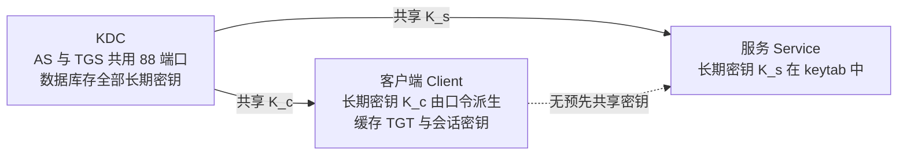
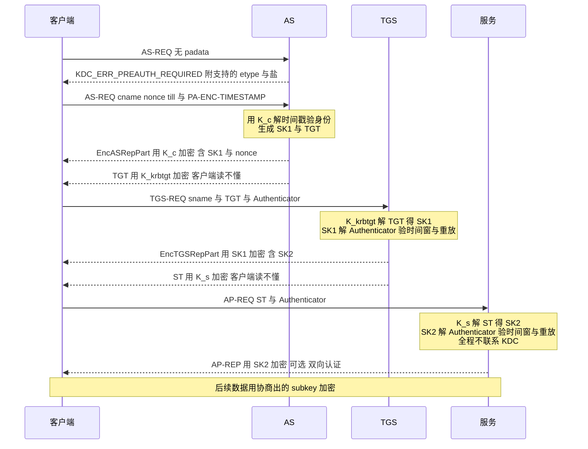
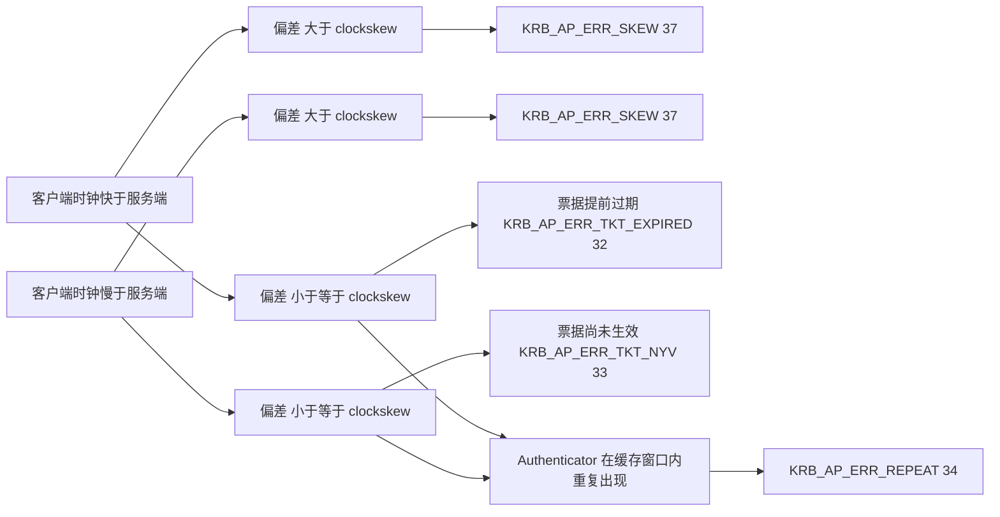
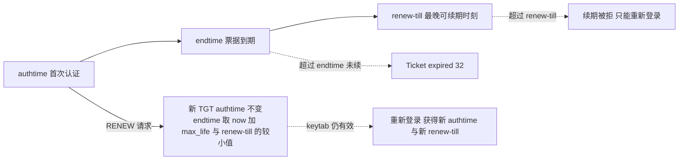
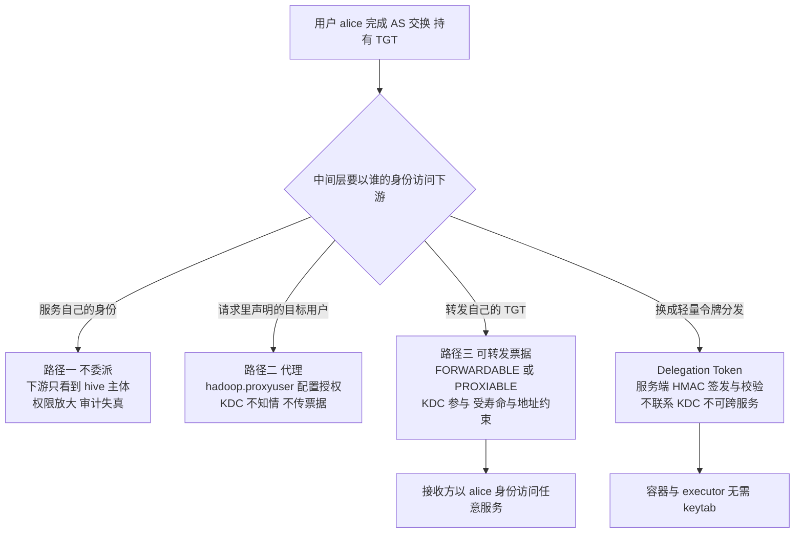
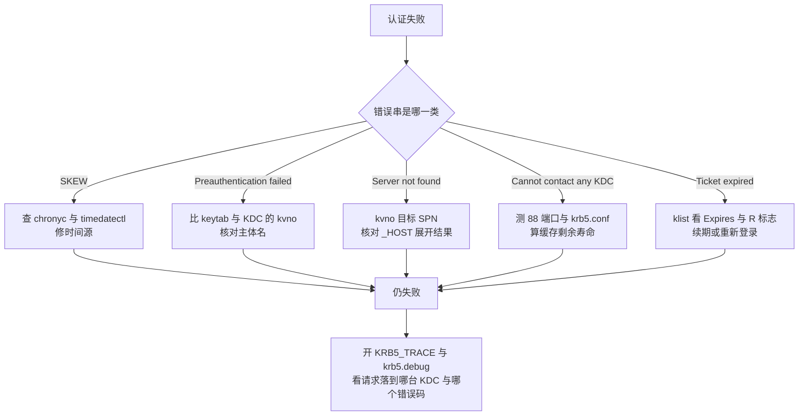

**摘要：**

Kerberos 常被当作 Hadoop 安全模式的前置条件来背：装上 KDC、发 keytab、`kinit` 一下，作业就能提交。这套说法能让人跑通一个集群，却解释不了三件事——为什么换台机器就要重新 `kinit`，为什么容器化之后认证开始随机失败，为什么明明有 TGT 却仍然拿不到服务。本篇不从协议流程说起，而从它的骨架说起：客户端、KDC（AS 与 TGS）、服务端构成的三方模型，以及 AS、TGS、AP 三次交换各自携带了什么、用哪把密钥加密、又各自验证什么。搞清这一层，TGT「客户端解不开却能证明身份」的反直觉之处才有解释，`Authenticator` 与重放缓存的关系也才不是一句口诀。

本篇的另一半落在时间上。Kerberos 把「新鲜」写进了协议：偏差超过 `clockskew` 是 `KRB_AP_ERR_SKEW`，偏差在窗口之内但 `Authenticator` 被缓存过是 `KRB_AP_ERR_REPEAT`，两种报错对应的是完全不同的处置路径。虚拟机的快照回滚、热迁移、云主机的 NTP 漂移，恰好都作用在这个参数上，使它成为大数据平台最常见也最容易被误判的事故源。围绕时间，`kdc.conf` 的票据寿命、续期与重新登录的差别、keytab 里 `kvno` 的失效语义，共同构成一套运维判据。

委派一节最容易混淆：不带委派、代理、可转发票据三条路径，以及 Hadoop 自己签发 `Delegation Token` 这个看上去像委派、实际并不是 Kerberos 委派的第四种做法。读者读完应当能回答：一张票据为什么有时效，一次认证为什么要求两端对表，一个长跑作业该拿 TGT 还是拿 Token。

---

## 第 1 章 三方模型：为什么认证需要一个发证的第三方

### 1.1 从两方困境到三方结构

1980 年代末，MIT 的 Athena 项目要在数百台工作站与服务器之间解决一个看似简单的问题：用户如何在不安全的网络上访问分布在不同机器上的资源。最直接的做法是每台服务器各自保存用户口令，请求到达时比对一次。这个做法在封闭的小网络里能跑，一旦规模上去就露出三个断口：口令要在网络上传输、N 台服务器维护 M 个用户的口令使管理工作量变成乘积关系、每访问一次就多一次被嗅探的机会。

退一步的聪明做法是把验证集中起来：用户只向中央服务器证明自己，再由中央服务器告诉业务服务器「这个人可信」。但这条通知本身又送回了一个老问题——业务服务器凭什么相信通知来自中央服务器，而不是来自恰好能连上它的攻击者。两端之间如果没有共享的密钥，任何一方的声明都无法自证，这是对称密码体制的硬约束，不是工程实现上的疏忽。

Kerberos 的解法是把「共享密钥」从两方之间搬到三方之间：引入一个所有参与者都预先与之共享密钥的第三方，由它充当见证人。客户端与 KDC 共享一份密钥（由用户口令派生），服务端与 KDC 共享另一份（写进 keytab），客户端与服务端之间则不需要任何预先的共享关系。信任的建立从「N×M 条密钥」压缩成「N+M 条密钥」，这条压缩是 Kerberos 全部工程价值的源头，也是它必须在网络上架设一个中心的原因。

不过第三方一旦成为中心，就带来两个新的工程后果。其一是可用性：所有认证的第一步都要联系 KDC，KDC 不可达意味着新会话无法建立。其二是时间：既然三方无法用「预先协商的会话」来区分新旧请求，协议只能用时间戳来标记新鲜度，而时间戳的判定依赖各方的时钟。这两个后果，一个决定了 KDC 必须以主备形态部署，另一个决定了整条链路的可用性会被一个 300 秒的参数掐住，后文各占一章。

### 1.2 三个角色与它们手里的密钥

三方模型里每个角色掌握的材料并不对称，这种不对称正是协议能够在不泄露口令的前提下完成认证的原因。

客户端掌握的是用户的长期密钥（long-term key），由口令经 `string2key` 一类函数派生；它同时掌握一份凭证缓存（credential cache），里面存着换来的票据与会话密钥。KDC 掌握的是全体主体（principal）的长期密钥数据库，它用这些密钥加解密，但从不把密钥本身发出去。服务端掌握的是自己那份长期密钥，通常以 keytab 文件的形式落在磁盘上，由服务进程在启动时读入。

**会话密钥**（session key）不属于任何一方，它是每次交换时临时生成、只存活在一次会话或一张票据生命周期内的对称密钥。这是 Kerberos 的**密钥分层**：长期密钥负责「证明你是你」，会话密钥负责「这一次通信只有我们知道」。分层带来一个容易被忽视的性质——长期密钥在网络上的暴露面几乎为零，口令泄露的唯一途径是本地文件被读走，而不是流量被截获。

下图把三角关系与共享密钥的落点画在一起，注意客户端与服务端之间那条虚线上没有任何密钥。



> [!info] 命名来源
> Kerberos 得名于希腊神话中把守冥界入口的三头犬 Cerberus。协议确实有三个参与方，但真正对应「三头」的并不是三个角色，而是三份密钥：客户端与 KDC 共享的一份、服务端与 KDC 共享的一份、以及每次会话临时生成的一份。

### 1.3 KDC 内部分成 AS 与 TGS

KDC（Key Distribution Center，密钥分发中心）在日常运维里常被当成一台机器，逻辑上它是两个服务。AS（Authentication Service，认证服务）负责验证「你是你」，发一张票据授予票据（Ticket Granting Ticket，TGT）；TGS（Ticket Granting Service，票据授予服务）负责验证「你有资格换票」，凭 TGT 签发访问具体服务的服务票据（Service Ticket，ST）。两者监听同一个 88 端口，靠消息类型区分，所以在网络层面看不出分界。

分开的理由不是洁癖。假设没有 TGS，用户每访问一个服务就要拿口令去 AS 换一次票，口令的使用频率被放大到与访问次数同阶，被截获的机会随之上升；同时 AS 承担了全部请求，扩展性被钉死在一处。有了 TGS，口令只在登录时用一次，换来一张有寿命的 TGT，此后换票只用 TGT 与 TGS 之间的会话密钥。用一句不那么严谨但足够直观的话说，TGT 是园区通用换票证，ST 是单个景点的门票。

这个分工还藏着一个对运维极其重要的性质：票据的验证**不需要 KDC 参与**。服务端拿自己的长期密钥解开 ST 就能验明客户端身份，全程不联系 KDC。因此 KDC 只在「发证」这条路径上，而不在「验证」这条路径上。KDC 挂掉，新建会话会失败，已经建好的会话不受影响；KDC 慢，受影响的是一次性的换票延迟，而不是每一次 RPC。这条性质到第 6 章会变成一条具体的排障判据。

---

## 第 2 章 三次交换：每一格里装了什么

### 2.1 AS 交换：用口令换一张自己读不懂的票据

一次完整的 Kerberos V5 认证由六条消息、三次交换组成，分别对应 RFC 4120 定义的 AS-REQ/AS-REP、TGS-REQ/TGS-REP、AP-REQ/AP-REP。前两次交换面向 KDC，第三次面向业务服务。

AS-REQ 是客户端发给 AS 的请求，请求体里比较关键的字段有五个：客户端主体名（`cname`，有时省略由 KDC 从预认证数据推断）、请求的服务主体名（这里固定填 `krbtgt/REALM@REALM`，即 TGS 服务自身）、希望的到期时间（`till`）、一个随机数（`nonce`）、以及客户端支持的加密类型（`etype`）。除此之外还携带预认证数据（pre-authentication data），最常用的是 `PA-ENC-TIMESTAMP`，即用客户端长期密钥加密的当前时间戳。

预认证的存在是为了堵一个历史漏洞。Kerberos V4 时代 AS 收到请求就直接返回加密的 TGT，攻击者可以对任意主体发起请求，拿到密文后离线爆破口令，这类攻击后来被称作 AS-REP Roasting。要求客户端先证明自己掌握长期密钥，等于把爆破的前提从「有密文」改成「有密钥」，攻击成本从离线穷举变成必须先在网络上失败一次预认证。

实际抓包时会看到两次 AS-REQ，第一次不带预认证数据，KDC 回一个 `KDC_ERR_PREAUTH_REQUIRED`（错误码 25）并附上支持的加密类型与盐值，客户端据此派生密钥后再发一次。这不是客户端在试错，而是协议允许 KDC 在不知道客户端能力的情况下先索要凭据，`kinit -V` 的输出里能看到这两轮。

AS-REP 返回两个加密块。第一个是用客户端长期密钥加密的 `EncASRepPart`，里面装着本次会话的会话密钥、票据有效期、标志位、以及 KDC 回显的 `nonce`；第二个是票据本身，即 TGT，它的密文部分用 `krbtgt/REALM@REALM` 的长期密钥加密，内容包含客户端主体名、同一个会话密钥、有效期与客户端地址。

两个块里装的是同一个会话密钥，却用两把不同的锁各封了一次。客户端只能打开第一把锁，于是它拿到了会话密钥与票据的元信息；它打不开第二把锁，因此永远看不到 TGT 的明文。这种设计常被概括成一句话：TGT 是给 TGS 的信封，不是给客户端看的凭证。但更值得琢磨的是它为什么能成立——客户端明知自己读不懂 TGT 的内容，仍然愿意把它当作身份证明带在身上，因为 TGS 读得懂，而 TGS 的读得懂本身就是「这张票由 KDC 签发」的证明。

`nonce` 在这里承担的是客户端侧的防重放。攻击者若把一张旧的 AS-REP 重放给客户端，`nonce` 对不上，客户端直接丢弃。这和后面 `Authenticator` 里的时间戳是两条不同的防线：`nonce` 保护客户端不受旧应答欺骗，时间戳保护服务端不受旧请求欺骗。

### 2.2 TGS 交换：用 TGT 换一张给服务看的票

拿到 TGT 之后，客户端向 TGS 发 TGS-REQ，换访问具体服务的 ST。请求体里有目标服务主体名（譬如 `hdfs/namenode.example.com@EXAMPLE.COM`）、完整原封不动的 TGT、以及一个 `Authenticator`。

`Authenticator` 是这段协议里最容易被跳过、又最不能跳过的东西。它的内容是 `{客户端主体名, 当前时间, 微秒数, 可选的子密钥, 可选的序号}`，用 AS 交换里得到的会话密钥加密。注意它用会话密钥、不用长期密钥：客户端手里既没有 TGS 的密钥，也没有自己的口令原文，能用的只有这份会话密钥。

它的作用可以这样理解。TGT 是一段静态密文，谁拿到都能原样转发，攻击者截获 TGT 并不需要破解它；真正把「持有者」与「合法客户端」区分开的，是能不能用会话密钥造出一个新鲜的 `Authenticator`。会话密钥只存在于凭证缓存与 TGT 的密文里，截获 TGT 的攻击者拿不到它，也就造不出能通过校验的 `Authenticator`。换句话说，TGT 证明「这张票是真的」，`Authenticator` 证明「**此刻在我的手里**」。

TGS 收到请求后按顺序做五件事：用 `krbtgt` 密钥解开 TGT，取出客户端主体名与会话密钥；用会话密钥解开 `Authenticator`，取出主体名与时间戳；比对两处主体名是否一致，防止拿别人的票冒充；检查时间戳与自己时钟的偏差是否在允许窗口内；查重放缓存（replay cache），确认这个 `(主体, 时间戳)` 组合在窗口内没有出现过。五项里前三项是认证，后两项是新鲜度校验，缺一项都会让前面的工作失去意义。

TGS-REP 同样是两个块。给客户端的部分用会话密钥加密，装着本次新生成的会话密钥与 ST 的元信息；给服务的部分就是 ST，用目标服务的长期密钥加密，客户端依旧读不懂。密钥在这里又换了一次：AS 交换产出会话密钥 SK1（客户端与 TGS 之间用），TGS 交换产出 SK2（客户端与服务之间用）。这种一次一密的分层让任何一段密钥泄露都只影响一段链路。

### 2.3 AP 交换：服务端独立完成验证

第三次交换面向业务服务。客户端把 ST 与一个新的 `Authenticator` 一起放进 AP-REQ，`Authenticator` 这次用 SK2 加密。服务端用自己的长期密钥解开 ST，取出客户端主体名与 SK2，再用 SK2 解开 `Authenticator`，重复 TGS 做过的那套校验：主体一致、时间窗、重放缓存。

服务端**全程不联系 KDC**。只要它手里的 keytab 与 KDC 数据库里那份密钥一致，它就能独立完成验证。这个设计让 KDC 从每一次请求的热路径上退了出去，代价是密钥同步成了运维责任——keytab 与 KDC 数据库一旦不一致，症状就落在服务端，而不是 KDC 侧，这是第 4 章要展开的失效链。

AP-REP 是可选的，用于双向认证：服务端用 SK2 加密一个包含自己时间戳的响应，客户端能解开就说明对面确实持有服务密钥，而不是中间人。此外双方可以借这次交换协商一个子密钥（subkey），后续业务数据用子密钥加密，避免 SK2 被反复使用在同一把密钥上。Hadoop 的 RPC 走 SASL/GSSAPI，双向认证与子密钥协商交给 GSS 层完成，应用层看到的是「连接建立成功」或 `GSS initiate failed`，看不出底下这层交换。

把三次交换并排看，会发现一条贯穿的不变量：长期密钥从不离开它所在的那台机器，会话密钥只在内存与密文中出现，每跨一段链路就换一次密钥。这条不变量解释了为什么 Kerberos 能在明文网络上工作，也解释了为什么它的凭证缓存一旦被读走就等于身份被盗——缓存里存的是会话密钥，不需要口令就能直接使用。

下图把三次交换的加密关系画全，标注了每一格里用的是哪把密钥。



### 2.4 三次交换的对照

把字段与密钥摊成一张表，能看出每次交换解决的问题不同，验证的侧重点也不同。

| 交换 | 客户端出示 | 密钥来源 | 服务端验证什么 | 输出 |
|---|---|---|---|---|
| AS | 主体名、`nonce`、加密时间戳 | 客户端长期密钥 K_c | 时间戳能否解开，是否在窗口内 | TGT 与会话密钥 SK1 |
| TGS | TGT、`Authenticator` | 会话密钥 SK1 | TGT 能否解开、主体是否一致、时间窗、重放缓存 | ST 与会话密钥 SK2 |
| AP | ST、`Authenticator` | 会话密钥 SK2 | ST 能否解开、主体是否一致、时间窗、重放缓存 | 双向认证结果与子密钥 |

表里最容易被误读的一行是 AS 交换的「验证什么」。用户会直觉地认为 KDC 在验证口令，实际验证的是时间戳的密文能否用数据库里那份长期密钥解开——口令从未出现在网络上，KDC 也不需要知道口令原文，它只需要那份派生出来的密钥。这条细节决定了改口令后的失效边界：失效的是旧密钥派生出的票据，不是「登录状态」。

---

## 第 3 章 时间敏感性：300 秒如何决定链路可用性

### 3.1 时间窗本身就是重放窗口

Kerberos 用时间戳判断新鲜度，而时间戳的判定需要一个容差。这个容差在 `krb5.conf` 里叫 `clockskew`，MIT 实现默认 300 秒。很多文档把它描述成「允许的时钟偏差」，仿佛它是一个为了迁就运维不力而设的宽松值；从协议角度看，它其实是**重放缓存窗口**的长度。

推理很直接。服务端接受一个 `Authenticator`，条件是时间戳落在 `[now - clockskew, now + clockskew]` 区间内。为了保证同一个 `Authenticator` 在这个区间里第二次出现时会被拒绝，服务端必须把它记住，记住的时长至少要覆盖整个区间。于是 `clockskew` 越大，重放缓存要保留的条目越多、保留时间越长；`clockskew` 越小，缓存越轻，但对时钟精度的要求越苛刻。300 秒是这两端之间的一个**经验折中**，不是协议硬性规定，也不是安全性上的最优解。

这也解释了为什么「把 `clockskew` 调到 3600 来解决问题」是一剂毒药。它确实能让一台漂移了十几分钟的机器重新通过认证，代价是把全集群的重放窗口放大十二倍：在这一个小时里，任何被截获的 `Authenticator` 都有机会被重放，而重放检测只能靠缓存兜底。真正该修的是时钟，不是容差。

### 3.2 三种时间故障的精确边界

把时间故障当成一种错误是常见误解。同样是「时间不对」，偏差的方向与幅度不同，协议返回的错误码完全不同，处置路径也不同。

偏差幅度超过 `clockskew` 时，服务端或 KDC 在解开 `Authenticator` 后判定时间戳超出窗口，返回 `KRB_AP_ERR_SKEW`（错误码 37）。Java 客户端的报错文本是 `Clock skew too great (37)`，MIT 命令行工具报 `Clock skew too great while getting initial credentials`。这个错误最干净：它只说明一件事，两端时钟差距超过容差，与 keytab、SPN、KDC 可达性都无关。

偏差在窗口之内，但这个 `Authenticator` 在缓存窗口内已经出现过一次时，返回的是 `KRB_AP_ERR_REPEAT`（错误码 34）。这条路径在真实环境里不常见，但一旦出现极难自查，因为时钟看上去是对的。典型触发场景是请求被网络或中间层重发：客户端超时后重试、负载均衡把同一个 TCP 段重放、抓包工具或代理做了透明的请求复制。此时服务端认为「这个时间戳我刚见过」，判为重放。它提示的是**链路层的重复投递**，而不是时钟问题。

偏差方向还会改变错误的表现形式。客户端时钟慢于 KDC 时，KDC 签发的票据 `starttime` 落在客户端的「未来」，客户端本地校验直接拒绝，报 `KRB_AP_ERR_TKT_NYV`（错误码 33），文本是 `Ticket not yet valid`。客户端时钟快于服务端时，票据在服务端看来已经过期，报 `KRB_AP_ERR_TKT_EXPIRED`（错误码 32），文本是 `Ticket expired`。后两种情况都会把排查者引向「票据过期了，重新 kinit」这条错误路径——重新登录能短暂缓解，但漂移还在，过一会儿又坏。

把四种情形放在一张时间轴上会更清楚：窗口之外是硬性拒绝，窗口之内是缓存判重，方向差异决定错误落在客户端还是服务端。



### 3.3 虚拟化与容器：时钟从哪里来

时钟问题在物理机时代相对温和，因为硬件时钟由一块电池维持、NTP 只做微调。虚拟化把这件事变复杂了：虚拟机的时钟不再来自硬件，而来自宿主机的虚拟时钟源，宿主机又可能受制于云平台的调度。一类典型故障是时间跳跃。虚拟机快照回滚后，客户机的时钟回到了快照时刻，可能与真实时间差出几十分钟；热迁移（live migration）把虚机从一台宿主搬到另一台时，若目标宿主的时钟与源宿主不一致，客机时钟会出现瞬时偏差；宿主机休眠后被唤醒，客机内的 NTP 客户端可能还没来得及纠正，应用的认证请求已经发出去了。

容器把这个问题推到了极端。容器与宿主机共享内核，也就**共享同一个时钟源**，容器内既没有必要、通常也没有权限去跑一个独立的 NTP 守护进程。因此「容器没配 NTP」这个说法本身是错位的：不是容器不需要时间同步，而是时间同步必须在宿主机或虚拟机层完成，容器只能继承结果。这也改变故障的形态——宿主机时钟一旦漂走，该节点上所有容器同时出现认证失败，而其他节点一切正常，现象看起来像某个应用自己的问题，实际是一次**节点级的时间事故**。

chrony 与 ntpd 的行为细节值得留意。chrony 默认倾向于用平滑调整（slew）而不是步进（step）来纠正偏差，因为步进会让依赖单调时钟的进程看到时间倒退；只有在偏差超过阈值且满足 `makestep` 许可条件时才步进。这套策略对长时间稳定运行的机器友好，对刚从快照恢复的机器却是灾难——它宁可花几小时慢慢追，也不肯一次跳到正确时间，而这几个小时里 Kerberos 一直是坏的。排查时看到 `chronyc tracking` 里 `System time` 偏差在缓慢收敛、`Last offset` 很大，基本可以确认是这个形态。

另一个隐蔽点是时间源的可用性。集群节点的 NTP 通常指向内网时间服务器，内网服务器再上溯到外部源。中间任何一跳失效，节点会进入「保持当前时钟、慢慢漂移」的状态，波动在几小时内看不出来，一天之后积累到分钟级。这类事故往往在跨天后集中爆发，且集中在少数几个网段，排查时容易被误判为「某些机器上的 keytab 有问题」。

### 3.4 票据寿命、续期与重新登录

时钟决定单次认证能否通过，票据寿命决定一次认证能维持多久。两者都写在配置里，但语义完全不同。

票据寿命由 KDC 侧决定。`kdc.conf` 里 `max_life` 规定单张票据从签发到失效的最长时间，`max_renewable_life` 规定这张票据允许被续期到的最晚时刻，MIT 的默认值通常记为 10 小时与 7 天（具体以对应版本文档为准，不同发行版与 Active Directory 的口径不同）。客户端在 `krb5.conf` 里写的 `ticket_lifetime` 与 `renew_lifetime` 只是「我希望要多久」，KDC 实际签发时取请求值与策略上限中的较小者。所以把客户端配成 24 小时并不会真的得到 24 小时的票据，除非 KDC 的 `max_life` 也放开了。

续期（renew）与重新登录（re-login）是两条不同的路径，混淆它们会导致对长跑作业寿命的错误预期。

续期是用现有的、仍然有效的 TGT 向 TGS 发一次带 `RENEW` 标志的 TGS-REQ，换一张到期时间更晚的 TGT。KDC 会检查三件事：原 TGT 未过期、带 `RENEWABLE` 标志、当前时间未超过 `renew-till`。三项都满足时，新 TGT 的 `authtime` 保持不变（它记录的是「你第一次证明身份的时刻」），`endtime` 取「当前时间加 `max_life`」与 `renew-till` 中的较小值。因此续期**不能突破** `max_renewable_life` 的硬顶，也无法把一张已经过了 `renew-till` 的票救回来。

重新登录是重新走一遍完整的 AS 交换，用 keytab 或口令换一张全新的 TGT。新票据有新的 `authtime`、新的 `renew-till`，等于把寿命重新计一遍。代价是必须有可用的凭据材料——服务账号要有 keytab，且 keytab 里的 `kvno` 与 KDC 数据库一致。Hadoop 的 UGI 选择的是重新登录而不是续期，原因就在这里：只要 keytab 有效，服务进程的认证寿命就不受 `max_renewable_life` 约束。UGI 侧如何调度这件事，见 [[01 Java 安全基石：UserGroupInformation 与 Subject 深度解析]]。

下图把一张 TGT 的生命周期摊开，标出 `authtime`、`endtime`、`renew-till` 三个时刻以及三条失效路径。



### 3.5 量化：容差与寿命的取舍

`clockskew` 的 300 秒放在今天的运维条件下是一个非常宽松的值。同一个机房内经 NTP 或 PTP 同步的节点，偏差通常在毫秒到十几毫秒量级；即便跨地域、走公网 NTP，正常也在几十毫秒（这些数字是量级判断，不构成基准）。300 秒相当于把容差设在了正常偏差的三到四个数量级以上，留下的余地不是给「稍慢一点的时钟」，而是给「NTP 已经完全失效但还没人发现」这种状态。认清这一点，排查时的判断就变得干脆：偏差一旦逼近 300 秒，说明时间同步机制已经出了问题，而不是时钟「稍微不准」。

票据寿命的取舍则是另一组数字。TGT 寿命短，被截获后的可用窗口短，但重新认证的频率高，对 KDC 的请求量与对 keytab 的依赖都上升；寿命长，交互体验好、KDC 压力小，代价是凭证缓存的暴露窗口变长，且一旦 keytab 泄露，攻击者可以用它反复换取长寿命票据。业界常见的组合是 TGT 8 到 24 小时、可续期 7 天，与工作日的作息大致对齐：交互式用户白天不用反复登录，下班后票据自然过期，等于给凭证加了一条按时间收敛的边界。

`renew_lifetime` 设得过长同样有代价。续期不需要口令也不需要 keytab，只需要一张还没过 `renew-till` 的 TGT；如果把可续期设成 30 天，一张被盗的 TGT 在理论上可以自我维持一个月，而管理员在 KDC 侧没有任何主动吊销手段。这正是「没有在线吊销机制」这一设计缺陷的放大器，也是第 8 章反例的伏笔。

| 参数 | 位置 | 默认量级 | 调大的代价 | 调小的代价 |
|---|---|---|---|---|
| `clockskew` | `krb5.conf` `kdc.conf` | 300 秒 | 重放窗口同步放大，缓存压力上升 | 对 NTP 精度要求变苛刻，轻微漂移即报 37 |
| `max_life` | `kdc.conf` | 10 小时量级 | 票据暴露窗口变长，吊销更困难 | 重新认证频繁，长作业更依赖 keytab 或 Token |
| `max_renewable_life` | `kdc.conf` | 7 天量级 | 被盗票据可长期自我续命 | 续期提前失效，跨周末的作业容易断 |
| `ticket_lifetime` | `krb5.conf` | 与 `max_life` 同阶 | 仅在未超 KDC 上限时有效，超了无收益 | 票据频繁过期 |
| `renew_lifetime` | `krb5.conf` | 与 `max_renewable_life` 同阶 | 同上，受 KDC 上限约束 | 可续期窗口变窄 |

---

## 第 4 章 Principal 与 keytab：身份的字符串与它的机器副本

### 4.1 三段式主体名

Kerberos 里的身份标识叫主体（principal），写法是 `primary/instance@REALM`。三段各有分工：`primary` 是主体名，用户主体通常是登录名，服务主体通常是服务名；`instance` 是限定符，服务主体用它放主机名，用户主体在历史上用它区分管理身份；`REALM` 是域，用 `@` 分隔，按惯例全大写。

`/` 与 `@` 的语义差别值得较真，因为排障时错一个字符的表现完全不同。`/` 是主体内部的层级分隔，KDC 把它当成同一个名字的组成部分；`@` 是域分隔，`@` 之后的字符串必须在 KDC 的 realm 列表里存在。把 `hdfs/namenode.example.com@EXAMPLE.COM` 写成 `hdfs@EXAMPLE.COM/namenode.example.com` 是语法错误，写成 `hdfs/namenode.example.com@EXAMPLE.com` 则可能在大小写不敏感的比较里侥幸通过，但一旦涉及 `auth_to_local` 的规则匹配就会失败。

服务主体的 `instance` 放主机名，这条约定支撑了 Kerberos 的一个关键安全属性：服务票据是**绑定到具体主机**的。攻击者拿到 `hdfs/namenode1` 的票据，不能拿去访问 `namenode2`，因为两台机器的主机名不同，KDC 中对应的是两条独立的主体、两把独立的密钥。Hadoop 用 `_HOST` 占位符在运行时把本机主机名填进配置，使同一份配置能落在所有节点上，这个机制的细节见 [[03 Hadoop 安全模式：Kerberos 集成全链路解析]]。

有两个特殊形态需要记住。其一是 `krbtgt/REALM@REALM`，它既是 TGS 服务的主体名，又是加密 TGT 的那把密钥的持有者，`/` 前后两段相同是它的固定写法，跨域信任时会出现 `krbtgt/OTHER@REALM` 这种两段不同的形式。其二是 `user/admin@REALM`，`admin` 作为 instance 表示「管理实例」，按惯例由 `kadm5.acl` 授予管理权限，与同名普通主体是两条独立记录、两把独立密钥。

| 主体形态 | 含义 | 常见误区 |
|---|---|---|
| `alice@EXAMPLE.COM` | 普通用户 | 大小写敏感，`Alice` 与 `alice` 是两个人 |
| `alice/admin@EXAMPLE.COM` | 用户的管理实例 | 与 `alice` 密钥不同，不能互相替代 |
| `hdfs/namenode.example.com@EXAMPLE.COM` | 主机上的服务 | 主机名必须与 DNS 正解一致 |
| `krbtgt/EXAMPLE.COM@EXAMPLE.COM` | TGS 自身与 TGT 加密密钥 | 两段相同是固定写法，不是笔误 |
| `krbtgt/OTHER.COM@EXAMPLE.COM` | 指向对端的跨域信任票 | 方向敏感，反向要另建一条 |

### 4.2 keytab 是长期密钥的容器

服务进程无法交互输入口令，需要一个可以无人值守读取的凭据材料，这就是 keytab（key table）。它是一份二进制文件，里面按条目存放主体名、密钥版本号、加密类型与密钥本体（由 KDC 数据库中的同一份长期密钥导出）。服务进程启动时读入 keytab，用其中的密钥完成 AS 交换，拿到 TGT，全程无需人工。

用 `klist -kte` 可以把这份二进制翻译成人能读的表格。三个选项各管一件事：`-k` 指定 keytab 文件而非凭证缓存，`-t` 显示条目的写入时间戳，`-e` 显示加密类型。

```bash
$ klist -kte /etc/security/keytabs/hdfs.service.keytab
Keytab name: FILE:/etc/security/keytabs/hdfs.service.keytab
KVNO Timestamp           Principal
---- ------------------- ------------------------------------------------------
   3 2026-10-12T09:14:02 hdfs/namenode1.example.com@EXAMPLE.COM (aes256-cts-hmac-sha1-96)
   3 2026-10-12T09:14:02 hdfs/namenode1.example.com@EXAMPLE.COM (aes128-cts-hmac-sha1-96)
   2 2026-06-03T11:20:47 hdfs/namenode1.example.com@EXAMPLE.COM (aes256-cts-hmac-sha1-96)
```

这份输出里有四个信息点。`KVNO` 是密钥版本号，同一主体出现多行不同 `KVNO`，说明文件里同时保留了新旧两代密钥，用于轮换期间的平滑过渡；时间戳是密钥写入文件的时刻，不是密钥生效时刻；同一 `KVNO` 下有两行，是因为 KDC 为该主体保存了多种加密类型的密钥，客户端与 KDC 协商出哪种就用哪种；如果这里只有 `rc4-hmac` 而没有 AES 条目，说明主体是在启用强加密之前创建的，需要重新设密钥。

keytab 与口令的关系必须说得直白：它存的是长期密钥，而长期密钥就是口令经单向函数派生的结果，因此 keytab 在功能上**等价于口令**，且不经过口令的强度约束。拿到 keytab 的人可以直接 `kinit` 出一个合法的 TGT，KDC 无法分辨这是服务自己还是攻击者。这也是为什么 keytab 的权限必须是 600 或更严的 400、属主必须是对应服务账号——644 意味着同主机上任何本地用户都能读走一个服务身份。

> [!warning] keytab 泄露的后果与轮换
> keytab 泄露等于该服务主体的口令泄露，且泄露者不需要知道任何口令原文。唯一有效的补救是轮换密钥：在 KDC 侧换掉该主体的密钥，重新导出 keytab，分发到所有使用该主体的节点。轮换期间旧 keytab 会立即失效，因此要么安排停机窗口，要么用保留旧密钥的方式过渡。

### 4.3 kvno 与改密码：一条被误读的失效链

`kvno`（key version number）是密钥的版本号，每次主体密钥变更就递增一次。它解决的是一个很实际的问题：密钥轮换不是原子的，KDC 数据库更新与各节点 keytab 更新之间必然有时间差，票据在这段时间里可能由旧密钥签发。服务端拿到一张 ST，需要知道该用哪一代密钥去解，`kvno` 就是那个索引。

围绕 `kvno` 最常见的误读是把 `ktadd` 当成轮换。`kadmin` 的 `ktadd` 只是把**当前**密钥导出到 keytab 文件，它不改变密钥，也不递增 `kvno`；真正换密钥的是 `cpw`（change password），对服务主体通常用 `cpw -randkey` 生成随机密钥。因此「定期执行 ktadd 轮换密钥」这个说法在机制上是不成立的：反复 `ktadd` 只会把同一把密钥重新写一遍，泄露的 keytab 依旧有效。

正确的轮换顺序是：先用 `cpw -randkey -keepold` 让 KDC 保留旧密钥并递增 `kvno`，此时新旧两代密钥在 KDC 侧同时有效；把新导出的 keytab 分发到所有节点；确认所有节点都已切换后，用 `kdb5_util purgekeys` 清理旧密钥。`-keepold` 与 `purgekeys` 这对组合是整条链路的关键，缺了前者会在分发窗口内造成大面积失败，缺了后者则让旧密钥长期留在 KDC 里，轮换等于没做。

失效链的表现取决于断在哪一环。KDC 侧密钥已换、节点上的 keytab 还是旧的，`kinit` 会在预认证阶段失败，报 `Preauthentication failed`，因为客户端用旧密钥加密的时间戳，KDC 用新密钥解不开。如果节点上的 keytab 已换、KDC 侧仍是旧的，预认证能过，但服务端用新密钥解不开 KDC 用旧密钥签发的 ST，报 `Key version number for principal in key table is incorrect`（`KRB_AP_ERR_BADKEYVER`，错误码 44）。两种失败都指向「版本不对」，但一个发生在登录环节、一个发生在访问环节，处置的对象完全不同。

还有一类更隐蔽的情形：多台 KDC 之间数据库尚未同步，客户端每次请求可能命中不同的 KDC。命中的那台用新密钥签发 ST，服务端用旧 keytab 解不开；命中另一台则一切正常。症状表现为间歇性失败、重试有时成功，单看某一次日志完全看不出规律。这类问题的根因在 KDC 的复制链路，不在客户端，判据是「同一主体、同一服务、失败率与请求落在哪台 KDC 相关」。

---

## 第 5 章 委派：三条路径与一条判据

### 5.1 中间层带来的身份难题

只要架构里出现中间层，委派问题就会浮现。用户 alice 连上 HiveServer2 提交一条查询，HiveServer2 要去读 HDFS 上一个只有 alice 有权访问的目录。这里有两个身份可选：用 HiveServer2 自己的服务主体去读，或者用 alice 的身份去读。前者简单，但下游看到的是 `hive` 而不是 alice，权限检查与审计记录都会失真；后者符合直觉，但 HiveServer2 手上没有 alice 的口令，也没有她的 keytab。

Kerberos 只解决「alice 如何向 HiveServer2 证明自己是 alice」，不解决「HiveServer2 之后如何以 alice 的身份行事」。这后半件事在 Kerberos 协议里有一条正规路径（可转发票据），在 Hadoop 生态里却有三种不同的做法，它们经常被混为一谈，而混用的后果往往不是报错，而是权限模型悄悄变形。

### 5.2 路径一：不委派

最朴素的做法是中间层用服务身份访问下游。HiveServer2 以 `hive` 主体读 HDFS，NameNode 检查的是 `hive` 的权限，审计日志记的也是 `hive`。这条路径没有任何凭证传递，实现简单、故障面小，在不少平台上是默认选择。

代价有三层。**权限被放大**：为了让 alice 能查那张表，`hive` 这个账号必须在 HDFS 上拥有足够宽的权限，于是任何一个能连上 HiveServer2 的人，实际可访问的数据范围由 `hive` 的权限决定，而不是由自己的权限决定。审计失真：日志里只有服务账号，事后追责要回溯「这条查询是谁提交的」，只能依赖 HiveServer2 自己的审计表，而那份表与 HDFS 侧的记录对不上。授权模型被迫外移：既然 HDFS 侧只能看到 `hive`，细粒度的权限控制就只能放到 Ranger 一类的外部引擎上，靠 SQL 层的策略补齐。

这三层代价并不总是不可接受。权限边界清晰、用户群体小、查询以批处理为主的场景里，不委派反而比传递凭证更稳。判断标准不是「先不先进」，而是「审计要求能不能接受服务账号混同」。

### 5.3 路径二：代理

Hadoop 给了一条配置层的路。`core-site.xml` 里写 `hadoop.proxyuser.<superuser>.hosts` 与 `hadoop.proxyuser.<superuser>.groups`，声明某个超级用户可以从哪些主机、代表哪些组发起代理；代码侧用 `UserGroupInformation.createProxyUser(target, superUGI)` 构造一个代理身份，在其上 `doAs` 执行业务。

这条路径的关键在于它**不是 Kerberos 的能力**。KDC 完全不知道代理的存在，它只看到 `hive` 主体做了一次正常的认证；代理发生在 Hadoop 的 UGI 与 RPC 层，由 NameNode / ResourceManager 在收到请求时检查配置、决定是否接受这个代理声明。因此它本质上是纯配置授权：只要配置允许，`hive` 就能以任意用户的名义行动；配置一旦写成 `hosts=*`、`groups=*`，这个能力就没有边界。

这里有一个容易被忽略的技术细节：代理不传递票据。RPC 连接仍然以 `hive` 的 SASL 身份建立，代理用户的身份通过 RPC 头里的「真实用户」字段传给服务端，服务端用它做权限检查与审计。所以代理能解决「授权按谁算」与「审计记谁」，不能解决「下游第三方系统也要认 alice」——下游如果不在 Hadoop 的代理体系内，凭据仍然只有 `hive` 那一份。

风险也集中在这里。`hive` 的 keytab 一旦泄露，攻击者不只拿到 `hive` 的权限，还拿到「冒充任何人」的开关，因为代理的目标用户是请求里任意填的。这与可转发票据的风险不同：可转发票据至少受票据寿命与地址约束，代理只受配置约束，而配置往往长期不动。

### 5.4 路径三：可转发票据

Kerberos 协议本身提供了转发能力。TGT 带 `FORWARDABLE` 标志时，客户端可以把这张 TGT 交给另一个主体，接收方用 `TGS-REQ` 的 `FORWARDED` 选项向 KDC 换出属于自己使用的服务票据，从而在票据有效期内以原用户身份访问任何该用户有权限的服务。GSSAPI 里由 `GSS_C_DELEG_FLAG` 触发，Java 侧对应 `GSSContext.requestCredDeleg(true)`。

这条路径的语义最贴近「真委派」，代价也最直接。接收方拿到的是一个完整的身份，不限于某个服务、某个目录，凡是原用户能访问的服务它都能访问；原用户无法在协议层限定范围，也**无法在中途撤销**——KDC 没有在线吊销接口，票据只能等它过期。地址约束是唯一的内建限制：票据里带 `caddr` 时，转发到地址不匹配的主机会被拒，报 `KRB_AP_ERR_BADADDR`（错误码 38）。

`PROXIABLE` 是比 `FORWARDABLE` 更细的一档，但它细在地址而非身份。带 `PROXIABLE` 标志的 TGT 允许客户端发 `PROXY` 选项的 `TGS-REQ`，让 KDC 签发一张地址集合可以替换（或干脆清空）的服务票据，从而穿过 NAT、多宿主、动态地址这些环境。它不改变「以谁的身份」这个维度，只放松「从哪来」这个维度。在当下普遍不校验 `caddr` 的部署里，地址维度的放松意义有限，`PROXIABLE` 的实际使用率远低于它的理论价值——这是一个被环境弱化了的能力，而不是被淘汰的能力。

### 5.5 第四种做法：Delegation Token 不是 Kerberos 委派

Hadoop 生态里真正被大规模使用的是委派令牌（Delegation Token），而它跟上面三条路径**都不是一回事**。它由服务端自己签发：NameNode 发 HDFS 的令牌，ResourceManager 发 YARN 的令牌；令牌用服务端的 master key 做 HMAC 签名，结构里带标识、类型、属主、续期者（renewer）、真实用户、签发时间、最晚到期时间与 `masterKeyId`；校验时服务端只需自己持有 master key，完全不需要联系 KDC。

它解决的问题很具体。容器是动态创建的，不可能为每个容器预置 keytab，而一个 Spark 作业动辄几百个 executor；如果每个 executor 都去 KDC 走一次 AS 交换，KDC 会在作业提交的瞬间承受成百上千次请求。令牌可以序列化、可以随作业配置分发，容器拿到令牌就能访问 HDFS，KDC 完全不在链路上。

它同时解决长跑问题，但方式与续期不同。令牌的有效期由服务端策略管理（HDFS 侧的默认量级是 7 天，续期间隔 24 小时，以对应版本文档为准），续期由续期者代表属主发起，不需要属主的 keytab。因此一个跑几天的作业不必依赖 TGT 的 `renew-till`，也不必让容器持有长期密钥。代价是令牌不能跨服务使用：HDFS 的令牌只对 NameNode 有效，拿去访问 Hive 或 Kafka 都不行；每个服务各有自己的令牌体系，这是它的安全边界，也是运维上要多管理一套生命周期的原因。

令牌与 TGT 的关系是派生而非替代：申请令牌的前提是持有一个有效的 Kerberos 身份，令牌只是把这个身份换成一张轻量、可分发、可续期的凭证。这条派生链的结构、`masterKey` 的轮换与 Spark on YARN 的完整分发路径，见 [[03 Hadoop 安全模式：Kerberos 集成全链路解析]]。

下图把三条路径与令牌的信任流画在一起，注意只有可转发票据这条路径让 KDC 知道了「身份被交给别人」。



### 5.6 四条路径的判据

把这些做法放进同一张表，判据就清楚了。选择的依据不是「哪种更先进」，而是「下游是否必须看到真实用户」与「凭证能否安全地送到执行点」这两个问题的答案。

| 场景 | 该用哪条 | 依据 | 反例 |
|---|---|---|---|
| 交互式查询，下游按用户鉴权 | 代理或令牌 | 需要真实用户身份做授权与审计 | 给服务账号开全库权限了事 |
| Spark 作业分发到容器 | Delegation Token | 容器无 keytab，KDC 不该承担扇出 | 把 forwardable TGT 塞进作业配置 |
| 服务间固定调用 | 不委派 | 身份本就该是服务自身 | 为「统一身份」硬套可转发票据 |
| 需要以用户身份访问非 Hadoop 系统 | 可转发票据，且限于短任务 | 协议层唯一能交出身份的方式 | 用长寿命 TGT 支撑多日作业 |
| 多租户平台统一入口 | 代理加白名单 | 配置层可控、可审计 | `proxyuser` 的 hosts 写 `*` |

表里最容易出错的一格是 Spark 那一行。把可转发票据分发给 executor，在单机测试里完全跑得通，因为票据还没过期、地址也没变；一旦作业跨节点、跨天运行，先遇到地址不匹配，再遇到 `Ticket expired`，而这两种失败都不指向「你不该用可转发票据」这个根因。

### 5.7 反例：给长任务发 forwardable TGT

这是生产里反复出现的错误做法，值得单独拆开。它的诱惑在于实现简单：`kinit -f` 拿到一张可转发的 TGT，序列化进作业配置，executor 读出来就能用。三个断点会在不同时间显现。

寿命断点最先到。TGT 的 `max_life` 通常是 10 小时量级，一张票据撑不过一个跨夜的回刷作业。想靠续期延长，就受 `renew-till` 约束；即使 `max_renewable_life` 有 7 天，续期也需要有人持有那张 TGT 并定期向 KDC 发请求，而 executor 生命周期比 driver 短，谁来续期没有答案。

地址断点其次。票据默认带客户端地址，executor 分布在不同节点上，用同一张票的概率极低，报 `KRB_AP_ERR_BADADDR`；把地址清空又失去了一层保护，且需要 KDC 与客户端配合，回到「用配置放宽安全约束」的老路。

撤销断点最致命。票据一旦分发出去，在有效期内无法收回。作业容器被回收后票据仍可能留在日志、临时目录或崩溃转储里，直到自然过期。Delegation Token 至少还能由服务端 `cancel` 掉，可转发票据没有对应操作。

---

## 第 6 章 跨域信任与 KDC 高可用

### 6.1 两个 realm 之间的信任怎么建立

一个企业有两套 realm 是常态：业务集群用 `PROD.EXAMPLE.COM`，办公网与数据仓库用 Active Directory 的 `CORP.EXAMPLE.COM`，用户身份在 AD 里，服务身份在集群里。跨域认证要让 AD 的用户能访问集群的服务，靠的是两个 KDC 之间预先共享的一把密钥。

具体做法是两个方向各共享一条 `krbtgt` 主体：A 与 B 的 KDC 数据库里都存有 `krbtgt/B@A`，两边密钥必须完全一致，A 域的用户才能换到指向 B 的跨域票；反向访问需要另一条 `krbtgt/A@B`，同样在两端各存一份、密钥一致。A 域的用户要访问 B 域的服务时，先向 A 的 KDC 换一张 `krbtgt/B@A` 的票，这张票被称作跨域引用票据（referral ticket）；再把它交给 B 的 KDC，换出 B 域内的服务票。票据里的 `transited` 字段记录经过的域路径，服务端可以据此判断信任链是否在允许范围内。

这里有两个方向性的坑。其一是**方向不对称**：A 信任 B 只让 B 的用户访问 A，反向要另建一条，不存在「建一条就互通」。其二是密钥一致性：两侧同名主体的密钥必须完全相同，轮换时也必须同步，否则跨域票据在接收方解不开，报的错误与 keytab 版本不匹配类似，很容易被误判成本地 keytab 问题。

### 6.2 capaths 与主机名映射

当两个 realm 不在同一个 DNS 层级下，或者信任不是直连而是经过中间域时，客户端无法从域名推断出该找哪台 KDC，需要用 `[capaths]` 显式声明路径。`.` 表示直连，写一组域名表示经过的中间域。`[domain_realm]` 解决的是另一个问题：把主机名后缀映射到 realm，让客户端知道「访问这台机器的服务该向哪个域要票」。这两张表加在一起，构成客户端的 Kerberos 导航图。

导航图出错的表现很有特点：本地 `kinit` 正常，访问本域服务正常，只有跨域访问报 `Server not found in Kerberos database`——因为客户端把目标主机映射到了错误的 realm，向错误的 KDC 要了一张不存在的服务票。判据是「目标 SPN 在本域 KDC 里查不到，但在对端 KDC 里存在」，在两侧分别用 `kadmin getprinc` 或 `kvno` 探一次即可确认。

多集群怎么配，取决于管理边界而不是技术偏好。共享一个 realm 最省事，所有节点一份 `krb5.conf`，没有跨域票据；代价是密钥暴露面扩大到一个域的全部主机，任何一个节点的 keytab 泄露都可能危及同域其他服务，且故障域合并，KDC 出问题影响所有集群。双向互信保留了各自的管理边界，代价是两套 principal 规划、两套 `auth_to_local` 规则，以及跨域排障的复杂度。各自独立再用 Knox 一类网关收口，隔离最好，但跨集群的数据访问要绕经网关，链路变长。

| 方案 | 适用 | 代价 |
|---|---|---|
| 单 realm 全集群共享 | 集群数量少、同属一个管理域 | keytab 暴露面大，故障域合并 |
| 双向跨域信任 | 多集群独立管理、需要互访 | 两套规划与规则，跨域排障复杂 |
| 各自独立加网关 | 强隔离、跨域访问少 | 访问绕行，网关成为新的单点 |

### 6.3 KDC 高可用与本地缓存的兜底边界

KDC 是认证路径上的单点，部署上必须至少两台。客户端侧的配置是在 `[realms]` 下写多条 `kdc`，客户端按顺序尝试，单台超时后才轮转到下一台；也可以依赖 DNS 的 SRV 记录（`_kerberos._udp` 与 `_kerberos._tcp`）做发现，由 `dns_lookup_kdc` 打开。管理面另有 `admin_server` 与 `kpasswd_server` 两个地址，分别对应 `kadmin` 与改密操作，它们不参与日常认证，但改密失败时通常先查这两项。

多台 KDC 之间要复制数据库，主库变更通过 `kprop` 推到从库。**复制有延迟**，延迟窗口内不同 KDC 对同一主体可能给出不同答案，这就是前文提到的间歇性版本不匹配的根源。判据很干脆：同一主体、同一服务，失败率与请求命中哪台 KDC 相关，就是复制问题，不是客户端问题。

| 配置项 | 默认量级 | 调大的代价 | 调小的代价 |
|---|---|---|---|
| `kdc` 列表条数 | 两台 | 全部不可达时要逐台等超时，认证延迟线性叠加 | 只剩一台，失去故障切换余量 |
| `kdc_timeout` | 数十秒量级 | 故障切换变慢，KDC 挂掉时客户端长时间挂住 | 网络抖动即被误判为不可达，频繁切换 |
| `dns_lookup_kdc` | 开启或关闭 | 依赖 DNS 正确性，DNS 故障即认证故障 | 关闭后 KDC 地址变更要改全量配置 |
| `admin_server` 条数 | 一台 | 管理面可切换，但改密请求可能落到从库 | 管理面单点，建主体与改密会失败 |
| `kpasswd_server` 条数 | 一台 | 同上 | 用户改密请求直接失败，与认证无关 |

KDC 全部不可达时，客户端报 `Cannot contact any KDC for realm`。这条错误常被当成「Kerberos 完全不可用」，实际边界要精确得多：KDC **只在发证路径上**。已经建立的 GSS 上下文继续工作，已换到并缓存在本地的服务票据继续可用，正在跑的作业不受影响；拿不到的是新的服务票据与票据续期，因为这两件事都要向 TGS 发请求。所以「KDC 挂了还能用」有严格前提——票据没过期、所需服务的票已在缓存里、这段时间不需要访问新的服务。缓存里那张 TGT 的剩余寿命，就是这次故障的**兜底窗口**；`klist` 看一眼 `Expires` 就能算出还剩多少时间，这个动作应当出现在 KDC 故障预案的第一步。

---

## 第 7 章 五种故障形态与判据

### 7.1 先按错误串分流

Kerberos 的报错文本比错误码更有辨识度，因为错误码在不同语言绑定里会被包一层。实际排障时**按错误串分流**，比按「认证失败」这个笼统分类有效得多。

| 错误串 | 触发条件 | 首查点 | 处置方向 |
|---|---|---|---|
| `KRB_AP_ERR_SKEW` 或 `Clock skew too great` | 两端偏差超过 `clockskew` | `chronyc tracking`、`timedatectl` | 修时间同步，不要调大容差 |
| `Preauthentication failed` | 预认证时间戳解不开，通常是密钥或口令不对 | keytab 的 `kvno`、主体名拼写 | 对齐 keytab 与 KDC 密钥 |
| `Server not found in Kerberos database` | 目标服务的 SPN 在 KDC 中不存在 | `kvno` 目标 SPN、`kadmin getprinc` | 注册服务主体，或用 `_HOST` 正确展开 |
| `Cannot contact any KDC for realm` | 所有 KDC 不可达或响应超时 | `nc -z kdc 88`、`/etc/krb5.conf` | 修网络或 KDC 服务，先算缓存剩余寿命 |
| `Ticket expired` 或 `Credentials have expired` | 票据已过 `endtime` | `klist -f` 的 `Expires` | 重新登录或修续期链路 |

### 7.2 五种形态的进一步分辨

`KRB_AP_ERR_SKEW` 的排查没有分支：先看时间。`timedatectl status` 看系统时钟是否同步、时区是否异常，`chronyc tracking` 看偏差与收敛趋势。要注意的是「系统时钟看起来对」不等于 `chrony` 在工作，如果 `chronyc tracking` 里 `Reference ID` 变成全零、`Leap status` 显示 `Not synchronised`，或者 `System time` 的偏差在单调增大，说明时间源已经不可达、系统在自由漂移，此时正确的处置是修时间源，而不是重启应用。

`Preauthentication failed` 有两种来源，频率差别很大。其一是 keytab 与 KDC 里的密钥对不上，通常发生在轮换之后，`kvno` 能直接看出来；其二是主体名写错，`hdfs/namenode.example.com@EXAMPLE.COM` 里的主机名与实际 DNS 正解不一致，导致 KDC 找不到对应记录——但这种情形更常见的报错是 `Client not found in Kerberos database`，所以看到预认证失败时优先怀疑密钥版本，其次怀疑大小写与全限定域名。

`Server not found in Kerberos database` 是服务端主体缺失。常见原因是部署时用 IP 或短主机名注册了 principal，而客户端按全限定域名去要票，两边对不上。用 `kvno <spn>` 直接探一次最快：存在则返回票的版本号，不存在则报这个错。Hadoop 的 `_HOST` 占位符在运行时替换成本机主机名，如果 `hostname -f` 返回的不是全限定域名，注册出来的主体就是错的，这一点在多网卡主机上尤其容易踩。

`Cannot contact any KDC for realm` 的排查要先确认「不可达」是网络问题还是 KDC 服务问题：`nc -zv kdc1 88` 测端口，`kinit -V` 看客户端尝试了哪些地址、超时多久。若端口通但请求超时，可能是 KDC 进程假死或数据库锁；若端口不通，先看防火墙与路由。这时应当立刻评估缓存剩余寿命，避免在修 KDC 的同时让长跑作业因票据过期而失败。

`Ticket expired` 与 `Credentials have expired` 指向票据生命周期。判据是看 `klist -f` 里 `Expires` 与当前时间的关系，以及标志位里有没有 `R`（renewable）。有 `R` 且未过 `renew-till` 时可以续期，没有 `R` 或已过 `renew-till` 就只能重新登录。如果服务进程本该有自动重新登录却在过期后才报错，问题在 UGI 的续期线程或 keytab 可读性，不在 KDC。

### 7.3 调试手段与观测点

命令行侧的三个工具足够覆盖大多数场景。`klist -fte` 一次给出票据、标志位与到期时间，是判断「有没有票、票还能用多久、能不能续」的第一动作。`KRB5_TRACE=/dev/stderr kinit -kt ...` 把客户端与 KDC 的往返逐条打出来，包含尝试了哪台 KDC、协商了什么加密类型、KDC 返回了哪个错误码。`kvno <spn>` 用来单独验证服务主体是否存在以及版本号是多少，不依赖应用。

JVM 侧靠系统属性。`-Dsun.security.krb5.debug=true` 打开 JDK 内部 Kerberos 调试输出，能看到 AS/TGS 请求的构造与应答解析；Hadoop 侧再叠加自己的认证日志，能定位到是登录阶段失败还是访问阶段失败。两者的区别很重要：登录失败说明 keytab 或 KDC 有问题，访问失败说明票据换不出来或服务端拒绝，指向完全不同的对象。



---

## 第 8 章 边界与反例

### 8.1 四个反复出现的反例

时钟相关的反例在容器化之后换了一副面孔。常见的处置是在容器镜像里装 `chrony` 并在启动脚本里跑起来，这不但无效，还制造了一种「已经处理过时间问题」的错觉：容器与宿主共享内核时钟，容器内的守护进程改不了宿主时间，只会不断失败或把偏差写进自己的日志。正确的位置在**宿主机与虚拟机层**——节点上跑时间同步，虚机确保虚拟时钟源正确、快照恢复后强制校时。诊断时判断「是个别容器还是整节点」比看容器日志更有价值，同节点所有容器同时失败几乎可以确定是宿主时钟。

keytab 权限是另一个。部署脚本为了省事把 keytab 放在 `/etc/security/keytabs` 下并 `chmod 644`，理由是「多个服务账号都要读」。644 的效果是同主机任何本地用户都能读走一个服务身份，而读走之后不需要任何口令就能换出合法 TGT。正确的做法是属主设为对应服务账号、权限 600 或 400，需要多账号读取时用组权限而不是放开所有人。判据是 `ls -l` 的输出里 group 与 other 位都不应有 `r`。

第三个反例在第 5 章已经展开：给长任务分发可转发票据。它的危险不在于会立刻报错，而在于小规模测试完全正常，直到作业跨节点、跨天才暴露，此时改动已经沉淀进作业模板。

第四个反例是把 `clockskew` 调大当作修复手段。它能让报错消失，掩盖的是时间同步失效这一真实故障，同时把重放窗口放大。若确实需要临时放宽，应当记录放宽的原因、期限与回滚条件，而不是让它成为长期配置。

| 反例 | 现象 | 根因 | 处置 |
|---|---|---|---|
| 容器内跑 NTP | 同节点所有容器同时认证失败 | 容器无独立时钟 | 在宿主或虚机层同步 |
| keytab 权限 644 | 无异常日志，但身份可能已被冒用 | 长期密钥可被任意本地用户读取 | 改属主与权限，轮换密钥 |
| 长任务分发可转发票据 | 跨节点报地址错误，跨天报过期 | 票据寿命与地址约束 | 改用 Delegation Token |
| 调大 `clockskew` | 报错消失，偶发重放判定 | 时间同步已失效 | 修 NTP，恢复容差 |

### 8.2 协议不管的那些事

把边界划清楚，能避免把 Kerberos 当成万能答案。它**只做认证**，回答「你是谁」，不做授权，不回答「你能做什么」。HDFS 的文件权限、Hive 的库表权限、Ranger 的策略，都是在认证通过之后另起的一套判定，Kerberos 票据里没有任何权限信息。因此「Kerberos 配好了为什么还能越权访问」不是一个问题，认证与授权本来就是两件事，后者的覆盖范围见 [[04 Apache Ranger 权限管控体系深度解析]]。

它也**不提供在线吊销**。票据一经签发，在有效期内无法作废，KDC 没有「拉黑某张票」的接口。这个缺陷的补偿手段只有两条：把票据寿命压短，以及把长期密钥保管好。所有关于「票据被盗后怎么办」的答案，最终都落回这两条。

它不管理会话。Kerberos 的票据是身份凭证，不是会话凭证；应用侧的会话超时、单点登录的会话状态，都是应用或网关自己维护的。把票据寿命当成会话寿命来设计，会得到一个「用户下班后票据过期但应用仍认为在线」的错位状态。

---

## 结语

回到三方模型上看，Kerberos 的设计选择其实只有一句话：用「与第三方共享的长期密钥」换取「两端无需预先共享密钥」，再用「有时效的票据」把这份信任压缩到一个可控的时间窗口里。前半句决定了它必须有一个中心，于是有了 KDC 的高可用问题；后半句决定了它必须信任时钟，于是有了 300 秒容差带来的一连串运维约束。

这些约束不该被当成协议的瑕疵。没有时间窗，重放就无法判定；没有票据寿命，泄露就没有尽头；没有密钥分层，会话密钥就会退化成长期密钥。运维上的每一次报错，几乎都能映射回这三条设计里的某一条：`KRB_AP_ERR_SKEW` 是时间窗在提醒你时钟坏了，`Preauthentication failed` 是长期密钥在提醒你版本不对，`Ticket expired` 是寿命在提醒你续期链路断了。把报错读成设计约束的回声，比把报错当成待消除的噪声更有用。

委派那几条路径的取舍也是同一逻辑。可转发票据最贴近协议的原始语义，却最难控制；代理最不像 Kerberos，却在多租户平台里最好用；Delegation Token 根本不是 Kerberos 委派，却解决了前两者都解决不了的分发与扇出问题。选择依据不在协议纯度，而在「下游要不要看到真实用户」与「凭证能不能安全送到执行点」这两个问题上。

时钟这件事值得单独留一句。它看起来是最土的基础设施，实际上决定了整条认证链路的可用性边界；它也是最容易被虚拟化抹掉的一层，因为容器里看不到它、快照会冻结它、热迁移会打乱它。把它当成协议的一部分来运维，比把它当成「运维该做的事」更贴近事实。七个环节如何串成一条完整的信任链，以及某个环节返回 401 或 403 时按什么顺序定位，见 [[08 大数据安全体系全景串联]]。

---

## 参考资料

1. RFC 4120, The Kerberos Network Authentication Service (V5)，<https://www.rfc-editor.org/rfc/rfc4120>
2. RFC 6649, Deprecate DES, RC4-HMAC, and Plaintext for Kerberos，<https://www.rfc-editor.org/rfc/rfc6649>
3. RFC 8009, AES Encryption with HMAC-SHA2 for Kerberos V5，<https://www.rfc-editor.org/rfc/rfc8009>
4. MIT Kerberos Documentation，`krb5.conf` 与 `kdc.conf` 配置说明，<https://web.mit.edu/kerberos/krb5-latest/doc/admin/conf_files/krb5_conf.html>
5. MIT Kerberos Documentation，KDC 配置说明，<https://web.mit.edu/kerberos/krb5-latest/doc/admin/conf_files/kdc_conf.html>
6. Apache Hadoop, Hadoop in Secure Mode，<https://hadoop.apache.org/docs/stable/hadoop-project-dist/hadoop-common/SecureMode.html>
7. Apache Hadoop, hdfs-default.xml（票据与委派令牌相关默认值），<https://hadoop.apache.org/docs/stable/hadoop-project-dist/hadoop-hdfs/hdfs-default.xml>
8. chrony 项目文档，<https://chrony-project.org/documentation.html>

---

> [!note] 思考题
> 1. TGT 由 `krbtgt` 密钥加密，客户端读不懂内容却仍把它当作身份证明。如果客户端完全无法验证 TGT 的合法性，它凭什么相信 KDC 返回的这张票是真的，而不是中间人塞给它的伪造品？
> 2. 偏差在 `clockskew` 之内但 `Authenticator` 被服务端缓存过会报 `KRB_AP_ERR_REPEAT`。什么样的网络或中间层行为会导致同一个 `Authenticator` 被投递两次，又该如何在客户端侧避免这种重复投递？
> 3. 代理（`hadoop.proxyuser.*`）不传递票据、也不经过 KDC，下游看到的却是真实用户。这种设计在多租户平台里如何避免 superuser 的 keytab 成为「冒充任何人」的总开关？
> 4. Delegation Token 由服务端自己签发与校验，不联系 KDC。当 NameNode 与 ResourceManager 各自维护一套令牌时，一次跨服务调用里令牌如何流转，哪些环节可能因为令牌类型不匹配而失败？
> 5. 把票据寿命从 10 小时压到 2 小时，安全性提高的同时会带来哪些新的运维负担，这种取舍在什么规模的集群上才划算？