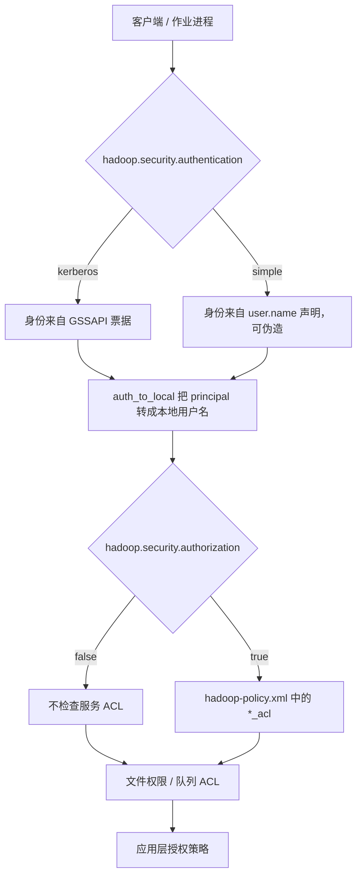
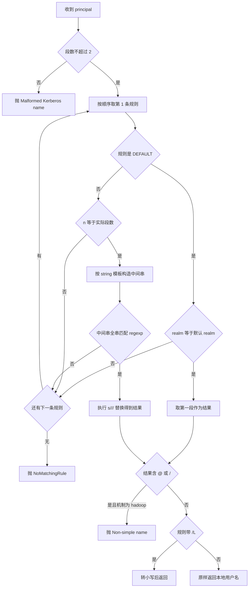
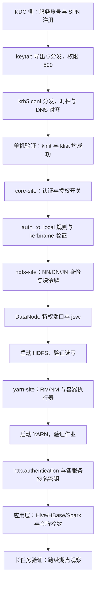
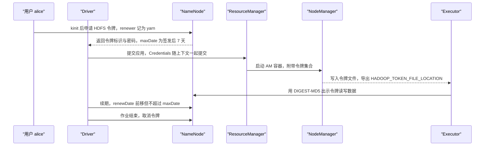
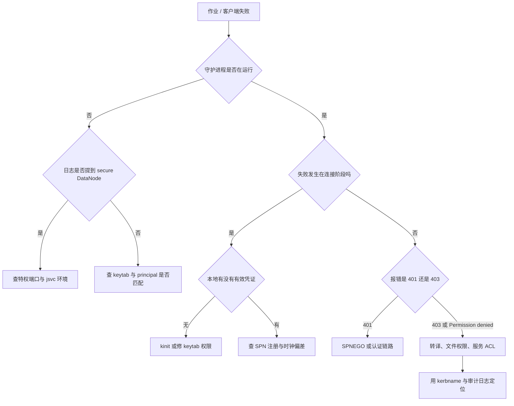

**摘要：**

把 `hadoop.security.authentication` 从 `simple` 改成 `kerberos`，只是宣告集群要走认证，离"能跑"还隔着很长一段路。服务账号与 keytab、principal 的通配展开、名字转译、DataNode 的特权端口、Web UI 的 SPNEGO、容器里取不到票据时使用的委托令牌，每一项都是一次独立改造，漏掉都会在某个时刻以完全不同面貌的故障出现，而且这些故障大多有延迟：端口配错当天就炸，令牌有效期配错要等七天。本文沿着一次真实形态的迁移过程，先把安全模式拆成四个开关，说清"认证"与"服务级授权"为什么是两件事；再给出名字转译的规则引擎与配错后的判据；然后把改造拆成 12 项清单，逐项标注不改会怎样；最后把委托令牌的签发、续期、传递、过期，与 SPNEGO 的 401 循环收束到一张故障判据表上。安全模式的成本不在配置里，而在它新引入的依赖项——KDC、keytab、时钟、DNS——以及这些依赖项对应的运维流程。读者应当拿到的是一条可执行的改造顺序与排查入口，并非一份可以照抄的配置清单。

---

## 第 1 章 安全模式的四个开关

### 1.1 一次只改了一个参数的迁移

设想一个典型的中等规模集群：三十来个节点，HDFS 与 YARN 分开部署，Hive 与 Spark 都跑在 YARN 上，日常用户两百出头。它此前一直运行在 Simple 模式，也就是谁都可以用 `HADOOP_USER_NAME` 冒充别人；某次合规审计之后，团队被要求在一个周末窗口内切换成安全模式。

值班的人最先改的是 `core-site.xml` 里的那一行，把 `hadoop.security.authentication` 从 `simple` 改成 `kerberos`，然后按惯例滚动重启。接下来的七十二小时，故障按顺序出现，每一个看起来都跟上一个毫无关系：

- 第一批客户端报 `No valid credentials provided (Mechanism level: Failed to find any Kerberos tgt)`，因为提交机上没有人 `kinit`；
- 补上 keytab 之后能连上 NameNode 了，但写 `/user/alice` 时报 `Permission denied`，因为服务端的 `auth_to_local` 把 principal 转译成了本地并不存在的名字；
- DataNode 一个都没起来，日志里只有一句 `Cannot start secure DataNode` 开头的告警；
- 集群修好之后 Web UI 打不开，浏览器在 401 与跳转之间循环；
- 一周之后，一个跑了六天的 Spark 作业在凌晨挂掉，报 `Token has expired`。

这五次故障的根因分散在五份不同的配置里，却属于同一次改造。把它们归到一处就能看出：安全模式并非一个开关，它是对"身份从哪里来、到哪里去、凭什么被承认"这条链路的整体替换，任何一段还是旧的，整条链就断在那里。按笔者的经验，真正需要独立决策的开关是四个，其余都是它们在各组件上的投影。

### 1.2 四个开关各自管什么

四个开关分别落在认证、授权、名字转译、组件覆盖四个层次上。它们的默认值都很"宽松"：认证默认 `simple`，授权默认 `false`，`auth_to_local` 默认为空（等价于只写了一条 `DEFAULT`）。也就是说，一个未经改造的 Hadoop 集群在这三项上全部处于关闭状态。

| 开关 | 落点 | 管什么 | 不管什么 | 默认值 |
|---|---|---|---|---|
| `hadoop.security.authentication` | `core-site.xml` | 客户端与服务之间是否用 Kerberos 做身份认证 | 不决定你是谁、能做什么 | `simple` |
| `hadoop.security.authorization` | `core-site.xml` | 是否对每个 RPC 服务做服务级 ACL 检查 | 不参与身份认证，与 Kerberos 无依赖关系 | `false` |
| `hadoop.security.auth_to_local` | `core-site.xml` | 把 principal 转译成本地用户名 | 不改变认证结果，也不改变 token | 空 |
| 组件级 `*.authentication` 与 principal/keytab | `hdfs-site.xml`、`yarn-site.xml`、`mapred-site.xml`、HBase/Hive 自己的配置 | 每个进程用哪个身份、哪个 keytab 登录 | 不覆盖全局开关的语义，只决定具体身份 | 各组件不同 |

前两项的默认值直接决定了迁移的第一步。只打开认证不打开授权，等于在门口装了人脸识别，楼里每扇门却没有锁：任何拿到合法票据的人都能对任意服务发起 RPC。反过来只打开授权不打开认证，服务级 ACL 比对的那个用户名来自客户端声明的 `user.name`，冒充一个人的成本是改一个查询参数。

### 1.3 认证与服务级授权：最容易混淆的一对

`hadoop.security.authorization` 这个名字起得不好。"authorization"在中文语境里经常被笼统地译成"授权"，于是很容易被理解成"Kerberos 认证之后的下一步"，好像它必须依赖 Kerberos 才能生效。事实是两个开关**完全正交**：`authorization=true` 在 Simple 模式下同样生效，只是此时它比对的名字可以被伪造；`authentication=kerberos` 打开而 `authorization=false` 时，认证是真的、授权检查却根本不存在。

要理解它管的是什么，得先看 Hadoop 的 RPC 分层。Hadoop 的每个服务都暴露若干协议，客户端通过协议调用远端方法：`ClientProtocol` 是 HDFS 客户端与 NameNode 之间的主协议，`DatanodeProtocol` 是 DataNode 向 NameNode 汇报的心跳协议，`ResourceTrackerProtocol` 是 NodeManager 向 ResourceManager 汇报的协议，`ApplicationMasterProtocol` 是 AM 向 RM 申请资源的协议。服务级授权就是在这些协议的入口处挂一张名单，问一句"调用这个协议的人，允许吗"。

名单写在 `$HADOOP_CONF_DIR/hadoop-policy.xml` 里，形如 `security.client.protocol.acl`、`security.datanode.protocol.acl`、`security.job.client.protocol.acl`。每一项的值是"用户列表 组列表"，两者之间用一个空格分隔，例如 `alice,bob mapreduce` 表示 `alice`、`bob` 以及 `mapreduce` 组的成员可以提交作业。`*` 表示所有人都可以。未被显式定义的协议，取 `security.service.authorization.default.acl` 的值；这一项也未定义时，取 `*`。

这个默认回退链条值得单独记一笔：打开 `authorization=true` 之后，如果没有逐个收紧 ACL，实际效果是"检查开着了，但名单是通配"，日志里不会出现任何拒绝，管理员很容易误以为授权已经生效。Hadoop 官方文档对这一点有一句明确的定位，服务级授权发生在"文件权限、队列权限等其它访问控制检查之前"，它是**第一道闸**，不是最后一道闸；文件权限与队列 ACL 仍然各管一段，Hive 表级与列级的策略则由 Ranger 之类的组件承担，那部分在 [[04 Apache Ranger 权限管控体系深度解析]] 里展开。

修改 `hadoop-policy.xml` 不必重启。NameNode 与 ResourceManager 都支持热刷新：

```bash
# 改完 hadoop-policy.xml 后，让 NameNode 重新加载服务级 ACL
hdfs dfsadmin -refreshServiceAcl

# ResourceManager 侧同理
yarn rmadmin -refreshServiceAcl
```

刷新入口本身也受 ACL 约束，`security.refresh.policy.protocol.acl` 决定谁能执行这两条命令。把它留成通配，意味着任何用户都可以随时改回一张宽松的名单，这是迁移时容易漏掉的一个提权面。

被服务级 ACL 拒绝时，客户端拿到的是 `AuthorizationException`，日志形如 `User alice is not authorized for protocol ...`（具体措辞随版本略有差异）。这与 Kerberos 认证失败的表现完全不同：认证失败发生在连接建立阶段，客户端连 RPC 头都发不完；授权失败发生在连接已经建立、身份已经确认之后。区分这一点，是后面第 7 章故障判据表的第一个分叉。

| 检查层次 | 配置载体 | 回答的问题 | 失败表现 | 生效时机 |
|---|---|---|---|---|
| 认证 | `hadoop.security.authentication` | 你是谁 | 连接阶段失败，`GSS initiate failed`、`No valid credentials` | 建立连接时 |
| 服务级授权 | `hadoop-policy.xml` | 你能调用哪个 RPC 服务 | 连接成功后被拒，`AuthorizationException` | 每次 RPC 调用 |
| 文件/队列授权 | POSIX 权限位、ACL、队列 ACL | 你能读哪个文件、进哪个队列 | `Permission denied`、队列提交被拒 | 业务操作执行时 |
| 应用级授权 | Ranger/Hive 策略 | 你能看哪张表、哪一列 | 应用层报错或空结果 | 应用解析阶段 |

一个常见的误解是把 `authorization=true` 当成"打开 Kerberos 的配套开关"，于是测试集群上不敢打开它，安全集群上打开了却从不配置 `hadoop-policy.xml`。前者失去了在没有 KDC 的环境里演练服务 ACL 的机会，后者只给了一个**虚假的安全感**。

### 1.4 组件级覆盖：全局开关的投影

第四个开关并不是一个配置项，而是一组配置项。`hadoop.security.authentication=kerberos` 只说了"要用 Kerberos"，至于 NameNode 用哪个 principal、keytab 放在哪里、DataNode 从哪个地址登录、HBase RegionServer 是否也跟随这个设置，全部由各组件自己的配置决定。把它们列在一起看，会发现覆盖是逐层扩大的：

| 组件 | 覆盖项示例 | 覆盖的是什么 |
|---|---|---|
| HDFS | `dfs.namenode.kerberos.principal`、`dfs.datanode.kerberos.principal`、`dfs.journalnode.kerberos.principal` | 服务实例的身份 |
| HDFS | `dfs.data.transfer.protection` | 数据传输通道的保护级别，与认证方式选择相关 |
| YARN | `yarn.resourcemanager.principal`、`yarn.nodemanager.principal`、`yarn.web-proxy.principal` | 服务实例的身份 |
| MapReduce | `mapreduce.jobhistory.principal` | JobHistory Server 的身份 |
| HBase | `hbase.security.authentication`、`hbase.master.kerberos.principal` | 是否启用 Kerberos 与具体身份 |
| Hive | `hive.server2.authentication`、`hive.metastore.sasl.enabled` | 接入层与元数据层的认证方式 |

这些覆盖项里最容易出事的是两类。一类是 principal 与 keytab 的错配：配置写着 `nn/_HOST@EXAMPLE.COM`，keytab 里却只有 `hdfs/_HOST@EXAMPLE.COM`，进程启动时登录失败，日志里是 `Failed to find any Kerberos tgt` 或 `Unable to obtain password from user`，看起来像 KDC 的问题，实际是 keytab 内容与配置对不上。另一类是组件级开关没有跟随全局开关：全局打开了 Kerberos，HBase 的 `hbase.security.authentication` 还是默认的 `simple`，于是 HBase 客户端用 Simple 方式连接一个已经强制 Kerberos 的 RPC 端口，报错会指向 SASL 机制协商失败，而不是指向那行没改的配置。

还有两个经常被误当成"认证开关"的保护级别配置，需要单独澄清。`hadoop.rpc.protection` 控制的是 SASL 连接建立之后的保护强度，取值 `authentication`、`integrity`、`privacy`，默认 `authentication`，它不决定要不要认证，只决定认证之后的数据是否签名、是否加密。`dfs.data.transfer.protection` 控制 DataNode 数据传输通道的同名选项，它的特殊之处在于：一旦设置，DataNode 会改用 SASL 认证数据传输，从而允许绑定非特权端口，这条路径与下一节的特权端口方案**互斥**。

下面这张图把四个开关作用的位置画在一起，可以看到它们并不是一条直线上的四道闸，而是分布在一次调用的不同阶段。



这张图也解释了为什么"只改一行再重启"必然失败：从 B 到 E 之间还隔着一个转译步骤，从 E 到 H 之间还隔着一个默认关闭的开关，而从 I 往后属于另外两套体系。一次迁移要把这条链上每一段的输入输出都对齐，而不是把某一个节点改成"开"。

---

## 第 2 章 auth_to_local：一条正则决定你是谁

### 2.1 为什么 Kerberos 名字不能直接当用户名

Kerberos 的 principal 有三段结构：`primary/instance@REALM`。`nn/namenode01.example.com@EXAMPLE.COM` 里 `nn` 是服务名，`namenode01.example.com` 是实例（通常是主机名），`EXAMPLE.COM` 是 realm。而 HDFS 的权限体系用的是本地用户名与组名：文件属主是 `hdfs`，属组是 `hadoop`，权限位是 `drwxr-xr-x`。

两者之间不能直接画等号，原因有三层。第一层是字符集，本地用户名不允许出现 `@` 与 `/`（在 Hadoop 默认的转译机制下，带这两个字符的结果会被直接判为非法，后文会看到具体报错）。第二层是语义，`primary` 才是"人"，`instance` 往往是"这台机器上的这个服务"，realm 是"哪个认证域"；把三段拼起来当用户名，等于把身份证号当姓名用。第三层是可管理性，同一个真人在集群里的身份可能是 `alice@EXAMPLE.COM`，也可能是从 AD 信任域来的 `ALICE@AD.EXAMPLE.COM`，而他在 Linux 上只有一个 `alice`，两者必须收敛到同一个本地名字，否则权限、配额、审计三条记录会对不上。

这个转译动作在 Hadoop 里承担的工作比表面看起来要重。它一次性决定了三件事：文件权限检查用哪个用户名去比对属主与权限位；组解析（`hadoop.security.group.mapping`）以哪个用户名去查系统组；超级用户判断（NameNode 认为谁是 `hdfs`）以哪个名字为准。换句话说，转译错一位，后面三条**全部跟着错**，而且错误形态各不相同：可能是启动失败，可能是权限拒绝，也可能是"一切正常"但超级用户换成了别人。

打个比方，这一步像海关的落地签窗口：护照（principal）是外文写的，本国系统只认身份证号（本地用户名）。窗口的转译表写错，人明明合法，却查不到户籍，办不了事；更糟的一种情况是表把所有人都转译成同一个身份证号，于是每个人都成了那个号的主人。

### 2.2 规则语法逐段拆解

`hadoop.security.auth_to_local` 的值是一串用空白分隔的规则，按书写顺序自上而下求值，第一条命中即返回，因此顺序本身是**语义的一部分**。规则只有两种形态：`RULE:[n:string](regexp)s/pattern/replacement/g` 与 `DEFAULT`。

| 片段 | 作用 | 容易错在哪里 |
|---|---|---|
| `RULE:` | 声明这是一条规则 | 大小写敏感，必须大写 |
| `[n:string]` | `n` 是 principal 的段数；`string` 是构造中间串的模板 | 把 `string` 当成替换模板用；`n` 与实际段数不一致导致规则永不命中 |
| `$0`、`$1`、`$2` | 在 `string` 里分别代表 realm、第一段、第二段 | 以为 `$0` 是整串；用了 `$2` 却没写进模板 |
| `(regexp)` | 中间串必须**全串匹配**才能继续 | 把它当 `find` 用，漏写首尾的 `.*` |
| `s/pattern/replacement/` | 对中间串做替换，默认只替换第一处 | 以为是全局替换，忘了 `g` |
| `g` | 替换改为全局 | 与 `/L` 的位置混淆 |
| `/L` | 对最终结果转小写（Hadoop 对 MIT 语法的扩展） | 以为 `DEFAULT` 会自动小写 |
| `DEFAULT` | realm 等于默认 realm 时取第一段 | 以为它对所有 realm 生效 |

`n` 的校验是硬性的：`n` 必须与 principal 的实际段数相等，规则才会被尝试。`alice@EXAMPLE.COM` 是 1 段，`nn/node01@EXAMPLE.COM` 是 2 段。Hadoop 的解析器本身只支持最多两段，超过两段的 principal（譬如 `a/b/c@REALM`）会直接抛 `Malformed Kerberos name`，根本进不了规则求值——3.3.x 的 `KerberosName` 源码里，名字解析正则是 `([^/@]+)(/([^/@]+))?(@([^/@]+))?`，没有第三段的位置。

`string` 是"构造中间串"的模板，不是 sed 的替换串。很多人把正则直接写在 `string` 的位置，或在 `string` 里写了 `$1` 却期待 `instance` 参与匹配。求值顺序是先用 `string` 拼出字符串（`$0` 换成 realm，`$n` 换成第 n 段），再拿 `(regexp)` 匹配它。因此格式写成 `[2:$1@$0]` 时，中间串是 `nn@EXAMPLE.COM`，`instance` 根本没进去，后面正则再怎么写都看不到主机名；只有 `[2:$1/$2@$0]` 才能得到 `nn/node01.example.com@EXAMPLE.COM`。

`(regexp)` 用的是**全串匹配**（Java 的 `Matcher.matches()`），不是包含匹配。写 `([ndj]n/.*@REALM)` 能匹配 `nn/node01@REALM`，因为 `.*` 吃掉了中间部分；写 `([ndj]n/)` 永远不匹配，因为它只覆盖前缀。规则不匹配时不报错，只是继续往下走；所有规则都不匹配时才抛 `NoMatchingRule`，日志形如 `No rules applied to alice@AD.EXAMPLE.COM`。这让"正则写错"与"规则没写"表现完全一致，排查时容易误判。

`s/pattern/replacement/` 里的 `$1` 指的是 `pattern` 的捕获组，而不是 principal 的段。这个坑在写"把 `alice/admin` 映射成 `alice`"这类规则时最容易踩：`pattern` 里没有捕获组时，替换串写 `$1` 会让 Java 抛异常。最稳妥的写法是把"映射到固定名"与"截取某一段"分开：前者直接用 `s/.*/hdfs/`，后者在 `pattern` 里显式加组。

`DEFAULT` 的行为比它的名声窄得多。它只在 principal 的 realm 等于默认 realm（通常来自 `krb5.conf` 的 `default_realm`）时才生效，取值是第一段；realm 不相等时它返回空，等价于"没匹配上"，继续往下走，若后面没有规则就抛 `NoMatchingRule`。它在 Hadoop 里也**不做小写转换**：3.3.x 源码中 `DEFAULT` 分支的 `toLowerCase` 恒为 `false`，只有显式写了 `/L` 才对结果转小写。这与 MIT `krb5.conf` 的默认规则行为不同，从 AD 迁移过来的团队常按 MIT 的印象写规则，于是 AD 的大写用户名被原样保留下来。

`/L` 的位置在整条规则末尾，而不是替换串的末尾。3.3.x 的规则解析正则是 `\s*((DEFAULT)|(RULE:\[(\d*):([^\]]*)](\\(([^)]*)\\))?(s/([^/]*)/([^/]*)/(g)?)?))/?(L)?`，可以看到 `/L` 在整条 `RULE:...` 之后。因此带替换的写法是 `RULE:[1:$1@$0](alice@AD\.EXAMPLE\.COM)s/.*/alice//L`，而"去掉 realm 并转小写"要写成 `RULE:[1:$1@$0](.*@AD\.EXAMPLE\.COM)s/@AD\.EXAMPLE\.COM//L`。后者说明 `/L` 不能挂在没有替换的规则上：那样结果里仍带 `@`，会先被"非简单名"检查拦下，根本走不到转小写那一步。

### 2.3 规则引擎的判定流程

把上面这些细节连起来，一次转译的判定过程是下面这样。注意其中有两个出口是异常，而不是"返回原串"。



图里那个"结果含 @ 或 /"的判断对应 `hadoop.security.auth_to_local.mechanism` 这个不太起眼的开关。它的默认值是 `hadoop`，语义是"最终结果不许含 `@` 或 `/`，否则判为非法并抛 `NoMatchingRule`，消息里会写 `Non-simple name ... after auth_to_local rule ...`"；改成 `mit` 之后这条限制取消，规则按 MIT 语义求值。这个开关的存在，恰好说明了"转译结果必须是简单名"是 Hadoop 自己加的一道保险，并非 Kerberos 的要求。

### 2.4 真实场景的规则集

把规则写对的前提是想清楚要覆盖哪几类身份。一个中等规模集群通常有四类：服务账号（`nn`、`dn`、`rm`、`nm`、`jhs`）、本 realm 的普通用户、信任域来的外部用户、以及带实例的运维账号（`alice/admin` 这类用于区分的 second component）。下面这张表给出四类场景的写法与结果。

| 场景 | principal 输入 | 规则 | 转译结果 |
|---|---|---|---|
| 服务账号归并到守护用户 | `nn/node01.example.com@EXAMPLE.COM` | `RULE:[2:$1/$2@$0]([ndj]n/.*@EXAMPLE\.COM)s/.*/hdfs/` | `hdfs` |
| 资源管理服务账号 | `rm/node02.example.com@EXAMPLE.COM` | `RULE:[2:$1/$2@$0]([rn]m/.*@EXAMPLE\.COM)s/.*/yarn/` | `yarn` |
| 本 realm 普通用户 | `alice@EXAMPLE.COM` | `RULE:[1:$1@$0](.*@EXAMPLE\.COM)s/@.*//` | `alice` |
| 信任域用户统一小写 | `ALICE@AD.EXAMPLE.COM` | `RULE:[1:$1@$0](.*@AD\.EXAMPLE\.COM)s/@AD\.EXAMPLE\.COM//L` | `alice` |
| 信任域用户做名字改写 | `adm_bob@AD.EXAMPLE.COM` | `RULE:[1:$1@$0](adm_(.*)@AD\.EXAMPLE\.COM)s/adm_(.*)/$1/` | `bob` |
| 带实例的运维账号 | `alice/admin@EXAMPLE.COM` | `RULE:[2:$1/$2@$0]([^/]+)/admin@EXAMPLE\.COM)s/.*/$1/` | `alice` |
| 兜底 | `carol@EXAMPLE.COM` | `DEFAULT` | `carol` |

官方文档给出的服务账号写法与表里前两行同构，形如 `RULE:[2:$1/$2@$0]([ndj]n/.*@REALM\.TLD)s/.*/hdfs/`：`nn`、`dn`、`jn` 三类 principal 无论落在哪台主机上，都归并到本地 `hdfs`；`rm`、`nm` 归并到 `yarn`；`jhs` 归并到 `mapred`。这种"按服务名归并、忽略主机名"的思路，正是 `_HOST` 通配符能够成立的前提——配置在每台机器上一样，转译结果也一样，于是权限位可以只写一次。

多 realm 场景要额外注意两点。其一，规则对所有 realm 都生效（`DEFAULT` 除外），所以为 AD 写的规则必须把 realm 写进正则，否则会误伤本 realm 用户；其二，不存在"多个默认 realm"这回事，第二信任域的用户必须靠显式 `RULE` 兜住，官方文档对此写得很直接：Hadoop 不支持多个默认 realm。工程上常见的做法是给每个信任域写一条 `RULE:[1:$1@$0](.*@AD\.EXAMPLE\.COM)/L`，再给本 realm 写一条 `RULE:[1:$1@$0](.*@EXAMPLE\.COM)s/@.*//`，最后才轮到 `DEFAULT`。

顺序上还有一条**硬规则**：`DEFAULT` 必须放在最后。它的语义是"realm 匹配就取第一段"，一旦命中就返回，写在中间的 `DEFAULT` 会让后面所有规则变成死代码。这个错误在单 realm 集群上完全正常，只有信任域用户出现时才暴露，而那时通常已经在生产上跑了几个月。

### 2.5 配错的三种形态

转译写错不会得到"配置警告"，而是得到下面三种结果之一。

第一种是规则不匹配，抛 `NoMatchingRule: No rules applied to <principal>`。原因可能是正则漏写 `.*`、`n` 写错、`string` 模板漏了 `$2`，也可能只是 `DEFAULT` 在单 realm 集群上碰巧能用、到了多 realm 环境不再生效。这类故障通常出现在 NameNode 或 ResourceManager 的日志里，客户端看到的是连接失败或者 `AccessControlException`，而真正的原因在服务端。

第二种是结果非法，抛 `Non-simple name <结果> after auth_to_local rule <规则>`。它出现在默认的 `hadoop` 机制下，触发条件是替换后的结果仍带 `@` 或 `/`。典型情形有两种：替换目标漏了 `@`，规则写成 `s/AD\.EXAMPLE\.COM//`，中间串 `alice@AD.EXAMPLE.COM` 替换后剩下 `alice@`；或者 realm 串与中间串对不上导致替换根本没发生，整个 `alice@AD.EXAMPLE.COM` 被当作本地用户名返回。这类错误在日志里的提示其实很明确，只是很少有人第一时间去看服务端日志。

第三种最危险：规则命中、结果是简单名、进程正常启动，但名字是错的。譬如把服务账号全部映射成 `hdfs`，于是 `yarn` 变成了超级用户；或者规则把 `alice/admin` 映射成了 `admin`，于是权限落到了另一个人头上。这类错误不会报错，属于**静默失败**，只会让权限矩阵在无人察觉的情况下变形。还有一种同族情形是把机制切成 `mit` 后规则仍写错，结果用户名带 `@`：此时不再抛 `Non-simple name`，UGI 里的短名就是 `alice@AD.EXAMPLE.COM`，HDFS 按这个名字查不到本地用户、组映射返回空集、权限位比对自然失败，客户端看到的是 `Permission denied`，而文件属主一栏显示的也是带 `@` 的名字。

> [!warning] 转译不是访问控制
> Hadoop 官方文档明确提醒不要把 `auth_to_local` 当作 ACL 来用，它只做名字转换，不做准入判断；需要准入控制时应当使用操作系统账号、服务级 ACL 或 Ranger 策略。把"只允许某些人映射到某用户名"当成安全边界，等于把校验放在了错误的一层。

### 2.6 怎么验证规则写对了

规则改动没有热加载入口（转译规则在进程内是静态加载的），要重启相关服务才生效，这一点不同版本可能略有差异，以对应版本文档为准。验证的手段有三个，建议在改配置的同一台机器上按顺序跑。

第一个是 `hadoop kerbname`，它用当前的 `auth_to_local` 规则集合把 principal 转成本地名并打印出来：

```bash
# 用本地 core-site.xml 中的规则做一次转译，输出即最终本地用户名
hadoop kerbname alice@AD.EXAMPLE.COM

# 服务账号也要验，别只验普通用户
hadoop kerbname nn/node01.example.com@EXAMPLE.COM
```

第二个是 `KDiag` 的 `--verifyshortname` 选项，它把短名验证纳入整套诊断流程：

```bash
hadoop org.apache.hadoop.security.KDiag \
  --principal nn/node01.example.com@EXAMPLE.COM \
  --keytab /etc/security/keytabs/nn.service.keytab \
  --verifyshortname nn/node01.example.com@EXAMPLE.COM \
  --out /tmp/kdiag-nn.txt
```

第三个是间接验证：用一个已知用户 `kinit` 之后执行 `hdfs dfs -ls /`，看审计日志里的 `ugi=` 字段。审计日志记录的是转译后的用户名，如果它显示成 `alice@AD.EXAMPLE.COM` 或者 `admin`，说明规则的效果与预期不符。审计日志是**最终事实**，前两个工具只是在复现规则，两者一致才算验证完成。
---

## 第 3 章 改造清单：12 项与各自的失效面

### 3.1 为什么按依赖顺序而不是按配置文件组织

把安全模式改造按"改哪个 XML"来组织，是迁移文档最常见的写法，也是最容易漏项的写法。配置文件的划分反映的是代码归属，而非依赖关系：`core-site.xml` 里有三个性质完全不同的开关，`hdfs-site.xml` 里既有身份配置又有端口配置，而 keytab 的权限属于操作系统层面，根本不在任何 XML 里。按文件过一遍，很容易产生"四个 XML 都改完了"的错觉。

按依赖顺序组织的另一个好处是能明确每一步的失效面。改造的安全边界是由最弱的那一环决定的，一项没做，前面做对的都白做；而失效面往往在几天甚至几周之后才显现，譬如 delegation token 的有效期是一个星期，那么"忘记配置续期路径"这件事会在第七天才爆出来。清单的价值就在于把这类**延迟故障**提前到纸面上。

下面的 12 项按"地基 → 开关 → 组件 → 应用"排列：前 3 项不涉及任何 Hadoop 配置，却决定后面 9 项能否成立；中间 6 项是各组件自己的身份与通道；最后 3 项是委托凭证与上层应用。

### 3.2 12 项改造清单

| # | 改造项 | 改什么 | 不改会怎样 |
|---|---|---|---|
| 1 | 服务账号与 keytab | 在 KDC 上为每个服务、每台主机注册 principal，为每台机器导出对应 keytab；文件权限 `600`，属主为运行守护进程的用户（或 `root` 且仅该用户可读） | keytab 可被任意用户读走，等于服务身份泄露；或属主错导致守护进程读不到，启动即失败 |
| 2 | krb5.conf 与主机环境 | 分发 `default_realm`、`[realms]` 的 KDC 地址、`[domain_realm]` 映射；设置 `renew_lifetime`；开启 NTP 时钟同步；确保主机名正反向解析一致 | 时钟偏差超过容忍范围时所有 GSS 握手失败；`renew_lifetime` 太短则长任务票据无法续期 |
| 3 | SPN 注册与 `_HOST` 展开 | 每个节点注册自己的 `服务名/FQDN@REALM`；确认节点上 `hostname -f` 返回 FQDN 且与 KDC 记录一致；`krb5.conf` 或 JVM 的 realm 解析一致 | `_HOST` 展开成短名或错误主机名，KDC 上无对应 SPN，服务之间互相认证失败 |
| 4 | 认证开关 | `core-site.xml` 设 `hadoop.security.authentication=kerberos`，并按需设 `hadoop.rpc.protection` | 集群仍处于 Simple 模式，任何人都能冒充超级用户 |
| 5 | 服务级授权 | `hadoop.security.authorization=true`，在 `hadoop-policy.xml` 中逐协议收紧 `*_acl`，并限制刷新入口的 ACL | 认证通过的任何人都能调用任意服务协议；或打开了检查但默认 ACL 仍是 `*`，等于没查 |
| 6 | `auth_to_local` | 按身份类型写规则集，`DEFAULT` 收尾；用 `hadoop kerbname` 与审计日志双向验证 | 转译失败导致服务启动失败或 `Permission denied`；转译错误导致权限落到别人头上 |
| 7 | HDFS 身份与块令牌 | NN/DN/JN 的 principal 与 keytab；`dfs.block.access.token.enable=true`；按需设 `dfs.data.transfer.protection` | DataNode 无法向 NameNode 认证；客户端读块时缺少 block token 被拒 |
| 8 | DataNode 端口与 jsvc | 安全模式走特权端口方案时，`dfs.datanode.address` 与 `dfs.datanode.http.address` 必须改到 1024 以下（如 `1004`、`1006`），并用 jsvc 以 root 绑定后降权 | DataNode 直接拒绝启动，HDFS 无副本可写，集群整体不可用 |
| 9 | HTTP 认证（SPNEGO） | `hadoop.http.filter.initializers` 加入 `AuthenticationFilterInitializer`；`hadoop.http.authentication.type=kerberos`；配置 `HTTP/_HOST` principal 与 keytab；各服务配置独立的签名密钥 | Web UI 与 WebHDFS 要么完全无认证，要么 401 循环打不开；签名密钥不一致时跨节点跳转反复失效 |
| 10 | YARN 身份与容器执行 | RM/NM 的 principal 与 keytab；`LinuxContainerExecutor` 与 `container-executor` 的 `6050`、属主 `root`、属组专用组；`container-executor.cfg` 权限 `0400` 且配置 `banned.users`、`min.user.id` | 容器无法以提交者身份运行，作业起不来；或容器以错误身份运行，越权访问数据 |
| 11 | MapReduce 与历史服务 | JHS 的 principal 与 keytab；`mapreduce.jobhistory` 相关目录权限；按需开启 Shuffle 加密 | 作业历史页面打不开或历史文件写入失败；Shuffle 明文传输，内网可嗅探 |
| 12 | 应用层传递与令牌参数 | Hive/HBase/Spark 各自的 `*.authentication` 与 principal；确认 delegation token 的 `max-lifetime`、`renew-interval`、`key.update-interval` 与业务最长任务时长匹配 | 上层应用绕开安全模式或直接用错身份；长任务在 token 绝对失效点集体失败 |

### 3.3 地基三项：keytab、krb5.conf、SPN

keytab 是这次改造里唯一"改了之后无法从代码和配置里看出来"的东西。它是一个二进制文件，里面存着 principal 的长期密钥；`kinit -kt` 或守护进程登录时，客户端用它向 KDC 换取 TGT。它的权限必须是 `600`，属主是与使用它的进程一致的用户（`hdfs`、`yarn`、`mapred`），或者统一由 `root` 持有并在启动脚本里以对应身份读取。权限给到 `644` 的集群并不罕见，后果是任何登录到该节点的普通用户都能拿到服务身份，前面所有的认证设计在这一步失效。

keytab 还有一个容易忽略的性质：它与 kvno 绑定。KDC 上修改了 principal 的密码（换 keytab、重新导出）之后 kvno 会递增，旧 keytab 立即失效。迁移期间如果一边在改 keytab、一边在滚动重启，就会出现"一半节点用新 keytab、一半用旧 keytab，只有一部分服务能起来"的场面。稳妥的做法是在窗口内一次性重新分发，分发前后各跑一次 `klist -kt` 比对 kvno。

krb5.conf 决定客户端去哪里找 KDC、认为哪个 realm 是默认的、票据能续多久。`renew_lifetime` 常被忽略，它约束的是 TGT 可续期的总时长，而不是单次票据的有效期；把它设得太短，长任务的 TGT 会在中途无法续期，进而导致依赖 keytab 重新签发票据的路径也失效。另一个实用项是 `udp_preference_limit`，当票据大到超过 UDP 报文上限时（AD 用户组数量多时很常见），KDC 会返回"响应过大"的错误，把它设成 `1` 强制走 TCP 可以绕开这类问题。

SPN 注册这一步的关键认知是"每台机器一个身份"。`_HOST` 通配符的作用是让所有节点共用同一份配置，而不是让所有节点共用一个 principal：配置里写 `dn/_HOST@EXAMPLE.COM`，每台 DataNode 启动时把它展开成本机的 FQDN，因此 KDC 上必须存在 `dn/node01.example.com@EXAMPLE.COM`、`dn/node02.example.com@EXAMPLE.COM` 等逐节点的条目。少注册一台，那台机器上的服务就登录失败，而其余节点完全正常——这类"单节点故障"在集群里极难通过集群级监控发现。

`_HOST` 展开依赖主机名解析。如果节点上的 `hostname -f` 返回短名，或者正反向解析不一致，展开出来的 principal 就与 KDC 记录对不上。Kerberos 对主机名的要求比普通服务严格，因为它把主机名写进了票据；迁就这种做法的最省事方式是让 DNS 与 `/etc/hosts` 在任何一台节点上都给出同一个 FQDN。

### 3.4 开关与转译：core-site 的三项

第 4、5、6 项都落在 `core-site.xml`，但它们不属于同一类问题，所以分成三次决策。

认证开关本身没有参数可调，难的是"一致"。这个值必须在所有节点上一致，包括客户端节点；一个节点漏改，它就会以 Simple 方式去连一个只接受 Kerberos 的端口，表现为该节点上的所有作业失败，而集群整体健康。工程上通常把 `core-site.xml` 做成统一分发，再用配置管理工具的收敛检查兜底。

服务级授权需要配套的动作比开关本身多：打开开关、编写 `hadoop-policy.xml`、确认 `security.service.authorization.default.acl` 不是通配、限制 `security.refresh.policy.protocol.acl`、最后用 `dfsadmin -refreshServiceAcl` 让改动生效。它的价值在"分层"：当认证已经由 Kerberos 兜住时，服务 ACL 是第二道闸，用于收缩"谁可以调用哪个协议"，例如只允许 `mapreduce` 组的成员提交作业，只允许 DataNode 所在主机访问 `DatanodeProtocol`。这道闸与文件权限互不替代，前者按协议，后者按路径。

`auth_to_local` 的落地节奏建议是"先写规则，再重启，再验证，最后才放开用户"。具体做法是先把服务账号规则与 `DEFAULT` 写进去，重启 NameNode 与 ResourceManager，用服务账号跑通一次读写；再补信任域规则，用 `hadoop kerbname` 与审计日志验证；最后才通知业务方可以提交作业。反过来做，业务方会在规则还没稳定时涌入大量失败作业，排障信号被噪声淹没。

### 3.5 HDFS 与 DataNode：身份、令牌、端口

HDFS 侧的配置项本身没有难点，难点在两处容易漏的。块访问令牌这一项**默认关闭**，它让 NameNode 在返回块位置时顺带签发一个短期令牌，客户端凭它向 DataNode 取数据，DataNode 不必回到 NameNode 验证。关闭状态下，安全集群的 DataNode 仍然接受"没有令牌"的读请求，数据通道的认证就退化成了网络位置信任。这一项与下一章的端口方案是两套独立机制，经常被一并漏掉。

DataNode 端口与 jsvc 是整份清单里最容易在迁移当天卡住的一项，第 4 章会单独展开。这里只记结论：安全模式下若不走 SASL 数据传输路径，`dfs.datanode.address` 与 `dfs.datanode.http.address` 都必须是特权端口，且 DataNode 必须由 jsvc 以 root 启动、绑定端口后再降权。

### 3.6 YARN 与 MapReduce：容器身份与历史服务

YARN 侧的核心问题是"容器以谁的身份运行"。Simple 模式下容器与 NodeManager 同用户，安全模式下这个行为不可接受，因此要切换到 `LinuxContainerExecutor`，由 setuid 的 `container-executor` 切换到提交者用户。这个二进制文件的权限是 `6050`、属主 `root`、属组是 NodeManager 所在的专用组；配套的 `container-executor.cfg` 权限 `0400`，里面要限制 `banned.users`（禁止 `hdfs`、`yarn`、`mapred` 等守护用户提交容器）与 `min.user.id`（防止其它超级用户绕过）。

这套权限链条上任何一环错位，表现都指向同一个地方：容器启动失败。具体形态因错位位置而异——属组不对会让 `container-executor` 拒绝执行，`banned.users` 配错会让以守护用户提交的作业全被拒，`min.user.id` 配错会让某些业务账号起不了容器。排查应从 `container-executor` 的权限位开始，而不是从作业日志开始。

MapReduce 侧容易被忽略的是历史服务与 Shuffle。JobHistory Server 需要自己的 principal 与 keytab，历史文件目录的属主是 `mapred`，权限按官方建议设成带 sticky 位的可写目录；Shuffle 通道默认不走 TLS，安全模式下如果要求端到端加密，需要单独开启 Shuffle 加密，它是独立于 RPC 保护级别的另一个开关。

### 3.7 改造顺序、灰度与回退

安全模式没有"半开"状态：一个节点用 Simple、另一个用 Kerberos，两者之间的 RPC 会直接失败，因为 SASL 机制协商不上。因此这次改造必须是窗口内的**整体切换**，或者用双集群并行过渡。下图给出一个可执行的顺序，箭头表示"前者不成立则后者无意义"。



回退方案要在动手前写好，而不是在故障之后想。回退不是把 `authentication` 改回 `simple` 那么简单，它至少要同时撤销四件事：认证开关改回 `simple`、DataNode 端口改回非特权值并去掉 jsvc 启动方式、`http.authentication` 改回非 Kerberos 类型、确认所有节点上的配置版本一致。任何一项残留都会造成"部分节点安全、部分节点非安全"的混态，比彻底失败更难排查。回退窗口内也不要把 keytab 立刻删掉，保留到确认业务恢复之后再清理，否则二次切换时要重新导出全量 keytab。

---

## 第 4 章 DataNode 与"启动即退出"

### 4.1 特权端口的认证语义

HDFS 的数据传输协议不走 Hadoop RPC 框架，这是它与控制通道最大的区别。控制通道（客户端到 NameNode、DataNode 到 NameNode）有完整的 SASL 支持，可以用 GSSAPI 做 Kerberos 认证，也可以用 DIGEST-MD5 做令牌认证；数据传输通道在早期版本里完全没有这层机制，客户端拿着块位置就直接连 DataNode 读数据。

在没有任何握手协议的前提下，DataNode 怎么证明"我是真的 DataNode"？Hadoop 的答案是借用操作系统的端口权限：能够绑定 1024 以下端口的进程，必须具有 root 权限（或 `CAP_NET_BIND_SERVICE` 能力）。于是 DataNode 启动时先用 root 绑定特权端口，再通过 jsvc **降权**到 `hdfs` 用户运行。攻击者即使能在主机上启动一个假进程，也绑不了那个端口，因为拿不到 root。

这个设计的假设写在官方文档里：它假设攻击者无法获得 DataNode 主机的 root 权限。换句话说，特权端口方案的安全性完全建立在主机权限模型之上；一旦攻击者已经是 root，这层防护就失效了。打个比方，特权端口像门牌号：只有能出示房产证（root）的人才能把门牌挂到自己门上，于是访客看到门牌就相信这是真的住户；如果有人能伪造房产证，门牌就不再是证据。

### 4.2 两条合法路径

Hadoop 2.6.0 之后，数据传输通道支持 SASL，于是安全模式下的 DataNode 有了两条合法路径，且**不能混用**。混用配置会让 DataNode 拒绝启动，而不是"任选其一生效"。

| 维度 | 路径一：特权端口 | 路径二：SASL 数据传输 |
|---|---|---|
| 关键配置 | `dfs.datanode.address=0.0.0.0:1004`、`dfs.datanode.http.address=0.0.0.0:1006` | `dfs.data.transfer.protection=authentication`（或 `integrity`、`privacy`） |
| 端口要求 | 必须在 1024 以下 | 必须使用非特权端口 |
| 启动方式 | root 启动并经 jsvc 降权，需要 `HDFS_DATANODE_SECURE_USER` 与 `JSVC_HOME` | 常规方式启动，`HDFS_DATANODE_SECURE_USER` 必须未定义 |
| HTTP 侧要求 | 无额外要求 | `dfs.http.policy` 必须设为 `HTTPS_ONLY` |
| 客户端要求 | 无版本门槛 | 客户端需 2.6.0 及以上 |
| 适用场景 | 物理机、长期运维的传统集群 | 容器化、非 root 启动、平台统一托管 |

两条路径的取舍落在"身份证明放在哪一层"。路径一把证明放在操作系统，实现简单、没有协议版本门槛，但要求 root 与特权端口，在容器与不可变基础设施里很难维持；路径二把证明放回协议层，用 SASL 在一次握手中证明身份，代价是要求 HTTP 侧强制 HTTPS、要求客户端版本、并且需要在全网关链路上都支持。迁移时还会遇到一个过渡期的细节：开启了 SASL 的客户端可以连两种 DataNode，反过来则不行，所以迁移顺序必须是"先升级并开启所有客户端，再逐台改 DataNode"，否则一改就从中间断开。

### 4.3 端口矩阵与判据

端口这一项的困难在于"默认值看着很正常"。Hadoop 3.x 的默认数据传输端口是 `9866`，HTTP 端口是 `9864`，两者都大于 1024；Hadoop 2.x 时代的数据传输端口默认是 `50010`。这些值在 Simple 模式下工作了很多年，迁移时很少有人想到去改它们。

| 配置项 | Hadoop 3.x 默认 | 安全模式要求（路径一） | 违反时的表现 |
|---|---|---|---|
| `dfs.datanode.address` | `0.0.0.0:9866` | 特权端口，官方示例 `0.0.0.0:1004` | DataNode 拒绝启动，日志以 `Cannot start secure DataNode` 开头 |
| `dfs.datanode.http.address` | `0.0.0.0:9864` | 特权端口，官方示例 `0.0.0.0:1006` | 同上；若只改数据端口而漏改 HTTP 端口，仍会拒绝启动 |
| `dfs.datanode.https.address` | `0.0.0.0:9865` | 无需特权 | 不适用于路径一 |
| `HDFS_DATANODE_SECURE_USER` | 未定义 | 定义为 `hdfs` | jsvc 无法降权，启动失败 |
| `JSVC_HOME` | 未定义 | 指向 jsvc 所在目录 | 找不到 jsvc，启动失败 |

这几项错误的表现高度同质：进程起来几十秒后退出，日志只有一句 `Cannot start secure DataNode` 开头的告警。排查时依次确认：两个端口是否都在 1024 以下；`hadoop-env.sh` 里 `HDFS_DATANODE_SECURE_USER` 与 `JSVC_HOME` 是否已导出；启动脚本是否用了 jsvc；是否在不该设置 `HDFS_DATANODE_SECURE_USER` 时设置了它（走 SASL 路径时这一项必须为空）。

> [!info] 容器化部署的选择
> 如果 DataNode 跑在容器里，路径一几乎不可行：容器默认不以 root 启动，也不允许绑定特权端口。此时应选择路径二，把 `dfs.data.transfer.protection` 打开、`dfs.http.policy` 设为 `HTTPS_ONLY`，并确保 `HDFS_DATANODE_SECURE_USER` 未定义。这条路径要求所有客户端都升级到支持 SASL 的版本，因此它是"先升级客户端、再改 DataNode"的顺序，而不是反过来。

---

## 第 5 章 Delegation Token 的完整生命周期

### 5.1 为什么长任务需要第二套凭证

Kerberos 的 TGT 解决的是"人如何证明自己是自己"，它在交互式场景下很好用：用户 `kinit` 一次，拿到一张默认十小时左右的票据，期间访问所有服务都由客户端自动用 TGT 换服务票据。但把它放到 YARN 上跑长任务，三个**硬约束**立刻显现。TGT 的续期语义与票据结构在 [[02 Kerberos 协议深度解析：TGT、ST 与票据体系]] 里展开。

第一，TGT 不可分发。它含会话密钥，是私密凭证，序列化后发给另一个进程等于把身份交出去；YARN 的容器按需创建、分布在不同节点，不可能为每个容器预置一份 TGT。第二，它依赖 KDC 可达。容器每次换服务票据都要访问 KDC，上万个容器同时启动时，KDC 从"认证服务"变成"单点瓶颈"，网络抖动会直接表现为大面积作业失败。第三，容器生命周期短于票据生命周期，一个 Executor 可能只活十几分钟，为它申请一张十小时票据既浪费也不安全。

Delegation Token 正是为这三条约束设计的：它由服务端签发、可以安全序列化、验证时不访问 KDC、并且有独立的续期机制。把它理解成"服务端开给持有者的一张临时通行证"更准确——服务端在内存里记下"这个序号对应某用户、有效期到某时刻、谁有权续期"，持有者每次请求时出示令牌，服务端在自己的记录里查一下即可。

### 5.2 谁签发：SecretManager

签发方是各个服务自己的 SecretManager。NameNode 侧是 `DelegationTokenSecretManager`，ResourceManager 侧是 `RMDelegationTokenSecretManager`，它们都继承自公共的 `AbstractDelegationTokenSecretManager`。所有实现共享同一套结构：一个 master key（保存在内存里，并持久化到 EditLog 或状态存储）、一个 `(序列号 → 令牌信息)` 的映射表、以及一个单调递增的序列号。

一次签发要做四件事：确认调用方已通过 Kerberos 认证；生成令牌标识（所有者、renewer、签发时间、最大有效期、序列号、master key 编号）；用当前 master key 对标识做 HMAC 得到密码；把标识与密码存入内存表，并把这次操作写进 EditLog，让 Standby NameNode 能回放。

master key 会定期轮换，轮换间隔由 `dfs.namenode.delegation.key.update-interval` 控制，默认一天。旧 key 不会立刻删除，而是保留到超过令牌的最大有效期之后；因为令牌标识里记录了签发时使用的 key 编号，验证时用它去找对应的历史 key。这个设计保证了轮换期间已签发的令牌不会集体失效。

在 NameNode HA 场景下，令牌表与 master key 必须同步，否则主备切换后 Standby 无法验证此前签发的令牌，所有在跑的长任务会在切换瞬间失败。同步依赖的是共享编辑日志：签发、续期、取消三类操作都会写进 EditLog，Standby 通过回放保持一致。这也是为什么切换演练时要专门验证"切换后长任务是否还能读写"，而不只是验证"切换后能连上"。

### 5.3 谁续期：TokenRenewer 与 renewer 字段

续期由客户端侧的 `TokenRenewer` 发起。它是一个抽象类，定义了四个方法：`handleKind`（这类令牌归我管吗）、`isManaged`（这枚令牌可续期吗）、`renew`、`cancel`。具体实现通过 Java 的 SPI 机制注册在 `META-INF/services/org.apache.hadoop.security.token.TokenRenewer` 里；在 HDFS 客户端的 jar 中，登记的实现包括 `DFSClient$Renewer`（负责 `HDFS_DELEGATION_TOKEN`）、`BlockTokenIdentifier$Renewer`（负责块访问令牌）、`TokenAspect$TokenManager` 等。

服务端收到续期请求后做三项校验，任何一项不过就拒绝：

- 令牌的 `maxDate` 是否已经早于当前时间——过了绝对失效点，续期也无意义，抛 `InvalidToken`；
- `renewer` 字段是否为空、是否与发起续期的身份一致——不一致抛 `AccessControlException`，消息里会写"non-matching renewer"；
- 用令牌标识里的 master key 编号重算密码，是否与令牌自带的密码一致——不一致说明令牌是伪造的或被篡改。

三项都通过之后，新的失效时间按 `min(maxDate, now + renewInterval)` 计算。这个公式是整章最该记住的一句：续期只能把"下次检查时间"往后推，永远无法突破签发时就定下的**绝对失效点**。很多人以为"续期可以一直续下去"，于是在设计长任务时只考虑了续期线程是否在跑，没有考虑七天后会怎样。

`renewer` 字段是"谁有权续期"的答案，它在签发时由调用方指定。Hadoop 客户端侧的 `FileSystem.getDelegationToken(renewer)` 就是把这个名字写进令牌；在 Spark on YARN 场景中，Driver 申请 HDFS 令牌时通常把 `yarn` 记为 renewer，于是 ResourceManager 成为有权续期的一方。如果实际发起续期的身份与这个字段不一致，续期会被拒绝；如果这个字段留空，令牌从一开始就不可续期。ResourceManager 侧确实有续期能力，它有专门的续期线程池（`yarn.resourcemanager.delegation-token-renewer.thread-count`，默认 50），但只对"把 RM 记为 renewer"的令牌生效，其余令牌必须由提交方或 AM 自己续。

### 5.4 一次作业里的令牌旅程

把签发、分发、使用、续期、取消连起来，一次 Spark on YARN 作业的令牌旅程如下。图中把 NameNode、ResourceManager、NodeManager 与 Executor 分开画，是因为令牌在每一跳上的传递方式不同。



图里有两个容易含糊的环节。其一是提交时的打包方式：Driver 把当前 UGI 中的令牌写进 `Credentials`，序列化进 `ApplicationSubmissionContext`，随 `submitApplication` 交给 ResourceManager；此后 RM 传给 NodeManager，NM 落到本地文件，容器进程通过环境变量找到文件并加载回 UGI。UGI 如何把令牌装进 Subject，[[01 Java 安全基石：UserGroupInformation 与 Subject 深度解析]] 从 JAAS 层给出了实现。其二是续期的发起方：Driver 或 AM 的续期线程负责调用 `renew`，RM 不会主动扫描所有作业——除非令牌的 renewer 字段写的就是 RM。

### 5.5 参数与代价

与令牌生命周期直接相关的配置有六项，全部以毫秒为单位，分布在 `hdfs-site.xml` 与 `yarn-site.xml`，两套实现的默认值高度一致。

| 参数 | 默认值 | 作用 | 调大的代价 | 调小的代价 |
|---|---|---|---|---|
| `dfs.namenode.delegation.token.max-lifetime` | 7 天 | 令牌绝对有效期上限，签发后不可突破 | 令牌泄露的窗口变长；NameNode 内存与 EditLog 中长期驻留的令牌变多 | 超过该时长的任务必须重新签发，否则中途失败 |
| `dfs.namenode.delegation.token.renew-interval` | 24 小时 | 每次续期把失效时间推进的步长 | 续期后可用窗口变长，失效判断变粗 | 续期更频繁，NameNode 侧续期 RPC 增加 |
| `dfs.namenode.delegation.key.update-interval` | 1 天 | master key 轮换间隔 | 泄露的 key 影响面变大 | 轮换更频繁，历史 key 占用内存增加 |
| `yarn.resourcemanager.delegation.token.max-lifetime` | 7 天 | RM 签发令牌的绝对有效期上限 | 同上 | 同上 |
| `yarn.resourcemanager.delegation.token.renew-interval` | 24 小时 | RM 令牌的续期步长 | 同上 | 同上 |
| `yarn.resourcemanager.delegation.key.update-interval` | 1 天 | RM master key 轮换间隔 | 同上 | 同上 |

这六项之间有一条隐含约束：key 的轮换间隔必须小于令牌的最大有效期，否则会出现"令牌还没过期、签发它的 key 已经被删掉"的情况，验证时找不到 key 而报错。默认值 1 天与 7 天满足这个约束；如果有人为了"减少轮换风险"把 `key.update-interval` 调到 30 天，又为了"让长任务更稳"把 `max-lifetime` 调到 7 天，这个组合会制造出一批"签发时用 key A、A 已被清理"的令牌。

### 5.6 传递：从 Credentials 到环境变量

令牌的传递有三个关键载体，理解它们才能理解为什么"有时候作业能跑、有时候不能"。

第一个是 `Credentials` 对象。它是令牌的容器，可以序列化成字节流；`UserGroupInformation.getCurrentUser().addCredentials(credentials)` 把当前用户的令牌汇总进去，`getCredentials()` 取出来。提交作业时，Driver 把汇总后的 `Credentials` 序列化进提交上下文，这是唯一一条"令牌跟着作业走"的正规通道。

第二个是 `HADOOP_TOKEN_FILE_LOCATION` 环境变量。NodeManager 启动容器时把令牌写进一个临时文件，并把路径导出到这个环境变量；容器里的 UGI 在初始化时会读取该文件、把令牌加载进当前用户的凭证集。这就是 Executor 明明没有 keytab、也没有 TGT，却能与 NameNode 通信的原因。写代码时若要手动补一个令牌，可以用 `UserGroupInformation.getCurrentUser().addToken(token)`，但要注意它只影响当前 UGI，不会自动传播到子进程，子进程要靠同一个令牌文件。

第三个是应用框架自己的凭据文件。Spark 在 YARN 模式下会把凭据写到 `spark.yarn.credentials.file` 指定的路径，并由 AM 周期性刷新，Executor 需要时重新读取。这条路径把"令牌更新"与"进程生命周期"解耦：Executor 不必重启，重新读文件就能拿到新令牌。

三种载体对应三种失效模式：`Credentials` 没打包进去，容器里根本没有令牌；环境变量没设或文件不可读，UGI 加载不到令牌；框架的凭据文件没刷新，容器里躺着的是过期令牌。它们在外层表现上可能都是"访问 HDFS 失败"，但排查入口完全不同。

### 5.7 过期与失效：四种症状

令牌相关的报错可以按"时间"与"存在性"两个维度分成四类，这四类在日志里的措辞不同，处置方式也不同。

| 症状 | 典型日志关键字 | 根因 | 处置方向 |
|---|---|---|---|
| 令牌过期 | `token ... is expired`、`Token has expired` | 当前时间超过令牌失效点，且未续期成功 | 检查续期线程与 renewer 字段；确认任务是否需要跨过 maxDate |
| 令牌丢失 | `token ... can't be found in cache`、`Delegation token can't be found` | NameNode 重启后未恢复、master key 轮换窗口错位、或令牌从未被签发方记录 | 检查 EditLog 与 HA 同步、检查 key 保留窗口 |
| 续期被拒 | `non-matching renewer`、`tried to renew a token ... without a renewer` | `renewer` 字段与实际续期身份不一致，或签发时未指定 renewer | 修正申请令牌时传入的 renewer，或改由有权限的一方续期 |
| 认证回退失败 | `Client cannot authenticate via:[TOKEN, KERBEROS]`、`GSS initiate failed` | 令牌不可用，客户端退回去用 Kerberos，而容器里没有 TGT 也没有 keytab | 确认令牌是否被正确传递；不要指望容器内自动获得 TGT |

第一类与第二类的区分点在于"是否见过这枚令牌"。过期令牌在服务端表里已被清理或标为失效，日志会写 expired；丢失则连记录都找不到，常见于 NameNode 重启、主备切换、或令牌签在旧 Active 上而新 Active 没同步到。第三类最容易被误判成过期，因为两者都表现为续期失败，但只要有 "non-matching renewer" 字样，问题就在字段而不在时间。

### 5.8 有效期的量级判断

把任务时长记作 T，令牌签发时刻记作 t0，那么能不能跑完可以用三个区间粗判（量级判断，不是精确阈值；实际值取决于前面六项参数的配置）。

T 小于 `renew-interval`（默认 24 小时）：令牌在任务生命周期内不会到期，续期甚至不会触发。这一区间的任务只要提交时令牌打包正确，就不会遇到令牌问题。

T 落在 `renew-interval` 与 `max-lifetime`（默认 7 天）之间：任务至少需要一次成功续期。此时要确认三件事——续期线程真的在跑、`renewer` 字段写的是实际续期身份、续期调用的网络路径可达。任何一件不成立，任务会在令牌失效点失败，而失败时间点与任务开始时间相差大约一个 max-lifetime，很容易被误认为"随机故障"。

T 大于 `max-lifetime`：无论续期多少次都不可能跑完，因为绝对失效点在签发时就定死了。这类任务必须有一条**重新签发**的路径：AM 或 Driver 持有 keytab，在令牌临近失效时重新 `kinit` 并向 NameNode 申请新令牌，再分发给 Executor；或者由 ResourceManager 以代理用户身份重新签发（对应 `yarn.resourcemanager.proxy-user-privileges.enabled`，默认关闭，且需要 NameNode 侧把 RM 配置为代理用户）。没有这条路径，任何"把 max-lifetime 调到 30 天"的做法都只是把失败时间往后推，同时把令牌泄露窗口与 NameNode 内存压力一起放大。

从工程取舍看，这里没有"更好的参数"，只有"更合适的失效模型"。参数调大是拿安全窗口换任务稳定，参数调小是拿续期频率换泄露风险；真正决定长任务能否跑完的，是有没有一条"重新签发"的路径，而不是那三个毫秒数。

---

## 第 6 章 SPNEGO 与 Web UI

### 6.1 浏览器不认识 Kerberos，SPNEGO 做翻译

RPC 通道上的认证由 SASL 承担，浏览器不会说 SASL。NameNode 的 9870 端口、ResourceManager 的 8088 端口面向的是人和脚本，HTTP 协议本身没有 Kerberos 的位置，于是有了 SPNEGO（Simple and Protected GSSAPI Negotiation Mechanism）：把 GSSAPI 的令牌装进 HTTP 的 `Authorization: Negotiate` 头里传递，浏览器负责向操作系统要票据，服务端负责验证票据。

一次成功的协商是四步。浏览器先发一个不带认证头的请求；服务端回 `401 Unauthorized`，并在响应头里挂 `WWW-Authenticate: Negotiate`；浏览器检测到这个头，调用操作系统的 Kerberos 库，为"HTTP/主机名"申请一张服务票据，再带上 `Authorization: Negotiate <Base64 票据>` 重发；服务端验证通过后返回 200，并种下一个签名过的 cookie，后续请求靠这个 cookie 免去重复协商。

Hadoop 侧的开关落在 `core-site.xml`。默认的 `hadoop.http.filter.initializers` 只有 `org.apache.hadoop.http.lib.StaticUserWebFilter` 一个过滤器，也就是说默认配置下 SPNEGO 根本没有被装上去。要启用它，必须把 `org.apache.hadoop.security.AuthenticationFilterInitializer` **追加**进这个列表——是"加进"，不是"替换"，覆盖式写法会把默认过滤器挤掉。

| 配置项 | 默认值 | 说明 |
|---|---|---|
| `hadoop.http.filter.initializers` | `...StaticUserWebFilter` | 需追加 `org.apache.hadoop.security.AuthenticationFilterInitializer` |
| `hadoop.http.authentication.type` | `simple` | 改为 `kerberos` 才启用 SPNEGO |
| `hadoop.http.authentication.kerberos.principal` | `HTTP/_HOST@LOCALHOST` | 短名必须是 `HTTP`，这是 SPNEGO 的约定 |
| `hadoop.http.authentication.kerberos.keytab` | `$user.home/hadoop.keytab` | 该 keytab 必须含本节点的 HTTP principal |
| `hadoop.http.authentication.signature.secret.file` | `$user.home/hadoop-http-auth-signature-secret` | 签名 cookie 用；同一服务各节点必须一致，不同服务之间应当不同 |
| `hadoop.http.authentication.token.validity` | `36000` 秒 | cookie 有效期，过期后浏览器需要重新协商 |

各组件还有自己的覆盖项：NameNode 用 `dfs.namenode.kerberos.internal.spnego.principal` 与 `dfs.web.authentication.kerberos.keytab`，ResourceManager 用 `yarn.resourcemanager.webapp.spnego-principal` 与 `yarn.resourcemanager.webapp.spnego-keytab-file`。这些覆盖项的存在说明一件事：SPNEGO 的 principal 是"每个 Web 端点一个"，KDC 上必须为每个节点注册 `HTTP/<FQDN>@REALM`，少一个节点，那个节点的 UI 就打不开。

还有一个细节需要提前核对：官方文档说 `_HOST` 会被替换成 HTTP 服务的绑定地址，绑定地址写成 `0.0.0.0` 时替换结果未必是期望的主机名，以对应版本文档与启动日志为准。排查 SPNEGO 问题时，第一件该确认的事就是"服务端实际登录的 principal 是什么"，这一行日志比任何猜测都直接。

### 6.2 浏览器侧：票据从哪里来

服务端配好之后，浏览器能否免密打开取决于三件事：客户端机器上有没有该用户的 TGT、浏览器是否信任目标主机、以及 DNS 名称是否与 SPN 一致。

TGT 来自操作系统的 Kerberos 集成：Windows 域环境登录时自动获取；macOS 与 Linux 需要 `kinit`；若浏览器跑在跳板机上，跳板机的 Kerberos 配置（`krb5.conf`）必须指向同一个 KDC 或与之有信任关系的域。

浏览器信任列表是第二道门。以 Firefox 为例，需要在 `about:config` 里设置 `network.negotiate-auth.trusted-uris`，值为集群域名后缀（如 `.example.com`）；Chrome/Chromium 通过启动参数 `--auth-server-whitelist` 指定；Windows 上的 IE/Edge 依赖"本地 Intranet"区域与"集成 Windows 认证"选项。脚本侧可以直接用 `curl --negotiate -u :` 验证同一套凭证是否可用，这条命令能把浏览器配置与服务端配置的问题分开。

DNS 名称是第三道门，也是**最容易被忽略**的一道。SPN 里写的是 FQDN，`HTTP/node01.example.com@EXAMPLE.COM` 与 `HTTP/10.20.30.40@EXAMPLE.COM` 是两个不同的身份；用 IP 访问时浏览器申请的是后者的票据，KDC 上没有这个 SPN，协商必然失败。此外 cookie 的 domain 属性在 IP 场景下不被浏览器接受，官方文档对此有明确说明：要让 cookie 在集群各节点间生效，所有节点都必须用 `hostname.domain` 形式的 URL。

### 6.3 "打不开"与"无限跳转"的判据

Web UI 的问题之所以难查，是因为 401 重复出现的原因可以分布在四个层：过滤器没装、票据没拿到、SPN 不匹配、cookie 不被接受。下面这张表按"看到什么"来分诊，每一行给出的是判据而非猜测。

| 现象 | 判据 | 根因方向 | 处置 |
|---|---|---|---|
| 页面直接打开，无任何认证 | 响应里没有 `WWW-Authenticate: Negotiate` | 过滤器未加载：initializers 没加，或 type 仍是 `simple` | 补 initializer 并确认 type 为 `kerberos`，重启对应服务 |
| 弹出用户名密码框 | 401 响应里带 `WWW-Authenticate: Basic` | SPNEGO 协商失败，回退到了简单认证 | 检查客户端有无 TGT、SPN 是否注册、`klist` 里是否有 `HTTP/` 票据 |
| 反复 401 与跳转 | 浏览器每次都在重新协商，服务端每次都拒绝 | cookie 不被接受：节点间签名密钥不一致、`cookie.domain` 未设而访问经由代理换了主机名、cookie 已过 `token.validity` 且重新协商失败 | 统一各节点签名密钥；显式设置 cookie 域名；核对时钟 |
| 只有某个节点打不开 | 其它节点正常，同一个浏览器 | 该节点 SPN 未注册、keytab 里缺 `HTTP/` 条目、或签名密钥与其它节点不同 | 在该节点 `klist -kt` 查 keytab 条目，在 KDC 上查 SPN |
| 用 IP 访问必然失败 | 用主机名访问正常，用 IP 访问 401 | SPN 与 cookie 都绑定在主机名上 | 统一用 FQDN 访问，或配置 DNS 别名并把 SPN 一并注册 |
| 返回 403 而非 401 | 认证已通过，页面内容被拒 | 授权问题，与 SPNEGO 无关 | 转向文件权限、服务级 ACL 或上层授权策略 |

这张表里最有价值的一行是"弹出用户名密码框"。它经常被当成"Kerberos 没配好"的证据，实际上它只说明协商失败后服务端回退到了 Basic 路径——而 Hadoop 的 `AuthenticationFilter` 在 Kerberos 类型下确实会附带 Basic 挑战。要区分"没票据"与"票据不被接受"，看服务端日志里到底是"没有 Negotiate 头"还是"票据验证失败"即可。

---

## 第 7 章 五种故障形态与判据

### 7.1 判据表

把前面各章的失效面收拢，安全模式迁移中最常见的故障可以归为五种。它们的共同点是"表面上都是连不上"，区别在于失败发生在链路的哪一段。

| 故障形态 | 现象 | 日志关键字 | 判据 | 第一动作 |
|---|---|---|---|---|
| DataNode 起不来 | 进程启动数十秒后退出，HDFS 缺副本 | `Cannot start secure DataNode` | 两个端口是否都在 1024 以下；jsvc 环境变量是否齐备 | 查 `dfs.datanode.address`、`dfs.datanode.http.address` 与 `hadoop-env.sh` |
| `Permission denied` | 认证成功、读写被拒；文件属主显示异常 | `Permission denied`、`No rules applied to`、`Non-simple name` | 审计日志里的 `ugi=` 是否等于预期用户名 | 用 `hadoop kerbname` 复现转译，再查组映射 |
| `No valid credentials` | 连接阶段就失败，连 RPC 头都发不出 | `No valid credentials provided`、`Failed to find any Kerberos tgt` | `klist` 是否为空；`kinit -kt` 能否成功 | 查 keytab 权限、kvno、时钟与 krb5.conf |
| 令牌过期 | 长任务在运行数小时后失败，重启后又好 | `token ... is expired`、`can't be found in cache` | 失败时刻与令牌签发时刻之差是否接近 `max-lifetime` | 查续期线程与 renewer 字段，而非先调大参数 |
| SPNEGO 401 循环 | 浏览器反复跳转或弹出密码框 | 服务端 filter 日志里的 Negotiate 失败 | 响应头里有没有 `WWW-Authenticate: Negotiate` | 按第 6 章的判据表逐层排除 |

这五种故障的**排障顺序**有讲究：先判断"进程有没有起来"，再判断"连接有没有建立"，最后才判断"请求有没有被授权"。顺序颠倒会浪费大量时间，譬如在 DataNode 根本没起来时去分析客户端的 `Permission denied`，结论一定是错的。

下面的决策树把这三个分叉画在一起，每个叶子节点指向具体的排查入口。



### 7.2 观测点

判据要落到可采集的信号上才有用。安全模式迁移期间值得长期打开的观测点有六处。

| 观测点 | 看什么 | 能提前暴露什么 |
|---|---|---|
| `klist -e -k -t <keytab>` | principal、kvno、加密类型 | keytab 被换过但服务没重启；加密类型不被支持 |
| `kinit -kt` 单机验证 | 能否用该 keytab 换到 TGT | keytab、krb5.conf、KDC 可达性、时钟四件事 |
| `KDiag` | 环境、库版本、主机名解析、短名验证 | 迁移窗口开始前的整体体检结论 |
| `hadoop kerbname` | 当前规则下的转译结果 | 规则写错但表面正常的转译 |
| NameNode / RM 审计日志 | 每次操作的 `ugi=` 与结果 | 转译后的用户名是否符合预期 |
| UGI 调试日志 | 登录过程、凭证类型、SASL 机制选择 | 单次复现的认证细节，噪音大，只宜临时打开 |

---

## 第 8 章 反例与边界

### 8.1 四个典型反例

第一个反例是只改认证不改授权。这类集群的典型特征是：Kerberos 配得很完整，`klist` 一切正常，但任何能 `kinit` 的用户都能对 NameNode 发起任意 RPC。它的危险之处在于"看起来已经安全了"——认证确实生效了，冒充确实不可能了，但授权这一层完全空缺，而这恰恰是企业内网最常见威胁模型（内部人越权）的防线。补法很简单：打开 `hadoop.security.authorization`，逐协议收紧 `hadoop-policy.xml`，并确认默认 ACL 不是 `*`。

第二个反例是 DataNode 端口留在默认值。`9866` 与 `9864` 是 Hadoop 3.x 的默认端口，`50010` 是 Hadoop 2.x 时代的数据传输默认端口，三者都是非特权端口。迁移时如果只改了 principal 与 keytab，DataNode 会在启动阶段直接退出；如果同时误配了 `dfs.data.transfer.protection` 却又保留了 `HDFS_DATANODE_SECURE_USER`，DataNode 会以另一种方式拒绝启动。这个反例的教训是：安全模式对端口的要求是**硬性**的，而且两条路径**互斥**，不能"都配上以防万一"。

第三个反例是 `auth_to_local` 只写 `DEFAULT` 却接入多个 realm。单 realm 集群上这条规则工作得很好，因为 `DEFAULT` 在 realm 匹配时取第一段。一旦信任域用户进来，`DEFAULT` 直接不匹配，规则集耗尽，抛 `NoMatchingRule`。这类故障的时间点很有欺骗性：信任关系是后配的，故障在信任域用户第一次访问时才出现，而那时距离迁移窗口可能已经过去几个月。

第四个反例是把 `auth_to_local` 当访问控制。有人会写出"只允许 `alice` 映射到 `admin`"的规则，并认为这就限制了权限。转译规则只做名字转换，不做准入；正确的位置是操作系统账号、服务级 ACL 或上层授权策略。

### 8.2 安全模式解决不了什么

安全模式解决的是"身份可信"，它不解决"数据在网络上是否可见"，也不解决"某个用户能看哪一列"。前者要靠 `hadoop.rpc.protection=privacy` 与 `dfs.encrypt.data.transfer`（以及 Shuffle 加密、HTTPS），这些是独立的开关，打开它们会带来可观的 CPU 与吞吐代价；后者要靠 Ranger 一类的应用层授权，那属于另一条链路，在 [[04 Apache Ranger 权限管控体系深度解析]] 与 [[08 大数据安全体系全景串联]] 里展开。

它也解决不了可用性问题。安全模式把 KDC、keytab 分发、时钟同步、DNS 解析全部变成了新的依赖项：KDC 不可达时，所有需要新票据的路径都会失败；时钟偏差超过容忍范围时，握手直接失败；DNS 记录不一致时，`_HOST` 展开出的 principal 与 KDC 记录对不上。这些依赖在 Simple 模式下都不存在，它们是这次改造的真实成本。

### 8.3 边界：什么时候不该全量改造

判断标准不是集群大小，而是**威胁模型**。如果集群处于完全隔离的网络、只有单一租户、所有访问都经过一层已做认证的网关，那么 Kerberos 集成的边际收益会显著下降，而运维成本（KDC、keytab 轮换、时钟、DNS）是实打实的。反过来，只要存在多租户、跨团队共享存储或合规要求，安全模式就是绕不过去的底座。

容器化环境是另一类边界。特权端口方案在容器里几乎不可行，必须走 SASL 数据传输路径；这意味着客户端的版本门槛、`dfs.http.policy` 的强制 HTTPS、以及全网关链路的协议支持都要一起满足。这不是"配置一下"的问题，而是平台能力的整体升级。

用一句话收束这一章：安全模式是一次全链路改造，它的成本不在配置文件里，而在依赖项与运维流程里；它的收益也不在配置文件里，而在"身份可以被追责"这件事上。是否值得，取决于这台集群上的数据值不值得被追责。

---

## 小结

安全模式的四个开关分布在认证、服务级授权、名字转译、组件覆盖四层，它们**彼此正交**：只打开认证不打开授权，身份可信但权限不受限；只打开授权不打开认证，名单比对的是一个可以伪造的名字。`auth_to_local` 是这条链上唯一把 Kerberos 世界与本地用户世界连起来的环节，它的规则是顺序敏感的短路求值，`DEFAULT` 只在 realm 匹配时生效且不做小写转换，写错之后的三种表现分别是启动失败、非法名字、以及"权限落到别人头上"。12 项改造清单的价值在于把延迟故障提前，尤其是 DataNode 特权端口这种"当天必炸"的项与令牌有效期这种"七天后必炸"的项，前者靠日志判据，后者靠时长与参数的关系预判。最后，令牌与 SPNEGO 是两条独立的凭证路径：前者让没有 keytab 的容器能工作，后者让浏览器能工作，它们各自的失效点都可以归结为"凭证是否存在、是否匹配、是否过期"三个问题。

---

## 参考资料

1. Apache Hadoop 3.3.5, *Hadoop in Secure Mode*，<https://hadoop.apache.org/docs/stable/hadoop-project-dist/hadoop-common/SecureMode.html>
2. Apache Hadoop 3.3.5, *Service Level Authorization Guide*，<https://hadoop.apache.org/docs/stable/hadoop-project-dist/hadoop-common/ServiceLevelAuth.html>
3. Apache Hadoop 3.3.5, *Authentication for Hadoop HTTP web-consoles*，<https://hadoop.apache.org/docs/stable/hadoop-project-dist/hadoop-common/HttpAuthentication.html>
4. Apache Hadoop 3.3.6 源码，`KerberosName.java`（`hadoop-auth`），<https://github.com/apache/hadoop/blob/rel/release-3.3.6/hadoop-common-project/hadoop-auth/src/main/java/org/apache/hadoop/security/authentication/util/KerberosName.java>
5. Apache Hadoop 3.3.6 源码，`AbstractDelegationTokenSecretManager.java`，<https://github.com/apache/hadoop/blob/rel/release-3.3.6/hadoop-common-project/hadoop-common/src/main/java/org/apache/hadoop/security/token/delegation/AbstractDelegationTokenSecretManager.java>
6. Apache Hadoop 3.3.6 源码，`TokenRenewer.java` 与 `META-INF/services/org.apache.hadoop.security.token.TokenRenewer`，<https://github.com/apache/hadoop/blob/rel/release-3.3.6/hadoop-common-project/hadoop-common/src/main/java/org/apache/hadoop/security/token/TokenRenewer.java>
7. Apache Hadoop 配置参考：`core-default.xml`、`hdfs-default.xml`、`yarn-default.xml`，<https://hadoop.apache.org/docs/stable/hadoop-project-dist/hadoop-common/core-default.xml>
8. MIT Kerberos Documentation, *krb5.conf*，<https://web.mit.edu/kerberos/krb5-latest/doc/admin/conf_files/krb5_conf.html>

---

> [!note] 思考题
> 1. 如果集群同时接入两个信任域，`auth_to_local` 的规则集应该怎样排序才能既不误伤本 realm 用户，又不让信任域用户落到 `NoMatchingRule`？
> 2. `hadoop.security.authorization` 与 Kerberos 认证正交，那么在只打开了授权的 Simple 集群上，服务级 ACL 究竟能防住什么、防不住什么？
> 3. 一个必须跑满十天的批处理作业，在不放大 `max-lifetime` 的前提下，有哪些可行路径让它活过令牌的绝对失效点？
> 4. DataNode 的两条安全路径为什么互斥？如果把特权端口、SASL 数据传输、`HDFS_DATANODE_SECURE_USER` 三者同时配上，会得到什么结果？
> 5. 浏览器反复 401 时，如何用一条命令区分"客户端没有票据"与"服务端不接受票据"？
