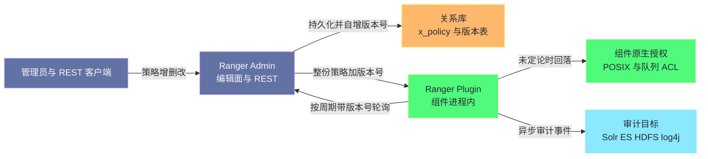
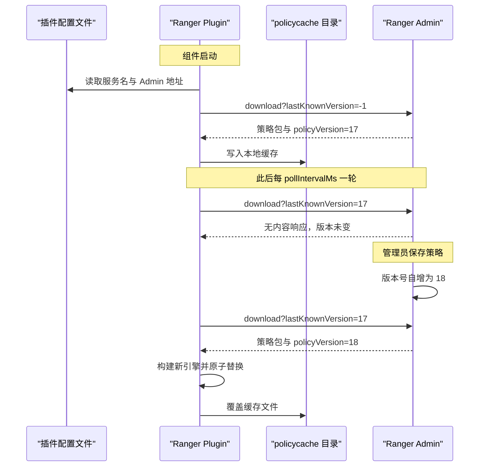
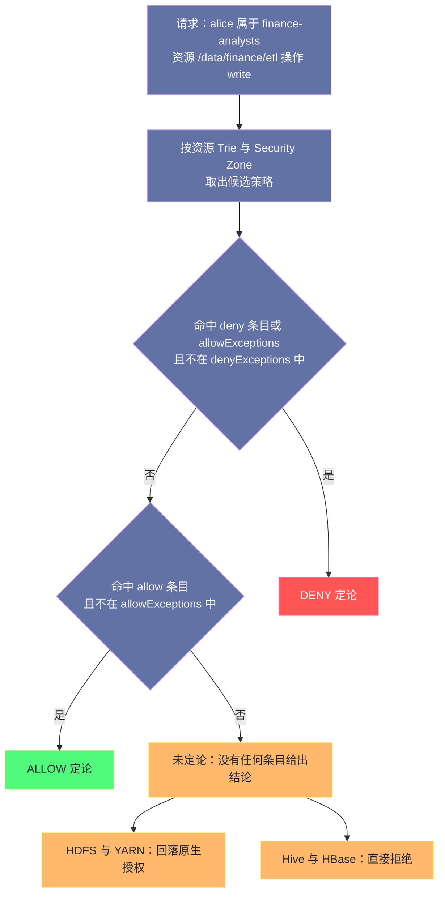
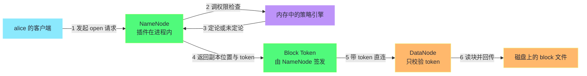
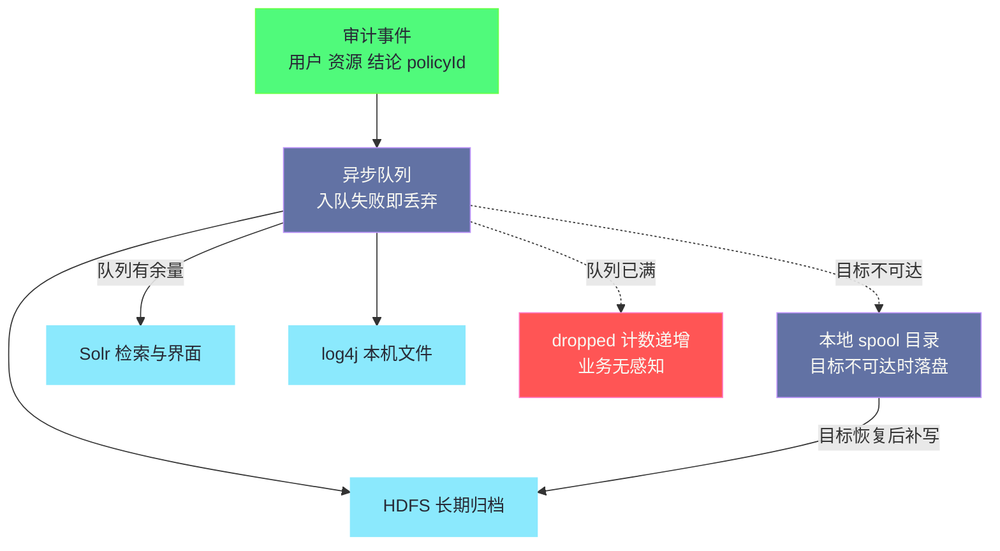

**摘要：**

Ranger 真正的难点不在策略页面，而在策略从管理员点下保存，到组件进程按新规则判定之间的那段路。本文不铺陈产品形态，只回答两个互相咬合的问题：策略是怎么一步步下发到 NameNode、ResourceManager 这类组件进程里的，以及当"策略配了却不生效"时，用哪些日志与字段把责任定位到具体环节。行文围绕四个部件展开：Admin 的编辑面与 REST、关系库里的策略与版本号、嵌在组件进程内的 Plugin、写出审计事件的旁路。Plugin 把策略缓存在进程内存、按 `pollIntervalMs` 定时比对版本号，这一个设计同时解释了"改了不立刻生效"与"Admin 挂了业务照跑"两种看似矛盾的现象。评估模型部分给出 deny 优先、两类 exceptions、excludes 与递归匹配、有效期与条件的求值顺序，并说明 HDFS 联合授权里的默认回落如何把漏配变成放行。随后拆开 HDFS 与 YARN 两个插件的接入点差异，讲清 HDFS 策略为什么管不到 DataNode 的直读。最后给出五个"配了不生效"的原因及其判据，以及 Ranger 与 HDFS ACL 的边界。文中每一条判据都落在具体位置上：审计里的 `policyVersion` 与 `policyId`×`result` 组合、缓存文件的 mtime、插件日志里的丢弃计数、组件上实际生效的那几行配置。

---

## 第 1 章 策略为什么"改了不生效"

### 1.1 一个顺序问题

周三下午，安全团队在 Ranger 里给 `/data/finance` 补了一条拒绝策略，原因是上一个季度的审计抽查发现某部门的实习生能读到不该读的分区。策略保存成功，页面刷新，列表里那条新策略带着绿色的启用标记。负责验证的同学十秒后在测试机上重跑了一次读取，依旧能读到数据，于是结论很快写进了群里：Ranger 不生效，策略暂时回滚。

真正发生的事情，是策略还在路上。

Ranger 的执行面并不在 Admin 进程里。NameNode、ResourceManager、HiveServer2 这些组件各自的进程内都跑着一份轻量的 Plugin，Plugin 持有一份从 Admin 拉来的策略副本，并按照一个固定的周期去问 Admin：版本号变了吗。默认周期是 30 秒，这意味着从保存到生效之间存在一个最长接近半分钟的空窗，窗口内的请求仍按旧策略判定。把"保存成功"当成"已经生效"，后面所有的判断都会歪掉。

顺序问题之所以棘手，是因为它不只出现在一处。策略可能压根没同步下来，也可能同步下来了但被默认回落放行，也可能插件判定的是另一个用户名，还可能组件侧根本没接上插件。这四种情况和"策略写错了"表现完全一样：用户还能访问，或者本该能访问的用户被拒。没有判据，只能靠猜；有判据，才能把责任压到具体环节。

### 1.2 控制面与数据面

理解 Ranger 的第一刀，是把它切成控制面与数据面。

控制面是 Ranger Admin：它提供 Web 控制台与 REST 接口，把管理员编辑的策略校验、落库、并把该服务对应的策略版本号加一。数据面是嵌在组件进程里的 Plugin：它把策略下载到内存，在每次访问时本地求值，毫秒级给出结论，不经过任何网络往返。审计则是数据面旁边的一条旁路，记录"谁在什么时候对什么做了什么、结论是什么"。

很多统一授权方案选择做代理：所有请求先过中心节点，由中心节点决定放行与否。代理的好处是决策只有一处、逻辑简单、行为最好解释；坏处是中心节点同时成为吞吐瓶颈与故障单点。Kafka 每秒数万条消息、HBase 每秒数千次读写、一个上万节点的 HDFS 集群每秒几十万次元数据操作，这些流量既不可能也不应该绕行到一个 Java Web 应用上排队。

Ranger 的选择是集中管理、本地执行：策略的定义集中在一处，策略的执行**分散在每个进程里**。这个选择换来的是可接受的延迟与可控的故障域，代价则是引入了同步延迟与"各进程看到的策略版本可能不同"这两个新问题。本文余下的篇幅，基本都在处理这两个代价。

### 1.3 一条贯穿案例

后面各章共用一条访问链，避免每节换一个例子。用户 alice 属于 `finance-analysts` 组，她要做三件事：通过 HiveServer2 查 `finance.transactions` 表；用 Spark 把结果写进 `/data/finance/etl`；最后向 `root.finance.etl` 队列提交这个 Spark 作业。这三步分别落在 Hive 插件、HDFS 插件、YARN 插件上，同一套 Admin、同一套策略版本号、同一条审计旁路，正好把四个部件与三类接入点串齐。

认证那一侧的故事在 [[03 Hadoop 安全模式：Kerberos 集成全链路解析]] 里已经展开，本文默认 alice 的身份已经由 Kerberos 或 delegation token 确定，UGI 里的短用户名与组列表可以直接使用；网关那一侧的统一入口在 [[05 Apache Knox 网关深度解析]] 里讨论，那是把外部请求转换成内部身份的另一个话题。

---

## 第 2 章 四个部件：谁保存、谁执行、谁记录

### 2.1 Admin 是编辑面，不是执行面

Ranger Admin 是一个标准的 Java Web 应用，对外暴露控制台与 REST 接口，对内连接一个关系库。管理员在控制台上的全部动作，最终都收敛成对库表的增删改：新建策略写 `x_policy` 与关联的资源、条目、条件表；修改策略则先校验、再更新、最后把该服务的 `policy_version` 加一。

这个"加一"是整个同步机制的支点。Plugin 与 Admin 之间没有推送通道，也没有消息队列，双方只靠版本号对齐：Plugin 每隔一个周期带着自己已知的版本号来问，Admin 比对之后要么说"没变"，要么把整份策略连同一个新版本号一起发下去。理解了这一点，就能解释为什么 Ranger 的策略生效是"周期收敛"而不是"事件驱动"。

Admin 本身可以多实例部署，共享同一个关系库，前面挂负载均衡。多实例不改变语义，因为策略与版本号都在库里；但它带来了一个运维细节：如果负载均衡把某个 Plugin 的请求分到一台读取了旧连接的实例上，版本号仍然是库里的值，不会出现两台 Admin 各说各话。真正的单点风险在关系库，不在 Admin 进程本身。

### 2.2 关系库是唯一事实源

策略存在 MySQL、PostgreSQL 或 Oracle 里，表结构大致可以分成三类：服务定义与实例（`x_service_def`、`x_service`），策略本体（`x_policy` 及其资源、条目、条件、有效期等从表），以及版本信息（`x_service_version_info`，为每个服务实例记录策略版本与标签版本）。

把策略放进关系库而不是文件或 ZooKeeper，是 Ranger 早期的一个务实决定：策略的编辑需要事务、需要审计、需要与用户目录做外键式的校验，这些都是一张关系库最擅长的事情。代价是 Admin 的写路径与库的可用性强耦合，库挂了策略就改不了——但请注意，库挂了并不影响已经下载过策略的 Plugin 继续判定，控制面的故障不会传导成数据面的故障。

版本表还承担了一个诊断职责。排查"策略没生效"时，管理员在控制台看到的策略更新时间与版本号，与 Plugin 拉到的版本号一旦对不上，问题就一定在同步链路上，而不在策略内容本身。这条推理后面还会用到。

### 2.3 Plugin 是执行面

Plugin 是一个打进组件进程 classpath 的 jar 包，加上一到两个 XML 配置文件。HDFS 的插件挂在 NameNode 内，YARN 的挂在 ResourceManager 内，Hive 的挂在 HiveServer2 内，HBase 的挂在 Master 与 RegionServer 内。每个插件只认识自己那个服务：它知道 HDFS 的鉴权点在哪里、请求对象该怎么构造、审计字段怎么填，其余一概不管。

插件与组件之间的耦合点很薄，薄到可以用"换一个实现类"来描述：HDFS 换掉 `dfs.namenode.inode.attributes.provider.class` 指向的那个类，YARN 换掉 `yarn.authorization-provider`，Hive 换掉授权管理器。这种薄耦合是 Ranger 能同时支持十几种服务的原因，也是"组件侧没接上插件"这类故障的根源——换实现类这件事发生在组件配置里，与 Admin 里的策略毫无关系。

### 2.4 审计是第四条腿

审计不是策略机制的一部分，但它是这套体系能被验收的前提。Plugin 在每次判定之后生成一个审计事件，交给审计子系统异步写出：目标可以是 Solr、Elasticsearch、HDFS、Kafka，也可以只是本地 log4j 文件。审计事件里带着命中策略的编号与版本号，这使它成为排查同步问题最直接的证据来源。

下面这张图把四个部件与它们之间的数据流画在一起，注意图中没有 Admin 指向 Plugin 的箭头，只有 Plugin 主动发起的轮询。



四个部件的职责与故障域可以并列起来看，这张表也是后文判断"哪一层挂了"的索引。

| 部件 | 位置 | 职责 | 挂掉之后的形态 |
|---|---|---|---|
| Ranger Admin | 独立进程，可多实例 | 策略编辑、校验、落库、版本号自增、策略下载接口 | 已有策略继续生效，新变更无法下发；控制台不可用 |
| 关系库 | Admin 侧 | 策略与版本号的唯一事实源 | Admin 不可用；Plugin 侧不受影响 |
| Plugin | 组件进程内 | 内存求值、本地缓存、审计事件生成 | 该组件失去 Ranger 授权，回落还是拒绝取决于服务 |
| 审计子系统 | Plugin 内嵌加外部 sink | 事件采集、队列、序列化、投递 | 业务不受影响，审计出现缺口 |

---

## 第 3 章 Plugin 的工作方式：内存里的策略副本

### 3.1 启动时的第一次下载

组件启动时，Plugin 用构造参数里的服务类型与服务名去读配置。以 HDFS 为例，`ranger-hdfs-security.xml` 里至少要给出三项：`ranger.plugin.hdfs.service.name` 指向 Admin 中那个具体的服务实例名（例如 `hdfs_prod`，不是类型名 `hdfs`）；`ranger.plugin.hdfs.policy.rest.url` 指向 Admin 的地址，多个地址用逗号分隔；`ranger.plugin.hdfs.policy.source.impl` 指向默认的 `RangerAdminRESTClient`。

拿到配置后，Plugin 发起第一次下载，请求的路径形如 `/service/plugins/policies/download/hdfs_prod`，带上当前的插件标识与已知版本号。Admin 返回一份完整的策略包：服务定义、策略列表、以及这个包对应的 `policyVersion`。Plugin 把这份包写入本地缓存目录（模板默认 `/etc/ranger/<repo>/policycache`），再在内存里构建策略引擎，此后所有鉴权请求都打在这份内存引擎上。

这里有一个容易忽略的差别：`service.name` 写错不会报配置错误，只会让下载接口返回"服务不存在"。Plugin 的表现是每次轮询都失败、缓存一直为空、策略引擎始终为 null。开源代码里这条路径会打出清理本地缓存的日志，版本号被置成 -1，看起来像在正常工作，实际上一个策略都没加载。

### 3.2 同步循环：版本号比较而不是逐条增量

Plugin 会起一个后台线程，每隔 `ranger.plugin.hdfs.policy.pollIntervalMs`（模板值 30000 毫秒）执行一次同步。同步的动作很简单：把本地已知的版本号带上，问 Admin 有没有更新。Admin 的回应只有两种情况——版本号没变，返回一个无内容响应；版本号变了，返回整份策略包。

这里的"增量"到底指什么，需要说清。它不是逐条策略的差异传输，而是"版本号相同就不传、不同就整份重传"。策略集合不大时（几百条策略的 JSON 通常在几百 KB 量级，具体取决于资源与条目数量），整份重传的成本远低于维护差异协议的复杂度；策略集合大到几万条时，整份重传的带宽与序列化开销才开始显眼，这也是大型集群往往要把 `pollIntervalMs` 调大、或者按业务拆成多个服务实例的原因。

版本号比较还带来一个副作用：如果管理员在一个轮询周期内连续保存了五次策略，Plugin 只会在下一个周期看到最终版本，中间的四个版本永远不会出现在插件侧。这对结果没有影响，但对排查有影响——审计里看到的 `policyVersion` 会跳号，跳号不是异常。

### 3.3 原子替换与"半新半旧"

新策略包下载完成后，Plugin 不是就地修改内存里的策略对象，而是用新包构建一个新的策略引擎，再把引用整体替换过去。正在判定的请求持有旧引擎的引用，判定完成即释放；新来的请求拿到新引擎。这个模式保证了任何单次请求都只在一个一致的策略快照上求值，不会出现"前半段按旧策略、后半段按新策略"的撕裂。

不过它没有消除时间上的不一致。同一个用户在替换发生的瞬间发起两次请求，完全可能得到**两个不同的结论**，一个落在旧快照上，一个落在新快照上。这类不一致无法用同步机制消除，只能靠"变更窗口内不要做验收"这种流程约束来规避。

下图把一次冷启动、若干次轮询与一次策略变更的时序摊开，可以看到版本号在整条链路上只增不减。



### 3.4 Admin 挂了会怎样

这是被问得最多的问题，答案要分三段说。

第一段，正在运行的 Plugin 一无所知。策略已经在内存里，判定过程不访问 Admin，所以只要 Admin 在策略变更窗口之外挂掉，业务侧完全没有感知。审计写入的目标如果是 Solr 或 HDFS，也确实与 Admin 无关，审计照写。

第二段，组件重启时要靠本地缓存续命。Plugin 重新初始化时同样会先尝试下载，失败之后读取本地缓存目录里的策略包；缓存里带着上次成功下载的版本号与策略内容，因此重启后的判定与宕机前一致。这就是缓存目录在生产上不能随手清理的原因——它是一份离线可用的策略副本。

第三段，冷启动且缓存为空时会很尴尬。全新安装、缓存目录被误删、或者升级后目录路径变了，此时 Admin 又不可达，Plugin 拿不到任何策略。这时候组件能否启动、启动后是拒绝所有请求还是放弃 Ranger 判定，取决于组件与插件版本的异常处理路径，不能一概而论；实践上要么保证 Admin 与组件网络可达，要么在升级前确认缓存目录随安装包保留。

### 3.5 判据：三个不会说谎的观测点

同步是否正常，有三个观测点，按可信度从高到低排列。

第一是审计事件里的 `policyVersion`。随便找一条 alice 的近期审计，把这个字段与 Admin 控制台上该服务的版本号对比，差值为零说明同步完成，差值大于零说明策略还没到。

第二是缓存目录里文件的修改时间。缓存文件只有在成功下载后才会被覆盖，它的 mtime 长期不动，说明插件一个周期都没成功拉过；反过来，mtime 在变而策略版本号没变，说明拉到了但版本没涨，问题在 Admin 侧的保存动作。

第三是插件日志。同步失败会留下明确的错误行，服务名写错的情形更是直接告诉你"服务不存在、清理本地缓存"。日志的缺点是量大，用服务名与轮询线程名过滤之后才有用。

配置项的取舍可以并列成表，右侧两列是"往大调"与"往小调"各自的代价，这也是整套同步机制里唯一能动手脚的地方。

| 配置项 | 模板默认 | 调大的代价 | 调小的代价 |
|---|---|---|---|
| `ranger.plugin.hdfs.policy.pollIntervalMs` | 30000 | 策略生效窗口变长，变更后最长要等一个周期 | Admin 与关系库压力上升，插件日志更密 |
| `ranger.plugin.hdfs.policy.rest.client.connection.timeoutMs` | 120000 | 网络异常时插件迟迟不判失败 | 弱网下频繁连接超时，同步成功率下降 |
| `ranger.plugin.hdfs.policy.rest.client.read.timeoutMs` | 30000 | 大策略包不易被截断，但故障感知变慢 | 策略包较大时读取中断，版本停在旧值 |
| `ranger.plugin.hdfs.policy.cache.dir` | `/etc/ranger/<repo>/policycache` | 指向共享存储会拖慢冷启动 | 指向本地盘则在节点重建后丢失缓存 |
| `ranger.plugin.hdfs.service.name` | Admin 里的实例名 | 写成类型名会导致永远下载失败 | 写错同理，且日志里只有服务不存在 |

---

## 第 4 章 策略的评估模型

### 4.1 一条策略的五个组成部分

一条 Ranger 策略可以被拆成五个部分，缺一个都会改变它的含义。

资源（resource）描述策略作用在什么上面。HDFS 只有一个资源维度 `path`，Hive 有 `database`、`table`、`column` 等层级，YARN 只有 `queue`。每个资源有两个开关：`isExcludes` 把"这些值"翻转为"除这些值之外"，`isRecursive` 决定路径或队列层级是否向下覆盖。

主体（user/group/role）描述策略作用于谁。用户与组来自 Ranger 的用户同步结果，角色则是 Ranger 自己维护的一组用户与组。

权限（access）描述允许或拒绝哪些操作。HDFS 是 `read`、`write`、`execute`，YARN 是 `submit-app` 与 `admin-queue`，Hive 是 `select`、`insert`、`create` 等。

条件（condition）描述在什么环境下才生效，常见的是 IP 段与时间窗，也可以在服务定义里声明自定义条件类型。有效期（validity schedule）则是带时区的时间区间，用于临时授权与定期复核。

把这些部分组合起来，一条策略条目就是"资源 + 主体 + 权限 + 条件 + 有效期"的五元组，任何一个维度不匹配，这条条目就不命中。

### 4.2 求值的四步

单次访问的求值分四步走。

第一步是按资源缩小候选集合。Plugin 内部用资源 Trie 按路径前缀或队列层级做索引，先取出可能相关的策略，再逐条精确匹配；如果集群启用了 Security Zone，则先按资源归属的区过滤一遍，资源不属于任何区时才落到默认区的策略上。

第二步是逐条策略求值。一条策略命中，要求资源匹配、主体匹配、访问类型匹配、条件成立、有效期覆盖当前时间，五者同时满足才算命中；主体这一维还要区分 deny 条目与 allow 条目各自列出的用户、组、角色。

第三步是合并结论。这里有一条压倒性的规则：**deny 优先于 allow**。只要有一条 deny 条目命中且不在 deny exceptions 里，请求就会被拒绝，后续的 allow 条目不再有机会。

第四步是处理"没有结论"。所有候选策略都没命中，或者命中的条目都不构成定论，Plugin 返回一个未定论的结果；未定论之后往哪里走，由服务类型决定，这正是下一节的内容。

### 4.3 deny 优先与两类 exceptions

deny 优先是最小权限原则的直接体现，也是策略冲突时唯一可预测的裁决方式。它的工程价值在于：当安全团队与业务团队各自维护策略、互相不知道对方改了什么时，一条 deny 的存在保证了"收紧"这个方向的操作永远有效，不会被另一条更宽松的 allow 悄悄覆盖。

两类 exceptions 让这条规则不至于太僵硬。

deny exceptions 是给 deny 开的白名单：某个用户属于被拒绝的组，但他在 deny exceptions 里列出了名字，那么 deny 条目对他不生效，求值继续往下走到 allow 判定。典型用法是"拒绝全体实习生，但保留那个负责数据核对的实习生"。

allow exceptions 则反过来，是给 allow 开的黑名单：某条 allow 对所有人生效，但列在 allow exceptions 里的主体被排除在外，如果他们没有别的 allow 命中，结果就落回未定论。典型用法是"财务目录对全公司只读，但外包账号除外"。

两类 exceptions 都写在策略对象内部，随策略一起下发；改动它们同样会让该服务的策略版本号自增，所以"版本号涨了"并不能说明 allow 条目被改过，排查时还得看策略内容本身。

### 4.4 excludes 与递归：资源匹配的两个开关

资源匹配看起来只是字符串比较，实际上是整套模型里最容易配错的地方，原因就在这两个开关上。

Ranger 的资源只有一对语义：`values` 是白名单（也就是通常说的 includes），`isExcludes` 把它翻转成黑名单，没有独立的 includes 字段。正常的资源写 `["/data/finance"]` 表示"只匹配这个路径"，而 `isExcludes=true` 之后的同一份值表示"匹配除这个路径之外的一切"。翻转之后，策略的覆盖面从一条路径变成整个命名空间，稍有误操作就会造成大面积放行或大面积拒绝，而这个错误在控制台上看起来只是勾了一个框。

`isRecursive` 决定覆盖深度。HDFS 的路径策略若不勾选递归，只对那一层路径本身生效；`/data/finance` 上的只读策略不会自动覆盖 `/data/finance/2026/part-0.parquet`，需要显式开启递归才向下延伸。YARN 的队列策略同理，`root.finance` 不递归时管不到 `root.finance.etl`。这两个开关的组合足以解释相当一部分"策略明明配了却没拦住"的现场。

通配符的边界也要说清。HDFS 路径里的 `*` 按字符匹配、不跨越路径分隔符，`/data/*/logs` 能匹配 `/data/finance/logs`，匹配不上 `/data/finance/raw/logs`；想要跨层级，得靠递归开关加上更宽的模式，而不是再加一个 `*`。

### 4.5 未定论之后：默认回落就是"漏配的后果"

一条请求在 Ranger 里没有命中任何策略，Plugin 返回的是"未定论"，而不是"拒绝"。这个区别是 HDFS 与 Hive 行为分叉的根源。

HDFS 与 YARN 采用的是联合授权（federated authorization）：Ranger 插件与组件原生授权并存，Ranger 只在能给出定论时短路，给不出定论就交给组件自己的授权逻辑。HDFS 的原生授权是 POSIX 权限与 ACL，YARN 的原生授权是队列 ACL。这个回落行为由一个开关控制，HDFS 插件配置里叫 `xasecure.add-hadoop-authorization`，模板默认 `true`；把它置为 `false`，Ranger 就变成唯一授权方，未定论即拒绝。

Hive 与 HBase 没有联合语义，Ranger 是唯一授权方，未定论等价于拒绝。

这里顺带澄清一个配置层面的误会：插件配置里并没有一个叫 `defaultPolicy` 的项可以让管理员选"没命中就放行"或"没命中就拒绝"，默认行为是联合授权开关与组件原生授权共同决定的，`ranger.plugin.<svc>.policy.rest.url` 只是 Admin 地址，与默认策略无关。想要改变未定论的后果，改的是 `xasecure.add-hadoop-authorization` 与原生权限，而不是某个 defaultPolicy 字段。

这套设计的意图很清楚：让 Ranger 能在存量集群上渐进落地，先接管一部分路径，其余继续由 POSIX 权限兜底，不至于一上线就把整个集群锁死。但它的副作用同样清楚：在联合授权下，漏配一条策略的后果不是"误拒"，而是"回到原生权限"，而原生权限恰恰经常是宽松的——尤其当目录为了兼容历史作业被设成 777 时，漏配就等于放行。这就是"默认值选错了方向"的典型形态：它让上线变容易，让**疏忽变危险**。

下图把求值路径与两条分支画在一起，注意图中 deny 与 allow 都是一次定论，未定论才走到回落。



### 4.6 superuser 与"只观察不拦截"

插件侧还有两条与策略无关的旁路，它们经常是"策略不生效"的隐形原因。

第一条是超级用户与超级组。Plugin 配置支持 `ranger.plugin.<svc>.super.users` 与 `ranger.plugin.<svc>.super.groups`，列在其中的主体不进入策略求值，直接放行。它们是给运维账号与 ETL 服务账号准备的口子，但一旦被当成"临时方便"随手加人，就会在完全无声的情况下绕过所有 deny 条目。排查这类问题的唯一办法是把配置项本身读出来看，不要假设它没被改过。

第二条是审计排除名单。`ranger.plugin.<svc>.audit.exclude.users/groups/roles` 与 HDFS 侧的 `xasecure.auditlog.hdfs.excludeusers` 会把指定主体的访问从审计里剔除。HDFS 的插件模板默认就排除了 `hbase,hive` 两个服务账号，因为这两个账号会产生海量内部访问记录。副作用是：如果某个业务用服务账号代理访问，审计里就查不到它的记录，恰好这批访问又是最需要被观察的。

至于"先观察不拦截"的上线前验证，需要澄清一个常见误解：插件侧没有一把全局的干跑开关，没有"只写审计、不做判定"的配置项。可行的做法有三种：把准备接管的业务账号先放进 super users，同时打开审计，观察这一段时间内它的访问形态与资源分布；为同一个 HDFS 建第二个服务实例，只挂到测试 NameNode 上，在测试集群上验证同一份策略；或者先用较宽的资源范围（父目录加递归）与宽松的 allow 上线，再逐层收紧到目标路径。三种做法都以"业务不中断"为目标，都需要接受一段时间内策略覆盖面不足的事实。

### 4.7 策略字段的语义与配错后果

把上面的讨论收进一张表，左侧是字段，右侧是配错之后的表现。这张表适合在写策略之前对照一遍。

| 字段或开关 | 语义 | 配错的后果 |
|---|---|---|
| `resources.path` 与 `isRecursive` | 路径策略是否向下覆盖子路径 | 不勾递归时子目录不受控，看起来像策略没生效 |
| `isExcludes` | 把资源值翻转为"除此之外的一切" | 覆盖面从一条路径变成整个命名空间 |
| `policyItems` | allow 条目集合 | 漏掉某个组的 allow，该组落回未定论 |
| `denyPolicyItems` | deny 条目集合，优先于 allow | 与 allow 冲突时按 deny 判定，容易造成误拒 |
| `allowExceptions` | 从 allow 中剔除的主体 | 写反方向会让本该被排除的人拿到权限 |
| `denyExceptions` | 从 deny 中豁免的主体 | 豁免名单留旧人，等于长期开后门 |
| `conditions` | IP 段与时间窗等环境条件 | 条件与实际客户端出口网段不符，一律不命中 |
| `validitySchedules` | 带时区的生效区间 | 时区写成 UTC，临时授权在预期之外多活八小时 |
| `isAuditEnabled` | 该策略是否产生审计事件 | 关掉之后策略生效但审计无记录，排查失去证据 |
| `policyPriority` | 多条策略并列时的优先级 | 依赖优先级掩盖冲突，后续调整策略时结论漂移 |

---

## 第 5 章 HDFS 插件：只拦 NameNode

### 5.1 接入点：一个可替换的属性提供器

HDFS 的插件接入点是一个叫 `INodeAttributeProvider` 的扩展点，通过 `dfs.namenode.inode.attributes.provider.class` 指定实现类，Ranger 提供的实现是 `org.apache.ranger.authorization.hadoop.RangerHdfsAuthorizer`。这个扩展点本来是为"在权限判定之外提供额外的 inode 属性"设计的，Ranger 借它把默认的权限检查器整体包了一层：先问 Ranger，Ranger 给不出定论时再调用原生检查器。

插件要真正被调用，还有一个前置条件：`dfs.permissions.enabled` 必须为 `true`。Ranger 的安装脚本会在 `hdfs-site.xml` 里把这个开关与 provider 类一起写入，注释里写得很直白——只有这个标志为真，插件才有机会进入权限检查。这个前置条件极其容易被忽略：如果有人在调优时把它关了，NameNode 的权限检查整体被跳过，Ranger 插件连被调用的机会都没有，而所有策略看起来都好好的。

鉴权的调用点分布在 NameNode 处理元数据操作的各条路径上：打开文件、创建文件、重命名、删除、列目录、改权限。每一次元数据操作都会构造一个访问请求，带上用户、组、路径、操作类型，交给插件在内存里求值。求值结果为定论时直接放行或抛出拒绝；未定论时按上一章说的回落规则处理。

### 5.2 一次读请求里插件的位置

把一次 HDFS 读摊开来看，Ranger 的介入点只有一个。

客户端先用自己的身份向 NameNode 发起 `open` 请求，NameNode 在做完路径解析之后调用权限检查，此时 Ranger 插件求值：alice 对 `/data/finance/etl/part-0.parquet` 是否有 `read`。通过之后，NameNode 返回该文件各副本所在的 DataNode 列表与一个 block token，客户端拿着 token 直连 DataNode 拉取数据，DataNode 只校验 token 是否有效、是否在有效期内、是否覆盖这个 block，不询问 Ranger，也不重新检查文件名与目录权限。

下图把这条链路上的六个动作按顺序画出，第四个动作之后 Ranger 就退场了。



### 5.3 为什么 HDFS 策略阻止不了 DataNode 直读

结论要说得干脆：Ranger 的 HDFS 插件不在 DataNode 进程里，也不参与 block 级的任何校验，所以它无法阻止"已经拿到有效 block token 的一方直接读 DataNode"。

这不是设计缺陷，而是**分层的结果**。NameNode 管命名空间与元数据，DataNode 管数据块，两者的信任靠 token 传递；如果每次块读取都回 NameNode 校验文件名与目录权限，NameNode 会立刻成为整个集群的吞吐瓶颈，HDFS 最初"把元数据与数据分离"的架构收益也就没有了。Ranger 选择只在 NameNode 这一个鉴权点上发力，等于接受了这个分工。

由此可以推出三条工程结论。

第一，行级过滤与列级脱敏只在 Hive 通道上有效。HiveServer2 以一个服务账号（通常是 `hive`）去读底层文件，HDFS 插件看到的是 `hive`，不是 alice；alice 的身份与列级策略只在 Hive 的插件里被使用。只要 alice 有办法拿到表目录的读权限，她就能用 Spark 直接读 parquet 文件，绕过脱敏。要堵这个口，处理办法是收紧 HDFS 层对表目录的访问，只允许服务账号读，普通用户一律走 HiveServer2。

第二，token 的生命周期就是暴露窗口。delegation token 与 block token 都有有效期，在有效期内被复制、被滥用都无法从 NameNode 侧察觉；能做的只有缩短有效期、限制签发对象、以及在审计里盯住异常的签发行为。

第三，审计的可见性受同一限制。审计记录的是"谁在 NameNode 上做了什么"，不是"谁在 DataNode 上读了多少字节"。判断是否存在绕过行为，不能只看 Ranger 审计，还得结合 HDFS 自身的审计日志与网络层流量。

### 5.4 service 名与配置文件的位置

HDFS 插件的配置文件落在 Hadoop 的配置目录里，与 `hdfs-site.xml` 同级：`ranger-hdfs-security.xml` 管插件与 Admin 的连接，`ranger-hdfs-audit.xml` 管审计目标，`ranger-policymgr-ssl.xml` 管与 Admin 通信时的证书。缓存目录在 `/etc/ranger/<repo>/policycache`，其中 `<repo>` 是 Admin 里的实例名。

`service.name` 是这一节唯一需要强调的点。Admin 里可以存在多个 HDFS 类型的服务实例，分别对应生产集群、测试集群、历史归档集群，插件靠实例名决定去拉哪一份策略。把实例名写成类型名，下载接口会告诉你服务不存在；把两个集群的实例名写成同一个，两个集群会共享同一套策略——后一种错误不会有任何报错，只会让测试集群的策略改动悄悄影响生产。

---

## 第 6 章 YARN 插件：管队列，不管数据

### 6.1 接入点与前置条件

YARN 的插件接入点是 `yarn.authorization-provider`，Ranger 提供的实现是 `org.apache.ranger.authorization.yarn.authorizer.RangerYarnAuthorizer`，它替换掉 YARN 默认的授权提供器，接管队列的提交与管理判定。

前置条件有两个，缺一不可。`yarn.acl.enable` 必须为 `true`，否则上层的队列 ACL 管理器会认为"没有开启 ACL"，直接放行，根本不会去调用授权提供器；`yarn.authorization-provider` 必须指向 Ranger 的实现类，否则插件虽然被初始化，却不在调用链上。这两个开关都在 `yarn-site.xml` 里，改动需要重启 ResourceManager。插件侧的 `ranger.plugin.yarn.service.name` 同样是 Admin 里的实例名（例如 `yarn_prod`），写错一样是"服务不存在"。

与 HDFS 一样，YARN 也支持联合授权。当 Ranger 给不出定论时，请求回落到 YARN 原生的队列 ACL（即 Capacity Scheduler 各队列上配置的提交与管理 ACL）。这解释了一个常见现象：只把 HDFS 接进 Ranger、YARN 侧什么都不配，作业照样能提交到任意队列——没有策略覆盖，回落到了原生 ACL，而原生 ACL 常常是"不限制"。

### 6.2 资源与访问类型

YARN 的资源模型只有一个维度 `queue`，取值是队列的层级路径，例如 `root.finance.etl`。与 HDFS 路径一样，队列策略也有递归开关：不开递归时，`root.finance` 上的策略不覆盖 `root.finance.etl`。

访问类型有两种。`submit-app` 决定能不能往这个队列提交应用；`admin-queue` 决定能不能管理这个队列，包括杀掉别人的应用、调整队列配置。两者是独立的权限，实践中经常被合成一条，结果给了提交权就顺带给了管理权。

这里要说清 YARN 插件的边界：它只管"能不能往某个队列提交"，不管"提交上去的作业能读哪些数据"。作业跑起来之后，容器里的进程以提交者身份或 delegation token 身份去读 HDFS，那次读取走的是 HDFS 插件；作业写 Hive 表，走的是 Hive 插件。三者在三个进程里、三套策略、三个版本号，任何一个没配好，都会表现成同一句话：**权限问题**。

### 6.3 两个插件的差异

HDFS 与 YARN 的差异不只是接入点不同，它们的回落对象、覆盖范围、审计形态都不一样，并列起来看更清楚。

| 维度 | HDFS 插件 | YARN 插件 |
|---|---|---|
| 所在进程 | NameNode | ResourceManager |
| 接入点 | `dfs.namenode.inode.attributes.provider.class` | `yarn.authorization-provider` |
| 前置开关 | `dfs.permissions.enabled` 为 true | `yarn.acl.enable` 为 true |
| 资源模型 | `path`，单维度，支持递归 | `queue`，单维度，支持递归 |
| 访问类型 | `read` `write` `execute` | `submit-app` `admin-queue` |
| 未定论回落 | POSIX 权限与 ACL | 原生队列 ACL |
| 覆盖不到的地方 | DataNode 的 block 读写 | 作业内部的数据访问 |
| 配置文件 | `ranger-hdfs-security.xml` 与 `ranger-hdfs-audit.xml` | `ranger-yarn-security.xml` 与 `ranger-yarn-audit.xml` |
| 配置前缀 | `ranger.plugin.hdfs.*` | `ranger.plugin.yarn.*` |

---

## 第 7 章 审计日志的机制与失败模式

### 7.1 审计是旁路，不是控制

Plugin 判定完成之后，把结论交给审计处理器，处理器把事件塞进队列，后台线程再批量写出。整条链路与判定过程是解耦的：审计故障不会让判定变慢，也不会让判定改变。

这个解耦是刻意的，代价是**审计的完整性没有强保证**。要判断"审计是否可信"，得先判断事件有没有被丢弃、有没有被本地缓冲、有没有在某个目标上停更，而不能因为"业务正常"就倒推"审计正常"。

### 7.2 目标可以并列，也可以只留本地

审计目标在 Ranger 里是模块化的，代码中按目标拆成独立模块：Solr、Elasticsearch、HDFS、Kafka、log4j，以及向审计服务投递的方式。一个插件可以同时启用多个目标，例如 Solr 负责检索、HDFS 负责长期归档、log4j 负责本机快速定位。

配置项的命名在不同版本里有代际差异：早期模板用 `xasecure.audit.solr.is.enabled`、`xasecure.audit.hdfs.is.enabled`、`xasecure.audit.log4j.is.enabled` 这种"目标加 is.enabled"的写法，较新的模板里也能看到 `xasecure.audit.destination.solr`、`xasecure.audit.destination.hdfs` 这类统一前缀的写法。同一个集群里两种写法可能同时存在（发行版模板与开源模板混用时尤其常见），排查时以实际模板与对应版本文档为准，不要凭记忆改。

总开关是 `xasecure.audit.is.enabled`。把它关掉，插件不再生成任何审计事件，业务完全不受影响——这一点很重要：业务正常从来不是审计正常的证据。

### 7.3 异步队列、本地缓冲与丢弃

以 HDFS 目标为例，模板里给出的参数能看出这条链路的形状：`xasecure.audit.hdfs.is.async` 为 `true` 开启异步，`xasecure.audit.hdfs.async.max.queue.size` 是队列上限，`xasecure.audit.hdfs.async.max.flush.interval.ms` 是刷新间隔，另有 `xasecure.audit.hdfs.config.local.buffer.directory` 指定本地缓冲目录、`xasecure.audit.hdfs.config.local.archive.max.file.count` 限制本地归档文件数。

异步语义的核心是**入队不阻塞业务线程**。队列满时，事件按丢弃处理，丢弃次数进入统计；插件日志里会周期性打出类似 `AsyncAuditProvider-stats` 的行，带上累计输入、输出与 dropped 计数。这条日志是判断"审计到底丢了多少"的直接依据，比在 Solr 里数条数可靠得多。

本地缓冲是另一层保护。HDFS 目标不可达时，事件先写本地 spool 目录，等目标恢复后再补写；归档文件数达到上限之后，最旧的文件会被清理。所以"审计少了几天"有时候不是丢在队列里，而是丢在本地 buffer 的滚动清理里。

下图把事件从产生到落地的几条路径画在一起，虚线的那两条分支就是审计缺口的来源。



### 7.4 审计丢了的判据

三类证据可以互相印证，覆盖三种不同的丢失方式。

第一类证据是丢弃计数。插件日志里的 dropped 值持续增长，说明事件在入队阶段就被丢掉了，原因通常是写入速率超过目标吞吐、或者队列上限设得过小。

第二类证据是本地缓冲目录。目录里文件堆积、归档目录里文件数达到上限后开始滚动删除，说明目标长时间不可达，事件走的是"先落地、后补写"的路径，补写之前的内容在 Solr 里查不到。

第三类证据是目标侧的时间断档。Solr 集合按天或按小时的时间字段出现空洞，而同一时段插件日志正常，说明写入路径畅通但检索侧被清理或索引失败；Solr 的保留期（各家发行版默认不同，常见的是按月计）与 collection 的滚动策略都要纳入考虑。

### 7.5 审计字段与三种用法

审计事件落到 Solr 或 Elasticsearch 之后，字段名与界面上的中文标签并不一一对应，排查时以字段名为准。下面这张表列出最常用的一批。

| 字段 | 含义 | 排查用途 |
|---|---|---|
| `reqUser` | 发起请求的用户 | 与策略里的 users 对比，验证身份映射 |
| `reqGroups` | 用户所属组 | 与策略里的 groups 对比，验证组来源 |
| `cliIP` | 客户端 IP | 与条件里的 IP 段对比，验证条件为何不命中 |
| `repo` | 服务实例名 | 确认请求落在哪个插件、哪套策略上 |
| `resType` 与 `resource` | 资源类型与具体资源 | 确认路径或队列是否与策略一致 |
| `action` 与 `access` | 操作类型与访问方式 | 确认访问类型是否被策略覆盖 |
| `result` | 结论，1 为允许、0 为拒绝 | 快速筛出被拒请求 |
| `policyId` | 命中策略的编号，未命中为 -1 | 区分"被拒绝"与"没策略" |
| `policyVersion` | 判定时使用的策略版本 | 与 Admin 版本号对比，验证同步 |
| `enforcer` | 做出判定的组件 | 确认回落到了原生授权还是 Ranger 判定 |

有了这些字段，三种排查路径就能串起来。

看 `policyId` 与 `result` 的组合：`policyId=-1` 且 `result=1`，说明没有策略命中、回落放行，这是"以为会拒绝其实没拦住"的铁证；`policyId=-1` 且 `result=0`，说明没有策略命中且组件拒绝，该去补 allow；`policyId` 有值且 `result=0`，说明命中的是一条 deny 条目，去看这条策略与 exceptions。

看 `policyVersion`：它落后于 Admin 的版本号，问题在同步链路；它与 Admin 一致而结论仍不符预期，问题在策略内容或匹配规则。

看 `reqUser` 与 `reqGroups`：用户名字符串与策略里写的不一致（大小写、域名后缀、`auth_to_local` 规则缩短的差异），或者组列表里压根没有策略要求的那个组，都会造成"策略对着人配了却没命中"。

---

## 第 8 章 五个"配了不生效"的原因与判据

### 8.1 原因一：策略没同步到插件

这是出现频率最高、也最容易**被误判成产品 bug**的一类。表现是策略在控制台上完好，审计里却仍是旧结论。

机理有四种可能：轮询周期还没到；插件到 Admin 的网络不通；Admin 侧版本号没涨（保存动作没成功落库）；`service.name` 写错导致插件拉的是另一个实例或根本拉不到。

判据是三条并看：审计里的 `policyVersion` 与 Admin 控制台的版本号是否相同；缓存目录里文件的 mtime 是否在最近一个周期内更新过；插件日志里有没有下载失败或"服务不存在"的错误行。若要绕开插件直接验证连通性，可以在组件所在主机上手工请求下载接口，注意在开启 Kerberos 的集群上，未携带票据的请求被拒是正常现象，返回 401 不代表网络不通。

```bash
# 在组件主机上直接问 Admin 要一次策略包，观察返回码与响应体大小
curl -s -o /tmp/policy.json -w '%{http_code}\n' \
  'http://ranger-admin:6080/service/plugins/policies/download/hdfs_prod?lastKnownVersion=17'
# 401 多为未带 Kerberos 票据，200 则说明链路与实例名都正确
```

### 8.2 原因二：默认回落把漏配变成了放行

策略确实没命中的时候，HDFS 与 YARN 会回落到原生授权，而原生授权往往比预期宽松。表现是所有用户都能读，或者"拒绝策略上线之后一切照旧"。

机理在于 `xasecure.add-hadoop-authorization` 默认为 `true`，联合授权生效；未定论不是拒绝，而是"交给 POSIX 与 ACL 再说"。如果目录权限本身是 777，或者 ACL 给了一个过宽的组，回落就等于放行。

判据非常干脆：审计里 `policyId=-1` 且 `result=1`。看到这个组合，不要再去改策略内容，先去看这个路径上的原生权限，然后决定是补策略、收紧 POSIX，还是把开关改成独占授权。

独占授权不是无脑选项。把 `xasecure.add-hadoop-authorization` 置为 `false` 之后，任何没有策略覆盖的路径都会立刻变成拒绝，一个漏配的临时目录就会让一批作业当天失败。正确的顺序是先把策略覆盖面补齐，观察审计里 `policyId=-1` 的比例降到接近零，再切换开关。

### 8.3 原因三：资源路径写错

路径写错的表现很迷惑：策略看起来完全正确，资源、用户、权限都填了，就是不命中。

最常见的四种错法。大小写不一致，HDFS 路径区分大小写，`/data/Finance` 与 `/data/finance` 是两条路径。末尾斜杠不一致，`/data/finance/` 与 `/data/finance` 在字符串匹配上不同。递归开关没开，策略挂在父目录上却期望覆盖子文件。通配符越界，用 `*` 试图跨目录匹配，实际上 `*` 不跨越路径分隔符。

Hive 的资源层级还多一层坑：`database`、`table`、`column` 是三个独立资源维度，一条只写了 `database` 的策略管不到表级操作，一条写了 `table` 却没写 `column` 的策略在列级脱敏上不生效。

判据是把审计里的 `resource` 字段与控制台上的资源值逐字比对，不要靠眼睛扫。路径里带了空格、带了中文、带了 `%` 编码，都会在比对时暴露出来。

### 8.4 原因四：用户与组映射不一致

表现是"给 alice 配了权限，alice 还是被拒"，或者"给 finance 组配了权限，组里的人全被拒"。

机理有两层。用户名这一层：策略里写的名字必须是插件拿到的短用户名，它由 `hadoop.security.auth_to_local` 规则把 Kerberos principal（形如 `alice@EXAMPLE.COM`）转换而来，规则写得不同，转换结果可能是 `alice`、`alice/EXAMPLE.COM` 或者别的形式。组这一层更隐蔽：UGI 里的组来自 `hadoop.security.group.mapping` 配置的组映射（可能是本地 shell 组，也可能是 LDAP），而 Ranger 控制台里看到的组来自 Admin 的 UserSync，两者是不同的数据源，同步延迟与过滤规则都可能不同，于是"控制台里 alice 在 finance 组里"和"插件看到的 alice 在 finance 组里"完全可能不成立。

判据是审计里的 `reqUser` 与 `reqGroups`。这两个字段是插件实际拿到的值，与策略里的字符串直接比对，差异一目了然；再用 `hdfs groups alice` 之类的命令在客户端侧对照一次，可以进一步区分是组映射的问题还是 UserSync 的问题。

### 8.5 原因五：组件侧没接上插件

这一类故障最干脆，也最少被怀疑：Admin 里的策略完全正确，同步也正常，但组件压根没调用插件。

需要逐项确认的开关：HDFS 的 `dfs.permissions.enabled` 是否为 `true`、`dfs.namenode.inode.attributes.provider.class` 是否指向 Ranger 的实现类；YARN 的 `yarn.acl.enable` 是否为 `true`、`yarn.authorization-provider` 是否指向 Ranger 的实现类；Hive 的授权管理器是否换成了 Ranger 的实现。任何一个被覆盖回默认值，插件就退出了调用链。

这里要澄清一个流传很广的说法：`ranger-<svc>-security.xml` 里并没有一个 `ranger.plugin.<svc>.enabled` 开关能整体关掉插件，插件的启用与否由组件侧的接入点决定。发行版（Ambari、Cloudera Manager 之类）会在自己界面上包装一个"启用 Ranger 插件"的选项，它最终改的就是上面那几行组件参数，外加把插件目录与配置文件放到组件 classpath 上。所以在发行版界面上点过"启用"并不等于参数没被别人改回去，升级、手工编辑 `hdfs-site.xml`、配置组覆盖都可能把它推翻。

判据是读实际生效的配置，而不是读模板或界面：用 `hdfs getconf -confKey dfs.namenode.inode.attributes.provider.class` 这类命令看组件的真实取值，再去 NameNode 启动日志里找插件初始化的那几行。

### 8.6 三个反例

第一个反例是改完策略**不等一个周期就断言无效**。30 秒的窗口不长，但足以让一次验收得出完全相反的结论，进而导致一次不必要的回滚。稳妥的验证方式是改完之后用审计里的 `policyVersion` 确认新版本已经到达插件，再做验收；这一步花的时间比反复重试少得多。

第二个反例是留着默认回落、却不收紧原生权限，同时又把"没策略"读成"已拒绝"。联合授权下"没策略"等于"回到原生权限"，而在很多历史集群里，原生权限是宽到没有意义的。把漏配当成误拒去排查，方向从一开始就反了；审计里的 `policyId=-1` 就是这条分岔的路标。

第三个反例是只配 HDFS 不配 YARN。数据访问被管住了，作业提交没人管，任何一个有集群账号的人都能把作业提到 `root.default` 甚至管理队列上，用更宽的资源配置去跑同样的数据读取。安全的短板从来不在被认真配置的那一侧。

| 原因 | 典型判据 | 观测点 |
|---|---|---|
| 策略没同步到插件 | 审计 `policyVersion` 落后于 Admin 版本号 | 缓存文件 mtime、插件日志、下载接口返回码 |
| 默认回落把漏配变成放行 | 审计 `policyId=-1` 且 `result=1` | 该路径的 POSIX 权限与 ACL、联合授权开关 |
| 资源路径写错 | 审计 `resource` 与策略资源值逐字不相等 | 递归开关、通配符边界、Hive 资源层级 |
| 用户与组映射不一致 | 审计 `reqUser` 或 `reqGroups` 与策略不一致 | `auth_to_local` 规则、组映射配置、UserSync 状态 |
| 组件侧没接上插件 | 组件实际配置里没有指向 Ranger 的实现类 | `hdfs getconf` 取值、启动日志、升级后的配置覆盖 |

---

## 第 9 章 与 HDFS ACL 的边界

### 9.1 ACL 是什么，不是什么

HDFS ACL（`dfs.namenode.acls.enabled` 控制是否可用）是 POSIX 权限的扩展，它让一个文件或目录可以额外列出若干用户与组的权限，突破"owner、group、other"三类的限制。它解决的是"同一份数据要按主体细分权限"的问题，落点在单个 inode 上。

ACL 不解决跨服务统一管理，不解决动态条件，不解决行级与列级控制，也不产生跨服务的审计。把这些需求压在 ACL 上，最后一定会退化成"路径上打满 ACL、谁也说不清谁能读"的局面。

### 9.2 优先级的真相：定论短路，未定论回落

关于 ACL 与 Ranger 谁优先，流传的说法是"Ranger 先评估，所以 ACL 失效"。这个说法只对了一半，准确的说法是：**Ranger 定论即短路**，能给出定论时原生检查器根本不会被调用，ACL 不参与；Ranger 给不出定论时（未命中任何策略），原生检查器接管，POSIX 与 ACL 按原语义生效。

这解释了两种看起来矛盾的现象。同一个目录上，Ranger 有一条 allow 策略，ACL 里有人被显式拒绝，结果是允许——因为 Ranger 定论短路，ACL 没被问过。反过来，Ranger 没有策略覆盖，ACL 里给了某个组读权限，结果是允许——因为回落了。

所以两者不是同一层次的竞争关系，而是接管与回落的关系。判断"这条路径实际由谁裁决"，看的是这个路径上有没有策略命中，而不是看 ACL 里写了什么。

### 9.3 该用哪个

选择判据并不复杂，把场景列出来基本就定了。

临时授权、单目录、少数几个人的读写需求，用 ACL 最快，改动小、可回收，不涉及任何中心组件。跨服务的统一授权、需要审计、需要行级与列级控制、需要按 IP 与时间收放权限的场景，只有 Ranger 能承担。多租户共享集群、各业务线要自助管理自己的资源，需要 Security Zone 把策略空间切开，这也超出 ACL 的能力范围。

两者并存时，把 ACL 当成收紧手段而不是放开手段。ACL 的每一次放开都会成为 Ranger 漏配时的实际兜底，等于在安全模型上开了一个不受集中管理的口子；而 ACL 的收紧（例如把目录的 other 权限去掉、只给服务账号）会让 Ranger 的未定论不再是放行，回落与拒绝的边界因此变得可控。

| 场景 | 建议 | 理由 |
|---|---|---|
| 临时给三五个人开一个目录的读权限 | ACL | 改动局部、易回收，不牵动中心策略 |
| 同一份数据要按部门细分读写 | Ranger | 策略集中、可审计，ACL 会迅速膨胀 |
| 需要按 IP 段或时间窗收放 | Ranger | ACL 没有条件语义 |
| 需要行级过滤与列级脱敏 | Ranger | 只有 Hive 侧的插件能做 |
| 多租户自助管理各自资源 | Ranger 加 Security Zone | ACL 没有管理权与隔离的概念 |
| 存量目录权限过宽，想先兜底 | ACL 收紧 | 为联合授权的回落加上一道硬约束 |

---

## 第 10 章 量化：延迟窗口与审计写入量

### 10.1 同步延迟的量级

同步延迟由三项构成：轮询间隔、请求往返时间、以及策略包的下载与构建时间。轮询间隔是主项，模板值 30 秒意味着最坏情况下策略变更要等接近 30 秒才落地；把间隔调成 5 秒，最坏延迟降到 5 秒量级，代价是 Admin 与关系库承受的请求量变成六倍。

第二项在网络正常的机房内通常是毫秒到几十毫秒量级，策略包越大、序列化与构建耗时越明显。所以"调小轮询间隔"并不能带来"实时生效"，只能把窗口从 30 秒压到几秒，而每压一档，**控制面负载就上一个台阶**。

还有一个容易被忽略的量：策略变更后，所有持有该服务策略的插件都会在同一个周期内先后拉取，形成一次对齐的请求尖峰。集群规模大、插件数量多时，这个尖峰比稳态轮询更值得关注。

### 10.2 审计写入量

审计量的估算依赖三个变量：每秒的鉴权请求数、单条事件的序列化大小、以及启用的目标数量。

下面这组数字是示例推算，只用来说明量级关系，不代表任何真实集群的实测值：假设一个中等规模集群每秒产生 5000 次受 Ranger 管控的 HDFS 元数据操作，单条审计 JSON 序列化后约 1.2 KB 到 2 KB，取 1.5 KB 计算，写入速率约 7.5 MB/s，折算到一天约 650 GB；若同时启用 Solr 与 HDFS 两个目标，实际落盘与索引的字节量要再乘一次目标数。这个量级足以说明为什么 HDFS 插件模板默认把 `hbase,hive` 两个服务账号排除在审计之外——它们产生的内部访问在总量里占大头，而审计价值最低。

压低审计量有三种手段：排除服务账号（`xasecure.auditlog.hdfs.excludeusers` 与插件的 `audit.exclude.users`）、只对被拒绝的事件开审计（通过策略的 `isAuditEnabled` 配合资源范围控制）、缩短目标侧的保留期。三种手段都会牺牲一部分可观测性，取舍要靠合规要求与排障需求来定，不能只看存储成本。

### 10.3 量与口径的汇总

| 量 | 示例值或典型值 | 含义 | 口径 |
|---|---|---|---|
| 策略同步延迟 | 0 到 30 秒，随 `pollIntervalMs` 变化 | 保存到生效的窗口 | 模板默认 30000 毫秒，不含下载耗时 |
| 单次求值耗时 | 微秒到毫秒量级 | 内存求值，无网络往返 | 与策略数量、资源 Trie 深度相关 |
| 审计写入速率 | 约 7.5 MB/s，约 650 GB 每天 | 5000 次每秒乘 1.5 KB | 示例推算，非实测 |
| 策略包大小 | 几百 KB 量级 | 数百条策略的 JSON 体积 | 随资源与条目数量线性增长 |
| 缓存失效窗口 | 一个轮询周期 | Admin 不可达时插件仍可判定 | 前提是缓存文件存在且可读 |

---

## 第 11 章 结语

Ranger 的设计可以用一句话概括：把集中管理的确定性与本地执行的可用性拼在一起，用版本号与轮询换取故障隔离，把延迟与不一致作为代价接受下来。理解了这一点，"改了不生效"就不再是玄学，而是一组可以逐项排除的检查点。

这套机制里真正需要决策的地方只有三处。第一处是轮询间隔与策略覆盖面之间的取舍：窗口越短，控制面压力越大；窗口越长，变更的收敛越慢，验收流程就得越严谨。第二处是联合授权还是独占授权：前者让存量集群可以渐进落地，代价是漏配等于放行；后者让策略成为唯一事实源，代价是一次漏配就是一次故障。第三处是审计的粒度与保留：全量审计最贵也最有用，排除服务账号最省但会留下盲区。

三处决策没有标准答案，只有与集群成熟度、业务对中断的容忍度、合规要求相匹配的答案。而无论选哪一种，判断它是否按预期工作的方式是一样的：看审计里的 `policyVersion` 有没有对齐，看 `policyId` 与 `result` 的组合说明了什么，看组件实际生效的配置指向谁。机制给了可预期的行为，判据给了可复核的证据，两者合起来才是一套能运维的授权体系。把四个部件、两个插件与审计旁路放回整条信任链上，[[08 大数据安全体系全景串联]] 给的是从客户端到 DataNode 的端到端视角，本篇补的是其中授权这一环的内部结构。

---

## 参考资料

1. Apache Ranger 官方站点与文档索引：https://ranger.apache.org/
2. Apache Ranger 社区 Wiki（策略模型、插件与审计配置）：https://cwiki.apache.org/confluence/display/RANGER/
3. HDFS 插件配置模板 `ranger-hdfs-security.xml`（轮询周期、缓存目录、联合授权开关）：https://github.com/apache/ranger/blob/master/hdfs-agent/conf/ranger-hdfs-security.xml
4. HDFS 审计配置模板 `ranger-hdfs-audit.xml`（异步队列、本地缓冲、目标开关）：https://github.com/apache/ranger/blob/master/hdfs-agent/conf/ranger-hdfs-audit.xml
5. HDFS 接入点实现 `RangerHdfsAuthorizer`：https://github.com/apache/ranger/blob/master/hdfs-agent/src/main/java/org/apache/ranger/authorization/hadoop/RangerHdfsAuthorizer.java
6. 定论短路与回落的实现 `RangerAccessControlEnforcer`：https://github.com/apache/ranger/blob/master/hdfs-agent/src/main/java/org/apache/ranger/authorization/hadoop/RangerAccessControlEnforcer.java
7. 插件基类与 super users、audit exclude 配置读取 `RangerBasePlugin`：https://github.com/apache/ranger/blob/master/agents-common/src/main/java/org/apache/ranger/plugin/service/RangerBasePlugin.java
8. 审计队列满即丢弃的实现 `AsyncAuditProvider`：https://github.com/apache/ranger/blob/master/agents-audit/core/src/main/java/org/apache/ranger/audit/provider/AsyncAuditProvider.java
9. Hadoop HDFS 默认配置项（`dfs.namenode.inode.attributes.provider.class`、`dfs.permissions.enabled`、ACL 开关）：https://hadoop.apache.org/docs/current/hadoop-project-dist/hadoop-hdfs/hdfs-default.xml
10. Hadoop YARN 默认配置项（`yarn.acl.enable`、`yarn.authorization-provider`）：https://hadoop.apache.org/docs/current/hadoop-yarn/hadoop-yarn-common/yarn-default.xml

---

> [!note] 思考题
> 1. 默认轮询周期 30 秒意味着策略变更存在一个可观测的空窗。如果业务要求"撤销权限必须在一秒内生效"，在这个架构下你能做到什么程度，又必须放弃什么？
> 2. HDFS 与 YARN 走联合授权、Hive 走独占授权，同一个集群里两种语义并存。运维上如何设计验收流程，才能避免把"回落放行"误判成"策略生效"？
> 3. HDFS 插件只在 NameNode 上工作，DataNode 靠 block token 放行。如果要防止"有权限的用户把数据文件拷走"，Ranger 能覆盖哪一部分，剩下的该由什么机制承担？
> 4. 审计队列满即丢弃，业务不受影响。在合规审计要求"访问记录不可缺失"的场景里，这个默认行为应当如何调整，调整之后又会引入什么新的风险？
> 5. 把 `xasecure.add-hadoop-authorization` 从 `true` 改成 `false`，等于把所有漏配路径一次性变成拒绝。你会用什么数据来判断"可以切了"，切的顺序又该怎么安排？
> 6. Ranger 与 HDFS ACL 并存时，ACL 的一次放开会在联合授权下变成实际兜底。这件事应该由谁来把关，用什么流程保证它不会悄悄发生？