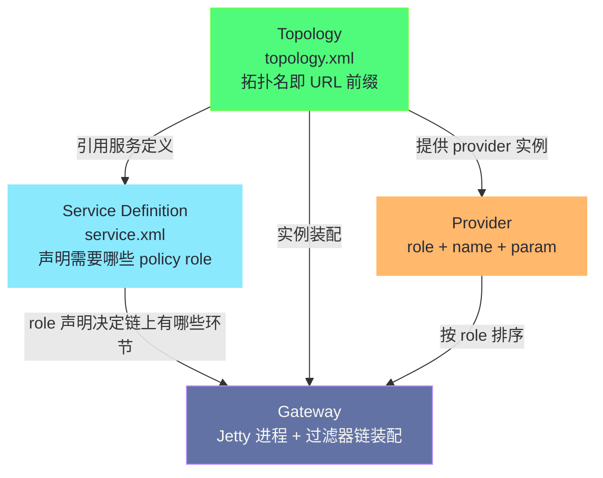
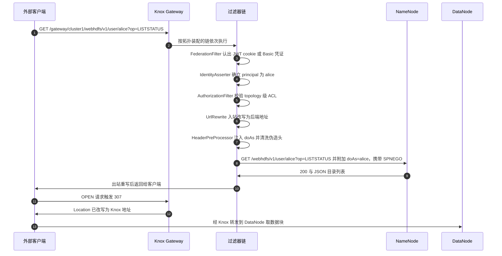
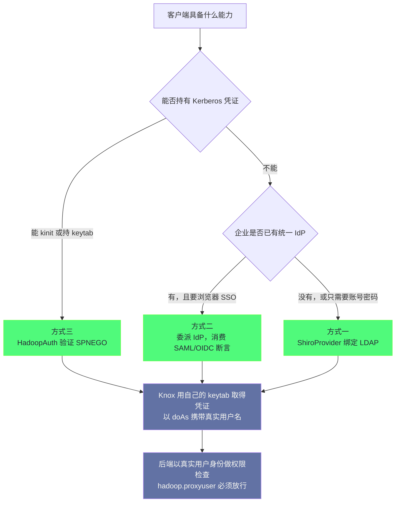
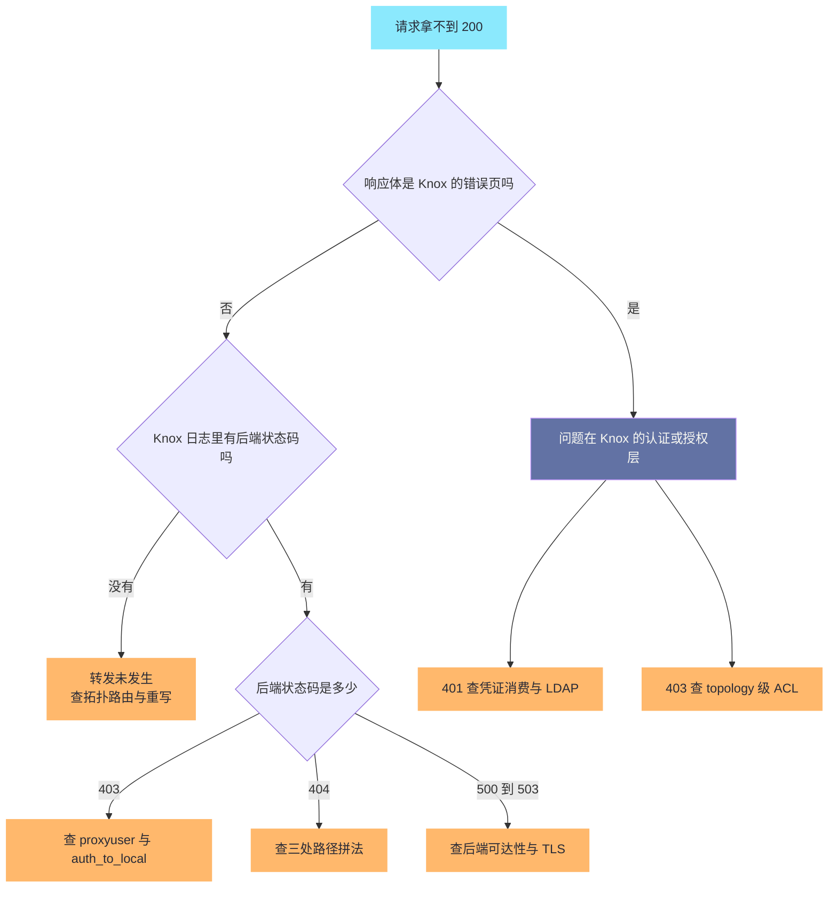
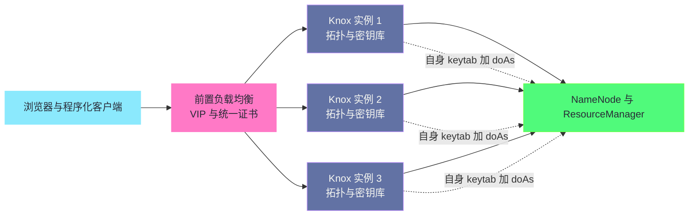

**摘要：**

Apache Knox 通常被概括成"Hadoop 的 API 网关"，这个说法不算错，却把最要紧的那层意思盖住了：Knox 是一个反向代理加一个身份联合层，它真正解决的是"客户端不装 Kerberos 也能访问安全集群"。本文按四条线索展开。第一条是结构，把 Knox 拆成 Gateway（Jetty 进程与一组 Filter）、Service Definition（`service.xml` 声明的后端拓扑能力）、Topology（`topology.xml` 描述的具体实例）与 Provider（认证、授权、身份断言的配置单元）四层，说清谁引用谁、哪一层的错误会以什么形态冒出来。第二条是 Filter 链与 `rewrite.xml` 规则引擎，给出"路径改写不对导致 404"的具体判据。第三条是身份联合的三种方式——Knox 自己认 LDAP、把认证委派给企业 IdP、以及 Knox 作为 Kerberos 客户端——并给出一张按客户端能力与 IdP 现状选型的判据表，以及 `doAs` 用户模拟对 `hadoop.proxyuser` 的硬依赖。第四条是"开了 Knox 之后 401/403 循环"的五个成因，逐个给症状与定位动作。末尾讨论 Knox 与 Ranger 的分工、多实例 HA 与拓扑热加载，以及它最容易被误用的地方：把网关当数据通道。全文的落点不在"Knox 有哪些配置项"，而在"某一层出错时会以什么形态暴露、用什么证据定位"。

---

## 第 1 章 一层缝在两个世界之间的东西

### 1.1 从"接不进来"说起

设想一家公司的数据平台已经打开了 Hadoop 安全模式，NameNode、ResourceManager、HiveServer2 都要求 GSSAPI 握手，而业务侧有一个 BI 团队，他们手上的工具只支持三件事：填一个 URL、填一对账号密码、点一下"测试连通性"。这两边要接上，缺的并不是某一个配置项，而是一层能把外部世界与内部世界缝起来的组件。

朴素的方案有三条，代价都不小。第一条是给每台 BI 服务器装 Kerberos 客户端、配 `/etc/krb5.conf`、分发 keytab，再写一个定时 `kinit` 的脚本；问题是 keytab 是长期密钥文件，分发到几十台机器就等于制造了几十个泄露点，而 BI 工具的调度时机往往不受 IT 控制，票据过期与续期窗口对不上是常态。第二条是干脆关掉认证，把集群退回简单模式；这样 HDFS 的权限模型会退化成一个纯声明式的模型，客户端说自己是谁就是谁，审计上也交代不过去。第三条是给每个客户端开端口映射或者反向隧道，把 NameNode 的 9870 端口直接暴露出去；这条路在出事之前看起来最省事，出事之后最难收场，因为暴露出去的端口接受任何来源的 SPNEGO 尝试，而集群的访问日志散落在二三十个服务进程里，没人能一次说清"某个外部 IP 昨天读了哪些目录"。

第三条路的真正问题，是把"认证"这件**该集中做的事**，复制到了每一个客户端上。Kerberos 的复杂性并没有消失，它只是被摊到了 N 个消费方身上，而每一个消费方的运维水平都不一样。

### 1.2 Knox 的定位：反向代理加身份联合层

Apache Knox 于 2013 年进入 Apache 孵化器，2014 年成为 Apache 顶级项目。它出现的时间点并不偶然：Hadoop 的 REST 接口在那几年陆续齐备，WebHDFS 有了完整的 REST 语义，YARN 的 ResourceManager 也开放了 REST API，HiveServer2 提供了 HTTP 传输模式，也就是说，后端已经"能用 HTTP 说话"了，缺的是把 HTTP 上的身份翻译成 Kerberos 身份的那一层。

所以 Knox 的准确定义有两半。第一半是反向代理（Reverse Proxy）：在客户端眼里，整个集群只有一个地址，默认是 `https://knox-host:8443/gateway/<topology名>/...`，路径前缀决定这次请求去哪个后端拓扑，Knox 自己**不做协议转换**，不改数据格式，只改写路径、请求头与响应里的地址。第二半是身份联合（Identity Federation）：把外部世界证明"你是谁"的各种方式——账号密码、SAML 断言、OIDC 的 ID Token、CAS ticket、一张签发好的 JWT cookie——统一翻译成内部世界认得的身份，也就是一个 Kerberos 主体加上一个被代理的真实用户名。

这两半合起来才是 Knox 的全貌。只把它当反向代理，就会疑惑"为什么一个 Nginx 也能做的事要单独引入一个组件"；只把它当身份层，就会低估它在路径改写与地址回写上花的力气，而这部分恰恰是它最难调的地方。

### 1.3 三个"不是"

要讲清定位，得把边界一并划出来。

Knox 不是 Ranger。Ranger 回答的是"alice 能不能读 finance 库的这张表"，它的判断依据是资源（库、表、列、行、HDFS 路径、Kafka topic）与主体（用户、组、标签）；Knox 回答的是"这个外部请求能不能进这个入口"，判断依据是拓扑名与服务角色。两者的粒度差了整整一个数量级，把它们混为一谈，就会出现"在 Knox 里写 URL 正则来管表权限"这种注定漏判的设计。

Knox 不是 Kerberos 的替代品。集群内部的 RPC、DataNode 之间的数据传输、服务与服务之间的调用，走的仍然是 Kerberos；Knox 只是把"最后一次从外部进入内部"的那一跳接了过来，用自己持有的凭证完成它。

Knox 也不是数据通道。它是 HTTP 反向代理，凡是走它转发的请求，请求体与响应体都要完整经过它的 JVM 堆与线程池。用它传 GB 级文件，是把一个身份组件当成了存储网关，这一点留到第 8 章细说。

---

## 第 2 章 四层结构：Gateway、Service Definition、Topology、Provider

Knox 的配置文件看起来零散，但层次其实非常清楚：一个常驻进程、一份服务能力声明、一份实例描述、一组处理单元。四层自上而下，每一层的错误都有各自固定的暴露形态。下面的描述以 Knox 1.6.x 与 2.x 的文档为准；参数名与默认值在相邻小版本之间有过调整，遇到对不上的地方，以对应版本的文档与发行版内 `conf/services` 下的实际文件为准。

### 2.1 Gateway：一个 Jetty 进程与一组 Filter

Gateway 是 Knox 的运行实体，本质上是一个嵌入了 Jetty 的 Java 进程。它的行为由 `conf/gateway-site.xml` 控制：`gateway.port` 决定监听端口（默认 `8443`），`gateway.path` 决定 URL 的根前缀（默认 `gateway`，也就是所有拓扑都挂在 `/gateway/` 之下），此外还有 TLS 证书与密钥库的位置、Jetty 线程池的上下限等运行参数。

启动时，Gateway 做三件事：扫描拓扑目录，把每个 topology XML 编译成一条过滤器链加一张路由表；按拓扑名注册成 Jetty 的 context；然后用一个后台的部署监视器（DeploymentWatcher）持续盯着目录，等文件变化。这个过程决定了 Knox 的一个基本性质：**Gateway 本身几乎没有业务逻辑**，它的全部行为来自拓扑文件。因此所谓"Knox 出问题"，绝大多数情况不是 Knox 的缺陷，而是某个 XML 里的某个字段写错了，或者某个字段写对了但没被加载。

一个便于记忆的类比是机场。Gateway 是航站楼本身，结构不变；Service Definition 是航空公司公布的航线清单，说明有哪些目的地、每个目的地需要走哪些流程；Topology 是今天这份具体的航班计划，说明哪个登机口、几点起飞；Provider 则是安检、边检、登机口核验这些环节，环节的顺序决定了旅客会先被哪一道拦住。

### 2.2 Service Definition：`service.xml` 声明的是能力，不是地址

服务定义文件（发行版内位于 `conf/services/` 下，文件名即服务名）描述的是一个后端服务"长什么样"，而不是"在哪里"。它通常包含三段信息：

```xml
<service role="WEBHDFS" name="webhdfs" version="3.0.0">
  <policies>
    <policy role="webappsec"/>
    <policy role="authentication"/>
    <policy role="rewrite"/>
    <policy role="authorization"/>
  </policies>
  <routes>
    <route path="/webhdfs/v1/{**=**}"/>
  </routes>
</service>
```

`role` 是服务在 Knox 内部的标识，拓扑文件里的 `<service><role>` 要跟它对上；`<policies>` 声明的是"访问这个服务要求链上存在哪些 policy role"，也就是说，它决定了这条请求要经过哪些 Filter。

路径里的通配语法有三种形态，只有命名捕获的值才会进入变量，供后续改写引用：

```
{name=**}    命名捕获，跨越多个路径段
{name=*}     命名捕获，只匹配一个路径段
{**}         匿名通配，只跳过不取值
```

`<routes>` 声明的是该服务对外暴露的路径前缀如何匹配，匹配到的片段能否被改写复用，取决于是否用了命名捕获，这一点在第 3 章展开。

这里有一个容易被忽略的设计意图：**地址不在这份文件里**。地址在拓扑文件里。正因为如此，同一份 `webhdfs` 服务定义可以被成百上千个集群复用，运维人员不需要为每个集群复制一份服务声明，只需要各写一份拓扑。

### 2.3 Topology：`topology.xml` 描述的是实例

拓扑文件是运维人员真正天天改的东西。它的名字就是 URL 前缀：一个叫 `cluster1` 的拓扑，对外的入口是 `https://knox-host:8443/gateway/cluster1/`。文件可以放在两个位置：发行版内的 `conf/topologies/`（随安装包维护）与运行期的 `data/deployments/`（由部署接口或运维脚本投放）。**两处同名时以后者为准**，这一条是"改了配置没生效"的常见根因之一。

一份拓扑的结构是两段：`<gateway>` 里放 Provider，`<service>` 里放后端地址。

```xml
<topology>
  <gateway>
    <provider>
      <role>federation</role>
      <name>SSOCookieProvider</name>
      <param><name>sso.cookie.name</name><value>hadoop-jwt</value></param>
    </provider>
    <provider>
      <role>authentication</role>
      <name>ShiroProvider</name>
      <param><name>main.ldapRealm</name><value>org.apache.knox.gateway.shirorealm.KnoxLdapRealm</value></param>
    </provider>
    <provider>
      <role>identity-assertion</role>
      <name>Default</name>
      <param><name>principal.mapping</name><value>alice@AD.EXAMPLE.COM=alice</value></param>
    </provider>
    <provider>
      <role>authorization</role>
      <name>AclsAuthz</name>
      <param><name>webhdfs.acl</name><value>*;hadoop-admins;*</value></param>
    </provider>
    <provider>
      <role>ha</role>
      <name>HaProvider</name>
      <param><name>WEBHDFS</name><value>maxFailoverAttempts=3;failoverSleep=1000;enabled=true</value></param>
    </provider>
  </gateway>
  <service>
    <role>WEBHDFS</role>
    <url>http://namenode1.example.com:9870/webhdfs</url>
    <url>http://namenode2.example.com:9870/webhdfs</url>
  </service>
</topology>
```

两个细节值得停一下。第一，同一个 role 可以出现多个 provider，例如 `federation` 与 `authentication` 同时存在，链上按顺序执行，前者负责消费已有的断言，后者负责在断言不存在时发起认证。第二，`<url>` 末尾的 `/webhdfs` 是后端的 context path，它必须与 `service.xml` 里 `<route>` 的路径以及重写规则的目标拼法三者对齐，这三者只要有一个多写或少写一段，症状就是第 3 章要讲的 404。

### 2.4 Provider：role 决定位置，name 决定实现

Provider 是配置的最小单元，三个字段各管一件事：**`role` 决定位置**，**`name` 决定实现**，`param` 决定这个实现的具体行为。Knox 内置的角色大致如下（名称随版本有增补，实现名以发行版的 `conf/services` 与文档为准）。

| role | 在链上的位置 | 典型实现 | 主要参数 |
| :--- | :--- | :--- | :--- |
| `federation` | 最前 | `SSOCookieProvider`、`JWTFederationFilter`、`HeaderPreAuth` | `sso.cookie.name`、`knox.token.audiences`、`knox.token.verification.pem` |
| `authentication` | 联合身份之后 | `ShiroProvider`、`HadoopAuth`、伪认证 | LDAP realm 参数、`hadoop.auth.config.*` |
| `identity-assertion` | 认证之后 | `Default` | `principal.mapping`、`group.mapping`、`type` |
| `authorization` | 身份确立之后 | `AclsAuthz`、`XASecurePDPKnox` | `<服务名>.acl` 或 Ranger 侧策略 |
| `ha` | 转发阶段生效 | `HaProvider` | `maxFailoverAttempts`、`failoverSleep`、`maxRetryAttempts` |
| `rewrite` | 转发前后 | 各服务自带的 rewrite provider | 规则文件引用、`rewrite.xml` 路径 |
| `hostmap` | 地址改写时 | `Default` | 内部与外部主机名映射 |

### 2.5 四层之间的一致性问题

四层之间的关系是引用关系，而不是包含关系，因此出错的方式也分成两类。

一类是"声明了但没提供"。`service.xml` 的 `<policies>` 声明了 `authorization`，而拓扑里没有 `authorization` 的 provider，这条请求在链上就走不到授权环节。Knox 对必需角色的缺失有校验，不同版本的严格程度不一样，但无论校验多严格，把"没配授权"理解成"默认放行"都是危险的。

另一类是**提供了但没声明**。拓扑里写了一个 `authorization` provider，而该服务的 `service.xml` 里没有对应的 `<policy role="authorization"/>`，这个 provider 就不会被挂进这条服务链。它不会报错，日志里也未必有痕迹，只会安静地不生效。这一类问题在排查时最费时间，因为配置看上去完全正确。

下面这张图把四层的引用关系与责任边界画在一起，便于对照上面的文字。



| 层次 | 载体 | 职责 | 写错时的形态 | 观测点 |
| :--- | :--- | :--- | :--- | :--- |
| Gateway | `gateway-site.xml` | 端口、根前缀、TLS、线程池 | 端口不通、路径前缀与规则不匹配 | 启动日志、`ss -lntp` |
| Service Definition | `conf/services/*.xml` | 声明 policy 与路由前缀 | provider 静默不生效 | 链装配日志 |
| Topology | `conf/topologies`、`data/deployments` | 定义入口名与后端地址 | 404、502、入口不存在 | 部署监视器日志 |
| Provider | 拓扑文件内 `<provider>` | 认证、授权、身份断言行为 | 401、403、身份名不对 | gateway 审计日志 |

---

## 第 3 章 过滤器链与重写规则引擎

### 3.1 链的顺序

一次请求进入拓扑之后，按下面的顺序穿过过滤器链：`FederationFilter`（联合身份）→ `IdentityAsserter`（认证与主体确立）→ `AuthorizationFilter`（授权）→ `UrlRewrite`（路径重写）→ `HeaderPreProcessor`（请求头预处理）→ 转发到后端。认证类 provider（Shiro、HadoopAuth）的实现就挂在 `IdentityAsserter` 这个位置上，也就是说，链上的"第二个位置"同时承担了"消费断言"与"发起认证"两种职责，取决于外部请求带的是什么凭证。

**这个顺序不是随意的**，三条理由各自都能推出具体故障。

联合身份必须最先跑。SAML 断言、OIDC 的 ID Token、JWT cookie 都是一次性消费的凭证，有效期短，且往往只能被消费一次；它们必须在任何需要 `Subject` 的逻辑之前被翻译成 Java 的 `Subject` 与 `Principal`。如果顺序颠倒，下游逻辑拿到的就是一个空主体，表现出来的症状是所有请求都 401，而且日志里看不出凭证有什么问题。

重写必须在身份之后。`rewrite.xml` 的模板里可以引用 `{$username}`、`{$groups}`、`{$serviceUrl[ROLE]}`、`{$inboundurl[...]}` 这类宏，路径重写的目标地址经常依赖"当前用户是谁"以及"后端服务地址是什么"。身份还没确立就重写，等于拿空值去拼地址，结果是一条指向不存在路径的 URL，后端返回 404。

请求头预处理必须落在最后、且在授权之后。它做两件事：把 `doAs`、`X-Forwarded-User`、`X-Forwarded-Proto` 这类内部需要的头注入请求，同时把客户端自带同名头清掉。后一件事是关键：如果客户端可以自带 `X-Forwarded-User: alice` 而不被清理，Knox 就变成了一个身份伪造器。把它放在授权之后，也避免了授权逻辑读到尚未清洗的请求头。

### 3.2 每个位置的失败形态

同一张表把六个位置与各自的失败形态放在一起，排查时可以按"症状"反查"位置"，譬如看到"转发成功但后端返回 403"，就该先查 `doAs`，而不是翻 Knox 的认证配置。

| 位置 | 职责 | 失败时的外部形态 | 日志关键字 |
| :--- | :--- | :--- | :--- |
| `FederationFilter` | 消费 JWT/SAML/header 断言 | 有 cookie 或 token 但仍 401，像"凭证没被认出来" | 断言解析失败、受众不匹配 |
| `IdentityAsserter` | 确立 principal，可能顺带做 LDAP 认证 | 401；或身份名与预期不符 | LDAP bind 失败、主体为空 |
| `AuthorizationFilter` | 粗粒度准入 | 403，且响应体是 Knox 的错误页 | ACL 拒绝、无匹配规则 |
| `UrlRewrite` | 入站与出站地址改写 | 404、502、Location 指向内网 | 规则未匹配、模板变量为空 |
| `HeaderPreProcessor` | 注入与清洗请求头 | 身份漂移、伪造成立、协议判断错 | 头被覆盖、`X-Forwarded-Proto` 缺失 |
| 转发 | 以服务身份做 SPNEGO 并带 `doAs` | 后端 401/403、连接超时 | `GSSException`、代理用户被拒 |

### 3.3 `rewrite.xml` 的规则引擎

重写引擎要解决的是同一个问题在两个方向上的映射：入站时，把 `https://knox-host:8443/gateway/cluster1/webhdfs/v1/...` 变成 `http://namenode:9870/webhdfs/v1/...`；出站时，把后端响应里出现的内部地址（典型是 3xx 的 `Location`、响应体里的 URL）换回 Knox 的对外地址，否则客户端会拿到一个它根本连不上的内网主机名。

规则文件的基本形态如下，结构示意，元素名与细节以对应版本的 schema 为准：

```xml
<rules>
  <rule dir="IN" name="WEBHDFS/inbound"
        pattern="*://*:*/**/webhdfs/v1/{path=**}?{**}"
        target="{$serviceUrl[WEBHDFS]}/v1/{path=**}?{**}">
    <rewrite template="{$serviceUrl[WEBHDFS]}/v1/{path=**}?{**}"/>
  </rule>
</rules>

<filter name="WEBHDFS/redirect">
  <content type="application/x-http-headers">
    <apply path="Location" rule="WEBHDFS/outbound"/>
  </content>
</filter>
```

三类元素的语义可以逐个拆开，捕获的规则跟在 `<rule>` 里一并说明。

`<rule>` 是规则的容器，`dir` 决定方向（`IN` 处理入站请求的 URL 与请求头，`OUT` 处理出站响应的头与体，`BOTH` 两者都做），`pattern` 是匹配式，`target` 或内部的 `<rewrite template="..."/>` 是改写目标。`pattern` 与 `target` 都是带捕获的模板：命名捕获把匹配到的片段存进具名变量，`target` 里用同名占位引用回来，形式见上面的规则示例；不带名字的形式只是跳过，不进变量。这就是 `capture` 的语义，捕获不是为了显示，而是为了让目标地址能带上原始请求的路径。

`<rewrite>` 是"在这个规则里，把哪个模板应用到哪个字段"。它既可以作为 `<rule>` 的子元素表达规则本身的改写目标，也可以通过 `<apply>` 的形式被引用到具体字段上。

`<filter>` 声明"响应里哪些内容需要被改写"。它的 `<content type="...">` 说明被处理内容的类型，`application/x-http-headers` 表示处理 HTTP 响应头，`application/json`、`application/xml` 表示处理响应体；`<apply path="Location" rule="..."/>` 说明头里的 `Location` 字段要按哪条规则改。

把整份规则集想成一本双向词典：入站查一次，把外部的说法译成后端认得的说法，出站再查一次，把后端的说法译回外部的说法；词典缺了哪一边，译文里就会漏出原文，漏出去的内网地址就是那个"原文"。

这里有一个必须记住的宏观事实：入站重写把外部路径映射到后端，出站重写把后端地址映射回外部，**出站方向最容易被忽略**。它被忽略时，症状不是报错，而是"操作成功但客户端取不到数据"。WebHDFS 的 `OPEN` 与 `CREATE` 都依赖 3xx 重定向（307 临时重定向，Location 指向某个 DataNode），如果出站规则没把 Location 换回 Knox 地址，客户端就会尝试直连 DataNode 的内网地址；在企业网里这个地址通常不可达，于是读文件超时、写文件卡在 `DataStreamer`。

### 3.4 路径改写不对导致 404 的判据

404 是 Knox 排障里最容易被误判的一类，因为它至少有**三种来源**，而对外表现几乎一样。

第一种是 Knox 自己的 404：路径根本没匹配上任何拓扑的 context，或者匹配上了拓扑但拓扑里没有对应的 `<route>`。这种 404 的响应体是 Knox 的错误页，而且后端服务的访问日志里不会有任何记录。

第二种是后端的 404：路由通了，请求被转发出去，但地址拼错了。最典型的拼法错误是 `<service><url>` 末尾已经带了 `/webhdfs` 这个 context，重写规则的目标又拼了一次 `/webhdfs`，最终后端收到的是 `/webhdfs/webhdfs/v1/...`。这种请求在后端看起来是一个非常正常的 404，在 Knox 看起来是一次成功的转发。

第三种是 502/503：地址或端口不通、TLS 不匹配、后端进程没起来。这一类的响应体通常是 Knox 的代理错误页，且 Knox 日志里有连接异常。

区分它们的动作只有四步，按顺序做即可。先看 Knox 的访问日志里有没有"后端 URL"这一项，有后端 URL 说明请求确实被转发过，可以排除第一种；再拿这个后端 URL 用 `curl` 直连一次，能复现 404 就说明问题在后端路径，与 Knox 无关；然后在 `gateway-log4j2.properties` 里把重写相关的 logger 打开到 DEBUG，看规则匹配了哪一条、捕获出来的变量是什么值；最后核对三处拼法是否一致——拓扑的入口前缀、`<service><url>` 的 context、重写规则的 target。

```bash
# 打开重写日志（改完需重新加载 log4j 配置）
logger.rewrite.name=org.apache.knox.gateway.filter.rewrite
logger.rewrite.level=DEBUG
```

下面这张时序图把一次 `LISTSTATUS` 的完整路径画出来，方便对照"哪一步留下了什么痕迹"。



---

## 第 4 章 身份联合的三种方式

身份联合是 Knox 最本质的那部分能力。三种方式的差别，不在于"谁更先进"，而在于"客户端能做什么"与"企业已经有什么"这两个约束的交集。三种方式殊途同归：到了 Knox 转向后端的那一跳，统统变成"Knox 用自己的 Kerberos 凭证认证，用 `doAs` 带上真实用户"。

### 4.1 方式一：Knox 自己认证

第一种方式最直观，也最容易落地：客户端用 HTTP Basic 提交账号密码，Knox 拿着这对凭证去企业目录服务（LDAP 或 Active Directory）做一次 bind，bind 成功就认为认证通过。实现在 `ShiroProvider`，底层是 Apache Shiro 的认证框架加上 Knox 扩展的 LDAP realm。

关键参数集中在几处：`main.ldapRealm.contextFactory.url` 指向目录服务，`main.ldapRealm.userDnTemplate` 描述用户名如何拼成 DN（譬如 `uid={0},ou=people,dc=example,dc=com`），如果不想按模板拼 DN，也可以改用 `searchBase` 加 `searchFilter` 做一次搜索再 bind。认证通过后，Shiro 会建立会话，后续请求带 `JSESSIONID` 就能复用，`main.sessionTimeout` 决定这个会话的有效期（单位是分钟）。如果后续授权需要用户所属组，还要配 `groupObjectClass`、`memberAttributeValueTemplate` 这一类组查询参数，否则 `AclsAuthz` 里的组规则永远是空集。

这条路的优点是把认证的信任根交给了企业目录，Knox 自己不存密码；缺点是每一次新会话都要跟目录服务交互一次，目录服务抖动会直接变成 Knox 的 401 风暴。连接池（`poolingEnabled`）、认证缓存与会话时长是这一层的三个常用旋钮，调节方向都是"少打目录服务"，代价则是凭证变更与账号停用后的生效延迟。

认证通过之后，Knox 拿到的是用户名 `alice`。它接下来要做的是用自己持有的 keytab 登录 KDC，取得向后端服务认证的凭证，再用 `doAs=alice` 告诉后端"这次操作以 alice 的名义执行"。这一步与后面两种方式是共用的。

### 4.2 方式二：委派给企业 IdP

第二种方式把认证完全交给企业已有的身份提供方（IdP）。用户在浏览器里被重定向到 IdP 完成登录（可能是 SAML 的 POST 绑定，也可能是 OIDC 的授权码流程，还可能是 CAS 的 ticket），IdP 把断言交给 Knox，Knox 只做一件事：验签、校验受众与有效期、取出主体，然后签发一张自己的短票据给浏览器。这张票据通常是名为 `hadoop-jwt` 的 cookie，之后访问任何一个受 Knox 保护的拓扑，`FederationFilter` 认出这张 cookie，验签通过就认为身份成立。

这条路上 Knox 扮演的是服务提供方（SP）或者断言消费方。`knoxsso` 拓扑负责"登录页 + 签发 JWT"，业务拓扑里的 `SSOCookieProvider`（1.x 常见）或 `JWTFederationFilter`（2.x 引入的 JWT 过滤器）负责"消费 JWT"。签发侧的关键参数是 `knoxsso.token.ttl`（票据有效期）、`knoxsso.signingAlgorithm`（签名算法，通常是 RS256）、`knoxsso.redirect.whitelist.regex`（允许回跳的地址白名单，防开放重定向）；消费侧的关键参数是 `knox.token.audiences`（受众，必须包含当前拓扑名或当前服务的标识）、`knox.token.ttl`（消费侧愿意接受的最大有效期）、`knox.token.verification.pem`（验签公钥）。

用非对称签名而不是对称签名，是为了让消费方不需要持有密钥。私钥只存在于签发侧（`knoxsso` 的密钥库），公钥可以任意分发；如果改用 HMAC，所有消费方都要安全保存同一份密钥，任何一份泄露都会让整条链路失守。这条设计在第 7 章讨论多实例部署时会再次出现，因为公钥的分发与同步是多实例一致性问题的一部分。

这条路的优点是非常明显的：用户只登录一次，之后访问 NameNode UI、Ranger Admin、Ambari、自研门户都不再输入密码；企业的人员离职流程在 IdP 侧生效，Knox 不需要重复维护账号。缺点是它对"非浏览器客户端"不友好：BI 工具不会做重定向登录，命令行工具也不方便处理 HTML 登录页。实践中常见的做法是两种方式并存——浏览器走 IdP，程序化客户端走 Basic 或 Kerberos。

### 4.3 方式三：Knox 作为 Kerberos 客户端

第三种方式是给那些本身就能持有 Kerberos 凭证的客户端准备的：集群内部的工具、已经加入域的应用服务器、或者愿意配 keytab 的 ETL 调度器。此时客户端与 Knox 之间的那一跳仍然是 HTTP，但携带的是 SPNEGO 的 `Authorization: Negotiate` 令牌；Knox 侧的 `HadoopAuthFilter`（拓扑里写作 `HadoopAuth`）负责验证这个令牌，实现上复用 Hadoop 自带的 HTTP 认证过滤器，参数前缀是 `hadoop.auth.config.*`。

这里有一个必须分清的**双主体问题**，它是这一层最常见的配置错误来源。验证客户端 SPNEGO 令牌所用的主体，是 `HTTP/knox-host@REALM` 这种服务主体，对应一份 keytab 条目；而 Knox 自己转向后端、代表用户访问 HDFS 时所用的主体，通常是 `knox@REALM` 这种用户主体，对应另一份 keytab 条目。两个主体、两份凭证、两个用途，把它们混成一个，结果就是"客户端能认证通过，但后端一律 403"，因为后端看到的代理用户名字根本不是 `hadoop.proxyuser` 里配的那个。

`hadoop.auth.config.type` 有三个取值需要注意：`kerberos` 走真正的 SPNEGO 验证；`simple` 表示信任客户端以查询参数或请求头声明自己是谁（`user.name`），不做任何密码校验；`pseudo` 是伪认证。后两者在测试环境里方便，在对外暴露的拓扑里等同于没有认证——任何人只要能构造一个查询参数，就能以任意用户身份进入。这一点在 Knox 的安全评审里是必查项。

客户端侧要满足几个前提：能拿到 TGT（`kinit` 或者 keytab 自动登录）、能访问 KDC（88 端口）、时钟与 KDC 的偏差在允许范围内（默认 5 分钟）。任何一条不满足，症状都是 401，而且错误信息会指向 GSSAPI 而不是 Knox，很容易把人引到错误的方向上。

### 4.4 三种方式的判据

把三种方式的适用条件放在一张表里，选型就不再靠感觉。四个维度决定了大部分场景的答案：客户端能不能持有 Kerberos 凭证、企业有没有现成的 IdP、要不要浏览器单点登录、以及失败时的可诊断性。

| 维度 | 方式一：Knox 自认证（LDAP） | 方式二：委派 IdP（SAML/OIDC/CAS） | 方式三：Knox 作 Kerberos 客户端 |
| :--- | :--- | :--- | :--- |
| 客户端需要什么 | 只会 Basic，能填账号密码 | 能跟随 302 跳转、能保存 cookie | 能 kinit 或持有 keytab，能访问 KDC |
| 企业 IdP 现状 | 有 LDAP/AD 即可 | 已有统一身份平台，且有 SP 接入流程 | 不需要 IdP，需要 KDC |
| 浏览器 SSO | 不支持，每个应用各登录一次 | 核心能力，一次登录通吃 | 不支持，浏览器通常没有 TGT |
| 无人值守的自动化 | 支持（账号密码可注入） | 基本不支持 | 支持（keytab 自动续期） |
| 注销与吊销 | 改密码 + 等会话过期 | IdP 侧踢人，Knox 侧靠票据过期 | 回收 keytab 或禁用主体 |
| 典型失败形态 | 401，LDAP bind 失败 | 401 受众不匹配，或 302 循环 | 401 GSS 失败，或后端 403 |
| 运维成本 | 目录服务连接与账号治理 | IdP 接入 + 公钥分发 + 受众管理 | keytab 分发与轮换 |

如果只能记一句话，笔者倾向于这样归纳：**浏览器场景优先选方式二**，程序化客户端在方式一与方式三之间取其一，能 kinit 的走方式三，不能的走方式一。三种方式可以在同一个 Knox 上并存，靠的是不同拓扑挂不同的 provider，这也是为什么拓扑的粒度设计很重要——按"客户端类型"切拓扑，比按"业务部门"切拓扑更容易管住认证策略。

下面这张图把三种方式的判定路径与共同归宿画在一起。



### 4.5 `doAs` 与代理用户：联合的最后一跳

无论前面用哪种方式认出用户，Knox 转到后端的那一刻都面临同一个矛盾：它是以自己的身份完成 Kerberos 认证的，但后端要按真实用户的权限做检查。如果所有请求都以 `knox` 的名义执行，HDFS 的目录权限、Hive 的库表权限就全部失效了，Knox 从一个安全组件退化成一个特权跳板。

Hadoop 的代理用户（Proxy User，也叫模拟 Impersonation）机制就是为解决这个矛盾而生的：服务账号代表其他用户发起请求，后端在处理时以被代理用户的身份做权限检查。Knox 把真实用户名放在 `doAs` 查询参数里（多数服务认这个参数，个别服务走 `user.name`，具体由后端服务的认证处理器决定，以对应版本文档为准），后端看到 `doAs=alice` 之后，先确认"自称 knox 的这个请求有没有资格代表 alice"，确认通过才以 alice 的身份执行。

这个"确认"由后端的 `ProxyUsers` 逻辑完成，判断依据是 `core-site.xml` 里的三个属性。它们不是可选优化，而是这条链路能否成立的硬前提。

| 属性 | 语义 | 配错的形态 | 收紧的代价 |
| :--- | :--- | :--- | :--- |
| `hadoop.proxyuser.knox.hosts` | 允许从哪些主机发起代理，校验的是 Knox 节点的地址 | 多写一个空格、写主机名但反解成 IP、Knox 在容器里出口 IP 漂移，都会 403 | 收得越紧越安全，但扩容、迁移、多活都要同步改 |
| `hadoop.proxyuser.knox.users` | 允许被代理的用户集合 | 只配 `alice` 而实际来的是 `bob`，403 | 收紧等于白名单维护，人一多就必然改用组 |
| `hadoop.proxyuser.knox.groups` | 允许被代理的用户组集合 | 组名大小写不一致、目录里组名带域后缀，403 | 依赖目录侧组治理的质量 |

这里有两处容易误解的地方。一是 `hosts` 校验的对象：它看的是"发起代理请求的那台机器"，也就是 Knox 节点，而不是最终客户端。把 `hosts` 写成客户端的网段是无效的，Knox 前面再挂一层负载均衡也不会改变这一点。二是 `users` 与 `groups` 是"允许被代理的人"，不是"允许使用 Knox 的人"；后者由 Knox 自己的认证与授权决定。两层判断各管一段，混在一起配就会出现"明明 ACL 放行了，后端还是 403"。

**后端也不止一个校验点**。HDFS 的 NameNode 有一份，YARN 的 ResourceManager 有一份，HiveServer2 自己还有一份（`hive.server2.enable.doAs`），Kafka、HBase 各有各的。配好了 HDFS 不等于配好了 YARN，这条在"Knox 访问 YARN REST 正常、访问 WebHDFS 403"这类不对称故障里体现得最清楚。代理用户机制在 [[03 Hadoop 安全模式：Kerberos 集成全链路解析]] 里有从 UGI 侧展开的完整推导，本篇只保留与 Knox 相关的那一段。

---

## 第 5 章 "开了 Knox 之后 401/403 循环"的五个原因

### 5.1 先分清是谁在拒绝

401 与 403 在协议上的含义是清楚的：401 表示没有通过认证，403 表示认证通过但没有权限。但在 Knox 这条链路上，同一个状态码可能由三个不同的角色产生：Knox 自己、Knox 转发的后端、以及夹在中间的网络设备。如果不先定位"**谁在拒绝**"，后面所有的猜测都是在浪费时间。

最有效的一刀是看响应体。Knox 自己产生的 401/403 会带 Knox 的错误页或它自己的 `WWW-Authenticate` 挑战；后端产生的 403 通常原样透传，body 是 Hadoop 的 JSON 或一段 `User: knox is not allowed to impersonate alice` 这样的纯文本；负载均衡或 WAF 产生的 403 往往带一段 HTML 且不含任何 Hadoop 痕迹。第二刀是看 Knox 访问日志里有没有"后端 URL"与后端状态码：有后端状态码，就说明 Knox 这一层的认证已经过了。

所谓"循环"，在浏览器场景里指 302 与登录页之间来回跳，在 API 场景里指同一个请求重试多次始终拿不到 200。这两者的成因有交集，但排查路径不同，下面五个原因按出现频率排列。

### 5.2 原因一：`hadoop.proxyuser` 未配或配错

这是最高频的一个，因为它的症状最"像权限问题"。Knox 侧一切正常——认证通过、授权通过、转发成功——后端返回 403，body 里写着 `User: knox is not allowed to impersonate alice`。前半句 `User: knox` 是 Knox 的服务主体短名，后半句是要被代理的用户，两者对不上任何一条允许规则时，后端就拒绝。

判据有三条，都很直接。第一，看后端日志里有没有 `AuthorizationException` 与上面那句原文；NameNode 与 ResourceManager 的日志格式略有差异，但关键短语一致。第二，绕过 Knox 直接复现：在 Knox 节点上用 `curl --negotiate -u :` 对后端发一个带 `doAs` 的请求，能复现 403 就说明与 Knox 无关，纯是后端配置问题。第三，核对属性名里的那个短名：`hadoop.proxyuser.<name>` 的 `<name>` 是 Knox 主体经过 `auth_to_local` 之后得到的短名，不是 Principal 全名，也不是主机名。

修法上有一条纪律值得单独强调：`hosts` 不要写 `*`，`users` 也不要写 `*`。这两个通配一旦同时出现，等于把"任意外部用户冒充任意内部用户"的权力交给了 Knox 的前置认证；只要前置认证有一处薄弱（弱口令、IdP 配置错误、`type=simple` 被误开），攻击面就会横向扩散到所有数据。正确的做法是 `hosts` 写 Knox 节点的具体地址（多实例就写多个），`users` 与 `groups` 用目录侧的组来收敛。

### 5.3 原因二：`auth_to_local` 不一致

`hadoop.security.auth_to_local` 是一条把 Kerberos 主体映射成短用户名的规则链：`alice@EXAMPLE.COM` 变成 `alice`，`knox/host@EXAMPLE.COM` 变成 `knox`。默认规则 `DEFAULT` 处理常见形态，但企业往往会在前面追加自定义规则来剥离域后缀、统一大小写、把服务主体映射成特定的服务账号。规则按顺序匹配，第一条命中即返回，因此"追加了一条规则"很可能改变了 Knox 主体的短名。

症状有两种。一种是 `hadoop.proxyuser.knox.*` 明明配了，后端仍然说 `User: knox/host is not allowed to impersonate alice`——注意前半句变成了 `knox/host` 而不是 `knox`，说明短名映射没按预期发生。另一种是 Knox 传给后端的用户名带了域后缀（`alice@AD.EXAMPLE.COM`），后端把它当成一个从未出现过的用户，权限检查自然不通过，有时还会在 HDFS 侧报参数非法。

判据同样有三条。第一，在 Knox 日志里看实际发出的 `doAs` 值，这是最直接的证据。第二，用 Hadoop 自带的工具验证映射结果：`hadoop kerbname knox/host@EXAMPLE.COM` 会打印出映射后的短名，与 `hadoop.proxyuser.` 后面的名字对比即可。第三，看 NameNode 日志里有没有 `No rules applied to` 这类告警，它意味着默认规则也没能处理这个主体。

如果映射结果不符合预期，正确的修法是统一 `auth_to_local` 的规则集，而不是去 `hadoop.proxyuser` 里迁就错误的短名——后者会让配置越来越难解释，换一个集群又要重来一遍。跨域身份（AD 用户名带域后缀）的另一种处理方式是在 Knox 侧做映射：`identity-assertion` 的 `Default` 实现支持 `principal.mapping`，形如 `alice@AD.EXAMPLE.COM=alice`，也可以按正则截断。放在 Knox 侧做的好处是后端不需要认识外部域名的形态，代价是映射表要随人员变动维护。

### 5.4 原因三：Cookie 与会话域问题

这一类只在多实例部署或跨域访问时出现，但一旦出现就非常像"认证反复失败"。机制是这样的：`knoxsso` 签发的 `hadoop-jwt` 默认是一个 host-only cookie，只对签发它的那个主机名有效。当用户在浏览器里访问 `knox01.example.com` 登录，随后负载均衡把请求分到 `knox02.example.com`，浏览器不会把 `knox01` 的 cookie 带过去，`knox02` 认为用户没登录，于是重定向回登录页——用户在两个主机名之间来回跳，看起来就是"登录成功后又被踢回登录页"。

修法是给 cookie 显式指定域后缀：在 `knoxsso` 拓扑里配 `knoxsso.cookie.domain.suffix=.example.com`，让所有 `*.example.com` 的实例共享同一张 cookie。前提是所有 Knox 实例对外暴露的主机名确实在同一个域后缀之下，并且各实例的签发密钥与验签公钥一致，否则 cookie 带过去了也验不过。

还有两个相关但不同的形态。其一是 HTTPS 终结在负载均衡上、Knox 看到的是明文 HTTP：`Set-Cookie` 可能缺少 `Secure` 标记，重定向也可能被拼成 `http://` 地址，浏览器在混合内容策略下拒绝或反复跳转；这类问题的判据是看响应头里的 `Location` 协议与 `Set-Cookie` 属性是否与外部访问协议一致，修法通常是让前置代理补 `X-Forwarded-Proto`，并确保 Knox 的头预处理把它认下来。其二是只用 Shiro 的内存会话而没有做会话粘性：负载均衡轮询到另一实例，会话不存在，用户重新认证；这一类的判据是"每次请求的 `JSESSIONID` 都在变"，修法要么做会话粘性，要么切到 JWT 这种无状态模式。

### 5.5 原因四：`rewrite.xml` 把路径改错

这个原因之所以被列进"401/403 循环"，是因为它的表现经常不是 404。WebHDFS 对某些非法路径返回 400 或 403，Knox 在重写失败时也可能抛出 500 而前置代理把它包装成认证错误；浏览器拿到 401 挑战后重新登录，登录完再打同一个坏路径，再失败，于是形成循环。用户看到的是"一直让我登录"，实际上问题在路径上。

判据在第 3 章已经给过，这里只补两条最省时间的。第一，先看请求到底落在哪个拓扑：把 URL 里的拓扑名与文件名对一遍，名字打错一个字符，表现就是 Knox 自己的 404，与认证毫无关系。第二，把入站重写的三个拼法对齐：拓扑入口前缀、`<service><url>` 里的 context path、重写规则 target 的拼法。三者只要有一个多一段或少一段，后端就会收到一个语义完全不同但格式合法的路径。

### 5.6 原因五：SPNEGO 与 `HadoopAuthFilter` 冲突

当客户端自己也配了 Kerberos（譬如一台已加入域的跳板机，或者把 `hadoop.security.authentication` 设成 `kerberos` 的工具），它会主动处理 `WWW-Authenticate: Negotiate` 挑战并附带 SPNEGO 令牌。如果 Knox 侧的拓扑用的是 Basic 或 JWT 认证，客户端就会陷入一种拉扯：Knox 回一个 Basic 挑战，客户端不认；客户端带 SPNEGO，Knox 的链上又没有能消费它的 provider。两边的挑战与响应交替出现，抓包看起来就是 401 循环。

还有一种是"同一个客户端两种凭证混用"：客户端先登录拿到了 Knox 的 cookie，之后又因为本地有 TGT 而在请求里附加了 Negotiate 头，两个身份同时出现在一个请求上，Knox 按链上顺序取到了其中一个，后端看到的却是另一个，结果是行为不稳定——同样的请求，有时 200，有时 403。

判据是抓包或 `curl -v` 看响应头里 `WWW-Authenticate` 出现了几个、顺序如何，再看客户端实际发送了什么。修法有两种取向：要么把客户端对齐到拓扑的认证方式（关掉客户端的 Kerberos 自动协商，或者显式只发 Basic），要么把拓扑改成能接受 SPNEGO 的 `HadoopAuth`，让两边都走 Kerberos。选择哪一种取决于客户端的可控程度，如果客户端是外部合作方提供的、改不了配置，就只能改拓扑。

### 5.7 五个原因的判据汇总

把五个原因按"前端形态、Knox 侧证据、后端侧证据、定位动作"四列放在一起，排查时按行对照即可。

| 原因 | 前端形态 | Knox 侧证据 | 后端侧证据 | 定位动作 |
| :--- | :--- | :--- | :--- | :--- |
| proxyuser 未配或配错 | 稳定 403，可复现 | 转发成功，后端状态码 403 | `is not allowed to impersonate` | 直连后端带 `doAs` 复现 |
| `auth_to_local` 不一致 | 稳定 403 或 400 | `doAs` 值与预期不符 | 主体短名带斜杠或域后缀 | `hadoop kerbname` 对比 |
| Cookie 与会话域 | 302 与登录页循环 | 反复签发 cookie，会话不命中 | 无请求到达 | 看 cookie 的 domain 与 path |
| 重写路径错误 | 404 被包装成认证失败 | 后端 URL 明显拼错 | 404 或 400 | 开 rewrite DEBUG 看规则命中 |
| SPNEGO 冲突 | 401 挑战交替 | 两个 `WWW-Authenticate` | 无请求或身份抖动 | `curl -v` 看挑战顺序 |

下面这张决策树把"先看什么、再看什么"的次序固定下来，避免在不同假设之间来回跳。



---

## 第 6 章 Knox 与 Ranger 的分工

### 6.1 一句话的分工

**Knox 管身份与入口**，Ranger 管数据与队列的授权。用一栋楼来比方才贴切：Knox 是楼门口的门禁，决定谁能进楼、能进哪一栋；Ranger 是每个房间的门锁与保险柜，决定进了楼的人能打开哪一扇门、能看到哪一层文件。门禁做得再严，房间的锁也一把都不能省。

这个分工不是人为划定的行政边界，而是由两者能看到的信息决定的：Knox 看到的是一个 HTTP 请求的 URL 与头部，Ranger 看到的是一个已经解析出来的资源访问意图（哪个库、哪张表、哪一列、哪个队列）。

### 6.2 Knox 的授权只到入口粒度

Knox 的 `AuthorizationFilter` 用 `AclsAuthz` 实现时，配置的形态是 `<服务名>.acl`，值由三段组成：用户列表、组列表、IP 段，用分号分隔，`*` 表示不限。也就是说，它能表达的最细粒度是"某个用户或某个组，能不能访问这个拓扑里的这个服务，且来自哪个网段"。再往下，**它看不见**。

这个粒度并非设计缺陷，而是位置决定的。一个 `POST /gateway/cluster1/hive` 的请求，表名在 body 的 Thrift 或 SQL 里；一个 `GET /gateway/cluster1/webhdfs/v1/data/finance/2026/...` 的请求，路径确实带了信息，但把它解析成"哪个库哪张表"需要理解 HDFS 的目录规范与 Hive 的外表映射，这是数据治理层面的知识，不是网关该持有的。

### 6.3 为什么不在 Knox 里做细粒度

把细粒度策略塞进 Knox 有三个具体的问题。

第一是表达力不够，必然漏判。用 URL 正则去近似"finance 表可读"，只能覆盖那些路径里恰好带了表名的访问形态；一旦有程序用 HDFS 的 `listStatus` 遍历目录、或者用 Hive 的参数化查询，正则会全部失效。而漏判在授权系统里的后果是"看起来配了，实际没拦住"。

第二是覆盖面不全。走 Knox 的流量被管住了，绕过 Knox 直连 NameNode、直连 HiveServer2 的内部作业不受任何影响。内部作业往往是数据量最大、权限最需要收紧的那一部分。安全边界必须画在数据旁边，而不是画在某个入口上——这一点在 [[04 Apache Ranger 权限管控体系深度解析]] 里讨论"策略集中、执行本地"时有过完整论证。

第三是职责混乱带来的运维成本。入口策略与数据策略混在一处，任何一次人员变动都要同时改两套配置，且两套配置的生效机制不同（拓扑要重载，Ranger 策略是轮询拉取），出问题时无法快速定位是哪一层拒绝的。

### 6.4 那 Knox 的授权该配什么

合理的用法是：Knox 只做"谁能用这个入口"的判断，而且判断维度尽量少。典型配置是按客户端类型与来源网段收敛，譬如给外部合作方单独一个拓扑、只允许特定网段访问、只暴露只读的 WebHDFS 操作；给内部 ETL 另一个拓扑、允许更大范围。真正的数据权限留给 Ranger。

如果企业已经在用 Ranger，可以让 Knox 的授权决策委托给 Ranger 的策略引擎（拓扑里把 `authorization` 实现换成 Ranger 的 Knox 插件）。这里要清楚的是，被评估的资源仍然是拓扑与服务，不是表与列；它解决的是"入口策略的统一管理"，不是"数据权限的下沉"。

| 决策问题 | 归属 | 判断依据 | 常见误配 |
| :--- | :--- | :--- | :--- |
| 谁能登录 | Knox 的认证 provider | 目录服务或 IdP | 把认证交给后端做两遍 |
| 谁能访问哪个入口 | Knox 的授权 provider | 拓扑名、服务名、网段 | 用 URL 正则近似表权限 |
| 能读哪张表哪一列 | Ranger 的 Hive 策略 | 库表列资源 | 在 Knox 里重复配一遍 |
| 能写哪个 HDFS 路径 | Ranger 的 HDFS 策略 | 路径模式 | 只靠 Knox 拓扑隔离 |
| 能用哪个 YARN 队列 | Ranger 的 YARN 策略 | 队列名 | 在 Knox 里按 URL 区分 |
| 数据是否需要脱敏 | Ranger 的列级策略 | 列与标签 | 期望网关做脱敏 |

---

## 第 7 章 多实例、热加载与拓扑治理

### 7.1 多实例部署

Knox 在设计上是无状态的，因此可以横向扩展成多个实例，前面挂一层负载均衡。常见的形态是两层：最外层是四层或七层的负载均衡，暴露一个 VIP；后面是两到四个 Knox 实例；每个实例持有相同的拓扑文件、相同的密钥库、以及各自的一份 keytab（内容相同）。

**无状态这个说法要打个折**。真正无状态的是请求处理逻辑，而下面三样东西是有状态的，它们决定了多实例能不能真正等价。第一是会话：如果用 Shiro 的内存会话，同一用户的请求被分到另一个实例就会重新认证，解决方式要么是负载均衡的会话粘性，要么是彻底不用会话（JWT 模式）。第二是密钥库：JWT 的私钥在签发侧，验签公钥在消费侧，多实例之间必须一致，否则用户从 A 实例登录、访问 B 实例时验签失败。第三是拓扑文件：多实例之间必须内容一致，否则会出现"在 A 上生效、在 B 上不生效"的随机故障，这类问题在排障时最容易被忽略，因为单看一个实例完全正常。



### 7.2 拓扑热加载

Knox 用后台的部署监视器扫描拓扑目录，按固定间隔比对文件的时间戳与内容摘要，发现新增或变更就重新解析并替换对应的过滤器链。这个间隔由 `gateway.topology.update.interval` 控制（单位为秒，默认值在秒级，具体以对应版本文档为准）。整个过程不需要重启进程，也不影响其他拓扑。

热加载有两个容易踩的点。第一是"改了没生效"：拓扑同时存在于 `conf/topologies` 与 `data/deployments` 时，后者优先，运维改了前者却发现行为没变，其实是被后者覆盖了；判据是看监视器日志里实际加载的文件路径。第二是"加载失败但没察觉"：新拓扑解析失败时，Knox 通常会保留旧链继续服务，请求仍然成功，看起来像是配置没生效；此时需要在日志里找解析异常，或者用 `bin/knoxcli.sh validate-topology` 一类子命令先校验再投放（子命令名以 `--help` 为准）。

重载的代价与拓扑数量成正比：每个拓扑在加载时要解析 XML、编译重写规则、装配过滤器链。间隔调小可以让变更更快生效，代价是更频繁的目录扫描与不必要的重复解析；间隔调大则相反。拓扑数量上百时，这个参数的取值就不再是"越小越好"。若单个拓扑的解析与规则编译在几十毫秒量级，上百个拓扑的一轮全量扫描就是秒级 CPU 占用（示例推算），这是拓扑数量增长后必须留意的第二笔账。

### 7.3 多集群怎么组织拓扑

一个企业往往有多个集群：生产与测试、不同业务线、不同地域。Knox 能用多种方式组织，选择哪一种取决于隔离要求与运维成本，没有唯一正确答案。

第一种是每集群一个拓扑（`prod-hdfs`、`test-hdfs`），入口名直观，隔离彻底，代价是拓扑文件重复，跨集群的客户端要自己切换前缀。第二种是单拓扑多服务、每个服务多个地址，适合同一个集群内 NameNode 主备这种场景（由 `HaProvider` 做故障转移），但不适合跨集群，因为不同集群的数据并不共享，把它放进同一个拓扑只会让入口名失去意义。第三种是按客户端类型或租户切（`bi`、`etl`、`partner`），便于把不同的认证方式与 ACL 绑定到不同的入口，代价是配置重复度最高，一处改动要同步多处。

| 组织方式 | 适用场景 | 隔离强度 | 主要代价 |
| :--- | :--- | :--- | :--- |
| 每集群一个拓扑 | 生产与测试、多地域 | 高 | 拓扑重复，客户端要记多个前缀 |
| 单拓扑多服务多地址 | 同集群 NameNode/RM 主备 | 中 | 跨集群不可用，入口名无区分度 |
| 按客户端类型或租户切 | 外部合作方与内部共存 | 高 | 配置重复最多，变更影响面广 |
| 按环境加租户两级切 | 大型多租户平台 | 最高 | 组合爆炸，需要模板化下发 |

### 7.4 参数与代价

把这一层最常动的几个参数放在一起，重点不是默认值，而是"往哪个方向调、付出什么"。

| 参数 | 作用 | 调小的代价 | 调大的代价 |
| :--- | :--- | :--- | :--- |
| `gateway.topology.update.interval` | 拓扑扫描间隔 | 生效变慢，故障恢复窗口变长 | 频繁扫描与解析，CPU 占用上升 |
| `main.sessionTimeout` | LDAP 认证会话时长 | 频繁回目录服务，认证延迟累加 | 账号停用与会话吊销的生效滞后 |
| `knoxsso.token.ttl` | SSO 票据有效期 | 用户频繁重登，体验下降 | 票据泄露的窗口变长 |
| `HaProvider` 的 `failoverSleep` | 后端切换间隔 | 主备切换快，但抖动时反复重试 | 切换变慢，故障期间等待更久 |
| `HaProvider` 的 `maxFailoverAttempts` | 切换次数上限 | 后端一次故障就失败 | 故障时请求超时时间被拉长 |

---

## 第 8 章 性能、边界与反例

### 8.1 它是 HTTP 反向代理，数据真的会过它

Knox 转发请求时，**请求与响应都要过它的 JVM**：读进来，交给后端，读回来，再写出去。对小请求这只是一次内存拷贝，对 GB 级的文件就是持续的数据搬运，占用堆内存（或者堆外缓冲）、占用 Jetty 的工作线程、占用与后端的连接。这也是为什么第 3 章提到的"出站重写"在这里变成了性能问题：为了让外部客户端不直连 DataNode，Knox 必须把 WebHDFS 的 307 目标改成自己的地址，于是文件数据的传输路径就被拉进了 Knox。

机制上可以这样理解：读一个大文件时，客户端向 Knox 请求 `OPEN`，Knox 向后端请求，后端返回 307 指向某个 DataNode，Knox 把这个 Location 改写成自己的地址返回给客户端，客户端再向 Knox 发起数据请求，Knox 才真正去向 DataNode 拉流。此后每一块数据都要从 DataNode 流到 Knox 再到客户端。这中间没有任何缓存或直通机制——反向代理的语义就是如此。

### 8.2 吞吐与延迟的量级

下面的数字是示例推算，用来建立量级直觉，不是实测基准，也不应作为容量规划的唯一依据。推算的假设是：Knox 与后端在同一机房，网络 RTT 在亚毫秒级，TLS 连接已复用，单实例的 JVM 堆与线程池按常规配置。

| 请求类型 | 典型大小 | 过 Knox 的额外延迟 | 过 Knox 的吞吐影响 | 判据 |
| :--- | :--- | :--- | :--- | :--- |
| 元数据类 REST | 几 KB | 增加一到数次转发与一次拷贝，毫秒级 | 几乎无影响 | 该走 Knox |
| 中小结果集 | 数 MB | 数十毫秒量级 | 需要观察线程池占用 | 视并发量而定 |
| 大文件上传下载 | GB 级 | 数分钟到十分钟量级 | 单流受 JVM 与网络限制，显著低于直连 | 不该走 Knox |
| 流式作业提交 | 数百 KB | 毫秒级 | 无影响 | 该走 Knox |

量级上的结论比具体数字更重要：Knox 的固定开销对元数据操作可以忽略，对数据面传输则是数量级的损失。一个 10 GB 的文件，如果单流经 Knox 只能跑到直连的一半带宽，多花的时间就是分钟级；如果同时有几十个这样的流，Knox 实例的线程池会先于网络带宽被耗尽，此时连元数据请求也开始超时——这就是"传大文件把网关打挂"的完整链条。

### 8.3 什么流量该走 Knox

判据可以归结成一句话：**要身份治理走 Knox，要吞吐绕开它**。

| 流量 | 走 Knox | 直连后端 | 理由 |
| :--- | :--- | :--- | :--- |
| 浏览器访问各类 UI | 是 | 否 | 需要统一登录与地址收口 |
| 外部合作方的小规模 REST 调用 | 是 | 否 | 需要统一认证与审计 |
| BI 工具的元数据查询 | 是 | 否 | 数据量小，治理价值高 |
| 批量数据导入导出 | 视策略 | 是 | 走专用通道或直连 DataNode |
| DistCp 一类的大规模复制 | 否 | 是 | 吞吐优先，认证由内部机制承担 |
| 内部服务之间的调用 | 否 | 是 | 已有 Kerberos，不需要再包一层 |

对于"外部不可直连 DataNode、又必须传大文件"的场景，正确的做法不是在 Knox 上硬扛，而是在 Knox 之外单独规划一条数据通道（专用的对象存储入口、受控的 SFTP 落地区、或者独立部署的数据传输代理），Knox 只负责签发访问凭证与记录审计。

### 8.4 反例

先看三个反例。第一个是把 Knox 当数据通道。表现是有人为了方便，把 GB 级的文件上传写成向 `/gateway/...` 发 PUT，初期只有一两个人用，看不出问题；随着接入方变多，Knox 的线程池被长时间占用，元数据请求开始排队，最终所有经过 Knox 的业务一起变慢。这类故障的定位难点在于"Knox 没有报错"，CPU 与内存看起来也正常，只有线程数与连接数在缓慢爬升。

第二个反例是 `proxyuser` 配 `*`。它的诱惑力在于"**先让它跑起来**"，而它一旦上线，就等于把 Hadoop 的代理权限完全打开：任何能通过 Knox 认证的人，都可以通过 `doAs` 冒充集群里的任意用户，包括 `hdfs` 与 `yarn`。此时 Knox 的认证强度成了整个平台权限的唯一屏障，而认证这件事恰恰是最容易被弱口令、被误开的 `simple` 模式、被配置错误的 IdP 削弱的。

第三个反例是拓扑改了不重载。表现是"配置明明改了，行为没变"，成因可能有三层：文件放错了目录（被另一份同名文件覆盖）、监视器没扫到（间隔未到或文件时间戳未变）、解析失败但旧链继续服务。三层的判据不一样，但共同点是都要看日志与文件路径，而不是反复重启。重启能"解决"这个问题，但会掩盖真正的原因，下一次还会再犯。

还有第四个值得记一笔的：`hadoop.auth.config.type` 被设成 `simple`。它让 Knox 信任客户端自报的用户名，看起来"认证突然就通了"，实际上是整条链路上最严重的降级。这个配置在测试环境里出现可以理解，出现在对外拓扑里就是事故。

### 8.5 观测点

排查与容量评估都依赖同一组观测点，把它们列在一起。

| 观测点 | 位置 | 能回答什么 |
| :--- | :--- | :--- |
| 访问日志 | Knox 的 `gateway-access.log`（文件名以 log4j2 配置为准） | 请求路径、响应码、耗时 |
| 审计日志 | Knox 的 `gateway-audit.log` | 谁在什么时间访问了哪个拓扑与服务 |
| 重写日志 | 打开 `org.apache.knox.gateway.filter.rewrite` 到 DEBUG | 规则匹配与捕获变量 |
| 部署监视器日志 | Knox 启动日志中的部署相关 logger | 拓扑何时加载、是否失败 |
| 后端异常 | NameNode/RM 日志中的 `AuthorizationException` | 代理用户是否被拒 |
| 票据状态 | Knox 节点上的 `klist` | 服务主体的票据是否有效 |
| 授权决策 | Ranger 的审计日志 | 数据侧是否拒绝 |

---

## 结语

Knox 的全部价值可以用一句话概括：它把"每个客户端都要懂 Kerberos"这件事，换成了"一个网关懂 Kerberos"。这是**复杂性的转移**，而不是复杂性的消除——被省下的是 N 个消费方的运维负担，被换来的是一个新的关键路径组件，它必须高可用、必须能承受住流量、必须被当成安全边界来加固。

从这个交换出发，前面几章的结论都可以重新读一遍。四层结构之所以要分清，是因为这个组件的全部行为都由配置决定，而配置的四层各有各的错法；过滤器链的顺序之所以要紧，是因为身份、授权与地址改写之间存在真实的依赖，顺序错了故障形态就会骗人；三种身份联合方式之所以要放在一起看，是因为它们最终都收敛到"Knox 用自己凭证认证、用 `doAs` 带上真实用户"这一跳，而这一跳的成败取决于后端的 `proxyuser` 与 `auth_to_local`。至于 401/403 循环的五个成因，它们分别落在这条链的不同环节上，先分清"谁在拒绝"，排查就完成了一半。

至于边界，笔者倾向于用一条可操作的尺度来判断：如果一次访问的治理价值高于它的数据量，就走 Knox；反之就绕开。把这条尺度写进接入规范，比事后在网关上加限流更能避免"传文件把网关打挂"这类问题。Kerberos 负责认证，Ranger 负责数据授权，Knox 负责把外部身份翻译进来并守住入口，三者的分工见 [[08 大数据安全体系全景串联]]；至于另一类以最终用户身份访问内部数据的透明代理，与 Knox 的对照见 [[06 DProxy 透明代理原理与生产实践]]。

---

## 参考资料

1. Apache Knox 项目主页与版本化文档：<https://knox.apache.org/>
2. Apache Knox 源码与仓库内文档（`docs/` 目录下按版本组织的用户指南、拓扑与 Provider 说明）：<https://github.com/apache/knox>
3. Hadoop 代理用户与超级用户配置（`hadoop.proxyuser.*` 的语义与校验逻辑）：<https://hadoop.apache.org/docs/stable/hadoop-project-dist/hadoop-common/Superusers.html>
4. Hadoop 安全模式（含 `hadoop.security.auth_to_local` 与主体映射）：<https://hadoop.apache.org/docs/stable/hadoop-project-dist/hadoop-common/SecureMode.html>
5. WebHDFS REST API（打开与创建操作的重定向语义）：<https://hadoop.apache.org/docs/stable/hadoop-project-dist/hadoop-hdfs/WebHDFS.html>
6. Hadoop HTTP Web 控制台认证（SPNEGO 与 `AuthenticationFilter`）：<https://hadoop.apache.org/docs/stable/hadoop-project-dist/hadoop-common/HttpAuthentication.html>
7. RFC 7519，JSON Web Token（JWT）：<https://www.rfc-editor.org/rfc/rfc7519>

---

> [!note] 思考题
> 1. 如果只把 Knox 的 `AuthorizationFilter` 当作唯一的授权点，那些绕过 Knox 直连 NameNode 或 HiveServer2 的内部作业，权限该由谁保证？
> 2. `hadoop.proxyuser.knox.hosts` 写成 FQDN 最安全，但当 Knox 运行在容器里、出口地址随调度漂移时，你会选择放宽到网段，还是改用别的收敛手段？
> 3. 在"外部客户端不允许直连 DataNode"的合规前提下，大文件传输该怎么设计，才能既守住边界又不让 Knox 变成瓶颈？
> 4. KnoxSSO 签发的 JWT 是无状态的，票据有效期内无法主动失效；如果要求"离职当天即刻断权"，这套机制需要在哪一层补什么？
> 5. 多集群环境下按"每集群一个拓扑"还是按"每客户端类型一个拓扑"组织，会如何影响 JWT 的受众设计与 ACL 的维护成本？