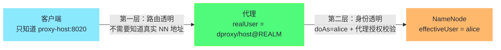
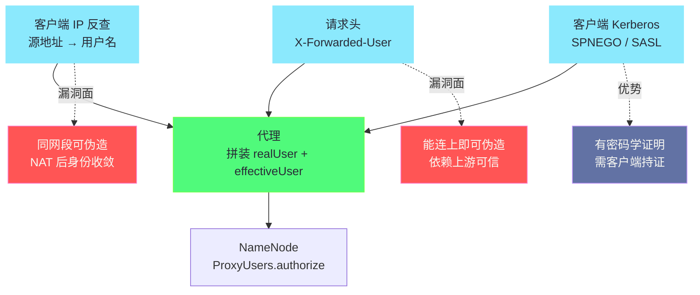
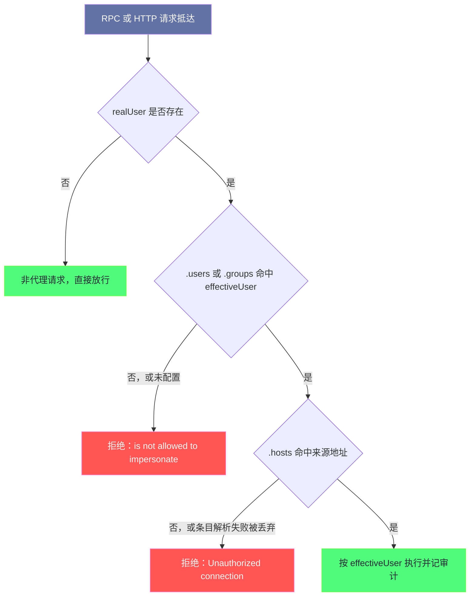
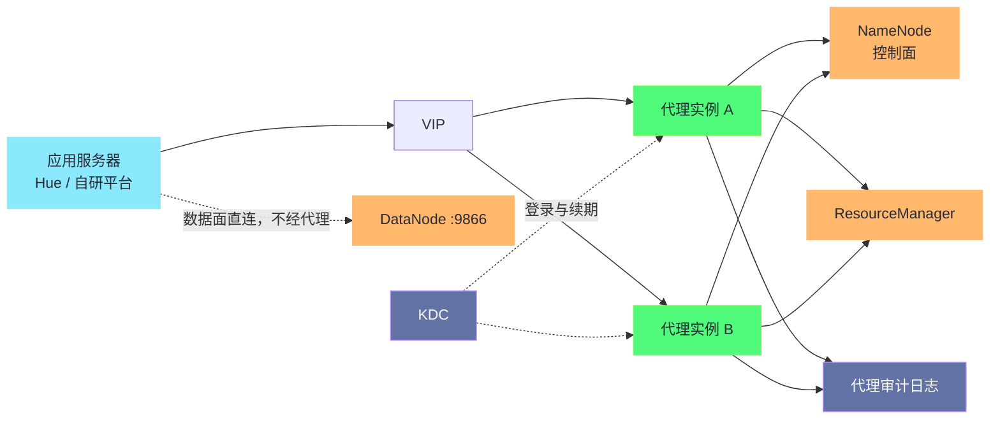
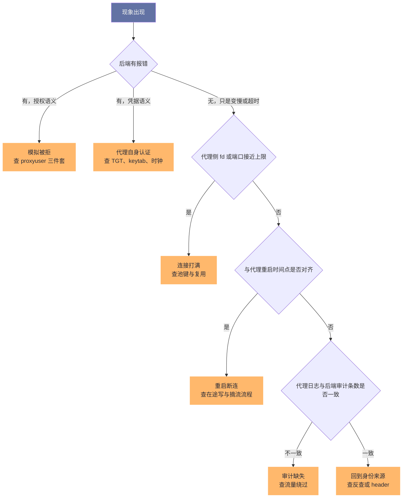

# DProxy 透明代理原理与生产实践：透明性的两层含义与代理的信任边界

**摘要：**

「透明代理」这个词在大数据平台里被用得很松：有人指 iptables 上的一条 DNAT 规则，有人指 Knox 前面那层 Nginx，也有人指内网那台持有 keytab、替上层应用换票的转发服务。三者都被称为透明，但透明的对象并不相同。本文把透明拆成两层：对客户端透明，指的是客户端不必改配置、不必知道真实集群地址；对身份透明，指的是代理必须能「变成」那个用户去访问后端，而这依赖 Hadoop 的代理用户（ProxyUser）授权。第二层才是安全问题所在，第一层只是网络工程。文章随后比较三种实现方式——L4 转发、L7 反向代理、客户端侧代理，给出「能否传递身份、能否审计、能否路由」的判据；再下潜到 HDFS 的代理机制与 NameNode 侧的 `ProxyUsers.authorize` 校验，逐个拆解 `realUser` 与 `effectiveUser` 两个身份槽位、`hadoop.proxyuser.*` 的三件套配置、以及 `MachineList` 在解析主机条目时的静默失败。最后落到生产：高可用、连接数核算、审计日志、证书与 keytab 轮换，以及五个可判读的故障形态。全文的落点是一个判断——透明不是免费的，它把认证成本从一个面收缩到一个点，那个点就是整套体系的信任边界。

---

## 第 1 章 两个视角下的「透明」

「透明」在大数据平台的日常语境里很少被严格定义。运维说它是透明代理，安全评审说它新增了一个信任主体，应用开发者说它只是换了个地址——三种说法都成立，因为透明不是技术属性，而是一组关系：对谁透明、在什么范围内透明。iptables 上的一条 DNAT 规则、Knox 前面那层 Nginx、内网那台持有 keytab 并替上层应用换票的转发服务，除了名字相同几乎没有共同点，区别不在实现细节，而在承不承认「身份」。

把「透明」按视角切开，同一个代理站在客户端前面看是一个样子，站在 NameNode 前面看是另一个样子。

### 1.1 对客户端透明：不用改配置

对客户端透明指的是一件很朴素的事：客户端连的还是那个地址，`fs.defaultFS` 还是原值，代码里没有一行知道代理的存在。真实集群的地址、端口、NameNode 的 Active 与 Standby 切换、Federation 新增的子集群，全被代理吸收在自己这一侧。

这一层透明是纯粹的收益，代价也清楚：代理成了**地址的所有者**。拓扑变更时改的是代理的配置，而不是几千个客户端的配置。这更像公司总机——打电话的人只记得一个号码，分机怎么转、谁在几楼都由总机负责，公司搬了楼层，号码还是那个号码。但总机有一个附加义务：它得知道这通电话是谁打来的，否则既没法记工单，也没法拒接。

最后那句话正是透明代理全部麻烦的来源。地址可以代理，话务可以转接，身份却没法转接——身份只能被「主张」，然后被后端核验。

### 1.2 对身份透明：代理必须「变成」那个人

后端的安全模型不认「转发」这回事。Hadoop RPC 在连接建立时就把主体钉死了：连接上下文里携带 `effectiveUser` 与 `realUser` 两个字段，前者是这次调用「以谁的名义」，后者是「谁实际通过了认证」。这份上下文随连接建立一次，之后这条连接上的所有 RPC 调用都按它判定，中途改不了。

由此，代理想让 NameNode 看到 alice，其实只有两条路。一条是让 alice 自己完成 Kerberos 认证，那么代理就退化成一条 TCP 转发，后端的 `realUser` 与 `effectiveUser` 都是 alice 本人；另一条是代理以 alice 的名义行事，也就是身份模拟（Impersonation）。

第二条路在 Hadoop 里的正式名字是代理用户（ProxyUser）。这种双身份结构在客户端侧由 `UserGroupInformation.createProxyUser` 构造，内部 Subject 与 principal 的组织方式可参见 [[01 Java 安全基石：UserGroupInformation 与 Subject 深度解析]]。它的形状很特别：`realUser` 是代理这个服务账号，`effectiveUser` 是 alice，两个身份同时出现在同一次调用里，后端两个都要校验——`realUser` 必须被明确授权「可以代理 alice」，`effectiveUser` 决定这次操作按谁的权限判定、在审计里记到谁头上。

于是就有了本篇要贯穿的核心区分：**路由**与**主体**。第一层透明改的是路由，解决「请求去哪里」；第二层透明改的是主体，解决「这次操作算谁的」。第一层是网络工程，配错的表现是连不上；第二层是授权工程，配错的表现更隐蔽——能连上，但看到的不是自己的数据，或者以别人的名义看到了不该看的数据。

下图把两个视角叠在一起，可以看到代理在两侧扮演的角色完全不同。

### 1.3 透明的三个前提

把两层透明放在一起看，就会发现「透明」这个说法其实有点误导。它并不表示「不需要认证」，它表示**认证被搬了家**。而搬家是有条件的，三个条件缺一不可。

| 前提 | 含义 | 缺失后的表现 |
|---|---|---|
| 代理自身被认证 | 后端确认「你就是那个被授权的代理」，而不是听代理自称 | SPNEGO 握手失败，报 `GSS initiate failed`；或请求以错误主体落地 |
| 代理被授权模拟 | `hadoop.proxyuser.<代理>.hosts` 与 `.users`（或 `.groups`）同时命中 | `User: ... is not allowed to impersonate ...` |
| 客户端不能自定身份 | 身份的权威来源唯一，且客户端写不进去 | 任何能连上代理的人都能以任意用户名访问，透明退化为冒充 |

三条里最容易漏掉的是第三条，因为它在代理的代码里，不在 Hadoop 的配置里。一个从请求头里读用户名的代理，如果它前面的网络边界不够硬，那么第一条和第二条配得再正确也没用——攻击者不需要破解 Kerberos，他只需要在请求里写上别人的名字。

> [!warning] 透明的边界就是信任的边界
> 代理把所有客户端的认证责任收敛到自己身上，于是「谁能连上代理」决定了「谁能成为谁」。这不是一个可以靠配置项修补的问题，而是部署形态决定的：代理能不能被客户端直连，比 `hosts` 写得多精确更重要。

### 1.4 认证成本从面收缩到点

引入透明代理，本质上是做了一次**认证成本的搬运**。原来每个客户端、每台机器、每个应用都要有自己的凭证，凭证分发面积等于客户端数量；现在只有代理持有凭证，客户端只要能被代理认出来即可。

这一搬，收益很直观：keytab 不用发到几十台机器上，轮换只需要动一个地方，客户端用什么语言写的也不再重要。但风险同样被搬到了一处——代理成了整个体系里唯一同时知道「谁在请求」和「怎么访问后端」的组件，它的凭证泄露、它的配置放松、它的一个 header 解析缺陷，都会直接等于后端的越权。

所以评价一个透明代理做得好不好，看的不是它有多「透明」，而是它的不透明处是否**可审计、可撤销**：谁批准了这个代理可以代理哪些人、从哪些地址来、什么时候收回。这三件事最终都落在 NameNode 的校验代码上。

---

## 第 2 章 没有代理，身份会在哪里塌缩

要理解代理用户为什么存在，最好的办法是设想它不存在。这不是虚构场景，而是很多平台在建设初期真实经历过的阶段：一个 Hue 或者一个自研数据平台，前端是一百个浏览器用户，后端是一套 Kerberos 化的 HDFS 与 YARN。

### 2.1 身份塌缩：一百个用户变成一个服务账号

上层应用自己持有服务账号的 keytab，所有请求都用这个账号发出。于是 NameNode 眼里只有一种用户：`hue`。这一百个用户在 HDFS 权限模型里的差异，全部消失。

后果分两种，且都不轻。若 `hue` 是普通账号，那么所有人都只能访问 `hue` 有权限的目录，权限模型退化成一个布尔值：能访问 `hue` 能访问的一切，或什么都访问不了；若 `hue` 恰好属于 `dfs.permissions.superusergroup` 指定的超级用户组，那么所有经它转发的请求都以超级用户身份通过检查，等于集群对所有浏览器用户开放。前者是「权限不够」，后者是「权限过大」，两者都不是「粒度粗一点」可以概括的，它们是权限判定结果的绝对值出错。

### 2.2 审计失真：日志里只有服务账号

HDFS 的审计日志会记下每次操作的 `ugi`、认证方式、来源 IP、命令与路径。身份塌缩之后，这一行日志里的主体永远是 `hue`。追查「是谁删了这份数据」时，日志能告诉你有一次 `delete`，但给不出人。

这里要补一个常被误解的细节：用了代理用户之后，审计日志并不会只记 `effectiveUser`，而是两个都记。典型形态是 `ugi=alice (auth:PROXY) via hue (auth:KERBEROS)`，`auth:PROXY` 说明这是被代理的调用，`via` 后面才是真实认证主体。所以「代理导致审计失真」这句话要修正为「不启用代理用户才导致审计失真」；启用之后，审计链条反而比单账号更完整，它同时留下了「谁主张」与「谁认证」。

### 2.3 授权不可表达：Ranger 策略失去主体

Ranger 的策略以主体（user、group）为维度，绑定资源与权限。策略能生效的前提是请求抵达时携带的主体是多样的，而塌缩之后主体只有一个，于是策略退化成一条「对 `hue` 全允许」或者「对 `hue` 全拒绝」。一百个分析师、五十个数据集、十三条差异化策略，全部无从表达。

这三件事的共同点在于：它们都不是「性能问题」或者「体验问题」，而是安全语义层面的失效。也正因为如此，代理用户机制才没有被做成一个可选优化，而是从 Hadoop 1.x 时代就存在的核心特性——它最早服务的对象不是数据平台，而是工作流调度器。Oozie 需要「用户提交、服务执行」，作业得以提交者的身份跑，官方文档里那句 `Some products such as Apache Oozie need this` 说的正是这个场景。

回顾这段来历，能看清一个关键设计取舍：代理用户机制只负责证明「代理有资格代表某人」，不负责证明「请求真的来自某人」。后者被交给了另一个参数 `hosts`。把授权与来源拆成两个独立维度，是这套机制最重要的设计决定，也是它最容易被配错的地方——因为两个维度分别配错时，报错信息完全不同。

### 2.4 两种「土办法」及其代价

在没有代理用户机制或者不想引入代理的场合，工程师通常退到两个方案上。

一个方案是把 keytab 发到每台客户端。这在凭证管理上是场灾难：密钥分发面积等于机器数量，轮换需要协调所有客户端，任何一台机器被入侵都等于该用户凭证泄露，而且很多客户端根本不该持有 Kerberos 凭证——一个跑在容器里的报表服务，没有理由为了读几个文件而持有一份长期密钥。

另一个方案是关掉安全模式。它在短期内最省事，代价是把认证与授权一起放弃，之后再用网络隔离去补，补到最后通常得到一个「内网可信」的假设，而这个假设正是第 3 章要拆穿的东西。

代理用户机制提供的是一条中间路径：服务账号只需要一份 keytab，却能合法地代表任意多个用户行事，同时后端始终知道每次操作的真实主体。这条路径并不免费，它把「谁可以代表谁」这个判断变成了一份需要持续维护的清单，清单松一格，前面三节的失效就会以另一种形式回来。

---

## 第 3 章 三种实现方式与判据

同一个目标可以有三条技术路线，它们的分界线只有一条：代理在不在协议层里。

### 3.1 L4 转发：只改目的地址

最轻的一层是 TCP 转发。iptables 的 DNAT、HAProxy 的 tcp 模式、Nginx 的 stream 模块、LVS，做的都是同一件事：把发往 `proxy-host:8020` 的字节流转给 `nn1:8020`，然后在回程把源地址换回来。

它的一个重要性质是：代理完全不碰 SASL，Kerberos 握手、Delegation Token 认证都在客户端与 NameNode 之间端到端完成。代理既不持有凭证，也不解密流量，泄露了也没有直接价值。这一点在安全评审时经常被低估——一个**不持有任何凭证**的转发层，其被攻破后的收益远小于一个持有 keytab 的代理。

但它能用的前提很窄：客户端必须自带合法身份。浏览器用户没有 TGT，Hue 的会话也不产生 TGT，这些场景下 L4 转发帮不上忙，因为「身份」这一层它根本没参与。

L4 还有两个不写在文档里的约束，出问题时都很难判读。

其一是 **SPN 对齐**。客户端发起 SASL 握手时，要按自己认为的目标主机名拼出服务主体（形如 `nn/<host>@REALM`），并在握手阶段校验后端出示的票据确实属于这个主体；而 L4 代理不改字节流，NameNode 出示的仍是自己 keytab 里那个主体。于是要么让代理的主机名与 NameNode 主体里的主机名一致——把代理的地址名注册进 NameNode 的 keytab，或者让客户端看到的地址本来就是 NameNode 的真实名字；要么在客户端把主体显式配死。这一步没做，现象是 `GSS initiate failed` 或服务主体找不到一类的报错，而抓包看 TCP 通得很好，于是很容易被误判成防火墙问题。具体的主体拼装与回退逻辑在不同版本与不同客户端实现上有差异，落地上以对应版本文档与抓包为准。

其二是源地址语义。DNAT 只改目的地址，不改源地址，所以后端看到的是客户端的真实 IP。这带来两个后果：`hadoop.proxyuser` 这一层与它无关（没有 `doAs`，也就没有模拟）；所有以来源 IP 为判据的策略——服务级授权、审计日志里的 `ip` 字段——看到的是客户端地址而不是代理地址。可一旦为了回程路由方便补上 SNAT，客户端 IP 就消失了，审计里的 `ip` 从此都是代理的地址，跨网段追责这条路就断了。

### 3.2 L7 反向代理：能改 header，能做认证

再往上一层，代理进入 HTTP 协议内部。它能终止 TLS、能读 header、能改 URL、能插入自己的认证，也能在转发前把身份写进 `doAs` 参数。Knox 属于这一类，Nginx 加认证模块再加 `proxy_set_header` 的自建网关也属于这一类。

这一层的价值在于「能认证」。外部客户端拿 LDAP 密码来换会话，网关完成认证后把它翻译成内部身份，再以代理用户的名义访问后端。认证方式的转换只发生在网关一处，后端仍然只认 Kerberos，这是边界网关存在的全部理由。代价也很明确：代理从此成为凭证持有者，它必须有一份 keytab 或一张服务证书，必须自己维护票据续期，必须防止 header 注入。

后面这一条在实现上比听起来麻烦。上游传来的请求里可能已经带了 `doAs` 参数，可能是历史遗留的客户端行为，也可能是有人手工构造的。代理在拼装目标 URL 时如果只是「追加」而不同时「清除」，那么客户端的 `doAs` 就会与代理注入的 `doAs` 并存，最终谁生效取决于后端解析参数的方式——而这恰恰是可以被利用的地方，因为 `doAs=hdfs` 意味着超级用户。正确做法只有一个：把来自客户端的 `doAs` 一律丢弃，只使用代理自己从可信来源确认的身份重新构造。

L7 代理还会遇到一个数据面的尴尬，这一点在 WebHDFS 上尤其明显。WebHDFS 的读写请求在拿到重定向之前并不传数据：`OPEN` 返回一个指向具体 DataNode 的 307，`CREATE` 也一样，真正的字节流由客户端直连 DataNode 完成。代理若老老实实把 307 透传回客户端，客户端会拿着内网 DataNode 地址去连——「对客户端透明」在这一刻破产，因为客户端必须能直达 DataNode 的网络；代理若自己跟随重定向把数据搬回来，它就变成了数据面的一部分，一台机器扛全集群的读写流量。两条路都不舒服，这是 HTTP 层次的代理在 HDFS 上绕不过去的取舍。

### 3.3 客户端侧代理：改 `fs.defaultFS`

第三条路最土，也最可控：客户端把 `fs.defaultFS` 指向代理，代理对外表现得像一个 NameNode，对内用 `createProxyUser` 造出 `effectiveUser`，再向真实的 NameNode 发起 RPC。

它牺牲了一部分「透明」——客户端要改配置，虽然只改一行。换来的是一整片控制面：代理可以按客户端来源 IP 决定信任与否，可以按路径把请求路由到不同 nameservice，可以在转发前后记录完整的审计字段，也可以在灰度时按客户端逐个切换。对于「内部服务访问内网 HDFS」这类场景，这一行配置的代价通常可以接受。

它还有一个容易忽略的性质：代理只代理控制面。HDFS 客户端从 NameNode 拿到块位置之后，数据是直连 DataNode 的，代理不在数据通路上。所以「客户端侧代理」的吞吐瓶颈通常不在代理，而在客户端的网络可达性与 DataNode 的负载；但如果代理被扩展成同时转发 DataNode 端口，这个结论立刻反转，它就成了全集群流量的单点。第 6 章核算连接数时，这个区分决定了要算的是每秒 RPC 数还是每秒字节数。

### 3.4 三种方式的判据

把三条路放在一张表里，选择就变成了查表。

| 维度 | L4 转发 | L7 反向代理 | 客户端侧代理 |
|---|---|---|---|
| 改的是什么 | 目的地址，TCP 层 | HTTP 请求与响应 | 客户端配置（`fs.defaultFS`） |
| 能否传递真实用户身份 | 不传递，也不参与 | 能，需自行解析并注入 | 能，代理侧 `createProxyUser` |
| 能否按用户审计 | 不能，只有五元组 | 能，但字段要自建 | 能，且能同时记来源 IP |
| 能否按用户路由 | 不能 | 能 | 能 |
| 代理是否持有凭证 | 不持有 | 持有 keytab 或证书 | 持有 keytab |
| 客户端是否要配合 | 不用，改 DNS 即可 | 要，换成网关地址 | 要，改一行配置 |
| 主要失效点 | SPN 对齐、源 IP 丢失 | header 注入、数据面重定向 | 代理可用性、连接数 |
| 典型实现 | iptables、HAProxy tcp、LVS | Knox、Nginx 加认证模块 | 自建 SDK 层代理 |

这张表里最值得盯的是第三行和第五行：能不能按用户审计，以及代理持不持有凭证。这两项合起来决定了一个代理在安全体系里到底是什么角色——是「看不见身份的中转」，还是「持有凭证的身份转换器」。前者出问题的概率低但可观测性差，后者可观测性好但它本身就是高价值目标。

DProxy 这类组件，通常落在第三列。它面向的是内网里那些「有会话、没有 Kerberos 凭证」的上层应用；用客户端侧代理而不是 L7 网关，是因为要处理 HDFS RPC 而不只是 HTTP，也是因为需要按客户端来源做信任判定。这一定位直接决定了它的身份来源问题——代理既然不在协议层里解析认证，就只能靠请求之外的信息来确认「你是谁」，这正是第 4 章的主题。

---

## 第 4 章 代理怎么知道「你是谁」

代理要做身份模拟，前提是它得先有个名字可以拿去模拟。这个名字从哪里来，是整套机制里最脆弱、也最少被认真讨论的一环。Hadoop 只规定了「代理如何向后端主张身份」，没有规定「代理如何确认身份」——后者完全落在实现方的设计里。

### 4.1 两个身份槽位在线上怎么走

不管哪条路径，最终到达 NameNode 的都是一对身份。以 RPC 为例，一次代理调用分三步：客户端连到代理监听的 NameNode 端口；代理用自己的 keytab 登录，用 `createProxyUser(alice, 代理的 UGI)` 造出代理 UGI；在这个 UGI 的 `doAs` 里发起真正的 RPC。这对身份由连接上下文携带，`realUser` 是代理的 Kerberos 主体，`effectiveUser` 是被模拟的用户名；因为上下文随连接建立一次，连接上的每一次调用都共享它，所以一条连接不能被两个用户复用。这不是实现细节，它有直接的工程后果：代理侧的连接池必须按 `effectiveUser` 分区，否则 alice 的请求会顺着 bob 的连接发出去，后端看到的主体是错的。

HTTP 路径上，这对身份换了个形式：`realUser` 来自 SPNEGO 认证或登录票据，`effectiveUser` 来自 URL 上的 `doAs` 查询参数。WebHDFS 与 HttpFS 都支持这个参数，HttpFS 还需要它自己那份代理用户配置——两侧都配齐，模拟才能成立。

两条路径的共同点是：后端只校验「代理被允许模拟谁」，完全不校验「代理凭什么认为自己是替这个用户办事」。这个空白由实现方填补，填补方式有三种。

### 4.2 三种身份来源及其漏洞面

第一种是从客户端 IP 反查。代理收到连接后拿源地址做反向解析或查一张静态映射表，得到用户名之后再去模拟。它的好处是客户端零改造，连 header 都不用带；坏处是身份与网络位置的绑定太硬，而网络位置恰恰是最容易伪造的东西之一。

同网段内，ARP 欺骗、IP 冲突、DHCP 地址回收后再分配，都能让一个客户端「变成」另一个地址；跨网段时，任何一次 NAT 都会把多个客户端压成同一个地址，于是映射表只能指向其中一个人。更常见的情况是这张表本身维护不住：IP 与人的对应关系在虚拟化与容器环境下天天变，映射表一过期，代理就开始以错误的人名义操作，而这一切在后端看来完全合法。

第二种是从客户端传来的 header 取用户名，形如 `X-Forwarded-User`、`X-Remote-User` 或自定的字段。它的好处是表达能力强，上游可以传任意来源的身份；坏处是它把信任完全押在「谁能连上代理」上。header 没有任何密码学保护，任何能建立 TCP 连接的进程都可以写一个 `X-Forwarded-User: hdfs` 上去。

第三种是让客户端自己完成 Kerberos 认证。代理以 SPNEGO 或 SASL 接受客户端的票据，把认证结果里的 principal 当作 `effectiveUser`（必要时先做一次名字映射），然后以自己的服务身份向后端发起代理调用。这是唯一一种「身份有密码学证明」的来源，代价是客户端要持有一份 keytab 或票据——而这恰恰是很多场景想避免的。

三种来源的漏洞面差别很大，判断时不要只看「能不能用」，要看「被伪造需要什么」。

| 身份来源 | 依赖的前提 | 伪造需要什么 | 适用场景 |
|---|---|---|---|
| 客户端 IP 反查 | 网络位置稳定、映射表准确 | 同网段地址伪造，或一次 NAT 收敛 | 客户端完全不能改，且网络边界极硬 |
| 请求头传用户名 | 只有受信上游能连上代理 | 一条 TCP 连接加一行 header | 上游本身已认证过用户，且与代理同处受控网段 |
| 客户端 Kerberos 身份 | 客户端持有票据、SPN 对齐 | 拿到该用户的密钥或票据 | 客户端有能力持证，追求端到端可证明 |

真正的工程判断在「伪造需要什么」这一列，而三行里最容易被忽略的是中间一行——它说的是「受信上游」。如果上游是 Hue，它的会话已经由 LDAP 认证过，`X-Forwarded-User` 承载的其实是 Hue 的认证结论，代理信任的是 Hue 这个应用，而不是那个 header——header 只是传递结论的载体。反过来，如果代理的端口对内网敞开，那么「受信上游」这个前提根本不成立，header 就成了任意用户名的输入框。

> [!warning] 混合使用时的唯一正确做法
> 同时开 IP 白名单和 header 时，两者不一致必须失败。允许「白名单内的机器可以声明任意用户」，等于把白名单当作身份凭据；允许「header 优先、IP 仅作参考」，等于白名单形同虚设。身份只能有一个权威来源，另一个只能是附加约束。

### 4.3 一个具体的分工：会话在应用，模拟在代理

把三种来源放进真实架构，最常见的组合是这样的：浏览器登录 Hue 或自研平台，应用用自己的会话体系认证用户（LDAP、OAuth、单点登录都行），认证通过后在请求里带上用户名；代理只接受来自这些应用服务器的连接，用应用服务器的服务身份完成 Kerberos 认证，再以 `doAs` 模拟该用户。

这条链路上有三个信任跃迁，每一个都需要单独交代：浏览器到应用，信任由应用的会话机制承担；应用到代理，信任由网络位置与（理想情况下）双向 TLS 承担；代理到 NameNode，信任由 `hadoop.proxyuser` 配置承担。任何一环被绕过，后面的模拟都还照常工作——这正是它危险的地方，失效不会自曝，只会安静地以错误的主体执行正确的操作。

下图把三种来源与它们各自的信任边界画在一起。

### 4.4 一个判据：身份信息不能与请求一起被客户端构造

回头看这三种来源，可以发现一个统一的判据：可信的身份，必须来自客户端**不能自行构造**的通道。Kerberos 票据满足这一点，因为它由 KDC 签发、有密钥证明；mTLS 证书也满足；地址与 header 不满足，它们都是客户端可以影响的量。

这条判据解释了一个看似矛盾的现象：为什么最「土」的方案（客户端侧代理，改 `fs.defaultFS`）反而更容易做对安全。因为它把信任判定放在了网络层（谁能连上代理端口），而身份判定放在了代理内部（从来源到用户的映射或 header），两者是分开的两件事，可以分别收紧。而 L7 网关把两者揉在一起，一旦网关对公网开放，header 就成了身份。

---

## 第 5 章 NameNode 侧的校验：`authorize` 的四步

代理把身份主张送出去之后，真正的裁决发生在后端。Hadoop 把这件事收在一个类里，逻辑短得可以逐行读完，但每一行都有对应的生产事故。

### 5.1 逐行读 `DefaultImpersonationProvider.authorize`

默认的模拟提供者由 `hadoop.security.impersonation-provider.class` 指定，未配置时用 `DefaultImpersonationProvider`。它的 `authorize(UserGroupInformation user, InetAddress remoteAddress)` 做四件事。

第一步，取 `realUser = user.getRealUser()`；若为 `null`，直接返回。这一步的意思是「没有代理关系的请求不归我管」——普通用户直连 NameNode，本就不存在模拟问题。它也顺带说明了一件事：模拟校验只对「带 realUser 的请求」生效，认证由 SASL 完成，两者是分开的两层。

第二步，按 `hadoop.proxyuser.<realUser 短名>` 取出 ACL，检查 `effectiveUser` 是否在其中。取不到 ACL，或者 ACL 判定不允许，抛出的异常是 `User: <realUser> is not allowed to impersonate <effectiveUser>`。

第三步，按同一个前缀取出主机白名单，检查来源地址是否命中。取不到，或者不命中，抛出的异常是 `Unauthorized connection for super-user: <realUser> from IP <addr>`。

第四步是结论：两项都通过便放行，后续的权限判定与审计记录都以 `effectiveUser` 为准。

顺序也有意义。**先查 ACL 再查 hosts**，意味着同一个错误配置在不同请求上会报不同的错：如果 `users` 没配，无论从哪台机器来都是「不允许模拟」；如果 `users` 配了而 `hosts` 没配，报的会是「未授权连接」。定位时先看报错，几乎就能确定是哪一半的问题。把四步连起来看，判定路径没有旁路：要么放行，要么在两个拒绝点之一停下。

回到第三步，匹配发生在 IP 层面：来源地址是 `InetAddress`，与客户端自称的主机名无关。这一点决定了「hosts 填主机名」与「hosts 填 IP」在行为上并不等价——填主机名时，名字是在配置加载那一刻被解析成 IP 的，之后不再变。

### 5.2 ACL 是对 `effectiveUser` 判定的

第二步里的 ACL 由 `users` 与 `groups` 两个配置项合成，判定的是 `effectiveUser`——也就是「alice 这个人能不能被代理」，而不是「dproxy 能不能代理别人」。这个方向经常被记反，导致排查时去查代理账号的组，查了半天没结果。

`groups` 的判定依赖服务端解析出的组成员关系。NameNode 解析用户组用的是自己的 group mapping（本地 `getent`、LDAP、或者 `hadoop.security.group.mapping.*` 指定的实现），与客户端、与 Ranger 用的映射可能是两套。于是出现一类典型问题：Ranger 里 alice 在 `analysts` 组、策略按组生效，访问也被正常放行，但代理这一步却被拒——因为 NameNode 侧的 group mapping 没把 alice 解析到 `analysts` 里。

解决这类问题不靠重启，靠刷新。`hdfs dfsadmin -refreshSuperUserGroupsConfiguration` 与 `yarn rmadmin -refreshSuperUserGroupsConfiguration` 会让对应服务重新从磁盘读取 `hadoop.proxyuser.*` 并重建 ACL 与主机列表；不刷新的话，配置改了也不会生效，因为这份配置在服务启动时就解析完了。安全模式下的前置条件与整体配置脉络见 [[03 Hadoop 安全模式：Kerberos 集成全链路解析]]。

### 5.3 `MachineList` 的三个坑

主机白名单由 `org.apache.hadoop.util.MachineList` 承载。它的语义比配置文件里看起来窄，三个坑都值得写进部署手册。

第一个坑是**通配的范围**。`MachineList` 只在「整个值恰好是单独的 `*`」时才表示全部放行；除此之外它支持三种条目：精确 IP、CIDR 网段、主机名。写 `10.18.101.*` 这种段通配会被当作主机名去解析，解析失败后在日志里留下一条告警，然后这一项被丢弃。丢弃之后的结果与「这一项没写」完全一样——所有来自该网段的请求都会被第三步拒掉，而配置看上去是「写了的」。

第二个坑是**解析时机**。主机名条目在配置加载时被解析成 IP 并存进集合，之后不再变化。主机名指向的地址变了、DNS 记录调整了、甚至域名临时不可解析，都会让白名单与你以为的不一样；补一次刷新才恢复。填 IP 或 CIDR 可以规避这一类，代价是地址变更时要改配置。

第三个坑是粒度。CIDR 写宽一格，信任域就扩一片；`10.0.0.0/8` 看起来只是「内网」，实际上是「整个内网都能当代理」。而信任域扩大的后果不是「多一点便利」，是第 4 章那条链路的第一环直接消失。

配置项的含义与代价可以整理成一张表。

| 配置项 | 语义 | 调大的代价 | 调小的代价 |
|---|---|---|---|
| `hadoop.proxyuser.<代理>.hosts` | 允许发起模拟的来源地址，支持 IP、CIDR、主机名与单独 `*` | 信任域按网段扩张，同网段任一主机被攻破即可冒充该代理 | 新增代理节点或漂移 VIP 时立即被拒，须刷新配置 |
| `.users` | 允许被模拟的用户清单，`*` 表示全部 | 与 `hosts` 叠加后等价于「该代理可代表全平台用户」 | 新增业务用户要改配置，漏改表现为该用户全部请求失败 |
| `.groups` | 允许被模拟的用户组，`*` 表示全部 | 组内成员变动会自动扩大授权，难以审计 | 依赖 NameNode 的 group mapping，映射不准即误拒 |
| `hadoop.security.impersonation-provider.class` | 指定模拟策略实现 | 自定义实现可做更细的判定，但要自己承担正确性 | 用默认实现时无法按请求上下文做动态判定 |

### 5.4 `User X is not allowed to impersonate Y` 的定位表

这句报错是透明代理运维中出现频率最高的一条。它有两个变体，来自 `authorize` 的第二步与第三步，含义完全不同，处置也不同。

| 现象 | 日志关键字 | 根因 | 处置 |
|---|---|---|---|
| 所有用户的请求都失败 | `is not allowed to impersonate` | `.users` 与 `.groups` 都没配，ACL 为空 | 补 `.users` 或 `.groups`，刷新配置 |
| 只有部分用户失败 | 同上，失败用户集中 | 该用户不在 `.users`，或不在 `.groups` 解析出的组里 | 补清单，或修 group mapping |
| 换机器后失败、原机器正常 | `Unauthorized connection for super-user` | 来源 IP 不在 `.hosts`，或多实例部署只加了一台 | 补全所有代理出口地址，优先用 CIDR |
| 配置「看起来对」但仍拒绝 | 伴随 `UnknownHostException` 告警 | 用了 `10.18.101.*` 这类段通配，条目被丢弃 | 改精确 IP、CIDR 或可解析主机名 |
| 改完配置无变化 | 无相关日志 | 未刷新模拟配置 | `dfsadmin` 或 `rmadmin` 的 refresh 子命令 |
| 代理账号自己报错 | `No valid credentials` | 不是模拟问题，是代理的 TGT 或 keytab 失效 | 查 `klist`、keytab 与时钟 |

最后一行要单独强调：很多被归到「代理配置」名下的故障，其实是代理自己的票据过期。区分方法很简单——看报错主体。报错里出现的是被代理用户或 super-user 的授权语义，就是模拟配置；出现的是 `No valid credentials`、`GSS initiate failed`、`Server not found in Kerberos database`，就是代理自身的认证问题，该查 KDC、keytab、时间同步与 SPN。

### 5.5 热加载的边界

刷新的边界需要说清楚：它重读的是服务端本地的 `core-site.xml` 一类配置文件，重建的是模拟提供者与代理服务器列表。它不刷新已经建立的连接，也不刷新票据；正在进行的请求继续按旧规则跑完，新请求才按新规则判定。这意味着「改配置 + 刷新」之后立刻观察到的现象可能还是旧的，排查时不要据此下结论。

还有一个容易被忽略的点：模拟配置是每个服务各自读的。NameNode、ResourceManager、HiveServer2、HBase Master 各有自己的 `hadoop.proxyuser.*` 判定，刷新也要分别刷新。只刷新了 HDFS 而忘了 YARN 的现象是「读文件正常、提交作业报错」，这类不一致比全线故障更难判读，因为它看起来像是一个功能退化而不是配置遗漏。

---

## 第 6 章 生产实践的四件事

把机制讲清楚之后，剩下的都是运营问题。透明代理的特殊性在于它同时具备三个属性：所有流量的必经点、凭证的持有者、身份的唯一证人。这三个属性各自对应一类运维要求。先看链路形状。

### 6.1 高可用：多实例加 VIP，且要能摘流

代理是必经点，它挂掉不是「慢一点」，而是全平台访问中断。所以多实例加 VIP 是最低配置，单实例部署只在测试环境成立。

但多实例不等于高可用，还有两件事要做。一是凭证的独立维护：每个实例各自从 keytab 登录、各自续期，不要共享票据缓存文件，否则一个实例的续期失败会连带另一个。二是可摘流：代理重启会断掉它承载的所有长连接，而这些连接上可能挂着正在写的文件。滚动重启时要先把实例从 VIP 摘掉，等在途请求走完再停，这比「先停再等客户端重试」温和得多。

客户端侧的重试参数是最后一道缓冲。HDFS 客户端在连接断开后会重建连接并重试，`ipc.client.connect.max.retries` 一类参数决定了它愿不愿意等；DataNode 侧的写管道在检测到中断后会做管道恢复，把坏掉的节点剔除后重建。这些机制能把一次滚动重启的影响压到很小的窗口，但它们不是免费的——恢复本身有代价，重复的管道恢复会放大写放大。所以正确的姿势是「尽量不让它断」，而不是「断了靠重试兜」。

### 6.2 连接数：它是所有控制面流量的收口

连接数要单独核算，原因是代理改变了连接拓扑的形状。没有代理时，N 个客户端各自与 NameNode 建连，NN 侧看到 N 组连接；有代理时，客户端连代理、代理连 NN，NN 侧看到的是代理一侧的连接数。

而代理到 NN 的连接数不能按「代理实例数 × 常数」估算。第 4 章那条「连接上下文绑定主体、**连接不能跨用户复用**」的性质，决定了代理必须为每个活跃用户维持至少一条到 NN 的连接。于是连接数大致随活跃用户数线性增长，而不是随客户端数。

下面是一组示例推算，用来展示量级关系，不是实测数据。假设活跃用户 500 人、每人同时在 2 个 nameservice 上有操作、每个（用户 × nameservice）组合维持 1 条 RPC 连接、代理 2 个实例各承担一半：

| 量 | 计算 | 结果 | 含义 |
|---|---|---|---|
| 代理到 NN 的连接数 | 500 × 2 ÷ 2 | 约 500 条/实例 | 与活跃用户数同阶，与客户端数无关 |
| 代理的本地端口占用 | 500 条 × 2 实例 | 约 1000 个 | 相对代理侧端口上限有充足余量 |
| NN 侧看到的客户端数 | 2 | 2 个代理 IP | 来源 IP 维度的限流会一起收敛 |
| 峰值 RPC 每秒 | 500 用户 × 每 10 秒 1 次 | 约 50 QPS | 远低于 NN handler 的处理能力 |

这张表想说明的是两件事。第一，代理确实收口了 NN 的连接：N 个客户端变成 2 个来源，NN 的连接数与来源 IP 维度的压力都下降了。第二，代理自己的连接压力与「活跃用户数」同阶，而不是与「客户端数」同阶，所以扩容判据应该看活跃用户数与会话时长，而不是看接入了多少台机器。

真正容易打满的不是 NN 侧，而是代理侧的每用户连接、文件描述符与端口。代理若频繁建连（每次请求新建一条到 NN 的连接而不是复用），源端口会迅速堆积在 TIME_WAIT，可用端口从六万多个掉到几千个只是时间问题。解法是复用：按 `effectiveUser` 与目标 nameservice 做连接池，池满时才新建。这个池的键必须包含用户，否则就是 4.1 节说的身份串线。

至于吞吐，要回到第 3 章那个区分。只代理 NameNode 端口的部署，数据面不经过代理，代理侧带宽通常不是瓶颈，瓶颈在 RPC 延迟——每多一跳，每次 RPC 多一次网络往返，对元数据密集型负载（大量 `listStatus`、大量小文件）有明显影响。如果代理同时转发 DataNode 端口，那就变成带宽问题：单机网卡的上限就是全平台的吞吐上限，这时候要算的是每秒字节数，以及一个实例故障后剩余实例能不能扛住。

### 6.3 审计日志：代理是唯一能说出「谁声称是谁」的地方

后端的审计能回答「谁做了什么」，但它回答不了「谁声称自己是谁」。Ranger 的审计记录的是 `effectiveUser` 与策略判定结果，HDFS 的审计记录的是 `ugi` 与 `via`，两者都以「请求抵达时携带的主体」为起点。而这个主体是怎么来的、由谁确认的、从哪个地址来的，只有代理知道。

所以代理的审计日志**不是后端审计的副本**，它补的是前端那一段。至少要记这几类字段。

| 字段 | 作用 | 缺失后的后果 |
|---|---|---|
| 时间与请求 ID | 与后端审计对齐，串起一次调用的两段 | 只能按时间窗模糊匹配 |
| `realUser` | 代理自己的身份，确认请求确实来自代理 | 无法区分代理发起的请求与他人直连 |
| `effectiveUser` | 主张的用户 | 无法与后端审计的 `ugi` 对齐 |
| 来源 IP 与端口 | 判断身份来源是否可信 | 身份伪造无法追溯 |
| 身份来源类型 | IP 反查、header 还是 Kerberos | 事后无法评估信任链强度 |
| 操作与路径、状态码、耗时、字节数 | 行为画像与容量分析 | 无法做按用户的用量与异常检测 |

其中「身份来源类型」这一列经常被省掉，但它恰恰是事后复盘的关键：同一个 `effectiveUser`，来自 Kerberos 认证与来自一个 header，可信程度完全不同。日志里不写来源，等于把所有请求都当成同等可信。

审计日志还有个别扭之处值得提前设计：它记的是「被允许执行的请求」。如果代理在模拟之前就拒绝了请求（来源不受信、header 缺失），这些拒绝不会出现在后端审计里，只出现在代理日志里。而拒绝往往比成功更有信息量——它是攻击尝试的唯一痕迹。所以代理侧对拒绝路径的日志级别不能低。

### 6.4 证书与认证：三份材料各有轮换周期

代理身上挂着三份安全材料，各自失效方式不同。

第一份是 keytab。它的失效有两种形态：票据过期（可自动续期，代理应开启续期线程并监控剩余有效期）与 keytab 与 KDC 侧密钥不一致（`kvno` 变了之后旧 keytab 无法登录）。后者通常发生在「KDC 上重新导出过密钥」之后，表现是重启前正常、重启后登录失败——因为在跑进程还用着内存里的旧票据。轮换 keytab 要在 KDC 侧与代理侧配合，先确保新 keytab 可用再替换文件，且替换后要能触发重新登录。

第二份是 HTTP 面的 TLS 证书。若代理同时提供 HTTP 接口（WebHDFS 转发），证书过期会让整条 HTTP 链路在客户端侧报证书错误，而 Kerberos 部分完全正常，于是故障表现成「一半功能不可用」。

第三份是上游到代理之间的认证材料。若用 mTLS，要考虑客户端证书的签发与吊销；若用共享密钥或 token，要考虑轮换时的双活窗口。这一类材料最容易在「上游扩容」时被遗忘：新加的应用服务器没有配客户端证书，于是它的所有请求在代理这一层就被拒，而应用侧的日志只显示连接被断开。

三份材料之外，还有一项容易被当成配置细节的东西：SPN 的写法。代理的 principal 里若含 `_HOST`，它会在运行时被替换成本机主机名，主机名不规范（大写、带域名后缀、解析结果与预期不符）都会导致 principal 与 keytab 对不上。部署时把最终的 principal 打印出来核对一次，比事后猜要省事得多。

---

## 第 7 章 透明代理与 Knox 的分工

平台里同时有 Knox 和 DProxy 的时候，最常见的问题不是「哪个更好」，而是「这个需求该走哪个」。判断标准其实只有一句话：**看客户端能不能配合**。

### 7.1 一句话判据

DProxy 面向 HDFS RPC 与内网客户端，追求「客户端不改、不持有凭证」；Knox 面向 HTTP 与外部客户端，要求「客户端按网关的规矩来」。前半句的关键词是内网——它意味着信任可以部分建立在网络位置上；后半句的关键词是外部——它意味着信任只能建立在凭证上。Knox 一侧的拓扑、Provider 链与 SSO 设计见 [[05 Apache Knox 网关深度解析]]。

| 维度 | DProxy 一类内部代理 | Knox 网关 |
|---|---|---|
| 客户端位置 | 内网，通常是受控的应用服务器 | 内网与外部皆有，经常对公网 |
| 协议面 | HDFS RPC 为主，兼顾 WebHDFS | HTTP 与 REST 为主 |
| 客户端是否改配置 | 改一行（`fs.defaultFS`）或以 DNS 顶替 | 改基址，按网关的 URL 结构访问 |
| 身份从哪里来 | 来源 IP、上游 header、上游 Kerberos 之一 | LDAP、JWT、SPNEGO 等显式认证 |
| 凭证在哪一侧 | 代理持有服务 keytab | 网关持有服务 keytab，客户端持外部凭证 |
| 授权粒度 | 转发前几乎不做，交给后端 | 可做服务级 ACL 与策略判定 |
| 主要职责 | 让已有身份但不该持证的客户端继续工作 | 让不可信客户端先变成有身份的请求 |

这两列的分工不是重叠关系，而是前后关系：Knox 解决「身份从无到有」，DProxy 解决「身份从有到用」。也正因如此，两者可以叠在一起——外部用户先过 Knox 完成认证，Knox 再以代理用户身份访问内部服务，内部若还有一层 DProxy，就会出现两跳 `doAs`。

两跳 `doAs` 本身在机制上成立，`realUser` 与 `effectiveUser` 的链条会一层层传递，审计里也能看到 `via` 的两段。但它抬高了排查成本：报错时得先判断是哪一跳被拒，配置上也要维护两套 `hadoop.proxyuser`（一套给 Knox，一套给 DProxy），并且第二跳的 `hosts` 必须精确到 Knox 的出口地址——Knox 是集群，出口是多个 IP，这条最容易漏。所以除非有明确理由（例如内部代理还承担协议转换或者统一审计），一般不必叠两层。

### 7.2 一个官方的反例：WebAppProxy 反过来防后端

讲分工时值得一提的，是 Hadoop 自带的另一个代理：YARN 的 Web Application Proxy。它把「透明」做在另一个方向上，也因此提供了一个很不一样的信任模型。

YARN 的 ApplicationMaster 是用户代码，它的 Web UI 地址会被注册到 ResourceManager，用户从 RM 点进去就打开了 AM 的页面。问题在于：用户信任 RM，但 AM 是不可信用户提交的代码；AM 完全可以在页面里放恶意脚本、放指向内网地址的链接，或者诱导浏览器发起伪造请求。WebAppProxy 的解法是把 tracking URL 改写成 `http://<proxy>/proxy/<applicationId>/`，让用户访问的是代理而不是 AM 的直接地址，从而在中间截断这层信任。

它做三件事：对不是该应用所有者的访问者给出警告页；剥离用户带来的 Cookie，替换成一个只含用户名的单值 Cookie；由代理自己向后端取内容。配置上是 `yarn.web-proxy.address`、`yarn.web-proxy.keytab`、`yarn.web-proxy.principal` 三项，不给地址时它就随 ResourceManager 一起跑。

这个例子的价值在于它证明了「反向代理」不等于「可信的中间人」。常规透明代理的信任方向是「代理信任后端、防客户端」，WebAppProxy 的方向相反——它假设后端（AM）是恶意的，代理是替用户挡刀的那一层。有意思的是官方文档对它的效果相当克制，明说当前实现并不能阻止 AM 放恶意外链、也不能阻止恶意脚本运行，而脚本既然能运行，剥 Cookie 的收益就有限。这段自述恰好说明第 1 章那个判断：代理能改变信任的形状，但不能凭空创造信任。

对内部代理的启示是反过来的：如果代理假设「后端可信、客户端可信」，它实际什么都不防，安全全押在网络边界上；这个取舍在内网可以成立，但必须是明确的取舍。

---

## 第 8 章 五个故障形态与判据

代理层的故障有一个共同特征：它很少报出「代理挂了」这种直白的错误，更多时候表现为下游服务报权限错、客户端报超时、或者某个功能静默失效。下面五个形态覆盖了大部分现场。

| 形态 | 典型现象 | 判据 | 第一处置 |
|---|---|---|---|
| 模拟被拒 | 全部或部分用户报权限错 | 后端日志出现 `is not allowed to impersonate` 或 `Unauthorized connection` | 核对 `proxyuser` 三件套并刷新 |
| 连接打满 | 请求大面积超时，代理负载不高 | 代理侧 fd 或端口接近上限，`Too many open files` | 查连接池键是否含用户、是否复用 |
| 身份反查失败 | 请求变慢但成功率尚可，或整批用户落到同一个账号 | 代理日志里解析超时或映射为空 | 停用反查，改静态映射或 Kerberos |
| 重启断连 | 重启窗口内出现写失败、管道恢复 | 客户端日志出现 `DataStreamer Exception` 一类 | 先摘流、等在途走完再停 |
| 审计缺失 | 后端有访问、代理无记录 | 两侧日志条数对不上 | 查是否有流量绕过代理 |

五个形态的区分顺序可以画成一棵判断树：先看报错落在哪一侧，再看时间点与变更记录能不能对上。

### 8.1 模拟被拒：多半是配置漂移

`User: X is not allowed to impersonate Y` 出现在后端日志里，说明请求已经抵达 NameNode 并完成了 `realUser` 的认证，只是模拟这一步没过。这类故障有个规律：极少是「一直坏」，多是「刚变过」。新增代理节点、换 VIP、扩了一个 nameservice、迁移了 group mapping、重新导出了 keytab，都会让原本成立的配置**突然不成立**。

判据是看报错的两半。前半段的主语是被代理用户，说明 ACL 没过；主语是 super-user，说明主机白名单没过。配置项与处置见第 5 章的表，这里只补一条经验：多实例部署时，`hosts` 里漏掉的那台机器往往就是最近扩容的那台，而它的流量在 VIP 权重调整之前可能一直是零，所以故障会延迟暴露。

### 8.2 连接打满：先怀疑连接池的键

代理报 `Too many open files` 或大量请求超时，而 CPU 与带宽都不高，基本可以判定是连接侧的问题。此时先不要急着调大 fd 上限，先看连接池的键。

如果池按「目标 nameservice」为键，那么所有用户共用一条到 NN 的连接，表面上省了连接，实际上会把 `effectiveUser` 串掉——后端看到的是第一个建连用户的主体，后续用户的操作全部记在他头上。这类 bug 的可怕之处在于它不报错：功能正常、权限判定错、审计也错。所以正确的池键必须包含用户。

如果池键是对的，那么连接数就该按 6.2 节那样随活跃用户数增长。此时要检查的是「有没有复用」：每次请求新建连接、用完即关的实现，会让源端口大量停留在 TIME_WAIT，连接数统计看着不高，端口却已经耗尽。

### 8.3 身份反查失败：慢而不死最难受

用 IP 反查做身份来源的代理，最怕 DNS 抖动。反查超时不会让请求失败，只会让它变慢，于是现象是「平台整体变卡」，所有下游指标都正常，唯独代理的 P99 上去了。更麻烦的变体是反查返回空：不同实现对空的处理不一样，有的拒绝，有的回落到默认账号——后者等于把一批用户静默合并成一个身份，权限与审计同时失真。

判据是看代理日志里有没有反查超时或解析为空的记录，以及这批请求的 `effectiveUser` 是否异常集中。处置上，短期可以把反查结果做本地缓存并设置合理的过期时间，长期应该把身份来源换成不依赖 DNS 的方式。

### 8.4 重启断连：断在哪一层要看客户端日志

代理重启时所有连接一起断，客户端侧的表现取决于当时在做什么。只是查询的，重连即可，用户几乎无感；正在写的，会触发管道恢复——客户端检测到某个 DataNode 无响应，把该节点从管道里剔除，用剩余副本继续写，然后向 NameNode 申请新的副本补足。这个过程会带来额外的网络与磁盘开销，持续几秒到几十秒。

判据在客户端日志里：`DataStreamer Exception`、`Bad connect ack`、`Slow BlockReceiver` 一类关键字，配合时间点与代理的重启时间对齐。处置分两层，短期靠摘流与选窗口，长期靠「重启前先 drain」的运维流程。

### 8.5 审计缺失：说明有流量绕过了代理

最隐蔽的形态是「后端审计有记录，代理审计没有」。这几乎总意味着有流量没走代理：DNS 缓存让客户端解析到了真实 NameNode 地址、某个客户端配置被改回了直连、某个新接入的应用没走代理、或者代理的某个实例日志没接上采集。

判据很简单，定期对两侧日志做条数比对与主体比对。这件事应该做成例行的自动核对，而不是出事后手工比对——因为「绕过代理」在平时不会造成任何可见的故障，只有出事之后才会被发现。

---

## 第 9 章 反例与量化边界

前面几章讲的是机制，这一章讲机制失效的样子。四个反例都来自真实取舍被简化成配置项之后的产物。

### 9.1 反例一：`hosts=*`

这是最常见的放松方式，理由通常是「代理是多实例、IP 会漂，写不死」。它的实际含义是：任何一台机器，只要拿到代理的 keytab，就能以任意用户身份访问集群。`hosts` 这道防线被移除之后，安全性退化成「keytab 不泄露」这一个假设。

而 keytab 泄露的概率并不低——复制到测试环境、打进镜像、误提交到仓库都有可能。`hosts` 存在的意义正是「即使 keytab 泄露，攻击者也得先出现在正确的位置上」；去掉这一层，等于把纵深防御换成单点。

如果确实存在 IP 漂移，正确做法是写 CIDR 覆盖代理所在网段，并保证该网段里只有代理；而不是写 `*`。

### 9.2 反例二：用 IP 反查当身份

这个反例的诱惑在于「客户端零改造」——不用改配置、不用带 header，代理自己就能知道是谁。问题在于它把身份与网络位置绑成了一个等式，而网络位置是最容易伪造的量。

同网段内伪造地址的技术门槛很低；跨网段时 NAT 会把多个客户端压成一个地址，反查回来只能指向其中一个人；容器与虚拟化环境下地址回收快，映射表一天不更新就可能指错人。任何一条成立，代理就会以错误的主体执行正确的操作，而后端看不出异常。

如果非要用地址做身份来源，至少应该把它降级成「附加约束」：地址只用来判断「这个请求该不该被受理」，真正的用户名必须来自客户端不能构造的通道。

### 9.3 反例三：让 L7 代理扛大文件

这个反例的技术根源在第 3 章：WebHDFS 的读写是重定向到 DataNode 的。代理若透传 307，客户端就要直连 DataNode，透明性在数据面失效；代理若跟随重定向，它自己就成了数据面。

后者在测试环境看不出问题，因为数据量小、并发低。上生产之后，现象是「传小文件正常，传大文件整个平台变慢」——代理的网卡、内存带宽、连接数被几个大文件的流同时占满，元数据请求排在它们后面。修的办法通常是把代理改成透传重定向，但这时又回到了透明性问题：客户端必须能直达 DataNode。

正确的判断是承认这个边界：HDFS 的数据面不适合被应用层代理接管。代理应该只处理控制面，数据面靠网络可达性解决。若必须让数据也从代理走，那要按数据面代理来设计容量，而不是拿控制面代理的规格硬扛。

### 9.4 反例四：把代理当授权点

代理能决定「谁以谁的身份访问」，很容易被顺势加上「能不能访问这个路径」的判断。这在实现上可行，但在体系上是错的：授权一旦在代理与后端两处同时存在，就会出现**两个真相**。用户在代理侧被允许、在后端被拒绝，或者反过来；策略变更要改两处，两处不同步时以谁为准说不清。

代理的职责边界应该是「身份的正确传递」，授权留给 Ranger 与 HDFS 自身的权限模型，代理最多做粗粒度的准入（例如拒绝某类来源）。这条边界划清了，审计也才清晰：代理审计回答「谁声称是谁」，Ranger 审计回答「谁被允许做什么」，两份日志各管一段，不会互相覆盖。

### 9.5 量化：单点风险与延迟代价

透明代理把风险集中，这一点可以量化，但下面这些数字是**示例推算**，不是实测。

延迟上，代理引入一次额外的网络往返与一次请求解析。同机房内，这一跳的增量通常在亚毫秒到毫秒级；对于以元数据为主的负载（大量小文件列举、大量 `exists` 判断），这个增量会按 RPC 次数累加，是用户能感知的部分；对以数据读写为主的负载，因为数据面不经过代理，增量可以忽略。判断要不要优化，先算「每秒 RPC 数 × 单跳延迟」，再看这个乘积相对总耗时占多少。

风险上，代理的可用性直接等于平台访问的可用性。若代理是双实例、任一实例可承载全部流量，可用性大致受限于 VIP 与实例自身的故障率；若代理是单实例，可用性就等于那一台机器的可用性，此时「多买一台机器」比任何参数调优都有效。这类账算起来不复杂，容易被忽略的原因是它不在任何监控面板上——面板显示的是代理健康，而不是「没有代理时的健康」。

还有一个量容易被漏掉：代理重启的影响面与当时在途的写流量成正比，评估变更窗口时按这个量估，而不是按请求数估。

---

## 第 10 章 结语：透明是一种委托

把全篇收拢，透明的两层含义其实是一个委托关系的两面。对客户端透明，是把「找到集群」这件事委托给代理；对身份透明，是把「证明我是谁」这件事委托给代理。前一种委托只涉及路由，失败了顶多是连不上；后一种委托涉及授权，失败了可能是在别人的名下安静地做完一件事。

这份委托要成立，需要三个条件同时在场：代理自己被后端认证、代理被明确授权可以代表谁、以及客户端无法自行指定身份。三个条件里前两个是配置问题，第三个是架构问题，而架构问题没法靠改配置修好。判断一个透明代理是否可信，看的不是它的 `hosts` 写得多细，而是它的端口对谁开放。

Hadoop 这边的实现把裁决收得很紧：`authorize` 四步、ACL 判 `effectiveUser`、`MachineList` 判来源地址。但机制只管「代理被允许代表谁」，不管「代理凭什么认为请求来自那个人」，后一半留给了实现方。三种身份来源的可信度差距极大，混用时的规则只有一条：不一致就失败。

生产上的四件事看起来琐碎，其实都在回答同一个问题：这份委托能不能被观察、被收回。连接数要单独核算，是因为代理是所有控制面流量的收口，它的连接形态与客户端不同；审计要单独建，是因为只有它知道「谁声称是谁」；高可用要做，是因为委托方一旦消失，被委托的事就全停了；凭证要能轮换，是因为委托的可撤销性最终落在材料上。把认证、授权、网关、审计串成一条链路逐段定位的路子，见 [[08 大数据安全体系全景串联]]。

由此可见，透明代理不是「让安全变简单」的组件，而是「把安全集中」的组件。集中带来可管理性，也带来单点。至于该集中到什么程度、愿意为可管理性承担多大的单点风险，取决于每个平台自己的边界——只有选择问题，没有高下之分。

---

## 参考资料

1. Apache Hadoop, *Proxy user - Superusers Acting On Behalf Of Other Users*：<https://hadoop.apache.org/docs/stable/hadoop-project-dist/hadoop-common/Superusers.html>
2. Apache Hadoop, *Web Application Proxy*：<https://hadoop.apache.org/docs/stable/hadoop-yarn/hadoop-yarn-site/WebApplicationProxy.html>
3. Apache Hadoop 3.3.6 源码，`DefaultImpersonationProvider`：<https://github.com/apache/hadoop/blob/rel/release-3.3.6/hadoop-common-project/hadoop-common/src/main/java/org/apache/hadoop/security/authorize/DefaultImpersonationProvider.java>
4. Apache Hadoop 3.3.6 源码，`MachineList`：<https://github.com/apache/hadoop/blob/rel/release-3.3.6/hadoop-common-project/hadoop-common/src/main/java/org/apache/hadoop/util/MachineList.java>
5. Apache Hadoop 3.3.6 源码，`IpcConnectionContext.proto`（`effectiveUser` 与 `realUser` 两个字段的来源）：<https://github.com/apache/hadoop/blob/rel/release-3.3.6/hadoop-common-project/hadoop-common/src/main/proto/IpcConnectionContext.proto>
6. Apache Hadoop, *WebHDFS REST API*（`doAs` 参数与 307 重定向语义）：<https://hadoop.apache.org/docs/stable/hadoop-project-dist/hadoop-hdfs/WebHDFS.html>
7. Apache Hadoop, *HDFS Permissions Guide*（超级用户组与权限模型）：<https://hadoop.apache.org/docs/stable/hadoop-project-dist/hadoop-hdfs/HdfsPermissionsGuide.html>

---

> [!note] 思考题
> 1. 若把 `hadoop.proxyuser.<代理>.hosts` 写成代理所在网段的 CIDR，与写成代理主机的精确 IP，在「代理扩容」与「同网段主机被入侵」两个方向上各自付出什么代价？
> 2. 代理侧连接池如果不按 `effectiveUser` 分区，功能测试往往全部通过。你会设计什么检查手段，在测试阶段就暴露这种身份串线？
> 3. WebAppProxy 的信任方向与本文讨论的内部透明代理相反。如果把「后端不可信」这个假设搬到 HDFS 代理上，哪些设计需要改，哪些会因此变得不可实现？
> 4. 代理审计记录「谁声称是谁」、Ranger 审计记录「谁被允许做什么」。当两者对不上时，你按什么顺序判断是日志缺失、身份映射错误，还是策略配置漂移？
> 5. 如果平台要求「透明代理的授权必须可按人撤销」，在不改动 Hadoop 源码的前提下，`hosts`、`users`、`groups` 三者的组合能不能做到？不能的话，缺的那一环应该由什么组件补上？