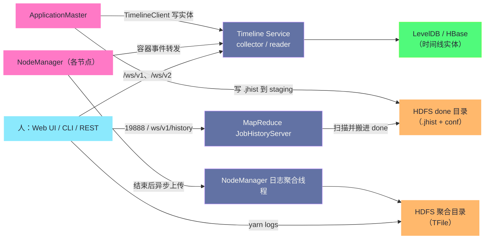
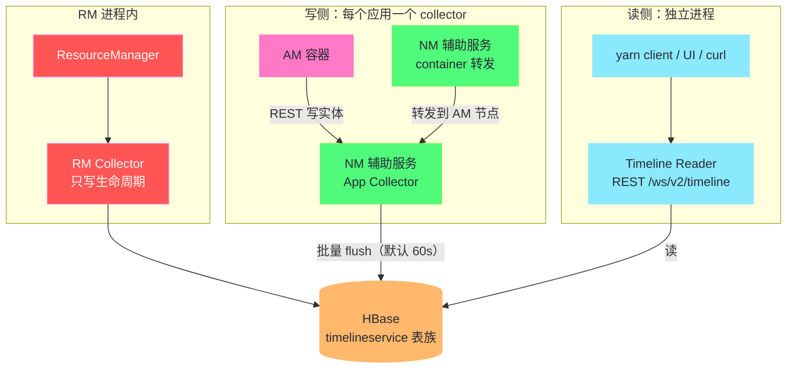
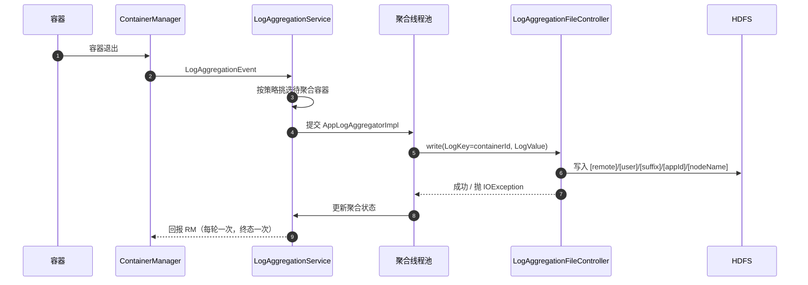
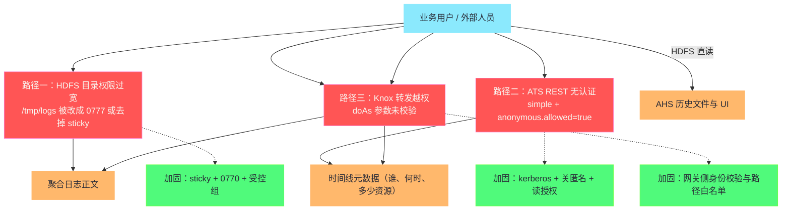
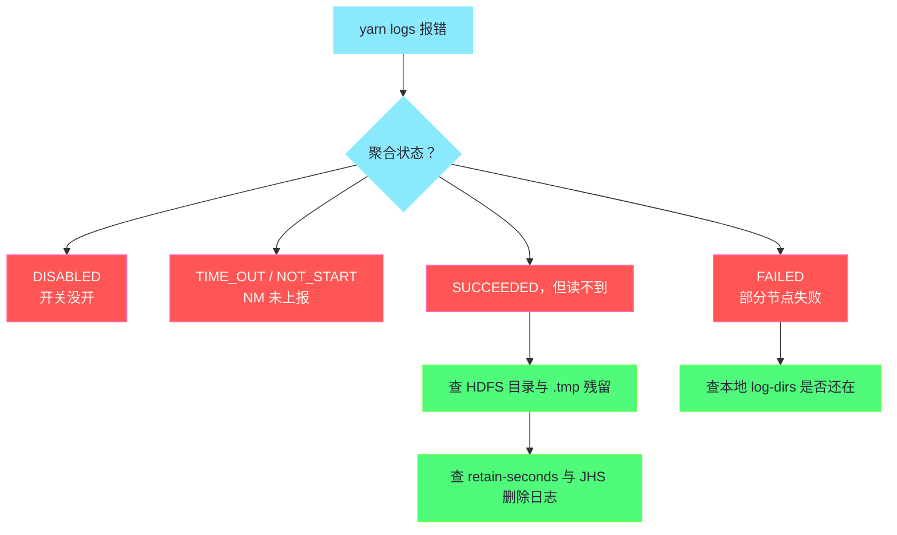

**摘要：**

作业跑完之后，它在集群里留下三类彼此独立的痕迹：写给时间线服务的事件与指标、框架自己攒下的历史文件、以及容器在本地写出的日志文本。YARN 没有把这三类痕迹收进同一个服务，而是分派给 Timeline Service（ATS）、MapReduce JobHistoryServer（AHS）与 NodeManager 的日志聚合三条链路，写入者不同、存储介质不同、权限模型不同、保留期也不同。本文以"三份证据、三条边界"为主线：先厘清三者的职责与"该查哪个"的判据，再剖开 ATS 从 v1 单机 LevelDB 到 v2 collector/reader 分离的重构与后端选型，随后逐段还原日志聚合这条异步链路的路径、TFile 格式、状态机、失败面与删除逻辑——其中包含一个常被忽略的事实：`yarn.log-aggregation.retain-seconds` 的过期删除动作实际运行在 MapReduce JobHistoryServer 进程里，只部署 ATSv2 的集群默认没有人来删日志。在此基础上讨论日志目录 1777/0770 的权限结构、ATS 默认放开的 REST 读取，以及三条典型的作业日志泄露路径，最后把五类高频故障形态、容量估算与 REST 端点整理成可对照的判据表。

---

## 第 1 章 三份证据与三个服务

### 1.1 作业结束之后，还剩下什么

一个 YARN 应用跑到 `FINISHED` 之后，它在 ResourceManager（RM）眼里还有一小段记忆：完成应用的 `ApplicationReport` 会在内存里留一阵，直到被新的完成应用挤出去，这个容量由 `yarn.resourcemanager.max-completed-applications` 决定，Hadoop 3.3.6 的默认值是 **1000**，而不是流传很广的 10000——10000 是 ATS 侧 `yarn.timeline-service.generic-application-history.max-applications` 的默认值，两个数分属不同服务的不同语义，抄错之后会得到"RM 界面里的完成作业忽然少了一截"这类莫名其妙的现象。无论这个数字调多大，它终究只是内存里的一个滑动窗口，RM 重启之后连窗口本身都不存在。

于是"作业跑完之后还能不能查"这个问题，被拆给了三类持久化的痕迹，笔者把它们称作三份证据。

第一份是**时间线**（timeline）：应用在运行过程中主动或被动地写下事件与指标，譬如应用提交、容器分配、以及框架自定义的实体（Tez 的 DAG、MR 的 Job、Spark 的 Job）。它要回答的问题是"什么时候发生了什么、消耗了多少资源"，形态是结构化的键值记录，因此需要索引、需要能按时间范围和过滤字段检索。

第二份是**框架账本**：MapReduce 的 ApplicationMaster 一边跑一边把作业事件写进 HDFS 上的 `.jhist` 文件，作业结束后由一个专门的守护进程把它们整理归档，对外提供计数器（Counter）、Task 尝试次数、每个 map 的输入输出量。这份数据只对 MapReduce 有意义，格式由 MapReduce 自己定义，读取方式是"顺序读、全文解析、加载进内存"。

第三份是**容器日志**：stdout、stderr、syslog，是人和程序真正"说话"的地方。它产生在每一台 NodeManager 的本地磁盘上，体量大、价值密度低、绝大多数时候没人看，但真出事的时候往往是唯一的证据。

### 1.2 三个服务的职责边界

三份证据对应三个服务，它们的分工可以用一张表说清楚。请注意表里最后两列——存在哪里、谁来回答——因为后面所有的运维麻烦，几乎都长在这两列的缝隙里。

| 服务 | 写入者 | 存什么 | 存在哪里 | 对外由谁回答 |
|---|---|---|---|---|
| Timeline Service（ATS） | 应用 AM 通过 TimelineClient；RM 写通用的应用生命周期 | timeline entity、metrics、flow 聚合 | v1 默认 LevelDB（本地盘）；v1.5 落共享文件系统；v2 默认 HBase | `/ws/v1/timeline/`、`/ws/v2/timeline/`、`/ws/v1/applicationhistory/` |
| MapReduce JobHistoryServer（AHS） | MR AM 写 `.jhist` 与 conf 快照到 staging，JHS 搬到 done 目录 | 作业事件、计数器、Task 尝试 | HDFS 上的 `done` 目录 | 19888 端口 Web UI、`/ws/v1/history/mapreduce/jobs` |
| 日志聚合（log aggregation） | 各 NodeManager 在容器/应用结束后异步上传 | stdout、stderr、syslog 等容器日志 | HDFS 上的聚合目录 | `yarn logs -applicationId`、ATSv2 的 `/ws/v2/applicationlog` |
| Spark History Server（参照物） | Spark AM 写 event log | Spark 内部事件（Job/Stage/Task） | HDFS 上的 event log 目录 | 18080 端口 |

表里第四行是参照物：Spark 的历史能力由 Spark 自带，与 ATS/AHS 没有继承关系，它的存在恰好证明"作业历史"在 Hadoop 生态里从来不是一个统一抽象，而是每个框架各自记账、各自开门。

### 1.3 AHS 这个名字的三重含义

AHS 是全篇最容易混淆的三个字母，它在不同语境下指三样东西，值得单独拆开。

最常指的是 MapReduce JobHistoryServer 这个进程，配置项是 `mapreduce.jobhistory.address`（默认 `0.0.0.0:10020`）与 `mapreduce.jobhistory.webapp.address`（默认 `0.0.0.0:19888`），身份由 `mapreduce.jobhistory.principal` 与 `mapreduce.jobhistory.keytab` 指定。它只认 MapReduce 的历史文件，其它框架写出来的东西它一概不读。

历史上它指的是 Hadoop 2.0 早期那个独立的 ApplicationHistoryServer 守护进程，负责把已完成应用的通用信息（队列、用户、起止时间、状态）存起来并提供查询。这个进程后来被并进了 Timeline Server，官方文档的原话是"引入时间线服务之后，Application History Server 只是时间线服务的一个用例"，但它的名字作为化石留了下来：今天 ATS 里那一组配置仍然叫 `yarn.timeline-service.generic-application-history.*`，协议 ACL 仍然叫 `security.applicationhistory.protocol.acl`，REST 路径仍然叫 `/ws/v1/applicationhistory/apps`。

第三种用法是口语化的泛指，"应用历史"四个字被省略成 AHS 之后，有时连 Spark 的历史页面也被叫成 AHS，这种叫法在排障现场会直接导致查错服务。

> [!info] 判据：先看端口，再看路径
> 19888 是 MapReduce JobHistoryServer；8188 是 Timeline Server 的 Web 端口（v1 与 v2 都用它，靠路径区分）；10200 是 Timeline Server 的 RPC 端口。端口对了，再确认 REST 路径前缀是 `/ws/v1/history/`、`/ws/v1/timeline/`、`/ws/v1/applicationhistory/` 还是 `/ws/v2/timeline/`，四个前缀互不通用，走错门只会得到 404。

### 1.4 要查作业历史，该看哪个

把三份证据摊开之后，"该查哪个服务"其实是一个判据问题，而不是记忆问题。下面这张表按"你想知道什么"倒推，左列是问题，右列是唯一能回答它的地方，中间一列是常见的误判。

| 你想知道什么 | 该看的地方 | 常见误判 |
|---|---|---|
| 应用为什么一直停在 ACCEPTED、资源排队排了多久 | RM 的 REST/UI（内存窗口内）；窗口之外看 ATS 的 app 实体 | 去 AHS 找，AHS 里根本没有非 MR 应用 |
| MR 作业每个 map 处理了多少行、Counter 是多少 | AHS 的作业详情 | 去 ATS 找，ATS 只有应用级指标 |
| Spark 作业哪个 Stage 慢、Task 倾斜在哪 | Spark History Server（读 event log） | 去 AHS 找，Spark 不写 `.jhist` |
| 容器的 stdout/stderr 原文 | 日志聚合目录或 `yarn logs` | 去 ATS 找，时间线里没有日志正文 |
| 一批应用作为一个工作流总共烧了多少资源 | ATSv2 的 flow 与 flow run | 去 RM 找，RM 没有跨应用的聚合视角 |
| 某个用户过去一周提交过哪些应用 | ATSv2 的 flow 查询或 RM 的 REST | 去 HDFS 翻目录，只能看到日志目录名 |

表的第三行值得多说一句：Spark on YARN 没有 AHS。Spark 的历史页面由 Spark 自己的 History Server 提供，YARN 这一侧只保留了 RM 内存窗口里的应用状态与 ATS 里的应用实体；如果集群只部署了 AHS 而没有开 ATS，那么 Spark 作业在 YARN 层面几乎没有可追溯的痕迹，只剩聚合日志——这也是"Spark 作业查不到历史"类工单的常见根因，问题不在 Spark，而在没人给它准备时间线。

### 1.5 三条链路的错位之处

把三个服务画在同一张图上，错位就非常直观：三条链路的起点都在应用进程或节点上，终点却落在三种完全不同的存储里，中间经过三个互不相识的守护进程。



三条链路的错位可以列成四组，每一组都足以独立制造一次工单。

写入者不同：时间线由应用自己写（AM 决定写什么、什么时候写），历史文件也由应用自己写，但整理归档由中心进程做；日志则由平台写（NodeManager 替应用收）。写入者不同意味着**失败的责任方不同**，应用没写就没有，平台没写也等于没有，而两边的日志还不在同一个地方。

保留期不同：ATS 的实体默认有 7 天租期（`yarn.timeline-service.ttl-enable` 默认 true，`yarn.timeline-service.ttl-ms` 默认 604800000）；AHS 的清理器默认也是 7 天（`mapreduce.jobhistory.max-age-ms` 默认 604800000，`mapreduce.jobhistory.cleaner.interval-ms` 每天跑一次）；而聚合日志的 `yarn.log-aggregation.retain-seconds` 默认是 -1，意思是**永不删除**。两个 7 天旁边跟着一个永不删除，容量规划和用户预期就会同时失真：用户按 ATS 的经验以为日志只能看一周，运维按"永不删除"的事实看着 HDFS 一路涨。

权限主体不同：读时间线要过 ATS 的 HTTP 认证与读白名单，读历史文件要过 HDFS 目录权限与 JHS 的 admin ACL，读聚合日志要过 HDFS 上那个以用户名为名的目录权限。三者各自有一套"谁能看"的答案，而用户只会问一句"我能不能看这个作业的日志"。

故障域不同：ATS 挂了，RM 的界面还在，只是历史查不到；JHS 挂了，MR 作业跑完没人搬文件，作业列表会停在旧的；NM 的聚合线程出问题，应用照跑，只是日志在 HDFS 上缺一块。三者互不感知，一个坏了另外两个不会报警，这就是本篇把"职责边界"放在最前面的原因。

---

## 第 2 章 ATS：从单机账本到读写分离

### 2.1 v1：把账本放在本机

Timeline Service 在 Hadoop 2.4 引入，动机很朴素：在它之前，应用的通用信息（队列、用户、起止时间）由前面提到的 ApplicationHistoryServer 单独保存，而框架自定义的信息（Tez 的 DAG、MR 的 Job）则完全没有统一的落点，每来一个框架就要在 YARN 里加一套存储。Timeline Service 试图用一套 entity 模型把这些东西统一起来：`entityType` 区分框架，`entity` 是实体 ID，`events` 是带时间戳的事件序列，`primaryfilters` 是可索引的过滤字段，`otherinfo` 放任意附加信息。

v1 的部署形态简单到近乎随意：一个 JVM 进程，一个本地存储，TimelineClient 通过 REST 把实体 POST 给它。存储默认是 LevelDB，由 `yarn.timeline-service.store-class` 指定，默认值 `org.apache.hadoop.yarn.server.timeline.LeveldbTimelineStore`，数据落在 `yarn.timeline-service.leveldb-timeline-store.path`（默认 `${hadoop.tmp.dir}/yarn/timeline`）。选择嵌入式 KV 库的理由是省事：不用额外部署数据库、写入是顺序追加、按时间范围扫描也够用。

但这个选择把整个服务的上限钉死在单机上。所有应用的写入都汇聚到一个 JVM、一个 LevelDB、一块盘；集群规模一上来，写入延迟先升高，接着 TimelineClient 的重试（默认 `yarn.timeline-service.client.max-retries` 为 30 次、间隔 1000 毫秒）把压力放大成雪崩，最后是 AM 里那条"写时间线超时"的线程拖住了作业本身的收尾。更糟的是单点：节点宕机，历史查询全灭，而写侧因为缓冲在客户端内存里，丢一段是常态。

这里有一个反复出现的反例：把 `yarn.timeline-service.store-class` 换成内存实现来"提升性能"。内存 store 在代码里确实存在（`yarn.timeline-service.entity-group-fs-store.cache-store-class` 的默认值就是 `MemoryTimelineStore`），但它的定位是**缓存**，在 v1.5 里给文件后端做读缓存用。拿它当生产后端，效果是重启即清空、堆内存随实体数线性上涨、GC 一路恶化到 Full GC 频繁，最后表现为 ATS 进程周期性无响应——这正是第 5 章要讲的 OutOfMemoryError 形态之一。

### 2.2 v1.5：把账本挪到共享文件系统

v1.5 是一个过渡形态，官方文档里它没有独立的篇幅，配置却不少，核心是 entity group 文件存储：实体按 group 落到共享文件系统上的文件里，写入先进 `active` 目录，冷却后由扫描线程搬到 `done` 目录，读取时用本地缓存加速。

这套机制的关键配置是 `yarn.timeline-service.entity-group-fs-store.*` 一族：`active-dir` 默认 `/tmp/entity-file-history/active`，`done-dir` 默认 `/tmp/entity-file-history/done/`，`scan-interval-seconds` 默认 60（多久扫一次 active 目录做搬迁），`cleaner-interval-seconds` 默认 3600（多久清一次过期数据），`retain-seconds` 默认 604800（done 目录里保留 7 天）。摘要数据仍然放在 LevelDB 里（`summary-store` 默认 `LeveldbTimelineStore`），读路径上先用内存缓存挡一层。

它解决的是"单机磁盘容量"这一个问题，没有解决写入单点：所有写入仍然进同一个进程，只是落盘从本地盘换成了共享文件系统。所以 v1.5 在真实集群里更像一个"没有 HBase 时的妥协方案"，用的人不多，配置却经常被误抄到 v2 的部署文档里——两套配置的名字长得像，语义完全不同。

### 2.3 v2：把写与读拆开

v2 的重构只有一句话：把收集（collection）与读取（serving）分成两组进程。这句话拆开看，是三个具体的设计决定。

第一，收集器下沉到应用身边。每个应用有一个专属的 Timeline Collector，作为 NodeManager 的辅助服务（auxiliary service）运行在 AM 所在节点上，AM 只往本机的 collector 写，其它节点上跑该应用容器的 NM 也把数据转发到 AM 所在节点的 collector；RM 另有一个进程内（in-process）的 collector，只写 YARN 通用生命周期事件，用官方的说法是"把写入量控制在合理范围"。写入压力因此随节点数分摊，而不是汇聚到一个中心点。

第二，读取器独立成进程。Timeline Reader 是独立的守护进程，只负责响应 REST 查询，配置项是 `yarn.timeline-service.reader.class`（默认 `HBaseTimelineReaderImpl`），监听地址 `yarn.timeline-service.reader.webapp.address`（默认继承 `yarn.timeline-service.webapp.address`，即 8188）。写侧对应 `yarn.timeline-service.writer.class`（默认 `HBaseTimelineWriterImpl`）。

第三，后端换成可水平分片的存储，默认 HBase。这一步是架构上的必要条件：collector 再多，如果后端还是单机 LevelDB，压力只是从进程前移到了磁盘。

除这三项之外，v2 还补上了一层 v1 没有的抽象：flow 与 flow run。一个 Oozie 工作流会提交多个 MR/Tez 应用，一段 Structured Streaming 的每个 micro-batch 也是一个独立应用，它们单看都是散落的 `application_*`，合起来才是一次业务动作；v2 用 `clusterId + userId + flowName` 标识 flow、用 `flowRunId` 标识某一次运行，把应用挂到 flow run 下面，再在 HBase 侧用 coprocessor 把应用的指标汇总进 flow run 与 flow。这让"这个工作流总共烧了多少 CPU"从一次跨应用的拼表查询，变成一次 flow 查询——代价是多了一层标识约定（客户端要在 `ApplicationSubmissionContext` 的 tag 里带上 flow 名、版本与 run id），以及 coprocessor 必须正确部署。

拆分带来一个新的时间问题，值得单独讲，因为它解释了"作业刚结束为什么查不到"。AM 容器结束后，collector 不会立刻退出，它还要等 `yarn.timeline-service.app-collector.linger-period.ms`（默认 60000 毫秒）才销毁，这段时间用来接收迟到的数据；写侧则是按批刷的，`yarn.timeline-service.writer.flush-interval-seconds` 默认 60 秒；再往下，客户端侧还有一层文件级的聚合缓冲，`yarn.timeline-service.client.fd-retain-secs` 默认 300 秒、`yarn.timeline-service.client.fd-clean-interval-secs` 默认 60 秒。三个窗口叠加，意味着短作业结束后的一两分钟内在 ATS 里查不到实体是正常现象，而不是丢了。反过来，如果一个作业结束十分钟后仍查不到，那才是真的有问题，判据在第 5 章。



### 2.4 三代对照

把 v1、v1.5、v2 放在一起看，能看清 YARN 在这个服务上花了四五年才完成的思路转变：从"把账本放在本机"，到"把账本放到共享盘"，再到"把记账和查账彻底分开"。

| 维度 | v1 | v1.5 | v2 |
|---|---|---|---|
| 写入进程 | 单进程 | 单进程 | 每应用一个 collector + RM collector |
| 读取进程 | 同一进程 | 同一进程 | 独立 reader 进程 |
| 默认后端 | LevelDB（本地盘） | 共享文件系统 + LevelDB 摘要 | HBase |
| 扩展方式 | 换更大的机器 | 换更大的共享盘 | 加 collector、扩 HBase |
| 关键配置 | `store-class`、`leveldb-timeline-store.*` | `entity-group-fs-store.*` | `writer.class`、`reader.class`、`hbase.*` |
| REST 前缀 | `/ws/v1/timeline/` | 同 v1 | `/ws/v2/timeline/` |
| 典型失效 | 单点、写入排队 | 写入仍单点 | HBase 依赖、reader 单实例 |

表里最后一行需要展开，因为它关系到两个被广泛误传的说法。

第一个误传是"v2 的 reader 可以随便加实例水平扩展"。架构上确实把 reader 从写入路径里摘了出来，多开几个 reader 挂负载均衡在逻辑上成立；但 Hadoop 3.3.6 的官方文档在描述现状时写的原话是"reader 目前是单实例"（"The reader is currently a single instance"），多读者支持在当时仍在路线图上。所以"reader 可以水平扩展"在 3.3.x 时代是架构上的可能性，不是开箱即用的能力，落地前要核对发行版是否回移了相关补丁。

第二个误传是"v2 只要把 `yarn.timeline-service.enabled` 打开就生效"。这个开关只告诉客户端"时间线服务是开着的，你应该往它写"，服务端跑哪个版本由 `yarn.timeline-service.version` 决定，默认值仍然是 `1.0f`。只开 `enabled` 不改 `version`，得到的是一个 v1 服务端配 v2 客户端的错位组合，客户端写 `/ws/v2/timeline`，服务端只认 `/ws/v1/timeline`，表现是写入 404、ATS 里空空如也。这两个配置必须成对出现，是部署环节最常见的坑。

### 2.5 后端选型的判据

流传的说法里，v2 的后端有 `hbase`、`cassandra`、`file`、`memory` 四种，实际情况需要按版本分清：Apache Hadoop 主线在 v2 里自带的是 HBase 与文件系统两套 writer/reader，`file` 后端由 `FileSystemTimelineWriterImpl` 承担，写出的文件名后缀是 `.thist`，根目录由 `yarn.timeline-service.fs-writer.root-dir` 指定；`memory` 实现存在于代码里，主要服务于测试与 v1.5 的缓存层；Cassandra 后端在 Apache 主线里没有对应的默认实现，只在部分发行版或社区补丁中出现，用之前必须核对具体版本，不能照抄别人的配置项。

| 后端 | 何时合适 | 代价 | 不适合的场景 |
|---|---|---|---|
| HBase | 中大型集群；需要按时间/用户/flow 多维检索；已有 HBase 运维能力 | 多一套 HBase 集群或表族；`hbase.configuration.file` 要指向正确的 hbase-site；coprocessor 要部署 | 只有几十个节点、没有 HBase 团队的小集群 |
| 文件系统（`fs-writer`） | 小集群、测试环境、验证链路连通性 | 查询能力弱，靠目录扫描；没有二级索引；容量与文件数成正比 | 需要 flow 聚合、需要多维查询的生产环境 |
| LevelDB（v1） | 单机验证、少量并发应用的边缘集群 | 单点、单盘、重启有丢失窗口；容量上限就是一块盘 | 任何多用户、多框架的生产集群 |
| 内存（缓存/store） | v1.5 读缓存、单元测试 | 重启即空；堆内存随实体数增长 | 任何需要持久化的场合 |

判据可以简化成两问。集群里已经有 HBase 吗？有就直接用 HBase，把 `yarn.timeline-service.hbase-schema.prefix`（默认 `prod.`）按环境分开，避免开发集群与生产集群撞表。没有 HBase，而且时间线只用来做"事后偶尔看一眼"的兜底，那就用文件后端，并接受"查询基本靠扫"的事实；如果连这点需求都要靠复杂查询满足，说明该引入 HBase 了，而不是继续在文件后端上打补丁。

还有一处容易被忽略的容量开关：`yarn.timeline-service.hbase.coprocessor.app-final-value-retention-milliseconds`（默认 259200000，即 3 天）控制应用结束后其指标最终值在 HBase 里保留多久再并入 flow 汇总。它决定的是 flow 级指标的历史精度，与实体本身的 TTL 是两套时间，调大意味着更长的明细保留和更大的存储占用。

### 2.6 部署清单里最容易漏的三项

第一项是 collector 根本起不来。v2 的 collector 是 NM 的辅助服务，光改 `yarn.timeline-service.enabled` 不够，必须在 `yarn.nodemanager.aux-services` 里加上 `timeline_collector` 并把 `yarn.nodemanager.aux-services.timeline_collector.class` 指向 `PerNodeTimelineCollectorsAuxService`，同时把 `yarn.timeline-service.version` 设成 `2.0f`。漏了这几步，服务端看起来正常，实际没有任何节点在写数据。

第二项是只有事件没有指标。系统指标（CPU、内存的用量序列）由 `yarn.system-metrics-publisher.enabled` 控制，默认 false，不开的话 ATS 里能查到应用与容器的事件，却查不到资源曲线，事后做容量分析时就没有数据可依。

第三项是 HBase 侧的准备工作。v2 依赖一个 coprocessor 做 flow 级汇总，jar 要从 HDFS 加载，默认路径 `/hbase/coprocessor/hadoop-yarn-server-timelineservice.jar`，可用 `yarn.timeline-service.hbase.coprocessor.jar.hdfs.location` 改写；表族创建工具（schema creator）需要把 timelineservice 相关的 jar 加进 `HBASE_CLASSPATH` 才能跑。多个集群共用一个 HBase 时，还要靠 `yarn.resourcemanager.cluster-id` 保证唯一，否则两个集群的记录会共用同一个 cluster 前缀，查询时无法区分来源。

---

## 第 3 章 日志聚合：一条会失败的异步链路

### 3.1 为什么由 NodeManager 来做

容器日志产生在节点上，这一点决定了聚合只能由节点侧发起。任何中心化的方案都要面对同一个矛盾：要么让应用自己上传（应用崩了就没日志，而崩掉的作业恰恰最需要日志），要么让中心进程去各节点拉（拉取窗口一旦错过，节点重启就永久丢失）。NodeManager 是唯一一个"容器生命周期全程在场、且比容器活得久"的角色——它在容器退出后仍然存在，还能替已经死掉的应用把日志送出去。

这也是日志聚合与另外两份证据最本质的区别：时间线和历史文件是"应用自己写的账"，应用不写就没有；聚合日志是"平台替应用收的账"，只要节点还在、HDFS 可达，平台有义务把它收上去。

代价是异步。异步意味着存在一个中间状态：日志已经产生、但还没上传完。这个中间状态就是后面所有"日志找不到"问题的温床。

### 3.2 状态机：先看状态，再看目录

YARN 为聚合过程定义了一个显式的状态机（`LogAggregationStatus`），RM 侧能看到每个应用当前的聚合状态。理解这七个取值的差别，比背任何排查命令都管用。

| 状态 | 含义 | 常见成因 |
|---|---|---|
| `DISABLED` | 聚合功能没开 | `yarn.log-aggregation-enable` 为 false |
| `NOT_START` | 应用已结束，还没有 NM 开始处理 | NM 与 RM 心跳异常、应用所在节点失联 |
| `RUNNING` | 正在聚合 | 正常中间态，长作业或大日志会停留较久 |
| `RUNNING_WITH_FAILURE` | 本轮有失败，但仍在重试/继续 | HDFS 抖动、单节点上传失败 |
| `SUCCEEDED` | 全部成功 | 正常终态 |
| `FAILED` | 流程结束，但至少有一份没聚合成功 | 部分节点上传失败、权限问题 |
| `TIME_OUT` | 应用结束了，但状态长时间没更新 | 超过 `yarn.log-aggregation-status.time-out.ms`（默认 600000 毫秒） |

这张表解释了一个高频误会：`FAILED` 不等于"什么都没收到"，它恰恰表示"收到了一部分"。所以看到 `FAILED` 时正确的动作是去 HDFS 上数一数有几个节点文件，而不是直接判定日志全丢。

### 3.3 链路上的每一步

把一个容器日志从本地磁盘送到 HDFS，中间经过五步，每一步都有独立的失败方式。

应用或容器结束时，ContainerManager 向 `LogAggregationService` 投递聚合事件；`LogAggregationService` 为应用创建一个 `AppLogAggregatorImpl`（一个 `Runnable`），交给线程池执行，线程池上限由 `yarn.nodemanager.logaggregation.threadpool-size-max` 控制，默认 100；聚合器按策略类 `yarn.nodemanager.log-aggregation.policy.class`（默认 `AllContainerLogAggregationPolicy`，即所有容器都收）挑出要上传的容器；随后通过 TFile 格式写入 HDFS 上的目标路径；每轮结束后把状态回报给 RM。



图里有两个细节值得强调。其一是聚合的粒度是"每个 NodeManager 一个文件"，不是每个容器一个文件，所有容器的日志按 `containerId` 分段塞进同一个 TFile，这也解释了 `yarn.nodemanager.log-aggregation.num-log-files-per-app`（默认 30）为什么存在——它给"同一个应用在同一个节点上能留几个聚合文件"设了上限，滚动聚合开得越勤，这个上限越容易被顶到。其二是写入是"写临时文件再改名"的，源码里临时后缀是 `.tmp`，所以 HDFS 上看到以 `.tmp` 结尾的文件意味着某次上传正在中途，不是坏数据。

### 3.4 路径、权限与文件格式

默认路径由三个配置拼出来：`yarn.nodemanager.remote-app-log-dir`（默认 `/tmp/logs`）、`yarn.nodemanager.remote-app-log-dir-suffix`（默认 `logs`），再加上应用属主与 `appId`，最终是 `<remote>/<user>/<suffix>/<application_id>`。

```text
/tmp/logs/
  └── alice/                                  # 提交用户
      └── logs/                               # suffix
          └── application_1705000000_0001/
              ├── node01.example.com_45678    # 每个 NM 一个 TFile
              └── node02.example.com_45679
```

权限是写死在代码里的，不是配置项，因此网上流传的 `yarn.nodemanager.remote-app-log-dir.permissions` 在 3.3.6 的 `yarn-default.xml` 中并不存在，改了也不会有任何效果；与之同族的 `yarn.nodemanager.remote-app-log-dir.retain-seconds` 同样查不到，聚合日志的保留期只有 `yarn.log-aggregation.retain-seconds` 一个入口，配错地方等于没配。`LogAggregationFileController` 里定义了两个常量：远端根目录的权限是 `01777`（即 `drwxrwxrwt`，带 sticky bit），应用目录的权限是 `0770`。源码注释把部署预期写得很清楚：根目录的属主是 NM 的运行账号、属组是 NM 所在的组，应用目录的属主是应用属主、属组仍是 NM 的组，"这样属主和 NM 都能访问/修改文件"，紧接着还有一句提醒——NM 所在的组应当是一个受控的组。这句话是整章安全讨论的起点，第 4 章会展开。

随目录创建时还会做一次校验：如果根目录已存在但权限不等于 `01777`，NM 会在日志里打出警告，内容是期望值与实际值，并提示"集群在多用户场景下可能出问题"。这条警告在真实集群里出现频率不低，因为很多平台为了"方便运维查看"手工把 `/tmp/logs` 改成了 `0775` 甚至 `0777`，去掉了 sticky bit。

文件格式是 TFile，一种为批量顺序读写设计的容器格式，键是 `containerId`，值是一段序列化的日志集合，内部按容器与日志类型分段。它不是纯文本，`hdfs dfs -cat` 出来是乱码，只能靠 `yarn logs` 或 TFile 的读取工具解析。压缩由 `yarn.nodemanager.log-aggregation.compression-type` 控制，默认 `none`，常见取值是 `none` 与 `gzip`（交给 TFile 的压缩 codec，装了哪个 codec 才能用哪个）；格式本身可插拔，`yarn.log-aggregation.file-formats` 默认只有 `TFile`，理论上可以加别的 controller，实际上很少有人动它。

### 3.5 配置与代价

日志聚合涉及的配置不多，但每一对取值都对应一种代价，下面这张表按"改动会付出什么"来组织。

| 配置 | 默认值 | 调大的代价 | 调小的代价 |
|---|---|---|---|
| `yarn.log-aggregation-enable` | false | 开启后 HDFS 写入与 NN 元数据压力上升 | 关闭即失去集中查看能力，节点盘一清就没了 |
| `yarn.nodemanager.remote-app-log-dir` | `/tmp/logs` | 换到更大配额目录可延寿，但历史数据要迁移 | 放在 `/tmp` 下易被其它清理策略误删 |
| `yarn.log-aggregation.retain-seconds` | -1 | 数值越大占用越多；小集群可能几周就吃掉数 TB | 太小会让用户"昨天的日志就没了"，且删除扫描更频繁 |
| `yarn.log-aggregation.retain-check-interval-seconds` | -1（取保留期的 1/10） | 间隔越大，过期日志清理越滞后 | 间隔越小，扫描目录越频繁，官方原话是"会让 NameNode 不堪其扰" |
| `yarn.nodemanager.log-aggregation.roll-monitoring-interval-seconds` | -1（关闭） | 滚动上传让运行中的作业也能看日志，代价是持续写 HDFS | 关闭时运行中作业看不到聚合日志，只能去节点上看 |
| `yarn.nodemanager.log-aggregation.num-log-files-per-app` | 30 | 单应用单节点留更多文件，目录更碎 | 小于滚动次数时会覆盖旧文件，历史片段丢失 |
| `yarn.nodemanager.log-aggregation.compression-type` | none | 开 gzip 省空间但增加 CPU，且读取要解压 | 不压缩时大日志的 HDFS 占用与读取带宽都更贵 |
| `yarn.log-aggregation.enable-local-cleanup` | true | 关闭可保留本地日志便于排障，但长期会撑爆节点盘 | 保持开启时，聚合完成后本地即删，出问题只能靠 HDFS |
| `yarn.nodemanager.log.retain-seconds` | 10800 | 仅在不聚合时生效，调大同样占盘 | 调小则未聚合场景下三天不到就被删 |
| `yarn.nodemanager.logaggregation.threadpool-size-max` | 100 | 并发上传高，HDFS 写压力集中 | 并发低，大量应用同时结束时聚合排队 |

这张表里最该盯的是第一行和第五行。`yarn.log-aggregation-enable` 默认是 false，这是"日志找不到"的头号原因：集群从 Hadoop 2 升级上来、或者由自动化脚本生成的 `yarn-site.xml` 漏了这一项，聚合根本没发生过，`yarn logs` 会明确告诉你"聚合没完成或者没开启"，而很多人不看这句提示，直接去翻 HDFS 目录。滚动上传（第五行）默认关闭，意味着**运行中**的作业在 HDFS 上看不到聚合日志，这是设计如此，不是故障；要让长跑作业也能看，就得开启滚动并把间隔设成不小于 3600 秒（`yarn.nodemanager.log-aggregation.roll-monitoring-interval-seconds.min` 是硬下限，低于它 NM 会告警）。

### 3.6 失败之后，日志还在不在

这个问题的答案比大多数文档写的要复杂，因为它取决于失败发生在哪一层。

如果失败发生在单容器上传这一层（`write` 抛异常），源码的处理是记一条错误日志、跳过这个容器、继续下一个，注释原文是"跳过这个容器"。整个应用的聚合流程仍然会走到收尾，然后在收尾阶段执行本地清理——只要 `yarn.log-aggregation.enable-local-cleanup` 为 true（默认值），`yarn.nodemanager.log-dirs`（默认 `${yarn.log.dir}/userlogs`）下的应用目录会被删掉。也就是说，单容器上传失败的结果是**HDFS 少一块，本地也删了**。这与"聚合失败日志会留在本地"的流传说法不同，后者只在另一种情况下成立。

如果失败发生在 DFS 层（NameNode 不可达、配额超限、HDFS 写入被拒），源码里有一处专门的分支：捕获到 `LogAggregationDFSException` 之后不再执行本地清理，注释写的是"清理会导致日志丢失"。这种情况下日志确实留在本地节点上，但也仅此而已——它没有任何机制保证下次一定会被重新上传，节点重启、本地目录的定期清理、容器运行时目录的回收，都会让它消失。把"日志留在本地"当成一种兜底，等于把证据保存在一个没有备份、随时可能被格式化的地方。

这里还有一个旧文档遗留的坑：很多排障手册让人去打开 `yarn.nodemanager.log-aggregation.debug-enabled`。Hadoop 3.3.6 的 `yarn-default.xml` 里根本没有这个键，写了也不生效。真正能用来保留现场的是 `yarn.log-aggregation.enable-local-cleanup`，把它在故障窗口内临时设为 false（改完要重启 NM），才有机会去节点上把原始日志捞出来。

### 3.7 谁在删那些日志

这是全篇最值得单独记住的一节，因为它解释了一个常见的运维困惑：`yarn.log-aggregation.retain-seconds` 明明配了 7 天，为什么 HDFS 上的日志半年了还在？

删除动作不在 NodeManager 里，也不在 ResourceManager 里，而是在 **MapReduce JobHistoryServer 进程内**：JHS 启动时会创建一个 `AggregatedLogDeletionService` 并注册为服务，它用一个定时器按 `yarn.log-aggregation.retain-check-interval-seconds` 的间隔扫描远端日志根目录，逐层遍历用户目录、suffix 目录、应用目录，删除超过保留期的应用目录。

它的删除判断有三个条件，缺一不可：应用目录的修改时间早于截止时间；通过 RM 的 `getApplicationReport` 确认应用已经处于终态（RM 查不到该应用时视为已终止）；目录下所有文件的修改时间都早于截止时间。如果应用还在运行，它只删那些已经超期的单节点文件，不动整个目录。这个设计相当谨慎，代价是它对 RM 的连通性有依赖——RM 不可达时删除任务抛异常、本轮跳过，日志继续堆着。

于是就有了三种"该删的没删"：集群只部署了 ATSv2 与 Spark、根本没有 JHS 进程，删除服务没人启动；JHS 起了但长期不可用或反复重启，定时器没跑；`yarn.log-aggregation.retain-seconds` 保持默认的 -1，删除逻辑在启动时就判定"保留期为负、删除关闭"并直接返回。前两种在 HDFS 上表现为目录无限增长，第三种是配置语义，不算故障但同样吃掉容量。

反过来，"删得太狠"也是一种故障。`retain-check-interval-seconds` 默认是 -1，代码里取的规则是保留期的十分之一，所以把保留期设成 1 天、检查间隔没设，等于每 2.4 小时扫一次目录——对 NameNode 是一笔不小的元数据操作开销，官方在配置说明里专门写了"小心设得太小会频繁打扰 NameNode"。删除动作本身按目录递归删，一次删掉成千上万个文件时，NN 的删除队列会积压，表现出来是 NameNode RPC 延迟上升。

保留期改动之后还需要一次刷新动作：`mapred hsadmin -refreshLogRetentionSettings`，它通过 JHS 的管理协议通知 `AggregatedLogDeletionService` 重建定时器。只改配置不刷新，要等 JHS 重启才生效，这个细节在变更单里经常被漏掉。

---

## 第 4 章 安全边界：三套门禁的交界处

### 4.1 日志目录的两层门与一把总钥匙

把 `/tmp/logs` 的权限结构拆开看，它其实是两层门加一把总钥匙。

第一层门是根目录 `/tmp/logs`，权限 `01777`，属主是 NM 账号，任何用户都能进入、能在里面创建自己的目录，但 sticky bit 保证只有目录属主（或 root）能删除别人的目录。这一层解决的是"谁能往里写"，它必须宽——所有提交作业的用户都要能写自己名下的目录。

第二层门是应用目录 `.../<user>/logs/<appId>`，权限 `0770`，属主是应用属主，属组是 NM 所在的组。这一层解决的是"谁能读"，它的实际效果完全取决于一个隐含假设：NM 所在的组是个受控的组。源码注释里那句"NM 所在的组显然应当是一个访问受限的组"，就是这把总钥匙的说明。

问题在于，HDFS 上新建目录的属组默认继承父目录，而父目录 `/tmp/logs` 的属组就是 NM 账号的主组。在很多平台的实际部署里，NM 以 `yarn` 账号运行，而 `yarn` 的主组往往是 `hadoop` 这类覆盖了所有平台用户的大组。一旦如此，`0770` 的语义就变成了"整个 hadoop 组的成员都能读所有人的日志"——包括所有提交作业的业务用户。这不是配置错误，而是权限模型与组织结构的错配：代码假设组是受控的，现实里组是宽泛的。

`yarn.nodemanager.remote-app-log-dir.groupname` 提供了一点补救空间：如果根目录由 NM 创建，可以用它指定属组。但要注意顺序——这个配置只在"NM 创建根目录"时生效，根目录已经存在时不会改属组，得先手工 `chgrp` 再重启 NM。

### 4.2 ATS 的认证与授权：默认值全开着

如果说日志目录的问题是"默认太宽"，那 ATS 的问题就是"默认几乎不设防"。下表列出的都是 3.3.6 里的出厂值。

| 配置 | 默认值 | 暴露面 |
|---|---|---|
| `yarn.timeline-service.http-authentication.type` | `simple` | REST 端点使用简单认证，不校验 Kerberos 身份 |
| `yarn.timeline-service.http-authentication.simple.anonymous.allowed` | `true` | simple 模式下**允许匿名请求**，等于 READ 全开 |
| `yarn.timeline-service.read.authentication.enabled` | `false` | v2 的读授权检查默认关闭，白名单不生效 |
| `yarn.timeline-service.read.allowed.users` | 空（启用授权时必填） | 未启用授权时形同虚设 |
| `yarn.webapp.filter-entity-list-by-user` | `false` | 列表类接口不按实体属主过滤，能看到别人的实体 |
| `mapreduce.jobhistory.admin.acl` | `*` | 任何人都是 JHS 管理员 |

单看每一行都不算惊人，叠起来就构成一条完整的泄露路径：知道 8188 端口的人，用 `curl` 直接请求 `/ws/v2/timeline/clusters/.../apps`，不需要任何凭证就能拿到应用列表、指标与 flow 信息；如果再配上 `/ws/v1/applicationhistory/apps` 与 `yarn logs` 的读取权限，作业的元数据与日志正文就都出去了。

这里还有一处必须点明的版本差异：不少文档与旧博客让人配置 `yarn.timeline-service.enable-rest-http-auth`，这个布尔开关在 Hadoop 2.x 时代存在，在 3.3.6 的 `yarn-default.xml` 里已经找不到。3.x 的认证开关统一收敛到 `yarn.timeline-service.http-authentication.type`，真正决定"匿名能不能进"的是 `...simple.anonymous.allowed`。照抄旧配置的后果不是报错，而是**静默无效**——配置写了，认证没开，谁也没发现。

同样地，不少资料里提到的 `yarn.timeline-service.domain.*` 一族 ACL 配置，在 3.3.6 与 3.4.1 的 `yarn-default.xml` 中都查不到；想在 ATSv2 上做"按用户隔离读取"，官方给出的手段是打开 `yarn.timeline-service.read.authentication.enabled` 并配置 `yarn.timeline-service.read.allowed.users`（用户列表 + 组列表），或者在没有开启授权的情况下打开 `yarn.webapp.filter-entity-list-by-user`，让列表按实体属主过滤。域（domain）粒度的 ACL 属于官方路线图里的"实体级 ACL"方向，落地与否要看具体版本，配之前先在自己集群的 `yarn-default.xml` 里确认键存在。

> [!warning] 一处真实存在的错配
> 开启 `read.authentication.enabled` 之后，读取白名单是**全集群生效**的，它没有"这个用户只能看自己的实体"这层语义，只有"在名单里就能读全部，不在就什么都读不到"。想做到按属主隔离，得靠 `yarn.webapp.filter-entity-list-by-user` 这类过滤，或者在 ATS 前面放 Knox 之类的网关做路径级转发与鉴权。

### 4.3 三条泄露路径

把权限、认证、代理三件事放在一起，作业日志泄露通常走三条路，下面这张图把它们画在了一起。



第一条路是 HDFS 目录权限本身。把 `/tmp/logs` 改成 `0777` 或去掉 sticky bit，等于让任何能访问 HDFS 的人直接 `hdfs dfs -cat` 别人的日志；sticky bit 被去掉之后，甚至能删除或篡改别人的日志目录。这类改动通常来自"运维要能看所有日志"的诉求，正确做法是用 HDFS ACL 给运维组授读，而不是把所有人的门都拆了。

第二条路是 ATS 的 REST 无认证。8188 端口一旦对业务网段开放，任何人都能枚举应用、flow 与指标；如果这个集群同时用 ATS 存了敏感业务的队列名、资源消耗、用户标识，泄露的就是完整的业务画像。加固手段是 `http-authentication.type=kerberos`、把 `simple.anonymous.allowed` 改成 false、开启 `read.authentication.enabled` 并配置白名单；如果前面有 Knox，更省事的做法是只让 Knox 访问 ATS，对外只暴露网关。

第三条路是 Knox 转发时的越权。网关把外部请求转成内部身份，中间必然存在"用户身份"与"代理身份"的转换；如果 `doAs` / 代理用户配置过宽（`hadoop.proxyuser.*.users=*`、`hosts=*`），任何能过网关认证的人都可以通过改动请求参数以别人的身份读取日志。这条路的加固在网关与代理用户配置侧，与本文的三份证据无关，机制细节属于 [[06 DProxy 透明代理原理与生产实践]] 与 [[05 Apache Knox 网关深度解析]] 的范围。

---

## 第 5 章 五种故障形态与判据

### 5.1 日志找不到

这是日志聚合方向绝对的高频问题，但它其实是三种不同的病，靠一条命令就能分开。

先看状态：`yarn application -status <appId>` 拿到应用状态与聚合状态。如果聚合状态是 `DISABLED`，那就是 `yarn.log-aggregation-enable` 没开，不用再查了；如果是 `NOT_START` 或 `TIME_OUT`，问题在 NM 与 RM 的通信；如果是 `FAILED`，说明部分节点失败，去 HDFS 数文件个数并与运行节点数对比。

再看目录：`hdfs dfs -ls /tmp/logs/<user>/logs/<appId>/`。目录不存在有两种可能，聚合从未开始，或者已经被删除服务清掉；目录存在但没有文件，多半是上传中断（`.tmp` 文件残留可以佐证）。

最后看本地：`yarn.nodemanager.log-dirs` 下的 `application_<id>` 目录还在不在。在，说明本地清理没执行（DFS 层失败或被临时关闭），可以抢救；不在，说明清理已发生，只能回到 HDFS 侧找。

把这三步串起来，就能回答"日志到底去哪了"这个问题，而不用在三个服务的日志里同时 grep。



### 5.2 `Log aggregation has not completed or is not enabled`

这句提示来自 `yarn logs` 的读取逻辑，源码里的触发条件是"远端应用日志目录不存在"，紧接着还会打印目录路径本身。所以看到这句话时的第一件事，是把提示里的路径抄下来，去 HDFS 上确认它到底存不存在。

如果路径不存在，回到 5.1 的三种病。如果路径存在，那这句提示本身就不该出现，多半是 CLI 推断出的路径与 HDFS 上的实际路径对不上：应用属主与目录名不符（改名、代理提交、大小写差异），或者集群配了多套 `remote-app-log-dir` 而客户端读到的是旧配置。还有一种情况是把权限提示误当成这句——代码里权限不足时打印的是另一段话，"猜测的属主是 A，当前用户 B 没有权限访问该目录"，两句话的判断方向相反，前者是数据没到，后者是数据到了但你进不去。

还有一种情况是长作业：应用仍在运行、滚动聚合没开，HDFS 上当然没有目录。这时要么等结束，要么开滚动聚合，要么直接去 NM 的 Web 界面看本地日志。

### 5.3 ATS 的 `OutOfMemoryError`

ATS 内存打爆的成因在不同代际里完全不同。

v1 时代最常见的是"实体太多 + 查询太杂"：单进程既要接写入又要接查询，`yarn.timeline-service.handler-thread-count`（默认 10）决定了并发处理能力，压满之后请求排队、堆内存堆积分页结果；如果同时把 `store-class` 换成了内存实现，堆的增长就是无界的。另一个隐形推手是 `yarn.timeline-service.generic-application-history.max-applications`（默认 10000），它决定通用应用历史能返回多少条，查询侧一次性拉取大列表时吃内存。

v2 时代的成因转向 reader 侧：reader 把查询结果在内存里组装，`limit` 参数不设或设得过大、`fields=ALL` 全字段返回、大 flow 的实体展开，都是把 reader 推向 GC 悬崖的直接原因；collector 侧则可能因为 HBase 写入变慢而积压，`yarn.timeline-service.writer.async.queue.capacity`（默认 100）满了之后只能阻塞或丢弃，表现为 collector 线程卡住。

判据是看日志里的第一现场：`java.lang.OutOfMemoryError: Java heap space` 之前的那几十行，多半是某个超大查询或某个 HBase 异常重试风暴。处置不能只靠加堆，得先确认是查询型增长还是写入型积压，前者要限流与索引，后者要查 HBase。

### 5.4 时间线存储读不出来（`Unable to read the timeline store` 一类报错）

现象是 REST 查询返回 500。客户端侧经常只拿到一句笼统的封装信息，形如 `Unable to read the timeline store`；Apache Hadoop 3.3.6 的服务端日志并不会打这一句，真正的判据是同一个时间段里紧跟其后的存储层异常。后端不同，异常形态不同，判据也不同。

HBase 后端：`TableNotFoundException` 说明表族没建，`RetriesExhaustedException` 说明 RegionServer 不可达或过载，`AccessDeniedException` 说明 ATS 用的 Kerberos 主体没有表权限。这三类的处置分别是跑 schema 创建、查 HBase 集群健康、修权限。`yarn.timeline-service.hbase.configuration.file` 指错文件时，表现是连到了另一套 HBase（或者连不上），这是部署期最容易出的错。

LevelDB 后端：进程在写的同时被查询，或者磁盘满、文件句柄耗尽，都会让 store 打不开。LevelDB 的锁是进程级的，同一个路径被两个进程打开会直接失败——这在"老 ATS 没停干净、新 ATS 又起来了"的滚动升级窗口里很常见。

文件后端：根目录权限、`active`/`done` 目录的可见性、summary store 的 LevelDB 路径，任何一处不对都会让读取返回空或者抛错。

把这几类归拢成一句话：存储读不出来的第一判据是"后端类型"，第二判据是"异常类名"，不要一上来就重启进程——重启能解决锁冲突，解决不了权限和表缺失，还会把真正的第一现场冲掉。

### 5.5 AHS 里查不到刚跑完的 MR 作业

MapReduce 的历史文件不是作业一结束就出现在 done 目录里的，中间有一次搬运：AM 先把 `.jhist` 与 conf 快照写进 staging 的中间目录（`mapreduce.jobhistory.intermediate-done-dir`，默认 `${yarn.app.mapreduce.am.staging-dir}/history/done_intermediate`），JHS 的扫描线程按 `mapreduce.jobhistory.move.interval-ms`（默认 180000 毫秒，即三分钟）的节奏把它们搬到 `mapreduce.jobhistory.done-dir`（默认 `${yarn.app.mapreduce.am.staging-dir}/history/done`），搬运用 `mapreduce.jobhistory.move.thread-count`（默认 3）个线程。所以在作业结束后的几分钟内，AHS 里查不到是正常时序，不是故障。

超过几分钟还查不到，依次查三件事：JHS 进程是否在跑、它的日志里有没有搬运失败（权限、NameNode 不可达）、中间目录里是否堆着文件。中间目录堆积是一个非常明确的信号——写侧成功、搬侧失败，通常是 JHS 的运行身份对中间目录或 done 目录没有权限。

done 目录与中间目录的权限同样是代码常量而非配置项：done 目录是 `0770`、带 `0007` 的 umask，中间目录是 `01777`，两者都定义在 `JobHistoryUtils` 里，只在创建目录时生效一次，之后手工 chmod 不会被 JHS 纠正——这既是自由度，也是隐患：一次临时放宽很容易在几任运维之后变成没人认领的默认状态。要放宽可读范围，干净的做法是 HDFS ACL，把"谁因为什么能读"记在 ACL 上，而不是改目录的 mode。

如果文件确实没了，客户端侧的报错家族通常是 `No history file`、`Unknown job` 一类的措辞（随客户端版本不同），服务端则可能是 `Cannot load deleted job`；三者的共同含义只有一个：done 目录里没有这个 job 的 `.jhist`。如果是文件都在 done 目录里、页面却报 "Sorry, <jobid> not found."，那才是解析或索引的问题：`.jhist` 的 binary 格式损坏、`mapreduce.jobhistory.jhist.format` 被改成 json 后新旧文件混存、或者 JHS 的作业列表缓存（`mapreduce.jobhistory.joblist.cache.size` 默认 20000）已经过期。JHS 还有一层"作业加载缓存"，`mapreduce.jobhistory.loadedjobs.cache.size` 默认 5、`mapreduce.jobhistory.loadedtasks.cache.size` 可以按 Task 总数设上限，大作业加载会吃掉 JHS 的堆内存，这也是 JHS 需要比想象中更大堆的原因。

还有一层容易被忽略的结构：done 目录按 `年/月/日/序列号` 分层，序列号目录固定 6 位（`SERIAL_NUMBER_DIRECTORY_DIGITS`），文件名里的序列号是 9 位，于是每个目录装够 1000 个文件就进位到下一个目录。一个每天产出上万个 MR 作业的集群，done 目录下会迅速累积出成千上万个日期子目录，而 JHS 启动时要扫这些目录建索引。`mapreduce.jobhistory.datestring.cache.size`（默认 200000）就是为这个扫描准备的缓存，调小之后 JHS 启动会明显变慢。

---

## 第 6 章 容量与选型

### 6.1 日志量估算

估算聚合日志容量只需要四个变量：日均容器数、单容器日志大小、压缩比、保留天数。三个副本再乘一次。下面这组数字全部是演示用的假设，不是任何集群的实测基准。

假设一个两百节点的集群，日均调度 2000 个容器，单容器聚合后平均 5 MB（stdout 与 stderr 合起来，含重复的框架日志），用 gzip 压缩后按 1/3 估算，保留 7 天：

```text
日志逻辑量 = 2000 × 5 MB = 10 GB/天
压缩后     ≈ 3.3 GB/天
7 天累计   ≈ 23 GB
HDFS 三副本 ≈ 70 GB
```

数字小得让人意外，这也是很多集群敢把 `retain-seconds` 设成 -1 的原因。但把参数换一换，结论就完全翻转：日均 2 万个容器、单容器 50 MB（打开了 DEBUG 级别、或者 Spark 的 executor 日志外溢）、不压缩、保留 30 天，逻辑量就是 30 TB，三副本 90 TB。真正决定容量的是"有没有人把日志级别开到 DEBUG"和"有没有超大 executor"，而不是应用数量。

所以容量规划的第一步不是算总量，而是找出日志体量的长尾：按用户、按队列统计聚合目录的大小，前 5% 的应用往往贡献 60% 以上的体积。把这些应用单独设 `LogAggregationContext` 的策略（应用侧可以覆盖 `yarn.nodemanager.log-aggregation.policy.class` 的集群默认值），或者干脆让它们关掉聚合、走自己的日志通道，比事后扩容便宜得多。

### 6.2 ATS 的写入与存储

时间线的容量取决于"每个应用写多少实体、每个实体多大"。同样给一组演示假设：日均 2000 个应用，每个应用平均运行 10 分钟，每分钟写 4 个实体（应用级事件、容器级事件、指标批次），则日均实体数约 8 万；平均峰值按日均的 10 倍估，写入 QPS 约 9 次每秒。

这个量级对 HBase 来说不算负担，对 v1 的单机 LevelDB 也谈不上压力——v1 的瓶颈往往不是平均 QPS，而是**查询与写入混跑**时的排队：一个用户拉取一周的应用列表，扫描线程占住 LevelDB 的读缓存（`yarn.timeline-service.leveldb-timeline-store.read-cache-size` 默认 100 MB），写入侧立刻感受到延迟，进而触发 TimelineClient 的重试，重试再放大写入，形成正反馈。这也是为什么很多小集群在"有人开始用时间线做报表"之后突然变得不稳定。

按实体大小估存储：每个实体含事件与指标，序列化后 2 KB 量级，8 万实体/天约 160 MB/天，7 天 TTL 下不到 2 GB 逻辑量，HBase 三副本也才 6 GB 上下。由此可见，时间线的容量问题几乎从来不是"存不下"，而是"查询方式不对"——大范围扫描、无过滤的全表列举、`fields=ALL` 拉全字段，这三件事能把任何后端拖垮。

### 6.3 选型判据汇总

把前面几章的判据收拢，可以得到一张决策表。左列是集群画像，右列是推荐组合与必须接受的代价。

| 集群画像 | 推荐组合 | 必须接受的代价 |
|---|---|---|
| 百节点以内、只有 MR 与少量 Spark、无 HBase 团队 | ATS v1（LevelDB）+ AHS + 聚合日志开、文件后端 | 时间线单点；容量受单盘限制；升级路径要重做 |
| 数百节点、多框架（MR/Spark/Tez）、有 HBase | ATSv2（HBase）+ AHS + 聚合日志 | 多一套 HBase 运维；reader 在 3.3.x 需核对多实例支持 |
| 千节点以上、多租户、需要 flow 聚合 | ATSv2（HBase，reader 前置负载均衡）+ AHS 独立部署 + 聚合日志滚动 + 定期归档 | 组件多、链路长；任何一环的默认值都可能成为风险 |
| 只有 Spark、没有 MR | ATSv2 + Spark History Server + 聚合日志 | 没有 AHS，MR 历史能力缺失；日志保留期必须自己接管 |

最后一行需要强调：没有 JHS 就意味着没有人执行 `yarn.log-aggregation.retain-seconds` 的删除逻辑，聚合日志的保留策略必须由外部接管——要么单独部署一个只做删除的 JHS（不对外提供查询），要么用定时任务扫目录删除，要么用 HDFS 的存储策略与配额兜底。这一点在规划阶段几乎总被忽略，等到 HDFS 容量报警时才被发现。

---

## 第 7 章 端点、命令与它们能回答的问题

### 7.1 四套端点，四个版本

YARN 的历史查询端点不是一套统一 API，而是四套并存、互不通用的路径，每套对应一个服务与一个版本。

| 端点 / 命令 | 归属 | 能回答什么 | 注意 |
|---|---|---|---|
| `GET /ws/v1/timeline/`、`/ws/v1/timeline/{entityType}` | ATS v1 | 通用实体、事件、域 | 只读 v1 的 LevelDB/文件后端 |
| `GET /ws/v1/applicationhistory/apps` | ATS v1 的通用应用历史 | 应用、Attempt、Container 的通用信息 | 受 `yarn.timeline-service.generic-application-history.enabled` 控制，默认关闭 |
| `GET /ws/v2/timeline/`、`/clusters/{c}/flows` 等 | ATS v2 | flow、flow run、app、自定义实体、指标 | 无 Java 客户端，只能 REST |
| `GET /ws/v1/history/mapreduce/jobs` | AHS | MR 作业、Task、Attempt、Counter、conf | 只对 MR 有效 |
| `yarn logs -applicationId` | 聚合日志 | 容器 stdout/stderr/syslog 原文 | 依赖聚合已完成且有权读 |
| `mapred job -history <jobid>` | AHS | 作业统计摘要（Counter、时间） | 走 RPC 10020，需 Kerberos 凭证 |

表里最容易踩的是第二行与第三行的并存。`yarn.timeline-service.generic-application-history.enabled` 的默认值是 false，这个开关关着的时候，RM 不会把应用的通用历史写进时间线，`YarnClientImpl` 也不会在 RM 查不到应用时回退去问 ATS——也就是说，只开了时间线服务而没有开这个开关，`/ws/v1/applicationhistory/apps` 大概率是空的，`yarn application -status` 在应用被 RM 挤出内存窗口之后也只能报"找不到"。这与"打开 `yarn.timeline-service.enabled` 就有历史可查"的直觉相差很远，却是 3.3.x 的出厂行为。

第二层错位在版本之间：`/ws/v1/applicationhistory/` 是 v1 服务端的接口，切到 ATSv2 之后，这套通用应用历史是否还有数据，取决于上面那个开关与实际服务端版本，升级时必须要重新核对。这也解释了为什么"升级之后有些应用的详情查不到了"——不是数据丢了，而是写入侧与读取侧根本不在同一个假设上。

### 7.2 `yarn logs` 读的到底是什么

`yarn logs` 不是去问某个服务要日志，它是一段在客户端跑的读取逻辑：先用应用 ID 与属主推导出远端目录，再通过可插拔的 file controller 读 TFile，按容器分段解出日志文本。这带来两个实际后果。

第一，它必须在有 Hadoop 客户端配置的机器上跑，且当前用户要有 HDFS 读权限。权限不足时它打印的是"猜测的属主是 A，当前用户 B 无权访问"，而不是 403——因为读取发生在客户端，没有服务端来返 HTTP 状态码。

第二，它对 `yarn.log.server.web-service.url` 这类服务端配置没有依赖。真正依赖服务端的是 Web UI 上的日志链接：ATSv2 提供了 `/ws/v2/applicationlog` 这个端点，可以通过 `yarn.log.server.web-service.url` 配成 `${yarn.timeline-service.hostname}:8188/ws/v2/applicationlog`，让历史应用的日志从 ATS 侧被代理出来。这是一个经常被忽略的能力：在没有 JHS 的集群里，它是"从 Web 界面点开历史作业日志"的唯一路径。

### 7.3 给运维的三条使用纪律

第一条，先确认应用状态与聚合状态，再动 HDFS。绝大多数"日志找不到"在 `yarn application -status` 的输出里就有答案。

第二条，区分"没数据"与"没权限"。前者去查聚合与保留期，后者去查目录权限与组，两者的处置方向相反，混在一起排查只会浪费时间。

第三条，任何涉及保留期的改动都要走刷新与验证：改 `retain-seconds` 之后刷新 JHS 的删除服务、确认删除服务真的在跑、再观察一周 HDFS 目录的增长曲线。只改配置不验证，等于把一次容量事故推迟一个季度。

---

## 结语

YARN 把"应用的运行证据"拆成三份，并不是设计上的疏忽，而是三类证据的写入者、存储语义与生命周期本来就不同：时间线要能查、历史文件要能算、日志要能存，三者对存储的要求互相冲突，硬塞进一个服务只会得到一个什么都做不好的服务。真正的问题在于，拆分之后配套的边界没有统一——三套保留期（7 天、7 天、永不删）、三套权限（ATS 的读白名单、JHS 的 admin ACL、HDFS 的目录权限）、三套失败语义（状态机、搬运失败、上传跳过），运维必须在三个地方同时回答"日志还在不在、谁能看"。

由此也得到一个反直觉的结论：这套体系里最脆弱的环节不是 ATS 也不是 AHS，而是那个默认关闭的 `yarn.log-aggregation-enable` 与默认永不删除的 `retain-seconds`——一个让日志根本不产生，一个让日志永远不被清理，两个默认值恰好把容量与可追溯性推向相反的方向。理解这一点之后，加固的顺序也就清楚了：先把聚合打开并把保留期显式写死，再把 ATS 的匿名读关掉，最后才去谈 ATS 换 HBase 还是文件后端这种选型问题。选型错了顶多是慢，边界错了是丢证据，而丢失的作业日志在事故复盘时是无法补回来的。

时间线服务的安全细节与票据体系紧密相关，ATS 的 token 签发、续期与校验属于 [[03 Hadoop 安全模式：Kerberos 集成全链路解析]] 的范围；把 UGI、Ranger、Knox、DProxy 与本文的三个服务串成一条完整信任链的视角，见 [[08 大数据安全体系全景串联]]。

---

## 参考资料

1. Apache Hadoop 3.3.6, *The YARN Timeline Service v.2* — [hadoop.apache.org](https://hadoop.apache.org/docs/r3.3.6/hadoop-yarn/hadoop-yarn-site/TimelineServiceV2.html)
2. Apache Hadoop 3.3.6, *The YARN Timeline Server（v1 与 Application History）* — [hadoop.apache.org](https://hadoop.apache.org/docs/r3.3.6/hadoop-yarn/hadoop-yarn-site/TimelineServer.html)
3. Apache Hadoop 3.3.6, *yarn-default.xml* — [hadoop.apache.org](https://hadoop.apache.org/docs/r3.3.6/hadoop-yarn/hadoop-yarn-common/yarn-default.xml)
4. Apache Hadoop 3.3.6, *mapred-default.xml* — [hadoop.apache.org](https://hadoop.apache.org/docs/r3.3.6/hadoop-mapreduce-client/hadoop-mapreduce-client-core/mapred-default.xml)
5. Apache Hadoop 3.3.6, *MR History Server REST API* — [hadoop.apache.org](https://hadoop.apache.org/docs/r3.3.6/hadoop-mapreduce-client/hadoop-mapreduce-client-hs/HistoryServerRest.html)
6. Hadoop 源码 `LogAggregationFileController.java`（`01777` / `0770` 权限常量与部署注释）— [github.com/apache/hadoop](https://github.com/apache/hadoop/blob/rel/release-3.3.6/hadoop-yarn-project/hadoop-yarn/hadoop-yarn-common/src/main/java/org/apache/hadoop/yarn/logaggregation/filecontroller/LogAggregationFileController.java)
7. Hadoop 源码 `AggregatedLogDeletionService.java`（保留期删除逻辑与 RM 查询）— [github.com/apache/hadoop](https://github.com/apache/hadoop/blob/rel/release-3.3.6/hadoop-yarn-project/hadoop-yarn/hadoop-yarn-common/src/main/java/org/apache/hadoop/yarn/logaggregation/AggregatedLogDeletionService.java)
8. Hadoop 源码 `LogCLIHelpers.java`（"Log aggregation has not completed or is not enabled." 与权限提示）— [github.com/apache/hadoop](https://github.com/apache/hadoop/blob/rel/release-3.3.6/hadoop-yarn-project/hadoop-yarn/hadoop-yarn-common/src/main/java/org/apache/hadoop/yarn/logaggregation/LogCLIHelpers.java)
9. Hadoop 源码 `AppLogAggregatorImpl.java`（单容器失败跳过与本地清理分支）— [github.com/apache/hadoop](https://github.com/apache/hadoop/blob/rel/release-3.3.6/hadoop-yarn-project/hadoop-yarn/hadoop-yarn-server/hadoop-yarn-server-nodemanager/src/main/java/org/apache/hadoop/yarn/server/nodemanager/containermanager/logaggregation/AppLogAggregatorImpl.java)
10. Hadoop 源码 `JobHistoryServer.java`（`AggregatedLogDeletionService` 注册位置）— [github.com/apache/hadoop](https://github.com/apache/hadoop/blob/rel/release-3.3.6/hadoop-mapreduce-project/hadoop-mapreduce-client/hadoop-mapreduce-client-hs/src/main/java/org/apache/hadoop/mapreduce/v2/hs/JobHistoryServer.java)

---

> [!note] 思考题
> 1. 如果把 `yarn.log-aggregation.retain-seconds` 从 -1 改成 7 天，需要同时确认哪三件事，才能保证删除真的会发生？
> 2. 日志目录的 `0770` 权限依赖"NM 所在的组是受控组"这一假设。在不改变应用侧代码的前提下，有哪些办法可以把这条假设变成可验证的事实？
> 3. ATSv2 的 collector 在 AM 结束后还会存活 `linger-period`，写侧又按批 flush。这套延迟机制对"作业刚结束就查历史"的自动化脚本意味着什么？
> 4. `yarn logs` 在客户端直接读 HDFS，而 ATSv2 提供了 `/ws/v2/applicationlog` 的服务端代理。两种读取路径在权限审计上的差别是什么，各自适合什么场景？
> 5. 一个只跑 Spark 的集群没有任何 MR 作业，是否仍然值得部署一个不对外提供查询的 JobHistoryServer？请从保留策略与组件成本两个角度权衡。