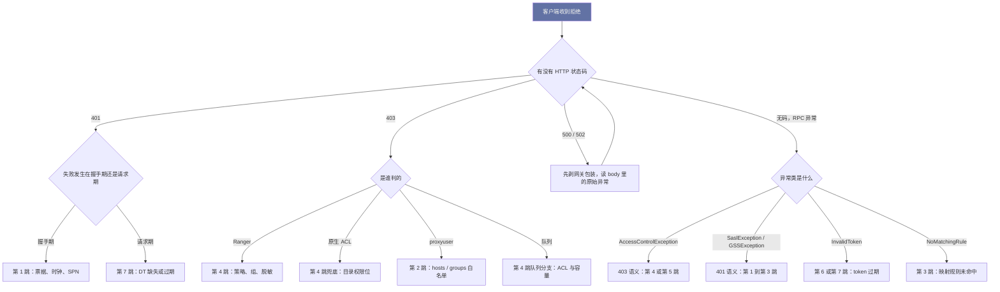
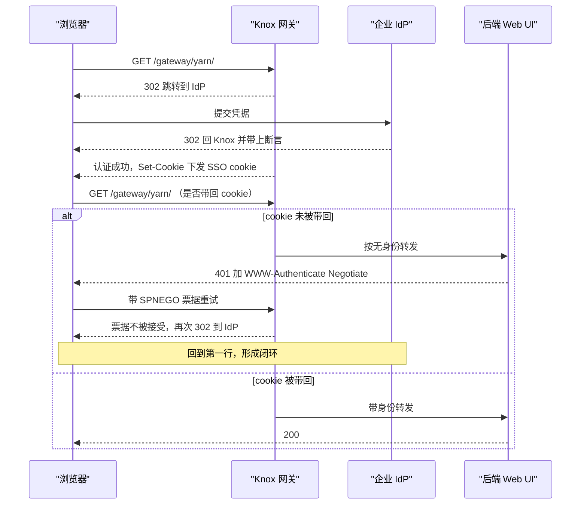
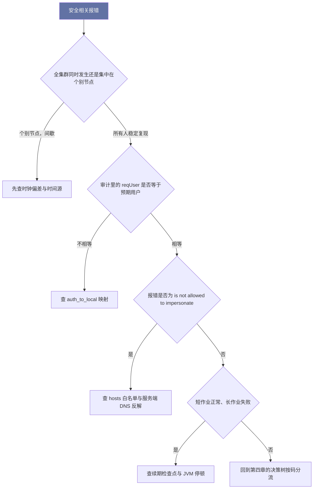

**摘要：**

一个请求带着身份穿过大数据平台，要经过八个能各自独立失败的落点：客户端拿到票据，入口把它换成内部身份，服务端把 Principal 压成用户名，授权引擎判定能不能做，ResourceManager 与 NameNode 各自决定收不收，容器与 DataNode 在没有票据的进程里继续使用身份，委托令牌负责让身份在长时间运行中不过期，最后审计把这一切记下来。本篇不逐篇复述组件原理，只做三件事：把八跳的职责、失败形态与判据逐跳摊开，给一张八跳 × 三样的总表；把 401 与 403 的分界讲成一套可执行的判别法，连同那些把 403 包成 401、把拒绝包成 500、以及根本没有状态码的例外情形；最后给出六类典型故障的逐跳回溯路径、四个看起来像安全问题其实不是的形态，以及一份每条都带判据而不是带"检查一下"的上线清单。读完之后应当具备的能力是：拿到一条报错，能在八跳里定位到其中一跳，并知道该去哪个日志、哪个字段、哪条命令确认，而不是从 Ranger 控制台开始逐个试。

---

## 第 1 章 一个请求的八个落点

### 1.1 三次 kinit 成功，三次访问被拒

设想一台提交机上的 alice 刚做完 `kinit`，`klist` 显示一张剩余寿命九小时的 TGT。接下来半小时里，她遇到三件事：通过 Knox 打开 YARN 的 Web UI，浏览器在登录页与网关之间来回跳；用 `hdfs dfs -ls /data/raw` 列目录，报 `Permission denied`，可她上周还能读；提交一个 Spark 作业，状态停在 `ACCEPTED` 二十分钟不动。

三次 kinit 都是成功的，三次访问都失败了，而三个失败的原因分属三个不同的落点：第一件是入口的 cookie 与 SPNEGO 协商，第二件可能出在身份映射或授权策略，第三件大概率与权限完全无关，是队列的容量或 AM 资源上限。这三者之所以容易被混为一谈，是因为它们在客户端看起来都像"安全配置有问题"，而这个词覆盖了从 keytab 到队列 ACL 的整条链路。排查的成本几乎全部来自这种混淆：一条拒绝消息从第八跳回传到第一跳的过程中会被反复翻译，`GSSException` 变成 401，`AccessControlException` 变成网关的 500，队列容量不足变成界面上一个不带原因的状态停留，到达工程师眼前时剩下的往往只是一个码或者一句"没权限"。

### 1.2 身份在链路上的四种物理形态

想把这条链路讲清楚，先要承认一件事：所谓"身份"在整条路径上并不是同一个东西，它至少换过四种物理形态。

第一种是 Kerberos 凭证，包括 TGT 与 Service Ticket。它以加密票据的形式存在，绑定在某个进程的凭证缓存里（Hadoop 默认用文件型 `ccache`，路径形如 `/tmp/krb5cc_<uid>`），一旦跨进程、跨主机就失效，这是它最本质的限制。

第二种是委托令牌（Delegation Token，下称 DT）。它由服务端用主密钥做 HMAC 签名，自带所有者、续期者与有效期三个字段，不依赖 KDC，因此能被打包进字节流、写进作业启动上下文、在几千个容器里各自还原，是 Kerberos 在"无法传递票据"环境下的延伸。

第三种是块令牌（Block Token）。它是数据面的凭证，由 NameNode 签发、DataNode 用与 NameNode 共享的密钥本地验签，默认寿命只有十分钟量级。它的存在让 DataNode 不必为每一次块读写回 KDC 或回 NameNode 查询。

第四种最不起眼，是一串纯字符串用户名。Knox 的会话、DProxy 的 `X-Forwarded-User` 头、`doAs` 参数、Ranger 审计里的 `reqUser`，携带的都是它。走到最后，授权与审计依据的既不是票据也不是签名，而是这串字符。

> [!info] 这条链路最容易被忽略的性质
> 凭证越往后走越轻，身份越往后走越"裸"。第八跳的审计记录里没有签名、没有票据、没有会话，只有一个字符串。这意味着前七跳任何一次身份映射的错误，都会在审计里留下一个格式完全正常、内容却错位的用户名，而审计本身没有任何能力发现这种错位。

### 1.3 八跳的切分依据

把链路切成八段，依据不是组件清单，而是协议边界、进程边界与信任域边界：每跨过一次，身份就要换一次形态，就存在一个能独立失败的位置。

第一跳是客户端，身份以 Kerberos 凭证的形态存在于某个进程内；第二跳是入口，Knox 或 DProxy 把外部身份换成内部代理身份；第三跳是身份映射，服务端把 `primary/instance@REALM` 压成 Linux 用户名；第四跳是授权，Ranger 或原生 ACL 对映射后的名字做判定；第五跳是服务自身，ResourceManager 与 NameNode 在协议层验完凭证后决定收不收这个请求；第六跳是容器与数据面，NodeManager 与 DataNode 用一个没有 `ccache` 的进程继续使用身份；第七跳是委托，DT 的申请、打包与续期；第八跳是审计，前七跳的结果被固化成记录。

第七跳的位置值得单独说明。按时间顺序，DT 的申请发生在第一跳，失效发生在容器起来之后；之所以把它单列在第六跳之后，是因为它最易出错也最难定位的三个时刻里，申请时没有可用身份与打包时漏掉，后果都要等容器启动才显现。位置跟着症状走，不跟着调用栈走。


这张图不是部署架构图，而是失效域的划分图。它回答的问题是：当一个人说"我没有权限"时，可能是八个位置里的哪一个先出的事。图上每一条箭头标注的是身份在这一跳传递时的形态，形态变化的地方就是最值得设检查点的位置。

### 1.4 为什么逐组件读文档解决不了排障

每个组件的文档都会把自己的失败形态写清楚，但不会告诉你两件排障必需的事：同一个症状可能由上游哪一跳引起，以及一个组件的拒绝到了客户端会长成什么样。举例来说，Ranger 拒绝与 HDFS 原生权限拒绝抛的是同一个异常类，只看异常无法判断是谁拒的，答案在审计的 `enforcer` 字段里。离开链路只看单组件，看到的永远是被翻译过一遍的版本。

---

## 第 2 章 八跳逐跳：职责、失败形态、判据

这一章按跳展开。每一跳给三样东西：这一跳负责什么，失败时长什么样（尽量给可搜索的原文），以及判据——去看哪个日志、哪个字段、执行哪条命令。错误消息一律按"形如"表述，不同版本的措辞会有出入，关键字不会变。

### 2.1 第一跳 客户端：票据如何变成进程内的身份

职责：把用户手里的密码或 keytab 换成一张能跨网络出示的票据，并在进程内把票据、组信息、令牌一起装进 UGI 这个容器。它决定了后面七跳以谁的名义开始。

失败形态：

- `kinit: Client 'alice@EXAMPLE.COM' not found in Kerberos database`，principal 拼错或 realm 不对。
- `kinit: Pre-authentication information was invalid`，密码错误或已过期。
- `GSSException: No valid credentials provided (Mechanism level: Failed to find any Kerberos tgt)`，这个进程没有可用 TGT，是整条链上出现频率最高的一条。
- `GSSException: Failure unspecified at GSS-API level (Mechanism level: Clock skew too great (37))`，时钟偏差超过 KDC 容忍窗口。
- `Unable to obtain password from user`，keytab 不可读，或 keytab 里的 principal 与配置项写的不是同一个。

判据：

- `klist` 看 `Default principal`、`Valid starting`、`renew until` 三行；`klist -e` 还能看到加密类型，AES 与 RC4 混用的集群里这一项能解释一部分"票据有但握手失败"。凭证缓存按 uid 存放，`sudo` 会换 uid，于是同一个 shell 里 `klist` 有票、`sudo -u hive` 里没有票，这是"我明明 kinit 过"最常见的解释。
- `klist -kt /etc/security/keytabs/hdfs.keytab` 列出的 principal，必须与 `dfs.namenode.kerberos.principal` 等配置项逐字对应；带 `_HOST` 的配置项要按实际主机名展开后再比。
- 客户端侧的 Kerberos 调试：给 JVM 加 `-Dsun.security.krb5.debug=true`；UGI 层面的输出把 `log4j.logger.org.apache.hadoop.security` 开到 `DEBUG`。

这一跳有一个反直觉的性质：票据是进程外的状态，跨进程不共享、跨主机不可传递，所以"在提交机上有票"不能推出"容器里有票"。运维中大量关于认证的争论，实质是在争论"票在哪"这个物理位置。

### 2.2 第二跳 入口：Knox 与 DProxy 的两种失败

职责：在信任域的边界上，把外部能证明的身份换成内部能承载的身份。Knox 面向没有 Kerberos 客户端的外部用户，用 LDAP 或 JWT 认证后以代理用户身份转发；DProxy 面向集群内部那些以浏览器访问、却需要以最终用户身份操作的服务，从 `X-Forwarded-User` 取名字后用服务账号 `doAs`。

失败形态：

- `401 Unauthorized` 加响应头 `WWW-Authenticate: Negotiate`，出现在 WebHDFS 或 Web UI 的 SPNEGO 路径上，表示服务端不接受出示的票据。
- `403 Forbidden`，响应体形如 `User: knox is not allowed to impersonate alice`，代理用户白名单没配、或来源主机不在 `hadoop.proxyuser.<user>.hosts` 里。
- 网关把上游的拒绝包成自己的错误：Knox 返回 `500`，原始异常在响应体或 `gateway.log` 里。
- DProxy 最危险的形态是**不报错**。请求头缺失时，取决于实现，请求可能以服务账号身份继续执行，权限检查全部按服务账号走，审计里 `reqUser` 变成 `dproxy` 或 `hive`，从任何界面看都像成功了。

判据：

- `gateway-audit.log`：记录按 `时间|请求ID|Logger|目标服务|USER_NAME|PROXY_USER_NAME|SYSTEM_USER_NAME|动作|资源|结果|消息` 排列，`USER_NAME` 是外部身份，`PROXY_USER_NAME` 是代理身份，两者都非空且符合预期才算通过。
- `gateway.log` 里 Provider 链的选择与 `doAs` 的落点，能看出请求被哪个 topology 接住。
- 后端服务的 `hdfs-audit.log` 里 `ugi=` 到底是代理账号还是最终用户，这是交叉验证代理链有没有真的生效的唯一硬证据。
- 构造实验：把 `X-Forwarded-User` 删掉或改成一个不存在的用户，看重放结果是拒绝还是降级执行，降级执行的实现不能上线。

入口层的失败最容易被误读：401 出现在这里、403 也出现在这里，而根因可能在下一跳（映射出错导致名字不对）或上一跳（票据本身不新鲜）。

### 2.3 第三跳 身份映射：全链路唯一一次改名

职责：把 Kerberos 的 `primary/instance@REALM` 压成 Linux 用户名。这是整条链上唯一一次"改名"，此后所有授权判定、目录属主比对、审计记录，用的都是改完的名字。

失败形态：

- `KerberosName$NoMatchingRule: No rules applied to alice/admin@EXAMPLE.COM`，规则一条都没命中。注意这里出现的是完整 principal，很容易看出问题；怕的是下面两种。
- 映射结果带着 instance：`alice/admin@REALM` 被映射成 `alice/admin` 而不是 `alice`，HDFS 里没有这个用户，目录属主也对不上，于是报 `Permission denied`。表象是权限问题，根因是映射问题。
- 映射成服务账号：规则写得太宽，把用户 principal 也归到了 `hdfs` 或 `yarn` 名下。此时一切"正常"，唯一的痕迹是审计里的 `reqUser` 是个不该出现的服务账号。

判据：

- `hdfs getconf -confKey hadoop.security.auth_to_local`，在客户端与服务端各跑一次。两份必须一致：客户端用它生成短名，服务端用它重新映射，不一致时会出现"客户端以为自己叫 alice、服务端认定你叫 hdfs"。
- 拿真实 principal 走一遍：用一个带 instance 的测试账号 kinit，做一次会落审计的操作，然后去 `hdfs-audit.log` 看 `ugi=`。这比读规则字符串可靠得多。
- NameNode 或 ResourceManager 侧把 UGI 相关日志开到 `DEBUG`，能看到映射前后的名字。
- 多 realm 场景（企业 AD 与集群专用 realm 互信）要把两个 realm 都覆盖，否则来自 AD 的用户全部报 `NoMatchingRule`。

映射由服务端执行，客户端看不到自己的名字被改成了什么，这决定了它在排障顺序里的位置：「kinit 成功但被拒」的第三个可能原因就在这里，排在第一跳票据、第二跳代理之后。

### 2.4 第四跳 授权：判定、未命中与兜底

职责：拿映射后的用户名与组，判定这个操作能不能做，并给出允许或拒绝，以及可选的过滤与脱敏改写。它不负责证明你是谁，只负责回答你能做什么。

失败形态：

- 原生权限拒绝：`AccessControlException: Permission denied: user=bob, access=READ, inode="/data/raw":hive:hive:drwxr-xr-x`。
- Ranger 策略拒绝：异常类与措辞可能和上面几乎一样，区分靠审计。Hive 侧形如 `does not have [SELECT] privilege on [finance/transactions]`，异常类可能是 `HiveAccessControlException` 或 Ranger 自己的 `RangerAccessControlException`。
- 队列授权拒绝：`User bob cannot submit applications to queue root.finance`。这条是立即失败，不会停在 `ACCEPTED`，后文第五章会用到这个区别。
- 没有任何拒绝，但结果不对：脱敏没生效、行过滤没生效。这类"静默失败"比拒绝更难发现，判据只能是对比策略与实际结果。

判据：

- Ranger 审计的四个字段：`access`（操作类型，如 `READ`、`SELECT`）、`enforcer`（决策者，`ranger-acl` 或 `hadoop-acl`）、`result`（1 允许，0 拒绝）、`policy`（命中的策略 id），合起来回答"谁判的、判成什么、依据哪条"。
- 插件本地策略缓存的更新时间戳，与 Ranger Admin 上策略的版本号是否对得上。策略改完不生效，先看这个时间戳，而不是先怀疑权限没配。
- `hdfs-audit.log` 里的 `allowed=` 字段，与 Ranger 审计的时间戳对时。两边不一致时，说明同一批请求分别被两套机制判过。

`enforcer` 是这一跳信息量最大的字段：`hadoop-acl` 意味着这条路径没有被 Ranger 策略覆盖，决策权回到了原生权限上，而原生权限在目录放开到 `777`、或 `other` 位有读权限时就是放行。这是第七章要展开的 fail-open 入口。

### 2.5 第五跳 服务：RM 与 NN 是两套判据

职责：服务端把连接上的凭证验成身份，再在自己那张表里决定收不收这个请求。NameNode 的表是路径与权限位，ResourceManager 的表是队列 ACL、容量与上限。

失败形态：

- `Client cannot authenticate via:[TOKEN, KERBEROS]`，客户端对这个服务既没有 token 也没有可用 TGT。注意这是 RPC 层的统一措辞，它不区分"没有 token"与"token 类型对不上"。
- `SASL authentication failed`、`GSS initiate failed`，握手阶段的失败，通常伴随 GSS 子异常给出更具体的原因（时钟、SPN、加密类型）。
- `Retrying connect to server`，认证没失败但连接建不起来，常见于服务端 principal 的 `_HOST` 解析结果与客户端访问地址不一致。
- `InvalidToken: token (HDFS_DELEGATION_TOKEN, owner=bob, renewer=yarn) is expired`，token 过期，服务端直接拒绝，不会自动刷新。
- `NameNode is in safe mode`，与安全无关，但它和"写不进去"的其他原因混在一起，容易被当成权限问题。

判据：

- NameNode 的 `hdfs-audit.log`：`cmd=` 是操作名，`ugi=` 是最终身份，`ip=` 是来源，`allowed=` 是结论，四个字段构成 HDFS 侧最完整的一次请求记录。
- ResourceManager 日志按 logger 名分流：`RMAppManager` 管提交与状态迁移，`CapacityScheduler` 管队列容量，`ApplicationMasterService` 管 AM 心跳。
- `yarn application -status <appId>` 看状态机停在哪一态、诊断信息里有没有被记录的异常。
- `hdfs getconf -confKey fs.defaultFS` 与客户端实际访问的地址是否同一个 nameservice。跨 nameservice 时 token 不是同一个，这条检查能提前排掉一半"偶发认证失败"。

认证失败与授权失败的日志往往挨着出现，却分属不同的因果链，同一个文件里两类日志混排是这条链上最常见的误读来源。判断办法就是上面那条：看这行日志由哪个 logger 打出，握手期的问题找 `SaslRpcServer`，请求期的问题找权限检查器与调度器。

```text
# 认证失败（握手期，第一到三跳的因果链）
INFO  ipc.Server: Socket Reader #1 for port 8020: readAndProcess from client 10.1.2.3
      threw exception [javax.security.sasl.SaslException: GSS initiate failed]

# 授权失败（请求期，第四跳的因果链）
INFO  security.authorize.FSPermissionChecker:
      Permission denied: user=bob, access=READ, inode="/data/raw":hive:hive:drwxr-xr-x

# 队列侧（提交期，第四跳的队列分支）
INFO  scheduler.capacity.CapacityScheduler: Application application_... submitted
WARN  scheduler.capacity.LeafQueue: User bob cannot submit applications to queue root.finance
```

### 2.6 第六跳 容器：一个没有票据的进程

职责：把身份带进一个没有用户 shell、没有 `ccache`、通常也不允许写临时文件的环境；数据面上则用块令牌让 DataNode 不必回 KDC 就能验权。

失败形态：

- `Container launch failed for container_...`，NM 侧启动失败，常见伴随本地目录权限、`container-executor` 配置、或启动脚本里引用的 keytab 不可读。
- 进程起来了但没有身份：`No valid credentials` 或 `Client cannot authenticate via:[TOKEN, KERBEROS]`。它意味着启动上下文里的 token 没被还原进 UGI。
- DT 过期：`InvalidToken ... is expired`，从第一次操作就开始报，而不是跑一段时间后报。
- 数据面：DataNode 侧 `DataXceiver error processing READ_BLOCK operation`，客户端侧最终可能退化成 `Could not obtain block`。块令牌过期或密钥轮换后签名对不上，都走这条路径。

判据：

- 容器日志：`yarn logs -applicationId <appId> -containerId <containerId>`，AM 与 Executor 的 stderr 都在里面。
- NM 侧 `ContainerLauncherImpl` 与 `container-executor` 日志，能区分"没启动"和"启动了但应用自己退出"。
- 进程环境：`/proc/<pid>/environ` 里的 `KRB5CCNAME` 与 `HADOOP_TOKEN_FILE_LOCATION`。后者非空说明身份来自 token 文件而不是票据。
- 容器内 `klist` 输出为空、但访问 HDFS 成功，这是正常形态，说明身份是 DT。把"没有 klist 输出"当故障，是这条链上最高频的误判。
- DataNode 侧按 `DataXceiver` 与块令牌关键字检索，注意同一时间段是否有 NameNode 的密钥轮换记录。

这一跳的设计意图值得点明：容器里没有票据不是疏漏，而是**刻意的取舍**。票据不可传递，系统便改用一种可传递、可续期、限定服务的签名凭证替代。理解了这一点，就不会再试图往容器里塞 keytab 来解决"读不了 HDFS"。

### 2.7 第七跳 委托：申请、打包、续期三个时刻

职责：把用户此刻的 Kerberos 身份兑换成一串可以打包进启动上下文、可续期、限定了服务与续期者的签名凭证。

三个时刻决定了三种失败：申请发生在提交前，用客户端身份完成，没有可用 Kerberos 身份时报错与第一跳同形；打包发生在提交时，DT 被序列化进 `ContainerLaunchContext` 的 token 字节流，漏打包时容器里没有任何痕迹，只在第一次访问时报 `Delegation token can't be found`；续期发生在运行中，由 token 里写明的续期者完成，续期者不在名单里或自己挂了，token 到期即失效。

失败形态：

- `Delegation token can't be found`，WebHDFS 或 HttpFS 客户端侧的措辞，表示本地没有可用的 DT。
- `No valid credentials provided`，DT 申请阶段没有 Kerberos 身份。
- `InvalidToken: token (HDFS_DELEGATION_TOKEN, owner=bob, renewer=yarn) is expired`，过期，且括注里能直接看到 owner 与 renewer 两个字段，是判断"该由谁续期"的线索。
- 跨服务误用：拿 NameNode 的 DT 去访问 ResourceManager，报 `Client cannot authenticate via:[TOKEN, KERBEROS]`。令牌选择器按类型与 service 匹配，匹配不到就回落 Kerberos，而容器里没有 TGT。

判据：

- `hdfs-audit.log` 里有没有 `cmd=getDelegationToken` 与 `cmd=renewDelegationToken`，分别对应时间和来源 IP。这是最硬的证据：申请没发生过，容器里就不可能有 token，此时不必再往下查容器。
- 把启动上下文里的 token 字节流在测试环境落盘，用 `hadoop dtutil -print` 读出来看 `kind`、`service`、`owner`、`renewer`、`expires`。这一步能把"到底有没有、有没有过期、属于哪个服务"三个问题一次回答。
- 有效期参数：`dfs.namenode.delegation.token.renew-interval`（默认 86400000 毫秒，即 24 小时）与 `dfs.namenode.delegation.token.max-lifetime`（默认 604800000 毫秒，即 7 天），用 `hdfs getconf -confKey` 读实际生效值。
- 块令牌寿命 `dfs.block.access.token.lifetime`（默认 600 秒），与数据面报错的时间对照。

token 不能跨服务是设计上的正确行为。每个服务各自持有签名密钥，一条**作用域边界**恰好阻止了"拿到一个低价值服务的 token 就能横穿整个集群"，把它当 bug 排查，方向一开始就偏。

### 2.8 第八跳 审计：唯一迟到的一跳

职责：把前七跳的结果固化成可回溯的记录。它不参与判定，但它是唯一能在事后回答"谁在什么时候以什么身份做了什么、被谁允许"的一跳。

失败形态：

- 没有记录。审计写端异步，缓冲队列满、写端不可用、序列化异常，都可能让记录静默消失。业务不受影响，问题在事后才暴露。
- 记成了别人。`reqUser` 是服务账号而不是最终用户，说明代理链在某处断了，或者 `doAs` 没开。
- 记错了来源。`cliIP` 是网关的地址，因为 `X-Forwarded-For` 没被透传。
- 作业历史侧：`yarn logs` 报 `Logs not available`，或非 owner 看不到作业，前者是日志聚合本身失败，后者是作业查看 ACL 生效。

判据：

- Ranger 审计按 `reqUser`、`repo`、`evtTime` 组合过滤，再看 `result`、`enforcer`、`policy`。先确认记录存在，再确认内容正确。
- Knox 的 `gateway-audit.log`，看 `USER_NAME` 与 `PROXY_USER_NAME` 是否都非空。
- `hdfs-audit.log` 与 Ranger 审计对时，两边应覆盖同一批请求，只有一边有记录说明某一层没接入审计。
- 作业历史：`yarn.log-aggregation-enable` 是否开启、`/app-logs` 目录与配额是否正常、`mapreduce.job.acl-view-job` 配置是否与实际可见性一致。

审计是**唯一迟到**的一跳，它的失败不会让任何人当场报错，验证只能靠主动演练——第八章会给出三条必须手工制造一次失败的演练。

---

## 第 3 章 八跳 × 三样：一张总表

### 3.1 总表

| 跳 | 这一跳的职责 | 失败形态（可搜索的关键字） | 判据（看哪里） | 常见码面 |
| :--- | :--- | :--- | :--- | :--- |
| 1 客户端 | 用密码或 keytab 换票据，装进 UGI | `Failed to find any Kerberos tgt`、`Pre-authentication information was invalid`、`Unable to obtain password from user` | `klist` 三行、`KRB5CCNAME`、`klist -kt keytab`、`sun.security.krb5.debug=true` | 本地报错，无码 |
| 2 入口 | 外部身份换内部代理身份 | `WWW-Authenticate: Negotiate`、`is not allowed to impersonate`、网关 500、无报错的降级 | `gateway-audit.log` 的 `USER_NAME`/`PROXY_USER_NAME`、`gateway.log`、后端 `hdfs-audit.log` 的 `ugi=` | 401 / 403 / 500 |
| 3 映射 | Principal 压成 Linux 用户名 | `NoMatchingRule: No rules applied to ...`、映射结果带 `/`、映射成服务账号 | `hdfs getconf -confKey hadoop.security.auth_to_local`、审计里的 `reqUser`、服务端 UGI DEBUG | 401 或 403 |
| 4 授权 | 判定能不能做这个操作 | `Permission denied: user=..., access=..., inode=...`、`cannot submit applications to queue`、脱敏未生效 | Ranger 审计的 `access`/`enforcer`/`result`/`policy`、策略缓存时间戳、`hdfs-audit.log` 的 `allowed=` | 403 |
| 5 服务 | 验凭证，再按队列或路径决定收不收 | `Client cannot authenticate via:[TOKEN, KERBEROS]`、`GSS initiate failed`、`Retrying connect to server`、`InvalidToken` | RM 侧按 logger 分流、`yarn application -status`、`hdfs getconf -confKey fs.defaultFS` | RPC 异常，无码 |
| 6 容器 | 无票据进程继续使用身份，数据面验块令牌 | `Container launch failed`、`No valid credentials`、`DataXceiver error processing READ_BLOCK` | 容器 stderr、`/proc/<pid>/environ` 的 `HADOOP_TOKEN_FILE_LOCATION`、DN 日志 | RPC 异常，无码 |
| 7 委托 | DT 的申请、打包、续期 | `Delegation token can't be found`、`InvalidToken ... is expired`、续期者不匹配 | `hdfs-audit.log` 的 `cmd=getDelegationToken`/`renewDelegationToken`、`hadoop dtutil -print`、两个生命周期参数 | 401 或 RPC 异常 |
| 8 审计 | 把结果固化下来 | 无记录、`reqUser` 是服务账号、`cliIP` 是网关地址、`Logs not available` | Ranger 审计按三个字段过滤、`gateway-audit.log`、`/app-logs` 与查看 ACL | 无 |

### 3.2 怎么读这张表

纵向读一列：拿到一条报错，在"失败形态"里搜关键字落到某一行，再顺着"判据"看具体位置。横向读一行：给某一跳设监控时，一行的判据就是这一跳的观测点。斜着读对角：码面只集中在入口与授权两行，其他六跳要么本地报错，要么只给 RPC 异常，这解释了为什么 RPC 客户端里看不到 401 与 403，却能收到同样的语义——码是 HTTP 层的产物，语义是链路层的产物。

这张表按 Hadoop 3.3.x、Ranger 2.x 的常见形态给关键字。**版本与部署差异**都会让观测点变化：错误消息与审计字段名在不同大版本间有过调整，没有 Knox 的集群第二跳整个消失，不接 ATS 的集群第八跳只剩两份记录。具体以对应版本文档与实际日志为准。

---

## 第 4 章 401 还是 403：一份反推法

### 4.1 两个码的语义分界

401 与 403 的区别一句话能说清：401 表示服务端没有拿到可信身份，403 表示服务端拿到了可信身份但不允许。前者是"我不知道你是谁"，后者是"我知道你是谁，但你不能"。这个区分在排障里价值极高，因为它把八跳直接劈成两半：401 指向第一到第三跳，403 指向第四到第五跳，中间没有第三种可能，除非有人把码包错了。

在 Hadoop 里这个分界可以精确到日志行：服务端如果已经解析出 `ugi=alice`，后续的拒绝一定是 403 语义；如果日志里只有握手失败、没有解析出的身份，那就是 401 语义。判断方法不是看码，而是看服务端日志里到底有没有一个可信的用户名。这一点在 RPC 场景尤其重要，因为 RPC 根本不返回码。

### 4.2 从错误码反推到环节

这棵决策树的第一层只问一件事：手里有没有码。



决策树的第一层不是问"哪个组件"，而是问"有没有码"：码的有无不决定问题在哪，只决定接下来能用什么手段，有码时按码分流，无码时只能按异常类分流。

第二层对 401 再问"握手期还是请求期"。握手期失败意味着凭证根本没被接受，回到票据本身；请求期失败意味着连接建立了、身份也认了，是后续携带的 DT 过期或缺失，指向第七跳。这一问把"认证问题"与"凭证生命周期问题"分开，两者的处置完全不同。

第二层对 403 再问"是谁判的"，答案藏在审计的 `enforcer` 里，而它只有在审计接通、判定真的被记录时才可读。审计没接通的集群，这一问只能靠日志措辞猜，这也是**先接审计**才谈排障的实际理由。

### 4.3 例外：被包错的码与没有码的协议

上面这套分界在干净实现的 HTTP 服务上成立，但真实系统有三类例外，不知道它们会在关键时刻把人带偏。

第一类是浏览器系。WebHDFS、YARN UI、HDFS UI 走 SPNEGO，认证过滤器在票据不被接受、用户不存在、协商失败等情况下往往统一回 401，不做区分，于是"用户名拼错"和"票据过期"长得一模一样。判据只能往服务端走：看 UI 服务端的认证过滤器日志，或用 `curl --negotiate` 观察响应头。

第二类是网关系。Knox 收到上游的 403 之后可能把它包成自己的 500 或 502，只把原文留在响应体里，于是"权限不足"在客户端表现为"网关内部错误"。判据是永远先读 body 再读码。

第三类是 RPC。服务之间没有 HTTP 状态码，只有异常类型：`AccessControlException` 对应 403 语义，`SaslException` 与 `GSSException` 对应 401 语义，`SecretManager$InvalidToken` 对应第七跳的凭证过期。这是 Hadoop 生态里最可靠的一套映射，比码更稳。

还有一类方向相反的陷阱：代理用户拒绝在语义上是授权问题（403），但它发生在认证成功之后第一次 `doAs` 的时刻，日志位置紧挨着 SASL 握手，措辞又是 `is not allowed to impersonate`，按关键字搜日志的人会把三条线索都指向认证，而实际要改的是 `hadoop.proxyuser.<user>.hosts` 或 `.groups`。

### 4.4 码、异常与归属的对照

| 客户端看到的东西 | 语义 | 归属跳 | 第一个动作 |
| :--- | :--- | :--- | :--- |
| `401` + `WWW-Authenticate: Negotiate` | 身份没认出来 | 1 / 2 / 3 | `klist` 与 `klist -kt`，再看服务端有没有解析出 `ugi=` |
| `403`，body 含 `is not allowed to impersonate` | 身份认出来了，代理不被允许 | 2 | 读 `hadoop.proxyuser.*.hosts` 与 `.groups`，跑 DNS 反解核对 |
| `403`，body 含 `Permission denied: user=...`，审计 `enforcer=ranger-acl` | 授权拒绝，策略判定 | 4 | 按 `policy` id 找策略，核对组与资源匹配 |
| `403`，审计 `enforcer=hadoop-acl` | 授权拒绝，原生权限兜底 | 4 | `hdfs dfs -ls -d` 看权限位与属主，检查路径是否未被策略覆盖 |
| `403`，body 含 `cannot submit applications to queue` | 队列授权拒绝 | 4 | 读队列的 `acl_submit_applications`，用组核对 |
| `500` / `502`，body 里裹着上游异常 | 网关包装 | 2 | 剥掉包装读原文，再按原文重走决策树 |
| `AccessControlException`（RPC） | 授权拒绝 | 4 / 5 | 看日志 logger 名，区分权限检查与队列调度 |
| `SaslException` / `GSSException`（RPC） | 认证失败 | 1 / 2 / 3 | 读 GSS 子异常，定位时钟、SPN、加密类型或票据缺失 |
| `SecretManager$InvalidToken`（RPC） | 凭证过期或类型不对 | 6 / 7 | `hadoop dtutil -print` 看 kind、owner、renewer、expires |
| `NoMatchingRule: No rules applied to ...` | 映射规则未命中 | 3 | 比对客户端与服务端的 `auth_to_local`，覆盖所有 realm |

这张表第一列写的是"客户端看到的东西"而不是"错误码"，因为排障时手里拿到的往往是一段粘贴来的报错，按形态匹配比按码匹配更贴近实际。

### 4.5 排查顺序：每次只动一个变量

知道归属之后，顺序同样重要。推荐的顺序是：先证身份，再证权限，再证代理链，最后证凭证生命周期，**一次只动一个变量**。

先证身份：以目标用户 kinit，做一次必然落到审计的读操作，确认 `reqUser` 是预期的那个人。这一步同时验证了第一跳与第三跳，因为映射结果就体现在 `reqUser` 里。再证权限：用同一身份读一个确切路径、查一张确切的表，身份对而资源确实不该给是策略问题，身份对而资源确实该给是策略覆盖不到，去看 `enforcer`。再证代理链：同一个人从 Knox 进、从命令行直连、从 DProxy 进，三次结果不一致，问题就在入口层，因为其余七跳没有变化。最后证凭证生命周期，只在长跑场景才做：短作业正常、长作业失败，时间点又对得上 token 的过期时间，那就是第七跳。

这个顺序的价值不在逻辑完备，而在一次只动一个变量；反过来，一上手就同时改策略、重发 keytab、重启网关，即使问题消失，也不知道是谁修的。

---

## 第 5 章 六类典型故障的完整回溯

下面六类故障是在这套链路上反复出现的形态。每一类给三样：现象长什么样、按什么顺序逐跳查、最终根因通常落在哪里。顺序都经过设计，第一个要查的位置往往是最可能的，而不是最显眼的。

### 5.1 提交后 ACCEPTED 停住

现象：`yarn application -status` 反复返回 `ACCEPTED`，容器数为零，界面里连一个 executor 都看不见，几十分钟后可能超时失败，也可能一直挂着。

这里有一个必须先纠正的判断：如果被拒的是队列的提交权限，提交动作会立即抛 `User ... cannot submit applications to queue ...`，应用根本不会进入 ACCEPTED。所以**卡在 ACCEPTED 就已排除队列 ACL**，把它当权限问题去改 Ranger 策略，是这条路上最常见的空转。

逐跳排查顺序：

1. 第五跳，看 RM 的 `CapacityScheduler` 日志里有没有周期性分配失败，同时记下目标队列的已用容量与最大容量。
2. 第五跳，查 `maximum-am-resource-percent`（默认 0.1，即 AM 容器最多占用队列资源的十分之一）。已运行应用的 AM 把这份额度占满时，新应用申请不到 AM 容器，只能排队。
3. 第五跳，查单用户限额：`minimum-user-limit-percent` 与 `user-limit-factor` 决定一个用户能吃掉多少队列资源，多用户互相挤压时，排在最前面的应用未必先走。
4. 第六跳，确认 NodeManager 报给 RM 的资源是否够起一个 AM 容器，即 `yarn.nodemanager.resource.memory-mb` 与 `yarn.scheduler.minimum-allocation-mb` 的关系。
5. 第四跳最后才看授权，且要用对照实验：换一个同组用户提交，无论立刻成功还是同样停在 ACCEPTED，都说明与权限无关。

根因形态：绝大多数是 AM 资源额度耗尽或队列容量不足，表现为"小作业能跑、大作业卡住"或"整点批量提交时必然卡住"，少数是队列层级配置导致子队列拿不到父队列的共享资源。判据是 RM 的 Web UI 的 Scheduler 页面，它能直接看到队列已用容量、最大 AM 百分比与活跃应用数，命令行 `yarn queue -status <队列名>` 给同一组数字，两处对照比翻日志快。

### 5.2 作业跑起来但读不了 HDFS

现象：AM 起来了，界面里有 stage，但 executor 全部失败，stderr 里是 `InvalidToken ... is expired` 或 `No valid credentials provided`，而同一个作业的 driver 在提交机上能读同一份数据。

逐跳排查顺序：

1. 第七跳，先查申请有没有发生。`hdfs-audit.log` 里搜 `cmd=getDelegationToken`，看时间是否在提交前后、`ugi=` 是否为目标用户。申请这一步没发生，后面全都不用查。
2. 第七跳，再查打包。把启动上下文里的 token 落盘用 `hadoop dtutil -print` 读，确认 `kind`、`service`、`owner`、`expires` 四个字段。缺失或 `expires` 已过，问题就在这一跳。
3. 第六跳，查容器环境里的 `HADOOP_TOKEN_FILE_LOCATION`，非空说明 token 文件被带进去了；为空但访问成功，说明身份来自别处，要重新确认身份来源。
4. 第五跳，查 `fs.defaultFS` 与作业实际访问的路径是否同一个 nameservice。跨 nameservice 时必须在提交参数里显式声明要访问的文件系统，否则那些文件系统上的 token 不会被申请。
5. 第三跳，最后才怀疑映射，因为容器内映射通常与服务端一致，出现分歧往往是两端的 `core-site.xml` 不是同一份。

根因形态：最常见三种——提交用的上下文本身不是安全身份（例如从 SIMPLE 模式的客户端提交到安全集群）；跨 nameservice 访问却没有申请对应 token；token 申请了但续期者配置与实际续期者不一致，短作业看不出，长作业必现。

判据：把 `getDelegationToken` 与 `renewDelegationToken` 两条记录的时间点、容器第一条 token 报错的时间点放在同一条时间线上，三个点对齐后，责任跳几乎没有争议。

### 5.3 任务里访问另一个服务被拒

现象：作业读写 HDFS 一切正常，但一调用 ResourceManager 的 REST 接口、或访问 HBase、或连接 HiveServer2，就报 `Client cannot authenticate via:[TOKEN, KERBEROS]`。

逐跳排查顺序：

1. 第七跳，用 `hadoop dtutil -print` 列出容器里所有 token 的 `kind` 与 `service`，看目标服务有没有对应的条目。
2. 第五跳，把目标服务的实际地址与 token 里的 `service` 逐字比对。地址用 IP、token 里是主机名，或者反过来，都会匹配失败。
3. 第一跳，确认容器里确实没有 TGT——这不是异常，是常态。回落 Kerberos 的路径在容器里天然走不通，所以 token 匹配失败就等价于认证失败。

根因：**token 不能跨服务**。每个服务用自己的密钥签发与验签，NameNode 的 DT 在 ResourceManager 看来无法验证。这不是配置疏漏，而是凭证的作用域设计。

处置上的取舍有两条路：提交前为每个目标服务分别申请 token，让它们一起进启动上下文；或让 AM 持有 keytab，在需要时自己登录。前者把凭证作用域限得最死，但需要**预先声明访问清单**，漏一个就在运行时炸；后者灵活，代价是把一个长期凭证放进了容器。多数生产环境选前者，并把访问清单写进作业提交模板，用流程兜住遗漏。

判据：容器 stderr 里报错发生的那一次调用，目标地址是什么，与 token 列表比对，五分钟就能做完。

### 5.4 开发环境能跑，生产报 No valid credentials

现象：同一份代码、同一个镜像，开发集群跑得好好的，搬到生产就抛 `GSSException: No valid credentials provided`，而本地用 `kinit` 手动跑一遍又能通。

逐跳排查顺序：

1. 第一跳，用运行用户直接复现：`sudo -u <运行用户> kinit -kt <keytab> <principal>`，并核对 keytab 的属主与权限模式。切到运行用户这一步是关键，服务进程读不到 keytab 时报的是 `Unable to obtain password from user`，措辞不指向权限，容易误判。
2. 第三跳，确认生产端的映射规则没有把服务账号映射成别的名字。开发环境常用 `DEFAULT` 一条规则就够，生产往往有十几条按服务分组的规则，顺序不同结果就不同。
3. 第二跳，确认入口有没有把"未认证"伪装成"已认证"。有些自研代理在缺头时用服务账号兜底，开发环境看起来一切正常，生产接上真认证后才发现身份一直是错的。
4. 第五跳，读 `hadoop.security.authentication` 的实际值。开发是 `simple`、生产是 `kerberos`，这是"同一份代码两种结果"最直接的来源。

根因形态：代码里写死了 `UserGroupInformation.createRemoteUser(...)` 一类的构造，在 SIMPLE 模式下等于"我说我是谁就是谁"，在 Kerberos 模式下完全无效；其次是 keytab 属主与运行用户不一致、`java.security.krb5.conf` 指向容器里不存在的路径、`_HOST` 展开结果与 keytab 条目不一致。

判据：UGI 日志会打印形如 `as:alice@EXAMPLE.COM (auth:KERBEROS)` 的上下文，括号里的认证方式是最直接的证据，一条日志就能区分"用了 Kerberos"和"以为用了 Kerberos"。

### 5.5 Web UI 登录后无限跳转

现象：浏览器打开网关后面的 YARN 或 HDFS 界面，地址栏在两三个 URL 之间快速来回，页面始终白屏或一直转圈，清 cookie 能好一阵，换个浏览器又复现。把闭环走一遍，形态如下。



逐跳排查顺序：

1. 第二跳，看 SSO cookie 的 `Domain` 是否覆盖浏览器实际访问的主机名。跨可注册域、或用了 IP 访问而 cookie 域是域名，浏览器都不会回传。
2. 第二跳，看 cookie 的 `Secure`、`Path`、`SameSite` 属性与访问协议是否匹配。HTTPS 下 `Secure` 缺失、或反向代理改写了协议，都会导致 cookie 被丢。
3. 第二跳，确认后端 Web UI 的 HTTP 认证类型与网关的转发方式是否匹配。后端若仍要求 SPNEGO，浏览器会再走一次 `Negotiate`，而 Kerberos 票据对同一个服务不能无限重放，第二次往往直接失败。
4. 第五跳，看后端 UI 的认证过滤器日志里是否出现过解析成功的用户名。一次都没出现过，说明请求根本没带着可信身份到达。

根因：无限跳转的本质是"每一轮都被当成新会话"。cookie 域不匹配、Secure 属性不匹配、SPNEGO 票据被复用失效、后端认证类型不一致，四种原因产生同一个现象，区别只在浏览器 Network 面板里的细节：逐条看 302 链上的 `Set-Cookie` 与后续请求的 `Cookie` 头，cookie 发了但没回来，问题在域或属性；回来了但仍 401，问题在后端认证类型。这一步比读任何日志都快。

### 5.6 审计日志里出现"不该访问的记录"

现象：合规同学发来一条审计记录，问"这个人为什么能读这张表"，记录显示 `result=1`，时间、用户、资源都很清楚。

逐跳排查顺序：

1. 第八跳，先确认记录本身可信：`reqUser`、`cliIP`、`evtTime`、`repo` 四个字段是否自洽。`cliIP` 是网关地址而 `reqUser` 是外部用户，说明 `X-Forwarded-For` 没透传，来源信息实际缺失。
2. 第四跳，读 `enforcer`。`ranger-acl` 说明 Ranger 判的，去按 `policy` 找策略；`hadoop-acl` 说明落到了原生权限，去看那个路径的权限位与覆盖情况。
3. 第三跳，比对 `reqUser` 与预期用户名。`reqUser` 是 `hive` 或 `hdfs` 这类服务账号时，说明代理链没生效，读到数据的其实是服务账号，此时"谁读的"这个问题在 HDFS 层已经无法回答，只能回到 SQL 层看。
4. 第二跳，看同一次访问在 `gateway-audit.log` 里的 `USER_NAME` 与 `PROXY_USER_NAME`。两者对不上，说明外部身份与内部代理身份在某处被替换了。

根因有四种：策略用了过宽的组（例如把所有认证用户归入一个 `public` 组）；组成员同步滞后，人已调岗而 Ranger 侧的组关系还是旧的；路径没被任何策略覆盖，而原生目录权限又放得很宽；代理或 `doAs` 没开，所有访问都以服务账号身份落地。

判据：把同一秒内的多条记录排在一起看。正常情况下 Ranger 审计里有一条 `SELECT`、`hdfs-audit.log` 里有一批 `cmd=open`，两边的时间与身份应当对得上。

### 5.7 六类故障的横向对照

| 故障 | 首个可疑跳 | 一句话判据 | 最容易误判成 |
| :--- | :--- | :--- | :--- |
| ACCEPTED 停住 | 5 | 应用没进 RUNNING，队列容量与 AM 额度是否已满 | 队列权限被拒 |
| 读不了 HDFS | 7 | `getDelegationToken` 有没有在审计里出现 | Kerberos 配置错误 |
| 访问别的服务被拒 | 7 | token 列表里有几个 `kind`/`service` | 认证整体失效 |
| 生产报 No valid credentials | 1 | 用运行用户能否 `kinit` 成功 | 代码逻辑问题 |
| Web UI 无限跳转 | 2 | cookie 发出去有没有带回来 | IdP 认证失败 |
| 审计里的越权记录 | 8 | `reqUser` 与 `enforcer` 分别是什么 | 有人猜到了密码 |

---

## 第 6 章 四个"看起来是安全问题"的形态

有一类故障最消耗时间：它长得完全是安全问题的样子，报错关键字也在安全组件里，实际根因却在系统层。下面四个形态各自对应一层系统设施——时钟、字符串处理、域名解析、JVM 运行时。

### 6.1 时钟漂移：最像认证失败的时钟问题

现象：一小部分节点的客户端间歇性报 `Clock skew too great (37)`，重试有时成功；同一机器上不同进程表现不一致，重启服务后短时间正常。

Kerberos 的防重放依赖时间窗：票据里带时间戳，服务端只接受落在容忍窗口内的票据，窗口由 `krb5.conf` 的 `clockskew` 决定（常见默认 300 秒），超出窗口，票据在密码学上完全正确仍然被拒。判据是 `chronyc tracking` 或 `ntpq -p` 看 offset 与同步源，把 KDC 与出问题节点的时间差直接量出来；KDC 侧日志里能看到 `KRB_AP_ERR_SKEW` 的记录，比客户端报错更早。

容易误判的地方在于它的分布：全集群同时漂移说明时间源有问题，个别节点漂移说明该节点的 NTP 被禁用或被容器环境的时钟隔离影响，两者处置完全不同。把它当"Kerberos 不稳定"去查配置，会浪费大量时间在已经正确的配置上。

### 6.2 auth_to_local 配错：最像权限问题的映射问题

现象：`kinit` 成功、票据正常，但一访问就 `Permission denied`；审计里能看到请求，`reqUser` 却是陌生名字或带着 `/`。

从错误消息看，`Permission denied` 是标准的授权拒绝，于是排查会从策略开始；但真正该动的是映射规则。**判据只有一个**——审计里的 `reqUser` 与你认为的用户是否一致。映射在服务端执行，客户端 `kinit` 出来的名字对不对，与服务端最后认定你是谁，是两件事，两端配置不一致时症状会非常像策略配错。

### 6.3 DNS 反解：最像代理被拒的解析问题

现象：`403`，body 是 `User: knox is not allowed to impersonate alice`，但 `hadoop.proxyuser.knox.groups` 明明配了 alice 所在的组，`hosts` 也写了网关地址。

代理用户的 `hosts` 检查并不只做字符串比对：除了比对来源 IP 与配置值，还会尝试把 IP 反解成主机名再比一次，反解结果与配置的主机名不一致时检查失败。常见来源是 `/etc/hosts` 与 DNS 记录不一致、短名与全限定名混用、多网卡机器反解到另一块网卡。

判据：在目标服务端机器上对来源 IP 做反解，把结果与 `hadoop.proxyuser.*.hosts` 里的每一项逐字比对，再核对 `/etc/hosts` 是否覆盖。这个检查必须**在服务端机器上做**，因为反解用的是服务端自己的解析器与 hosts 文件。

处置上的取舍：把 `hosts` 改成 IP 最直接，代价是网关扩容或换机时要改配置；继续用主机名则必须先修好**正反解一致**，代价是要动 DNS 或 hosts，影响面更大。多数团队选前者，并把网关的地址段写进配置而不是单机地址。

### 6.4 续期检查点被 JVM 停顿错过：最像随机失效的运行时问题

现象：长跑作业偶尔在运行几小时后开始报 token 过期，重启就好，下次复发时间不固定；同一批作业里，只有跑得最久的那几个出事。

续期不是一个持续的过程，而是一个周期性的检查动作：UGI 的票据重新登录由 `hadoop.kerberos.min.seconds.before.relogin`（默认 60 秒）约束最小间隔，DT 的续期由续期者按续期间隔触发，块令牌由 NameNode 按寿命签发。这些检查与业务线程共享同一份 CPU 与 GC 预算，一次长达数秒的停顿就足以让它错过窗口，尤其是 TGT 剩余寿命本来就不多、或续期间隔被调得很短时。表现就是"随机失效"：不是配置错，不是时钟错，是检查没能在该发生时发生。

判据：把 GC 日志里的长停顿时间戳、首次报错时间戳、续期日志（形如 `Relogin from keytab`）的间隔放在一条时间轴上，三者对齐结论就成立。`jstat -gcutil` 可现场确认停顿与老年代占用；没有 GC 日志时这类问题基本无法证实。

处置方向有两个：给这类进程更宽松的停顿预算（换收集器、调堆、限制单次停顿），或者给凭证更宽松的续期窗口（把最小间隔调小、把续期提前量调大）。前者治本，后者只是缓冲。

### 6.5 四个形态的分流

四个形态的分叉点可以压成两个问题，下图按这两个问题分流。



这张分流图只处理"已经确认是安全报错、但常规排查无效"的情形。两个分叉点值得记住：看分布（个别还是全体）把系统层问题与配置层问题分开，看身份（审计里的名字对不对）把映射问题与策略问题分开。

---

## 第 7 章 四层防线：失败时各自默认做什么

### 7.1 四层归位

把前八跳按"防线的性质"重新归成四层，比按组件归更有解释力：归位的依据不是它们在哪一跳，而是它们失败时默认做什么。

| 层 | 失败时的默认行为 | 这个默认值由什么决定 |
| :--- | :--- | :--- |
| 认证（Kerberos / UGI） | 拒绝，即 fail-closed | 协议本身：拿不出可信票据就没有身份，没有身份就没有后续 |
| 入口（Knox / DProxy） | 取决于配置 | 代理用户白名单、`X-Forwarded-User` 缺失时的兜底策略、cookie 与转发规则 |
| 授权（Ranger / ACL） | 取决于 `default policy` | 未命中策略时的回退路径、原生权限位、是否存在兜底允许策略 |
| 委托（Delegation Token） | 过期即拒绝 | token 自身的有效期与续期是否成功，没有"宽限期"这种说法 |

第一行与第四行由协议与凭证定义，行为可预测；第二行与第三行由配置决定，行为取决于部署时怎么填。

### 7.2 默认行为比实现细节更值得设计

安全体系的讨论常常集中在机制上：Kerberos 用哪种加密类型、策略缓存多久刷新、token 用什么签名算法。这些都是实现细节，出错时表现为性能或兼容问题；真正决定一次事故规模的是默认行为——当某个环节拿不到它需要的东西时，系统是停下来还是继续走。

停下来的一侧叫 **fail-closed**，继续走的一侧叫 **fail-open**：前者在可用性上付代价，后者在安全性上付代价，这种**代价不对称**才是安全设计里最需要显式表态的地方。四层里有两层天然 fail-closed，另两层把选择权交给了配置，于是配置的严谨程度直接等于体系的实际强度。认证层拿不到票据时不会退化成"以匿名身份继续"，而是直接抛 `No valid credentials`，这个默认值不是某个开关，而是"没有身份就无法构造 `doAs` 主体"这个实现事实；授权层未命中策略时是否放行，则取决于那条路径上还有没有别的判定。

### 7.3 授权层为什么最危险

授权层是四层里唯一"两边都可能错"的一层：认证层的错法只有过度拒绝，委托层的错法只有过期，授权层则有两个方向——过度拒绝影响业务，过度放行在无声中把数据交出去，第二种往往几个月都没人发现。

三条实际的 fail-open 路径值得逐条认一遍。第一条是原生权限兜底过宽：路径没有被任何 Ranger 策略覆盖时，决策落回原生权限，审计里体现为 `enforcer=hadoop-acl`，此时目录若是 `777` 或 `other` 位有读权限，访问就通过了，`/tmp`、数据交换用的临时目录、早期建的公共目录都容易长期保持宽权限。

第二条是授权开关本身没开。Hive 的 `hive.security.authorization.enabled` 默认关闭，若没有正确接入 Ranger 插件，Hive 层根本不做判定，任何人都能查任何表；"装了 Ranger"与"授权生效"之间隔着插件配置与策略覆盖范围。

第三条是兜底允许策略。为了让业务先跑起来，常见做法是建一条资源为根路径、用户组为全体认证用户的允许策略，计划"以后再收紧"。这条策略一旦存在，前两条就都不重要了，所有未覆盖的资源都会被它接住。

`default policy` 在这个体系里的分量正在此：它不是某个配置项的名字，而是"当没人明确表态时系统怎么办"的答案。三层 fail-closed 只能让配错的服务大体安全，一个 fail-open 的授权层却会让前面的努力归零。

### 7.4 影响默认行为的配置项与代价

下面这些配置项都直接改变某一跳的松紧，"调大调小的代价"没有正确答案，只有与业务匹配的选择。

| 配置项 | 常见默认 | 调小的代价 | 调大的代价 |
| :--- | :--- | :--- | :--- |
| `dfs.namenode.delegation.token.renew-interval` | 24 小时 | 续期请求变密，NameNode 的 token 更新与写锁压力上升，但过期窗口更短、吊销更及时 | NameNode 压力下降，但 token 一次签发可在更长时间内被使用，撤销不及时 |
| `dfs.namenode.delegation.token.max-lifetime` | 7 天 | 长跑作业必须在作业内部重新认证，否则到期必失败 | 长跑作业省事，但泄露的 token 有效窗口变长，与最小权限原则冲突 |
| `dfs.block.access.token.lifetime` | 600 秒 | 大文件读取需要多次换令牌，DataNode 侧拒绝与客户端重试增多 | 数据面凭证有效更久，密钥轮换后的时间窗更宽，风险上升 |
| `ranger.plugin.<service>.pollIntervalMs` | 30000 毫秒 | 策略撤销更快生效，代价是 Ranger Admin 的轮询压力与插件日志量上升 | Admin 压力下降，但权限变更的生效延迟变长，应急撤销会留下空窗 |
| `hadoop.kerberos.min.seconds.before.relogin` | 60 秒 | keytab 认证更频繁，KDC 压力上升，日志噪音大 | 续期动作更迟，遇到长 GC 停顿更容易错过，表现为随机失效 |
| `hadoop.proxyuser.<user>.hosts` | 按需配置 | 收紧到具体主机能防住代理滥用，代价是扩容与换机必须同步改配置 | 写成通配等于取消来源校验，任何能访问入口的请求都可冒用代理身份 |
| `yarn.scheduler.capacity.<queue>.acl_submit_applications` | 根 default 队列常为通配 | 收紧后必须同步更新所有提交方，包括调度系统的服务账号 | 保持通配等于任何认证用户都能往该队列塞作业，容量被无关业务占满 |
| `yarn.scheduler.capacity.maximum-am-resource-percent` | 0.1 | 能同时运行的 AM 变少，大作业更容易停在 ACCEPTED | AM 占用变多，任务容器被挤压，队列有效算力下降 |

这张表里有两项值得单独说明。`renew-interval` 与 `pollIntervalMs` 属"调小更安全、但更贵"的类型，代价分散在长尾上（NameNode 压力、Admin 压力），不会立刻表现为故障，很容易被一路调小直到某环节扛不住。`hosts` 与 `acl_submit_applications` 属"调大更省事、但等于取消防线"的类型，问题不在性能，在于防线消失后没有任何症状。

---

## 第 8 章 上线检查清单

### 8.1 清单

清单每一条都写成可执行的动作加可观测的判据，凡是写"检查一下"的条目都不算数。

| 层 | 检查项 | 判据（通过标准） |
| :--- | :--- | :--- |
| 认证 | 每个节点的服务 keytab 可用 | 用运行用户执行 `kinit -kt <keytab> <principal>` 成功，`klist` 的 `renew until` 覆盖下一个维护窗口 |
| 认证 | 节点与 KDC 的时钟偏差在容忍窗口内 | `chronyc tracking` 的 offset 绝对值远小于 `clockskew`（常见默认 300 秒），且全部节点同一时间源 |
| 认证 | 无票据访问必须失败 | 清空凭证缓存后访问受保护路径，必须报 `No valid credentials`；能成功即为不通过 |
| 认证 | 映射规则覆盖真实 principal 形态 | 用带 instance 的测试账号 kinit 后做一次操作，审计里的 `reqUser` 必须等于预期用户名，且不含 `/` |
| 入口 | 代理用户白名单精确到组 | 用一个不在白名单里的用户经入口访问，必须 403 且 body 含 `is not allowed to impersonate` |
| 入口 | 代理入口不降级 | 剥离 `X-Forwarded-User` 后重放请求，必须被拒；若以服务账号身份执行即为不通过 |
| 入口 | 审计字段完整 | `gateway-audit.log` 每条请求的 `USER_NAME` 与 `PROXY_USER_NAME` 均非空，`OUTCOME` 与实际结果一致 |
| 授权 | 未覆盖路径必须被拒 | 用一个无任何策略覆盖的路径，以无权限用户访问，必须 403 且审计 `result=0`；若成功即为 fail-open |
| 授权 | 原生兜底权限不过宽 | 仓库根、临时目录、日志目录的 `other` 位不得有写权限；`hdfs dfs -ls -d` 逐条核对 |
| 授权 | Hive 授权确实启用 | `hive.security.authorization.enabled` 为 true 且插件指向 Ranger；用无权限用户查表必须失败 |
| 授权 | 队列不开放给全体 | 每个队列的提交 ACL 不含通配（除非该队列被明确定义为公共队列），用别的组提交应报 `cannot submit applications to queue` |
| 委托 | token 能申请也能续期 | `hdfs-audit.log` 里同一天既有 `getDelegationToken` 也有 `renewDelegationToken` 记录 |
| 委托 | 过期 token 被拒 | 用一张手工制造为已过期的 token 访问，必须报 `InvalidToken ... is expired`，不得出现宽限通过 |
| 委托 | 长跑作业覆盖最大寿命 | 作业计划时长超过 `max-lifetime` 的，必须配置 keytab 或内部重新认证，并有对应的变更记录 |
| 委托 | 跨文件系统的 token 齐全 | 作业访问的每个 nameservice 都在提交参数里显式声明，`dtutil -print` 能看到对应 `service` |
| 审计 | 允许与拒绝都留痕且 30 秒内可查 | 一次成功的 `SELECT` 能查到 `result=1`、`enforcer=ranger-acl`；一次无权限访问能查到 `result=0`，而不是只有服务端异常 |
| 审计 | 记录的是最终用户 | 经入口访问时，`reqUser` 是最终用户而不是代理账号或服务账号 |
| 审计 | 写端故障不静默 | 断开审计写端后，业务应保持可用且产生告警；业务不可用或无声丢弃都不通过 |
| 审计 | 作业历史权限正确 | owner 能 `yarn logs` 查到日志，非 owner 在未授权时应被拒 |

### 8.2 观察期怎么过

新服务或新路径接入时，直接从"全量拒绝"开始会打断业务，从"全量允许"开始又等于没接，可行的路径是分五步走。


第一步的形态需要说清楚。所谓"只审计不拦截"，在 Ranger 里并没有全局的干跑开关，实际做法是用一条允许兜底策略加全量审计，让访问全部通过并被记录，只用审计数据做画像。前提是观察期内权限实际上开放，因此只适用于新接入的服务、新上线的路径，不能用在已有敏感数据上。

第二步的复盘要用审计的三个字段而不是三个人聊天：`reqUser` 看谁在访问，`access` 看做了什么，`repo` 与资源名看访问到哪里。

第四步的 Deny 演练最容易被省掉，做法是造一个确实没有任何策略覆盖的资源，用一个确实不该有权限的账号去访问，确认拿到 403 且审计里 `result=0`。它同时验证了策略的缺口、审计的连通性与默认行为到底站哪一边。

### 8.3 三条必须手工制造一次的失败

清单上的条目要标"通过"，最好有一条"曾经真的失败过一次"的记录。性价比最高的三次演练是：改坏一个测试 keytab 的权限，确认服务在预期位置报 `Unable to obtain password from user` 且告警指向正确节点；把一张测试 token 改成已过期，确认拒绝消息里带着 owner 与 renewer；断开审计写端一分钟，确认业务仍可用、告警产生、恢复后记录补齐。三次各半小时，覆盖静默降级、隐性宽限、审计丢失三类最难事后发现的问题。

---

## 第 9 章 反例：三种把排查带偏的习惯

### 9.1 把所有 401/403 都当权限问题

第一种习惯是看到拒绝就去改策略，原型是把 401 与 403 当成同一件事，于是从 Ranger 控制台开始，建策略、加组、重启插件，一路试到某个组合碰巧通过。代价不是慢，而是留下隐患：为了让报错消失而加的策略通常过宽且没人回收，加的组关系会长期留在目录服务里，最坏的情况是把 `hosts` 写成通配，等于把入口层的来源校验永久关闭。**一句话判据**是：先问服务端有没有认出一个可信用户名，认出了问题在授权，没认出问题在认证。

### 9.2 只查一个组件的日志

第二种习惯是只翻离报错最近的那个组件。看到 `Permission denied` 只翻 NameNode 日志，看到 403 只翻 Knox 日志，看到 `InvalidToken` 只翻 Spark 日志。

同一件事会在至少三处留下记录，且三处措辞不同：一次经入口的 Hive 查询，在 Knox 审计里有外部身份与代理身份，在 HiveServer2 侧有 SQL 与授权判定，在 NameNode 审计里有 `cmd=open` 与 `ugi=`。只看一处，看到的是被翻译过一遍的版本；任何一次排查至少取两个不同层的记录放在同一条时间线上，足以排除一半的跳。

### 9.3 省掉观察期

第三种习惯是跳过观察期，直接把策略从"允许"切成"精确"。动机通常是进度，后果通常是上线当天大面积失败，然后紧急加白名单，最后策略退回到比原计划宽得多的状态。

还有一种省法是长期停在"全量允许 + 审计"，因为业务一直没准备好。问题不在于安全，在于它会让人误以为体系已经上线：审计里有数据、控制台里有策略，唯独没有一条拒绝生效过。第八章"未覆盖路径必须被拒"与"允许与拒绝都留痕"两条判据就是为这种情况准备的。

### 9.4 延迟账本：量级判断

最后给一份延迟账本，用途不是容量规划，而是判断某一跳的时间成本是否可能就是问题。

| 跳或环节 | 典型耗时量级 | 说明 |
| :--- | :--- | :--- |
| 客户端 kinit | 几十毫秒 | 一次 AS 交换，同机房；跨机房会到百毫秒级 |
| Service Ticket 获取 | 首次几十毫秒，之后接近零 | 票据会进凭证缓存，同服务的后续调用复用 |
| 入口 Provider 链 | 数毫秒 | 不含 LDAP 绑定；LDAP 绑定另计，通常十几毫秒 |
| 身份映射 | 微秒级 | 规则匹配，正则命中即返回 |
| 授权判定 | 亚毫秒到毫秒 | 插件在进程内，读本地策略缓存，无网络往返 |
| 服务端 RPC | 数毫秒 | 同机房；跨机房按网络往返放大 |
| token 申请与续期 | 数毫秒 | 一次 RPC，频率低 |
| 数据面传输 | 毫秒到秒 | 取决于块大小与带宽，与安全机制基本无关 |
| 审计写入 | 业务无感，落地秒级 | 异步，不阻塞请求；延迟体现在可查询时间上 |
| 作业历史写入 | 业务无感，分钟级 | 日志聚合是后置动作，与作业运行解耦 |

这几行都是量级判断，不是基准测试结果，版本与硬件差异会让具体数值变化数倍。它们支持的结论只有两条：认证与授权在稳态下的开销远小于数据面，把性能问题归因到安全机制之前应当先排除数据面；唯一可能出现"秒级感知延迟"的是入口的 LDAP 绑定与跨机房场景，其余各跳都不该成为性能瓶颈。

---

## 第 10 章 逐跳的延伸

八跳里每一跳的机制都有对应的专门拆解。下表按跳给出篇目，用途是需要深挖某一跳的"为什么这样设计"时知道去哪一篇，而不必在本篇的判据层面反复打转。

| 跳 | 对应篇目 | 它解决的问题 |
| :--- | :--- | :--- |
| 1 客户端 | [[01 Java 安全基石：UserGroupInformation 与 Subject 深度解析]] | `Subject`、`Principal`、`LoginContext` 与 UGI 的关系，`doAs` 的主体切换怎么做 |
| 1 客户端 | [[02 Kerberos 协议深度解析：TGT、ST 与票据体系]] | AS 与 TGS 交换、keytab 的本质、票据续期协议 |
| 2 入口 | [[05 Apache Knox 网关深度解析]] | Topology、Provider 链、KnoxSSO 的会话与 cookie 机制 |
| 2 入口 | [[06 DProxy 透明代理原理与生产实践]] | 代理用户机制、`X-Forwarded-User` 的信任边界、Web 应用代理 |
| 3 映射 | [[03 Hadoop 安全模式：Kerberos 集成全链路解析]] | `auth_to_local` 规则语法、SASL 握手、Principal 规划 |
| 4 授权 | [[04 Apache Ranger 权限管控体系深度解析]] | 策略模型、评估顺序、行过滤与列脱敏的落地形态 |
| 5 服务 | [[03 Hadoop 安全模式：Kerberos 集成全链路解析]] | RPC 层的认证协商与 token 优先级 |
| 6 容器 | [[03 Hadoop 安全模式：Kerberos 集成全链路解析]] | 容器凭证的分发、块令牌与数据面保护 |
| 7 委托 | [[01 Java 安全基石：UserGroupInformation 与 Subject 深度解析]] | UGI 的凭证容器与续期行为在 Java 层的实现 |
| 8 审计 | [[07 YARN ATS 与 AHS 作业历史日志服务全解析]] | ATS v2 与 AHS 的存储、日志聚合与查看权限 |

把这张表与第三章的总表并排放，会看到一个分工：总表回答"出错时看哪里"，路由表回答"想弄懂为什么时读哪里"。前者是运维动作，后者是理解成本，不能互相替代——只读判据不去理解机制，排障会退化成试错；只读机制不看判据，理解了也定位不到现场。

到这一步可以把那句话收回来了：一套安全体系的强度，不取决于它最强的哪一跳，而取决于最弱的那一跳在失败时默认做了什么。八跳里任何一跳放宽，前面七跳的严谨都会被绕过；只要负责拒绝的那几跳仍然 fail-closed，配置上的疏漏就还有被审计与演练发现的余地。判断一次改动是否安全，最终要问的不是"它能不能工作"，而是"它坏掉的时候，系统是停下来，还是继续走"。

---

## 参考资料

1. Apache Hadoop, Secure Mode（含代理用户、`auth_to_local`、Delegation Token 的配置说明）：https://hadoop.apache.org/docs/stable/hadoop-project-dist/hadoop-common/SecureMode.html
2. Apache Hadoop, HDFS Permissions Guide（原生权限与 ACL 的判定规则）：https://hadoop.apache.org/docs/stable/hadoop-project-dist/hadoop-hdfs/HdfsPermissionsGuide.html
3. Apache Hadoop, HDFS Commands Guide（`hdfs fetchdt`、`hdfs getconf` 等命令）：https://hadoop.apache.org/docs/stable/hadoop-project-dist/hadoop-hdfs/HDFSCommands.html
4. Apache Hadoop, Capacity Scheduler（队列 ACL、`maximum-am-resource-percent` 与用户限额）：https://hadoop.apache.org/docs/stable/hadoop-yarn/hadoop-yarn-site/CapacityScheduler.html
5. Apache Ranger, Ranger Audit Schema（`access`、`enforcer`、`result`、`policy` 等字段定义）：https://cwiki.apache.org/confluence/display/RANGER/Ranger+Audit+Schema
6. Apache Knox, Audit（`gateway-audit.log` 的字段顺序与含义）：https://apache.github.io/knox/config_audit/
7. MIT Kerberos, krb5.conf（`clockskew` 等参数语义）：https://web.mit.edu/kerberos/krb5-latest/doc/admin/conf_files/krb5_conf.html
8. Apache JIRA SLIDER-1158（RM 切换后出现 `Client cannot authenticate via:[TOKEN]` 的现场记录）：https://issues.apache.org/jira/browse/SLIDER-1158

---

> [!note] 思考题
> 1. 401 与 403 的分界在 HTTP 上很清楚，但在 RPC 上只剩下异常类型。如果一个集群同时存在 Knox 入口、DProxy 内部代理与直连 RPC 三种访问路径，你会怎么设计一套统一的错误归类，让三条路径上的同一类失败在监控里落到同一个指标上？
> 2. 授权层是四层里唯一可能 fail-open 的一层。假设你要为一个已经运行三年、有大量历史目录的集群补齐"未覆盖路径必须被拒"，在不中断业务的前提下，你会先动原生权限位还是先补兜底拒绝策略，理由是什么？
> 3. `hadoop.proxyuser.*.hosts` 写成通配能让一批入口问题立刻消失。除了收紧配置，还有哪些机制可以在网络层或网关层补回这道防线，各自的代价是什么？
> 4. 审计是唯一"迟到"的一跳，它的故障不会当场暴露。如果只能给审计层设三个监控指标，你会选哪三个，为什么不是"日志条数"？
> 5. 委托令牌的最大寿命是硬上限，超过就必须重新认证。对于需要连续运行数月而不允许中断的流式作业，你会选"作业内部定期重新登录"还是"把凭证生命周期外包给一个独立的续期服务"，取决于哪些前提条件？