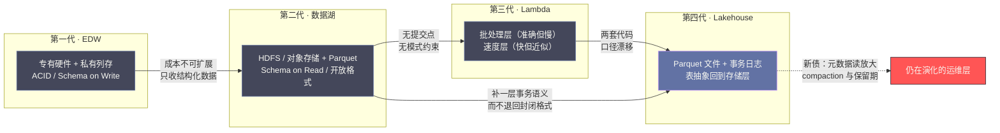
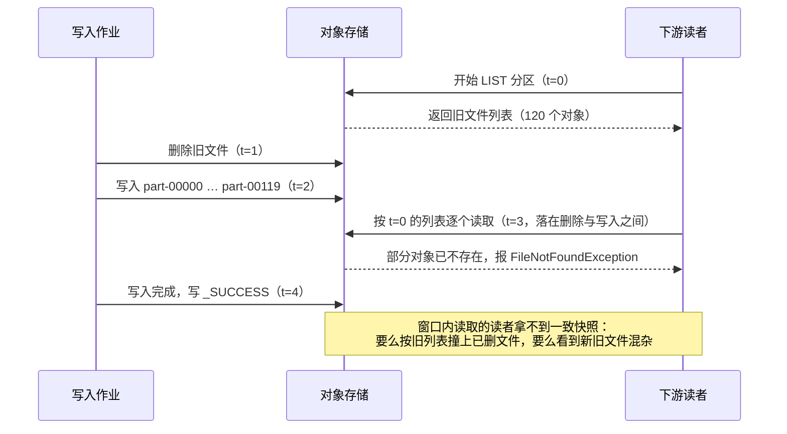
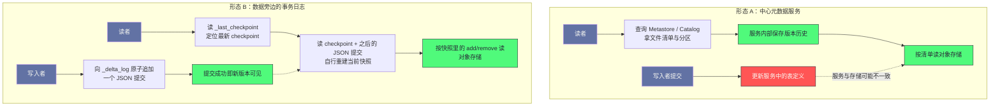
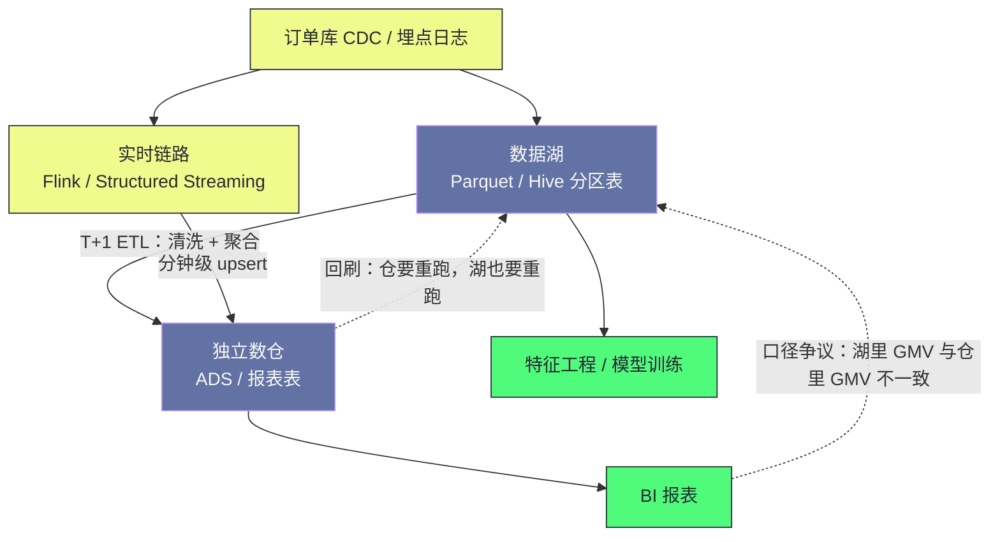
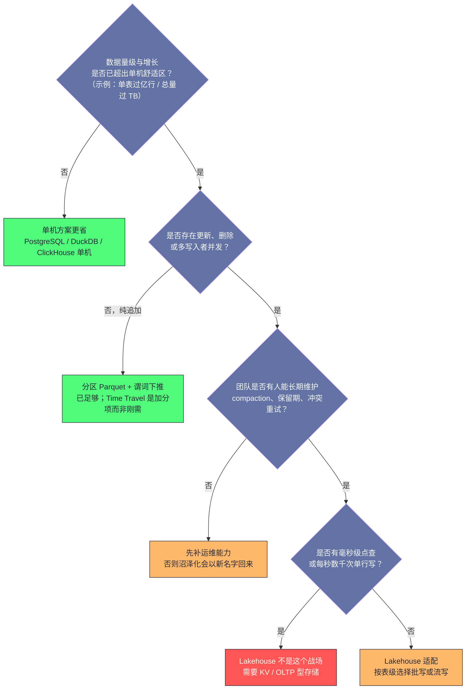

# 01 为什么需要 Lakehouse：数据仓库与数据湖的架构演进

**摘要：**

数据工程走过的二十年里，架构换了四代：企业数据仓库（EDW）把分析负载从 OLTP 系统里剥离出来，数据湖把存储成本压低一个数量级，Lambda 架构用两套链路去补数据湖缺失的正确性，Lakehouse 则把"表"这一层重新加回文件之上。这四代不是简单的替代关系，每一次都是用新的代价换掉旧的代价——数仓换来的是采购单上的数字与封闭的格式，数据湖换来的是失控的目录与"沼泽化"，Lambda 换来的是两套代码、两套语义与一份永远对不平的账。本文不按年表复述历史，而是按"表这个抽象由谁维护"来划代，逐代交代它解决了哪个具体失败、又引入了哪个新问题，再把落点放在一个判断上：Lakehouse 的实质不是"湖加仓"，而是在对象存储之上补了一份事务日志，这个位置选择同时决定了它能力的上限与代价的形状。文章用一条订单流水线贯穿全篇，最后给出成本结构的迁移账，以及四类不该上 Lakehouse 的具体场景。

---

## 第 1 章 四代的分界：看"表"这个抽象落在哪一层

### 1.1 一条贯穿全篇的订单流水线

抽象的分代讨论容易空转，所以先给出一条具体的流水线，后文每一代都拿它来对照。

设想一家中等规模的电商：订单明细表 `orders` 每天新增约 1.2 亿行，保留三年，落成 Parquet 之后压缩比大约 1:4，总量在 12 TB 上下；商品维表 `dim_product` 只有 200 万行，但每天有三千多次属性变更，包括改名、换类目、调价格带，属于典型的缓慢变化维。两个表要喂三个消费者：T+1 的 GMV 报表，要求口径稳定、同一份报表重跑结果一致；风控规则回刷，要求能按商品维度做点更新并回溯到"上周三那个版本的商品类目"；数据科学家的特征工程，要求能直接读原始明细，不希望被一张宽表的 schema 卡住。

这些数字是示例推算，用来固定量级，不是任何真实系统的指标。真正要紧的是三个消费者提出的要求彼此冲突：报表要一致性与稳定性，风控要可变性与可回溯，ML 要原始性与开放性。任何一代架构的成败，都可以用同时满足这三条的能力来衡量。

### 1.2 分代的判据：谁在维护"文件集合"到"表"的那一步转换

一个目录里堆着几百个 Parquet 文件，它不自动等于一张表。要让"表"成立，至少需要四件事同时为真：成员明确（这一版里哪些文件属于它）、模式明确（列名、类型、可空性）、统计可得（行数、列的 min/max、分区值）、提交有原子性（要么全可见，要么全不可见）。

这四件事的真相存放在哪里，决定了架构的分代。笔者据此把演进切成四段：数仓把四件事全部收进引擎私有的目录与格式里；数据湖把它们交给目录约定与使用者的自觉；Lambda 没有回答这个问题，只是用两套程序绕开了它；Lakehouse 则把四件事写进存储层的一份日志，让"表"成为数据旁边的一个可自证的事实。

| 代际 | 代表系统 | "表"的真相存放位置 | 提交点 | 典型失败形态 | 引入的新问题 |
|---|---|---|---|---|---|
| 第一代 EDW | Teradata、Netezza、Exadata | 引擎私有的目录与私有列存格式 | 引擎事务日志 | 扩容必须停机搬数据，格式无法外部读取 | 成本与封闭性 |
| 第二代数据湖 | HDFS/S3 + Hive 表 + Parquet | Hive Metastore 的分区定义 + 目录约定 | 无 | 读到半成品文件、模式漂移静默变 null | 沼泽化，无人对口径负责 |
| 第三代 Lambda | 批层 Spark + 速度层 Storm/Flink | 两套程序各自的逻辑里 | 各链路各自的 checkpoint | 批流结果对不平，历史回刷无法重放 | 两套代码、两套语义 |
| 第四代 Lakehouse | Delta Lake、Iceberg、Hudi | 表目录内的元数据（日志/manifest） | 元数据的原子提交 | 元数据读放大、并发提交冲突、运维对象增多 | 新一层运维债务 |

这张表的最后两列值得并排看：每一代的新问题，几乎都是它用来解决上一代问题的那件工具的副作用。数仓用紧耦合换来性能和 ACID，代价是成本与封闭；数据湖用开放与分离换来便宜，代价是没有提交点；Lambda 用两套链路换来"批的准确加流的及时"，代价是语义分裂；Lakehouse 用一份日志换来事务，代价是每次读表都要先解析日志、每次写表都要争一个提交位。

### 1.3 四代的关系图

下图把四代与它们的失败串成一条链，箭头上的文字是"这一代没能解决、因而被下一代接手"的那件事。



图里有两条从数据湖出发的边：一条经过 Lambda 再到 Lakehouse，一条直达 Lakehouse。后者想说明的是，Lakehouse 并不是 Lambda 的"升级版"，两者不在同一条继承链上——Lambda 试图在应用层补正确性，Lakehouse 在存储层补正确性，前者绕开了问题，后者直面了问题。

### 1.4 演进的真动力：成本结构在换座位

如果把四代看成能力的堆叠，会得出"后一代全面优于前一代"的错误结论。真实的驱动力是成本结构：二十年里存储的单位成本跌了两三个数量级，计算弹性化了但单位算力并不便宜，人力则一路上升。第一代架构是"存储极贵、算力集中在少数大机器上"那个年代的最优解，它把存储与计算焊死在一台机器上，用昂贵硬件换确定性性能；这套解在存储变便宜之后立刻变成负债，因为扩容的最小粒度仍然是"一台机器"。

同理，数据湖是"存储便宜、计算可以横向扩"年代的最优解，它把存储让给了商品硬件与对象存储，留下的窟窿靠人力去补——补分区、补对账、补口径，这就是后来被称作沼泽化的开销。Lambda 补窟窿的方式是再加一套程序，用更多的人力换正确性。到 Lakehouse 这一步，交易的形态变了：用一份日志把正确性做成存储层的属性，一次性付出协议复杂度，之后每次读写摊薄一点元数据开销，换来的是不再需要人维护"哪些文件算数"。

这条线索在第 7 章展开成一张成本迁移表与一份标注过的示例推算。此处只需记住一个判断：架构的分代，本质上是把**成本从一类资源搬到另一类资源**上。搬得动，是因为那类资源变便宜了；搬得痛，是因为新资源上的开销还没有被工具吸收。

---

## 第 2 章 第一代 EDW：ACID 的代价写进了采购单

### 2.1 它剥离的到底是什么

二十世纪九十年代的企业里，业务数据散落在 ERP、CRM、计费、库存这些 OLTP 系统里，而这些系统为短事务优化：缓冲池里装着热数据块，锁的粒度按行或页算，日志系统按 WAL 顺序写。在这样的系统上跑一条跨三年订单的全表扫描，后果不只是"慢"：冷数据块挤占缓冲池，长事务持有大量 undo，长查询与短事务争同一批 latch，最严重时整个下单链路被拖到超时。九十年代 DBA 之间流传的"报表不能在生产库跑"，说的就是这件事。

数据仓库的第一个贡献是把这两种负载在物理上分开，带来三样东西：独立的硬件与实例，分析查询再怎么扫也扫不到交易库；面向分析的组织方式，维度建模（Kimball 的星型模型）把"订单事实"与"商品、门店、时间维"分开存放，指标定义从某个人的 SQL 搬进模型，口径第一次有了物理载体；ACID 与 Schema on Write，让加载失败不留下半张表，让错误数据在入口被拦住。

### 2.2 可靠性是靠哪几件机制兑现的

数仓的可靠性不是一句口号，它由几件具体的机制支撑，理解这几件机制才能理解它为什么难以搬到廉价存储上。

其一是列式存储加压缩。同一列的数据类型一致、局部性强，按列压缩后扫描量能降到行存的十分之一量级，代价是点更新昂贵——列存写一行接近重写一个 row group，所以数仓天生倾向批量加载、少做更新。

其二是 MPP 执行加数据分布。表按分布键切到各个节点，Join 时能做成节点内本地连接，只有分布键不一致时才需要跨节点重分布。这套机制要求引擎对数据的物理布局有完全的控制权，包括它放在哪个磁盘、按什么顺序、有几个副本。

其三是索引与物化视图。位图索引把低基数列的过滤变成位运算，物化视图把常用的聚合预先算好，代价是每一次基表变更都要维护这些结构——维护的及时性又依赖引擎独占写入。

其四是事务日志与锁管理器。这些组件假定自己能拿到可靠的本地磁盘与低延迟的互斥原语，而对象存储既没有原子的多对象事务，也没有便宜的互斥原语。

把这四件机制摆在一起看，会发现它们共享同一个前提：引擎必须对存储有排他的**控制权**。当系统既是存储的拥有者又是执行者时，ACID 与高性能可以同时成立；一旦存储换成别人提供的对象存储，这个前提就不再成立，于是"把数仓搬到云上"的第一步往往不是重构，而是把整套东西搬进虚拟机——成本结构没变，只是账单从采购变成按小时计费。

### 2.3 三个具体失败

**失败一：扩容粒度与峰值利用率。**紧耦合架构里，扩存储必须扩机器。一家公司为月结那一天的峰值准备算力，而这套算力在其余三百多天里大部分闲置。以示例推算：若月结窗口是 4 小时，全年 8760 小时里真正需要满载的时间不足 0.05%，即使按 5% 的均值利用率估算，为峰值付的溢价也是数量级级别的。存储侧同理：数据每年增长 40%，但每加 10 TB 就要加一台带固定 CPU 与内存的机器，多出来的算力无处可用。

**失败二：Schema on Write 的加载窗口与半结构化数据的入口。**加一列不是一句 `ALTER TABLE`：要评估历史回填、占用变更窗口、让所有下游视图与 ETL 同步调整。更根本的是，用户行为日志、埋点事件、第三方回调这类半结构化数据无法在入库前压成固定关系模式——先拍平意味着大量字段被丢弃，而字段的价值往往半年后才被发现。于是这些数据被挡在数仓之外，单独放在文件服务器上，形成了一个个"影子数据集"，口径与主仓不一致，也没人负责。

**失败三：封闭格式与迁移成本。**数据以引擎私有格式落盘，外部工具读不懂，导出的唯一方式是卸成文本再装载。一次 PB 级迁移的工期以月计，还要停业务、做双跑校验；SQL 方言的差异（窗口函数的扩展写法、特有的分析函数、优化器 Hint）让应用层也要跟着改。迁移成本高到了一种程度，它就变成了议价能力——这是供应商锁定的经济基础，与技术优劣无关。

> [!warning] 一个常见的误读
> "数仓失败是因为技术落后"是一个省事但错误的结论。数仓在它被设计的场景里（结构化、批量、口径固定、规模在 TB 级）依然是效率和可靠性最高的选择，今天的高并发 BI 仍然大量跑在数仓或它的云上后继者里。它失败的地方在于**扩展的边界**：当数据规模到 PB、数据形态变成半结构化、消费者从 BI 扩展到 ML 时，它那套"引擎独占存储"的前提就再也付不起。

### 2.4 反事实：没有数仓的世界

把数仓抽掉会怎样？每个部门直接从 OLTP 库拉数据，各自写 SQL、各自定义"有效订单"（是否剔除退款、是否含运费、按下单还是支付时间），财务、运营、增长三张报表给出三个 GMV，开会第一小时用来争论哪个数字对。这不是假设，它是 2010 年代很多公司在数据湖上重演过的场景——湖把存储问题解决了，却没有解决"谁来定义表"的问题，于是口径的混乱以另一种形式回来了。

由此可见，第一代架构真正留下的遗产不是某台机器或某种格式，而是"单一事实来源"这个治理概念。这个概念在后三代里反复被重新实现：数据湖试图用 Hive Metastore 实现它，Lambda 试图用"批层为准"实现它，Lakehouse 试图用一份日志实现它。每一次实现失败，都不是因为概念错了，而是因为承载它的那层**抽象选错了位置**。

---

## 第 3 章 第二代数据湖：便宜之后，谁来当"表"

### 3.1 抽象被劈成了两半

Hive 是这一代最有代表性的实现，它把"表"定义为 Metastore 里的四元组（库名、表名、表目录位置、分区与序列化定义），再加上一条目录约定：表目录下的文件都属于这张表，`dt=2026-11-19/` 这样的子目录就是分区值。

这个定义能跑起来，是因为它把两件本该一起的事拆开了：Metastore 记录的是"这个目录下的所有文件都属于我"，而不是"这一版包含哪些文件"。听起来只差一个措辞，实际差掉的是**提交点**。没有提交点，就没有"当前版本"这个概念，也就没有快照隔离、没有时间旅行、没有"读到一半写者失败"的保护。第 1.2 节列的四件事里，模式算勉强有（靠读取端解释），成员靠目录约定，统计几乎没有，提交点干脆不存在。

这不是 Hive 的设计者疏忽。在 HDFS 时代，一个目录的 `rename` 是元数据层的原子操作，`_temporary` 目录加一次 `rename` 就能做出"要么全可见要么全不可见"的效果，代价很低。所以那时的共识是：提交语义由文件系统的 rename 提供，表格式不必自己再做一遍。这套共识在对象存储上崩塌了——对象存储没有目录，没有原子 rename，`rename` 只能实现成"逐个对象复制再删源"，一个十万文件的目录等于十万次操作，中途失败就留下半套数据。

### 3.2 失败一：写入不是原子的，读者会看到半成品

最典型的一幕是覆盖写分区。为了重算某天的数据，作业先把 `dt=2026-11-19/` 下的旧文件删掉，再写入新文件；或者反过来，先写新文件再删旧文件。前一种顺序在删除与写入之间留了一个空窗口，后一种顺序在写完新文件到删完旧文件之间留了一个"新旧并存"的窗口。无论哪种，只要下游在窗口内读取，就会拿到一个既不是旧版本也不是新版本的混合体。下面这张时序图把这个窗口画出来。



判据很直接：同一个分区连续两次 `count(*)` 结果不同，或者某天的报表数值比前一天低一截、重跑之后又恢复正常。工程师通常把它归因为"作业偶发失败"，但根因在读取的那一刻——读者没有拿到一个一致的快照，因为系统里根本不存在快照。

`_SUCCESS` 标记是常见的补救，但它只回答"这批文件写完没有"，不回答"哪些文件属于同一批"。更麻烦的是，`_SUCCESS` 本身也是对象存储上的一个对象，写它与写数据文件不是同一件事，两者之间同样有窗口。并发写入的问题更严重：两个作业同时往同一分区写，文件名里的 UUID 让它们不会互相覆盖，于是同一分区里出现两批文件，行数正好翻倍，而没有任何一处会报错。

### 3.3 失败二：模式漂移是静默的

Parquet 是自描述格式，每个文件都带自己的 schema，于是很容易得出"湖上不需要 schema 管理"的结论。这句话把"能读出来"和"读得对"混为一谈了。

真正的危险来自读取端的宽容策略：Hive 读 Parquet 时列名大小写不敏感，缺列补 null，类型不匹配也补 null；Spark 在 `spark.sql.parquet.mergeSchema=false`（默认值）时按目录里的文件各自解释，不做跨文件校验；Hive Metastore 里的 schema 与文件里的 schema 是两份，谁也不会去核对。把这些宽松叠起来，就得到了一个最糟糕的失败形态：**写入成功、读取成功、结果错误。**

举一个具体的例子。上游作业把 `order_amount` 从 `decimal(18,2)` 改成 `string`（可能是为了兼容某个带货币符号的来源字段），写入端毫无阻碍，文件照常生成。下游 `SELECT SUM(order_amount)` 不报错，因为读取端把无法转换的值解释成 null，而 `SUM` 会忽略 null。报表那天少了 12% 的 GMV，所有人看到的是"今天大盘不太好"。

```sql
-- 三个计数点出问题所在：行数正常，非空金额明显偏少，差值就是脏数据规模
SELECT count(*)                  AS rows_all,
       count(order_amount)       AS rows_amount_not_null,
       sum(CAST(order_amount AS double)) AS gmv
FROM   orders WHERE dt = '2026-11-19';
```

加列也有讲究。在文件尾部追加列是安全的，但用位置映射的方式插到中间，读取端就会把后面的列整体错位一格；把 `Order_Amount` 与 `order_amount` 两个大小写不同的列写进不同文件，在 Hive 里是同一列，在 Parquet 里是两列，在 Spark 里取决于参数。这类问题在 Schema on Read 的框架内无解，因为"哪一份 schema 说了算"本身就没有答案——每个读者都可以有一份自己的解释。

### 3.4 失败三：没有统计信息，优化器只能猜

列式格式的谓词下推依赖文件内的统计：每个 row group 记录各列的 min/max，查询时跳过不可能命中的 row group。这条优化的效果完全取决于数据的物理顺序。如果写入时数据是按时间顺序来的，`sku_id` 在文件里几乎是随机的，每个 row group 的 min/max 都覆盖全域，裁剪率接近于零；如果按 `sku_id` 排序写入，同样的查询能裁掉 99% 的数据。

问题在于，湖上几乎没有机制去保证这件事。Hive 的 `ANALYZE TABLE ... COMPUTE STATISTICS` 默认只算表级与分区级的行数、字节数，列级的 NDV 与直方图要显式加 `FOR COLUMNS`，而大多数团队的调度里根本没有这一步。CBO 拿不到分布信息，Join 顺序与 Join 策略只能靠默认值猜：本该广播的小表被当成大表走了 Shuffle，本该走 Sort-Merge 的两张大表被误判成可以广播，内存直接打爆。

一个示例推算能说明量级差：假设 `orders` 有 1 万个文件、每个 128 MB，按 `sku_id IN (10 个值)` 过滤；若 min/max 没有区分度，要扫满 1.28 TB；若写入时按 `sku_id` 聚簇，命中比例可以压到 1%，也就是 13 GB 左右。两个数字之间差了两个数量级，而差别既不来自引擎也不来自硬件，只来自"数据在文件里怎么排"。这也是 Z-Order 与聚簇写入的立足点，只是到第三代之后才被认真对待。

### 3.5 失败四：没有版本，"覆盖"是不可逆操作

湖上的表没有 `git log`。一次误跑的覆盖写盖掉昨天的分区之后，唯一恢复路径是重跑上游，而上游往往保留不住那么久——Kafka 的保留期常见配置是 7 天，对象存储上的原始日志可能只留 30 天。于是就出现了工程上很典型的一幕：数据错了三天才发现，发现的时候已经无法回到错误发生之前的状态。

合规场景更尖锐。删除请求（个人信息删除、监管要求的下架）在湖上的实现方式是"重写受影响的文件"，而重写一旦出错，被删掉的可能远超预期，且无法撤销。这类操作在没有版本的表上，本质上是一次不可回滚的生产变更。

### 3.6 沼泽化是一组具体动作，不是一个形容词

"数据沼泽"这个说法容易被当成文学修辞，其实它对应一组可以点数的运维动作：每天定时跑 `MSCK REPAIR TABLE` 或 `ALTER TABLE ADD PARTITION` 把新目录注册进 Metastore；定期清理写了但没注册分区的孤儿文件；清理 `_temporary` 目录的残留；合并小文件。最后一项在有流式写入时尤其突出：一分钟一个微批次、每个批次落一个文件，一天就是 1440 个文件，一年五十多万个，单分区之内的文件数足够让任何一次作业的 `InMemoryFileIndex` 构建慢到成为瓶颈。

对象存储让这笔账更难算清：一个分区下 50 万个对象，按每页 1000 个 key 计要 500 次 LIST 请求，每次都有延迟与计费，作业哪怕只读一个分区也要先把这 500 次请求走完才能开始算。存储费用降下去了，请求费用与启动延迟上来了，这笔账在只算"每 GB 每月多少钱"的对比表里看不见。

| 沼泽化问题 | 可观测判据 | 业务后果 |
|---|---|---|
| 非原子写入 | 同分区两次 `count(*)` 不一致，报表数值抖动后自愈 | 报表口径不可信，问题无法复现 |
| 模式漂移 | `count(*)` 与 `count(列)` 差距持续扩大，下游出现 null | 指标静默偏低，发现时已污染多期 |
| 无统计信息 | 同一查询在不同写入顺序下扫描量差两个数量级 | 计算成本失控，SLA 不稳定 |
| 无版本 | 误覆盖后只能全量重跑，恢复时长以小时计 | 故障恢复依赖上游保留期 |
| 元数据与文件不一致 | 分区已注册但无文件，或有文件未注册 | 空结果被当成"当天没数据" |

最后一行最难发现：空结果与"当天确实没有数据"在表面上完全一样，运营的第一反应是上游没推数，等排查到湖上已经是第二天。

### 3.7 反事实：干脆不用湖呢

把这一章的问题推到极端，会得到一个"那就回到数仓"的结论。但回到数仓意味着重新接受第一章的三个失败：成本、封闭、只收结构化数据。而这一代真正被验证的价值恰恰在那三个方向：对象存储的单价、Parquet 的开放、任意引擎可读。

所以问题不是"湖还是仓"，而是"湖上缺了哪一层"。缺的不是存储能力，也不是计算能力，是一层能把文件集合变成表的元数据。Lambda 是第一次试图补这一层的尝试，只不过它把补丁打在了应用侧。

---

## 第 4 章 第三代 Lambda：用两套代码补上缺失的那一层

### 4.1 2011 年的那个提法

2011 年 Nathan Marz 在博客里提出 Lambda 架构，出发点是一个关于容错的判断：如果原始数据是不可变且可重算的，那么任何错误都能通过重算来修正，系统就不需要为"写入正确性"付出高昂代价。据此他把系统分成三层：批处理层保存不可变的 master dataset，承担全量重算与正确性；速度层只处理最近一段增量，容忍近似；服务层在查询时把两层的视图合并。

这个设计在当时的约束下相当聪明：它承认湖上没有事务这个事实，既然写入的原子性不可得，那就让"正确"由可重算来定义，而不是由提交来定义；既然流处理的结果迟早会被批处理纠正，那就让流处理只负责"最近一段时间的及时性"。口径的最终裁决权交给批层，流层只提供临时视图。

### 4.2 维护债的四种具体形态

Lambda 的代价不在运行时，而在维护。它把同一份业务语义实现了两遍，而两遍实现之间没有共同的真相来源。

第一种是双实现的语义差异。批层写 Spark SQL，速度层写 Flink SQL 或 Storm 拓扑，两边看起来都是 SQL，细节却处处不同：时间函数默认时区不一致（一边按 UTC 截断日期，一边按本地时区），NULL 的排序位置不同（`NULLS FIRST` 与 `NULLS LAST` 的默认值相反），浮点累加的顺序不同导致末位不一致，正则与 UDF 的边界行为不同。任何一处差异都会在某个边界数据上暴露出来，而暴露的时机通常是月末对账。

第二种是迟到数据。批层可以等到第二天再算，迟到几个小时的数据照样进入正确结果；速度层在窗口关闭之后到达的数据只能丢弃或者落到死信队列，需要人工补。于是同一指标在"当天看"和"隔天看"之间必然有差，差值的大小取决于迟到数据的比例，而业务方看到的是"这个数每天都在变"。

第三种是不可加聚合。UV、去重用户数这类指标不满足可加性，批层可以做全量 `COUNT(DISTINCT)`，速度层必须用 HyperLogLog 之类的近似结构，误差通常在 1% 以内但方向不确定。两套结果放在一张报表上，一个精确一个近似，使用者并不知道自己看的是哪一种。

第四种是回刷。业务口径变更（比如"有效订单"从按下单时间改为按支付时间）要求重算三年历史。批层重跑是常规操作，速度层则要回放 Kafka，而 Kafka 的保留期常见是 7 天——三年历史根本回放不出来。于是 Lambda 的"流层可重建"这个前提，在保留期面前是不成立的。

| 语义维度 | 批处理层 | 速度层 | 差异在何处暴露 |
|---|---|---|---|
| 日期截断 | 按 UTC 或指定时区显式转换 | 常按算子所在机器时区 | 跨零点的小时级指标 |
| 迟到数据 | 全部纳入 | 窗口关闭后丢弃 | 当天与隔天报表的差 |
| 去重聚合 | 全量 `COUNT(DISTINCT)` | HLL 近似（误差约 1%） | UV 类指标 |
| 更新与删除 | 全量重写分区 | 依赖主键 upsert 与状态 TTL | 用户注销后的指标 |
| 历史回刷 | 重跑任意区间 | 受消息保留期限制 | 口径变更后的追溯 |

把这张表横着读一遍，会发现每一行都不是"实现 bug"，而是两层在语义上本来就没有共同定义。修复方式通常是加一份对账作业：每天比较两条链路的结果，差异超过阈值就告警，然后由人去找原因。对账作业本身又成了一个需要维护的系统，而"阈值定多少"往往变成跨团队的政治问题——定紧了天天误报，定松了真问题漏过去。

### 4.3 Kappa：一套代码，但把批伪装成流

2014 年 Jay Kreps 提出 Kappa 架构，思路更简洁：既然维护两套语义这么贵，那就只留一套，所有计算都用流处理表达，需要重算历史时回放日志。这个提法消除了双实现的问题，代价转移到另外两处：一是要求消息系统长期保留全部历史（成本与运维都不可忽视），二是要求流引擎承担本该由批引擎承担的负载——三年的全量聚合、复杂的多表 Join、模型训练前的特征清洗，用流处理表达既别扭又低效。

Kappa 在实践中常见的形式是"流处理为主、批处理为辅"的混合体，回到 Lambda 的老问题上，只是批的那一半变小了。真正被它证明的一点是：只要存储层能给出一份可重放、有序的历史，**"重算"就能替代"修补"**。这个判断后来被 Lakehouse 完整继承——Delta 的 Time Travel 与 CDF 做的正是"让重算变得便宜"。

### 4.4 这一代的欠账

Lambda 的根本问题不在于复杂，而在于它把"表"的定义搬进了两套程序：什么算有效订单、哪个时间戳是业务时间、迟到多久还算当天，都变成代码里的 if 分支，而不是数据上的约束。代码可以改，历史数据不会自动跟着改，于是每次口径调整都要配一次全量回刷，而回刷能力受限于消息保留期。

换句话说，这一代用工程纪律替代存储层缺失的抽象。纪律的维持成本随团队规模线性上升，随人员流动剧烈波动；当数据团队从三个人变成三十个人，这套纪律就维持不住了——这是大量公司转向"湖上做批、另建实时链路做流"的现实动因，也是 Lakehouse 出现的背景。

---

## 第 5 章 第四代 Lakehouse：把"表"加回文件之上

### 5.1 两种把表加回来的方式

要让"表"重新成立，只有两条路。一条是把真相放进一个中心元数据服务：服务记住"这张表由哪些文件组成、当前是第几版"，读者先问服务再读文件，Hive Metastore 加一套版本表就是这个形态。另一条是把真相放到数据旁边：在表目录里维护一份日志，日志按提交顺序记录文件的增加与删除，任何拿到目录读权限的人都能自己算出任意版本的文件清单。

两条路都能实现 ACID 与时间旅行，性质却完全不同。中心服务形态下，服务与存储是两套系统，必须保持一致：服务里说有 120 个文件，存储里只有 118 个（有人手删了，或清理任务跑早了），读者就会撞上 `FileNotFoundException`；服务是单点，所有读者都要连它，跨组织共享要先共享访问权；时间旅行要求服务保留历史清单，保留多久由服务决定，与数据生命周期脱钩。

日志形态把这些耦合解开了：真相随数据走，拷贝一个目录就等于拷贝了表及其全部历史；任意引擎只要实现协议就能读，不必接入特定元数据服务；时间旅行的保留期由日志策略决定，与数据文件清理策略分开配置。代价在另一头：每次读表都要先解析日志，日志会无限增长，于是必须有 checkpoint 把"前 N 次提交的净效果"压实成一个文件。

下图把两种形态的读者路径并排放，差异在"读者拿到的成员清单从哪来"这一步上。



图里那条红色标注是形态 A 的固有风险：写入者先改服务再写文件（或反之），两步之间的一致性没有任何机制保证。形态 B 里没有这个缝，因为提交本身就是"写一个日志文件"这一个动作，文件与日志的对应关系在提交里写死。

### 5.2 这个位置选择决定了能力的上限

把日志放在数据旁边，不只是实现细节，它决定了能力边界长什么样。以下五条都可以从这个位置推导出来。

第一条，事务的粒度是"单表的一次提交"，不是"跨多表的一个事务"。日志属于某一张表，提交只对这一张表生效，所以 Lakehouse 没有跨表原子写。多表 ETL（订单表与维表要同时更新）必须靠幂等重跑与顺序编排来解决，而不能靠回滚。这不是实现偷懒，而是"表是自证的"这个前提的必然结果：要让每张表都能被独立读取与拷贝，就不能让它们的提交互相依赖。

第二条，更新的形态由"数据文件不可变"决定。改一行数据，要么重写包含它的整个文件（写时复制，Copy-on-Write），要么只写一个"这个文件里第几行被删了"的标记（读时合并，Merge-on-Read）。前者的写放大与文件大小成正比，后者的读放大与标记数量成正比。删除向量（Deletion Vector）就是把后者做成协议的一部分：把删除行号压成位图，与文件一起提交，读取时过滤。能力上限由此确定——单行更新的成本可以做到与表大小无关，但代价是每次读都要多做一次过滤，且老版本引擎可能根本不认识这个位图。

第三条，读表要先解析元数据，所以元数据规模是硬约束。一张表积累了一万次提交，如果每次都从版本 0 的 JSON 读起，冷启动就要读一万个文件。checkpoint 的存在就是为了压住这条曲线：默认每 10 次提交生成一个 checkpoint（把截至该版本的所有 `add`/`remove` 压实成一份 Parquet），读表时先读 `_last_checkpoint` 定位最新 checkpoint，再补读它之后的若干 JSON。读放大从"与历史提交数成正比"降到了"一次 checkpoint 加不超过十次提交"，代价是每次写都要判断是否该生成 checkpoint，以及 checkpoint 本身的写放大。

第四条，能力是可选启用的，启用即提高门槛。Delta 协议用一对版本号（`minReaderVersion` 与 `minWriterVersion`）声明"读这张表至少需要什么能力、写这张表至少需要什么能力"：基础表是 reader 1 加 writer 2，列映射（Column Mapping）把 reader 抬到 2，变更数据流（CDF）要求 writer 4，删除向量要求 reader 3 加 writer 7，表特性（Table Features）机制要求 writer 7 并允许按特性逐项声明。这组数字的用途不是让人背，而是让人理解一件事：启用一个特性，等于宣布**不再支持老读者**。一个只实现了 reader 1 的引擎读到启用了删除向量的表，会直接报错而不是降级——协议在这里选择了正确性而非兼容性。具体版本门槛以官方协议文档（PROTOCOL.md）的对应章节为准，各引擎 connector 的实现进度是另一条独立演进的线。

第五条，权限与治理不在协议里。协议只规定"文件清单与提交如何表达"，不规定"谁能读哪些行、哪些列"。行列级权限、动态脱敏、血缘追踪、审计日志，这些必须由一层 catalog 或平台提供。Delta Lake OSS 提供的是协议与 Spark 连接器；Unity Catalog 提供的治理能力属于 Databricks 平台产品（其开源版本是另一条线），两者不是一回事。把这一点记清楚，才能理解为什么同一个 Delta 表在不同平台上"看起来能力不同"。

| 能力 | 由协议/OSS 保证 | 需要平台或 catalog 提供 |
|---|---|---|
| 快照隔离与原子提交 | 是（日志提交协议） | 否 |
| 时间旅行与按版本查询 | 是（日志保留期内） | 跨表统一的历史视图需要 catalog |
| 多引擎读写 | 是（各引擎自行实现协议） | 统一连接配置与凭证管理 |
| 删除向量、列映射、CDF | 是（按版本门槛启用） | 否 |
| 行级/列级权限 | 否 | 是（catalog 的行过滤与列掩码） |
| 数据血缘与审计 | 否 | 是（平台侧事件与 lineage） |
| 自动 compaction 托管 | 配置项在 OSS | 托管调度与观测在平台 |
| 声明式管道（DLT 类） | 否 | 是（Databricks 平台能力） |
| 查询加速（缓存与 I/O 预测） | 否 | 是（平台侧专有实现） |

需要单独点明的是：Delta Live Tables（DLT，后来并入 Databricks 的 Lakeflow 品牌）、Unity Catalog 的托管治理、Predictive I/O 与 Photon 加速，都属于 Databricks 平台能力，不是 OSS 协议的一部分；开源侧交付的是表格式、事务协议与各引擎连接器。

### 5.3 代价清单

把好处说完，该说代价了，下面三条各自对应一类在生产里反复出现的现象。

第一类是元数据冷启动。每个会话第一次访问某张表都要解析一次日志，一天上千个作业、每个作业访问若干张表，累计的元数据读取量并不小。缓解手段是长驻会话与元数据缓存，而缓存又带来"读到旧快照"的可能——失效策略因此成为一个需要显式配置的东西。

第二类是并发提交冲突。乐观并发意味着两个写入者可以同时准备提交，提交时才发现彼此冲突：往同一个分区追加、一方删除另一方正在读的文件、一边改 schema 一边写数据，都会触发冲突异常（`ConcurrentAppendException`、`ConcurrentDeleteDeleteException`、`MetadataChangedException` 等），由框架重试或抛给上层。重试要求作业幂等，否则"重试成功"会变成"数据重复"，这条要求在批处理里常被忽略，却在流式写入与人工补数并存时真出事。

第三类是小文件与保留期的耦合。日志记录的是文件的增删，删掉的文件在日志保留期内仍然可以被时间旅行找回，所以物理删除（VACUUM）必须晚于所有可能的时间旅行查询。默认配置下，日志保留 30 天、VACUUM 保留 7 天：如果某个读者去查 20 天前的版本，日志里还有记录，但文件已经被清掉了，于是报 `FileNotFoundException`。这不是 bug，是两个保留期没有对齐时的必然结果，而它经常在"用时间旅行做数据恢复"的演练中第一次暴露。

### 5.4 一个比喻：书库门口的借还登记册

把对象存储想成一座没有管理员的书库，书可以随便放、随便拿，但书库里没有目录。数据湖相当于规定"三层东侧的书架属于小说"，谁放谁取都靠这个约定；一旦有人把书放错层，或者一次搬书搬到一半停下，读者就找不到或者找到半套。

Lakehouse 相当于在书库门口放一本借还登记册：每笔进出记一行，标注"今天新增哪几本、下架哪几本"，册子只能顺序追加、不能撕页。读者要确认"此刻馆藏有哪些书"，翻册子自己算即可；要查上周三的馆藏，翻到那一页即可。册子太厚之后每十页做一份汇总页（checkpoint），读者从最近的汇总页开始翻，最多再补十页。

比喻的技术限定在于：登记册必须能"原子追加"，否则两个人同时登记就会互相覆盖。对象存储是否提供"对象不存在才写入"的语义，决定了这件事是就地完成还是要引入外部协调（早期在 S3 上做多写入者，常见做法是借 DynamoDB 做提交锁），落地时以目标存储的文档为准，不能照搬别人的架构图。

---

## 第 6 章 与"湖 + 独立数仓"两层同步的对照

### 6.1 两层结构的由来

在 Lakehouse 之前，更常见的选择不是 Lambda，而是"湖 + 独立数仓"的两层结构：原始数据落湖（Parquet、Hive 表），再用 ETL 把清洗后的结果同步进一个独立数仓（早期的 Hive 仓、后来的 ClickHouse、Doris、云上的 Redshift 与 Snowflake）。这套结构解决的是"湖上查询太慢、BI 工具不认湖、权限体系在数仓里"这三个现实问题，代价是同一份数据存在两个地方，中间靠一条同步链路维系。

它和 Lambda 的区别在于，Lambda 的流层是近似的、临时的，两层结构的数仓是权威的、持久的。于是问题从"两套语义哪个算准"变成了"两份数据哪个才算数"，前者是技术问题，后者是治理问题，而治理问题更难收场。

### 6.2 三种双写拓扑

同步链路的组织方式大致有三种，失败形态各不相同。

第一种是串联：湖里是唯一原始层，数仓是湖的下游。一条 ETL 从湖读、往数仓写，中间做清洗与聚合。这条链路本身是"一次搬运加一次口径转换"，所以它的失败形态与任何数据管道相同：延迟、失败重跑、部分成功。区别在于它多了一个"口径转换"的环节——湖里的 `dt` 按 UTC 分区，数仓里的 `dt` 按本地时区，转换规则写在 ETL 里，而 ETL 的作者可能没意识到自己承担了定义业务日的责任。

第二种是并联：同一份源数据，一条链路进湖、一条链路进数仓。两条链路各自清洗，看起来像冗余，实际上很快就分叉——一条链路的作者修了一个脏数据规则，另一条没有同步，两个系统的同一个指标开始出现固定偏差。并联的初衷是"湖给 ML、仓给 BI"，结果是"没人能说清 ML 看到的和 BI 看到的是不是同一批订单"。

第三种是混合：实时链路直接进数仓，批链路进湖，服务层在查询时把两边 JOIN 起来。这是三种拓扑里最难维护的一种，因为两边时效性不同——实时链路有最近五分钟，批链路有昨天及以前，中间那段要么重复要么空洞。查询侧必须处理"同一订单在两个来源里都存在且状态不同"，而这个逻辑通常是报表 SQL 里的一行 `COALESCE`，没有任何文档。下图把混合形态的两条链路画在一起。



两条虚线是这套结构真正的成本所在：口径争议发生在两处存储之间，回刷要同时动两个地方。单层结构不是把这两条虚线画直，而是取消了"第二处存储"这个前提——同一张表既被 BI 读也被 ML 读，争议的对象从"两份数据"变成"一个版本"。

### 6.3 口径漂移的五个来源

两层结构里最常见的漂移点，全部来自"转换发生在搬运途中"。

时区是第一处。湖上按 UTC 落分区是标准做法，报表按本地时区看数是业务直觉，两者在跨零点的小时级指标上必然不同。转换写在 ETL 里，就等于把"业务日从几点开始"这个定义藏进了一段代码。

去重是第二处。湖里的明细保留全部变更（一个订单可能有三条状态记录），数仓的报表表只保留最新状态，去重方式是 `row_number() over (partition by order_id order by update_time desc)`。这条 SQL 一旦写成 `order by update_time` 而不是 `order by update_time, sequence`，同一毫秒的两条记录取哪条就取决于执行顺序，而执行顺序在并行引擎里不保证。

迟到数据是第三处。湖上的分区随时可能被补写，数仓的 T+1 快照在生成那一刻就固定了。于是"昨天的报表"与"今天重跑的昨天的报表"数值不同，而这个差异在数仓里无法自证——它只能回湖里查。

NULL 与默认值是第四处。`SUM` 忽略 null，`COALESCE(x, 0)` 不忽略；金额字段用 `decimal(18,2)` 还是 `double`，在累计金额到亿级时会出现肉眼可见的尾差。这些差异单看都是小问题，叠在一个对外发布的 GMV 上就变成了口径事故。

回刷是第五处。口径变了，湖要重算、数仓也要重算，两条链路的耗时不同，中间存在一个"两边口径不一致"的窗口，窗口长度取决于较慢的那条链路。业务方在这个窗口里下的结论，事后基本都要作废。

| 对照维度 | 湖 + 独立数仓两层 | 单层 Lakehouse |
|---|---|---|
| 数据副本 | 两份（湖与仓各一份） | 一份（表即文件加日志） |
| 同步链路 | 需要，且是必须维护的生产链路 | 不需要 |
| 口径漂移风险 | 高（转换发生在搬运中） | 低（同一张表、同一版本） |
| 时效性上限 | 受同步调度周期限制（常见 T+1 或小时级） | 受写入方式限制（批或流） |
| 回刷成本 | 两处都要重跑，且要保证顺序 | 一处重算，旧版本仍可读 |
| 查询性能 | 数仓侧快（列存 + 索引 + MPP） | 依赖文件布局与统计，通常弱于专用数仓 |
| 高并发点查 | 数仓擅长 | 不擅长 |
| 治理复杂度 | 两套权限、两套血缘、两套审计 | 一套（前提是 catalog 统一） |
| 迁移成本 | 从湖迁到仓，格式与方言都要改 | 表可整体拷贝，引擎可选 |

### 6.4 时效性与成本的三角

两层结构之所以长期存在，是它在"时效性"上有一个便宜的解：实时需求走数仓侧的短链路，历史与重算走湖侧的批链路，查询时按需合并。Lakehouse 把两份存储压成一份（写入方式选批或流，表只有一份），并没有消除时效性与成本的取舍：流式写入带来小文件与提交频率上升，compaction 跟不上时读性能下降；批式写入便宜，时效性止步于调度周期。

真正的变化在于取舍的位置。两层结构里，取舍发生在"建不建第二条链路"这个架构决策上，一旦建了就要长期维护；单层结构里，取舍退化成"这张表用流写还是批写"这个表级配置，改起来便宜得多。同一份复杂度，**从架构层挪到了表配置层**，这才是单层结构在工程上的实际收益。

---

## 第 7 章 成本结构的迁移

### 7.1 四代架构的成本落在谁头上

前面几章反复出现"成本"这个词，但四代架构里它的构成完全不同，把它摊开才能解释演进为什么发生在那些时间点。

| 成本项 | 第一代 EDW | 第二代数据湖 | 第三代 Lambda | 第四代 Lakehouse |
|---|---|---|---|---|
| 存储 | 专有硬件，随容量线性上升且必须整机扩容 | 商品硬件与对象存储，单价低一到两个数量级 | 与数据湖相同，另加消息系统保留成本 | 与数据湖相同，另加日志与 checkpoint 的元数据存储 |
| 计算 | 与存储绑定，为峰值配置 | 弹性、按作业配置 | 两套引擎（批与流）各自常驻 | 一套引擎，批流共用，峰值仍要弹性 |
| 人力 | DBA 与 ETL 开发 | 分区修复、小文件合并、对账 | 双链路开发与对账，人力随指标数线性增长 | compaction 调度、保留期管理、冲突重试 |
| 迁移 | 极高（私有格式） | 低（开放格式） | 中（两套代码都要迁） | 低（表目录可整体拷贝） |
| 失败代价 | 作业失败，重跑即可 | 数据污染，往往无法回滚 | 批流不一致，需人工裁决 | 元数据损坏或文件被过早清理 |

把这张表按时间读一遍，会看到一条清晰的迁移路线：成本从"采购与许可"搬到"计算与请求"，再搬到"人力与运维"。每次迁移都伴随一次单价崩塌——存储单价崩了，紧耦合不划算；计算弹性了，为峰值买常驻不划算；人力成为最贵的一项时，任何"再加一套系统"的方案都不划算，这正是 Lakehouse 把复杂度从"两套程序"收回"一份协议"的经济学解释。

### 7.2 一份示例推算

先做一组示例推算。假设：热数据 40 TB、冷数据 200 TB，对象存储标准层按 0.02 美元/GB/月计；小文件导致的请求量为每 TB 每月 20 万次 GET、2 万次 LIST；compaction 每月消耗 3000 核时。

存储部分：240 TB 折合 245,760 GB，月成本约 4,900 美元。请求部分：4800 万次 GET 与 480 万次 LIST，按 GET 0.0004 美元/千次、LIST 0.005 美元/千次计，约 19 美元加 24 美元，微不足道。真正的大头在 compaction 与冷启动：3000 核时按 0.1 美元/核时计约 300 美元，而每天上千个作业各解析一次元数据、其中一部分还要扫全表定位文件，累计的扫描与启动开销往往与存储费用同量级。

这组数字是示例假设，不是厂商报价，用途是说明一个结构性事实：在对象存储上，存储费用通常是账单里最小的一项，真正决定成本的是**"文件数乘以作业数"**。所以 Lakehouse 的成本优化点与数仓完全不同——数仓优化查询，Lakehouse 先优化文件布局，再优化查询；前者的收益来自执行计划，后者的收益来自"少读一些文件"。

### 7.3 人力成本的形态

人力最难量化，但形态可数：每周花在分区修复与孤儿文件清理上的时间、花在双链路对账上的时间、花在"这个指标怎么算"会议上的时间。第二代的沼泽化与第三代的语义分裂，都是把这些时间变成常态支出，而不是一次性投入。

Lakehouse 没有让这些时间归零，它换了一批对象：从"修分区"变成"调 compaction 与保留期"，从"两套逻辑对账"变成"处理并发冲突与重试"。判断迁移是否划算，不能只看"少了一套系统"，要把这批新对象的人力折算进去；团队规模不足以让这批工作分工时，省下的系统会以另一种形式回来。

### 7.4 成本反转带来的一个能力

存储便宜到可以"多留一份历史"之后，一件在数仓时代做不到的事变得可行：把"修正数据"换成"重算数据"。误写了一版，不必去修那一版，直接重算并提交新版本，旧版本留在日志里可查可回溯。Time Travel 与 CDF 的经济性正来自这里——它们的存储成本是常数级的一次，而收益是每一次事故处置从"恢复备份"变成"读旧版本"。

---

## 第 8 章 边界与反例：什么情况下不该上 Lakehouse

### 8.1 一条判据

判断该不该上，可以按下面这条路径走，它把四个易误判的分支显式化。



把"纯追加"单独拎出来，是因为它最常被误判：很多团队的负载只是日志分析，却因为"要建数据湖"而引入一整套事务与 compaction 机制。

### 8.2 反例一：数据量很小

单表千万行、总量几十 GB 的场景，用 PostgreSQL 或 DuckDB 通常优于 Lakehouse：查询延迟在毫秒级，SQL 完整，事务与约束齐全，备份就是一次文件拷贝。Lakehouse 在这个规模上的固定开销占比很高——一次元数据冷启动可能比查询本身还慢，OPTIMIZE 的收益还不如把文件数从 200 降到 50 明显，VACUUM 的时间窗口比写入时间还长。

判断"小"的界线还要看增长曲线与并发写入者：如果数据一年内翻十倍、多维表需要 upsert，提前一年上 Lakehouse 合理；如果三年都是这个量级，这套机制的存在感会一直低于维护成本。

### 8.3 反例二：只做追加型日志分析

只追加、不更新、单写入者的日志分析，是分区 Parquet 表最擅长的场景：按 `dt` 与 `hour` 分区，查询带分区谓词，列裁剪与谓词下推都能生效，压缩率高、扫描量小。这种场景上 Delta 表，能拿到的额外能力主要是时间旅行与模式演进，付出的代价是：日志目录要维护、checkpoint 要生成、compaction 要调度、老版本清理要配置。

如果团队真正需要的只是"能查、便宜、可回溯 30 天"，"分区目录 + 生命周期策略 + 对象存储版本控制"这条更朴素的路径往往更省事。把 Delta 加上去不是错，但要清楚买的是什么，别把它当成"数据湖的正确做法"顺手引入。

### 8.4 反例三：团队没有 Spark 运维能力

这条反例最容易被低估。Lakehouse 把事务做进了存储层，同时把一批新的运维对象放到了使用者桌上：compaction 的触发频率与目标文件大小、checkpoint 间隔与日志保留期、VACUUM 与时间旅行的保留期对齐、并发提交的重试与幂等、元数据缓存失效、对象存储的条件写支持。其中任何一个配错，症状都与沼泽化时代高度相似——查询变慢、任务失败、文件找不到。

换句话说，Lakehouse 消灭的是"分区注册"这类手工动作，没有消灭"有人在看着存储层"这个要求。没有 Spark 调优与作业运维能力的团队上来就用，最常见的结果是把沼泽化的债换成了"compaction 债"，名字变了，金额没变。

### 8.5 反例四：把 Lakehouse 当数据库用

把 Delta 表当成 OLTP 表用，会出现两类症状。一类是提交频率过高：每秒一次 MERGE 意味着每秒一次日志提交与一次 checkpoint 判断，日志目录迅速膨胀，而每次提交只值一行更新。另一类是高并发点查：按主键取一行要解析元数据、定位文件、读 row group，延迟在几十到几百毫秒，无法与 KV 存储的亚毫秒相比。

正确的边界是把它当成"**分析型存储**"：吞吐优先、批量优先、延迟秒级可接受；需要毫秒级的场景应另建一条服务链路。

| 场景 | 建议 | 主要理由 |
|---|---|---|
| 单表千万行、总量几十 GB | 单机数据库 | 固定开销占比高，SQL 与约束更完整 |
| 纯追加日志分析、单写入者 | 分区 Parquet + 生命周期策略 | 不需要事务与合并，机制成本大于收益 |
| 有 upsert、有并发、有回溯需求 | Lakehouse | 事务、时间旅行、模式演进都是刚需 |
| 团队无人维护存储层 | 先补能力或选托管服务 | 否则运维债务换个名字回来 |
| 毫秒级点查、每秒数千次写 | KV / OLTP 存储 | Lakehouse 的读路径与提交模型不适合 |
| 多引擎共享同一份数据 | Lakehouse（或同类表格式） | 协议开放，引擎可替换 |

### 8.6 一条容易被忽略的边界：协议版本是契约，不是兼容承诺

"开放协议"常被理解成"任何引擎都能读"，实际含义更窄：协议规定了表怎么写、读者该怎么解释，但每个引擎实现到哪个版本**是各自的进度**。一张启用了删除向量的表，交给只实现到 reader 1 的连接器，得到的是明确报错而不是降级读取。这在多引擎环境里需要治理：升级特性之前先盘点所有读者引擎的版本，否则某天下游报表突然读不了表，而写入侧看起来一切正常。

---

## 第 9 章 Iceberg 与 Hudi：同一层的三种组织方式

Delta Lake 不是唯一的选择，Apache Iceberg 与 Apache Hudi 解决同一类问题，差别在元数据怎么组织。此处的对照只停在架构层，具体机制见 [[大数据/数据湖/Iceberg/00 专栏导览|Iceberg]] 与 [[大数据/数据湖/Hudi/00 专栏导览|Hudi]] 两个专栏。

Delta 的组织方式是"按提交顺序追加的日志 + 周期性 checkpoint"，读表等于重放日志到最新版本，简单直接，代价是日志规模要靠 checkpoint 压住。Iceberg 是"快照 + manifest 列表 + manifest 文件"的树状结构，分区演进与超大表的元数据裁剪更从容，代价是层级更多、每次提交要写的文件更多。Hudi 是"时间线（timeline）+ 文件组"，把每个文件组的主键索引与增量日志当成一等公民，天性适合高频 upsert 与增量拉取，代价是写入侧更复杂。

| 维度 | Delta Lake | Apache Iceberg | Apache Hudi |
|---|---|---|---|
| 元数据组织 | 单一日志 + checkpoint | 快照 + manifest 树 | 时间线 + 文件组 |
| 提交语义 | 日志原子追加 | 快照原子切换 | 时间线 instant 提交 |
| 更新实现 | 写时复制为主，删除向量支持读时合并 | 写时复制为主，删除文件支持读时合并 | 读时合并（MoR）为一等形态 |
| 分区演进 | 依赖列映射与覆盖写 | 隐藏分区，演进能力强 | 依赖分区路径与索引 |
| 擅长负载 | 批流一体的增量管道 | 超大表、多引擎、分区频繁演进 | 高频 upsert、CDC 入湖 |
| 多引擎成熟度 | Spark 最成熟，其他引擎按版本追赶 | 引擎覆盖广，Flink/Trino 支持较早 | Spark 成熟，其他引擎视版本 |

三者选型的落点不在"谁更先进"，而在负载形状：批流一体、Spark 为中枢，Delta 的简单性值钱；表特别大、分区常重构、引擎五花八门，Iceberg 的元数据分层值钱；以 CDC upsert 为主、下游按增量消费，Hudi 的文件组与时间线值钱。三者都能给出 ACID 与时间旅行，差别在维护成本落在哪一侧。

---

## 第 10 章 小结：抽象层的位置决定了谁承担复杂度

四代架构各自解决的问题可以压缩成四句话：数仓把分析负载从交易系统里剥离，代价是把可靠性绑定在专有硬件上；数据湖把存储成本降下来，代价是丢掉了"表"这个抽象；Lambda 用两套程序补正确性，代价是语义分裂与维护债；Lakehouse 把表加回文件之上，代价是元数据与运维对象变成新的常驻开销。

把这条线再抽一层，会得到本文真正想说的判断：演进不是能力的叠加，而是**抽象层的重新划分**。每一次划分都在回答同一个问题——文件集合到表的那一步转换，由谁来做、真相存在哪里、代价由谁承担。数仓把答案放进引擎，湖把答案交给约定，Lambda 把答案写进程序，Lakehouse 把答案放回数据旁边。位置一换，能力的上限与代价的形状就都跟着换了。

由此也能理解为什么 Lakehouse 不是"湖加仓"：它没有把两套系统拼在一起，而是取消了"第二套系统"存在的必要，把同步链路的职责收进一份协议。这份协议能保证什么、不能保证什么，第 5 章那张表已经列清——事务、时间旅行、多引擎读写是协议给的，权限、血缘、托管调度与声明式管道是平台给的，两者不能混着承诺。

至于该不该上，判断依据不是行业趋势，而是三笔账：数据规模是否已经超出单机、更新与并发是否是真实需求、团队是否有人能长期看着存储层。三笔账里只要有一笔算不过来，朴素的方案往往更划算——架构决策里唯一稳定的规律，因地制宜，没有放之四海皆准的答案。

---

## 参考资料

1. Armbrust, Ghodsi, Xin, Zaharia. [Lakehouse: A New Generation of Open Platforms that Unify Data Warehousing and Advanced Analytics](https://www.cidrdb.org/cidr2021/papers/cidr2021_paper17.pdf). CIDR 2021.
2. Armbrust et al. [Delta Lake: High-Performance ACID Table Storage over Cloud Object Stores](https://www.vldb.org/pvldb/vol13/p3411-armbrust.pdf). VLDB 2020.
3. [Delta Lake 官方文档](https://docs.delta.io/latest/index.html) 与 [Delta 协议规范（PROTOCOL.md）](https://github.com/delta-io/delta/blob/master/PROTOCOL.md)：日志格式、checkpoint、`minReaderVersion` 与 `minWriterVersion` 的门槛定义以此为准。
4. [delta-io/delta 源码仓库](https://github.com/delta-io/delta)：`_delta_log` 读写、快照重建、冲突检测的实现。
5. Nathan Marz. [How to beat the CAP theorem](https://nathanmarz.com/blog/how-to-beat-the-cap-theorem.html). 2011.
6. Jay Kreps. [Questioning the Lambda Architecture](https://www.oreilly.com/radar/questioning-the-lambda-architecture/). 2014.
7. [Apache Iceberg 官方文档](https://iceberg.apache.org/docs/latest/) 与 [Apache Hudi 官方文档](https://hudi.apache.org/docs/overview)：元数据组织与写入模型的对照来源。
8. [Amazon S3 强一致读写的说明](https://docs.aws.amazon.com/AmazonS3/latest/userguide/Welcome.html)：对象存储一致性语义的变化，以及它为什么仍然不提供原子 rename。

---

> [!note] 思考题
> 1. 如果把"表"的真相从数据旁边的日志搬回一个中心 catalog，能换来跨表事务与统一权限，代价是什么？在什么组织规模下这笔交换是划算的？
> 2. 数据湖的沼泽化被归因于"没有提交点"，但很多团队在上了 Lakehouse 之后仍然出现了数据质量问题。这说明提交点解决了哪一类问题、又没有解决哪一类？
> 3. 两层结构里的口径漂移，有多少来自工具、多少来自组织分工？如果两个团队各自维护湖与仓，换成单层之后这种分工真的会消失吗？
> 4. Lambda 的"批层为准"在 Lakehouse 里变成了"以某个版本的快照为准"。当流式写入与批式重算同时修改同一张表时，谁有资格成为那个"准"？
> 5. 协议版本是契约而不是兼容承诺。在多引擎环境里，你会用什么机制来防止"某个下游引擎读不了新特性的表"这类事故？
