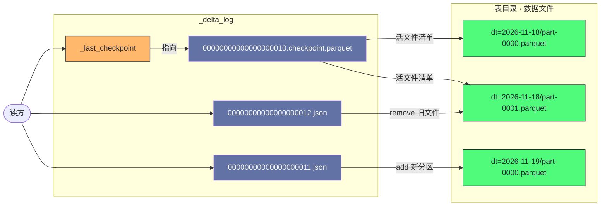
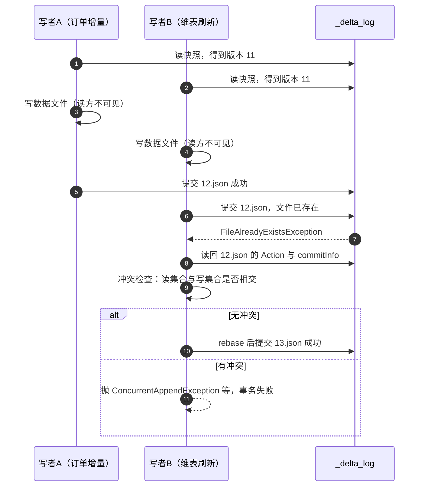
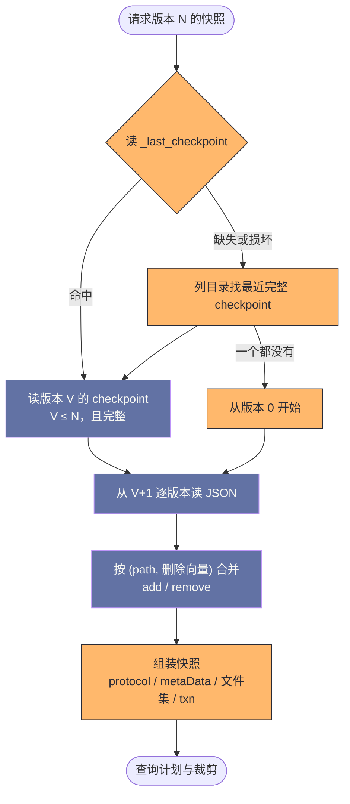
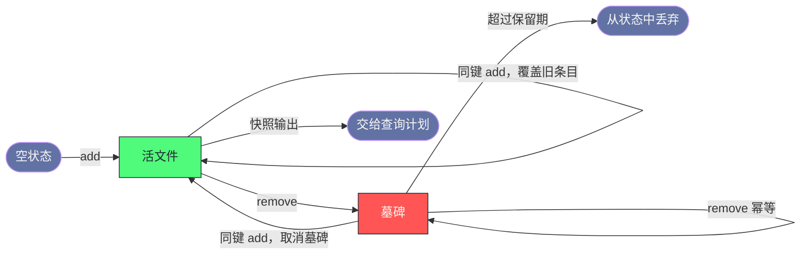
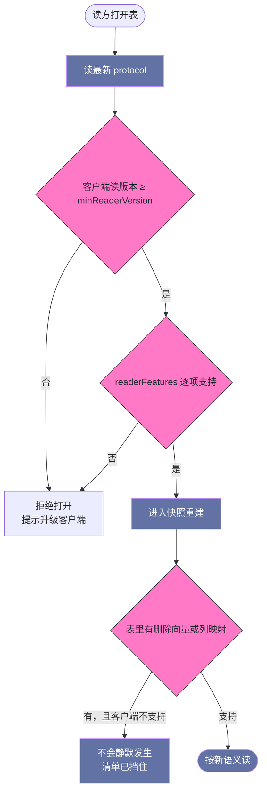

# 02 事务日志 Delta Log：ACID 保证的基石

**摘要：**

一张 Delta 表在对象存储上不过是两种东西：一排不可变的数据文件，和 `_delta_log/` 里一串递增编号的 JSON。前者的名字没有语义，后者却定义了整张表的身份——哪个版本包含哪些文件、schema 长什么样、什么样的读者有资格打开它。本文从物理布局讲到读写协议：先看 `_delta_log` 目录里几类文件的分工，包括提交 JSON、checkpoint、`_last_checkpoint`，以及 `.crc`、sidecar、log compaction 这些容易忽略的辅助物；再逐个拆开 `add`、`remove`、`metaData`、`protocol`、`commitInfo`、`txn`、`cdc`、`domainMetadata` 八种 Action 的字段与用途，重点交代 `add` 里的 `stats`、`partitionValues`、`dataChange` 如何决定查询裁剪与流式增量。然后回答一次提交凭什么原子：它不是加锁，而是往一个没人用过的名字上写一个文件，靠存储的原子原语与名字唯一性把并发写者排成一队，写失败的一方读回对手的提交、做冲突判定、再重试。接着走一遍读路径，把 `_last_checkpoint` → checkpoint → 其后 JSON → 按 `(path, 删除向量)` 重放这条链路算清楚，并算 checkpoint 间隔这笔账：它把读路径从上千次请求压到十次量级，代价是每次 checkpoint 都要重写全部活文件的元数据。最后落在 protocol 的特性协商与故障形态上，解释降级为什么做不到，并发冲突、半写文件、`_last_checkpoint` 失真分别长什么样、怎么判、怎么处置，以及手工删日志、把表当普通 parquet 目录读写会留下什么样的不可逆后果。

---

## 第 1 章 一次提交只留下一个文件

### 1.1 对象存储只肯给三件事

2020 年，Armbrust 等人在 VLDB 上发表的 Delta Lake 论文里，把云对象存储的约束摆在最前面：可用的原语只有 PUT、GET、LIST，没有 rename，没有原子的多文件提交，没有租约，早期 S3 的 LIST 还是最终一致的。要在这种地基上放一张"有事务"的表，手里能打的牌少得可怜——你无法承诺"这一批文件同时可见"，也无法承诺"两个人不会同时写同一个位置"。

Delta 的应对方式，是把"当前状态"从目录结构里抽出来，交给一份只追加的日志：数据文件只是字节，日志才定义哪一版包含哪些字节。于是提交一个新版本的全部工作，收缩成往 `_delta_log/` 里写一个此前不存在的文件。这个动作在 HDFS 上是一次 rename，在 S3 上是一次 PUT，两者都是单文件级别的原子操作；而"此前不存在"这层含义，由文件名里的版本号来保证。

这个思路的代价藏在后面每一章里：日志会无限增长，所以要 checkpoint；日志是唯一真相，所以谁都能改它，也就谁都可能改坏它；单文件原子性只覆盖一个文件，所以并发写者必须先约定一个共同的起点，再靠冲突检测把事情理顺。

### 1.2 目录结构的两个层次

打开一张 Delta 表的目录，看到的是两种性质完全不同的东西。一层是数据文件，Parquet 格式，可能散落在根目录，也可能按 `dt=2026-11-19/` 这样的分区目录摆放。这些文件是不可变的，一旦写出就不再被修改，更新一行数据的做法是写出一个包含新值的新文件，再把旧文件在日志里标记为失效。另一层是 `_delta_log/` 目录，里面是那张表的全部历史：每一次写操作对应一个 JSON 文件，每隔若干版本还会有一次 checkpoint。

两层之间的关系是单向的。数据文件不知道自己在不在表里，只有日志知道；反过来说，日志里记录的每一条 `add` 都必须对应一个真实存在的文件，否则读方会在执行阶段报文件缺失。协议对分区目录的态度也说得很清楚：按 `分区列=值/` 摆放只是沿袭 Hive 的习惯，不是协议要求，实际的分区值必须从日志里读。这条规定在实践里经常被忽略，也经常在"目录看着对、查询结果不对"的现场里被翻出来（见第 9 章）。

### 1.3 一份贯穿全篇的台账

为了让后面的机制有具体的着落，笔者设想一张订单表 `dwd.orders`：按 `dt` 分区，每天约两千万行，落在两百个左右的数据文件里；同一套 ETL 里还有一张维表 `dim.sku`，每天凌晨做一次全量刷新（先 `MERGE` 再 `OPTIMIZE`），刷新之后再跑一轮 `VACUUM`。三个写入者——订单增量作业、维表刷新作业、以及一个周期性的 `OPTIMIZE`——会在午夜前后的一小时内挤在同一批表上。

这张表的日常会长成后面反复引用的形状：订单增量是纯追加，只产生 `add`；维表刷新是 `MERGE`，会产生 `remove` 和 `add`；`OPTIMIZE` 只重排文件，会产生 `dataChange=false` 的 `remove`/`add`。三种写入在日志里留下的痕迹不同，在冲突检测里的命运也不同，这一点在第 4 章会看到具体的区分。

### 1.4 一个比喻：出入库单据与盘点表

把 Delta Log 想成仓库的台账：每发生一笔出入库，就在单据本上补一张单子，单据一旦写下就不许涂改，写错了只能再补一张冲销单；仓库里实际堆着什么，要按单据顺序一笔笔推。checkpoint 则相当于定期做一次盘点，把"截至某张单据时的库存"汇总成一张表，下次查库存从盘点表接着往后推单据即可，不必从第一张单子翻起。

比喻需要两处技术限定。其一，单据本不是一本装订好的书，而是一个目录里的一堆独立文件，任何人都能绕开流程往里塞一张单子，所以"不许改"这件事靠的是纪律而不是锁；其二，盘点表不是库存事实，它只是单据的物化结果，盘点表丢了可以重算，单据丢了才是真的丢了。这两点限定了后文所有故障处置的方向：checkpoint 与 `_last_checkpoint` 属于**可重建的派生数据**，提交 JSON 属于不可重建的源数据。

下图是 `dwd.orders` 在某个版本上的目录形状，左侧是数据文件，右侧是日志目录里的几类文件，箭头表示读方重建快照时实际会走的那条路径。



图里那个橙色的 `_last_checkpoint` 只是一个指针，真正的事实是 checkpoint 与它之后的两个 JSON；把指针删掉，读方仍然能通过列目录找到 checkpoint，只是要多付一次 LIST 的钱。

---

## 第 2 章 物理布局：日志目录里的文件家族

### 2.1 提交文件：二十位零填充的版本号

提交文件的名字是二十位零左填充的十进制版本号加 `.json`，从 `00000000000000000000.json` 开始，每次成功提交加一。零填充不是为了好看，它让字典序与数值序一致：`...009.json` 排在 `...010.json` 之前，于是任何支持"按字典序分页列目录"的存储都能用一次 `LIST` 前缀操作拿到从某个版本开始的连续日志，也能用"从某版本起列目录"把范围收窄。

文件内容是换行分隔的 JSON，一行一个 Action，官方叫法是 Delta file，**一整个文件就是一次原子提交**。这里有一个容易被忽略的协议细节：同一个提交文件里的 Action 不保证按顺序被应用。因此协议规定，同一版本内，同一个 `(path, 删除向量 id)` 组合的 `add` 与 `remove` 各自至多出现一条，`metaData`、`protocol` 各至多一条，同一个 `appId` 的 `txn` 至多一条。这条约束把"一个文件内部的自洽"变成了写方的责任，读方于是可以放心地把一个版本当作无序集合来合并。

版本号还有一层含义是历史水位：`DESCRIBE HISTORY` 里的 version 就是这个数字，Time Travel 的 `VERSION AS OF` 也是它。它不表达时间，只表达顺序，这一点在跨引擎读取时很重要——别的引擎不需要知道提交时刻，只需要知道版本号。

### 2.2 checkpoint：三种命名与两种规格

checkpoint 是日志历史的物化结果，一个 checkpoint 覆盖到某个版本为止的全部有效状态。它的命名有严格的规则，而且"命名"与"规格"是两个正交的维度，混起来看很容易糊涂。

按命名分有三类。经典命名是 `00000000000000000010.checkpoint.parquet`，单个 Parquet 文件；多部分命名是 `00000000000000000010.checkpoint.0000000001.0000000003.parquet`，序号与总数各补足十位，一个 checkpoint 拆成三个文件；UUID 命名是 `00000000000000000010.checkpoint.80a083e8-....parquet`，版本号后跟一个 UUID，可以指向 `_delta_log/_sidecars/` 下的若干 sidecar 文件，也可以是单独的 JSON 文件。

按规格分有两种。V1 规格就是"一个 Parquet 文件装下全部 Action"，每个 Action 在表里对应一个 struct 列（`add`、`remove`、`metaData`、`protocol`、`txn`、`domainMetadata`），缺失的列传 null；V2 规格允许把文件级的 Action 外置到 sidecar，checkpoint 本体只保留元数据与 sidecar 引用，因此它必须带一条 `checkpointMetadata` Action，并且只能用 UUID 命名或经典命名的 Parquet 文件承载。

命名与规格的组合被协议严格限定：V1 规格可以用经典命名与多部分命名，不能用 UUID 命名；V2 规格可以用 UUID 命名与经典命名，不能拆成多部分。这条组合限制的动机很实际——多部分 checkpoint 写不成原子，而 V2 恰恰是为了解决"checkpoint 写不原子"这个问题才出现的（第 6 章展开）。

多部分 checkpoint 已被标记为不推荐使用，原因列在协议里：写方无法在读者使用之前校验内容；两个写方并发写同一版本会互相覆盖，拼出谁都没写过的混合体；无法做跳过统计、无法复用 part；还拖慢目录 LIST。这些缺陷在 V2 里被逐一消掉，所以协议建议新实现直接写 UUID 命名的 V2 checkpoint。

### 2.3 `_last_checkpoint`：一个提示，不是事实

`_last_checkpoint` 是一个很小的 JSON 文件，位于 `_delta_log/` 根下，字段包括 `version`（checkpoint 覆盖的版本）、`size`（checkpoint 里的 Action 条数）、可选的 `parts`（多部分的分片数）、`sizeInBytes`、`numOfAddFiles`、`checkpointSchema`、`tags`，以及可选的 `checksum`（对规范化后的 JSON 求 MD5）。

它的作用是省掉一次全目录扫描：没有它，读方要找到最新的 checkpoint，只能把 `_delta_log/` 整个列一遍，再从结果里挑版本最高且完整的那个；目录里有几万个文件时，这一列本身就是秒级开销。有了它，读方先读这一个小文件，拿到版本号，再去按名字读对应的 checkpoint。

但它**只是提示**。协议没有要求它必须存在、必须最新、必须正确，实现也只是"鼓励"在找到的情况下用校验和验证。这一点在读方代码里体现得很直白：读 `_last_checkpoint` 失败会先重试三次，每次间隔一秒——这是为了躲开"覆盖写不是原子的"这类存储（Azure 上的注释明确提到这个可能）留下的半写文件；三次都失败，就记一条 `delta.lastCheckpoint.read.corruptedJson` 事件，打一行"文件已损坏，将直接搜索 checkpoint 文件"的日志，然后回头去列目录找最近一个完整的 checkpoint。

还有两个细节值得记。其一，`_last_checkpoint` 的版本可能比目标版本还新——比如你要读三天前的版本，而最新 checkpoint 在昨天，这时读方需要放弃它，去找不晚于目标版本的最新 checkpoint。其二，`_last_checkpoint` 指向的 checkpoint 文件可能已经被清理掉或从来没写成功，读方不能假设它一定可读。

### 2.4 文件家族里还有谁

除了提交文件、checkpoint、`_last_checkpoint` 这三样主角，`_delta_log/` 里还会出现若干辅助文件，它们各有各的写入时机与读者。日志压缩文件把一段连续提交按重放规则压成一份聚合结果，读方可以选择读它来替代逐版本读原始提交；sidecar 承载 V2 checkpoint 的文件级 Action；`.crc` 记录每个版本的表大小与条数，用来发现非合规修改；删除向量文件与 CDC 文件分别服务于软删行与变更流；目录托管表的提交会先落在 `_staged_commits/`，外部日志存储的临时文件落在 `.tmp/` 下。

把这些文件按"读方是否需要"排一张表，比按名字记更实用：

| 文件 | 命名 | 是否影响正确性 | 主要读者 | 可重建 |
|---|---|---|---|---|
| 提交 JSON | 二十位版本号 + `.json` | 是，唯一源数据 | 所有读方 | 否 |
| checkpoint（V1/V2） | 版本号 + `.checkpoint.*` | 否，读方可回退更早 checkpoint 或全量重放 | 读方快照重建 | 是 |
| `_last_checkpoint` | 固定名 | 否，缺失时退化为列目录 | 读方 | 是 |
| 版本校验和 `.crc` | 二十位版本号 + `.crc` | 否，仅用于校验 | 检查工具 | 是 |
| 日志压缩文件 | `起.止.compacted.json` | 否，可被原始提交替代 | 读方 | 是 |
| sidecar | `_sidecars/<唯一名>.parquet` | 是，被 V2 checkpoint 引用 | 读方 | 是，需与 checkpoint 一起重建 |
| CDC 文件 | `_change_data/…` | 仅影响改变更流的正确性 | CDF 读方 | 否 |
| 删除向量文件 | `deletion_vector_*.bin` | 是，影响被软删的行 | 读方 | 否 |
| 临时文件 | `.<名>.<uuid>.tmp` 等 | 否，不参与读 | 无 | 是 |

---

## 第 3 章 Action：日志里到底记了什么

### 3.1 八种 Action 的分工

一个提交文件里的每一行都是一个 Action，种类不多但语义分得很细：有的改数据集合，有的改表定义，有的只是旁注。

| Action | 出现时机 | 关键字段 | 读方处理 |
|---|---|---|---|
| `add` | 新增文件，或替换被修改的文件 | `path`、`partitionValues`、`size`、`modificationTime`、`dataChange`、`stats`、`deletionVector`、`baseRowId`、`defaultRowCommitVersion`、`clusteringProvider` | 并入活文件集合，同键旧条目被替换 |
| `remove` | 文件逻辑失效 | `path`、`deletionTimestamp`、`dataChange`、`extendedFileMetadata`、`partitionValues`、`size`、`tags`、`deletionVector` | 移出活文件集合，保留为墓碑 |
| `metaData` | 建表、改 schema、改表属性 | `id`、`name`、`format`、`schemaString`、`partitionColumns`、`configuration`、`createdTime` | 覆盖当前元数据，每版本至多一条 |
| `protocol` | 建表、升级读写协议 | `minReaderVersion`、`minWriterVersion`、`readerFeatures`、`writerFeatures` | 打开表之前先校验，不通过直接拒绝 |
| `commitInfo` | 每次提交（可选） | `timestamp`、`operation`、`operationParameters`、`readVersion`、`isolationLevel`、`isBlindAppend`、`operationMetrics`、`engineInfo` | 重放时忽略，审计与 `DESCRIBE HISTORY` 使用 |
| `txn` | 需要幂等的写入 | `appId`、`version`、`lastUpdated` | 按 `appId` 保留最新一条 |
| `cdc` | 开启变更数据捕获的更新类操作 | `path`、`partitionValues`、`size`、`dataChange`、`tags` | 重放时忽略，改变更流的读方按版本对齐使用 |
| `domainMetadata` | 写入某特性自己的元数据 | `domain`、`configuration`、`removed` | 按 `domain` 覆盖，`removed=true` 视为删除 |

这张表里有一个值得先记住的划分：`add`、`remove`、`metaData`、`protocol`、`txn`、`domainMetadata` 会进入快照状态，`commitInfo` 与 `cdc` 不会。进入快照的 Action 必须能被 checkpoint 承载，不进入的则被明确排除在 checkpoint 之外；这条划分解释了为什么历史审计只能从 JSON 里读（第 6 章）。

### 3.2 `add`：文件进表时的身份信息

`add` 是日志里出现最频繁的 Action，它把一个物理文件登记为表的逻辑文件，字段既描述"在哪"，也描述"里面大概是什么"。

`path` 是相对表根目录的路径，或者一个绝对路径；按协议它是 RFC 2396 的 URI，读取之前需要做百分号解码。这个细节不是学究气：路径里带空格、中文或特殊字符时，日志里存的是编码后的形式，两个写者若一个按解码后的字符串比较、一个按编码后的比较，就会在同一份文件上得出"两个不同的键"，重放时出现同一文件两条 `add` 的怪象。Delta 内部的做法是把路径规范化为 URI 作为键（第 5 章）。

`partitionValues` 是一个字符串到字符串的映射，键是分区列名，值是分区值的序列化结果。它必须从日志读，不能从目录结构推：分区目录只是摆放约定，一个文件完全可能被写在根目录却声明自己属于 `dt=2026-11-19`。映射里值为 `null` 表示该列是空值，这一点写代码时要显式处理，否则 `Option` 与字符串 "null" 混起来会出错。

`size` 与 `modificationTime` 来自文件系统，`size` 在计算表大小、决定是否触发小文件合并时被用到，`modificationTime` 更多是诊断信息。`dataChange` 是一个布尔标记：为 `true` 表示这次提交真的改变了表的数据；为 `false` 表示只是重排了已有数据或补充了统计信息，比如 `OPTIMIZE` 的产物。协议对 `false` 有额外约束——被标记的文件必须已经在表里，或者它包含的记录被同一版本的 `remove` 覆盖。流式消费日志的下游可以据此跳过整条 Action，这在小文件合并频繁的表上能省掉大量无意义的处理。

### 3.3 `stats`：文件级统计与它的三重边界

`stats` 是一个可选的 JSON 字符串，内容分两层：全局统计有 `numRecords`（文件里的记录数）与 `tightBounds`（列统计是否仍然紧），列级统计有 `minValues`、`maxValues`、`nullCount` 三张与 schema 同形的映射。查询优化里的数据跳过（data skipping）完全建立在这三个东西上：规划阶段先按分区值裁掉一批文件，再按谓词与 `minValues`/`maxValues` 比较，把不可能命中的文件从扫描列表里划掉。

它有三重边界，弄混任何一重都会得出错误的裁剪结论。

第一重是收集范围。默认只收集 schema 前 32 个列的统计，这个数字由表属性 `delta.dataSkippingNumIndexedCols` 控制（默认值 32，按 schema 顺序数，嵌套列按叶子列计），也可以用 `delta.dataSkippingStatsColumns` 显式指定一组列，后者优先级更高。分区列不收集列统计，因为分区裁剪已经用 `partitionValues` 做了同样的事，重复收集只会让 checkpoint 变大。表建好之后再改这个属性，已经写出的旧文件不会重新收集统计，于是同一张表里新老文件的统计覆盖范围不同，裁剪效果会随文件批次波动。

第二重是精度。字符串列的统计值会在固定前缀长度处截断，时间戳列截到毫秒；截断保证了"边界是安全的近似"，代价是边界附近会多放进来一些文件。这意味着 `minValues`/`maxValues` 适合用来排除，不适合用来断言——用它算"这个文件的最小订单号是 1000"可以，用它算"这里一定有 1000 这个订单"不行。

第三重是紧致性。删除向量软删掉若干行之后，列统计并没有立即重算，`minValues` 可能比真实最小值还小，`maxValues` 可能比真实最大值还大，这时 `tightBounds` 为 `false`，语义变成"下界与上界"而不是"精确最小最大"。`nullCount` 在宽边界下也只有两个取值有意义：等于物理记录数说明所有有效行都是空，等于零说明所有有效行都非空，中间值不携带信息。

把这三重边界合起来看，`stats` 更像一份"帮助排除的粗略地图"，**它不保证正确性，只影响效率**；但正因为它不参与正确性校验，写坏了也不会有任何报错——查询会安静地少读几个文件，再安静地给出错误结果。这也是为什么统计信息只能由写方在提交时生成，事后没有任何环节会去校验它。

### 3.4 `remove`：墓碑与物理删除之间的七天

`remove` 只做一件事：把某个逻辑文件从当前快照里摘出去。它不删物理文件，`deletionTimestamp` 记录"什么时候摘掉的"，`dataChange` 的语义与 `add` 对称，`extendedFileMetadata` 为真时才会带上 `partitionValues` 与 `size`。

物理删除是另一条线上的事。`VACUUM` 会删掉所有"不再被任何保留版本引用、且删除时间早于保留期"的文件，保留期由 `delta.deletedFileRetentionDuration` 控制，默认一周。这一周是一个刻意留出的窗口：并发跑的读者可能还拿着旧快照在扫文件，滞后的流式查询可能刚要从三天前的版本开始追，Time Travel 也可能随时被人查。窗口内，`remove` 以墓碑形式留在状态里；窗口外，墓碑在 checkpoint 与重放时被丢弃，物理文件由 `VACUUM` 清走。

这里存在一个常被忽略的耦合：`VACUUM` 之后，日志里更早的版本仍然可以读出"文件清单"，但清单指向的物理文件已经没了，查询会报文件不存在。也就是说，`VACUUM` 的保留期实际上定义了 Time Travel 的可用下界，与日志保留期是两回事。把 `VACUUM` 的保留期调到比业务回溯需求还短，是生产事故里很典型的一类配置失误。

checkpoint 里保存的 `remove` 是精简过的墓碑：协议明确规定，checkpoint 里的 `remove` 结构不包含 `stats` 与 `tags`，因为它只在 `VACUUM` 时被用来判断"这个文件什么时候可以被删"，不需要完整的文件描述。

### 3.5 `metaData`：整体覆盖，不是打补丁

`metaData` 每个版本至多一条，出现即整体覆盖之前的元数据，包括表 id、名字、描述、文件格式、schema 字符串、分区列、表属性与创建时间。它不是一个增量补丁，不会出现"这里加一列、那里改一个属性"的合并语义；写方必须把完整的新元数据写进去。

`schemaString` 是 schema 的 JSON 序列化，Delta 自己的类型系统与 Parquet 类型之间有一层映射，字段的 `metadata` 里还会带注释、默认值等列级信息。`id` 是表的身份，它不随目录移动而改变，这是判断"两个路径是不是同一张表"的依据。`partitionColumns` 一旦确定，改动它意味着整张表的数据布局要重写，协议不允许轻率变更，实现层面通常直接拒绝。

schema 演进与数据文件的互动也是在这条 Action 上完成的：加一个可空列只需要写一条新的 `metaData`，已有的数据文件不用动，读方发现文件里缺这一列就补 `null`——协议把这条规则写得很直白，"schema 里有而数据文件里没有的列，读方应当补 null"。删列、改类型这类操作则会碰到更严格的限制，那是 schema 管理的话题，这里只需要记住：`metaData` 的每一次覆盖，都决定了此后所有版本的读方如何解释同一批字节。

### 3.6 `protocol`：两个整数守住的门

`protocol` 只有两个必填整数，加上两份可选清单：`minReaderVersion`、`minWriterVersion`，以及读方特性清单 `readerFeatures`、写方特性清单 `writerFeatures`。前两个整数是门，后两份清单是门上的细则。

它的行为极其简单也极其强硬：读方打开表时先读最新版本的 `protocol`，如果自己的实现版本低于 `minReaderVersion`，直接报错让用户升级客户端，而不是"尽力读一读"。写方同理。当 `minReaderVersion` 为 3 时，读方还必须逐项核对 `readerFeatures`，缺一项就拒绝打开；`readerFeatures` 只在读协议为 3 时存在，`writerFeatures` 只在写协议为 7 时存在，这两条是协议里写死的对应关系。

### 3.7 `commitInfo`：审计记录与提交上下文

`commitInfo` 是唯一一个"内容自由"的 Action：协议允许实现往里塞任意合法 JSON，只对少数场景规定了必填字段。实践中常见的字段包括提交时间戳、用户 id 与用户名、操作类型（`WRITE`、`MERGE`、`UPDATE`、`DELETE`、`OPTIMIZE`、`VACUUM` 等）、操作参数、`readVersion`（本次事务基于哪个版本）、隔离级别、`isBlindAppend`、`operationMetrics`，以及引擎信息。

`readVersion` 与 `isBlindAppend` 是并发控制的两个线索：前者说明这次提交基于哪个快照，后者说明这次提交有没有读过表的数据。纯追加（`isBlindAppend=true`）不需要读表就能算出结果，因此与任何并发提交都不产生数据冲突，冲突检测可以走最快的通道。

还有一条与版本相关的硬约束：启用了提交内时间戳（in-commit-timestamp）特性之后，每次提交都必须带 `commitInfo`，且它必须是提交文件里的第一条 Action，其中的 `inCommitTimestamp` 字段是时间旅行的权威时间。这个特性的出现，是因为文件系统的修改时间在并发提交与目录托管场景下并不可靠——版本顺序不等于时间顺序。

checkpoint 不保留 `commitInfo`，协议把这条写得很明确。因此审计信息的完整寿命等于 JSON 日志的寿命，日志被元数据清理删掉之后，`DESCRIBE HISTORY` 也就看不到那些版本了。这不是缺陷，是设计取舍：审计属于提交属性，不属于表状态。

### 3.8 `txn`：流式写入的幂等锚点

`txn` 记录一个应用自己的进度：`appId` 标识应用，`version` 是应用自定义的进度号，`lastUpdated` 是可选的时间戳。它的用法在协议里写得很清楚，Structured Streaming 的写入分四步——先把待写数据与批号记进预写日志，再查目标表里该 `appId` 的最新 `version`，若已不小于待写批号就跳过，否则乐观写入数据文件，最后把"数据文件 + 新的 `appId`/`version`"放进同一个原子提交。

关键在于最后一步：进度与数据在同一个版本里落盘，要么都成功，要么都不可见。这才是 Delta 对外承诺 exactly-once 的机制基础，而不是靠下游去重。

`lastUpdated` 的用途是清理：`txn` 记录不会永远保留，早于保留阈值的条目在重放时会被过滤掉，否则一张长期运行的流式表会在状态里积累成千上万条过期的进度记录。

### 3.9 `cdc` 与 `domainMetadata`：两个旁支

`cdc` 指向 `_change_data/` 目录下的变更数据文件，这些文件除了业务列还带一个 `_change_type` 列，取值包括 `insert`、`update_preimage`、`update_postimage`、`delete`。它不在表的数据文件集合里，重放时被直接忽略；改变更流的读方会在某个版本里优先读 `cdc` 文件，只有在没有 `cdc` 的版本上，才退化成"`add` 视为插入、`remove` 视为删除"来推导变更——而那种推导对更新操作是丢信息的，因为没有更新前的镜像。这个 Action 需要写方特性 `changeDataFeed`。

`domainMetadata` 承载某个特性自己的键值配置：`domain` 是域名，`configuration` 是字符串载荷，`removed` 为真表示删除该域；两个并发事务若都修改同一个域，视为冲突。它需要写方特性 `domainMetadata`。

这里必须做一次界定：`domainMetadata` 是 OSS 协议里的承载机制，但具体哪些域、各自什么语义，往往由平台产品定义。Databricks 平台上一些托管能力会借助域元数据落盘状态，那些域的含义与生命周期属于平台能力，不是 OSS 协议的一部分；OSS 只规定了"怎么存、怎么合并、怎么冲突"。

### 3.10 一次维表刷新的完整提交

把上面这些拼起来，看一次 `dim.sku` 的 `MERGE` 刷新在日志里长什么样。假设当前版本是 11，刷新改了三行、插入两行，旧数据落在两个文件里，新数据写成一个文件，同时还带着流式进度。

```json
{"commitInfo":{"timestamp":1763568000000,"operation":"MERGE","operationParameters":{"predicate":"s.sku_id = t.sku_id"},"readVersion":11,"isolationLevel":"WriteSerializable","isBlindAppend":false,"operationMetrics":{"numTargetRowsUpdated":"3","numTargetRowsInserted":"2"},"engineInfo":"Apache-Spark/4.0.0 Delta-Lake/4.0.0"}}
{"remove":{"path":"sku/part-00000-3a5f.parquet","deletionTimestamp":1763568000000,"dataChange":true,"extendedFileMetadata":true,"partitionValues":{},"size":8388608}}
{"remove":{"path":"sku/part-00001-7c2e.parquet","deletionTimestamp":1763568000000,"dataChange":true,"extendedFileMetadata":true,"partitionValues":{},"size":7340032}}
{"add":{"path":"sku/part-00000-9b1d.parquet","partitionValues":{},"size":8650752,"modificationTime":1763567995000,"dataChange":true,"stats":"{\"numRecords\":1204,\"minValues\":{\"sku_id\":1},\"maxValues\":{\"sku_id\":1206},\"nullCount\":{\"sku_id\":0}}"}}
{"txn":{"appId":"7f3c9a12-dim-refresh","version":11,"lastUpdated":1763568000000}}
```

五行，两个 `remove`、一个 `add`，加一条审计和一条进度，构成版本 12 的全部内容。`remove` 带着 `extendedFileMetadata` 与尺寸，是为了让 `VACUUM` 不必回头翻更早的日志；`add` 的 `stats` 只覆盖 `sku_id` 这一个被收集统计的列；`commitInfo` 的 `readVersion=11` 说明这次事务基于版本 11 的快照读取，若这期间有人提交了版本 12，冲突检查就会拿这份读取集合去比。行与行的顺序无关紧要，读方先按 `(path, 删除向量)` 建立索引，再统一合并。

---

## 第 4 章 原子性：写一个文件，不做分布式锁

### 4.1 提交收缩成一个动作

一次写操作在提交之前做了很多事：读快照、扫描文件、算出要改哪些行、写出新的 Parquet、算好统计信息。这些事全都发生在"表之外"——新写出的数据文件在目录里躺着，但没有任何日志条目引用它们，读方按快照扫不到，所以它们此刻等同于不存在。真正让这些字节进入表的那一步，只有一个动作：把这一批 Action 写进 `_delta_log/<下一个版本号>.json`。

原子性就落在**这一个动作**的信封上：目标文件要么完整出现，要么完全不出现；它一出现，版本就成立了；它不出现，前面做的所有事都白做，清理交给临时文件与垃圾回收。没有"一部分 Action 生效"这种中间状态，因为读方根本不看半个文件，它只看完整文件里的内容，而文件内容在写入前就已经在内存里组装完整。

这条设计里唯一需要存储配合的性质，是"同名文件只能有一个写者成功"。HDFS 的 rename 在目标存在时失败，天然满足；对象存储的 PUT 不检查存在，需要额外手段；文件系统的 rename 在多数实现里覆盖，需要前置检查加锁。各家 LogStore 的差异全部集中在这一个点上。

### 4.2 各家存储的原子原语

把 Delta 在各存储上的提交写法并排放，能看清"原子性"是怎么被不同实现凑出来的：

| 存储 | 提交写法 | 冲突如何暴露 | 半写是否可见 |
|---|---|---|---|
| HDFS | 先写 `.<文件名>.<uuid>.tmp`，再 `rename` 到正式名 | rename 目标已存在即失败 | 是，临时文件可见但名字不同 |
| 本地文件系统 | 同上，额外加进程内同步 | 先 `exists` 检查再 rename；`RawLocalFileSystem` 的 rename 会覆盖，故需同步 | 是 |
| S3（默认单驱动） | 直接创建对象，写入前做一次 `exists` 检查 | 进程内路径锁 + 检查；跨进程无互斥，靠调用方保证单写者 | 否，多部分上传未完成不可见 |
| S3（外部日志存储） | 写 `.tmp/<文件名>.<uuid>`，在 DynamoDB 条件写成功后再拷贝为正式文件 | DynamoDB 的 `attribute_not_exists` 条件失败即冲突 | 临时文件可见 |
| GCS | 带 generation 前置条件创建对象 | 条件不满足转为"文件已存在"异常 | 否 |
| 目录托管（coordinated commits） | 由目录服务仲裁提交 | 目录服务返回提交结果或冲突 | 由目录实现决定 |

这张表的第四列决定了一件事：当存储允许"半写文件可见"时，读方不能靠"文件存在"判断提交完成，只能靠"文件名恰好是某个版本号"来过滤。HDFS 的临时文件叫 `.<正式名>.<uuid>.tmp`，与二十位版本号的命名模式不匹配，读方按名字枚举时**天然看不见**；S3 的多部分上传在完成前根本不产生可见对象。两者路径不同，效果一致：写失败留下的残骸不会被误认为提交。

### 4.3 名字唯一性如何变成乐观并发

把镜头拉近到两个并发写者。A 和 B 都读了版本 11 的快照，都把数据文件写好，都试图提交版本 12。谁先到，谁赢；后到的那个会撞上"目标已存在"，于是它必须弄清楚自己输在哪，再决定是放弃还是接着干。

下图是一次典型的冲突-重试序列，版本号是这场竞争里唯一的仲裁者。



冲突检查的依据不是"有没有别人写过"，而是"别人的提交是否碰到了我读过或写过的范围"：追加写查并发提交有没有改过自己读过的分区，删除查有没有人删同一个文件，事务标识查同一个 `appId` 是否被并发推进。判定所需的材料全在对方的 `commitInfo` 与 Action 里，这也是 `commitInfo` 必须记 `readVersion` 与操作类型的原因。

判定无冲突之后，事务并不能直接把原来的提交原样重写一遍，它要做一次 rebase：把本次事务的读基准换成最新版本，重新计算要写的 Action。最典型的是纯追加，基准版本变了，但 `add` 的路径与统计都不受影响，rebase 等于只改版本号。有删除向量的更新类操作则可能需要重算位图，这也是协议里"提交文件不能跨尝试复用"的原因——行追踪等特性会让文件级 Action 在 rebase 时被重写。

### 4.4 重试、上限与"提交其实已经落地"

重试次数由两个内部配置控制。`delta.maxCommitAttempts` 的默认值是 10,000,000，这个数字大得离谱，实际含义是**冲突重试不设上限**，因为冲突是正常的并发代价，不该因为运气差就失败；另一个 `delta.maxNonConflictCommitAttempts` 默认 10，管的是网络抖动、超时这类非冲突失败，重试十次还不行就抛出去。

有一类情况需要单独处理：提交其实已经成功，但客户端没收到确认。重试时它会发现目标版本已经存在，实现会在 rebase 阶段识别"上一轮尝试已经落地"，跳过重复提交、只补做收尾动作；这类幂等处理不在协议里，是各家实现自己的工程问题。

### 4.5 半写文件：可见但无用的临时文件

正常路径上不存在"半个提交"。HDFS 的正式文件名在 rename 之后才出现，S3 的对象在 PUT 完成前不可见，GCS 的前置条件保证不会有两个写者同时创建成功。真正会留下的残骸是临时文件：提交写到一半进程被杀，`.<文件名>.<uuid>.tmp` 就留在 `_delta_log/` 里；外部日志存储的 `.tmp/` 目录也可能留下写了一半的暂存。

这些残骸不参与读，但会占空间、会拖慢 LIST。处置的原则很简单：确认没有在途提交之后再删；删掉一个正在写的临时文件会让那个写者失败，虽然不损坏表，但会浪费一次重算。

`_last_checkpoint` 的半写是另一回事。它被覆盖写时若进程中断，读方可能拿到一个截断的 JSON；读方对此的处理是重试三次再回退列目录，已经在第 2 章交代过。这里值得补一句：回退是安全的，因为 checkpoint 文件本身没有半写风险（有临时文件保护），`_last_checkpoint` 只是加速器。

### 4.6 反事实：给提交加一把分布式锁

既然冲突检测与重试这么麻烦，为什么不直接加锁：提交前先抢一把按表名分配的锁，拿到锁的人写日志，写完释放。这个方案在工程上被反复尝试过，失败的原因也很稳定。

租约模型要等持有者失联后租约过期才能放锁，过期时间必须大于一次提交的最长耗时，否则会出现两个写者同时持锁；锁服务本身成了单点，一次抖动就让全集群的写入停摆；跨引擎时 Spark、Trino、Flink 各连各的，任何一方绕开锁，原子性就失效。相比之下，名字唯一性是存储本身提供的原语，任何能写这个目录的引擎都自动受它约束。

代价转移到了别处：每次冲突都要做一次读回与判定，重试可能让一次提交多写几个数据文件，写者必须自觉遵守"不改旧文件"的纪律。这是一次典型的权衡——用存储原语换掉分布式协调，用纪律换掉锁。

---

## 第 5 章 读路径：从 `_last_checkpoint` 到快照

### 5.1 重建快照的五步

读一张表，本质是把"从某个版本开始的所有 Action"折叠成一个状态。有了 checkpoint，这个折叠不需要从版本 0 开始，五步就能走完。

第一步，解析表路径，读 `_last_checkpoint` 拿到最新 checkpoint 的版本与分片数；读不到就退化为列目录。第二步，按版本号与目标版本挑一个可用的 checkpoint——目标版本是最新版本时就是最新 checkpoint，做 Time Travel 时则要挑不晚于目标版本的 checkpoint。第三步，读 checkpoint 的 Parquet，取出其中的 `protocol`、`metaData`、活文件、未过期墓碑、`txn` 与 `domainMetadata`。第四步，从 checkpoint 版本加一开始，逐版本读 JSON，按顺序应用。第五步，把结果组装成快照对象，交给查询计划。

下图把这五步与"没有 checkpoint"的退化路径画在一起，两条路径的差别只在起点。



图中的合并是整条链路唯一的语义环节，其余都是取数与丢数；一旦合并规则错一条，读出来的就是一张"看起来正常"的错表。

### 5.2 重放规则：键、覆盖与墓碑

重放的实现是一张哈希表加几条规则，规则本身不复杂，但每一条都对应一个容易踩的坑。

键不是单纯的 `path`，而是 `(路径, 删除向量唯一 id)` 这个二元组。原因是同一个数据文件可能在不同版本里被不同的删除向量软删过，逻辑文件变了，物理文件没变；若只按 `path` 建键，后一个 `add` 会覆盖前一个的删除向量，软删的行会重新出现。**路径要规范化为 URI**，避免百分号编码差异造成同一个文件两个键。

`add` 的处理是覆盖式写入，同时把同一个键上的墓碑取消——这对应"一个文件删了又被加回来"的场景，状态里最终只能留一条。`remove` 的处理分两种：若表里本来有这个键，它是"取消一次 `add`"，记为墓碑；若本来没有，它是"删除一个更早版本里的文件"，也记为墓碑。墓碑只在保留期内有效，超过阈值的在重放结束时被过滤掉。

`metaData` 与 `protocol` 都是后写覆盖，`txn` 按 `appId` 保留最新，`domainMetadata` 按 `domain` 覆盖或删除，`commitInfo` 与 `cdc` 直接跳过，`checkpointMetadata` 与 `sidecar` 这类只在 checkpoint 里出现的 Action 在重放时也被跳过——它们描述的是"checkpoint 自身"，不是表状态。

下图把这套规则画成状态转移，注意墓碑的分支：它既是 `remove` 的产物，也是下一次裁剪的输入。



### 5.3 checkpoint 的挑选标准

挑选 checkpoint 的规则比"取最新的那个"复杂，因为最新未必可用。

完整性是第一道筛。多部分 checkpoint 的每个分片都必须存在，缺一个就整份作废——协议明确要求读方忽略分片缺失的多部分 checkpoint，因为它写不成原子，半份 checkpoint 是正常会出现的残骸。零字节的 checkpoint 也要丢弃，虽然它技术上是个合法 Parquet 的空壳，读出来会是空快照，这种"合法但错误"的文件比坏文件更危险。

版本上界是第二道筛。做 Time Travel 时必须挑不晚于目标版本的 checkpoint，否则重放会从未来往回走，得到错误的起点。同一版本上可能并存多种格式的 checkpoint（比如两个客户端并发写，一个写了经典命名、一个写了 UUID 命名），协议允许读方任选其一，因为两者的内容等价。

### 5.4 增量快照：没有新 checkpoint 时不重放

一个常被误解的点是"每次读都要重建快照"。实际上 `DeltaLog` 会缓存快照，并在新版本出现时做增量更新：若新版本区间里没有 checkpoint，就在上一次的快照对象上叠加新的提交，把 `add` 并进文件集合、把 `remove` 标记成墓碑，而不是把 checkpoint 之后的 JSON 重读一遍。

这样在两次 checkpoint 之间，一次提交只处理一个 JSON 的几十行 Action，延迟基本恒定；代价是这份增量只在单进程内有效，进程重启、缓存失效或者换个读者，仍要回到完整的五步。因此"增量"是进程内的性能优化，不是协议承诺。

### 5.5 请求数与延迟的量级

把一次冷启动读的请求数算一遍，能直观看到 checkpoint 在买什么。以一张有一千个提交版本、checkpoint 间隔为 10 的表为例（示例推算）：读最新快照需要一次 `_last_checkpoint`、一次 checkpoint 读取（V1 单文件，或 V2 的一个本体加若干 sidecar），加上最多九个 JSON；总请求数在十次上下。若 checkpoint 全部丢失，同样一次读要发一千次 GET，按每次 10 到 30 毫秒计，元数据阶段就要 10 到 30 秒，而且这还只是延迟，并发读方还会把对象存储的请求配额一起打满。两者差两个数量级，这就是 checkpoint 存在的全部理由——它买的不是空间，是**读路径的长度**。

请求数之外还有一个隐性成本：LIST。`_last_checkpoint` 命中时读方不需要列目录，请求数才稳定在十次量级；一旦回退到列目录，即使只列最近一千个版本也要按页翻好几次，成本比 GET 高得多。这也是清理作业必须保证"最老保留版本上有一个 checkpoint"的原因——否则回溯较早版本时会把整个目录翻一遍。

---

## 第 6 章 checkpoint：把历史压成一个文件

### 6.1 这笔账迟早要还

追加日志的代价是线性的：版本每多一个，读方重建快照的请求数就跟着涨，而日志又不能删——它是唯一真相。

checkpoint 的思路是把"历史"换成"状态"：不去记录每一步发生了什么，而是定期把"到这一刻为止的结果"完整写一份。读方从最近一份结果出发，只补看它之后的增量。这个转换的关键在于，checkpoint 的大小正比于当前活文件数，与历史长度无关——一张表写十年、存一百万个文件，checkpoint 也就是一百万条 `add` 的量级。

### 6.2 里面装了什么

checkpoint 的内容由协议规定，不多不少：`protocol`、`metaData`、所有活着的 `add`、尚未过期的 `remove` 墓碑、`txn`、`domainMetadata`；V2 规格下再加 `checkpointMetadata` 与 sidecar 引用。`commitInfo` 与 `cdc` 被明确排除——前者是提交属性，后者不是表数据，两者都不属于"状态"。

格式是 Parquet，每种 Action 占一个 struct 列，缺失的列为 null。文件动作里的统计信息有两种落法：`stats` 存成 JSON 字符串（`delta.checkpoint.writeStatsAsJson` 默认开启），或者存成与 schema 同形的 `stats_parsed`（`delta.checkpoint.writeStatsAsStruct` 默认关闭）；分区表还可以把 `partitionValues_parsed` 写成带类型的结构。这些开关决定的是 checkpoint 的读取方式，写端与读端必须对齐，否则会读到一份"列在但解析不出来"的 checkpoint。

写一份 checkpoint 的工作量，是把当前状态的全部 Action 重新序列化一遍。对活文件数以百万计的表，这是一次数百 MB 级别的批量写（示例推算：每条 `add` 连统计信息约五百字节，一百万个文件约五百 MB），而且发生在提交的关键路径尾部。这就是为什么 checkpoint 的成本不能只看"多写一个文件"。

### 6.3 V2 与 sidecar：把大文件拆开

V1 checkpoint 的问题在大表上暴露得很直接：单文件几十万行，写入要一次性完成，读取要一次性打开，并发写同一版本时还会互相覆盖。V2 规格的解法是把文件动作外置成 sidecar：checkpoint 本体只保留元数据与"引用了哪些 sidecar"，文件级 Action 分散在 `_sidecars/` 下若干个独立 Parquet 里，每个 sidecar 有唯一名字。

好处有三层。命名上，UUID 后缀让并发写者不会互相覆盖，谁写的 checkpoint 都完整；结构上，本体小了，写入与读取的粒度都变细；工程上，sidecar 是纯文件级 Action，写入逻辑比"混合 Action 的大 Parquet"简单。代价是多了一层文件：清理时要保护被引用的 sidecar，读的时候要多开几个文件，而且 sidecar 不能跨 checkpoint 复用——每次仍要重写。

V2 与多部分 checkpoint 互斥，协议直接禁止在启用 V2 特性时写多部分 checkpoint，原因就是后者的那些缺陷（写不成原子、并发混合、目录膨胀）正好是 V2 要解决的问题。为了让不认识 V2 命名的老客户端不至于"读到空表"，协议建议写者在启用 V2 时仍偶尔写一份经典命名的 checkpoint，让老客户端能读到 `protocol` 然后优雅地报版本不兼容。

这里也要标一次口径：V2 checkpoint 是 Delta Lake 3.0 引入的 OSS 协议特性，`delta.checkpointPolicy` 在 OSS 4.0 里默认仍是 `classic`，要显式开启。它不属于 Databricks 平台专属能力，尽管平台上会替你开好。

### 6.4 间隔的取舍

`delta.checkpointInterval` 默认 10，含义是"每积累十个版本尝试写一次"。这个数字同时影响三件事：读方的重放长度、写入的放大倍数、以及清理作业能推进多远。把它调大调小，没有普适答案：

| 场景 | 间隔取向 | 原因 |
|---|---|---|
| 每天几次写入的小表 | 保持默认 10 | checkpoint 只有几 KB，写一次的成本可以忽略，读路径越短越好 |
| 每分钟都有提交的表 | 适当调大 | 每次 checkpoint 都在提交尾部做一次全量序列化，间隔太密会把延迟推高 |
| 百万文件的大表 | 调大，并评估 V2 | 单次 checkpoint 是数百 MB 的写，频率直接决定写放大 |
| 多引擎共享的表 | 保持默认，且不要关 | 其他引擎找 checkpoint 的能力不一，保留经典命名与固定间隔最稳 |

按前面那张表的规模做一次示例推算：一百万个活文件、每条 `add` 五百字节、每天五百次提交。间隔为 10 时，每天写五十次 checkpoint，每次五百 MB，光 checkpoint 就是二十五 GB 的日写入量；把间隔调到 100，日写入量降到 2.5 GB，代价是最坏情况下读方要多重放九十个 JSON——与几百 MB 的写相比，这九十次 GET 通常更便宜。这类算术没有标准答案，但它应该被算过，而不是沿用默认值。

另一个副作用是提交延迟的尾部：checkpoint 写在提交之后，不影响提交结果，但它占用的带宽与元数据操作是实打实的，写入高峰时可能让后面的提交排队。

### 6.5 写失败不等于提交失败

checkpoint 与 `_last_checkpoint` 的写入都包在异常处理里：失败只记一条事件（`delta.checkpoint.sync.error` 或 `delta.lastCheckpoint.write.error`）、打一行 warning，除非运行在测试环境或显式配置了"失败即抛"，否则不向上抛。这个选择是对的——**checkpoint 是派生数据**，让它拖垮一次已经成功的提交，等于用加速器换正确性。

### 6.6 清理与保留

日志与 checkpoint 的删除由元数据清理负责，保留期是 `delta.logRetentionDuration`，默认三十天。清理的算法是：找到一个"不晚于截止时间"的最新提交 `cutoffCommit`，再找不晚于它的最新 checkpoint `cutOffCheckpoint`，保留这个 checkpoint、它对应的那个版本的 JSON、以及它之后的全部提交，删掉更早的一切，包括更早的 checkpoint、`.crc`、压缩文件与 sidecar。

为什么必须保留 `cutOffCheckpoint` 那个版本的 JSON？因为 checkpoint 不带 `commitInfo`，而提交内时间戳、审计等特性需要从 JSON 里读提交属性；只留 checkpoint 会让某些特性在边界上失真。这条细节很少被人注意，却是"清理之后还能不能做 Time Travel"的分界线。

清理的安全性也分方向：删 checkpoint 是安全的，读方会退到更早的 checkpoint 或从头重放，只是变慢；**删提交 JSON 是不可逆的**，被删区间里的版本再也无法重建，Time Travel 会直接报版本不存在。这也是为什么协议要求"保留区间的最老版本上必须有一个 checkpoint"——否则删掉的 JSON 就再也补不回来。

---

## 第 7 章 protocol：特性协商与降级为什么做不到

### 7.1 两个整数，两张清单

`protocol` 的形态朴素得不像一个兼容性机制：两个整数声明"读这张表最少要什么版本的客户端、写这张表最少要什么版本"，两份清单列出"除了版本之外还必须支持哪些特性"。读方打开表时先比对整数，再逐项比对清单，任何一项不满足就拒绝打开。

这套机制是 Delta 3.0 引入的：在那之前只有线性版本号，每加一个特性就抬一次版本，实现要么全支持要么不支持；有了清单，版本号只表达"是否进入特性协商时代"，具体能力由清单逐项声明，不同引擎于是可以只实现自己需要的子集。

### 7.2 版本矩阵

两个版本号的历史要求分开列，每一行继承上一行：

| 读协议 | 额外要求 |
|---|---|
| 1 | 基础读取 |
| 2 | 列映射（column mapping） |
| 3 | 表特性（table features），且写协议必须为 7 |

| 写协议 | 额外要求 |
|---|---|
| 2 | 仅追加表、列不变量（invariants） |
| 3 | `delta.checkpoint.writeStatsAsJson` 与 `writeStatsAsStruct`、`CHECK` 约束 |
| 4 | 变更数据捕获（CDF）、生成列 |
| 5 | 列映射 |
| 6 | 标识列（identity columns） |
| 7 | 表特性 |

读协议到 3、写协议到 7 之后，版本号本身不再携带具体能力，能力全在清单里。看懂这一点，才能理解为什么同样写 `minReaderVersion=3`，两张表对读方的要求可能完全不同。

### 7.3 特性清单的读写不对称

特性分为只约束写方的、与同时约束读写方的两类。把常见的几个列出来，不对称立刻显形：

| 特性名 | 约束方 | 含义 |
|---|---|---|
| `appendOnly` | 写 | 表只允许追加 |
| `invariants` | 写 | 列不变量约束 |
| `changeDataFeed` | 写 | 变更数据文件与 `cdc` |
| `generatedColumns` | 写 | 生成列 |
| `identityColumns` | 写 | 标识列 |
| `columnMapping` | 读 + 写 | 列映射，读者也必须理解物理名 |
| `deletionVectors` | 读 + 写 | 删除向量，读者必须跳过软删行 |
| `timestampNtz` | 读 + 写 | 无时区时间戳语义 |
| `v2Checkpoint` | 读 + 写 | V2 checkpoint 与 sidecar |
| `domainMetadata` | 写 | 域元数据承载 |
| `rowTracking` | 写 | 行级标识与提交版本 |
| `clustering` | 写 | 聚簇表（含 liquid clustering） |

写方特性**只影响怎么写**，读方不看也能读；读写方特性一旦开启，读方不理解就会读出错误数据，而不是报错——列映射里每一列的物理名变了、删除向量里若干行本该消失、无时区时间戳的事件顺序变了。因此这些特性必须同时写进 `readerFeatures`，让不认识它们的客户端在读之前就被挡住。

### 7.4 升级如何发生

开启一个特性时，写方在某个版本里写入新的 `protocol`，把相应特性加进清单；同一个提交里通常还会带 `metaData`（表属性变化）或第一批使用新格式的数据。这个版本之后，表就对所有读方提出了新要求，不满足的实现会在打开时收到"协议不兼容"的错误。

升级的责任落在表的所有者身上，而且是一个跨团队的决定：表一旦升级，Spark、Trino、Flink、Hive 以及各种自研读取器都必须支持新特性，否则从那一刻起它们全部读不了这张表。实践中常见的僵局就在这里——写入方想用删除向量省掉整文件重写，读取方还停在旧连接器上。

### 7.5 降级为什么做不到

"把 `minReaderVersion` 改回 1 不就降级了吗"是一个很自然的想法，但它做不到，原因有三层，一层比一层硬。

第一层是数据已经用新语义写进去了。开启列映射之后，Parquet 文件里的物理列名可能是 `col-<uuid>` 这样的内部名，日志的 `metaData` 里存着映射关系；把读协议改回 1 并删掉映射，旧读者会按逻辑名去找列，找不到就当空值，读出一整表 null 而不是报错。删除向量更直接：数据文件里被软删的行还在，没有删除向量的读者会把它们全部读出来，结果是"删了的数据又出现了"。这类错误不会抛异常，只会安静地给出错结果，比崩溃难查得多。

第二层是协议层面的单向性。`protocol` 只允许写更高的要求，任何"降低"都需要重新走一遍特性检查，而特性的关闭并不是改一个字符串——它要求证明历史里没有该特性的任何痕迹。协议为此定义了受控的降级流程：先把历史数据与日志整理到旧读者可解释的形态，再移除特性；必要时还要截断历史，因为被截断之前的版本里仍然带着新特性的字节。Delta 3.0 的发布说明里有一条"支持协议版本降级"，指的正是这条受控路径，而不是随手改版本号。

第三层是 checkpoint。V2 checkpoint 的 sidecar 引用、按新格式写出的统计结构、以及被重写过的墓碑，都让"旧读者读 checkpoint"不再成立；即使 JSON 日志还兼容，读方从最新 checkpoint 起步时也会失败。要么回退到旧格式的经典 checkpoint，要么接受读不了。

把这三层放在一起看，结论很清楚：降级**不是改版本号，而是重写历史**；它的成本与风险都落在 Time Travel 与数据重写上，所以默认假设应该是**协议只升不降**。



这张图想强调的是那道门必须在读之前生效。Delta 把特性检查放在打开表的第一步，而不是在读数据时逐行检查，因为它要防的正是"安静地读错"。

### 7.6 跨引擎的口径

协议是公共的，实现是分裂的：Spark 连接器最完整，Trino、Flink、Hive 各自维护对协议子集的支持、版本独立演进，Hive 那条路径基本只支持基础读取。Delta Kernel 就是为了减少这种分裂——把协议实现收进一个库，连接器只对接 Kernel 的 API。

这里必须把三类东西分清楚。第一类是 Delta Lake OSS 的协议与 Spark 连接器，本文讨论的都是这一类；第二类是 Databricks 平台上的托管能力，比如目录托管表的提交裁决（`catalogManaged` 协议在 OSS 规范里有描述，但真正提供裁决服务的是 Unity Catalog 这样的平台组件）、Delta Live Tables、Predictive I/O，它们属于商业产品，不是 OSS 协议的一部分；第三类是其他引擎的 Delta 连接器，它们对协议的覆盖程度各不相同。把三者混为一谈，就会得出"Delta 支持 X"或"Delta 不支持 X"这种没有意义的结论。

---

## 第 8 章 故障形态：症状、判据与处置

### 8.1 并发提交失败

并发冲突在日志层面表现为提交被拒，在应用层面表现为一串特定异常。它们的共同点是：事务本身没错，错在它与别人撞了。

| 异常 | 触发场景 |
|---|---|
| `ConcurrentAppendException` | 追加写撞上并发的删除或更新，且落在自己读过的分区里 |
| `ConcurrentDeleteReadException` | 删除撞上并发的读取或重写 |
| `ConcurrentDeleteDeleteException` | 两个事务删同一个文件 |
| `ConcurrentTransactionException` | 同一个 `appId` 的 `txn` 被并发推进 |
| `MetadataChangedException` | 并发修改了 schema 或表属性 |
| `ProtocolChangedException` | 并发升级了协议 |
| `ConcurrentWriteException` | 没有具体冲突提交，但写入失败 |

报错消息里通常带一段 `Conflicting commit: {...}`，把对方版本的 `commitInfo` 原样贴出来，再加上隔离级别的说明与文档链接。排查时先看这段：如果对方是 `OPTIMIZE` 或纯追加，多半可以重试；如果对方改了 schema 或协议，重试也没用，得先处理上游。

### 8.2 半写文件与 `_last_checkpoint` 失真

另一类故障属于"元数据看起来坏了，但表还能读"。典型症状是读表时报 JSON 解析错误，或者读到的 checkpoint 版本指向一个不存在的文件。

判据来自日志：若看到"`_last_checkpoint` 已损坏，将直接搜索 checkpoint 文件"这样的 warning，配合 `delta.lastCheckpoint.read.corruptedJson` 事件，说明读方已经走了回退路径，表本身是可读的，只是慢了一点。若看到的是读 checkpoint 时的文件不存在异常，说明 `_last_checkpoint` 指向的 checkpoint 被清理掉了或从未写成功。

根因通常有三种：覆盖 `_last_checkpoint` 时进程中断（覆盖写不原子），清理作业删掉了 checkpoint 却没更新指针，或者有人手工动过目录。多数情况什么都不用做，读方下次会列目录找到正确的 checkpoint 并重写指针；需要人工介入的只有"checkpoint 真的没了且日志很长"这一种。

### 8.3 checkpoint 落后

还有一类不是错误，是性能退化：读表越来越慢，`DESCRIBE HISTORY` 正常，查询结果正确，但每次冷启动都要重放很多 JSON。判据是比对 `_last_checkpoint` 的版本与最新版本，差距远大于 `delta.checkpointInterval` 就说明 checkpoint 一直没写成；根因可能是每次 checkpoint 都失败（权限、配额、超大文件写入超时），也可能是这个间隔被调得过大，处置是先看失败事件，再决定修权限还是调间隔。

### 8.4 一张处置表

| 症状 | 判据 | 根因 | 处置 |
|---|---|---|---|
| 提交报文件已存在 | 异常类型为冲突类，带 Conflicting commit | 并发写到同版本 | 重试事务；结构性拆分写入 |
| 读表报 JSON 解析失败 | `_lastCheckpoint.read.corruptedJson` 事件 | `_last_checkpoint` 半写 | 等读方自愈；必要时删除指针让其重扫 |
| 读 checkpoint 报文件不存在 | 指针版本高于实际可用 checkpoint | 清理竞态或写失败 | 让下次提交补写；或显式触发 checkpoint |
| 冷启动读极慢 | checkpoint 版本远落后于最新版本 | checkpoint 长期失败或间隔过大 | 查失败事件、修权限、调间隔 |
| 查询结果少了数据 | 目录里有 Parquet 但日志里没有 | 绕过日志写入 | 文件不会被自动收编，需重新写入 |
| Time Travel 到早期版本报文件缺失 | 日志有版本、物理文件已被 `VACUUM` | `VACUUM` 保留期短于回溯需求 | 调大保留期；接受更早版本不可回溯 |

这张表里最需要警惕的是第五行：它看起来像"数据没写进去"，实际是"写进去了但表不认"，两条路径的修复方式完全不同。

---

## 第 9 章 反例：三类不该做的事

### 9.1 手工删 `_delta_log` 里的文件

日志目录看起来只是文件，删起来很容易，但不同文件的可恢复性差别巨大。删 `_last_checkpoint` 完全无害，读方会退化为列目录；删 checkpoint 会变慢，但可以从更早的 checkpoint 或全量重放恢复。

真正不可逆的是删提交 JSON：版本链缺一环就断链，Time Travel 会直接报版本不存在，读者也无法从 checkpoint 之后重建那段历史。

还有一种更隐蔽的删法：删掉 checkpoint 依赖的 sidecar。checkpoint 本体看起来完好，读的时候才发现引用的 sidecar 少了一个，于是整份 checkpoint 作废，读方回退到更早的 checkpoint。这种故障的症状与"checkpoint 缺失"一样，根因却在另一个目录。

### 9.2 把 Delta 表当普通 parquet 目录读写

这一类操作是最常见也最难自查的事故，因为它"能跑"。用 Parquet 接口往表目录里写一批文件，文件确实躺在目录里，但日志里没有对应的 `add`，于是查询看不到它们；反过来用 Parquet 接口读表目录，读到的是全部物理文件，包括已经被 `remove` 但还没被 `VACUUM` 的旧文件，结果里会出现重复与已删除的行。

更麻烦的是这些"野生文件"永远不会被自动收编，也不会被 `VACUUM` 清理——`VACUUM` 只删"日志里标记删除且过期"的文件，不在日志里的文件不在它的视野内。**`FSCK REPAIR TABLE` 也帮不上忙**：它的方向是"日志引用了不存在的文件"，把这些 `add` 从状态里摘掉，而不是把目录里多出来的文件登记进日志。写入绕过日志的另一层代价是约束失效：schema 校验、不变量、行级追踪全部不生效，因为这些东西的实现都在日志与写事务里。

### 9.3 跨引擎写同一张表

读是共享的，写不是。不同引擎各有自己的提交实现与 LogStore 假设，同时写一张表能否正确串行化，取决于它们是否共享同一套提交仲裁。HDFS 上 rename 的原子性让所有引擎天然串行；S3 上默认的单驱动 LogStore **只在单进程内加锁**，跨集群的两个写者各自"检查不存在然后写入"，后写的覆盖先写的，而这种丢失在日志里看不出来，因为被覆盖的版本没留下痕迹。

对此的应对，要么是让写入集中到单一集群（单写者），要么使用外部的提交仲裁：OSS 提供的外部日志存储模块用一个外部数据库做条件写，把"谁先提交"从对象存储挪到一个支持条件写的服务上；Databricks 平台上则是由平台托管的协调服务完成同样的事。这是平台能力与 OSS 能力的一个清晰分界——机制在 OSS 里可以自建，托管与运维在平台侧。

---

## 第 10 章 收束：日志是 WAL，但 WAL 不归数据库管

把 Delta Log 类比成数据库的预写日志（WAL），大体是对的：先写日志再让状态可见，日志顺序即提交顺序，恢复时靠重放日志重建状态。但有一处本质差别，决定了它所有的工程特性——数据库的 WAL 归数据库进程管，应用只能通过事务接口碰它；Delta 的 WAL 就躺在表目录里，任何有存储权限的人都能读写。

回头看本文拆开的几件事，其实都在回答同一个问题：在没有事务的对象存储上，事务语义能从哪来。答案是把原子性交给单文件写入，把隔离性交给版本号竞争与冲突检测，把持久性交给存储，把一致性交给 schema 与裁剪规则的保守性，再把读性能交给 checkpoint。每一处都是拿一样东西换另一样：拿写放大换读路径，拿重试换无锁，拿前向兼容的门换生态的滞后。

真要给一条可执行的结论，那就是：把 `_delta_log` 当成数据库的系统表来对待。它不该被手工编辑，不该被其他写入路径绕过，它的 checkpoint 间隔应该按读路径的长度来设计，而不是照抄默认值。做到这三条，Delta Log 这套看起来过于简单的机制，就足够撑起一张十年不用重建的表。

---

## 参考资料

1. [Delta Lake Protocol Specification](https://github.com/delta-io/delta/blob/master/PROTOCOL.md)：文件类型、Action 结构、checkpoint 规格、协议版本与特性清单的权威定义。
2. Armbrust M. et al. *Delta Lake: High-Performance ACID Table Storage over Cloud Object Stores*. PVLDB 13, 2020. [PDF](https://www.vldb.org/pvldb/vol13/p3411-armbrust.pdf)
3. [DeltaLog.scala](https://github.com/delta-io/delta/blob/master/spark/src/main/scala/org/apache/spark/sql/delta/DeltaLog.scala) 与 [Checkpoints.scala](https://github.com/delta-io/delta/blob/master/spark/src/main/scala/org/apache/spark/sql/delta/Checkpoints.scala)：快照更新、checkpoint 写入与 `_last_checkpoint` 读取的实现。
4. [InMemoryLogReplay.scala](https://github.com/delta-io/delta/blob/master/spark/src/main/scala/org/apache/spark/sql/delta/actions/InMemoryLogReplay.scala)：重放规则与 `(path, 删除向量)` 键的实现。
5. [HDFSLogStore.java](https://github.com/delta-io/delta/blob/master/storage/src/main/java/io/delta/storage/HDFSLogStore.java) 与 [S3DynamoDBLogStore.java](https://github.com/delta-io/delta/blob/master/storage-s3-dynamodb/src/main/java/io/delta/storage/S3DynamoDBLogStore.java)：临时文件加 rename、外部日志存储的条件写。
6. [Delta Lake 3.0.0 发布说明](https://github.com/delta-io/delta/releases/tag/v3.0.0)：表特性、V2 checkpoint、日志压缩的引入版本。
7. [Delta Lake 工具命令文档](https://docs.delta.io/latest/delta-utility.html)：`DESCRIBE HISTORY`、`FSCK REPAIR TABLE` 等命令的行为说明。

---

> [!note] 思考题
> 1. 如果一次提交的 JSON 文件写成功了，但写方进程在写 `commitInfo` 之后、返回之前崩溃，表的状态会怎样？下一次读表时会不会看到"半个提交"？
> 2. checkpoint 每十个版本写一次，意味着一百万个文件的表每次 checkpoint 要重写数百 MB 的元数据。有没有可能让 checkpoint 只写"增量"，再用某种索引把历史拼起来？代价会是什么？
> 3. `_last_checkpoint` 只是一个提示，那为什么还要维护它？如果去掉它，读方的哪一段逻辑会变慢、慢多少？
> 4. 降级要"重写历史"，而重写历史会打断 Time Travel。假设业务确实需要从启用删除向量的表退回旧格式，你会选择截断历史还是保留双份数据？
> 5. 把 Delta 表当普通 parquet 目录写入，产生的文件既不被查询也不被 `VACUUM`。这类"孤儿文件"在生产里应该如何被发现与清理？
