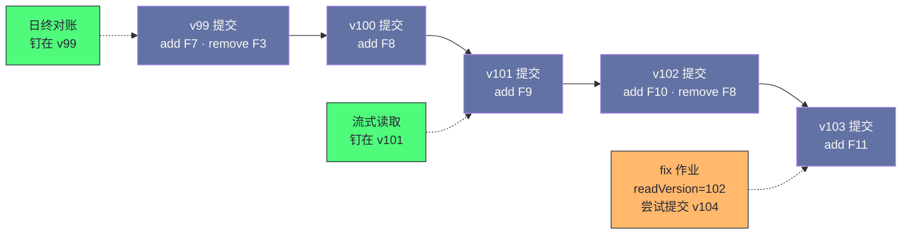
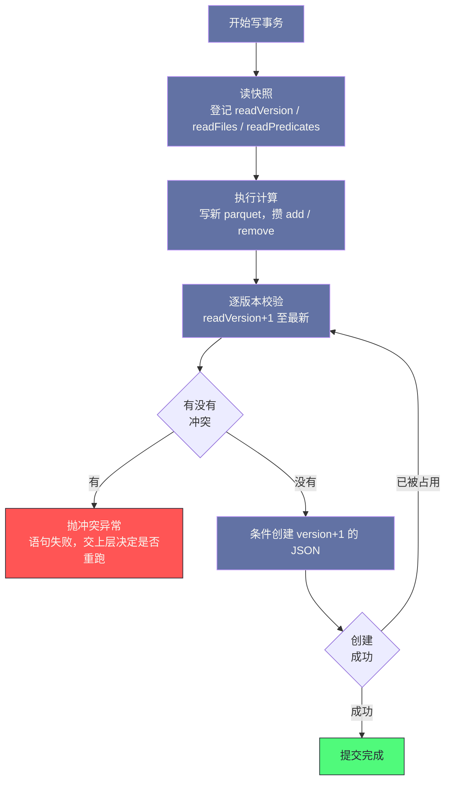
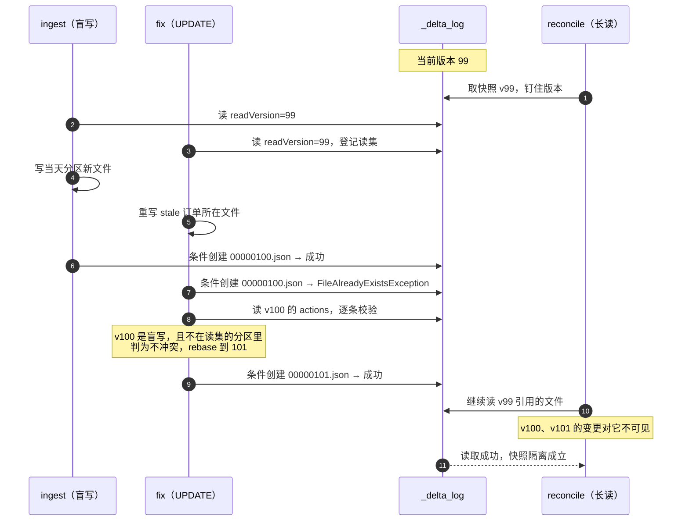
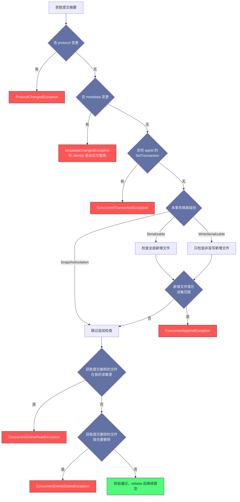
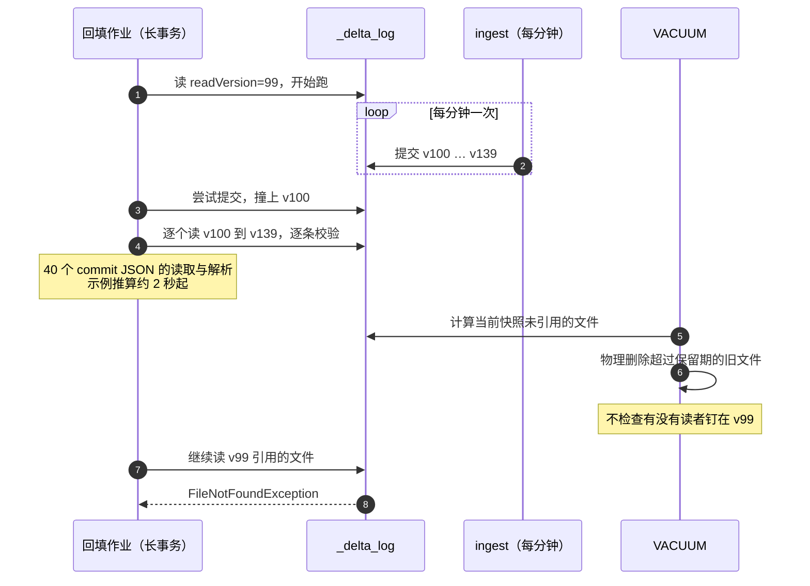

# 03 MVCC 与快照隔离：并发读写的正确性保证

**摘要：**

在对象存储上给一张表加锁，代价高且不可靠，Delta Lake 因此把并发写入交给乐观并发控制（Optimistic Concurrency Control，OCC）：每个写事务各自读一个版本、各自计算、各自落盘，直到提交那一刻才校验这一路上有没有人动过自己读过的文件或分区。本文把这条提交协议拆成五步——读当前版本、做变更、逐版本校验、原子写新 JSON、失败则重试——并给出校验的完整判据：删除与删除、删除与读、追加与读这三组文件级规则，加上 metadata、协议与应用事务三组元数据级规则。在此之上整理冲突矩阵，逐格说明 append 与 append、append 与 DML、update 与 update、OPTIMIZE 与 DML、VACUUM 与 DML、schema 变更各自的结果与异常类，并交代隔离级别在这里的真实作用范围：它只影响“并发追加算不算冲突”这一条，而 Delta Lake OSS 只接受 Serializable，WriteSerializable 是 Databricks 运行时的默认值。文章最后给出冲突的代价、报错原文与“重试会不会成功”的判据，以及四类常见错误用法。文中的配置默认值与异常类名均按 Delta Lake OSS 4.x 源码核对，凡属 Databricks 平台行为的部分单独标注。

**关键词（Keywords）**: OCC, 快照隔离, 冲突检测, 隔离级别, ConcurrentAppendException, LogStore

---

## 第 1 章 版本号是唯一的时间坐标

### 1.1 四个作业撞在同一张订单表上

设想一张 `orders` 表，按 `dt` 分区，一天新增两百来个、每个几十 MB 的 parquet 文件，上面跑着四个作业：`ingest` 每分钟把 Kafka 里的订单追加进去，只写当天分区；`fix` 每小时把状态对不上的订单改正，条件是 `dt = 当天 AND status = 'stale'`；`compact` 每天凌晨 OPTIMIZE，把小文件合并成大文件；`reconcile` 是日终对账，全表读一遍，跑四十分钟。表上还挂着每天一次的 VACUUM。

这四个作业之间会发生什么，取决于它们各自在 `_delta_log` 里留下什么痕迹，以及痕迹之间有没有重叠。要回答这个问题，得先说明白“版本”是什么。

### 1.2 一次提交就是往账本上多一个文件

Delta 表的全部状态记在 `_delta_log` 目录里，文件名形如 `00000000000000000104.json`，二十位零填充，末尾就是版本号。一次提交（commit）就是这样一个文件，内容按行放着若干 Action：`add` 表示某个 parquet 从这一刻起属于这张表，`remove` 表示某个 parquet 从这一刻起不再属于这张表，另有 `metaData`、`protocol`、`commitInfo` 这类不涉及数据文件的条目。

版本号单调递增，且在同一张表内唯一：版本 104 只可能有一个提交成功。这条唯一性是整个并发控制的支点，后文所有“谁能提交、谁该让路”的判断，最终都落在“版本 104 这个文件是谁先创建出来的”上面。把账本想成一摞按页码装订的记录页并不失真，只要记住订书钉并不存在——没有哪只手在阻止两个人同时写第 104 页，只有“该页是否已被占用”这一条检查。

`commitInfo` 里记着这次提交读了哪个版本、用了什么隔离级别、是不是纯追加、动了多少文件，这些不是调试信息，而是事后判断冲突性质的第一手证据：

```json
{"commitInfo":{"timestamp":1763500000000,"operation":"MERGE","readVersion":99,
"isolationLevel":"Serializable","isBlindAppend":false,"operationMetrics":{"numFiles":"212"}}}
{"add":{"path":"part-00017-....parquet","partitionValues":{"dt":"2026-11-19"},"size":104857600,"dataChange":true}}
{"remove":{"path":"part-00003-....parquet","deletionTimestamp":1763500000000,"dataChange":true}}
```

（示例，字段有删减。）`readVersion` 与 `isBlindAppend` 尤其有用：前者说明这个事务看到的表有多旧，后者说明它有没有读过现有数据；纯追加的提交不读任何现有文件，也就没有读集可以被别人破坏。

### 1.3 读者拿到的是一份快照，不是一次目录列举

读一张 Delta 表，Spark 并不会把 `_delta_log` 里的文件从头读一遍。它先找最新的 checkpoint（默认每十次提交一个 parquet 格式的 checkpoint），再从 checkpoint 之后逐个重放 JSON，把 `add` 与 `remove` 对消，得到一个文件集合，这就是某个版本的快照（Snapshot）。

关键在于这份快照是在**作业开始时**定下来的。`spark.read.format("delta").load(...)` 之后，DataFrame 上挂着 `snapshot.version`，后续的 `count()`、`write`、二次聚合都基于同一个版本。哪怕这个 DataFrame 在四十分钟里被反复触发，而这张表在这四十分钟里从版本 99 走到版本 130，它读到的仍然是版本 99 的文件集合。Delta 官方文档把这个行为表述为“读者在作业开始时看到的快照视图保持不变，即使表在作业期间被修改”，落到实现上就是快照对象被固定住，不再向 log 追问最新版本。

所以“读不阻塞写”这件事在 Delta 里不是一项优化开关，而是快照语义的自然结果：读者不去看新版本，写者也不去问读者，两条路径在版本号上分叉，互不干扰。

### 1.4 写者也不覆盖旧文件

反过来，写者为什么不阻塞读者？因为写操作**不改写已有的 parquet**。一次 UPDATE 会生成新的 parquet 文件，然后在提交里写一条 `add` 指向新文件、一条 `remove` 指向旧文件；旧文件在对象存储上原封不动地躺着，直到 VACUUM 把它物理删掉。读者手里拿的版本 99 只引用旧文件，物理字节还在，读得下去。

下图把这条时间轴摊开：版本号从左到右递增，三个读者各自钉在某个版本上，写者只往右端追加新的账页。



图中 `F3` 在 v99 之后已被逻辑删除，但对账作业读的仍是 v99 的快照，所以 `F3` 对它依然有效；而 `fix` 作业从 v102 起读，看不到 v102 自己删掉的 `F8`，也看不到 v103 的 `add F11`。同一个物理文件对不同版本的读者意义不同，冲突判定做的就是把这些“意义”对齐成文件集合。

### 1.5 快照隔离的边界：VACUUM 是唯一会打穿快照的操作

MVCC 的“多版本”并不免费，历史版本要占存储，所以必须有过期机制，而 Delta 把这个机制单独交给 VACUUM，不让它进事务协议。VACUUM 的工作方式是列出当前快照不引用的文件，把超过保留期的物理删除；它不参与 OCC，也不检查有没有人正在读旧版本。

于是快照隔离在这里出现了一个明确的破口：读作业钉在 v99 上跑了两小时，而 VACUUM 在第二十分钟就把 v99 引用、但 v105 已不再引用的文件删了，那么这个读作业会在某个 task 上抛 `java.io.FileNotFoundException`，报错里带的正是那个 parquet 的路径。这不是并发冲突，重跑一次也没用——文件没了。

Delta 用两个默认值把这条破口的宽度限制在“读作业时长”这个量级上：`delta.deletedFileRetentionDuration` 默认一周，含义是逻辑删除之后至少要留一周才允许物理删除；`spark.databricks.delta.retentionDurationCheck.enabled` 默认开启（4.x 源码中为 true），含义是如果 VACUUM 的保留期短于 `deletedFileRetentionDuration`，命令直接拒绝执行，免得把 log 自身依赖的文件删掉。这两项的存在说明一件事：快照隔离的正确性由 OCC 保证，快照的可读性由保留期保证，两者是两个不同的承诺。后文第 8 章还会回到这条边界上。

---

## 第 2 章 提交协议：五步与两个上限

### 2.1 第一步：读当前版本，登记读集

写事务开始时（`OptimisticTransaction` 拿到快照的那一刻），Delta 记录三样东西：`readVersion`（读到哪个版本）、`readFiles`（实际参与了计算的 `AddFile` 集合）、`readPredicates`（下推到文件级的谓词）。如果整个扫描没有任何可下推的谓词，就把 `readWholeTable` 置为真。

这三样东西构成了本事务的“读集”，也是后文冲突判定的输入。请注意读集的粒度：`readPredicates` 记录的是分区级的谓词，`readFiles` 记录的是文件级的实际读取；一个 `WHERE dt = '2026-11-19'` 的 DELETE，读集不是“当天那些行”，而是“当天那个分区里被扫到的那些文件”。判定的最小单位就是**文件与分区**，行级信息在提交校验里根本不存在。

乐观控制的“乐观”就体现在这里：读的时候不加任何锁，不管有没有别人在写同一批文件，先算完再说。

### 2.2 第二步：做变更，数据文件先落盘

Spark 作业照常执行，把新的 parquet 写到表目录下（文件名带随机 UUID，不会撞名），把要提交的 `add`、`remove` 攒在 Driver 的内存里。这一步结束时，表还什么都没变——新文件是孤儿文件，旧文件仍在账上，任何人来读表都读不到这批新数据的半个字节。

这是理解后面所有失败形态的前提：一次冲突失败之后，那批已经写下去的 parquet 就是纯粹的空间浪费，需要靠后续的 VACUUM 清理。冲突的成本不止是 CPU，还有已经落盘又被判无效的文件。

### 2.3 第三步：冲突校验，逐版本比对

提交前，事务要知道从 `readVersion` 到现在，有没有人提交过东西。做法是从 `readVersion + 1` 开始，把 `_delta_log` 里新增的每个 commit JSON 逐个读出来，解析成一个“获胜提交摘要”（`WinningCommitSummary`），里面装着那个提交的 `add` 集合、`remove` 集合、metadata 变更、协议变更和应用事务记录，然后交给冲突检查器逐条比对。

比对通过，事务就把自己的 actions 挂到下一个可用版本上（rebase），继续尝试提交；比对不通过，抛异常，本次事务作废。

有一个细节容易被忽略：校验是**逐个版本**做的，不是只看最新版本。一个事务读了 v99，提交时表已经在 v110，它要对 v100 到 v110 这十一个提交各做一次校验；任何一个提交判为冲突，事务立即失败。这解释了为什么长时间运行的作业在高峰期提交特别容易失败——不是最新那个提交跟它有问题，而是它读完之后这一路上只要有一个人动过它的读集就够了。

### 2.4 第四步：原子写新 JSON

这一步是整条协议里唯一依赖存储系统的地方：把 actions 序列化成 JSON，写成一个“只在文件不存在时才创建”的对象。

Delta 把这层能力抽象成 LogStore，并在接口文档里写死了三条契约：写入的对象必须原子可见（不能出现半截文件）；同一个目标位置只能有一个写者创建成功（互斥）；一旦目录里出现某个文件，之后所有列举都必须看到它（一致列举）。三条契约听起来平淡，但对象存储原生只保证了“最终一致”和“后写覆盖先写”，所以每种存储都要用自己的办法去模拟“文件不存在才创建”：

| 存储 | LogStore 实现 | 原子提交靠什么 | 冲突时的表现 |
|---|---|---|---|
| HDFS | `HDFSLogStore` | 写临时文件后 `FileContext.rename`，`overwrite=false` 时目标存在即失败 | `FileAlreadyExistsException` |
| Azure ADLS | `AzureLogStore` | `overwrite=false` 时走原子 rename，目标存在则 rename 失败 | `FileAlreadyExistsException` |
| GCS | `GCSLogStore` | `fs.create(overwrite=false)` 由 GCS 连接器转成对象代际前置条件，代际不匹配返回 412 | 412 转成 `FileAlreadyExistsException` |
| S3（单 Driver） | `S3SingleDriverLogStore` | 进程内锁 + 先查后写，名字里的 single driver 就是它的能力边界 | 只能保证单 Driver 下互斥 |
| S3（多 Driver） | `delta-storage-s3-dynamodb` | 提交前向 DynamoDB 做条件写，用外部协调服务仲裁版本号 | 条件写失败 → 冲突 |
| S3（条件写，未发布） | `io.delta.storage.S3LogStore` | 借 S3A 的 `If-None-Match: *` 条件创建，配合 user metadata 里的写入 UUID 回收归属 | 冲突 → `FileAlreadyExistsException`，结果不明 → `S3UnknownWriteOutcomeException` |

表里最后一行需要单独说明。master 分支（`version.sbt` 标的是 4.5.0-SNAPSHOT）中新增了一个原生 S3 LogStore，它的设计要点记在仓库的 `storage/S3_NATIVE_PUT_IF_ABSENT.md` 里：要求 Hadoop S3A 3.4.2 及以上、开启 `fs.s3a.create.conditional.enabled`（对应 HADOOP-19256），每次非覆盖写都生成一个 UUID 写进对象元数据，close 抛错时靠这个 UUID 判断“到底提交成功没有”，判不出来就抛 `S3UnknownWriteOutcomeException` 交给上层。按 tag 核对，这个实现没有随 4.4.1 发布，属于已进主干、未进发布线的能力。

三条契约里，第二条决定协议能否成立，第三条决定读者能否把版本序列读连贯。第三条尤其容易在对象存储上悄悄破功：读者靠列举 `_delta_log` 判断“下一个该读哪个版本”，一旦提交过的文件在之后的列举里时有时无，版本序列就出现一个洞，重放出来的快照是错的。也正因为如此，Delta 对日志文件与数据文件的原子性要求完全不同——数据文件不需要原子可见，它只是字节，提交之前没有任何快照引用它，写坏了最多留下一批孤儿文件；日志文件必须原子可见，因为它是账本，半截的 JSON 会让重放停在半行上，而“半行”在 JSON 行格式里无法被识别为错误，只会被当作解析失败或者更糟的静默跳过。

顺带说清一件常被引用错的事：S3 的 PUT 在很长一段时间里不是条件写，“文件不存在才创建”在 S3 上要靠 DynamoDB 之类的外部协调来补，这也是为什么在 S3 上创建 Delta 表时，官方文档会专门要求配置多 Driver 方案。把这一步说成“用 S3 的原子 PUT 实现锁”并不准确，准确的说法是“用各种存储各自的条件创建语义，模拟出一个只允许一个人创建的版本号槽位”。

### 2.5 第五步：失败则重试，两个上限

条件创建失败（`FileAlreadyExistsException`）意味着版本号被别人抢了，此时事务不重跑计算，而是回到第 2.3 步做一次 rebase：把中间新增的提交读进来逐条校验，校验通过就把自己的提交挪到再下一个版本号，再试一次创建。

这个循环的上限由两个配置控制，它们都在 `DeltaSQLConf` 里，并且都带 `spark.databricks.delta.` 前缀：

| 配置 | 默认值 | 管什么 |
|---|---|---|
| `spark.databricks.delta.maxCommitAttempts` | 10000000 | 版本竞争（`FileAlreadyExistsException`）导致的重试次数上限 |
| `spark.databricks.delta.maxNonConflictCommitAttempts` | 10 | 与冲突无关的可重试失败（协调提交返回的可重试错误）上限 |

一千万这个数字实际上等于**不设上限**。它反映的是一个工程判断：版本竞争本身不是错误，只要每次 rebase 都能通过校验，多试几次总能提交成功；真正该设上限的是另一类失败——提交协议本身出了可重试的故障（例如协调提交服务超时），那种情况下无限重试会变成打不完的重试风暴，所以给十次。两个上限的语义不同，混用会得出错误结论：看到 `maxCommitAttempts` 很大就以为“Delta 不会因冲突失败”，恰恰相反，冲突失败根本不靠这个上限拦截，而是靠校验直接抛异常。

这里必须纠正一个流传很广的配置名。笔者在 OSS 源码里逐个检索过 `spark.databricks.delta.retryWriteConflict` 一类写法，`DeltaSQLConf` 与整个 `spark/src/main` 目录下都没有这个键；与之相关的真实开关只有上面两个，外加 `spark.databricks.delta.commit.idempotencyCheck.enabled`（默认关闭，用于在提交响应丢失、重试时发现“其实上一次已经提交成功”）。要“调整重试行为”，先确认要调的是版本竞争重试还是非冲突重试，名字找错等于没调。

### 2.6 五步之外的第六件事：失败之后谁来重算

到 2.5 为止，Delta 层的重试都是“搬版本号”，从不重新执行用户的计算逻辑。真正需要重算的场景发生在协议之外：校验判定冲突后抛出异常，整个 SQL 语句失败，失败向上冒泡到调用方——调用方可能是调度系统、Structured Streaming 的 micro-batch、Delta Live Tables 的管道，也可能是人。是否重跑、重跑几次、重跑的结果是否可接受，都是上层的决定。

把这两层混为一谈是很多误判的源头。下面这张表把五步的产物与失败形态并排列出，可以看清每一层各自负责什么：

| 步骤 | 动作 | 产物 | 失败时的形态 |
|---|---|---|---|
| 1 读版本 | 打开快照，登记读集 | `readVersion`、`readFiles`、`readPredicates` | 快照文件已被 VACUUM 删除，读阶段就失败 |
| 2 做变更 | 跑作业写新 parquet，攒 actions | 新数据文件 + 内存中的 `add`/`remove` | Task 失败，事务根本没进提交 |
| 3 校验 | 逐版本比对获胜提交 | 通过则 rebase 到新版本 | `ConcurrentAppendException` 等，事务作废 |
| 4 原子写 | LogStore 条件创建版本文件 | 新版本落账，提交完成 | `FileAlreadyExistsException`，回到第 3 步 |
| 5 重试 | 重新校验并再创建 | 提交成功，或耗尽上限 | `maxCommitRetriesExceededException` |

下图把这条循环画出来，注意图里两条失败路径：创建失败时回到校验节点重来一遍，校验失败时直接走到语句失败。



### 2.7 一次完整的版本竞争时序

把镜头收窄到两个作业上：`ingest` 与 `fix` 同时在 `readVersion=99` 启动。`ingest` 是纯追加，算得快，先抢到版本 100；`fix` 慢一步，来创建版本 100 时撞上 `FileAlreadyExistsException`，于是回退到校验，发现版本 100 是一个盲写追加，且落在自己读的分区之外，判为不冲突，rebase 到版本 101 提交成功。



时序图里有两个动作值得记住：`fix` 撞的是版本 100 这个文件名，而不是“锁”；`fix` 通过校验后提交到 101，而不是把 100 覆盖掉。整个过程中没有任何等待，也没有任何一方需要知道对方的存在——这就是“无锁”在两个写者之间看起来的样子。

---

## 第 3 章 冲突判定的四条规则

### 3.1 判定需要的信息

冲突检查器（`ConflictChecker`）不吃整张表，它只吃两包结构化的信息：一包是本事务的读集与写集，叫 `CurrentTransactionInfo`；另一包是被比较的那个提交的摘要，叫 `WinningCommitSummary`。两包信息的字段决定了判定能做到多细：

| 侧 | 字段 | 含义 |
|---|---|---|
| 本事务 | `readFiles` | 实际参与计算的 `AddFile` 集合 |
| 本事务 | `readPredicates` | 下推到文件级的分区谓词 |
| 本事务 | `readWholeTable` | 是否无谓词全表扫描 |
| 本事务 | `readAppIds` | 读到过的应用事务（流式 checkpoint 的 appId） |
| 本事务 | `actions` | 待提交的 `add`/`remove`/`metadata`/`protocol` |
| 获胜提交 | `addedFiles` / `removedFiles` | 那次提交增删的文件 |
| 获胜提交 | `isBlindAppend` | 那次提交是不是纯追加 |
| 获胜提交 | `metadataUpdates` / `protocol` | 表结构与协议变更 |
| 获胜提交 | `appLevelTransactions` | 那次提交写下的应用事务记录 |

判定逻辑分两层：**元数据层先跑**（协议兼容、metadata 冲突、应用事务依赖），文件层后跑（追加、删除-读、删除-删除）。这个顺序决定了异常类的“优先级”——如果两个事务既改了 schema 又动了同一批文件，报出来的是 `MetadataChangedException`，因为它在前面。

### 3.2 规则一：两个事务删了同一个文件

第一条规则最直白：本事务要 `remove` 的文件，与获胜提交 `remove` 的文件有交集，就是冲突，抛 `ConcurrentDeleteDeleteException`。

这条规则不受隔离级别影响，也不看这个文件有没有被读过。典型的触发场景是两个 OPTIMIZE 撞在同一批小文件上：它们各自把同一批文件登记为“待删除”，先提交的那个成功，后提交的那个在比对时发现“我要删的 F17 已经被它删了”，直接失败。

为什么不能宽容一点，比如“既然它已经删了，我跳过这条 remove 就好了”？因为 `remove` 与 `add` 是配套的：OPTIMIZE 会同时在同一个提交里 `remove` 小文件、`add` 合并后的大文件，跳过 `remove` 会让账本出现“旧小文件仍在表里”的错误状态，读者会读到重复数据。删两次的语义无法靠“少删一次”修补，只能整体重来，这是这条规则不给余地的原因。

### 3.3 规则二：别人删了我读过的文件

第二条：本事务读过的文件，被获胜提交 `remove` 了，抛 `ConcurrentDeleteReadException`。此外还有一条更粗的判定：如果本事务是 `readWholeTable`，那么获胜提交只要 `remove` 了任何文件，就算冲突——因为“全表读”意味着“所有文件都在读集里”，逐一比对文件列表没有意义。

读集用的仍然是**文件粒度**。`fix` 作业的 UPDATE 只读了当天分区里的四十个文件，`compact` 把其中二十个合并成大文件，`fix` 就会在提交时撞上 `ConcurrentDeleteReadException`，尽管它要改的那几行数据可能恰好落在没被合并的那二十个文件里。

这条规则同样不受隔离级别影响。它守的是“读到的数据在提交时必须还是那份数据”这个基本假设：如果读过的文件已经被换掉，本事务基于旧文件算出来的 `remove`/`add` 就失去意义，继续提交会让表出现“旧内容被重新写回”的错误。

### 3.4 规则三：别人往我读过的范围里追加了数据

第三条是最容易误解的一条：获胜提交 `add` 了文件，而这些文件落在本事务读过的分区（或全表）范围内，就判冲突，抛 `ConcurrentAppendException`。

它的判定比前两条复杂，因为要先决定“哪些新增文件参与检查”，而这个决定正是隔离级别的全部作用所在。源码里的分支写得很清楚：

- 隔离级别为 `WriteSerializable` 且本事务没有改 metadata 时，只把获胜提交的**非盲写**新增文件纳入检查，盲写追加直接放过；
- 隔离级别为 `Serializable`（或 `WriteSerializable` 但本事务改了 metadata）时，盲写新增文件也纳入检查；
- 隔离级别为 `SnapshotIsolation` 时，一律不查。

换句话说，`ingest` 那种每分钟一批的盲写，会不会让并发的 `fix` 失败，取决于 `fix` 用的是哪一级隔离。Serializable 下会失败，WriteSerializable 下放过。这一点在第 5 章展开，这里先记住判定粒度：追加检查看的是分区谓词，不是行；只要新文件落在被读的分区里，哪怕里面一行都不满足 `fix` 的 WHERE 条件，也算冲突。

### 3.5 规则四：表结构、协议与应用事务

文件之外还有三类元数据级冲突。

metadata 变更（`ALTER TABLE` 加列、改属性、改分区）会让并发事务收到 `MetadataChangedException`。这一条的执行顺序很靠前，而且相当严格：只要获胜提交里有 metadata action，几乎一律失败，例外只有两类——获胜提交只是更新 identity 列的高水位（且本事务自己没改 metadata），或者获胜提交只是开启了行跟踪（row tracking）的标记。

协议变更（升级 `minReaderVersion` / `minWriterVersion`、启用新表特性）会让并发事务收到 `ProtocolChangedException`；如果获胜提交是降级（移除特性），则一律失败，因为降级之后旧写者的语义已经无法保证。

应用事务（`SetTransaction`）的冲突判定用于流式幂等：本事务读到过某个 appId 的版本号，而获胜提交更新了同一个 appId 的记录，抛 `ConcurrentTransactionException`。它的典型场景不是“写得太快”，而是“同一个 checkpoint 被两个实例同时跑”——两个实例都认为自己在推进同一个 appId，先到的那个把记录写进去，后到的那个发现记录已被改，只能失败。

### 3.6 判定的顺序与“先便宜后昂贵”

`checkConflicts` 的调用顺序是：协议兼容 → metadata → domain metadata → 应用事务 → 行跟踪相关调和 → 追加 → 删除-读 → 删除-删除 → 时间戳排序调和。这个顺序不是随手排的，它遵循两条原则：先做便宜的判断（读一个 commitInfo 里的 `operation` 字段就能判的，不必展开文件列表），先做影响面大的判断（metadata 一变，后面所有文件级判断的语义都要重新解释）。

对排障的意义在于：报出来的异常类是最先失败的那一条，而不是“最严重”的那一条；**最先失败**未必是业务上最要紧的那一步，需要顺着判定顺序往回推，才能找到真正被破坏的读集。一个 MERGE 同时撞上并发 OPTIMIZE 与并发 schema 变更，看到的会是 `MetadataChangedException`；此时若只盯着“文件冲突”去改分区，方向就错了。

下图把判定顺序与分支画成决策树，注意追加检查上有隔离级别这唯一一处开关。



---

## 第 4 章 冲突矩阵

### 4.1 一张按“已提交对本事务”组织的矩阵

把两两组合排开，可以看到冲突判定的真实形状。行是已经提交成功的那个事务（获胜方），列是正在提交的本事务，格子给的是判定与异常类。三列分开写，是因为同样是“本事务”，INSERT、DML 与 OPTIMIZE 的读集大小差得远，结果也就完全不同。

| 获胜方（已提交） | 本事务 INSERT（盲写） | 本事务 UPDATE / DELETE / MERGE | 本事务 OPTIMIZE |
|---|---|---|---|
| INSERT，落在读集之外 | 不冲突 | 不冲突 | 不冲突 |
| INSERT，落在读集分区内 | 不冲突 | Serializable 冲突，WriteSerializable 放过 | 不冲突 |
| DML，重写了本事务读过的文件 | 不冲突 | 冲突（删除-读，可能先撞追加） | 冲突（删除-读） |
| DML，重写本事务未读的文件 | 不冲突 | 视文件交集，可能翻成追加冲突 | 视文件交集 |
| OPTIMIZE，同分区重写 | 不冲突 | 追加冲突或删除-读冲突 | 删除-删除冲突 |
| ALTER TABLE / schema 变更 | 冲突（metadata） | 冲突（metadata） | 冲突（metadata） |
| VACUUM START / END 空提交 | 不冲突 | 不冲突 | 不冲突 |
| 同 checkpoint 的流式提交 | 冲突（应用事务） | 冲突（应用事务） | 冲突（应用事务） |

这张表和官方文档那张 3×3 的“能否冲突”表格结论一致，只是把“可能冲突”展开成了具体的异常类。看表时先确认两件事：本事务有没有读集，获胜提交有没有删除或 metadata 变更。没有读集的盲写几乎免疫所有文件级冲突，却仍会栽在 metadata 上；有读集的事务则要小心自己的读集有多宽。

### 4.2 盲写与盲写：永远不冲突

两个 `INSERT` 并发，结论是确定的：不冲突，任何隔离级别下都一样。原因不在于“双方都很客气”，而在于冲突判定的输入为空——盲写的 `readPredicates` 是空集、`readWholeTable` 是假，追加检查找不到任何可以匹配的分区，删除检查也没有文件可以比对。

这条性质值得写在架构设计的第一页上：把一个高频写入管道做成纯追加，等于让它**从并发控制里退出**。`ingest` 每分钟一批、每批几十个文件，一年下来也不会因为并发而失败一次，代价是下游要自己处理重复与去重。

### 4.3 盲写与 DML：取决于 DML 的读集与隔离级别

反向看，一个正在提交的 DML 遇到并发盲写，结论就不确定了。`fix` 的 UPDATE 读了当天分区，`ingest` 在这期间往当天分区追加了一批订单：在 OSS 的 Serializable 下，`fix` 会收到 `ConcurrentAppendException`；在 Databricks 运行时的 WriteSerializable 下，这批盲写被放过，`fix` 提交成功，但它删改的是“不含新订单”的那份数据。

后一种结果常被当成 bug 报告：明明两个作业在不同文件上工作，为什么我删掉的行数比预期少。它在 WriteSerializable 的语义里是合法结果，历史顺序看上去是“DELETE 先执行、INSERT 后执行”，而实际上 INSERT 先提交。第 5 章会说明这正是两种隔离级别的分野。

### 4.4 update 与 update：读集重叠即冲突

两个 UPDATE 并发，判定有两个入口。第一是追加检查：对方重写后的新文件落在本事务读过的分区里，就撞 `ConcurrentAppendException`，这与两批文件是否重叠无关，只要两边读了同一个分区就成立。第二是删除检查：对方删掉的文件正好在本事务读集里，撞 `ConcurrentDeleteReadException`；两边删了同一个文件，撞 `ConcurrentDeleteDeleteException`。

所以同分区并发 UPDATE 实际上很难并存，真正能并存的只有两种情况：分区不同，或者一边被降级成了不动数据的提交。有一个容易踩的细节：即使两次 UPDATE 改的是完全不同的行，只要落在同一个 parquet 文件里——或者哪怕只是同一个分区——就足够触发冲突，因为 Delta 的更新单位是文件（Deletion Vector 引入后是“文件 + 位图”，仍然以文件为载体），冲突判定也停在文件与分区这一层。把行级更新当成行级并发保护，是最常见的一类误判。

### 4.5 OPTIMIZE 与 DML：dataChange=false 不等于不冲突

OPTIMIZE 提交的 `add` 带 `dataChange=false`，这个标记的含义是“这些文件的变化不改变表的数据内容”，下游的增量消费（CDF）据此跳过它们。但它不影响冲突判定：OPTIMIZE 照样 `remove` 旧文件、`add` 新文件，这两个动作都会被人撞上。

它对 DML 的两种撞法各有不同的异常：如果 DML 读过被合并的文件，是 `ConcurrentDeleteReadException`；如果 DML 的读集分区里出现了 OPTIMIZE 新写的大文件，而 DML 的追加检查先跑，会先撞 `ConcurrentAppendException`。两个 OPTIMIZE 相撞则是 `ConcurrentDeleteDeleteException`，与官方文档里“两个 compaction 重写同一批文件”的描述一致。

反过来，OPTIMIZE 自己提交时几乎不会因为别人的追加而失败，因为它在 `canDowngradeToSnapshotIsolation` 里被降级了：提交的 actions 全部 `dataChange=false`、没有一个会改变数据的 `FileAction`，于是隔离级别自动降到 `SnapshotIsolation`，追加检查整段跳过。这是一处值得记住的非对称：优化类操作对自己的宽容度最高，对别人的影响却不小。

### 4.6 VACUUM 与 DML：不在协议内的那个

VACUUM 在历史里会留下两条空提交，operation 分别是 `VACUUM START` 与 `VACUUM END`，源码里的注释说得很直白：这两条提交只是把 VACUUM 记进表历史。它们不带文件动作，所以与任何 DML 都不构成冲突判定上的问题；碰到并发 metadata 变更时，VACUUM 会用 `spark.databricks.delta.vacuum.commit.maxRetries`（默认 3）重开事务重试。

真正的风险不在提交，而在删除本身：VACUUM 列出当前快照不引用的文件并物理删除，这个过程完全不经过 OCC。`fix` 在 v99 上读了四十分钟，VACUUM 在这期间把 v99 引用、当前版本不再引用的文件删了，`fix` 的 task 就会抛 `FileNotFoundException`。这是唯一一类“OCC 管不到、但会以并发问题的面目出现”的故障，也是第 8 章反例的素材。

### 4.7 schema 变更：最重的一次提交

`ALTER TABLE ... ADD COLUMNS` 之类的操作会写一条 `metaData` action，它对并发写者的影响是全局的：不管对方是盲写还是 DML，只要自己的提交晚于这次 schema 变更，就会收到 `MetadataChangedException`。源码里保留了极少数豁免（identity 高水位、行跟踪开关），其余一律失败。

这条规则在白天会非常刺眼：一个高频追加的流作业，遇上一次加列，micro-batch 就要失败重试；如果流的重试策略是“指数退避 + 有限次数”，加列就可能把流打断。可行做法是把 schema 变更安排在写入低峰，或者先用 `delta.columnMapping.mode` 之类的机制把加列成本与写入解耦（这属于 Schema Evolution 的话题，本文不展开）。

### 4.8 矩阵的读法：让读写集在分区上错开

把矩阵读完，能得到一条设计准则：冲突不取决于操作类型，取决于读写集有没有重叠。官方文档给的办法也是如此——按操作条件里最常用的列分区，让两组文件集合不相交。`fix` 的更新条件带 `dt`，`ingest` 只写当天分区，`compact` 按分区跑，三个作业的文件集合天然错开，冲突就会降到接近零。

反过来说，分区键选错会让这个矩阵失去作用：如果表按 `user_id` 哈希分区，而 `fix` 的条件是 `status = 'stale'`，那么它要扫全表所有分区，读集成全表，矩阵里每一格都会变成“冲突”。

---

## 第 5 章 隔离级别：OSS 只有一个可选值

### 5.1 三个级别在源码里的位置

`isolationLevels.scala` 定义了三个级别，注释把它们的强弱写得很清楚：`Serializable` 最严格，要求所有读写操作可串行化；`WriteSerializable` 只要求写操作可串行化，允许“UPDATE 在并发的 INSERT 之后提交，却表现得像执行在 INSERT 之前”；`SnapshotIsolation` 最弱，只保证读看到一致快照、写不与写改同一批值。

三个级别的差别在代码里**只落到一处**：追加检查要不要把盲写的新增文件纳入比对。删除-删除、删除-读这两条规则对所有级别一视同仁，这一点常被误解为“调高隔离级别能防住所有冲突”，实际上调级别只影响“并发追加”这一类。

### 5.2 OSS 的校验只允许 Serializable

DeltaConfig 里 `ISOLATION_LEVEL` 这一项的定义值得逐字看：默认值 `Serializable`，校验函数是 `_ == Serializable`，出错提示是 `must be Serializable`。也就是说，在开源版上执行下面这条语句会被直接拒绝：

```sql
ALTER TABLE orders SET TBLPROPERTIES ('delta.isolationLevel' = 'Serializable');
```

这条语句本身合法（值就是默认值，等于没改），但换成 `WriteSerializable` 就会抛 `IllegalArgumentException`，提示 `delta.isolationLevel must be Serializable`。社区里不少排查记录都是这个错，根因是把 Databricks 上的写法照搬到开源版。

还有一处更细的行为值得知道：读取表元数据时，配置解析走的是 `fromMapOption → fromString`，不做校验。所以如果一张表是由别的引擎写下的、metadata 里存着 `WriteSerializable`，开源版读进来不会报错，冲突检查会按 `WriteSerializable` 分支执行。写入路径严格、读取路径宽松，这个不对称在多引擎环境里是真实存在的。

### 5.3 WriteSerializable 是 Databricks 平台的默认值

Databricks 的隔离级别文档写得很明确：`WriteSerializable` 是默认值，`Serializable` 是可选的更强一级，并给出了切换的动机——若业务无法接受“DELETE 提交晚于并发 INSERT，却漏掉了 INSERT 的行”，就把表改成 Serializable，代价是并发写吞吐下降。同一份文档也写明，Serializable 在同时写入时会压低吞吐，因为本来互不相干的两组读写会被拉成一条能自圆其说的顺序。

所以这里必须把三类东西分开：Delta Lake 开源协议与 Spark 连接器的行为，由上面的源码决定；Databricks 平台把这个取值放开并把默认值定在 WriteSerializable，这是平台能力，不是 OSS 协议的一部分；Trino、Flink 等连接器对 `delta.isolationLevel` 的支持与默认值各自独立演进。同一句“默认 WriteSerializable”，放在平台语境下成立，放到开源协议上就是错的，这类混淆在技术选型材料里出现得相当频繁。

### 5.4 一处自动降级：不动数据的提交走 SnapshotIsolation

隔离级别**不是全程恒定**的。提交前会调用 `canDowngradeToSnapshotIsolation` 判断能不能降级，条件是：所有 `FileAction` 都 `dataChange=false`，且没有 metadata 之类的其他动作。OPTIMIZE（含 Z-Order 重排）、Auto Compaction、空提交都满足这个条件，于是它们的提交以 `SnapshotIsolation` 完成，跳过追加检查。

这个设计解释了两件事。第一，为什么 OPTIMIZE 在高频写入的表上能安然跑完——它不参与追加冲突。第二，为什么 `DESCRIBE HISTORY` 里同一个表的 `isolationLevel` 会变——在 OSS 上，纯写数据的提交记 `Serializable`，优化类提交记 `SnapshotIsolation`。如果只看文档、不看历史，很容易以为一个表的隔离级别是固定值。

### 5.5 Serializable 的代价与一个语义陷阱

选 Serializable 换来的是一致性，付出的是可用性。最直观的例子是同表上的清理与补录：

```sql
DELETE FROM orders
WHERE dt = '2026-11-19' AND status = 'stale';
```

DELETE 读到的是当天分区，另一个作业同时往当天分区补录了一批 `status = 'stale'` 的订单。在 WriteSerializable 下，这批盲写不参与追加检查，DELETE 顺利提交，补录进来的 stale 行留在表里——历史顺序看起来像 DELETE 先执行、INSERT 后执行，而实际上 INSERT 先提交。在 Serializable 下，这批盲写的落点与 DELETE 的读集分区相同，追加检查命中，DELETE 收到 `ConcurrentAppendException`，重试后才会把这些行一并删掉。

两种结果各自自洽，区别只在“业务能不能接受漏删”。如果下游依赖“DELETE 一定删掉了提交时刻所有符合条件的行”，WriteSerializable 的放宽就是错的；此时要么选 Serializable，要么把清理改成一个带水位的有界窗口，用条件本身把并发窗口挤掉。

这里还有一条边界值得写清楚：OCC 的读集只覆盖本次写入的目标表。像子查询读另一张 Delta 表这种跨表读取，不会进入目标表事务的读集，那张表在读取期间的变更既不会让本事务失败，也不会被本事务看见——本事务只是基于一份较旧的快照做了判断。跨表一致性不在这套机制的责任范围内，要它成立得靠事务外的手段，譬如把两张表的读取与写入收进同一个调度窗口，或者把维表做成随时间变化的副本。

第二个代价是并发度下降。不读表的盲写本来可以随便并发，Serializable 下它们仍不冲突（盲写没有读集），但所有“读了再写”的操作——MERGE、带谓词的 DELETE/UPDATE、带 `replaceWhere` 的重写——都会被同分区的追加打断。一张每秒都有追加的表，在 Serializable 下几乎不可能安稳地跑小时级 MERGE。

| 维度 | Serializable（OSS 默认且唯一可选） | WriteSerializable（Databricks 默认） | SnapshotIsolation（内部降级用） |
|---|---|---|---|
| 写-写串行 | 保证 | 保证 | 只保证不改同一批值 |
| 读-写串行 | 保证 | 不保证 | 不保证 |
| 追加是否可能冲突 | 是，盲写也纳入检查 | 只有非盲写纳入检查 | 一律不检查 |
| 典型用途 | 强一致账务、可重放的历史 | 大多数分析型写入 | OPTIMIZE、空提交 |
| 并发吞吐 | 低 | 中 | 高 |

---

## 第 6 章 代价：冲突率、长事务与大范围 DML

### 6.1 冲突率的三个变量

要估算冲突率，只需要三个量：本事务的读集有多宽（占表文件数的比例 p）、提交窗口内其他事务提交了多少次（n）、这些提交有多少落在读集上（比例 q）。一个粗糙但够用的近似是：至少一次碰撞的概率约等于 1 − (1 − p·q)^n。三个量里，p 由分区与谓词决定，n 由并发度与事务时长决定，q 由写者之间的分区分布决定。

拿前面的例子做一次示例推算：`orders` 表一天 200 个文件，`fix` 读当天分区（p ≈ 1，因为它读的是当天全部分区），`ingest` 每分钟提交一次、`fix` 跑 8 分钟，于是 n ≈ 8、q ≈ 1，碰撞概率接近 1。也就是说在 Serializable 下，`fix` 只要跑超过一分钟就必然失败。若把 `fix` 改成按 `dt + hour` 分区写、`ingest` 也按小时分区，p 降到 1/24，碰撞概率降到约 28%，还不够；再把 `fix` 的窗口缩到 3 分钟内，n 降到 3，碰撞概率约 12%。（以上为示例推算，不是实测数据。）

这组数字想说明的是：冲突率对“提交窗口内别人提交了几次”极其敏感，**压低 n 比压低 p 更有效**。所有“缩短事务时长”的建议，本质都是在压 n。

### 6.2 重试的账单：整条 DAG 白跑

一次冲突失败的代价不是重试一次提交，而是整条计算链作废。`fix` 的 8 分钟里，读 parquet、join、重写文件、上传，全部白做；重跑还要再付一遍。更麻烦的是那批已经写下的孤儿文件——它们不在任何快照里，只能等 VACUUM 清理，而 VACUUM 的保留期默认一周。冲突率高的时候，对象存储上会堆积大量“提交失败但已经写完”的文件，存储账单与列举开销一起上涨。

### 6.3 长事务：中间版本数与校验成本

长事务的问题分两段。第一段在提交时：如果读了 v99，提交时表已到 v139，那么 40 个中间提交要逐个读出来解析、逐条比对。每次读取都是一个对象存储 GET，每次解析都要处理那个提交的全部 actions。示例推算：40 个版本、平均每个 40 KB、单次 GET 延迟 50 ms，光读取就是约 2 秒，解析与比对的 CPU 另算；这还只是一次尝试，若版本又被抢，下一次还要再读新的一批。

第二段在重试放大：长事务的提交窗口长，窗口里被抢的概率高，一旦被抢就 rebase 再校验，校验的版本数继续增加。事务时长与重试次数在这里形成正反馈，这也是为什么“跑两小时的回填作业”经常在最后一步失败。

下图把长事务的版本窗口画出来：读者与写者各自钉在版本上，VACUUM 在后方删除旧文件，三者互不知情。



最后两行是对账作业与回填作业最常遇到的组合故障：冲突校验通过了，但文件已被删，读失败。这类故障在日志里表现为 task 级别的 `FileNotFoundException`，而不是任何 `Concurrent*Exception`。

### 6.4 DELETE / MERGE 触碰文件多时的失败率

大范围 DML 的失败率随触碰文件数线性上升，原因有两个。其一是冲突面变大：读集越大，被别人的提交命中的概率越高。其二是校验成本变高：读集与获胜提交的比对是集合操作，文件数多时单个版本的比对就慢。

一个全表 `DELETE FROM orders WHERE status = 'stale'`，如果 `status` 不在分区键里，就要扫全表所有文件，**读集等于全表**，`readWholeTable` 为真。此时任何并发提交的 `remove` 都会让它失败，任何并发追加（Serializable 下）也会让它失败。这种语句在白天的高频写入表上几乎不可能成功，把它放进夜间窗口、或者改成按分区循环执行，是唯一稳的做法。

### 6.5 缓解手段与各自的副作用

| 手段 | 降低什么 | 副作用 |
|---|---|---|
| 按操作条件分区 | 读集宽度 p | 分区列基数高时产生大量小目录，列举变慢 |
| 缩短单次事务时长 | 窗口内提交数 n | 批变小，文件数变多，需要更多 OPTIMIZE |
| 盲写代替 MERGE | 读集归零 | 下游要自己去重，语义从“覆盖”变成“追加” |
| OPTIMIZE 排在低峰并串行 | 并发 compaction | 与 DML 的窗口错开变成排班问题 |
| 提高重试次数 | 瞬时冲突的存活率 | 冲突率高时变成重试风暴，孤儿文件更多 |
| 用 `delta.appendOnly` | 误删误改 | 表不再支持 DML，回退需要改表属性 |

这张表里没有“一招解决”的选项，因为每一行的副作用都在别处增加成本：分区换列举，批变换文件数，盲写换语义，串行换时效。选方案的过程就是决定在哪一段付钱。

---

## 第 7 章 报错原文与处置

### 7.1 六个异常类与它们的边界

Delta 的冲突异常几乎全部落在 `io.delta.exceptions` 包里，抛出的类名是判断处置方式最快的入口：

| 异常类 | 触发条件 | 重试能否解决 |
|---|---|---|
| `ConcurrentAppendException` | 并发提交往本事务读到的分区（或全表）追加了文件 | 多数能，但结果可能变化 |
| `ConcurrentDeleteReadException` | 并发提交删除了本事务读过的文件 | 多数能，需要重算 |
| `ConcurrentDeleteDeleteException` | 并发提交删除了本事务也要删除的文件 | 通常能，特别是 compaction 重跑 |
| `MetadataChangedException` | 并发提交修改了表 metadata | 通常能，但要注意 schema 兼容 |
| `ProtocolChangedException` | 并发提交升级或降级了表协议 | 需先升级客户端版本 |
| `ConcurrentTransactionException` | 同一 appId 的事务记录被并发更新 | 不能，先解决重复实例 |

### 7.2 报错原文

这三条文件级异常的文案由 error class 模板拼出来，父类信息加子类提示连在一起，实际看到的是类似下面的样子（`<...>` 是运行时填充的字段）：

```text
Transaction conflict detected. a concurrent MERGE added data to table orders
committed at version 104. The concurrent operation modified data in the partition
{dt=2026-11-19} that should have been read by this operation. Please retry the
operation. Refer to https://docs.delta.io/latest/concurrency-control.html for
more information.
```

`ConcurrentDeleteReadException` 与 `ConcurrentDeleteDeleteException` 的模板结构相同，只是动词从 `added data to` 换成 `deleted data from`，并分别说明“该数据本事务读过”与“本事务也想删除”。`ConcurrentTransactionException` 的文案直接把矛头指向流式重复启动，连问两句：是不是多个流式查询用了同一个 checkpoint 往这张表写，是不是同一个查询被并发起了两个实例。

模板里那句 “Please retry the operation” 是官方建议，但它只对“重跑之后语义仍然正确”的操作成立，这一点在第 7.4 节展开。

### 7.3 定位：从历史与日志里还原现场

`DESCRIBE HISTORY orders` 是排查冲突的第一站，返回的列里有两项专门为这件事准备：`readVersion` 与 `isolationLevel`，外加 `isBlindAppend`。把它们放在一起看，能立刻判断出一次提交的性质——读版本离提交版本多远（事务跑了多久、中间有多少次提交），隔离级别是哪一档（是否参与了追加检查），是不是盲写（被撞的可能性有多大）。

```sql
DESCRIBE HISTORY orders;
-- 关注列：version、timestamp、operation、readVersion、
--        isolationLevel、isBlindAppend、operationMetrics
```

第二步是 Spark 应用日志。冲突发生时，Driver 日志里会留下 `Checking for conflicts with versions [100, 141)` 这类条目，括号里的版本区间就是本次校验的范围，紧跟着的是获胜提交的版本号与抛出的异常类；把这些版本号与 `DESCRIBE HISTORY` 的时间戳对上，就能知道是哪个作业撞了谁。日志里另一条值得看的是 `delta.commit.retry.conflictCheck` 这项计时，它记录单次校验耗时，长事务提交慢的原因基本都在这里。

### 7.4 重试会成功吗：一个可操作的判据

判据不复杂，问三个问题，按顺序问。

第一问：失败的是哪一类异常。`ConcurrentTransactionException` 与 `ProtocolChangedException` 基本不能靠重试解决，前者说明有重复实例在写同一个 checkpoint，后者说明客户端版本不匹配。

第二问：重跑会不会改变结果。`ConcurrentAppendException` 出现在 Serializable 的 DML 上时，重跑会让 DML 看到新追加的数据，读集与写集都变，结果与第一次不同——如果这个操作要求“精确删除某个时点的行”，重跑就是错的；如果它只是“把当前所有 stale 的行改掉”，重跑才是对的。判断方法很朴素：把语句里的时间条件与数据条件分开看，若条件依赖于“执行那一刻的表内容”，重跑就改变了语义。

第三问：重跑是否幂等。`INSERT` 失败后重跑一次，表里可能多一份数据（如果上一次其实提交成功、只是客户端没收到响应）；`MERGE` 按主键匹配天然幂等；`OPTIMIZE` 幂等；`DELETE` 按条件幂等，按行号不幂等。幂等性不成立时，重试前必须**先确认上一次是否真的失败**——这正是 `spark.databricks.delta.commit.idempotencyCheck.enabled` 想解决的问题，但它默认关闭，且只覆盖“提交已落账、响应丢失”这一种情形。

确认“上一次到底提交没有”有一个笨但可靠的办法：查历史。若那次操作其实已经落账，`DESCRIBE HISTORY orders` 里会多出一条 `operation` 与你的语句一致、`operationParameters` 里的谓词也与你的语句一致、时间戳落在失败时刻附近的记录；若历史里没有，就说明事务确实没提交。这一步必须做在重试之前，因为异常类型只能告诉你“冲突发生在哪一步”，不能告诉你“上一次是不是只丢了响应”。

### 7.5 应用侧重试的骨架

把上面的判据落成代码，形态大致如下（示意，不是 Delta 内部实现）：

```python
for attempt in range(MAX_ATTEMPTS):
    try:
        run_merge_into_orders()
        break
    except ConcurrentAppendException:
        if not retry_preserves_semantics("merge"):
            raise
        sleep_with_jitter(attempt)
    except ConcurrentDeleteDeleteException:
        sleep_with_jitter(attempt)
else:
    raise RuntimeError("conflict retries exhausted")
```

两个要点：区分“语义允许重跑”与“语义不允许”的异常，不要把所有 `Concurrent*` 一锅端；退避里带抖动，否则同一批作业会在同一时刻重新撞在一起，形成活锁。把重试次数做无限、退避做固定，是冲突率高的系统里最常见的自伤方式。

---

## 第 8 章 反例与边界

### 8.1 高并发 MERGE 打同一批文件

最典型的失败现场：CDC 管道每五分钟一批，同一张目标表，多个分区都从一个入口进，MERGE 的条件只写主键、不带分区键。每批 MERGE 都要扫全表或大半个表来匹配主键，读集极大，几个批次并行时互相踩，`ConcurrentAppendException` 与 `ConcurrentDeleteReadException` 轮着报。

修法不是加重试，是改条件：把分区键写进 MERGE 的 ON 子句，让每批只读自己那一段文件。官方文档给的建议就是把 `s.date = t.date` 这类分区条件显式写进去，而不是指望优化器把谓词下推到位。

### 8.2 把冲突当 bug 去关校验

**冲突是协议在工作**，不是缺陷。把校验关掉有几种做法，每一种的后果都比冲突严重：直接删 `_delta_log` 里的冲突提交（账本错乱，读者看到不存在的文件）；用 Parquet 直接写进 Delta 表目录（文件进了目录但不进账本，等于既读不到也管不了）；把重试写成死循环且不退避（冲突不消失，只是把失败时间推后，同时制造更多孤儿文件）。

真正该做的是把冲突当作信号：它告诉你两个作业的读写集重叠了。重叠要么是设计上可避免的（分区没对齐），要么是业务上必须串行的（全表对账），两种都有正解，唯独“关掉校验”没有。

### 8.3 长事务 + 高频 VACUUM

一个跑两小时的回填，配一个每小时跑一次、保留期设成一天甚至几小时的 VACUUM。VACUUM 每跑一次就删掉一批旧文件，回填作业随时可能读到已被删除的文件，抛 `FileNotFoundException`；而此时 OCC 一点问题都没有，校验能过，冲突检查全绿。

这类故障最难查的地方在于症状与根因分离：报错在 task 层，日志里是文件路径，看不出与 VACUUM 有关；要确认得把 VACUUM 的执行时间与失败时间对齐。处置办法是把保留期设得比最长作业时长更长（`delta.deletedFileRetentionDuration`），并保证保留期校验开关保持开启，让过短的 VACUUM 直接被拒绝，而不是悄悄删掉别人正在读的文件。

### 8.4 用 WriteSerializable 求解冲突

“冲突太多，把隔离级别降到 WriteSerializable”是一个方向正确的动作配了一个错误的预期。它降低的是“并发追加是否算冲突”这一项，`ConcurrentDeleteDeleteException`、`ConcurrentDeleteReadException`、`MetadataChangedException` 一个都不会消失；而且它在 OSS 上根本设不进去，会直接抛 `IllegalArgumentException`。

更要注意的是它改变的语义边界：被放过的那些冲突不会消失，只是变成“按 WriteSerializable 允许的顺序解释”。如果下游依赖“DELETE 一定删掉了当时所有符合条件的行”，这个放宽就是错的，应该选串行化执行而不是降级别。

### 8.5 冲突为零不等于正确

最后一条边界是反向的：没有冲突不代表结果对。两个 `INSERT` 永远不冲突，但业务上可能不允许重复；两个不同分区的 MERGE 永远不冲突，但它们可能在争同一行数据——只要这一行被写进了两个不同分区的文件里（分区键选错时会发生）。冲突检测只保证“读集没被破坏、写集没被重复删除”，它不保证业务主键唯一，也不保证跨分区的行级一致性。

把并发控制的边界看清楚，才能明白它替你挡掉了什么、没有挡掉什么。**挡掉的是账本级的不一致**；没挡掉的是语义级的重复与错位，那需要主键约束、去重逻辑或者上游的幂等设计来兜。

---

## 小结

Delta Lake 的并发控制可以压缩成一句话：用版本号竞争替代锁，用提交时校验替代运行期互斥。读操作按快照隔离，天然不阻塞写；写操作各自计算、各自落盘，在提交前逐版本校验读集有没有被人动过，通过就把提交挪到下一个版本，不通过就把失败交回上层。

判定规则只有四条：删删相撞、删读相撞、追加落入读集（唯一受隔离级别影响的一条）、元数据与协议变更。隔离级别的真实作用范围就这一条，而 OSS 只接受 Serializable，WriteSerializable 是 Databricks 平台的默认值。代价则集中在三处：冲突率高时的整链重算与孤儿文件、长事务的校验开销、大范围 DML 的失败率；三者都可以通过缩短事务、压缩读集、对齐分区来缓解，但没有一项是免费的。

---

> [!note] 思考题
> 1. 一个每分钟提交一次的流式追加作业，与一个每小时跑一次的 MERGE，在 Serializable 与 WriteSerializable 下分别会怎样互相影响？如果把两者都改成按小时分区，冲突会消失还是只是变小？
> 2. 为什么冲突判定以文件与分区为粒度，而不做到行级？Deletion Vector 把单行删除的代价降到“写一个位图”，它是否也把冲突判定细化了？
> 3. 长事务提交时要逐版本校验它读完之后的所有提交。如果表的写入频率是每分钟一次，一个跑两小时的作业在提交时会读多少个 commit 文件？这个成本有没有办法被协议本身降低？
> 4. 把 `delta.deletedFileRetentionDuration` 设为一天、同时跑一个两小时的对账作业，会不会出问题？如果会，报错会出现在哪一层，为什么 OCC 拦不住？
> 5. 冲突异常里的 “Please retry the operation” 对哪些操作成立、对哪些操作不成立？请用 MERGE 与 INSERT 各举一例说明重试前要先确认什么。

## 参考资料

- [Delta Lake 事务协议规范（PROTOCOL.md）](https://github.com/delta-io/delta/blob/master/PROTOCOL.md)
- [Concurrency control（官方文档）](https://docs.delta.io/latest/concurrency-control.html)
- [Storage configuration（LogStore 三条契约与各存储实现）](https://docs.delta.io/latest/delta-storage/)
- [Delta Table Properties Reference](https://docs.delta.io/latest/table-properties/)
- [Table utility commands（DESCRIBE HISTORY 的列定义）](https://docs.delta.io/latest/delta-utility/)
- [ConflictChecker.scala（冲突判定与隔离级别分支）](https://github.com/delta-io/delta/blob/master/spark/src/main/scala/org/apache/spark/sql/delta/ConflictChecker.scala)
- [OptimisticTransaction.scala（提交循环与重试上限）](https://github.com/delta-io/delta/blob/master/spark/src/main/scala/org/apache/spark/sql/delta/OptimisticTransaction.scala)
- [isolationLevels.scala（三个隔离级别的定义与注释）](https://github.com/delta-io/delta/blob/master/spark/src/main/scala/org/apache/spark/sql/delta/isolationLevels.scala)
- [DeltaConfig.scala（ISOLATION_LEVEL 的默认值与校验）](https://github.com/delta-io/delta/blob/master/spark/src/main/scala/org/apache/spark/sql/delta/DeltaConfig.scala)
- [DeltaSQLConf.scala（maxCommitAttempts 等配置）](https://github.com/delta-io/delta/blob/master/spark/src/main/scala/org/apache/spark/sql/delta/sources/DeltaSQLConf.scala)
- [Native S3 put-if-absent LogStore 设计说明](https://github.com/delta-io/delta/blob/master/storage/S3_NATIVE_PUT_IF_ABSENT.md)
- [Delta Lake Releases](https://github.com/delta-io/delta/releases)
- [delta-io/delta#1261：OSS 与平台在隔离级别默认值上的差异](https://github.com/delta-io/delta/issues/1261)
- [Isolation levels（Databricks 平台文档，WriteSerializable 为默认值）](https://docs.databricks.com/aws/en/optimizations/isolation/isolation-levels)
- Armbrust M. et al. Delta Lake: High-Performance ACID Table Storage over Cloud Object Stores. VLDB 2020.