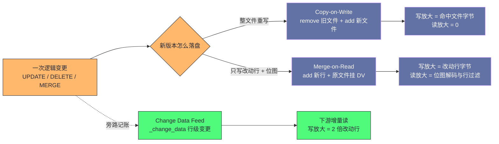
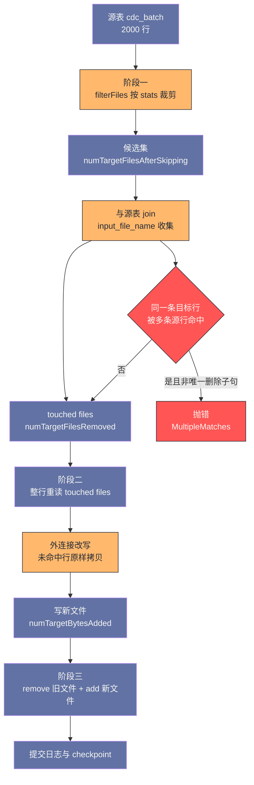
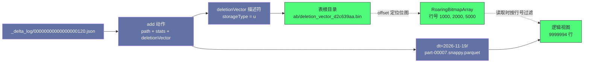
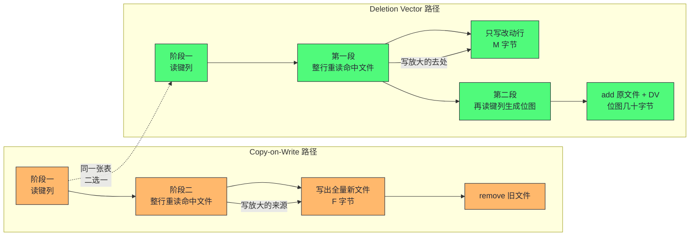
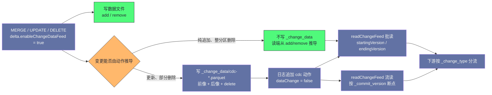
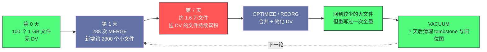

# 04 DML 操作深度解析：MERGE、UPDATE 与 DELETE 的实现机制

**摘要：**

Parquet 文件写完即不可变，于是数据湖上的每一次 UPDATE、DELETE、MERGE 都不可能是"改一行"，只能换算成"写一批新文件、让一批旧文件退出快照"。换算的方式有三条：整文件重写（Copy-on-Write）、只写变更行并把删除记成位图（Deletion Vector，Merge-on-Read 的一种）、以及把行级变更另存一条旁路（Change Data Feed）。本文以一张订单表的 CDC 增量同步贯穿全篇：先拆开 MERGE 的三阶段执行计划，指出阶段一能否靠列统计裁剪候选文件，取决于 ON 条件里有没有只引用目标表的合取项，这是"MERGE 只改几行却扫全表"的最常见来源；再分别讲 Copy-on-Write 的"删一行重写整文件"、Deletion Vector 的协议描述符与读侧过滤、Change Data Feed 的 `cdc` 动作与 `_change_type` 四值。文中给出 `numTargetRowsCopied`、`numTargetBytesAfterSkipping`、`numTargetDeletionVectorsAdded` 等可以对着 Spark UI 核对的度量，并用一组明确标注为示例推算的数字回答一个具体问题：命中 1% 的行与命中 90% 的行，代价为什么可能一样，又是在哪一步开始分岔。答案指向前者：代价公式里只有命中文件的字节，改动行数要等到选定 DV 之后才进入公式。落点是反例：高频小批量 MERGE 不做 OPTIMIZE 规划、CDF 后开却要追历史、DV 只开不 purge。口径为 Delta Lake OSS 4.x。

---

## 第 1 章 三种写策略：同一个问题的三种答案

### 1.1 不可变文件留下的唯一选择

2019 年前后，云对象存储上的分析型数据开始以 PB 计，而对象存储只提供整对象读写：没有追加，没有随机写，覆盖一个对象等于重写一个新对象再改名。Parquet 又是列式压缩格式，footer 里记着 schema、row group 偏移与每列的 min/max，任何一行字节发生变化，这份元数据就一起作废。两个约束叠起来，结论只有一条——数据湖上的行级修改必须落地为新文件。

Delta Lake 在 VLDB 2020 的论文里把这个约束转成了设计前提，做法是把"文件"和"快照"解耦：数据文件没有身份，身份由事务日志里的 `add` 与 `remove` 动作赋予。一次 DML 提交是一串动作的原子集合，读者按日志版本重建快照，看不见正在写的文件，也看不见已被 `remove` 的文件。物理清理交给 `VACUUM` 在保留期之后做，默认保留 7 天，对应表属性 `delta.deletedFileRetentionDuration`。

这个设计的妙处在于把两件事拆开了：正确性由日志兜住，代价则由"替换多少字节"决定。于是讨论 DML 性能，其实是在讨论一道算术题——被命中的文件有多大、被重写的字节有多少、被额外读的字节有多少。

### 1.2 三条路其实不在同一个维度

业界常说数据湖有三种写策略，这话对，但容易误导。Copy-on-Write（CoW）与 Merge-on-Read（MoR，在 Delta 里的实现是 Deletion Vector）回答的是同一个问题，**落盘形态**。前者是"重抄一遍"，后者是"保留原件、附加批注"，二者互斥，同一张表在同一个时刻只走其中一条。

Change Data Feed（CDF）回答的是另一个问题，**变更可见性**。它不改写路径的选择，只在上层多记一份行级变更，因此可以与 CoW 同开，也可以与 DV 同开。把三者并排成"三选一"，是阅读这一章时最容易犯的错；准确的摆法是两条正交的轴，一条管落盘形态，一条管变更可见性。这个区别在调优时很实际：换写策略要重写数据文件，开 CDF 只是多写一份副本，两者的回滚成本完全不同。

| 维度 | Copy-on-Write | Merge-on-Read（Deletion Vector） | Change Data Feed |
|---|---|---|---|
| 回答的问题 | 新版本怎么落盘 | 新版本怎么落盘 | 变更怎么被下游读到 |
| 物理产物 | 重写后的数据文件 | 新行文件 + `deletion_vector_*.bin` | `_change_data/` 下的 `cdc-*.parquet` |
| 写侧放大 | 命中文件的全量字节 | 改动行的字节 | 改动行的两倍（前像 + 后像） |
| 读侧放大 | 无 | 每个带 DV 的文件多一次位图读取与行过滤 | 无（只影响 CDF 读者） |
| 文件级账本 | `remove` 旧文件、`add` 新文件 | 原文件 `add` 项带上 DV 描述符 | 每版本追加 `cdc` 动作 |
| 关键表属性 | 无 | `delta.enableDeletionVectors` | `delta.enableChangeDataFeed` |
| 可否与另一条并存 | 与 CDF 可并存 | 与 CDF 可并存 | 与两者都可并存 |
| 主要度量 | `numTargetRowsCopied` | `numTargetDeletionVectorsAdded` | `numTargetChangeFileBytes` |

### 1.3 一个贯穿全篇的订单表

为了让后面的数字有落点，笔者设一张订单表 `orders`：表结构里 `dt` 为分区列，主键 `order_id`，其余是 `amount`、`status`、`updated_at`。总量按 100 GB 估，100 个 Parquet 文件、每个 1 GB、每个文件约一千万行，行宽按 100 字节算，全表约十亿行。上游是 MySQL binlog 经 Flink 落成的变更流 `cdc_batch`，每 5 分钟一批，一批约 2000 行，其中更新与删除合计约占六成；下游有两类消费者，一类是每 5 分钟做一次增量同步的维表宽表任务，一类是白天不断打过来的 BI 查询。

这个规模不是随手编的，它刚好卡在一个尴尬区间：单文件 1 GB 大到"重写一次很疼"，表又小到"全表重写一次只是贵，不是不可能"。真实生产里 PB 级的表会靠分区把候选集压得很小，GB 级的表则常常连分区都懒得加，恰好是三种策略差异最明显的地方。

### 1.4 一个比喻：重抄、批注与流水账

把 Parquet 文件想成一本已经装订好的账册，改一行就有三种写法。第一种是把整页撕掉重抄，抄完把新页插回去、旧页登记作废——这就是 CoW，账册永远干净，代价是抄写量等于整页。第二种是不撕页，在页边贴一张小纸条，写明"第 137、402、998 行作废"，查账时先把作废行跳过——这就是 DV，纸条极小，但每本账册旁边多了一张要维护的纸条，且纸条多了要么合并、要么整页重抄。第三种是另开一本流水账，只记"哪一行从什么改成了什么"——这就是 CDF，查当前余额仍然要看正册，但下游想知道"昨天变了什么"时，翻流水账就够了。

比喻的技术限定在于：纸条不是免费的。它要在每次读取时被解码，要在每次写入时被维护成 RoaringBitmap，要在合并时被物化，还要在 `VACUUM` 时跟数据文件一起被管理。这三件事，正是后文讨论代价时的三条主线。

下图是两条轴的全景。上半部分是落盘形态的分叉，下半部分是旁路变更流，两者可以同时存在于一张表上。



---

## 第 2 章 MERGE 的执行计划：先找文件，再重写文件

### 2.1 三个阶段，源码注释写得很直白

Delta 的 `MergeIntoCommand` 类注释里，算法被切成三段：阶段一找出目标表里"被命中"的文件，并顺带校验没有两条源行匹配到同一条目标行；阶段二把这些文件再读一遍，写出包含更新与插入的新文件；阶段三用协议动作原子地移除旧文件、加入新文件。这三段的分工，决定了 MERGE 的代价结构。

阶段一是全部代价的分水岭。它不重写任何东西，却要读；它读多少，取决于两件事：候选集被裁剪到多小、投影到多少列。阶段二才真正改写，它读多少、写多少，取决于命中文件的总字节。阶段三只是提交动作，日志大小与命中文件数成正比，通常不是瓶颈——除非命中文件有上万个，此时光是 `add`/`remove` 动作与 checkpoint 的写入就会变成可观的开销。

这个分工像一次按目录找书的过程：先翻卡片目录缩小到某个架子（阶段一），把架子上的书抽出来逐页核对标记（阶段二），最后在借阅簿上登记"这几本换了版本"（阶段三）。技术限定在于，卡片目录对应的是每列的 min/max 统计，只有条件里出现"只属于目标表"的谓词时它才用得上，翻目录这一步本身也可能被跳过。

### 2.2 阶段一：候选集、join 与 touched files

阶段一的实现是 `findTouchedFiles`，主干只有几步。先用 `deltaTxn.filterFiles(getTargetOnlyPredicates(spark), keepNumRecords = true)` 按列统计裁掉不可能命中的文件，得到候选集；再把源表与该候选集做一次带 ON 条件的 join；join 的每一行上附加两个辅助列，一个是由 `monotonically_increasing_id()` 生成的 `_row_id_`，一个是 `input_file_name()` 给出的文件名。

```python
# 阶段一的逻辑骨架（源码逻辑的示意，非可直接执行代码）
candidates = txn.filterFiles(getTargetOnlyPredicates())          # 按 stats 裁剪
target_df  = read(candidates).withColumn("_row_id_", monotonically_increasing_id()) \
                             .withColumn("_file_name_", input_file_name())
joined = source_df.join(target_df, condition, "inner")           # 只取 ON 命中的行
touched = joined.select("_row_id_", record_file_name("_file_name_")).distinct()
```

文件名不是直接 `collect` 回来的，而是通过一个 `SetAccumulator` 在 Executor 侧登记，累加器名故意写成 `internal.metrics.MergeIntoDelta.touchedFiles`。这个前缀有讲究：Spark UI 会把普通累加器挂到任务的 metrics 上，而 MERGE 的 touched files 可能有上万个文件名，挂在 UI 上会吃掉大量 Driver 内存，所以它被登记成**内部累加器**，只在需要时读值。读源码时看到这种"故意不让 UI 看见"的写法，通常意味着数据量已经大到会拖垮界面。

同一个 join 里还顺带做了两件事：按 `_row_id_` 分组计数，若同一条目标行被多条源行命中，直接抛错，除非整条语句只是一个无条件的删除子句；把源表行数、裁剪前后文件数与字节数分别记进 `numSourceRows`、`numTargetFilesBeforeSkipping`、`numTargetFilesAfterSkipping`、`numTargetBytesBeforeSkipping`、`numTargetBytesAfterSkipping`。这四个文件与字节度量是判断"裁剪到底有没有生效"的唯一可靠依据，比看耗时靠谱得多。

### 2.3 裁剪为什么常常不生效

这里有一个反直觉的细节，值得单独说。`getTargetOnlyPredicates` 只保留 ON 条件里那些引用集合完全落在目标表上的合取项。像 `T.order_id = S.order_id` 这样的等值连接，引用同时涉及两侧，不满足条件，于是被丢掉；如果 ON 里再没有别的只引用 `T` 的谓词，`filterFiles` 拿到的就是空序列，候选集等于快照全集。这类只引用目标表的条件，后文简称 **target-only 谓词**。

换句话说，最常见的 MERGE 写法——只用主键做等值连接——从一开始就放弃了列统计裁剪，阶段一就是一次带列裁剪的全表扫描。这解释了一个反复出现的现场：表有 100 GB，一次只改 2000 行，MERGE 却稳定跑十几分钟，`numTargetFilesBeforeSkipping` 与 `numTargetFilesAfterSkipping` 两个数字一模一样。

要让裁剪生效，就得在 ON 里写一个只引用目标表的谓词，而这必须与语义自洽。分区级增量刷新是标准做法：源批次本来就只包含某一天的数据，目标也只该在那一天的分区里匹配，于是把分区常量写进 ON。

```sql
-- 只刷新 2026-11-19 这一天的分区
MERGE INTO orders AS T
USING cdc_batch AS S
ON T.order_id = S.order_id
   AND T.dt = DATE '2026-11-19'          -- 只引用 T，可用于 stats 裁剪
WHEN MATCHED AND S.op = 'U' THEN
  UPDATE SET T.amount = S.amount, T.status = S.status, T.updated_at = S.updated_at
WHEN MATCHED AND S.op = 'D' THEN DELETE
WHEN NOT MATCHED AND S.op = 'I' THEN
  INSERT (order_id, dt, amount, status, updated_at)
  VALUES (S.order_id, S.dt, S.amount, S.status, S.updated_at)
```

代价是语义被收窄了：其他分区的同主键行不再参与匹配，源批次里若混进别的日期，会被当成新行插入。这不是技巧，而是把"分区级幂等重刷"这件事写进语句本身。若不想收窄语义，还有一条路是把整条 MERGE 换成按分区覆盖写，本质上放弃了行级匹配。

另外两个细节会让裁剪失效：一是语句里出现 `WHEN NOT MATCHED BY SOURCE`，此时所有目标文件都可能产生删除，`filterFiles` 直接被传入 `Literal.TrueLiteral`，候选集必然是全集；二是分区列上没有谓词而 ON 的 target-only 谓词又落在非分区列上，此时只能靠文件级 min/max 统计裁剪，效果取决于数据的物理排序或聚簇程度。

### 2.4 阶段二：重读命中文件，再写一遍

阶段二 `writeAllChanges` 拿到命中文件清单后，用 `buildTargetPlanWithFiles` 把这些文件重新组装成一个读取计划，注意 `columnsToDrop` 传的是空序列，也就是整行读取。随后与源表做一次外连接，按 MATCHED/NOT MATCHED 子句改写每一行，未命中的目标行原样拷贝，最后写出新文件。

这里的全外连接不是随手选的。CoW 路径下，被命中文件里的行有三种去处：被更新、被删除、原样保留；要同时表达"保留"与"不保留"，只能在 join 输出上带一个丢弃标记列，因此必须是外连接。连接类型还直接影响第二遍扫描源表的方式，也影响 `numSourceRowsInSecondScan` 这个度量是否等于第一次扫描的行数——两者不一致时，`checkNonDeterministicSource` 会记一条告警，若开了 `MERGE_FAIL_IF_SOURCE_CHANGED` 则直接抛错，防止源数据在两次扫描之间变化导致结果不自洽。

被原样拷贝的行，是 CoW 路径上纯粹的搬运成本，Delta 专门给它一个度量 `numTargetRowsCopied`，含义就是"number of target rows rewritten unmodified"。这个数字越大，说明这次 MERGE 越不划算：它花的写带宽与更新命中文件里的每一行有关，与真正改了的那几行无关。

### 2.5 代价公式：三个字节量

把上面两段合起来，一次 CoW 模式的 MERGE 可以近似成三个字节量之和：

- 阶段一读：候选文件数 × 键列宽度（`columnsToDrop` 会砍掉与条件无关的列）
- 阶段二读：命中文件数 × 全行宽
- 阶段二写：命中文件数 × 全行宽 + 新增行的字节

三个量里，第一个由裁剪效果决定，后两个由命中文件的总字节决定。被更新的行数只通过"新增行的字节"这一项出现，而且占比通常极小。这就是那句话的来历：MERGE 的代价由**被命中文件的字节数**决定，被更新的行数只决定新增文件里那一小截。把这句话记牢，后面 DV 与 CDF 的取舍都是它的推论。

| 阶段 | 做什么 | 读的字节 | 写的字节 | 可控旋钮 |
|---|---|---|---|---|
| 阶段一 | 裁剪候选集、join 找命中 | 候选文件 × 键列宽 | 0 | ON 里的 target-only 谓词、分区列、聚簇程度 |
| 阶段二 | 重读命中文件、改写、落盘 | 命中文件 × 全行宽 | 命中文件 × 全行宽 | 单文件大小、命中文件数、`numTargetRowsCopied` |
| 阶段三 | 提交 `add`/`remove` 与 checkpoint | 日志与 checkpoint 字节 | 日志与 checkpoint 字节 | 命中文件数、checkpoint 间隔 |
| 全流程 | 度量落点 | `numTargetBytesAfterSkipping` | `numTargetBytesAdded` | Spark UI 的 MERGE 节点 |

下图把三阶段与两类文件（候选集、命中集）画在一起。注意阶段一与阶段二读的是同一批文件的两种投影：前者只读条件涉及的列，后者读全列。



---

## 第 3 章 Copy-on-Write：删一行，重写整文件

### 3.1 一次 DELETE 的物理过程

`DELETE FROM orders WHERE order_id = 1001` 在 CoW 模式下要走的路径，比它的语法长得多。先扫描快照里所有可能命中的文件——这一步与 MERGE 的阶段一同构，同样受 target-only 谓词与分区裁剪的影响；再对每个命中文件整行读出、逐行判断谓词、把不满足的行原样写出、把满足的行丢弃；最后在日志里 `remove` 旧文件、`add` 新文件。一行被删，命中文件里其余的一千万行全部被重写了一遍，只是内容没变。

这就是 `numTargetRowsCopied` 在 DELETE 场景下的含义：`numTargetFilesRemoved` 是 1，`numTargetRowsDeleted` 是 1，而被搬运的行数可能是千万级。Delta 不会为了省这次搬运去做更细粒度的拆解，因为拆出来的每个碎片都要在日志里占一条 `add`，小文件问题会比写放大更早发作。

### 3.2 CoW 的三笔账

第一笔是读放大。命中文件要被读两遍，一遍找命中（只读条件涉及的列），一遍重写（读全列）。第二笔是写放大，命中文件的全量字节要重新编码成 Parquet：重新计算 row group、重新压缩、重新收集每列 min/max、重新写 footer。第三笔是元数据账，旧文件的 `remove` 动作带 tombstone，要保留到 `VACUUM` 清理；新文件的 `add` 动作带完整统计信息，statistics 字符串的长度与列数成正比。

三笔账里最贵的是第二笔，因为 Parquet 的写是全量重编码，不是内存里改几个字节。压缩算法（SNAPPY、ZSTD）决定了这笔账有一个固定倍数：解压、修改、再压缩，CPU 开销往往先于带宽成为瓶颈。2000 行的小批 MERGE 命中一个 1 GB 文件时，读进来解压、上千万行判断谓词、再压缩写出，十几分钟的运行时间里有大半花在这里。

### 3.3 文件大小是命门

CoW 的代价与命中文件的总字节成正比，因此单文件大小是第一个该调参数，而不是并发度。下表是一组示例推算，假设行宽 100 字节、每次 MERGE 命中 2000 行、这些行按最坏情况铺满所有文件。

| 单文件大小 | 文件数（总 100 GB） | 命中 2000 行时的命中文件数 | 每次 MERGE 重写字节 | 每天 288 次的写字节 |
|---|---|---|---|---|
| 1 GB | 100 | 约 100（全表） | 约 100 GB | 约 28.8 TB |
| 256 MB | 400 | 约 400（全表） | 约 100 GB | 约 28.8 TB |
| 128 MB | 800 | 约 800（全表） | 约 100 GB | 约 28.8 TB |
| 1 GB，按天分区后只刷当天 | 100（单分区 1 个） | 1 | 约 1 GB | 约 288 GB |

这张表要说的是：只要键与文件布局无关，单文件大小怎么调都不改变总字节，因为命中集合始终是全集；真正把 100 GB 打到 1 GB 的是布局——分区、聚簇、排序，让"要改的行"在极少数文件里。文件大小只影响同一命中集合内的搬运效率与合并频率，它解决的是另一个问题。

### 3.4 反事实：如果允许原地更新

不妨设想 Delta 允许在 Parquet 文件里原地改写某一行的字节。看起来省掉了全部写放大，实际会同时失去三样东西。其一是快照隔离：读者正在读的文件被就地修改，同一个查询的不同 task 可能读到修改前与修改后的行，ACID 里的一致性当场失效。其二是时间旅行：旧版本没有独立物理载体，`RESTORE` 与按版本查询都无从谈起。其三是并发写：两个 MERGE 同时改同一文件的不同行，需要文件级锁与崩溃恢复，而对象存储不提供锁。

Delta 的选择是把这三样都保住，代价是写放大。这是一次典型的权衡：**用空间换正确性**，再用布局把空间要回来。理解了这一层，就不会把 CoW 当成"落后的实现"——它是把 MVCC 语义落到不可变存储上的最直接方式。

### 3.5 什么时候 CoW 仍然是对的选择

读多写少、写入批量大、命中文件少的场景，CoW 的优势无可替代：读路径完全干净，没有位图要解，没有额外的小文件要打开，查询计划与纯 Parquet 一模一样；写路径虽然重，但当每次 MERGE 命中几百个文件、改动行占比很高时，DV 也省不下多少写，反而多付了读侧开销。

判断标准可以非常具体：看 `numTargetRowsCopied` 与 `numTargetBytesAdded` 的比值。若搬运的行数远大于改动的行数，说明 CoW 在为一个字节级的修改重写整个文件，此时考虑 DV；若两者数量级接近，说明这次修改本来就是"大改"，CoW 的写放大没有浪费。

---

## 第 4 章 Deletion Vector：把删除写成一张位图

### 4.1 一个特性分了四次上线

Deletion Vector 不是一次性就绪的能力。官方文档给出的支持矩阵是分操作发布的：扫描从 2.3.0 起支持，`DELETE` 从 2.4.0 起，`UPDATE` 从 3.0.0 起（3.1.0 起默认开启），`MERGE` 从 3.1.0 起；该特性在文档里长期标注为实验性支持。版本门槛必须记清，因为"开了 DV 但 DELETE 走了 CoW"这类现场，绝大多数是连接器版本没到。

| 操作 | 首个支持的 Delta Lake 版本 | 默认启用版本 |
|---|---|---|
| SCAN | 2.3.0 | 2.3.0 |
| DELETE | 2.4.0 | 2.4.0 |
| UPDATE | 3.0.0 | 3.1.0 |
| MERGE | 3.1.0 | 3.1.0 |

开启方式是一条表属性：`ALTER TABLE orders SET TBLPROPERTIES ('delta.enableDeletionVectors' = true)`。这条语句会顺带升级表协议——读端要求 reader version 3、写端要求 writer version 7，并在 `protocol` 的 `readerFeatures` 与 `writerFeatures` 里同时写入 `deletionVectors` 表特性。协议升级之后，不支持该特性的旧客户端将无法读这张表，这是"开启前先确认全链路连接器版本"的原因。反过来说，读端必须尊重 DV 的存在，即使表的 `delta.enableDeletionVectors` 属性已经被关掉，只要 `add` 动作里挂着 DV 描述符，读者就得过滤——属性管的是"以后还写不写新的 DV"，不是"以前的 DV 还算不算数"。

### 4.2 协议里的五个字段

DV 在日志里的表达，是挂在 `add`（以及 `remove`）动作上的一个描述符对象，五个字段：

| 字段 | 类型 | 含义 |
|---|---|---|
| `storageType` | String | 单字符，`u` 表示相对路径、`i` 表示内联在日志里、`p` 表示绝对路径 |
| `pathOrInlineDv` | String | 相对路径时是"随机前缀 + Z85 编码的 UUID"，内联时是 Z85 编码的位图字节，绝对路径时是完整路径 |
| `offset` | Option[Int] | 该 DV 在一个共享文件内的起始字节偏移，内联时不存在，缺省视为 0 |
| `sizeInBytes` | Int | DV 原始字节数（内联时指编码前的长度） |
| `cardinality` | Long | 这张 DV 逻辑上从该文件里删掉了多少行 |

几个派生字段值得记住。`uniqueId` 由 `storageType`、`pathOrInlineDv` 与 `offset` 拼出，作用是让快照重建时能区分"同一文件在不同版本挂着不同 DV"；`absolutePath` 在 `storageType='u'` 时按 `<表目录>/<随机前缀>/deletion_vector_<uuid>.bin` 还原。`offset` 的存在意味着一个 DV 文件可以装多张 DV，写入端可以把同一批操作产生的位图拼在一起，减少对象存储上的小文件数量。

```json
{
  "add": {
    "path": "dt=2026-11-19/part-00007-9c1e.snappy.parquet",
    "size": 1073741824,
    "dataChange": true,
    "stats": "{\"numRecords\":10000000,\"minValues\":{...}}",
    "deletionVector": {
      "storageType": "u",
      "pathOrInlineDv": "ab^-aqEH.-t@S}K{vb[*k^",
      "offset": 4,
      "sizeInBytes": 40,
      "cardinality": 6
    }
  }
}
```

位图本身用的是 **RoaringBitmapArray** 格式：对稀疏行号，它用分块 + 容器压缩，6 个被删行号序列化后只有 40 字节这个量级；对内联场景，这 40 字节经 Z85 编码后直接进 JSON，连文件都不用写。协议还额外要求，挂了 DV 的文件在 `stats` 里必须给出正确的 `numRecords`，因为读端要靠它算"逻辑行数 = numRecords − cardinality"，而这个数字会进入统计信息与查询计划。

下图是 DV 在目录与日志里的落点。注意 DV 文件放在表根目录，不随分区层级走，因为一张 DV 文件可以装来自多个分区的位图。



### 4.3 写路径：MERGE 在 DV 模式下变成两小段

启用 DV 之后，MERGE 的阶段二不再是"整行重读、整文件重写"，而是拆成两小段。第一段 `writeAllChanges(writeUnmodifiedRows = false)` 只输出被修改的行与新增的行，未被修改的目标行不再拷贝，因此 `numTargetRowsCopied` 在这里应当接近 0；第二段 `writeDVs` 重新扫一遍命中文件，为被修改或被删除的那些行生成位图，写成新的 DV 描述符挂回原文件的 `add` 动作上。

两段各自都有明确的度量：第一段结束时 `numTargetBytesAdded` 只包含改动行的字节；第二段结束时 `numTargetDeletionVectorsAdded`、`numTargetDeletionVectorsRemoved`、`numTargetDeletionVectorsUpdated` 三个计数给出位图的增删改情况，并且会覆盖 `numTargetFilesRemoved` 与 `numTargetBytesRemoved`，把"被整体替换掉的文件"单独算出来。所谓整体替换，是指某张 DV 覆盖了文件里绝大部分行，此时继续挂位图不如直接重写文件，实现会把这些文件连同位图一起替换掉——这也是为什么"删几行"和"删掉一大半"在 DV 路径上是两种不同的开销。

连接类型也随之收窄。CoW 路径必须用全外连接才能表达"未修改行原样保留"，而 DV 路径不需要保留未修改行，于是 MATCHED-only 的场景可以退化成内连接，没有 `WHEN NOT MATCHED BY SOURCE` 时可以退化成左外连接。少一次全外连接，就少一轮两侧数据的重分布与合并。

还有一处记账细节值得留意。改动行被写成了新行，原行只是被位图标记为无效，于是"文件里少了一行、新文件里多了一行"这件事在统计口径上必须对得上：Delta 用 `numLogicalRecordsAddedInFilesWithDeletionVectors` 记录"留在原地但被软删的行数"，并在命令不变量里核对 `更新行 + 删除行 + 原样拷贝行 + 软删行 = 被移除文件的行数`。这条式子是理解 DV 的关键——它没有消灭行，只是把行的位置换了一种表达。

### 4.4 读路径：多一次解码，多一次过滤

读端遇到带 DV 的文件，流程是：读 Parquet 的 row group、在向量化读取阶段按行号过滤、拼出最终结果。Spark 连接器里的 `DeltaParquetFileFormat` 会在打开数据文件时检查 `add` 动作是否带 DV，若带则在读取计划里插入行过滤，把位图解析成行号集合，用 Selection Vector 的方式跳过被删行。

位图在这里的角色像一份门禁名单：门还是那扇门、数据还是那些数据，只是进门前多了一道核对。技术限定在于，核对的对象是行号而不是主键，所以这份名单只对生成它的那个文件有效；文件一旦被重写，名单立刻作废，这也是物化阶段要重建统计信息的原因。

有两条缓解读放大的机制。第一是 row group 级跳过：若查询只涉及某个 row group，而 DV 标记的行全在别的 row group 里，这个 row group 连位图都不必解。第二是列裁剪：DV 过滤发生在行一级，与列无关，因此读的列越少，位图解码的相对开销越明显，但绝对开销仍与"行数"而不是"字节数"相关。

真正被低估的读侧成本在对象存储上：每个带 DV 的文件在打开时可能多一次 DV 文件读取请求，位图只有几十字节，但请求次数是实打实的。一张表若有五千个文件挂着 DV，一次全表扫描在计划与打开阶段就多出几千次小对象读取，延迟而不是带宽成了瓶颈。`delta.enableDeletionVectors` 打开之后，直接读日志统计一下"挂 DV 的文件占比"，比统计"DV 文件总字节"有意义得多。

### 4.5 代价：写侧省下的，读侧要还

把写侧与读侧放在一起看，DV 并没有把总 I/O 消掉，它只是搬了个位置。以第 2 章的三个字节量为基准，CoW 近似是「阶段一读 αF + 阶段二读 F + 写 F」，DV 近似是「阶段一读 αF + 第一段读 F + 第二段读 αF + 写 M」，其中 F 是命中文件字节、M 是改动行字节、α 是键列占全行宽的比例（示例量级取 0.1）。于是 DV 相对 CoW 的差值是：

- 写侧节省：F − M
- 读侧增加：αF

只要 M 明显小于 F，DV 就是净赚；当改动行占比接近 1 时，写侧省不下多少，读侧却白多了一次扫描（位图那一段），DV 反而略亏。官方文档特意声明 UPDATE、MERGE 与 OPTIMIZE 对 DV 中记录的修改没有严格保证，原因也在这里：UPDATE 与 MERGE 只重写它们本来就要碰的文件，OPTIMIZE 只重写被合并策略选中的文件，三者都没碰到的位图会一直留着，要等一次专门的 purge 才会消失。换句话说，DV 是一笔按比例划算的买卖，不是一个永远正确的默认值。

### 4.6 物化：省下的写，在合并时还回去

DV 不会永久挂着。位图累积会让读侧成本线性增长，因此必须有物化机制把"软删"变成"真删"。官方文档列出的触发点有三个：关闭 DV 的 DML 命令、`OPTIMIZE`、以及 `REORG TABLE ... APPLY (PURGE)`。前两者只是"顺便"——`OPTIMIZE` 会重写参与合并的文件，挂着 DV 的文件被重写时位图自然消失；`REORG TABLE ... APPLY (PURGE)` 才是专门干这件事的命令，它只重写含有软删记录的文件，幂等，且会把重写后偏小的文件合并成大文件。

这里存在一个容易误判的账：DV 省下的写放大，会在物化时一次性还回去。每次 MERGE 省了 99 GB 写，攒了三十次，`REORG` 一次重写 100 GB——总量上并没有消失，只是从"每次 MERGE 都疼"变成"定期合并时疼一次"。这笔账划不划算，取决于两次物化之间被读了多少次、位图让每次读多花了多少，以及合并窗口能不能接受一次长任务。

下图把两条路径的读写字节并排画出来。上半是 CoW 的"读两遍、写一遍全量"，下半是 DV 的"读两遍全量加一遍键列、只写改动行"，两者的差别集中在写侧那一格。



---

## 第 5 章 Change Data Feed：在正册之外记一条流水

### 5.1 没有 CDF 时下游的三条老路

`orders` 的变更要同步到 Elasticsearch 做实时检索，没有 CDF 时有三种做法。全量扫描最直接：每小时读一遍全表、整体覆盖写入下游，代价是每天二十四次全表读，而其中九成以上的行并没有变。时间旅行做差集稍好一点：读版本 N 与 N−1 做全外连接，只同步差异，代价是两倍全量读加一次大 join，本质上没省。第三种是回到上游：从 binlog 侧再消费一遍，绕过 Delta，代价是两套口径、两套幂等、两套故障处理。

| 方案 | 读的数据量 | 能否拿到删除 | 实现复杂度 | 适用 |
|---|---|---|---|---|
| 全量扫描覆盖 | 每次全表 | 能（隐含在覆盖里） | 低 | 表小、变更极少 |
| 时间旅行做差集 | 每次两版全表 | 能 | 中 | 偶发核对，不适合常态 |
| 上游 binlog 再消费 | 增量 | 看上游是否带删除 | 高（两套口径） | 已有成熟 CDC 管道 |
| Change Data Feed | 只有变更行 | 能（`delete` 类型） | 低（同一张表） | 常态增量同步 |

CDF 的位置就在这张表的最后一行：它不改变写路径，只在提交时顺手把行级变更写下来，让下游有地方可查。

### 5.2 `cdc` 动作与 `_change_data`

开启方式是一条表属性：`delta.enableChangeDataFeed = true`，可以建表时给，也可以 `ALTER TABLE` 加。开启之后，做 `UPDATE`、`DELETE`、`MERGE` 时，写入端除了正常的 `add`/`remove`，还会在表目录下的 `_change_data` 里写 Parquet 文件（文件名形如 `cdc-00000-<uuid>.c000.snappy.parquet`），并在日志里追加一条 `cdc` 动作。这个动作的 `dataChange` 固定为 `false`，因为它不改变表的物理内容，只是给"变更读者"的一份副本。

协议对读端的要求很明确：某个版本里只要有 `cdc` 动作，变更读者就必须只读这些文件，忽略同一版本里的 `add` 与 `remove`；若没有 `cdc` 动作，则把 `add` 当作插入、把 `remove` 当作删除来推导。这解释了文档里那句看起来矛盾的话——纯追加写入与整分区删除不会在 `_change_data` 下产生文件，因为这两类变更完全可以从动作里推导出来，写一份副本纯属浪费。换句话说，CDF 的原则是**推导不出来的才写**。

这条原则值得用账册的比喻再讲一遍：正册记余额，流水账记发生了什么；凡是"看正册就能推出来"的变动（新建一页、撕掉整页），流水账不必重复记，凡是"只看正册看不出前后差异"的变动（改了一行、删了一行的某一版），流水账才必须留下前像与后像。技术限定在于，这条"能推出就不写"的优化由写入端自行判断，没有强制约定，所以不同引擎写出的 CDF 文件分布可能不同，读端必须两种路径都支持。

代价也在这里：能被推导的变更几乎免费，推导不出来的变更要付两次写。一次 MERGE 更新 2000 行，写的是 2000 行前像加 2000 行后像，共 4000 行的字节；这部分与命中文件大小无关，只与被改动的行数成正比。这是 CDF 与 CoW/DV 最不一样的地方——它的写放大锚定在"行的数量"上，而不是"文件的大小"上。

### 5.3 `_change_type` 四值与两列元数据

变更文件在业务列之外多了三个列：

| 列名 | 取值或含义 |
|---|---|
| `_change_type` | `insert`、`update_preimage`、`update_postimage`、`delete` 四值 |
| `_commit_version` | 产生这条变更的日志版本号，用于按版本归并、去重与断点续读 |
| `_commit_timestamp` | 该版本的提交时间，用于按时间窗口消费 |

`preimage` 是更新前的值，`postimage` 是更新后的值，一次更新会产生一对。这个设计对下游很友好：想算增量总额，只取 `insert` 与 `update_postimage` 再减去 `delete` 即可；想做行级审计，把 `preimage` 与 `postimage` 成对取出来就是一条完整的变更记录。代价是同一行数据在变更流里出现两次，写放大翻倍，而这正是 5.2 节说的那笔账。

### 5.4 打开的时点就是可读的起点

CDF 有一个时间上的硬边界：只有开启之后的变更才被记录，历史版本没有 change data。文档写得很清楚——把起始版本或起始时间指到开启之前，读取会直接报"change data feed 未开启"类的错误，而不是返回空结果。这个区别很重要：报错说明数据不存在，空结果会让人误以为"这段没变更"。

因此"用 CDF 追历史"这个需求从一开始就不成立。真有历史回溯需求，只能回到时间旅行做差集，或者从上游重放。另一个相关边界是保留期：`_change_data` 目录里的文件遵循表的保留策略，`VACUUM` 会把它们一并删掉。默认 7 天的保留期意味着 CDF 只能覆盖最近 7 天，若下游任务停摆超过这个窗口，恢复时读到的不是"没变更"，而是文件已不存在。

还有一条容易被忽略的兼容性约束：开启 CDF 之后，Delta Lake 1.2.1 及以下的写入端不能再写这张表（读不受影响）。多引擎环境里，"某个老版本 Spark 作业突然写失败"往往是这里引起的。

### 5.5 落地：批读与流读

批读用 `readChangeFeed` 选项加版本或时间区间，区间两端都是闭区间；不指定结束版本时读到最新版本。

```python
# 批读：只取两个版本之间的变更
changes = (spark.read.format("delta")
           .option("readChangeFeed", "true")
           .option("startingVersion", 120)
           .option("endingVersion", 140)
           .table("orders"))

# 流读：从某个版本起持续消费，用于增量同步
stream = (spark.readStream.format("delta")
          .option("readChangeFeed", "true")
          .option("startingVersion", 120)
          .table("orders"))

# 下游按变更类型分流：只把后像与插入写进检索库，删除单独处理
upserts = changes.filter("_change_type IN ('insert', 'update_postimage')")
deletes = changes.filter("_change_type = 'delete'")
```

流读有一个值得说明的行为：不指定 `startingVersion` 时，第一批发出来的是当前快照，被标记成 `insert`，此后才是真正的变更。这让"从零构建下游"与"之后持续跟进"能用同一套代码，但也意味着首次启动会读到全量——如果下游只想要增量，务必显式给出起始版本。

下图是 CDF 的写入与读取路径。左侧是写入端在提交时多写的 `cdc` 文件，右侧是读取端按 `cdc` 动作优先、`add`/`remove` 兜底的顺序取变更。



---

## 第 6 章 三者与小文件：优惠券不能当饭吃

### 6.1 DV 减少的是字节，不是文件数

DV 最容易被误读的一点，是把它当成"小文件问题的解药"。它降低的是重写字节，完全不改变文件数量：MERGE 在 DV 模式下依然要把改动行写成新文件，`numTargetFilesAdded` 一样会涨；被位图覆盖的旧文件依然在快照里占一个 `add` 动作，只是多挂了一个描述符。文件数只由两件事决定——写入时产生了多少文件、合并时消掉了多少文件。优惠券能抵掉一部分账，抵不掉全部：DV 抵的是重写字节，抵不掉元数据条数、事务提交次数与保留期这三笔固定开销。

而 DV 恰恰让小文件更容易积累。因为不再重写旧文件，写入端失去了"顺便合并"的机会：CoW 每次重写 1 GB 文件，输出通常还是一两个 1 GB 文件；DV 每次只写两三千行改动，输出就是几个几十 KB 的小文件，旧文件原封不动留在那里。写放大省下来的成本，一部分转化成了**文件数**。

### 6.2 一次 MERGE 到底新增多少文件

新增文件数由阶段二的输出分区数决定，粗略等于写任务数，而写任务数又与集群并行度、分区列、是否按分区重分布有关。示例推算：一批 2000 行、总字节约 200 KB，写入端跑 8 个任务，产出 8 个文件，每个只装两百多行、二十几 KB；每 5 分钟一次，一天 288 次，就是 2304 个文件；一个月七万个。这些文件既不会被 `VACUUM` 清掉（它们是最新快照的一部分），也不会自己合并，只能等 `OPTIMIZE`。

文件多了之后，受害的第一环不是扫描带宽，而是读计划：每次查询要读日志或 checkpoint 拿到 `add` 动作列表，每个动作带统计信息字符串，七万个动作就是几十 MB 的元数据；`numFiles` 涨上去之后，连 `DESCRIBE DETAIL` 都会变慢。第二环是 `findTouchedFiles` 里的 `numTargetFilesBeforeSkipping`——裁剪前的候选集越大，`filterFiles` 本身的 CPU 开销越大。

### 6.3 OPTIMIZE 会把 DV 物化

`OPTIMIZE` 是 bin-packing：把小文件合并成大文件，目标大小由 `spark.databricks.delta.optimize.maxFileSize` 一类配置控制，幂等，不改数据内容。当它重写一个挂着 DV 的文件时，位图标记的行会被真正丢弃，新文件不带 DV。这就是 4.6 节说的"物化"。

于是三件事在同一时刻发生：小文件被合并、DV 被消除、统计信息被重算。从成本角度看，`OPTIMIZE` 是唯一同时偿还三笔欠账的动作：CoW 遗留的碎片、DV 遗留的位图、以及写入端每次新增的小文件。实践里常见的问题是把它放在业务低峰跑却没人监控，跑不完就杀掉，于是欠账越滚越大——`OPTIMIZE` 的幂等性保证了重跑安全，但保证不了它会被跑完。

### 6.4 OPTIMIZE 与 REORG 的分工

两者都能物化 DV，但选文件的逻辑不同。`OPTIMIZE` 按大小挑文件，挂着 DV 但体积够大的文件可能不被选中，因此它有"合并了却没清干净 DV"的可能，官方文档也承认这一点。`REORG TABLE ... APPLY (PURGE)` 按"是否含软删记录"挑文件，凡是挂着 DV 的都会被重写，因此它是清理 DV 的专用手段；副作用是重写范围可能比 `OPTIMIZE` 大，且会把重写后偏小的文件再合并一次。

选择上的判断很简单：如果目标是控制文件数量并顺带清清位图，用 `OPTIMIZE`；如果目标是让某张表尽快回到"无 DV"的干净状态（譬如要降级协议、要给旧客户端读、要评估读放大），用 `REORG ... APPLY (PURGE)`。两者都不是免费的，都该按周期排进调度，而不是等出问题再手工跑。

### 6.5 写入侧的三道闸

与其事后合并，不如在写入时少产生文件。OSS 连接器为这件事提供了三类手段，版本门槛在优化文档里写明：手动 `OPTIMIZE` 自 1.2.0 起可用，Z-Ordering 自 2.0.0 起，自动合并（auto compaction）与优化写（optimized write）自 3.1.0 起。

| 手段 | 配置位置 | 作用 | 代价 |
|---|---|---|---|
| 优化写 | 表属性 `delta.autoOptimize.optimizeWrite` | 写入前按目标大小重分布，减少小文件 | 多一次 shuffle，写延迟上升 |
| 自动合并 | 表属性 `delta.autoOptimize.autoCompact` | 写成功后同步合并同分区小文件 | 写事务变长，占用写集群资源 |
| 手动 `OPTIMIZE` | SQL 命令 | 周期合并、顺带物化 DV、可配 Z-ORDER | 需要调度与单独算力 |

对每 5 分钟一批的 CDC 场景，优化写往往是性价比最高的一项：它把"八个小文件"变成"一两个中等文件"，从源头减半。自动合并更彻底，但它把合并塞进写事务里，写延迟会明显上升，对于有新鲜度要求的链路需要权衡。

### 6.6 保留期是三者共用的

CoW 的旧文件、DV 的位图文件、CDF 的变更文件，都受同一个 `VACUUM` 保留期约束，默认 7 天（`delta.deletedFileRetentionDuration`）。这个共用带来一个后果：把保留期调长以支持时间旅行与 CDF 补数，会让三者的存储同时膨胀；调短以省存储，则三者的可回溯窗口一起缩短。想要"DV 位图尽快清掉但 CDF 保留久一点"是不可能的，它们的生命周期由同一个时钟管理。

下图是表状态随时间的演化。写入持续产生小文件，合并周期性回收，DV 在两次合并之间累积；三条线各自的斜率决定了应该在什么时候插入一次合并。



---

## 第 7 章 量化：影响 1% 的行与影响 90% 的行

### 7.1 推算口径先说清楚

下面所有数字都是示例推算，用于说明量级关系，不代表任何真实系统的实测值。统一假设：`orders` 表 100 GB、100 个文件、每个 1 GB、约一千万行、行宽 100 字节；每 5 分钟一次 MERGE，一天 288 次；每次源批次 2000 行；阶段一与 DV 第二段按键列读取，键列占全行宽的比例记作 α，示例取 0.1；对象存储的读写都按字节计，忽略请求次数与延迟。

CoW 的单次 I/O 近似为 αF + F（读）+ F（写）= 2.1F；DV 的单次 I/O 近似为 αF + F（读）+ αF（读）+ M（写）= 1.2F + M。其中 F 是命中文件总字节，M 是改动行字节。两个式子摆在一起，DV 相对 CoW 的差值就是那一项 **0.9F − M**：改动行字节只要小于命中文件字节的九成，DV 在总 I/O 上就占优。这个"九成"不是定律，它只是 α = 0.1 这个示例假设下的结果；α 越大（条件涉及的列越多），DV 的第二段扫描越贵，门槛越低。

### 7.2 命中 1% 与命中 90%：前一半代价相同

现在把 2000 个键均匀撒进 100 个文件。任一行落在任一文件的概率是 1%，2000 行里至少有一行落在某文件之外的概率是 0.99²⁰⁰⁰ ≈ 2×10⁻⁹，于是**每一个文件都会被命中**，命中集合是全集 100 GB。若把场景换成"全表改一个字段"，改动 9 亿行，命中集合还是这 100 个文件、100 GB。

| 场景 | 布局与改动量 | 命中文件 | F | CoW 单次 I/O | DV 单次 I/O（M 为改动行字节） |
|---|---|---|---|---|---|
| A | 键随机分布，改 2000 行（约 1%） | 100 | 100 GB | 约 210 GB | 约 120 GB（M ≈ 0.2 MB） |
| B | 键随机分布，改 9 亿行（约 90%） | 100 | 100 GB | 约 210 GB | 约 210 GB（M ≈ 90 GB） |
| C | 按天分区只刷当天，改 2000 行 | 1 | 1 GB | 约 2.1 GB | 约 1.2 GB |
| D | 按天分区只刷当天，改当天的九成 | 1 | 1 GB | 约 2.1 GB | 约 1.3 GB |

A 与 B 是本节的要害：改动量差了 450 倍，CoW 的代价一模一样。原因不在实现，在代价公式——CoW 只认 F，不认 M。这也说明"MERGE 只更新了 2000 行，所以应该很快"这个直觉错在哪：那 2000 行只是决定了 M，而代价由 F 决定。

DV 在 A 与 B 之间则明显分岔：A 里 M 只有 0.2 MB，写侧从 100 GB 降到 0.2 MB，省下来的正是 CoW 搬运 `numTargetRowsCopied` 的那部分；B 里 M 是 90 GB，写侧几乎没省，反而多付了第二段扫描，与 CoW 打平。这就是 4.5 节那个 0.9F − M 的直观含义：DV 的收益与"没改的行占比"成正比。

### 7.3 真正的杠杆是布局

把 A 与 C 并排看：同样改 2000 行，C 的单次 I/O 只有 A 的**百分之一**，差别全部来自命中文件从 100 个变成 1 个。按 288 次/天折算，A 场景一天约 34.5 TB 的读、C 场景约 345 GB；一个月差两个数量级。任何写入策略的选择都补不上这个差距——DV 最多把 A 的写侧省掉，读侧那 120 GB 一天照样要付。

因此调整顺序应该是：先把查询与更新共用的维度做成分区或聚簇，让 target-only 谓词能生效，把 F 压下来；再在剩下的 F 里选 CoW 还是 DV。反过来先开 DV 再想布局，通常会得到一个"读变慢了、写快了一点、文件更多了"的中间态。

需要提醒的是，布局优化的前提是更新模式与分区键相关。CDC 流里如果混着历史订单的补改（迟到数据、退款重算），按 `dt` 分区就意味着这些更新要跨很多分区，F 又回到接近全表。这类"跨分区改写"是湖仓增量更新最难缠的部分，通常要为迟到数据单独设一条重刷链路，而不是让它混进 5 分钟一次的 MERGE。

### 7.4 读写比决定策略

把 CDF 也算进来之后，单次 MERGE 的三条路径可以放在一张表里比较。仍以 A 场景为例，M ≈ 0.2 MB：

| 路径 | 单次写侧 | 单次读侧 | 每次新增文件 | 适合的读写比 |
|---|---|---|---|---|
| CoW | 约 100 GB | 约 110 GB | 少（就地把大文件重写） | 写少读多、批量大 |
| CoW + CDF | 约 100 GB + 0.4 MB | 约 110 GB | 少 | 需要下游增量、写入不频繁 |
| DV | 约 0.2 MB + 位图 | 约 120 GB | 多（改动行落新文件） | 写多读少、改动行占比低 |
| DV + CDF | 约 0.2 MB + 0.4 MB + 位图 | 约 120 GB | 多 | 高频增量 + 下游要变更流 |

读侧那一列值得再看一眼：DV 并没有减少读，它比 CoW 还多了第二段扫描。换来的东西在写侧——**少写**，而不是少读。而写比读贵，是因为写要重编码 Parquet、要收集统计信息、要产生新文件与 tombstone、要让所有读者的缓存失效。把这层因果关系理清，就不会在看到"DV 之后 MERGE 的读取字节变多了"时以为配错了参数。

### 7.5 加上 CDF 的账

CDF 的写侧与 F 无关，只与改动行数成正比：A 场景每次写前后像约 400 KB，一天 115 MB，全年约 42 GB，与表本身相比可以忽略；B 场景改动 9 亿行，前后像约 180 GB，一次就把整张表写了两遍。这条对比正好说明 CDF 的成本锚点在哪里：它对"小批高频"极其友好，对"整表重构"极其不友好。

也正因如此，全表重构类的作业通常绕开 CDF：直接写新表再换表，或者临时关掉 `delta.enableChangeDataFeed` 再打开。后一种做法要小心——关闭期间的变更不会被记录，下游会丢掉这段窗口，而它不会报错。

---

## 第 8 章 边界与反例

### 8.1 反例：高频小批量 MERGE 没有合并规划

症状是 MERGE 越来越慢，但 `numTargetRowsCopied` 很小、`numTargetBytesRemoved` 也不大，说明单次代价并不高；真正的异常在 `numTargetFilesAdded` 与 `DESCRIBE DETAIL` 里的 `numFiles`，两者都在线性增长。根因是每次写入产出的几个小文件没人合并，读取时要处理几万个 `add` 动作。判据很好取：连续三天的 `numFiles` 曲线若是一条斜线，就说明合并策略缺位。处置是排上周期性的 `OPTIMIZE`，并在写入端开优化写；如果表已经烂到几万个文件，先按分区做局部 `OPTIMIZE`，不要一次性全表跑。

### 8.2 反例：CDF 后开却要追历史

症状是下游补数任务一启动就报"变更数据未记录"类的错误，或者补数结果缺了几天。根因是 CDF 的可见范围从开启那个版本开始，历史版本没有 change data，无法通过 CDF 得到。判据是看 `DESCRIBE HISTORY` 里那条 `SET TBLPROPERTIES` 操作所在的版本号，与补数的起始版本比较。处置只能是换手段：用时间旅行做差集补那一小段，或者从上游重放；同时把"开启 CDF 与下游起始版本对齐"写进上线检查单，避免同类问题在下一张表上重演。

### 8.3 反例：DV 开了却从不 purge

症状是查询计划里挂 DV 的文件越来越多，读取每 GB 的耗时缓慢上升，`numTargetDeletionVectorsAdded` 长期为正而 `numTargetDeletionVectorsRemoved` 一直是零。根因是只开了开关，没有安排物化；位图只增不减，读侧每个文件多一次位图读取与行过滤，对象存储上的小请求数也随之上涨。判据是统计"挂 DV 文件数 / 总文件数"，这个比例若长期高于三成，读放大已经实质发生。处置是周期性 `REORG TABLE ... APPLY (PURGE)`，或者干脆安排一次 `OPTIMIZE` 把含 DV 的文件卷进去重写。

### 8.4 边界：`WHEN NOT MATCHED BY SOURCE` 关掉裁剪

这条子句的语义是"目标表里有、源表里没有的行怎么办"，它天然要求对全表求反，于是 `filterFiles` 被传入**恒真条件**，候选集变成全集。很多人为了让删除逻辑写在一处而加上它，结果把一个分区级增量变成了全表扫描。判据是 `numTargetFilesAfterSkipping` 等于 `numTargetFilesBeforeSkipping`，且语句里确实有这条子句。处置是把删除逻辑拆出去：要么在源侧显式给出要删除的键，用 `WHEN MATCHED THEN DELETE` 表达；要么接受全表扫描，并把它排到低峰。

### 8.5 边界：源表不确定或已被缓存

MERGE 会读源表两遍（阶段一、阶段二），这就要求两遍读到同样的数据。源若来自一个非确定性的 DataFrame，或者来自一张在两遍之间被并发改写的表，结果可能不自洽。Delta 的处理是：检测到源计划不确定或已被缓存时，先把源物化（materialize）成一个临时结果再跑，代价是多写一遍源数据；同时用 `numSourceRows` 与 `numSourceRowsInSecondScan` 的一致性做校验，开了 `MERGE_FAIL_IF_SOURCE_CHANGED` 时不一致直接失败。判据是 Spark UI 上出现 `materializeSourceTimeMs` 明显非零，处置是尽量给 MERGE 一个确定的源（先落临时表或先 `cache` 后 `persist`），而不是让它在运行期猜。

### 8.6 边界：并发 MERGE 撞在同一批文件上

两个 MERGE 同时命中同一批文件时，后提交的那个会在提交阶段发现它想 `remove` 的文件已被前一个事务 `remove`，触发并发写冲突并失败重试。这是 MVCC 语义下的正常行为，不是缺陷；问题在于高频小批场景下重试概率会放大：一批 2000 行铺满 100 个文件，等于每次都在跟全表范围的事务竞争。缓解方式有两条，一是让命中集合变小（布局优化），二是按分区串行化写入（同一分区同一时刻只有一个 writer）。判据是作业日志里出现并发修改类异常且伴随重试次数上升。

### 8.7 一张反例速查表

| 症状 | 判据 | 根因 | 处置 |
|---|---|---|---|
| MERGE 稳定跑很久但改动很少 | `numTargetFilesAfterSkipping` = `numTargetFilesBeforeSkipping` | ON 里没有 target-only 谓词，或语句含 `NOT MATCHED BY SOURCE` | 补分区常量谓词，或拆分删除逻辑 |
| 写入变快但查询变慢 | 挂 DV 文件占比持续上升 | 只开 DV 不物化 | 周期 `REORG ... APPLY (PURGE)` 或 `OPTIMIZE` |
| 文件数一条斜线往上 | `numOfFiles` 连涨三天 | 写入产生小文件且无合并 | 开优化写 + 周期 `OPTIMIZE` |
| 补数任务报 change data 未记录 | 起始版本早于 CDF 开启版本 | CDF 后开，无法追历史 | 时间旅行差集或上游重放 |
| 下游偶发丢一段变更 | 关闭 CDF 的版本区间与补数窗口重叠 | 关 CDF 期间不记录，且不报错 | 变更开关纳入变更评审 |
| MERGE 重试率升高 | 并发修改类异常计数上升 | 命中集太大，事务互撞 | 缩小命中集或按分区串行化 |
| 源数据变化导致结果不自洽 | 两遍扫描行数不一致 | 非确定性源或被缓存的源 | 先物化源，再跑 MERGE |

---

## 第 9 章 落点

回到开头那道算术题。三种机制其实在处理同一笔账：不可变文件让"改一行"必须变成"换一堆字节"，CoW 选择换整文件、DV 选择换改动行、CDF 选择额外换一份变更副本。三者的差别不在先进与否，而在把成本放在哪个环节、由谁承担。

可以给出一条按顺序执行的判断路径。第一步看命中集合：`numTargetBytesAfterSkipping` 若接近表的总体积，先别调策略，去改布局——分区、聚簇、或者把迟到数据拆出去，这一步的收益通常是十倍量级，后面的选择都在它的剩余空间里做。第二步看改动占比：改动行只占命中文件的零点几个百分点，DV 的收益最大，因为它把写侧从 F 压到 M；改动行接近整个文件，DV 与 CoW 的总 I/O 会打平，此时该看的是读，谁读得少谁赢。第三步看下游：需要在分钟级把变更推给检索库、宽表或审计流的，CDF 几乎是唯一不重复计算的选择，但它只能覆盖开启之后的窗口，历史补数还得另想办法。

这三步也标出了各自的代价边界。布局优化的前提是更新键与分区键相关，迟到数据打破这个前提；DV 的收益随位图累积与文件数增长而衰减，只能靠物化周期回补；CDF 的写放大锚定在改动行上，全表重构时它会翻倍，而关闭开关又是静默失效。没有一项是"开了就好"的开关，每一项都需要配套的调度与监控，否则省下的成本会以另一种形式回来——文件数、位图数、保留期，都是会自己长大的东西。

从更长的视角看，这条演进线也符合 Lakehouse 的一贯思路：把复杂性从"应用怎么写"转移到"存储层怎么管"。CoW 让应用无需关心物理布局，代价是写放大；DV 让应用无需关心文件重写，代价是读侧位图与物化调度；CDF 让应用无需自己算差集，代价是写放大与开启时点。复杂性没有消失，它只是被移到了运维能看见的地方，这也正是它可被管理的原因。

顺带说明版本与归属：本文讨论的 CoW、DV、CDF、`OPTIMIZE`、`REORG ... APPLY (PURGE)` 都在 Delta Lake OSS 的协议与 Spark 连接器范围内，其中 DV 在官方文档里长期标注为实验性支持，`REORG` 的语法与命令实现在 OSS 的 `DeltaSqlBase.g4` 与 `DeltaReorgTableCommand` 里。Databricks 平台上的 Delta Live Tables、Unity Catalog、Predictive I/O 属于商业产品能力，不在 OSS 协议之内，本文未把它们当作机制依据。

---

## 参考资料

1. Delta Lake Protocol（`PROTOCOL.md`）：Deletion Vector 描述符、`add`/`remove`/`cdc` 动作、表特性与协议版本要求。https://github.com/delta-io/delta/blob/master/PROTOCOL.md
2. Delta Lake 文档：What are deletion vectors，各操作的首个支持版本与默认启用版本、物化触发点。https://docs.delta.io/delta-deletion-vectors/
3. Delta Lake 文档：Change data feed，开启方式、`_change_data` 存储、保留策略、批读与流读、覆盖范围限制。https://docs.delta.io/delta-change-data-feed/
4. Delta Lake 文档：Table deletes, updates, and merges，DML 语义与 `MERGE` 语法。https://docs.delta.io/delta-update/
5. Delta Lake 文档：Optimizations，bin-packing、auto compaction、data skipping、Z-Ordering、optimized write 的版本门槛。https://docs.delta.io/optimizations-oss/
6. Delta Lake 源码：`MergeIntoCommand.scala`，阶段划分注释与插入专用执行路径。https://github.com/delta-io/delta/blob/master/spark/src/main/scala/org/apache/spark/sql/delta/commands/MergeIntoCommand.scala
7. Delta Lake 源码：`ClassicMergeExecutor.scala`，`findTouchedFiles` 的裁剪条件、`writeAllChanges` 的连接类型、`writeDVs` 的位图生成。https://github.com/delta-io/delta/blob/master/spark/src/main/scala/org/apache/spark/sql/delta/commands/merge/ClassicMergeExecutor.scala
8. Delta Lake 源码：`MergeIntoCommandBase.scala`，MERGE 全部 SQL 度量的定义与 `numRecords` 不变量校验。https://github.com/delta-io/delta/blob/master/spark/src/main/scala/org/apache/spark/sql/delta/commands/MergeIntoCommandBase.scala
9. Delta Lake 源码：`DeltaSqlBase.g4`，`OPTIMIZE`、`REORG TABLE ... APPLY (PURGE)`、`VACUUM` 的命令面。https://github.com/delta-io/delta/blob/master/spark/src/main/antlr4/io/delta/sql/parser/DeltaSqlBase.g4
10. Armbrust M., Ghodsi A., Xin R., Zaharia M. Lakehouse: A New Generation of Open Platforms that Unify Data Warehousing and Advanced Analytics. CIDR 2021. https://www.cidrdb.org/cidr2021/papers/cidr2021_paper17.pdf
11. Armbrust M., Das T., Sun L., et al. Delta Lake: High-Performance ACID Table Storage over Cloud Object Stores. VLDB 2020. https://www.vldb.org/pvldb/vol13/p3411-armbrust.pdf

---

> [!note] 思考题
> 1. 阶段一的裁剪只认只引用目标表的合取项。如果让你在不改查询语义的前提下为 `T.order_id = S.order_id` 这类写法补一个可裁剪的谓词，你会从哪里取这个谓词的值，又该如何保证它不破坏"未命中则插入"的语义？
> 2. DV 把写侧从 F 压到 M，却在读侧多了一次键列扫描。假设一次写入的成本是读取的 k 倍，改动行占比为 p，推导 DV 相对 CoW 的盈亏平衡点，并说明 k 在对象存储与本地 HDFS 上为什么不同。
> 3. `_change_data` 只在"变更无法由动作推导"时才写。这个优化省掉了哪些文件，又给读端增加了什么义务？如果让你实现一个变更读取器，如何判断某个版本该走 `cdc` 动作还是走 `add`/`remove` 兜底？
> 4. `OPTIMIZE` 按大小挑文件，`REORG ... APPLY (PURGE)` 按是否含软删挑文件。如果一个表既有大量小文件又有大量 DV，两条命令的执行顺序会不会影响最终效果？
> 5. CDF 的可见范围从开启版本开始，而 `VACUUM` 又按保留期删除变更文件。这两个边界叠加之后，一个停摆 10 天的下游任务在恢复时会遇到什么，如何设计才能既省存储又不丢变更？