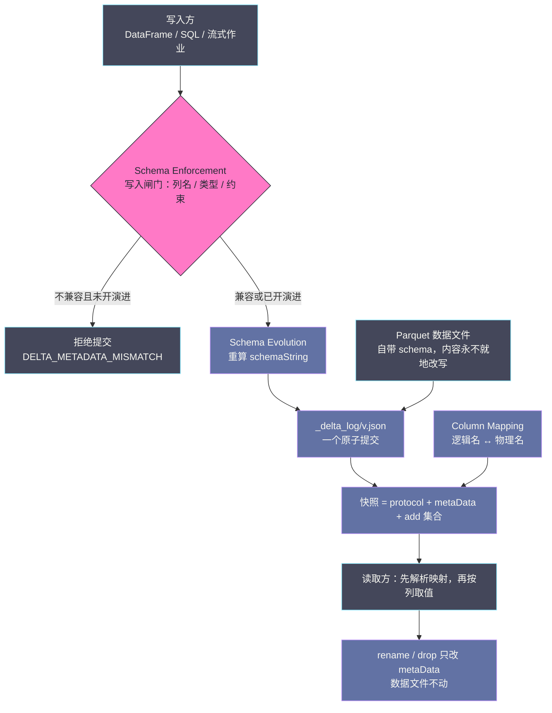
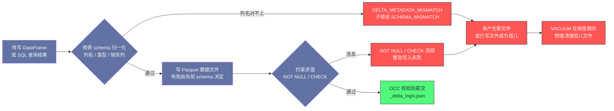
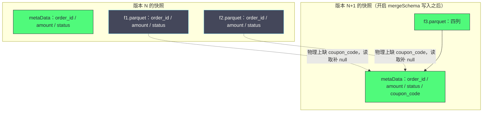
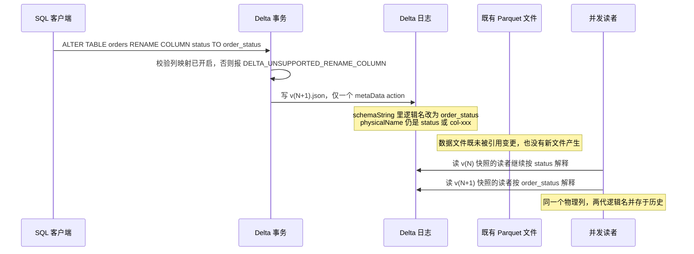
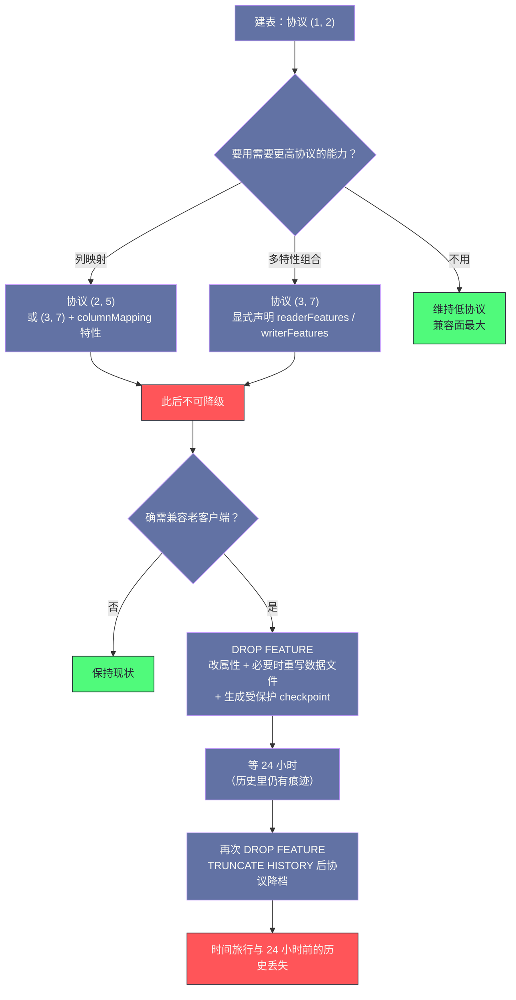
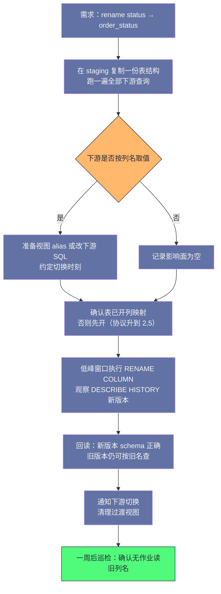

# 05 Schema Evolution 与 Schema Enforcement：模式管理全解

**摘要：**

Schema 管理看起来是 DDL 层面的一件小事，在湖仓里却同时牵动三样东西：写入时要不要拦、历史文件该怎么读、以及别人还能不能读你的表。纯 Parquet 的表没有提交点，表级 schema 只是外部元数据服务里的一条记录，而列身份只存在于每个文件的 footer 里，两份定义各说各话；一旦改列名，旧文件仍按旧名字躺着，查询返回 null，全程没有报错。Delta Lake 的做法是把 schema 收进事务日志：每个版本至多一份 metaData action，写入时按当前 schema 校验，演进时只追加一份新的 metaData 而不碰数据文件。本文沿这条主线拆三层机制——强制（Enforcement）的三条判据与报错原文、演进（Evolution）的合并规则与 mergeSchema 的作用域、列映射（Column Mapping）如何用物理名与列 id 把逻辑列名从物理布局里解耦——再交代类型拓宽的记录方式、协议版本与表特性、以及几乎不可逆的降级路径，最后落到运维侧的变更流程、在 DESCRIBE HISTORY 里定位变更点，与三类代价高昂的反例。要回答的是两个问题：为什么 rename 可以只改元数据，以及这份便宜到底是用什么换来的。

**关键词（Keywords）**: Column Mapping, Schema Enforcement, Schema Evolution, Type Widening, 协议版本, 表特性, 列重命名, DESCRIBE HISTORY

---

## 第 1 章 Schema 在湖仓里为什么格外难

### 1.1 一个改了列名的下午

设想 2016 年前后一个典型的数仓运维场景：上游业务把订单表的 `status` 字段改名为 `order_status`，数据组收到需求，在 Hive 里执行一条 `ALTER TABLE orders CHANGE COLUMN status order_status string`。命令秒级返回，元数据服务里的表定义更新了，`DESC orders` 看到了新列名，事情看上去结束了。

第二天报表侧来问：为什么订单状态全空了。原因不难猜——Hive 元数据里的列名改了，但 HDFS 上那些按天分区的 Parquet 文件里，列的名字仍然是 `status`。查询时读取端按 `order_status` 去找列，文件里没有，于是按 Parquet 的兼容读规则返回 null。整个过程没有任何报错，失败从"改列名"这一刻起，被推迟到了"有人真的去读这一列"的时刻。

这类事故不是某个引擎的缺陷，而是"表级 schema"与"文件级 schema"之间没有任何强制关系所导致的必然结果。湖仓要解决的正是这类问题，而它的做法不是让文件可改，而是给"表"补上一个可以原子更新的定义。

### 1.2 Parquet 的列身份只存在于文件里

Parquet（Apache Parquet）是列式存储格式，每个文件自带一份 schema，写在文件尾部的 footer 里。读取一个文件时，读取端先读 footer 拿到列名、类型、嵌套结构与统计信息，再决定去读哪些列的哪些 page。

这份 schema 是文件的私有财产。同一个目录下的两个 Parquet 文件，列名可以完全不同、列顺序可以完全不同、类型也可以不同，只要读取端愿意逐文件协商，它们就能被读成一张逻辑表。Spark 读 Parquet 目录时默认并不逐文件合并 schema（`spark.sql.parquet.mergeSchema` 默认关闭），而是用目录级 summary 或者调用方给的 schema 去匹配文件，规则大致是三条：文件里缺的列返回 null，文件里多的列被忽略，类型不匹配则报错或者按规则强转。

于是"表 schema"这件事在纯 Parquet 世界里其实是不存在的，存在的只有"文件 schema 的集合"外加一个读取端惯用的公共视图。所谓 Schema-on-Read，本质是把解释权交给读者，谁读谁负责拼装；拼装规则一旦不一致，同一个目录在不同的作业里就是两张不同的表。

| 维度 | 纯 Parquet 目录 | Hive 外部表 | Delta Lake 表 |
|---|---|---|---|
| 表级 schema 存在哪里 | 不存在，靠读取端拼 | 元数据服务（HMS）里的一份记录 | 事务日志 `metaData` action 的 `schemaString` |
| 与数据文件的关系 | 无强制关系 | 弱关系，不会因改元数据而修复文件 | 读取端按日志里的 schema 解释文件 |
| 改列名的代价 | 重写全部文件，或永远错着读 | 改元数据，旧文件读成 null | 开启列映射后只改元数据 |
| 变更是否有原子提交点 | 无 | 元数据服务层面有，和数据不同步 | 有，一个版本一个 commit |
| 脏数据能否拦在入口 | 不能 | 只能在写入端自行保证 | 能，写入时按表 schema 校验 |

### 1.3 没有提交点，就没有"表"

把问题再往下推一层：为什么 Hive 改列名会出事，而关系数据库不会？差别不在列式还是行式，而在"表"这个概念有没有一个原子的定义处。

关系数据库里有系统表，改列名是一次事务，改完之后所有后续读都按新定义执行，物理存储层的列序、偏移由存储引擎负责，用户看不见。数据湖没有这一层：目录列表不是表，`_SUCCESS` 文件不是表，元数据服务里的那条记录也只是旁证——它和数据文件之间没有任何机制保证同步，读写两侧谁先谁后完全自由。

Delta Lake 的做法是把"表当前长什么样"这件事变成日志里的一个 action。事务日志（Delta Log）是一个只追加的目录 `_delta_log/`，每次提交产生一个按版本号命名、零填充到 20 位的 JSON 文件，例如 `00000000000000000042.json`，里面每行一个 action：`protocol`、`metaData`、`add`、`remove`、`txn`、`commitInfo` 等等。读一个版本，就是按版本序把 action 重放一遍，其中"最新的 `metaData` 生效、最新的 `protocol` 生效"。schema 因此有了**唯一且可原子替换**的存放处。

这个改动看似只是换了个存储位置，带来的性质却完全不同：schema 变更和数据变更可以放进同一个 commit（原子），也可以单独占一个 commit（轻量）；读者始终读某个版本的快照，不会被中途的变更撕裂；变更的历史天然留痕，`DESCRIBE HISTORY` 能指到具体版本。

### 1.4 三层机制的分工

Delta 把 schema 管理拆成了三件彼此正交的事，混在一起谈就会得出"Delta 什么都能改"或者"Delta 改 schema 很危险"这类片面结论。



三层各管一段：强制层决定"什么样的数据能进来"，演进层决定"表定义怎么长出新列、新类型"，列映射层决定"逻辑列名与物理布局还需不需要一一对应"。三者共用同一个提交机制，变更都享有原子性；但对协议版本的要求各不相同，这正是后文反复出现**协议门槛**的原因。

### 1.5 贯穿全文的订单表

为了让后面的机制有具体着力点，笔者用一个订单表 `orders` 贯穿全篇：

```sql
-- 初始定义（下游有三个消费者，后文会逐个提到）
CREATE TABLE orders (
  order_id   BIGINT,
  amount     DECIMAL(12, 2),
  status     STRING,
  channel    STRING,
  updated_at TIMESTAMP
) USING DELTA PARTITIONED BY (dt);
```

上游是一个 CDC（Change Data Capture）同步作业，每天把业务库的增量写进来；下游有三类消费者：BI 报表按 `status` 与 `channel` 做分组聚合，特征工程每天全量扫一遍 `amount` 求用户级统计，还有一个流式作业订阅变更数据，把订单状态变化推给风控。后文每次讲一种变更，都会落回这张表：加 `coupon_code` 列、把 `amount` 拓宽到 `DECIMAL(14, 4)`、把 `status` 改名为 `order_status`、删掉一个早期的 `legacy_flag`、以及一次失败的"新增 NOT NULL 列"。

这三个消费者对 schema 变更的敏感度完全不同：BI 依赖列名，改名即失效；特征工程依赖类型，加宽即静默改变数值精度；流式作业依赖"历史文件能否被同一份逻辑 schema 读"，非加法变更会直接打断它。这种差异决定了任何一次变更都不能只看写入侧。

### 1.6 一个比喻：总部台账与门店价签

把纯 Parquet 的表想成一排门店，每家店在自己货架上手写价签：总部想改一个商品名，只能派人去每家店重写价签，否则顾客看到的还是旧名字；总部手里那本台账（元数据服务）即便改了，也和货架上的价签没有强制关系。

Delta 的表则像总部统一印制的台账加一套登记制度：门店上新必须先在台账登记（Schema Enforcement），台账可以加行但已经登记过的行不许涂改（Schema Evolution 的向后兼容），而货架上的位置（物理列名）与台账上的品名（逻辑列名）通过一张对照表关联（Column Mapping），改名只改对照表，货架不用重新摆。

比喻的技术限定在于：台账本身也有代价。Delta 的台账不是免费的中心化系统，它就是对象存储上的一个目录，靠"写一个只增不改的 JSON 文件"实现原子性；对照表也不是数据库索引，而是塞在字段元数据里的一段 JSON。这一点决定了"改列名"可以便宜到毫秒级，而"改协议版本"贵到不可逆。

---

## 第 2 章 Schema Enforcement：写入闸门

### 2.1 校验发生在写文件之前

Delta 的写入流程可以粗略分成四步：先在 Driver 侧把待写数据按目标表的 schema 归一化，再按归一化后的布局写 Parquet 数据文件，然后构造本次提交的 action 集合，最后走乐观并发控制（Optimistic Concurrency Control，OCC）校验并提交。

schema 校验落在第一步与第四步之间。以 Spark 写入为例，写入路径会调用 `SchemaUtils.normalizeColumnNames`，把待写 DataFrame 的列按表 schema 做三件事：名字大小写归一（在 `spark.sql.caseSensitive=false` 时把数据列名改成表里的写法）、缺失列的判定、多余列的判定；需要的话再插入显式 `cast`。这一步不通过就直接抛异常，数据文件根本不会被写出来。



图中右侧那条分支值得记住：**校验失败不等于什么都没发生**。约束求值发生在数据文件写入之后，违反约束时文件已经落在存储上，只是没有被任何 `add` action 引用，成了**孤儿文件**；读者看不见它们，但它们占着存储，直到 VACUUM 按 `delta.deletedFileRetentionDuration`（默认一周）清理。排查存储异常增长时，这个差别很要紧。

### 2.2 判据一：列名集合

第一条判据最简单也最常触发：待写数据里出现了表 schema 中不存在的列，且没有开启演进，则整批写入被拒。

这条规则看似呆板，实际考量是"额外的列无法解释"。读者按表 schema 投影，多出来的列不会被看到，写进去只浪费存储；更糟的是它让"上游多了字段"这件事静默流通，直到某天有人问为什么新字段查不到。**把静默变成显式报错**，是把问题推回上游的第一道阀门。

反过来，数据里缺列是允许的：缺的列在写入时按 null 填充，因为表 schema 里那些列本来就必须可空，否则它无法容纳历史文件。注意方向：Delta 要求"数据的列是表的子集"，而不是反过来——这与直觉相反，却正好对应 Parquet 兼容读的方向。

### 2.3 判据二：类型是否可安全转换

第二条判据针对类型。目标列与源列类型不一致时，Delta 不会一律拒绝，也不会一律强转，而是看这次转换是不是"安全"的：信息不丢失就放行并插入 `cast`，可能丢精度或者可能失败就拒绝。

判据的方向很硬：**窄到宽放行，宽到窄拒绝**。`int` 到 `bigint`、`float` 到 `double`、精度更大的 decimal 放行；`bigint` 到 `int`、`double` 到 `string`、`string` 到 `double` 一律拒绝（字符串可能是 `"N/A"`，转换必然有失败路径）。拒绝时报的是合并类型失败或者 Spark 的强转错误，前者形如 `DELTA_FAILED_TO_MERGE_FIELDS: Failed to merge fields '<currentField>' and '<updateField>'`，后者在越界时会给出 `DELTA_CAST_OVERFLOW_IN_TABLE_WRITE`，并提示"要用 `try_cast` 就把越界值变成 null 的话可以显式写出来"。

这里有一个容易混淆的地方：`int` 到 `bigint` 在写入时放行，不等于表 schema 会变成 `bigint`。写入端的 `cast` 只是把这一批数据转成表要的类型，表 schema 一个字节都没动；要让列真的变宽，是另一条路径（类型拓宽，见第 4 章）。把"写入时允许窄数据进宽列"和"把列改成宽类型"当成同一件事，是在生产上做出错误判断的常见起点。

### 2.4 判据三：可空性与约束

第三条判据来自约束。Delta 的约束体系分两层：列上的 `NOT NULL` 标记，以及 `ALTER TABLE ... ADD CONSTRAINT` 添加的 `CHECK` 约束。加约束会自动抬高写入协议版本，具体档位取决于约束类型——`CHECK` 约束对应写入版本 3。

`NOT NULL` 的检查方向有两个：数据里缺了这一列时报 `DELTA_MISSING_NOT_NULL_COLUMN_VALUE`，值显式为 null 时报 `DELTA_NOT_NULL_CONSTRAINT_VIOLATED`。`CHECK` 约束在写入时对每一行表达式求值，任何一行不满足就整批失败。这类失败是**全有或全无**，不会出现"一半数据进去了"的状态。

一个常被踩的坑是给已有表加 `NOT NULL`：历史里那些为 null 的行会让 DDL 直接失败，报 `DELTA_NEW_NOT_NULL_VIOLATION` 并提示违反行数。正确的顺序是回填数据、再改可空性，而不是反复重试 DDL。反过来，新增一个 `NOT NULL` 列也不可行——历史文件里没有这一列，按兼容读只能给 null，与约束直接冲突；Delta 对此明确禁止，而不是悄悄放宽。

### 2.5 报错原文长什么样

以 Delta Lake OSS 4.4 为例，典型的 schema 不匹配是一次带子错误的元数据不匹配异常，主错误类是 `DELTA_METADATA_MISMATCH`，子错误 `SCHEMA_MISMATCH` 的文本为：

```text
A metadata mismatch was detected when writing to the Delta table.
A schema mismatch detected when writing to the Delta table (Table ID: <id>).
To enable schema migration using DataFrameWriter or DataStreamWriter, please set:
'.option("mergeSchema", "true")'.
For other operations, set the session configuration
spark.databricks.delta.schema.autoMerge.enabled to "true". See the documentation
specific to the operation for details.

Table schema:
...
Data schema:
...
```

这段文本区分了"单次写入的开关"与"会话级开关"，把两条路径都写了出来。同一个主错误下还有两个子错误：`OVERWRITE_REQUIRED`（想改 schema 或分区必须显式 `overwriteSchema=true`，用 `replaceWhere` 时不允许）与 `PARTITIONING_MISMATCH`（写入指定的分区列与表不一致）。三个子错误放在一起，是为了让一次失败说清"撞了哪堵墙"。

### 2.6 append 与 overwrite 的差别

`append` 与 `overwrite` 在 schema 校验上规则相同，后果不同：`append` 失败只是这一批没进去；`overwrite`（非动态分区覆盖）失败会让"本该整表替换"的作业整体回滚，下游看到的还是旧数据。真正的差别在"想改 schema 怎么办"。

默认情况下，`mode("overwrite")` 不替换表 schema：写入数据的 schema 仍被当成"要往表里塞的东西"去校验。要替换，必须显式设置 `overwriteSchema=true`，代价是表 schema 与分区定义整体换掉，历史文件里对不上的列从此按新定义解释（多的忽略、缺的补 null），这等于一次隐式的数据迁移。用 `replaceWhere` 做局部覆盖时，这条路径被明确封住——局部覆盖和整表改 schema 在语义上无法同时成立。

| 写入方式 | 是否可改表 schema | 触发条件 | 下游可见的影响 |
|---|---|---|---|
| append | 否 | 只能靠 `mergeSchema` 或会话开关追加新列 | 老数据新列为 null |
| append + mergeSchema | 是，只加列 | 单次写入显式开启 | 同上，且表 schema 变更对其他写入方立即可见 |
| overwrite（默认） | 否 | 只做数据替换 | 无 schema 变化 |
| overwrite + `overwriteSchema` | 是，整体替换 | 显式开启，且不能用 `replaceWhere` | 历史列语义可能被重解释 |
| overwrite + `replaceWhere` | 否 | 局部覆盖 | 无，且不允许改 schema |

### 2.7 mergeSchema 开关的作用域

`mergeSchema` 这个词在文档里出现了三个层次，混用会造成"为什么我开了没生效"的困惑，值得单独摊开。

第一层是**单次写入选项** `mergeSchema=true`，挂在 `DataFrameWriter` 或 `DataStreamWriter` 上，只对这一条写入命令生效，作用域最小、意图最清楚。

第二层是**会话级开关** `spark.databricks.delta.schema.autoMerge.enabled`，它把"允许演进"作为整个 SparkSession 的默认行为，影响该会话里的写入操作，也是 `MERGE INTO` 做 schema 演进前提的那个开关（官方文档对 merge 的要求写得很明确：必须先把这个配置置为 true）。

第三层是**语句级语法**：Delta Lake 4.3 起文档化了 `INSERT WITH SCHEMA EVOLUTION` 与 DataFrame API 的 `.withSchemaEvolution()`，把演进意图写进语句本身。优先级上，操作级设置高于会话级设置；两者都开时以操作级为准。

注意这里没有"表属性级"的开关。`delta.autoMerge.enabled` 这类表属性不在 OSS 的配置清单里，想把"永远不许自动演进"钉在表上，只能靠"不开会话开关 + 每个写入作业自己不开选项"，而这恰恰是运维上难以保证的，第 8 章再算这笔账。

### 2.8 大小写、别名与归一化

`normalizeColumnNames` 除了判定，还会改写：把待写数据的列名改成表 schema 里的大小写，再把结果 alias 回表里的名字。这在大小写不敏感的 Spark 会话里很自然，跨引擎时却会造成误解——同一张表，别的连接器可能直接报列不存在。

另一类更隐蔽的问题是"同名但嵌套路径不同"：列名判定按完整字段路径展开（`a.b.c` 形式）再比对，所以"顶层多一列"与"某个 struct 内部多一列"会得到同样的"多余列"结论。遇到这类报错，先看报错里 Table schema 与 Data schema 两段展开结果，比逐层 `printSchema` 快。

---

## 第 3 章 Schema Evolution：加列为什么安全

### 3.1 加列是唯一"零成本"的演进

在所有 schema 变更里，加列是唯一的**纯加法**：不需要额外协议、不需要重写文件、也不需要读者做特殊处理。原因就藏在 Parquet 的兼容读规则里：新加的列在历史文件里不存在，读取端按名字找不到，返回 null；null 是每一个可空列本来就允许的值，语义上没有歧义。

这条推理有一个前提：**新列必须可空**。历史文件里没有这一列，读取端只能给 null，如果新列被声明为 `NOT NULL`，历史数据立刻违反约束。Delta 的选择是直接拒绝这种演进，而不是"先加上、以后再说"。

第二个前提是"读取端按名字匹配列"。Delta 的读取路径始终以表 schema 为基准去投影，文件里多出来的列不会被读到（列映射模式下更是如此），所以"加列"对老文件是纯粹的加法。

### 3.2 一次提交里同时发生的事

演进不是"先改 schema，再写数据"的两步操作，而是同一个 commit 里的一组 action。以一次带 `mergeSchema` 的 append 为例，版本 `v+1` 的 JSON 里同时包含若干 `add` action（新写的数据文件）、一个 `metaData` action（含新的 `schemaString`）、以及一个 `commitInfo`：

```json
{"commitInfo":{"timestamp":1735689600000,"operation":"WRITE","operationParameters":{"mode":"Append"},"isBlindAppend":true}}
{"metaData":{"id":"b7f3...","format":{"provider":"parquet","options":{}},"schemaString":"{\"type\":\"struct\",\"fields\":[{\"name\":\"order_id\",\"type\":\"long\",\"nullable\":true,\"metadata\":{}},{\"name\":\"amount\",\"type\":\"decimal(12,2)\",\"nullable\":true,\"metadata\":{}},{\"name\":\"status\",\"type\":\"string\",\"nullable\":true,\"metadata\":{}},{\"name\":\"coupon_code\",\"type\":\"string\",\"nullable\":true,\"metadata\":{}}]}","partitionColumns":["dt"],"configuration":{},"createdTime":1735689600000}}
{"add":{"path":"dt=2026-11-19/part-00007-....parquet","partitionValues":{"dt":"2026-11-19"},"size":1048576,"modificationTime":1735689600000,"dataChange":true,"stats":"{...}"}}
```

这个设计带来一个常被忽略的性质：读者要么看到 `v` 版本（旧 schema、旧文件集合），要么看到 `v+1` 版本（新 schema、旧文件集合加新文件），中间没有"schema 已更新但数据还没写"的窗口。写入侧不需要加锁，读取侧不需要重试，这就是把 schema 塞进事务日志换来的确定性。



图里左边两个文件从未被修改，右边的 schema 却已经包含新列——"演进"这个词容易让人以为是文件在变，实际变的自始至终只有那一行 JSON。

### 3.3 合并规则

Delta 的 schema 合并由 `SchemaMergingUtils` 负责，规则可以整理成一张表：

| 变更 | 是否允许 | 机制 | 备注 |
|---|---|---|---|
| 添加可空列 | 允许 | 追加到所在 struct 末尾，历史数据读为 null | 列名大小写按源数据保留 |
| 添加 NOT NULL 列 | 拒绝 | 历史文件无法满足约束 | 需先回填再加约束 |
| 删除列 | 不通过演进 | 必须开列映射后用 `DROP COLUMN` | 演进只增不减 |
| 重命名列 | 不通过演进 | 必须开列映射后用 `RENAME COLUMN` | 见第 5 章 |
| 窄到宽类型合并 | 部分允许 | 需表开启类型拓宽 | 见第 4 章 |
| 宽到窄类型合并 | 拒绝 | 会丢精度 | 报合并类型失败 |
| struct 内新增字段 | 允许 | 与顶层同规则 | 嵌套路径逐层合并 |
| array 内 struct 新增字段 | 允许 | 按名解析 | MERGE 场景自 2.3 起支持按名指定字段 |
| NullType 列 | 特殊处理 | 写入时丢弃列但保留在 schema | 后续收到真实类型再合并 |

这张表里最容易误读的是最后一行。NullType 是 Spark 推断不出类型时的占位，Parquet 无法表示，Delta 的处理是"写入时把这一列从数据里丢掉，但 schema 里留着这个位置"，等到某次写入带来真实类型，再把 schema 合并成那个类型。这个行为在"上游偶尔送全 null 列"的数据源上会出现，表现为"表里有列、数据里全 null、过几天突然有了值"。

### 3.4 演进之后，统计信息会出现空洞

加列是零成本的，但"零成本"只针对可读性。新列在历史文件里没有统计信息（min/max、null 计数），数据跳过（data skipping）依赖的正是这些统计，于是涉及新列的谓词在历史分区上无法裁剪，只能全量扫描。

这不是正确性问题，但会造出**统计空洞**：一次加列会让"按新列过滤"的查询在最老的那批分区上退化为全扫，随着时间推移才逐渐恢复。如果新列会立刻被高频查询使用，一个常见做法是变更后对该表做一次 `OPTIMIZE` 加 `ZORDER BY`（或者在新版本里用液态聚簇），顺手把统计信息补齐；代价是一次全表重写，这正是"演进便宜、补统计不便宜"的分界点。

另外，删列会同步收缩统计列清单（`delta.dataSkippingNumIndexedCols` 的语义是按列序计数的），删掉靠前的列会让后面的列在统计体系里"前移"，历史统计与新统计的列对应关系因此需要重新对齐。这类细节不会报错，只会在某天发现"这个谓词怎么不裁剪了"时才被想起。

### 3.5 反例：把 autoMerge 常年开着

最省事的做法是在集群默认配置里把 `spark.databricks.delta.schema.autoMerge.enabled` 设成 true，所有作业都不再为 schema 报错发愁。这件事的代价在文档里写得很直白：会话级开启不推荐，因为它会导致跨操作的意外 schema 变更，并且让"哪个操作改了 schema"难以追溯。

把它想成一个组织的用印制度：平时不设审批，谁都能盖章，效率极高；出事时想查是谁盖的，只能翻每一份文件的边缘。schema 演进本身不危险，危险的是"演进没有边界"——上游一次拼写错误（`order_stauts`）就被自动登记成新列，此后表里长期躺着两个拼写不同的状态列，而 BI 侧只认其中一个。

替代方案并不复杂：把会话开关关掉，需要演进的作业显式写 `mergeSchema` 或 `WITH SCHEMA EVOLUTION`，并在代码评审里作为一个显式决策被看到；再配合第 7 章的变更流程，让 schema 变更在 `DESCRIBE HISTORY` 里能一眼定位。

---

## 第 4 章 类型变更：从一律禁止到类型拓宽

### 4.1 类型变更为何天生不安全

列名可以靠"查表映射"解决，类型不行。类型决定了物理编码：`int` 在 Parquet 里是 4 字节定长，`decimal(12,2)` 是定长精度编码，读取端必须知道用哪种解码器。若表 schema 说是 `bigint` 而文件里存的是 4 字节 int，读取端可以把它提升成 long（Parquet 与 Spark 都支持的标准兼容提升）；若表 schema 说是 `string` 而文件里是 double，就没有任何合理的自动解释。

所以类型变更的可行性完全取决于**读端能不能不改文件地重解释旧数据**。窄到宽可以，宽到窄不行，跨族转换更不行。Delta 早期的策略是干脆禁止类型变更：`ALTER TABLE ... CHANGE COLUMN ... TYPE` 会失败，想改只能整表重写。

### 4.2 类型拓宽的引入与口径

类型拓宽（Type Widening）在 Delta Lake 3.2 以预览形式出现、在 4.0 正式支持。开启方式是设表属性 `delta.enableTypeWidening = 'true'`；协议上它会引入表特性 `typeWidening`（3.3 及以后）或者 `typeWidening-preview`（3.2），而这一类特性属于读写双向特性，协议门槛是读取版本 3、写入版本 7。

```sql
-- 开启类型拓宽（会同时引入表特性，协议抬到 7/3）
ALTER TABLE orders SET TBLPROPERTIES ('delta.enableTypeWidening' = 'true');

-- 手动把金额列拓宽（不会重写任何数据文件）
ALTER TABLE orders ALTER COLUMN amount TYPE DECIMAL(14, 4);
```

支持的类型路径比想象中窄，也很讲究分寸：

| 源类型 | Delta 3.2（预览）可拓宽到 | Delta 4.0 可拓宽到 | 说明 |
|---|---|---|---|
| byte | short / int | short / int / long / decimal / double | 到 decimal 与 double 必须手动 |
| short | int | int / long / decimal / double | 同上 |
| int | long | long / decimal / double | 同上 |
| long | — | decimal / double | 必须手动 |
| float | double | double | 无 |
| decimal(p, s) | 精度更大的 decimal | 精度更大的 decimal | 需满足 k1 ≥ k2 ≥ 0 |
| date | — | timestampNTZ | 带时区语义的 timestamp 不在列 |

decimal 的规则值得单独记：从 `decimal(p, s)` 变到 `decimal(p + k1, s + k2)` 必须满足 `k1 ≥ k2 ≥ 0`。例如 `decimal(10, 1)` 想加两位小数，最小目标是 `decimal(12, 3)`，因为总精度至少要覆盖"原有整数位 + 新增小数位"。`byte`、`short`、`int` 的最小目标是 `decimal(10, 0)`，`long` 是 `decimal(20, 0)`。

至于"为什么整数到 decimal 或 double 必须手动"，官方给的理由是防止"整数被意外提升成小数"，进而出现下游把小数写回整数列时被截断的连锁问题。这条限制本质上承认了一件事：类型拓宽在物理上是安全的，但在业务语义上不一定是——把金额从整数分变成小数元，是数据迁移，不是类型演进。

### 4.3 机制：把每次类型变更记在字段元数据里

类型拓宽的实现不是"在元数据里同时存逻辑类型和物理类型"这么简单，实际做法是把每一次类型变更的 from/to 记到该字段的元数据里，键名是 `delta.typeChanges`，每一项包含 `fromType`、`toType`、以及嵌套路径 `fieldPath`（在预览版客户端里还会多一个 `tableVersion`）。

读取侧的推理因此是这样一条链：快照的 `schemaString` 给出当前逻辑类型（例如 `decimal(14,4)`）；字段元数据里的 `delta.typeChanges` 说明"这一列曾经是 `decimal(12,2)`"；读取某个历史文件时，若该文件写于变更之前，它里面的物理类型就是窄类型，读取端按 Parquet 的类型提升把值读出来再交给上层。文件本身完全不需要改动。

写入侧则反过来：写入端按当前 schema 做 cast，宽列能装下窄值，所以窄数据写进宽列永远安全；只有当写入端带来的数据比表还宽时，才需要再判断一次"要不要继续拓宽"。

这套机制有一个直接推论：类型拓宽的元数据是有序累积的，一列可以经历多次拓宽（`decimal(10,0)` → `decimal(12,2)` → `decimal(14,4)`），每一次都留下一条记录，连成一条**变更链**。这也是为什么"降级"必须重写文件——只有把每一次变更加过的文件都改写成最终类型，才有可能把 `delta.typeChanges` 整条链删掉。

### 4.4 自动演进时的拓宽条件

类型拓宽与 schema 演进可以联动：开启演进后，写入数据比表列更宽时，Delta 可以自动把表列拓宽，而不是尝试 downcast。这条路径要同时满足五个条件：写入命令开启了演进、目标表开启了类型拓宽、源列类型确实比目标宽、该变更在支持列表内、且不属于"整数到 decimal 或 double"这一类只允许手动的变更。

反过来，如果表没有开类型拓宽，"自动演进"的默认行为其实是降级（downcast）——尽量把源数据转成表里的类型。这个默认值值得警惕：一个上游把 `int` 改成 `bigint` 之后，若表没开类型拓宽而写入又开着演进，数据会被静默截断回 `int`，越界值直接报错或丢精度，而不是把表变宽。官方文档对此的提醒很直接：如果不希望类型被自动拓宽，就在跑带演进的作业之前把类型拓宽关掉；反过来，如果希望变宽，就必须在写入前把表属性打开。

### 4.5 老客户端撞上新类型

一旦表里存在类型拓宽记录，不懂这个特性的客户端读表会直接失败，而不是读出错误数据——这一点是刻意的。对应的报错是 `DELTA_UNSUPPORTED_TYPE_CHANGE_IN_PREVIEW`，文本写明"本版本的 Delta 无法读取该表，因为应用了一次不支持的类型变更，字段从 A 变成了 B，请升级到 4.0 或更高版本"，并给出"或者用支持读该表的客户端把 Type Widening 特性 drop 掉"这条退路。

把失败做成显式，是湖仓在类型问题上的基本原则：**宁可读不出，不可读错**——金额被读成截断的整数，比读不出来危险得多。

### 4.6 关闭与降级不是一回事

把 `delta.enableTypeWidening` 设为 false 只阻止未来的类型变更，不移除表特性，也不会让不支持该特性的客户端恢复可读。真正移除要 `ALTER TABLE ... DROP FEATURE 'typeWidening'`，过程相当重：

它会先把相关表属性关掉，然后把所有仍带窄类型的 Parquet 文件重写一遍，使文件里的类型与表 schema 对齐；接着创建一组受保护的 checkpoint 并引入 `checkpointProtection` 特性，最后把协议降到仍能覆盖剩余特性的最低版本。要彻底降到老客户端可写，还需要加 `TRUNCATE HISTORY`，而这个动作会清掉 24 小时以前的历史，时间旅行随之作废，并且完整降级要分两次、间隔至少 24 小时执行。

也就是说，类型拓宽**入场便宜、退场很贵**：入场只是一条表属性，退场是一次全表重写加上历史截断。这个不对称在第 6 章讨论协议时还会再出现一次。

---

## 第 5 章 Column Mapping：把列名从物理布局里解耦

### 5.1 重命名的历史成本

在没有列映射的年代，Delta 表的重命名只有一条路：整表重写。用 `overwriteSchema` 配合 `withColumnRenamed`，把数据全部读出来、改列名、再写回去。对一个 TB 级的订单表，这是一次数小时的重写，期间还要考虑双写窗口、下游切换、以及失败回滚。

工程上更常见的做法不是重写，而是绕：建视图把旧列名 alias 成新列名，物理列不动。视图解决读，解决不了写——写入方仍按旧列名写；它也只是一层需要维护的映射，时间一长没人数得清表里有几个别名。

两者都不便宜，所以现实中大多数团队的选择是"就这样用着"，命名混乱逐年累积。列映射要解决的正是这个僵局：让"改列名"变成一次元数据变更，而不是一次数据迁移。

### 5.2 机制：给每一列一个物理名和一个 id

列映射（Column Mapping）给表中每一列——包括嵌套结构里的每一个字段——分配两样东西：一个物理名（physical name）与一个 32 位整数 id。物理名写在字段元数据的 `delta.columnMapping.physicalName` 里，id 写在 `delta.columnMapping.id` 里；表级开关是表属性 `delta.columnMapping.mode`，取值 `none`、`name`、`id`。

```json
{
  "name": "order_status",
  "type": "string",
  "nullable": true,
  "metadata": {
    "delta.columnMapping.id": 7,
    "delta.columnMapping.physicalName": "col-5f422f40-de70-45b2-88ab-1d5c90e94db1"
  }
}
```

上面这段就是 `schemaString` 里一个字段的真实形状：对外的名字是 `order_status`，写进 Parquet 的列名是 `col-5f42...`。读者解析 schema 时先拿物理名去文件里找列，找到之后再把结果挂回逻辑名下，整个过程对 SQL 层不可见。

开启列映射需要协议支持：读取版本 2、写入版本 5；如果表已经在表特性体系上（读取 3 / 写入 7），则需要 `columnMapping` 这个读写双向特性。官方文档给出的开启语句会显式写上两个版本号，而实际执行时若表的协议不够，客户端会顺带升级并给出提示——4.4 的报错建议文本就写着"如果表不在所需协议版本上，它会被升级"。

```sql
-- 在已有表上开启；协议会升到 (2, 5)
ALTER TABLE orders SET TBLPROPERTIES (
  'delta.minReaderVersion' = '2',
  'delta.minWriterVersion' = '5',
  'delta.columnMapping.mode' = 'name'
);
```

### 5.3 开启那一刻发生了什么

这是理解整套机制的关键细节：对一张已有数据的表开启列映射时，历史列不会得到随机物理名，而是沿用自己的逻辑名作为物理名。源码里的对应参数叫 `reuseLogicalName`，含义是"能复用就复用"，这样历史文件里那些用原名存着的列仍然可以被找到，不需要重写任何数据。

只有开启之后新加的列，才会得到 `col-<uuid>` 形式的物理名；同时表属性 `delta.columnMapping.maxColumnId` 会单调递增，保证每个新列拿到的 id 不与历史冲突。这个属性是内部属性，用户不能手写。

由此可以推出一个很实用的判断：表里某列物理名就是列名本身，说明它是"开启之前就存在的老列"；看到 `col-` 前缀，则是开启之后新增的。排查历史问题时，这条规律比翻日志快。

### 5.4 rename：一次只有 metaData 的提交

有了映射，`RENAME COLUMN` 的实现就变成了**纯元数据更新**：改 `schemaString` 里那个字段的 `name`，保留它的 `physicalName` 与 `id` 不变，提交一个新版本。



这次提交的 action 集合里没有 `add`、没有 `remove`，只有 `metaData`（以及 `commitInfo`）。它的代价与表规模无关：一个 PB 级的表和一张千行表，rename 的耗时都在**毫秒到秒**的量级。真正的成本在元数据一侧——每次 rename 都要重写整个 `schemaString`，而这个字符串会随列数线性增长，几十万列的超宽表另当别论。

历史版本的可读性也由此保住：查 `v(N)` 的读者看到的是旧 schema，按旧名解释；查 `v(N+1)` 的读者看到新 schema。两者读的是同一批文件，各用各的映射。这种"同一份数据、两代名字并存"的能力，是 MVCC 快照隔离在元数据层面的直接体现。

### 5.5 drop：逻辑删除与物理名的唯一性

`DROP COLUMN` 同样是纯元数据操作：从 `schemaString` 里移除该字段（含其 `id` 与 `physicalName` 记录），文件不动。

但它比 rename 多几道闸门。不能删分区列（`DELTA_UNSUPPORTED_DROP_PARTITION_COLUMN`）；不能删聚簇列（`DELTA_UNSUPPORTED_DROP_CLUSTERING_COLUMN`）；不能把表删到只剩零列（`DELTA_DROP_COLUMN_ON_SINGLE_FIELD_SCHEMA`）；如果这一列被 `CHECK` 约束或者生成列引用，会分别报 `DELTA_CONSTRAINT_DEPENDENT_COLUMN_CHANGE` 与 `DELTA_GENERATED_COLUMNS_DEPENDENT_COLUMN_CHANGE`，"删除"之前必须先处理依赖。删列还会同步收缩表的统计列清单，避免后续写入继续为不存在的列收集统计。

物理数据不会因为 `DROP COLUMN` 消失。它仍然躺在历史文件里，只有经过 VACUUM、超过保留期（默认一周）之后才可能被清理。若在保留期内对历史版本做时间旅行，被删的列会重新出现——因为那个版本的 schema 里它还在。

这里藏着一个精妙的设计：协议要求**物理字段路径在所有版本上唯一**。也就是说，一个被删掉的列，它的物理名不能再被之后新增的列复用；新列拿的是新的 `col-<uuid>`。这条约束直接排除了一个危险情形——先删 `legacy_flag`、后来又加回一个同名但语义不同的 `legacy_flag`，读取端不会因为物理名相同而把旧文件里的历史值当新列读出来。

### 5.6 两种模式：name 与 id

Delta 协议定义了两种列映射模式，差别在于读取端用什么来定位文件里的列：

| 维度 | `name` 模式 | `id` 模式 |
|---|---|---|
| 读取端定位方式 | 按 `delta.columnMapping.physicalName` 找列 | 按 Parquet 的 `field_id` 找列，字段 id 来自 `delta.columnMapping.id` |
| 物理名形态 | 老列为原名，新列为 `col-<uuid>` | 一律为 `col-<uuid>` |
| 文件缺少定位信息时 | 找不到就返回 null | 文件没有 field id 时，可拒读或整列返回 null |
| 主要用途 | 兼容已有数据，渐进启用 | 新建表，彻底隔离逻辑名与物理布局 |
| 大小写敏感度 | 依赖物理名字符串匹配 | 依赖整数 id，大小写无关 |

`id` 模式更适合全新的表：整数 id 不受改名、大小写、特殊字符影响，读取端也不需要字符串匹配。代价是 Parquet 文件必须带 field id，而很多外部工具写 Parquet 时并不写这个字段，跨引擎写入容易踩坑。`name` 门槛低、历史数据零迁移，但把字符串映射放进了热路径，且物理名一旦生成就不能变。

能新建表就新建表用 `id`；存量表要开，只能用 `name` 起步，因为历史文件里根本没有 field id。

### 5.7 老 reader 会看到什么

开启列映射会把协议抬到读取版本 2。协议升级是单向的：此后任何只实现了读取版本 1 的客户端（例如 Delta 1.x 的库、某些版本较老的第三方连接器）读这张表都会被拒绝，报 `DELTA_INVALID_PROTOCOL_VERSION`，文本里写明表要求什么版本、当前客户端支持什么版本。

比"读不了"更麻烦的是"读得了但读错"。协议要求读取端把列名按物理名解析，分区值与列级统计同样按物理名解析。一个没有实现列映射却恰好能打开文件的工具，会看到：

1. 新列的物理名是 `col-<uuid>`，界面上直接显示这串随机字符；
2. 老列显示的是"开启映射时的那个名字"，此后即使被 rename，它读到的仍是旧名；
3. 分区值取自日志 `add.partitionValues`，键是物理名，按逻辑名去找会"找不到分区"；
4. 文件级统计（`stats`）的列键同样是物理名，按逻辑名做数据跳过会静默失效。

第 4 点尤其隐蔽：结果是对的，只是慢，慢到无法归因——**读得对与读得快是两件事**。这也是"跨引擎共享列映射表"要在接入前逐项验证的原因。Delta 对此也有交代：为外部系统生成 manifest 的功能明确不支持列映射表（`DELTA_UNSUPPORTED_MANIFEST_GENERATION_WITH_COLUMN_MAPPING`），理由正是"外部读者读不懂这些表"。

### 5.8 代价清单

列映射换来的能力很大，代价也很实在，值得一次性列清楚：

- 协议单向抬升，读到 (2, 5) 或者表特性体系下的 `columnMapping`，此后无法回退到不需要映射的协议；
- 文档明确写着开启后不可关闭，尝试把 `delta.columnMapping.mode` 设为 `none` 会报错；不过在 4.4 的源码里已经出现了一条移除路径（操作名 `REMOVE COLUMN MAPPING`，由内部配置 `columnMapping.allowRemoval` 控制），它的做法是把全部数据文件按逻辑名重写一遍——即便能退，退的代价也是一次全表重写；
- 变更数据订阅（Change Data Feed）会受限：表开了 CDF 又做过 `RENAME COLUMN` 或 `DROP COLUMN` 之后，部分操作会被直接拦下，报 `DELTA_BLOCK_COLUMN_MAPPING_AND_CDC_OPERATION`；
- 流式读需要额外的 schema 追踪：列映射表一旦发生过改名或删列，`spark.readStream` 需要提供 `schemaTrackingLocation` 才能继续，否则报 `DELTA_STREAMING_INCOMPATIBLE_SCHEMA_CHANGE_USE_SCHEMA_LOG`；
- 分区列可以 rename（分区值按物理名记录，逻辑名变化不影响定位），但不能 drop，也不能通过 `ADD COLUMN` 或改类型去动它；
- 列名可以包含空格与 `,;{}()\n\t=` 等 Parquet 不接受的字符，这算额外红利，但会让下游 SQL 到处需要转义。

### 5.9 反例：没有映射时的 rename，只能"加列回填"

在列映射出现之前，工程上处理 rename 有一套固定套路：加新列、回填历史、双写、切读、删旧列。拆开看是五步，每一步都有窗口：

1. `ADD COLUMN order_status STRING`，表里出现两个语义相同的列；
2. 跑一次历史回填，`UPDATE orders SET order_status = status`，这一步在大表上等价于全表重写（若开了删除向量则轻一些，但仍是重活）；
3. 上游改为双写两列，或下游改为读新列、同时容忍旧列为空；
4. 等所有消费者切换完成，删掉 `status`；
5. 为了兼容还没改完的报表，往往再加一个视图。

这套流程跑完之后，表的历史里留下了一段"两列并存"的时期，任何一次跨这段时间的聚合都会重复计数或者漏数；回填作业本身还可能因为并发写入而进入冲突重试；删旧列又要再确认一次没有消费者。把这条路和 `RENAME COLUMN` 的一次元数据提交放在一起看，就能明白列映射到底省掉的是什么：它省掉的不是重写文件的几小时，而是这一整套过渡期的状态与协调成本。

---

## 第 6 章 协议版本、表特性与不可逆的升级

### 6.1 protocol action 里的两组数字

Delta 表的每个版本都带一个 `protocol` action，里面最要紧的是两个整数：`minReaderVersion`（读这张表至少要实现的读协议版本）与 `minWriterVersion`（写这张表至少要实现的写协议版本）。

```json
{"protocol":{"minReaderVersion":2,"minWriterVersion":5}}
```

这两个数字的设计意图是"把读者与写者分开管"：只读的作业只需要满足读协议，写作业则必须同时满足读写两套要求（因为写之前必须先构造快照）。`CHECK` 约束就是典型的纯写协议特性——只有写方需要求值，读者对此无感；列映射则相反，它两边都要，因为数据在文件里的形状变了。

从读取版本 3、写入版本 7 开始，`protocol` 里多了两组特性名列表：`readerFeatures` 与 `writerFeatures`。规则很硬：读取版本是 3 时 `readerFeatures` 必须存在，写入版本是 7 时 `writerFeatures` 必须存在；只支持读者特性而不支持写者特性是非法的。

```json
{"protocol":{"minReaderVersion":3,"minWriterVersion":7,
 "readerFeatures":["columnMapping"],
 "writerFeatures":["columnMapping"]}}
```

### 6.2 表特性解决的是"捆绑销售"

在表特性（Table Features）之前，协议版本是一个"打包"的单位：想用一个新特性，就得把协议升到包含它的那一档，而那一档往往还捆绑了若干你并不需要的特性。对一个需要与多个引擎共享的表来说，这等于被迫接受一整套兼容性损失。

表特性（Delta Lake 2.3 起引入）把粒度拆细：表声明"我支持哪些特性"，客户端只需实现这些特性，不必实现整个版本档位的全部内容。开关是一类特殊的表属性，形如 `delta.feature.<name> = 'supported'`；当某个操作需要新特性而表还没声明时，报错会把该敲的命令原样打出来（`DELTA_FEATURES_REQUIRE_MANUAL_ENABLEMENT`），这对运维很友好。

协议与特性的关系可以这样理解：协议版本回答"这张表需要哪一代客户端"，表特性回答"具体需要哪些能力"。前者决定兼容性下限，后者决定实现清单。

### 6.3 版本与特性的对应关系

官方给出了一张对照表，摘出与 schema 管理相关的部分：

| 能力 | minReaderVersion | minWriterVersion | 与 schema 管理的关系 |
|---|---|---|---|
| 基本功能 | 1 | 2 | 无 |
| CHECK 约束 | 1 | 3 | 写入时校验行级约束 |
| 变更数据订阅 / 生成列 | 1 | 4 | CDF 与列映射存在交互限制 |
| 列映射 | 2 | 5 | rename / drop 的前提 |
| 身份列 | 1 | 6 | 与列映射、生成列组合时需注意 |
| 表特性（写） | 1 | 7 | 细粒度特性声明 |
| 表特性（读） | 3 | 7 | 读写双向特性的完整形态 |
| 类型拓宽 | 3 | 7 | 需 `typeWidening` 特性 |
| 删除向量 | 3 | 7 | 与列映射、CDF 的组合有限制 |

从这张表可以读出一条规律：凡是"影响读者如何解释文件"的能力（列映射、类型拓宽、删除向量），读取版本都从 3 起步；凡是"只约束写入行为"的能力（CHECK 约束、生成列、身份列），读取版本可以留在 1。这条规律不是巧合，而是"读协议只声明读者必须理解的东西"这一原则的产物。

### 6.4 升级容易，降级基本不成立

**协议只能升不能降**，这是协议设计里最硬的一条。直接改表属性把 `delta.minReaderVersion` 往回设，会报 `DELTA_INVALID_PROTOCOL_DOWNGRADE`：`Protocol version cannot be downgraded from (<oldProtocol>) to (<newProtocol>)`。

协议声明的是"这张表的历史里可能用到了哪些能力"：历史文件写下去就在那里，时间旅行还可能把读者带回那些版本，只要历史里有某个特性的痕迹，就不能宣称不再需要它。官方文档的措辞是"协议版本升级不可逆，可能破坏现有的读者或写者"。

真正可行的降级路径只有一条：`ALTER TABLE ... DROP FEATURE`。它在 4.0 提供完整形态（3.0 起有早期实现），但能 drop 的特性是被列白名单限定的——列映射、类型拓宽、删除向量、V2 checkpoint、`checkpointProtection` 等在列，其余一律不行。



图中最后一格是最容易被低估的：降级不是"把开关拨回去"，而是一次带数据重写与历史截断的重操作。真正需要在多引擎生态里保住兼容面的团队，做法往往相反——建表时就把协议与特性按需最小化，而不是先升上去再想着退。

### 6.5 元数据原子性与"数据不动"

回到本章开头那个问题：为什么 rename 便宜。答案可以收成三句话。

第一句：schema 是日志里的一个 action，不是文件上的属性。改 schema 只需追加一个新版本，提交的原子性由"写一个不存在的 JSON 文件"这一动作保证（对象存储上用 PUT-if-absent，HDFS 上用原子 rename）。

第二句：读端按最新 `metaData` 解释文件，而不是按文件自身声明的列名。action 重放规则是"最新的 protocol 与 metaData 生效"，所以逻辑名到物理列的映射读取时即时生效，历史文件不必配合。

第三句：数据文件的语义只依赖物理布局，列映射把物理布局与逻辑名解耦之后，改名不改物理布局，文件自然不用动。没有列映射时，改名必须改物理布局，"数据不动"就不成立——这也解释了为什么 rename 必须先开列映射。

原子性还有一个不显眼的收益：schema 变更与数据变更可以放进同一个 commit。带 `mergeSchema` 的一次 append 就是如此，新列定义与新数据同时生效。若分成两个 commit，中间那个版本会出现"schema 有列但没有数据"或"数据有列但 schema 不认识"的窗口，读者在窗口期读到的结果无法解释。

---

## 第 7 章 运维视角：一次 schema 变更要做的事

### 7.1 先分类，再动手

schema 变更的风险不在变更本身，而在"这次变更是哪一类"。按对读者与协议的影响，订单表上能做的那几种变更可以排成一张表：

| 变更 | 协议影响 | 老 reader | 数据文件 | 下游影响 | 处置要点 |
|---|---|---|---|---|---|
| 加可空列 | 无 | 无感 | 不重写 | 新列为 null，需通知 BI | 单次写入开 `mergeSchema` 或显式 `ADD COLUMN` |
| 加 NOT NULL 列 | 不允许 | 与历史数据冲突 | 不重写 | 历史行为 null，约束无法满足 | 改为"加可空列 + 回填 + SET NOT NULL"三步 |
| 列类型拓宽 | 升到 (3, 7) | 低于 4.0 的客户端读不了 | 不重写 | 数值精度可能变化，需通知特征工程 | 先开 `delta.enableTypeWidening`，再做 ALTER |
| 列类型收窄或跨族转换 | 不允许 | — | 必须重写 | 语义变化 | 走整表重写 + 新表切换，不当演进用 |
| rename | 需列映射，升到 (2, 5) | 未实现列映射的读不了 | 不重写 | BI 按列名取数会失效 | 提前发变更通知，配合视图过渡 |
| drop | 需列映射 | 同上 | 不重写（物理仍在） | 引用该列的作业失败 | 先查约束/生成列/聚簇列依赖 |
| 改分区列 | 不允许 | — | 必须重写 | 分区裁剪策略全部改变 | 按新表重建，不做原地变更 |
| 加 CHECK 约束 | 升到写入 3 | 无感 | 不重写 | 违规写入被拒 | 先跑一遍校验查询确认历史数据合规 |

这张表的用法是"先定位行，再决定流程"。把 rename 当成加列处理会少做协议验证；把类型拓宽当成加列处理，会让 4.0 以下的客户端在某天集体报错。

### 7.2 在 DESCRIBE HISTORY 里找到变更点

`DESCRIBE HISTORY` 返回的是每个提交版本的 `commitInfo`，字段固定为一组：`version`、`timestamp`、`userId`、`userName`、`operation`、`operationParameters`、`readVersion`、`isolationLevel`、`isBlindAppend`、`operationMetrics`、`userMetadata`、`engineInfo`。schema 变更在其中的呈现方式是按操作名区分的：

| operation | 典型 operationParameters | 含义 |
|---|---|---|
| `ADD COLUMNS` | `columns`（JSON 数组） | 新增列，含列定义与位置 |
| `DROP COLUMNS` | `columns` | 删列，值为被删列的完整路径 |
| `RENAME COLUMN` | `oldColumnPath` / `newColumnPath` | 改名 |
| `CHANGE COLUMN` | `column`（新列定义） | 改类型、可空性、注释、位置 |
| `SET TBLPROPERTIES` | `properties` | 改表属性，含 `delta.columnMapping.mode` |
| `UPGRADE PROTOCOL` | `newProtocol` | 协议升级，对应表特性引入 |
| `ADD CONSTRAINT` | `name` / `expr` | 加 CHECK 约束 |
| `MERGE` / `UPDATE` / `DELETE` | `predicate` 等 | 数据变更，可能顺带演进 schema |

排查顺序建议是：先按 `operation` 过滤出结构性变更，再看时间点是否与故障起点吻合，最后用 `userMetadata` 找变更发起方。`commitInfo.userMetadata` 可以由会话配置 `spark.databricks.delta.commitInfo.userMetadata` 填一个固定字符串，把变更工单号写进去，能让事后追溯从"猜"变成"查"。

要读某个历史版本的 schema，靠的不是 history 本身，而是时间旅行：`DESCRIBE TABLE orders VERSION AS OF 12`，或者用 `versionAsOf` 读一次再 `printSchema`。变更前后各取一次 schema 做 diff，是最省事的核对方式，比翻 JSON 日志可靠。

### 7.3 并发下的冲突与不可重试的变更

schema 变更会与并发写冲突。Delta 的 OCC 在提交时校验"这一批改动是否与期间发生的其他提交冲突"，schema 变更属于元数据变更，冲突时抛 `MetadataChangedException`，文本说明"表元数据被并发事务修改"；如果冲突的是协议变更，抛 `ProtocolChangedException`。

对数据写入来说，这类冲突通常可以靠重试解决（重新读快照、重新计算受影响文件）。对 DDL 来说**不可重试**：一条 `ALTER TABLE ... CHANGE COLUMN` 重试多少次语义都一样，重试只是在等一个稳定的窗口。所以运维上的做法是把 DDL 安排在写入低峰，并在 DDL 前后各留一段缓冲，避免它落在一批长事务中间。

另一类更隐蔽的问题是"读者手里的快照过期"。一个长期运行的作业如果持有 `DataFrame` 或 `DeltaTable` 对象，期间表 schema 被改成了不兼容的形状，后续读会报 `DELTA_SCHEMA_CHANGE_SINCE_ANALYSIS`，提示"表 schema 以不兼容的方式变化，请重新定义 DataFrame 或 DeltaTable 对象"。这个报错出现时不要去查数据，直接改代码重新构造对象即可。

### 7.4 下游的反应

前面那张表里"下游影响"一列，展开来看是四类消费者各自的敏感点：

BI 与报表依赖列名。rename 之后，写死 `status` 的地方都会失败或返回 null（取决于工具是否静默处理），所以 rename 必须与报表侧的改动同批上线，过渡期用视图 alias 兜住。

ETL 与特征工程依赖类型与列集合。加列会让"按位置取列"的作业错位（这类写法脆弱，但现实中大量存在），类型拓宽会让下游的 `sum` 精度变化，变更前要跑一次一致性对比。

流式作业最敏感。Delta 的流式读遇到非加法 schema 变更（rename、drop、改类型）会明确失败，要求提供 `schemaTrackingLocation` 才能继续；即便提供了，作业也可能需要重启才能按新 schema 处理。设计上应当假设"每次非加法变更都会打断一次流"，把重启成本算进变更窗口。

元数据服务里的副本要同步。Delta 表在 Hive 元数据服务里的 schema 只是一份副本，读 Delta 表走的是日志，但有些只用元数据服务的工具会读这份副本。`spark.databricks.delta.catalog.update.enabled` 打开后，客户端会在检测到 schema 或属性变化时异步同步；没开的话，副本会一直停在建表时那一版。

### 7.5 一次变更的完整时序

把上面这些约束排成一条时间线，一次安全的 schema 变更大致长这样：



这条时序里最容易被砍掉的是第一步和最后一步：前者是唯一能在变更前发现"某个报表按列名取值"的环节，后者是唯一能确认过渡视图可以撤掉的环节。中间那步 `RENAME COLUMN` 本身反而是最没有风险的——它只是一次元数据提交。

### 7.6 巡检项

日常巡检里与 schema 管理相关的只有少数几件事：定期导出各表的 `protocol` 版本，找出"协议已升到 (3, 7) 但下游仍跑着老客户端"的组合；对开了列映射的表检查 `DESCRIBE HISTORY` 里有没有未通知的 rename/drop；对含类型拓宽记录的表确认所有读取方版本；检查 `delta.columnMapping.maxColumnId` 是否单调（异常倒退通常意味着有人手工改过元数据）；以及核对 checkpoint 是否按 `delta.checkpointInterval` 正常产生，schema 的重放依赖日志，日志过长会让"读一次 schema"变得昂贵。

---

## 第 8 章 边界与反例

### 8.1 反例一：把 autoMerge 当成默认配置

第 3 章已说过它的代价，这里补上失效形态：会话级 `spark.databricks.delta.schema.autoMerge.enabled=true` 让所有写入都具备改表 schema 的能力。它带来的问题不是"多了一列"，而是"schema 变成写入方的集体产物"——任何一个作业的拼写错误都能留下痕迹，而删除又受限于"演进只增不减"，只能靠 DDL 清理。

审查这类问题的判据很直接：看 `DESCRIBE HISTORY` 里 `ADD COLUMNS` 与 `WRITE` 操作的比例。如果绝大多数写操作都在顺手加列，说明演进没有边界；如果 `ADD COLUMNS` 与变更工单一一对应，说明控制住了。

### 8.2 反例二：用"加列回填"代替 rename

在没有列映射的表上，rename 只能走加列回填。这条路本身没错，错在把它当成"完成了"：双写窗口一开就出现两个真相来源，回填只处理当时的历史数据，之后上游若只写新列，旧列会持续为 null；下游若还有人读旧列，报表就会出现"近期状态为空"的现象，而这种缺失是静默的。

比较务实的做法是把"加列回填"当成一次数据迁移项目来管：定切换日、定校验查询、定清理日，而不是当成一个 DDL 顺手做掉。

### 8.3 反例三：用演进处理真正的数据迁移

类型拓宽只解决"同一语义、更宽表示"的问题。以下变更不属于它，却经常被当成它来做：金额单位从分改成元（`bigint` 到 `decimal`，值要除以 100）、`status` 从英文改成中文、`timestamp` 从本地时间改成 UTC。这些是语义迁移，物理类型甚至可能不变，演进机制对此毫无帮助——它只保证"旧值按新类型读得出来"，不保证"旧值在新语义下仍然正确"。

识别方法很简单：问一句"老数据如果原样读出，业务上还对不对"。若答案是否定的，就不是 schema 问题，而是**语义迁移**，该走重写加双表切换，而不是 `ALTER COLUMN TYPE`。

### 8.4 分区列与聚簇列不能低成本改

分区列在 Delta 里是 `metaData.partitionColumns` 的一部分，分区值记在每个 `add` 的 `partitionValues` 里。rename 分区列是允许的（`RenameColumn` 声明自己可以改分区列，因为分区值按物理名记录），但新增、删除、改类型都不行。聚簇列是另一套约束，删列时直接报 `DELTA_UNSUPPORTED_DROP_CLUSTERING_COLUMN`。

想真正改分区策略，只能重建表：新建一张按新分区定义的表，把数据写进去，再切换。这类变更的影响面远超 schema 本身，涉及文件布局、数据跳过、下游读取路径，不该被当作"DDL 小改动"来排期。

### 8.5 嵌套结构里的限制

嵌套类型的 schema 管理更受限：`NOT NULL` 不能出现在数组或映射内部（报 `DELTA_NESTED_NOT_NULL_CONSTRAINT`），非空嵌套字段也不能加到可空父字段里（`DELTA_NOT_NULL_NESTED_FIELD`）。数组内 struct 字段可按名解析并演进；但 `array<int>` 改成 `array<bigint>` 这类元素类型变更不在类型拓宽覆盖范围，只能重写。

排查嵌套问题时，报错里的字段路径（`a.b.element.c` 这种形式）是主要线索，它对应协议里"字段路径"的定义：数组元素用 `element`，映射用 `key` 与 `value`。

### 8.6 多引擎下的"物理名泄漏"

第 5 章讲过，开启列映射后，分区值与文件统计都按物理名记录。这在跨引擎场景里会造成一类难以归因的现象：某引擎读出来的分区列显示为 `col-xxxx`，或者查询计划里完全看不到分区裁剪，性能退化成全表扫。

判断方法有两条。看数据本身：如果界面上的列名是 `col-` 开头，说明该引擎没有解析列映射。看执行计划：如果分区过滤条件没有下推成分区裁剪，说明该引擎没有按物理名解析 `partitionValues` 或 `stats`。两条都成立时，结论不是"表坏了"，而是"这个引擎的 Delta 连接器版本不满足这张表的协议要求"，处置方向是升级连接器或对这张表关闭列映射（后者意味着一次重写）。

同类问题也出现在 Iceberg 兼容（UniForm）这类"一份数据多种协议"的场景里：类型拓宽的部分变更（整数到 decimal/double、decimal 增加精度、`date` 到 `timestampNTZ`）在 Iceberg V2 下不被支持，一旦表上有这些变更，再开启 Iceberg 兼容就会报错。想两头都兼容，就得在类型变更的清单上做取舍，这与 Iceberg 侧的能力演进有关，可参考 [[大数据/数据湖/Iceberg/00 专栏导览|Iceberg]] 专栏里的协议讨论。

### 8.7 反例速查

| 现象 | 常见误判 | 实际机制 | 处置方向 |
|---|---|---|---|
| rename 之后报表状态列全空 | 数据被删了 | 无列映射，旧文件仍按旧名存列 | 开列映射后 rename，或回填加列 |
| 老版本客户端突然读不了表 | 表文件损坏 | 协议升到老客户端不支持 | 升客户端，或评估 DROP FEATURE 的代价 |
| 新加的列查询很慢 | 表被写坏了 | 历史文件没有该列统计，无法数据跳过 | 对表做 OPTIMIZE 补统计 |
| 写入报 schema mismatch 但数据看着没错 | 引擎有 bug | 列名大小写或嵌套路径不匹配 | 对比报错里的两段展开 schema |
| 流式作业突然报 schema 变更 | 上游乱写 | 非加法变更打断了流 | 提供 schemaTrackingLocation 并重启 |
| 改了列名但某工具还显示旧名 | 元数据没同步 | 该工具按物理名读取，未实现列映射 | 升级连接器 |
| 类型加宽后下游数值对不上 | Delta 算错了 | 下游按旧精度承载，或写回时被截断 | 全链路核对类型，必要时手动 ALTER |

---

## 第 9 章 落点

回到开头那两个问题。

rename 为什么可以只改元数据？因为 Delta 把"表的定义"从文件属性搬到了事务日志里，而列映射又把"逻辑列名"从物理布局里解耦出来。两者叠加，改名这个动作不再需要触碰任何数据文件，它只是往 `_delta_log` 里追加了一个只含 `metaData` 的版本。这份便宜的根源不是某个优化技巧，而是"schema 有了一个原子的、可版本化的存放处"这个结构性选择。

这份便宜是用什么换来的？三样东西。

第一样是**兼容性收缩**。每引入一个影响读者解释文件的能力——列映射、类型拓宽、删除向量——读取协议就被抬高一次，而协议不可降级。表的能力越强，能读它的客户端集合越小，这个交换在单引擎环境里几乎无感，在多引擎共享的表上却是实打实的成本。

第二样是"演进只增不减"的表达力。Delta 的演进机制天然只做加法：加列、加宽、加约束，删除与改名必须走列映射，语义迁移根本不在它的职责范围内。这条边界的价值在于它把"安全的变更"与"需要重写的变更"明确分开，代价是遇到后者时，绕不开一次真正的数据迁移。

第三样是运维上的显式性。约束、协议、列映射、类型拓宽，每一个都要主动打开，打开之后都会在 `DESCRIBE HISTORY` 与 `protocol` 里留下痕迹。这套设计的假设是"变更应当被看见"，所以它宁可让写入在越界时报错，也不肯替调用方猜意图。把会话级的 autoMerge 一直开着，本质上是在拆掉这个假设——省下的报错，最后都会以更难排查的形式回到数据上。

行文至此，可以给一个判断 schema 问题的顺序。先问这次变更是加法还是非加法：加列与加宽走演进，改名与删列必须先确认列映射，语义迁移直接按数据迁移立项。再问协议代价：变完之后，现有的每一个读取方还读不读得了，读不了的那些能不能升。最后问历史影响：变更之后的统计信息、分区裁剪、流式作业、以及依赖列名的报表，哪些会在未来一周里慢慢露出问题。三个问题问完，绝大多数 schema 相关的故障都会落到一个具体机制上，而不是停在"重建一次表"这种无从验证的处置上。

至于这套机制会不会继续朝"什么都可改"的方向走，目前仍然言之尚早。表特性与 DROP FEATURE 的组合正在把"不可逆"变成"可逆但很贵"，而类型拓宽与列映射的边界仍然由 Parquet 的物理约束决定——只要数据文件还是不可变的、还要被多个引擎读取，schema 变更的便宜就永远只能来自元数据层，而不可能来自数据层。

---

## 参考资料

1. Delta Lake Protocol（PROTOCOL.md）：action 结构、Column Mapping 的读写要求、表特性与协议版本。https://github.com/delta-io/delta/blob/master/PROTOCOL.md
2. Delta Lake 官方文档：Delta column mapping（启用方式、协议要求、已知限制）。https://docs.delta.io/latest/delta-column-mapping/
3. Delta Lake 官方文档：Delta type widening（支持的类型路径、启用与降级）。https://docs.delta.io/latest/delta-type-widening/
4. Delta Lake 官方文档：How does Delta Lake manage feature compatibility（协议版本矩阵与特性清单）。https://docs.delta.io/latest/versioning/
5. Delta Lake 官方文档：Drop Delta table features（DROP FEATURE 的原子步骤、checkpointProtection、24 小时两步降级）。https://docs.delta.io/latest/delta-drop-feature/
6. Delta Lake 官方文档：Concurrency control（并发冲突异常的类型与语义）。https://docs.delta.io/latest/concurrency-control/
7. Delta Lake 官方文档：Table properties reference（`delta.minReaderVersion`、`delta.logRetentionDuration` 等默认值）。https://docs.delta.io/latest/table-properties/
8. Delta Lake 官方文档：Table batch reads and writes（`mergeSchema`、`overwriteSchema`、NullType 与会话配置）。https://docs.delta.io/latest/delta-batch/
9. Delta Lake 源码：`DeltaColumnMapping.scala`（物理名生成、`reuseLogicalName`、列 id 分配）。https://github.com/delta-io/delta/blob/master/spark/src/main/scala/org/apache/spark/sql/delta/DeltaColumnMapping.scala
10. Delta Lake 源码：`alterDeltaTableCommands.scala`（`ADD/DROP/RENAME/CHANGE COLUMN` 的提交内容与校验）。https://github.com/delta-io/delta/blob/master/spark/src/main/scala/org/apache/spark/sql/delta/commands/alterDeltaTableCommands.scala
11. Delta Lake 源码：`TypeWideningMetadata.scala`（`delta.typeChanges` 的 from/to 记录方式）。https://github.com/delta-io/delta/blob/master/spark/src/main/scala/org/apache/spark/sql/delta/TypeWideningMetadata.scala
12. Delta Lake 源码：`DeltaOperations.scala`（操作名与 `operationParameters` 的键）。https://github.com/delta-io/delta/blob/master/spark/src/main/scala/org/apache/spark/sql/delta/DeltaOperations.scala
13. Delta Lake 错误类定义：`delta-error-classes.json`（本文引用的报错文本来源）。https://github.com/delta-io/delta/blob/master/spark/src/main/resources/error/delta-error-classes.json

---

> [!note] 思考题
> 1. 列映射开启之后，改名只提交一个 `metaData`。如果一次提交里同时包含 `metaData` 与 `add`，读者在读完快照之前做了两次提交，那么"schema 与数据一致"这个保证是由哪一条 replay 规则给出的？
> 2. 协议不可降级，而 `DROP FEATURE` 号称能降级。这个"可降级"是在什么前提下成立的，代价又转移到了哪里？
> 3. 类型拓宽把 from/to 记进字段元数据，而不是同时记录物理类型。这个选择让读取端多做了哪一步，又为什么使 `DROP FEATURE` 必须重写数据文件？
> 4. 如果强行把列映射的 `physicalName` 改成人类可读的列名（绕过 `col-<uuid>`），会破坏哪些机制？请从物理字段路径唯一性与 drop 之后再 add 同名列这两个角度分析。
> 5. 一个团队希望"任何时刻都能用任意一个引擎读这张表"。在列映射、类型拓宽、删除向量这三类能力里，哪些可以开、哪些应当等，判断依据是协议版本还是别的什么？