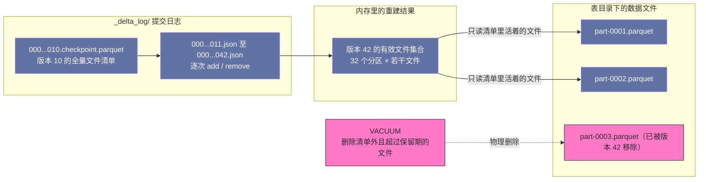
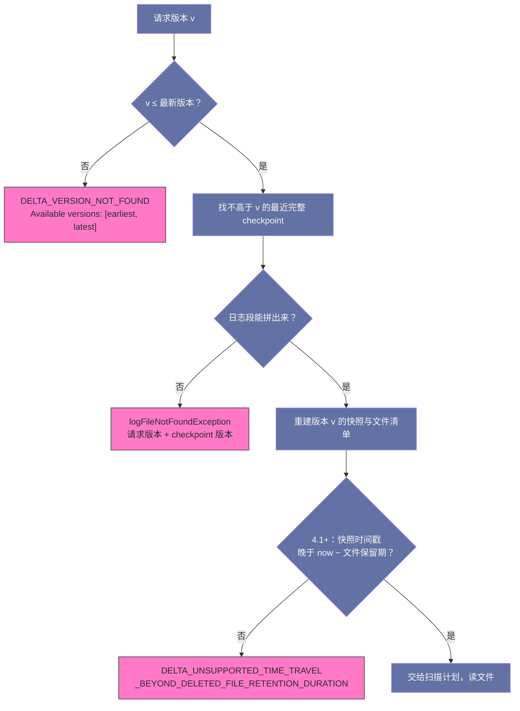
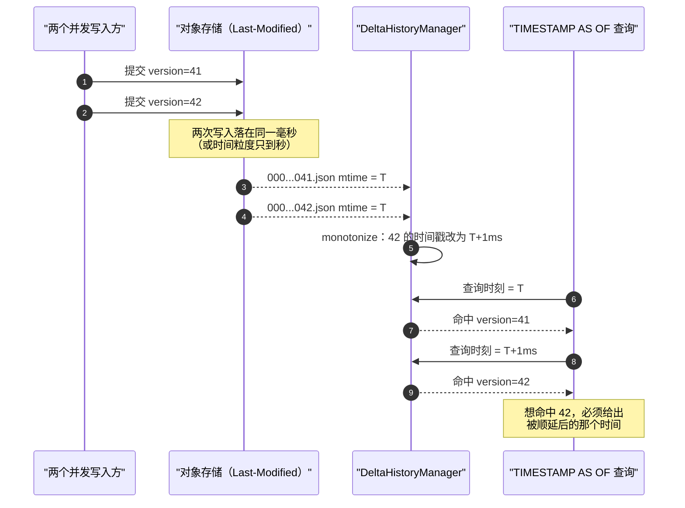
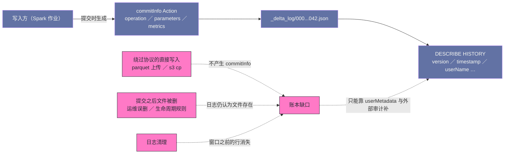
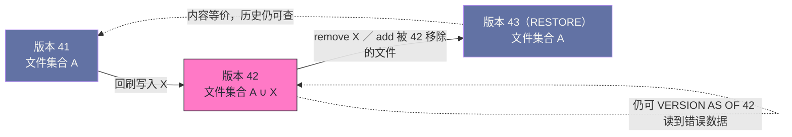
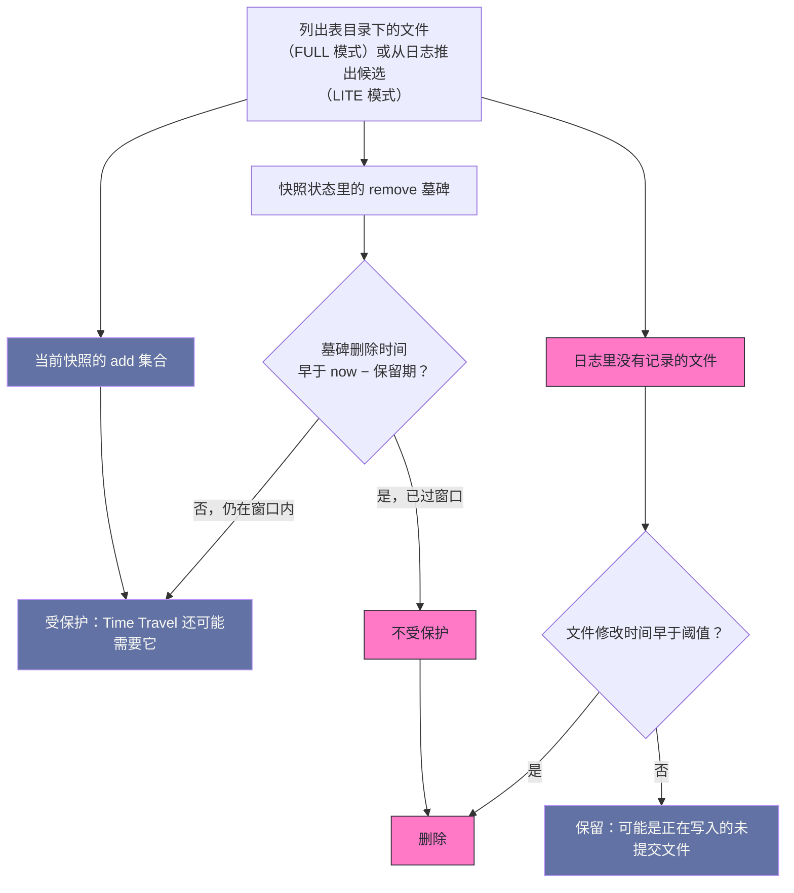

# 06 Time Travel：数据版本管理与回溯查询

**摘要：**

数据湖上最贵的一次提问，往往不是"这条数据对不对"，而是"它是什么时候变成这样的、还能不能退回去"。Time Travel 给出的回答看起来简单：表保留每一次提交，`VERSION AS OF` 按编号取回旧快照，`TIMESTAMP AS OF` 按时刻取回旧快照。但这份能力从来不是免费的存档，它同时受两只互相独立的时钟约束——提交日志按 `delta.logRetentionDuration` 被清理，数据文件按 `delta.deletedFileRetentionDuration` 被 VACUUM 物理删除，能回溯的窗口取两者之中更短的那一个。一张被错误回刷写坏的订单表贯穿全篇，三次追问依次落到定位、回退与窗口三个动作上。文章沿"看得见的历史到底有多长"这条线索拆开四件事：版本解析与时间戳解析各自走哪条路径、按时刻查询依赖的究竟是哪一个时间（这是被写错最多的一处）、`DESCRIBE HISTORY` 能提供哪些可核对的证据以及哪些盲区、`RESTORE` 为什么是"追加一个新版本"而不是删除历史。其中按时刻查询依赖的并不是提交内容里的时间字段，而是日志文件的修改时间，它还要经过单调化、再按会话时区折算——这三点合起来解释了多数"查到错的版本"的事故；4.1 起，读取端还会按文件保留期主动拒绝超窗回溯，把原本"读文件时才失败"的问题提前成一条明确报错。落点放在契约上：Time Travel 是一份和 VACUUM 抢时间的约定，约定失效时读者看到的是文件找不到，而不是版本号不存在。

---

## 第 1 章 历史读的是什么：一份文件清单，不是一份数据副本

### 1.1 一条贯穿全篇的订单表

抽象地讲"版本可见性"很容易滑向复述概念，所以先摆一张具体的表。笔者设想某电商的订单明细表 `orders`，按 `dt` 分区，日增一千万行上下，单行压缩后约两百字节，一年下来约 700 GB；白天由三个作业轮番改写：上午十点的维表打宽 MERGE、下午两点半的金额修正 UPDATE、晚上九点的 `OPTIMIZE` 小文件合并。按 20 MB 一个文件估算，仅当前快照就有十万量级的文件。这些数字是示例推算，只用来固定量级。

某天下午 14:05，一次回刷作业把测试环境的汇率带进了生产，`amount` 被整体放大了一万倍；14:40 有人发现大盘对不上。此刻要回答的问题只有三个：错误数据落在哪个版本上，能不能退回去，三天之后再想退回去还退得动吗。这三个问题分别对应本文的三条主线——看见历史、回到历史、历史被清理。

### 1.2 快照是一份清单

Delta 表的目录里并存两样东西：`_delta_log/` 下的提交日志，以及散落在分区目录里的 Parquet 数据文件。日志里每个 `%020d.json` 文件记录一次提交的 Action：新增了哪些文件（`add`）、移除了哪些文件（`remove`）、元数据与协议有没有变。把某个版本之前的所有 `add` 与 `remove` 累加起来，剩下的那份文件集合，就是这个版本的数据。

所以读 version=42，本质上是两件事：先从日志里重建出 42 号提交所对应的文件清单，再去对象存储把这些清单里的文件读出来。第一件事的成本随"离最近一个 checkpoint 有多远"增长，第二件事的成本和读最新版完全一样——同样的文件、同样的 Parquet 读路径、同样的谓词下推与分区裁剪。把这条链路画成图，能看清两个存储区域各自负责什么，以及 VACUUM 究竟在哪一端动刀。



图里那条虚线是全文的分水岭：日志只增不减地描述"谁属于哪一版"，数据文件则会被 VACUUM 真的删掉。重建清单永远能成功（只要日志还在），把清单里的文件读出来却不一定成功（文件可能已被删）。这两件事的失效方式完全不同，排查时看到的现象也不同，后面第 6 章会把这条边界落到具体的配置项上。

### 1.3 历史的三份账单

把时间旅行的成本拆开，账单有三份，且归在不同的账期上。

第一份是元数据重建。读 42 号版本要先找到不高于 42 的最近 checkpoint，再把 42 之前的增量日志按序回放，直到文件集合收敛。checkpoint 间隔由 `delta.checkpointInterval` 控制，默认 10，也就是平均每隔十个版本落一次全量清单；因此重建代价的期望值在半次到十次提交回放之间，与表的数据量基本无关。

第二份是数据扫描。这一点常被误判成"查历史更慢"。真正慢的是清单重建那一小段，一旦清单到手，后续的扫描、过滤、聚合与读最新版走的是同一个执行计划，读取的数据量取决于旧版本当时有多少文件，而不取决于它是旧的。

第三份账单落在存储上，且只在写入侧发生。每次 `UPDATE`、`DELETE`、`MERGE`、`OPTIMIZE` 都会写入新文件、把旧文件标记为 `remove`；被标记的文件在物理上仍然躺在对象存储里，按同样的单价计费，直到 VACUUM 把它们删除。也就是说，**历史不是日志里的几行 JSON，而是"被移除但尚未删除"的那批文件本身**。一张每天改写三成的表，历史文件占用的空间很快就超过当前快照。

### 1.4 反事实：如果表只有最新版本

不妨设想另一种设计：日志只保留最新快照，每次提交覆盖上一版。这样的表读起来更快、元数据更小、存储更省，代价是它失去了两件事。

一是失去解释能力。当报表数字异常时，手上只有一个当前状态，没有任何证据能说明是哪次提交改的、改了多少行、谁改的。二是失去回退路径。没有旧版本可用，唯一的补救是把上游数据重新跑一遍；而对一张被多个作业、流式任务和人工订正共同写入的表来说，"重跑"往往既不可重现也不可幂等——下游已经消费过的数据不会因为上游重算而自动纠正。

这里能看出 Time Travel 的位置：它不是给表加了一个"历史"功能，而是把本来就存在于 MVCC 机制里的旧版本暴露成了一个可寻址的对象。写时复制（Copy-on-Write）与标记删除（`remove` 而不是物理删）本来就是并发读写正确性的前提，Time Travel 只是给了这套机制一个入口，让使用者能主动指到某个版本上。代价随之而来：既然旧文件必须为并发读者保留一段时间，那么"保留多久"就从一个实现细节变成了一个必须对外承诺的参数。

### 1.5 三个问题与一条主线

回到那条事故线：要定位错误版本，需要一份可核对的提交账本（第 4 章）；要退回去，需要一条不会破坏历史、且原子生效的命令（第 5 章）；要在三天后仍然退得动，需要清理策略与回退需求对齐（第 6 章）。而支撑这三个动作的前提，是"我能准确指到某一版"——按版本号指还是按时刻指，这两种指法的可靠性差别极大，下一章从这件事开始。

关于口径：本文以 Delta Lake OSS 4.x 为准，凡属具体版本引入的行为会标注版本号；涉及 Databricks 平台能力（工作区、作业、集群、托管式优化等）的地方会明确写出来，它们不属于开源协议的一部分。

---

## 第 2 章 按版本号查：一条稳定的寻址路径

### 2.1 四种写法，同一条归宿

按版本号回溯有多种入口，它们在 SQL 层和 DataFrame 层各自不同，但最终都会收敛到同一步：把版本号解析成一个 Snapshot。

```sql
-- 表名 + 版本子句，最常用的形式
SELECT count(*) FROM orders VERSION AS OF 42;

-- 路径语法：把版本号编进标识符里，方便在临时排查时用
SELECT count(*) FROM delta.`s3://lake/orders`@v42;
```

```python
# DataFrame 读法，适合在 Spark 作业内部回溯
df42 = (spark.read.format("delta")
        .option("versionAsOf", 42)
        .load("s3://lake/orders"))

# DeltaTable API：注意 dataFrame() 读的是当前版本，不是 42
from delta.tables import DeltaTable
dt = DeltaTable.forPath(spark, "s3://lake/orders")
df_now = dt.toDF()                                     # 当前版本
hist = dt.history(20)                                  # 提交记录表，不是数据
df42 = dt.atVersion(42).toDF()                         # 这才是 42 号版本的数据
```

最后两行是这套 API 里最容易混淆的地方：`DeltaTable.history()` 返回的是提交信息表，字段是 `version`、`operation`、`operationMetrics` 之类，它的每一行描述"发生过什么操作"，而不是"那一刻有哪些数据"。要拿 42 号版本的数据，仍要走 `spark.read` 的 `versionAsOf` 或 `DeltaTable.atVersion(42).toDF()`。

| 入口 | 写法 | 解析结果 | 适用与限制 |
|---|---|---|---|
| SQL 子句 | `orders VERSION AS OF 42` | 直接取版本号 | 只能在 Spark SQL 会话里用，表必须可解析 |
| 路径语法 | 标识符尾部追加 `@v42` | 从标识符尾部正则提取版本 | 只有尾部形如 `@v<数字>` 时才被识别，适合临时排障 |
| DataFrame | `option("versionAsOf", 42)` | 构造函数参数转成 `DeltaTimeTravelSpec` | 作业里最稳，版本号可以来自参数或上游元数据表 |
| DeltaTable | `atVersion(42)` | 同上 | 需要同时使用表对象上的其他命令时顺手 |

### 2.2 版本号的解析：边界由日志决定

版本号的解析听上去没有任何不确定性，它就是一个整数。但"这个整数还存在吗"这件事，取决于日志有没有被清理。

Delta 在解析版本号时会走一次显式校验，源码是 `resolveTimeTravelVersion` 里的 `checkVersionExists`：把请求的版本与"最早可重建版本"和"最新版本"两端比较，越界就抛 `VersionNotFoundException`，对外呈现为 `DELTA_VERSION_NOT_FOUND`，消息形如 `Cannot time travel Delta table to version 42. Available versions: [0, 41].`。方括号里的两个数字就是这个区间的两端。

这条消息里的方括号承担了两个不同的信息，值得分开看：

上界好理解：42 大于当前最新版本，说明这次提交还没发生，或者查询打到了另一套环境上。

下界才是需要经验的地方。默认情况下它等于 0，一旦它变成 37、51 这种非零值，就说明日志已经被清到只剩后半段——`Available versions: [37, 41]` 不是"表只有 5 个版本"，而是"37 之前的重建起点已经没了"。日志清理由 `delta.logRetentionDuration`（默认 `interval 30 days`）驱动，清理动作依附在 checkpoint 上：只有落了一个更晚的 checkpoint，才有可能删掉更早的 JSON 文件。源码里的 `getEarliestRecreatableCommit` 判断逻辑是：如果版本 0 的 JSON 还在，最早可重建版本就是 0；否则取"版本号不小于最小残留 JSON 版本减一"的最后一个完整 checkpoint。翻成工程语言：**清理以 checkpoint 为锚，锚点之前的版本即便你记得版本号，也已经没有回放的起点**。

还有一条罕见的路径：版本号落在这个区间里，日志段却拼不出来（多段 checkpoint 缺了其中一段，或者校验通过之后日志恰好被并发清掉）。此时抛的是 `DELTA_LOG_FILE_NOT_FOUND`，消息是 `Unable to retrieve the delta log files to construct table version 42 starting from checkpoint version 40 at <logPath>.`。它和 `DELTA_VERSION_NOT_FOUND` 的区别是排查方向不同：后者查"我要的版本在不在区间内"，前者查"区间内那段日志为什么拼不齐"——前者通常是策略问题，后者通常是存储或竞态问题。

### 2.3 两个开关：可重建性与保留期

同样一个版本号，经过不同的调用路径会被施加不同的检查，理解这一层能解释很多"同样的语句换台机器就报错"的现象。

`getActiveCommitAtTime` 与 `checkVersionExists` 都带一个 `mustBeRecreatable` 语义：为真时下界取"最早可重建版本"（依赖 checkpoint），为假时下界取"最早残留的 JSON 文件"（只看文件在不在）。前者更严格，因为它保证能真的把状态拼出来；后者宽松，只保证日志里有记录。VACUUM 之类的维护命令会故意用宽松的那一档，因为它们只需要知道一个时间点对应哪个版本，并不需要读那份状态。

另一层检查是数据文件保留期。从 4.1 起，`SnapshotManagement` 里新增了一道 `enforceTimeTravelWithinDeletedFileRetention`：把目标快照的时间戳与当前时间比较，一旦早于 `now - delta.deletedFileRetentionDuration`，直接拒绝，报 `DELTA_UNSUPPORTED_TIME_TRAVEL_BEYOND_DELETED_FILE_RETENTION_DURATION`（"Cannot time travel beyond delta.deletedFileRetentionDuration (168 HOURS) set on the table."）。这个判断不依赖 VACUUM 有没有真的跑过——这是一个容易被忽略的转折：**可回溯窗口的约束从"文件还在不在"变成了"策略允不允许"**。在 4.0 及更早的版本上，同样的查询不会有这道检查，它会一路走到读数据文件的阶段，然后以文件不存在的形式失败。

### 2.4 下界的两把锁

把版本解析的下界画成决策流，两把锁的位置就很清楚了。



三个失败出口分别由三件不同的事决定：提交号是否已产生、日志是否还在、文件保留期是否覆盖。排查时先看异常类名，就能直接定位到该查哪一层，而不必从"数据是不是被我删了"这种最坏假设开始。

---

## 第 3 章 按时间戳查：那串数字从哪来

### 3.1 它不是 commitInfo 里的字段

几乎所有介绍 Time Travel 的材料都会写一句"Delta 在 `commitInfo` 里记录了提交时间，按时间戳查询时找时间戳不大于目标的最近提交"。这句话的前半段没错，每次提交确实会写一个 `commitInfo` Action，里面有一个 `timestamp` 字段；但后半段指向的解析路径并不是它。

看 DeltaHistoryManager 的实现就会遇到一个反直觉的细节：非 In-Commit-Timestamp 表在枚举提交时，取得的时间来自提交文件的修改时间，源码是 `Commit(version, file.getModificationTime)`。也就是说，**定位用的时间是对象存储上那个 JSON 文件的 Last-Modified，而不是文件内容里的 `commitInfo.timestamp`**。这条路径随后还会做一次单调化处理，见下一节。

这个差别在两种情况下会立刻显形。一种是写入方与服务端时钟不一致：客户端机器的时钟偏了十分钟，`commitInfo.timestamp` 记的就是偏的时间，而文件修改时间由存储服务盖章，两者对不上。另一种更常见：日志文件被复制、被迁移、被某些工具重写，修改时间变了而内容没变，于是按时间戳回溯的结果会发生整体平移。按版本号查询对这类问题完全免疫，这也是后文把"能用版本号就别用时间戳"写成契约第一条的原因。

### 3.2 单调化：同一毫秒与倒退的时钟

即便拿到了每个提交的文件修改时间，它仍不满足"可作为地址"的条件。作为地址，时间序列必须严格递增：否则同一个时刻会指向两个版本，二分查找也就失去意义。Delta 的做法是在读出提交列表后做一次单调化——源码 `monotonizeCommitTimestamps` 逐个比较相邻提交，一旦发现后一个的时间戳不大于前一个，就把后一个改写成前一个加一毫秒。

这段逻辑解释了三种在真实环境里会碰到的现象。

当两次提交落在同一毫秒（并发写入、流式微批、或者对象存储返回的时间粒度较粗，S3 的 `Last-Modified` 只到秒），后一次提交的时间戳会被顶到前一次加 1ms，`DESCRIBE HISTORY` 里看到的就是这串被顺延过的值。此时用"你记忆中那次提交的墙上时间"去查，落点可能停在前一次提交上——因为被顺延之后，后一次提交的显示时间已经大于你给的时间戳了。

当时钟倒退（NTP 回拨、虚拟机迁移、容器时钟漂移），写入方所在的机器把后一次提交盖成更早的时间，单调化会把它拉回"前一版加 1ms"，于是历史时间线看起来仍然平滑，但已经和任何人墙上的钟都对不上。这类偏差在被顺延的次数多了以后会累积成可观的偏移，且只影响按时间戳查询，不影响按版本号查询。

当历史跨越了日志清理，`getActiveCommitAtTime` 的二分与并行搜索都只在"还存在的提交"范围内进行，落在窗口之外的时间会走第 3.4 节的三条报错路径，而不是给出一个猜测值。

下图把一次同毫秒提交的单调化过程画成时间轴：两个提交的原始修改时间相同，顺延之后硬生生拉开一毫秒，查询边界正好卡在中间。



### 3.3 跨时区：字面量按会话时区解释

第二类坑来自输入端，而不是存储端。SQL 里写 `TIMESTAMP AS OF '2026-11-19 14:05:00'`，这个字符串本身不含时区，解析时按当前会话的 `spark.sql.session.timeZone` 折算成毫秒。`DeltaTimeTravelSpec.getTimestamp` 的实现就是一次带 `sessionLocalTimeZone` 的 Cast，随后转成 Java Timestamp 与提交时间比较。

后果很直接：同一个字符串，在 `Asia/Shanghai` 的会话里指向 UTC 06:05，在 UTC 会话里指向 UTC 14:05，相差八小时。对一张白天每十分钟提交一次的表来说，这个偏差足够跨越几十个版本。更隐蔽的是夏令时：某些时区在切换日会存在"这一小时出现两次"或"这一小时不存在"的情况，字面量可能被解析到另一个瞬间，甚至被直接判为非法。

还有一处细节会绊住脚本：路径语法里的时间戳后缀（形如 `orders@20261119140500000`）要求是 17 位 `yyyyMMddHHmmssSSS` 形式，并且按会话时区解析；位数不对时它不会被当作时间戳，而是被当成普通标识符的一部分，最终以表找不到的形式失败。Delta 提供 `DELTA_INVALID_TIMESTAMP_FORMAT`（"The provided timestamp <timestamp> does not match the expected syntax <format>."）来区分这类错误，但它只在那条专门的解析分支里触发。

工程上的解法是把时区写死在字面量里——用带偏移的 ISO 8601（`2026-11-19T14:05:00+08:00`）或在会话里显式 `SET TIME ZONE`，让"字符串到瞬间"的折算不再依赖运行环境。

### 3.4 三种落空与三条报错

一个时间戳查不到东西，有三种可能，对应三条不同的报错，也对应三种不同的处置。

早于最早可用提交时，`getActiveCommitAtTime` 抛出 `DELTA_TIMESTAMP_EARLIER_THAN_COMMIT_RETENTION`：`The provided timestamp (2026-01-01 00:00:00.0) is before the earliest version available to this table (2026-01-20 09:12:33.0). Please use a timestamp after 2026-01-20 09:12:33.`。括号里给的是最早提交的实际时间，照着它往后挪就能查通——前提是那份快照的数据文件还在，这才是真正的问题所在（第 6 章）。

晚于最新提交时，报错是 `DELTA_TIMESTAMP_GREATER_THAN_COMMIT`：`Timestamp 2026-12-01 00:00:00.0 is after the table's latest version (2026-11-19 14:40:02.0). Use a timestamp at or before 2026-11-19 14:40:02.` 这条报错对应源码里的 `canReturnLastCommit` 参数：它为假时，"时间戳晚于最新提交"被视为不可接受的输入，直接拒绝；为真时则退化为最新快照。读路径的默认值是假，`DeltaTableUtils.resolveTimeTravelVersion` 的签名里写得很清楚，只有维护类命令（譬如 VACUUM 的窗口换算、RESTORE 命令内部的版本解析）才会显式传真。写错年份的查询会被这条报错拦住，而不是安静地返回最新数据——这一点比"静默退化"好，但它也意味着跨时区偏移造成的"看起来在将来"会被同一句话回应，排查时容易往时钟方向猜错。

第三种落空既不属于早也不属于晚，而是"同一时刻对应多个提交"的取舍问题。单调化保证了不会真的出现并列，但它把选择权收窄成了一个确定的、可能与直觉不一致的答案。RESTORE 把前面两条报错都改写成了自己的版本：分析阶段捕获 `TemporallyUnstableInputException` 转成 `DELTA_CANNOT_RESTORE_TIMESTAMP_GREATER`，捕获早于窗口的异常转成 `DELTA_CANNOT_RESTORE_TIMESTAMP_EARLIER`，两条消息都直接给出可用的时间上下界，比原始异常更好用。

把四类坑并排放，判据与处置的对应关系就能一眼扫完。

| 坑 | 典型现象 | 判据 | 处置 |
|---|---|---|---|
| 拿 `commitInfo.timestamp` 当定位依据 | 按时间查到的版本比预期早或晚 | 对比文件 mtime 与 `commitInfo` 里的时间 | 以 `DESCRIBE HISTORY` 的 timestamp 列为准，或改用版本号 |
| 同毫秒多次提交 | 边界时刻查不中目标版本 | 目标提交的时间戳恰好比前一次大 1ms | 查版本号；或把查询时刻加 1ms 试探 |
| 跨时区字面量 | 同一字符串在不同集群结果不同 | 会话 `spark.sql.session.timeZone` 不同 | 字面量带偏移，或在会话里固定时区 |
| 落到保留期之外 | 报 `DELTA_TIMESTAMP_EARLIER_THAN_COMMIT_RETENTION` | 括号里的最早可用时间晚于查询时间 | 调整保留期策略，或接受窗口已过 |

### 3.5 In-Commit Timestamps：把时间写进内容里

上面所有麻烦的根源是"时间存放在文件元数据上"。Delta 从 3.2 起提供了一个表特性来解决它：In-Commit Timestamps（ICT），由表属性 `delta.enableInCommitTimestamps`（默认关闭）开启，开启后每次提交在 `commitInfo` 里额外写一个 `inCommitTimestamp` 字段，写方负责保证它单调递增，读取侧直接用它做定位，不再依赖文件修改时间。

这个特性解决了三件长期存在的问题：跨存储迁移后时间线不再漂移；对象存储时间粒度粗糙不再是隐患；多写入方各自时钟不同步时，只要写入路径统一，时间线仍然可比。代价是它是一项表特性，需要协议升级，老版本读方按协议拒绝打开这张表，因此通常只在新建表或明确可控的环境里启用。如果表开了 ICT 但某个写入方没有写这个字段，提交会被拒绝，报 `DELTA_MISSING_COMMIT_TIMESTAMP`；这比"写进去了但时间不对"要好得多。

一句话总结取舍：**版本号是逻辑地址，永远稳定；时间戳是物理时间，只有在 ICT 开启后才接近稳定**。业务侧如果需要"按业务日期回溯"，正确的做法是自己在表里存业务时间列并配合分区，而不是拿提交时间去逼近业务语义——提交时间是"数据什么时候被写进来"，不是"数据描述的是哪一天"。

---

## 第 4 章 DESCRIBE HISTORY：账本能回答什么

### 4.1 一列一列看

`DESCRIBE HISTORY orders LIMIT 20` 返回的是一张按版本倒序的提交清单。它的数据来源是每个版本 JSON 里的 `commitInfo` Action，加上从文件系统取到的时间戳，两者拼起来构成这一行。

| 列 | 含义 | 注意 |
|---|---|---|
| `version` | 这次操作产生的版本号 | 与 `add`/`remove` 的提交一一对应 |
| `timestamp` | 该版本的提交时间 | 非 ICT 表来自日志文件修改时间并经过单调化 |
| `operation` | 操作类型，如 `WRITE`、`MERGE`、`DELETE`、`OPTIMIZE`、`VACUUM START`、`RESTORE` | 大小写与拼写随版本略有差异，别硬编码匹配 |
| `operationParameters` | 操作参数，如 `predicate`、`mode`、`partitionBy` | 谓词是原文，可能很长，也可能是被截断的表达式 |
| `readVersion` | 本次操作读取的基准版本 | 并发场景下等于提交时的快照版本，是判断"读旧写新"的依据 |
| `isolationLevel` | 本次操作使用的隔离级别 | Delta 的 `Serializable` / `WriteSerializable`，决定冲突判定严格程度 |
| `isBlindAppend` | 是否为"盲追加"——没有读取表内已有数据 | 为真时并发追加互不冲突，是写入吞吐的关键标记 |
| `operationMetrics` | 量化指标，按操作类型的 map | 详见 4.2，诊断的主要抓手 |
| `userId` / `userName` | 执行者标识 | 取自 Spark 会话，作业里通常是运行账号，粒度到人不一定成立 |
| `userMetadata` | 写入时通过选项传入的自定义元数据 | 排查时最有用的一列，可以塞工单号、批次号 |
| `job` / `notebook` / `clusterId` | 运行环境信息 | Databricks 平台侧填充，OSS 下通常为 null |

最后一行必须单独强调：`job`、`notebook`、`clusterId` 属于 Databricks 平台能力（工作区、作业与集群是它的产品概念），不属于 Delta 协议的一部分，开源版没有这些上下文，字段会是空的。把它们当成"OSS 也有的审计字段"去设计流程，最后会发现整列都是 null。

### 4.2 operationMetrics：按操作类型读指标

`operationMetrics` 是一个 `map<string,string>`，键随 `operation` 变化很大。挑几个常用的列出来，判读方式各不相同。

| 操作 | 主要指标 | 判读方式 |
|---|---|---|
| `WRITE` | `numFiles`、`numOutputRows`、`numOutputBytes` | 单次写入文件数除以行数得到平均文件大小，偏小说明小文件在堆积 |
| `MERGE` | `numTargetRowsInserted`、`numTargetRowsUpdated`、`numTargetRowsDeleted`、`numTargetRowsCopied`、`numTargetFilesAdded`、`numTargetFilesRemoved` | `copied` 相对 `updated` 的比例反映写放大，比例高说明改一行要重写整文件 |
| `DELETE` | `numDeletedRows`、`numCopiedRows`、`numAddedFiles`、`numRemovedFiles` | 删分区级数据时 `numDeletedRows` 可能缺失，别拿它当唯一口径 |
| `UPDATE` | `numUpdatedRows`、`numCopiedRows`、`numAddedFiles`、`numRemovedFiles` | 同上，关注"改了多少行 vs 重写了多少行" |
| `OPTIMIZE` | `numAddedFiles`、`numRemovedFiles`、`numAddedBytes`、`numRemovedBytes`、`minFileSize`、`p50FileSize`、`maxFileSize` | `removed/added` 的文件数比就是这次合并的压缩比 |
| `VACUUM` | `numFilesToDelete`、`numDeletedFiles`、`numVacuumedDirectories` | 前两个数不等通常意味着删除过程中有文件已不存在，或 dry run |
| `RESTORE` | `numRestoredFiles`、`numRemovedFiles`、`tableSizeAfterRestore`、`numOfFilesAfterRestore` | 恢复后的文件数直接反映回退点的碎片程度 |

一个具体用法：把 `MERGE` 的 `numTargetRowsUpdated` 与 `numTargetRowsCopied` 相除，得到"每改一行要连带重写多少行"的写放大系数。维表打宽这种只影响少量行的场景，写放大系数通常与单文件行数同量级；系数突然抬到几百，基本可以判定分区或聚簇策略与更新模式不匹配，改一行就要重写一整份分区文件。

### 4.3 用指标做一次小文件诊断

举一个从 `DESCRIBE HISTORY` 出发的推算，全部数字都是示例，用来演示方法而非给出结论。

假设某表一天有 12 次 `WRITE`，每次 `numFiles` 约 40，文件大小 20 MB 上下；另有 6 次 `MERGE`，每次 `numTargetFilesAdded` 约 60、`numTargetFilesRemoved` 约 55。一天真正写出去的文件是 12×40 + 6×60 = 840 个，约 16.8 GB；被替换掉的是 6×55 = 330 个，约 6.6 GB，逐日净增则是 840 − 330 = 510 个。一周之后，当前快照多出约 3500 个文件，而被替换掉的那 2300 多个旧文件一个都没少，全部躺在存储里等 VACUUM 过期。这组数字解释了为什么存储的增长速度会明显快于表本身：逻辑上每天涨三成，物理上每天多留六成。

如果这张表上还有一次夜间 `OPTIMIZE`，它的 `numAddedFiles` 与 `numRemovedFiles` 会同时出现一个尖峰，`p50FileSize` 从 20 MB 抬到 100 MB 以上；此后白天的 `WRITE` 又会把平均值拉回去。这条"晚上抬、白天落"的锯齿曲线是判断"该不该把合并频率提上来"的直接证据，比看总文件数更敏感。

### 4.4 账本记不全的地方

`DESCRIBE HISTORY` 被很多人当成"完整的审计日志"，这个定位偏了。它有四类明确记不到的地方。

把从写入到展示的这条链路与几类旁路画在一起，缺口在什么位置就很直观：账本只记录"通过协议提交的动作"，凡是没经过这条路的变化，都落在它视野之外。



其一，绕过 Delta 写入路径的操作。有人直接用 `spark.write.parquet` 往表目录里塞文件、用 `s3 cp` 上传、或者用别的引擎以非 Delta 协议写——这些文件不会产生 `commitInfo`，它们要么在下次提交时被当作"未跟踪文件"由 VACUUM 清理，要么在有人手工补 `add` 时以一次异常提交的形式出现。日志记的是"通过协议提交的动作"，不是"目录里发生的所有变化"。

其二，提交之后才发生的物理变化。文件被运维误删、存储桶策略过期删除、生命周期规则把冷数据挪到别的存储类——这些都发生在日志视野之外。日志仍会说这个文件属于某个版本，只有真正去读的时候才发现它不在了，于是表现为偶发的读失败，而不是一条可追溯的记录。

其三，历史窗口本身会缩短。`DESCRIBE HISTORY` 能翻多远由 `delta.logRetentionDuration` 决定，默认 30 天；日志清理之后，早于窗口的行不会再出现。审计能看到的范围因此等于日志保留范围，想用"日志里没有"来证明"没发生过"，逻辑上是不成立的。

其四，操作者的粒度有限。`userId` 与 `userName` 取自 Spark 会话与运行环境，同一个服务账号跑几十个作业时，这一列无法区分是哪个作业干的；而 `readVersion`、`operationParameters` 只能说明"做了什么"，说明不了"为什么做"。真正要做责任追溯，需要在写入侧主动打标——用 `userMetadata` 存批次号与作业实例号，这是 OSS 里唯一可靠的业务级锚点。

```sql
-- 写入侧主动打标，事后才能在账本里认出这一批是谁写的
INSERT INTO orders
SELECT /*+ REPARTITION(8) */ * FROM staging_orders_20261119
```

```python
# 提交时带上批次号与工单号，DESCRIBE HISTORY 的 userMetadata 列即可检索
(spark.read.table("staging_orders_20261119")
     .write.format("delta").mode("append")
     .option("userMetadata", "batch=20261119-03;ticket=OPS-4412")
     .saveAsTable("orders"))
```

---

## 第 5 章 RESTORE：产生新版本，而不是删掉历史

### 5.1 六步之内发生了什么

`RESTORE` 的语义经常被误解成"回滚"，让人想到数据库的 undo：把后来的提交抹掉，让表回到旧状态。真实语义要温和得多——**它比较目标版本与当前版本的文件集合，把差异写成一次新的提交，历史一行不少**。

源码 `RestoreTableCommand` 的注释把算法写得很清楚，归纳成六步：读当前最新快照；读目标版本快照；把"目标版本有、当前版本没有"的文件作为 `add` 动作写进新提交；把"当前版本有、目标版本没有"的文件作为 `remove` 动作写进新提交；在 `spark.sql.files.ignoreMissingFiles` 未开启时校验待加入的文件确实存在于存储上；用 `commitLarge` 把元数据、协议与这些动作一并提交。比较的是 `(路径, 删除向量标识)` 这个二元组，而不是单纯路径，因为删除向量（Deletion Vector）启用后同一路径可能对应"整份文件"与"文件加若干被删行"两种不同状态。

```sql
-- 退到写坏数据之前的那个版本
RESTORE TABLE orders TO VERSION AS OF 41;

-- 也可以按时间退，解析规则与第 3 章一致
RESTORE TABLE orders TO TIMESTAMP AS OF '2026-11-19 14:00:00';
```

```python
# 通过 DeltaTable API，等价于上面第一条
from delta.tables import DeltaTable
dt = DeltaTable.forPath(spark, "s3://lake/orders")
dt.restoreToVersion(41)
```

下图把两侧文件集合的差集关系画出来。注意箭头方向：产生的是一个新的版本 43，它引用的是 41 的文件集合，而 42 依然完好地留在日志里。



"错误数据仍可查"不是缺点，是特性：事故复盘时需要把错误版本再读一遍做差异比对，如果 `RESTORE` 真把 42 抹掉了，反而失去了证据。这条性质也让 `RESTORE` 具备可重入性——退错了版本，可以再退回去。

### 5.2 三条常被忽略的语义

`RESTORE` 只回退数据这个印象，需要修正三处。

第一处是元数据与表属性会一起回退。源码在提交前执行 `txn.updateMetadata(restoredMetadata)`，用的是目标版本的 `metadata`，只对其中的 identity 列高水位做了合并处理，并把自适应元数据相关的属性从最新版本继承过来。这意味着如果 41 号之后你改过表属性——打开了变更数据捕获、调整了保留期、加了列注释——`RESTORE` 会把这些改动一并退回旧值。这条副作用在事故现场经常被漏掉：回退完成、数据对了，两天后才发现保留期被改回了默认的七天。

第二处是协议不降级。新提交的协议取"目标版本协议"与"当前版本协议"的合并结果，只在两者都支持的前提下才会写出；除非显式打开允许降级的开关（`spark.databricks.delta.restore.protocolDowngradeAllowed`），否则旧协议不会被写回去。原因是降级会让"回退点之后、升级之前"的那些版本无法再被正确读取，等于用一次恢复破坏了历史可读性。

第三处是目标版本必须早于当前版本，且文件必须还在。回到与当前相同的版本在分析阶段就会被判成空操作，直接返回空结果；回到更新的版本则被 `require` 拒绝。目标版本的数据文件若已被 VACUUM 删除，`checkSnapshotFilesAvailability` 会拦下来，除非把 `spark.sql.files.ignoreMissingFiles` 打开——而在那种情况下恢复出来的表是残缺的，把它当成"成功恢复"是更危险的结果。

### 5.3 恢复之后为什么还要合并

`RESTORE` 只改"引用哪些文件"，不改文件的物理布局。于是有一个反直觉的后果：如果回退点当时就是一张碎片化的表（譬如一天里被 `MERGE` 改过几十轮），`RESTORE` 会把这份碎片原样带回来，文件数与恢复前相比可能没有明显下降，甚至因为同时期 `OPTIMIZE` 产生的文件被 `remove` 而让平均文件大小更小。

另一方面，`RESTORE` 自己会制造一批"孤儿文件"：42 号版本写入的文件被 43 号 `remove` 了，它们在物理上仍然存在，要等保留期过后由 VACUUM 回收。恢复动作越大，这批待回收的文件越多——一次跨几十个版本的大回退，可能在存储上留下一个与表本身同量级的"影子"。

所以恢复流程的收尾应当是两步：先确认数据口径，再跑一次 `OPTIMIZE`（需要时带聚簇）把物理布局整理回可接受的水位，最后按既定节奏跑 VACUUM 把孤儿文件回收掉。反过来，如果恢复后既不合并也不清理，表会停在"逻辑正确但物理退化"的状态上，后续每次查询都在为这次事故付利息。

| 方案 | 产生新版本 | 是否原子 | 元数据是否回退 | 适用场景 |
|---|---|---|---|---|
| `RESTORE` | 是 | 是，`commitLarge` 单次提交 | 是，含表属性与 schema | 整表回到某个已知良好状态 |
| 按版本读 + 覆写 | 是 | 覆写是一次提交，但中间结果要自己保证 | 否 | 只回退部分数据，或需要清洗后写回 |
| 从备份表恢复 | 取决于方式 | 取决于方式 | 否 | 保留窗口已过、文件已被物理删除 |
| 克隆到临时表比对 | 否（新表） | 是 | 否 | 事故复盘、需要保留证据再决定 |

这张表的最后一行值得单独说：浅克隆是 OSS 文档里明确给出的能力，它只复制日志、不复制数据文件，克隆出来的表与原表共享底层文件。它适合"先把旧版本固化成一张独立表，再慢慢比对"的场景，代价是克隆表与原表共享文件的命运——原表一旦 VACUUM 把文件删掉，克隆表里指向同一批文件的版本也跟着失效。

---

## 第 6 章 VACUUM：一份和读者抢时间的契约

### 6.1 保护集是怎么算出来的

VACUUM 的目标是删除"不再被任何需要的版本引用"的文件，所以它必须先构造一个保护集，再删除保护集之外的东西。保护集由两部分并起来。

第一部分是当前快照引用到的文件，也就是 `add` 仍然有效的那些。这部分不许删，删了当前版本就坏了。

第二部分是"保留期窗口内被移除的文件"。快照状态里保留着 `remove` 动作（墓碑，tombstone），每个墓碑带一个删除时间戳；只有当墓碑的删除时间早于 `now - 保留期` 时，对应文件才不被保护。源码里的过滤条件正是 `tombstone.delTimestamp < deleteBeforeTimestamp` 时丢弃该墓碑——被丢弃的墓碑所指向的文件，失去保护，进入待删集合。

把这两部分合起来看，**"保护"是两条判据的析取**：文件要么现在还被引用，要么是最近才被移除的，任何一条成立就留下。VACUUM 删的是两条都不成立的文件，再加上表目录里那些从来没被日志记录过的游离文件。



图中最右下那条分支是并发安全的命门：未提交的写入会先把文件写进表目录、再提交日志，中间有一个时间窗。VACUUM 若在窗口内把这个"还没被任何提交记录的文件"当成游离文件删掉，那次提交之后就指向了一个不存在的文件——表看起来提交成功了，读的时候才发现文件没了。保留期存在的意义，一半是给 Time Travel，一半是给这个窗口。

### 6.2 两个保留期，窗口取小

与"历史还能看多久"直接相关的表属性有两个，它们的默认值来自 DeltaConfig。

| 表属性 | 默认值 | 管什么 | 由谁执行清理 |
|---|---|---|---|
| `delta.deletedFileRetentionDuration` | `interval 1 week` | 被 `remove` 的数据文件在物理上保留多久 | `VACUUM` |
| `delta.logRetentionDuration` | `interval 30 days` | 提交日志（JSON 与旧 checkpoint）保留多久 | 依附 checkpoint 的日志清理 |
| `delta.checkpointInterval` | `10` | 每多少个版本落一次 checkpoint | 写入方自动触发 |

两个保留期作用在不同的对象上，谁短谁就是瓶颈。**可回溯窗口取两个保留期中更短的那个**：默认配置下文件保留 7 天、日志保留 30 天，所以窗口是 7 天。日志里还留着第 20 天前的版本记录，但那些版本引用的文件早已被 VACUUM 删掉。反过来，如果把日志保留期调到 1 天，窗口就变成 1 天，因为重建状态的日志段已经被清掉，即便文件还在也没法定位。

这个不对称是笔者在事故复盘里见得最多的误判来源。有人看到 `DESCRIBE HISTORY` 能翻到 30 天前，就推断"能回到 30 天前"，然后在第 20 天那份快照上读到文件不存在的异常。日志删得比文件晚，这是设计使然——日志只是元数据，便宜；数据文件才是成本。

### 6.3 `RETAIN` 参数被忽略这件事

`VACUUM orders RETAIN 168 HOURS` 看上去是在为这一次清理指定保留期，但这个语义在 4.1 之后变了。

4.0 及更早的实现里，`retentionMillis` 直接由 `retentionHours` 换算而来，命令行确实能临时放宽窗口——当然要先过下一节那道安全检查。从 4.1 起，`VacuumCommand.gc` 换了一套逻辑：当内部配置 `spark.databricks.delta.vacuum.retentionWindowIgnore.enabled` 为真（默认值即为真），且传入的保留期不是 0 时，直接丢弃这个参数并打一条警告——`Vacuum with retention threshold other than 0 hours is ignored. Please set delta.deletedFileRetentionDuration table property to configure the retention period.` 也就是说，保留期只认表属性，命令行的 RETAIN 只保留了一个语义：传 0 表示"我要用最短保留期"，而那恰好是最危险的一档。

这条设计有它的道理：保留期是表的性质，不该随某一次维护作业的命令行而变；如果允许临时调短，某次误敲就会把整张表的历史窗口永久缩短。但它也让很多照着旧文档写的运维脚本失效——脚本以为自己在"这次清理时多留几天"，实际上什么都没改。

正确的改法只有一条：改表属性，再让 VACUUM 按表属性执行。

```sql
-- 把文件保留期调到 30 天，之后再执行不带 RETAIN 的 VACUUM
ALTER TABLE orders SET TBLPROPERTIES (
  'delta.deletedFileRetentionDuration' = 'interval 30 days'
);

-- 先 dry run，看清将要删除的文件数与总大小
VACUUM orders DRY RUN;
```

### 6.4 安全检查：那道把保留期拦住的门

真正把危险值拦下来的是第二道门：`spark.databricks.delta.retentionDurationCheck.enabled`，默认开启。它在 `checkRetentionPeriodSafety` 里比较"本次命令传入的保留期"与"表上配置的保留期"，前者更小就拒绝执行，抛 `DELTA_VACUUM_RETENTION_PERIOD_TOO_SHORT`，消息是：`The specified VACUUM retention period is too low and may corrupt this Delta table if any writes are in progress.`，随后给出关闭检查的配置项与建议的最小小时数。

这道门保护的是两件事，其中一件跟 Time Travel 无关：并发写入方（第 6.1 节末尾那个时间窗）与仍在运行的读查询。把保留期压到小于最长事务时长，正在跑的长任务可能读到一半发现文件被删；把保留期压到小于未提交写入的滞留时间，可能把别人马上要提交的文件删掉，那是真正的表损坏。

这道门的判据只有"本次传入的保留期"这一项，所以它管不住另一条路：直接改表属性。不带 `RETAIN` 的 VACUUM 完全按表属性执行，`configuredRetention` 本身就是判据，检查自动通过。简单说，把表属性从默认的一周改成零、改成一天，安全检查一次都不会触发——窗口是在配置提交的那一刻被改小的，不是在 VACUUM 执行的那一刻。这也是为什么改保留期这类操作值得走一遍审批流程：**工具不会替你拦，它只拦命令行。**

绕过这道门的标准动作是关掉检查再执行：

```sql
-- 危险动作：关掉安全检查后按 0 小时执行，只应在确认无人并发访问时使用
SET spark.databricks.delta.retentionDurationCheck.enabled = false;
VACUUM orders RETAIN 0 HOURS;
```

这段代码在很多事故复盘的记录里都能看到，它的后果分三层：正在跑的读查询开始报文件不存在；Time Travel 窗口被压缩到接近零；对象存储的删除通常不可逆，数据只能靠备份或存储层的版本恢复来找回。要注意 `RETAIN 0 HOURS` 同时也是唯一不被忽略的 RETAIN 值——它是专门留给"我确实要立刻清理"这种场景的，恰恰因此最容易被误用。

### 6.5 LITE 模式与清单模式

`VACUUM` 默认是 FULL 模式：先列出表目录下的所有文件，再与保护集做差。表很大时，这一步 LIST 本身就可能是最慢的环节。

从 3.3 起提供了 LITE 模式（`VACUUM orders LITE`，或把 `spark.databricks.delta.vacuum.lite.enabled` 打开作为默认），它不列目录，改为遍历日志，从"保留期窗口之外的最早提交"开始推导候选文件集合。快是快了，代价是把 VACUUM 的正确性绑在了日志完整性上：如果日志已经被清理到看不见保留期起点，LITE 无法确定哪些文件可以安全删除，会抛 `DELTA_CANNOT_VACUUM_LITE`（"VACUUM LITE cannot delete all eligible files as some files are not referenced by the Delta log. Please run VACUUM FULL."），要求改用 FULL。

这条报错把第 6.2 节那个"谁短谁是瓶颈"的结论扩展了一步：**日志保留期不仅决定能回溯多远，还决定能不能用更省事的清理方式**。日志保留期短于文件保留期的表，LITE 模式基本不可用。

还有一种省掉 LIST 的路径是提供清单：`VACUUM orders USING INVENTORY (SELECT ...)`，把对象存储的清单报告或自建的清单表喂进来当候选集合，适合文件数已经让 LIST 成为瓶颈、且手上有现成清单来源的表。它的风险在于清单的时效性——清单过期会漏删（无害）或误删（有害，若清单与真实目录不一致到把在用文件当成候选），所以用之前要确认清单的时间范围覆盖保护集。

### 6.6 墓碑自己也会过期

第 6.1 节说保护集依赖墓碑。这一步有个容易被忽略的细节：墓碑本身保存在 checkpoint 的状态里，而 `Snapshot.minFileRetentionTimestamp` 的注释写得很直白——早于这个时间戳的墓碑会被丢出 checkpoint。计算方式是 `now - delta.deletedFileRetentionDuration`，与数据文件同一口径。

于是形成一个闭环：墓碑与数据文件在同一时刻失去意义。一旦某次清理把旧 checkpoint 换成了新的，新 checkpoint 里只剩窗口内的墓碑；此时再想知道"某个文件是什么时候被移除的"，就只能回放提交日志——而日志的保留期通常比这更长，所以回放通常可行，这也解释了为什么 VACUUM LITE 在日志完整时能正常工作。

需要留意的是墓碑被丢弃的后果：不是"历史里少了记录"，而是"VACUUM 不再认为这个文件需要保护"。所以在保留期边界附近反复做 VACUUM、又反复回退、再回退到更早版本的操作，容易出现"某一次恢复把一个已经被保护的窗口缩短了"的情况——因为 checkpoint 是随时间滚动生成的，边界会跟着滚动。

---

## 第 7 章 长事务、竞态与几条反例

### 7.1 八小时的读为什么能跑过七天

一个常见疑问是：既然 VACUUM 会删文件，那一个跑了八小时的报表查询凭什么安全？

答案是这套机制里根本没有锁。读查询开始时解析出一个 Snapshot，拿到一份文件清单；此后它对表的访问只依赖这份清单里的文件，不参与任何提交，也不持有任何会阻塞 VACUUM 的东西。VACUUM 也不会去问"现在有没有人在读"，它只按时间为判据。所以两者的安全边界完全由时间决定：**只要查询持续时长小于文件保留期，它引用的文件在查询结束前就不会被删**。八小时对七天，余量足够。

反过来说，如果保留期被压到比最长查询还短，安全就没了。这个判断与"VACUUM 是不是刚跑过"无关：一次长查询从第 6 天 23 点开始，跑到第 7 天 3 点，VACUUM 在这期间执行，删掉的正是它正在读的那批文件。规划保留期时要按"最长的那一类任务"留足，而不是按"平均任务"。

流式读取是同一件事的放大版。一个暂停超过保留期的流式作业，重启时要读的起始版本引用的文件可能已不在，作业会反复失败。DeltaConfig 里 `delta.deletedFileRetentionDuration` 的注释专门提到这一点：如果有流式查询在读这张表，要保证它停止的时间不超过保留期，否则重启时会读不到旧文件。失败现场看到的报错是 `DELTA_LOG_FILE_NOT_FOUND_FOR_STREAMING_SOURCE`，提示语直白承认了这个成因——如果没有人删过数据，多半是查询落后了，要么删掉流的 checkpoint 从头开始，要么调大表的保留期。

### 7.2 留得太短的三种崩法

把保留期压短，故障有三种典型形态，严重程度依次上升。

最轻的是读失败。长查询、回溯查询、下游的补数任务在读取时遇到文件不存在，报错通常是文件系统的 `FileNotFoundException`，堆栈里能看到 Delta 的扫描计划。这类失败可恢复——重跑一次、改用更新的版本即可，代价是 SLA 与人工。

其次是回溯能力静默失效。没有人报错，直到某天需要"退回三天前"，才发现窗口只剩三小时。这类问题的可怕之处在于反馈延迟：策略生效的那一刻没有任何告警，代价在需要它的那一刻才兑现。

最重的是表损坏。VACUUM 把某个并发写入方"已写文件、未提交日志"的文件删掉，那次提交仍然会成功，但表里从此指向一个不存在的文件。此后每次读到这个版本都报错，`RESTORE` 也无法绕过——因为问题不在引用关系，而在文件本身没了。修复方式只能是从备份恢复文件，或者回退到不含该提交的版本（如果那个版本的文件还完整）。

### 7.3 五类反例

把事故里反复出现的误用列成一张表，症状与判据一并给出，便于对照现场。

| 反例 | 症状 | 判据 | 正确做法 |
|---|---|---|---|
| 把 Time Travel 当备份 | 需要恢复时版本超出窗口，或文件已被删 | 目标版本早于 `now − deletedFileRetentionDuration` | 备份与回溯分开建设，接受回溯只是短期能力 |
| 恢复后不跑 `OPTIMIZE` | 逻辑正确但查询变慢、文件数居高不下 | `numOfFilesAfterRestore` 与恢复前相当甚至更多 | 恢复后合并一次，再按节奏 VACUUM |
| 保留期调成 0（或关掉检查）图省空间 | 读查询随机失败、回溯窗口归零 | VACUUM 的 `numDeletedFiles` 出现尖峰 | 保留期不小于最长任务时长，逐表设定 |
| 只靠时间戳做幂等/去重 | 偶发重复写入或漏写 | 同一批数据出现了两个版本，时间戳相邻 | 用版本号或幂等键，别用提交时间 |
| 把 `DESCRIBE HISTORY` 当完整审计 | 排查时发现关键操作没有记录 | 目录里有日志里没有的文件 | 写入侧打 `userMetadata`，审计另建链路 |

第一行要单独展开。"Time Travel 就是我的备份"是一个流传很广的误解，它混淆了两件事：回溯是"在保留期内找回旧状态"，备份是"在任何时候都能找回"。前者的窗口由你自己配置且随时可能被一次 VACUUM 终结，后者的前提是数据在另一个独立的存储位置上。用回溯代替备份，等价于把 RPO 交给一个默认七天的参数。

第二行的展开见 5.3 节：`RESTORE` 不整理物理布局，恢复之后的表会继承回退点的碎片程度，还要额外背上一批孤儿文件。

### 7.4 保留期怎么定

保留期的取值是一个三变量权衡：最长任务时长、回溯需求、存储成本。前两个是硬约束，第三个是软约束。

硬约束先算。取"最长的一类长任务"（大报表、模型训练的特征回刷、跨表对账）作为下限，再取"业务上真的会用到的回溯天数"作为另一个下限，两者取大。这里要诚实：多数团队的"回溯需求"是一句口号，真正被用到的往往只有事故后的几小时到几天；把口号当成需求，会把存储成本抬到没有收益的高度。

软约束用增量算。设表的当前大小为 S，每天被 `UPDATE`/`MERGE`/`OPTIMIZE` 改写的数据比例为 r，那么保留期为 D 天时，历史文件占用的存储约为 S×r×D（示例推算，忽略压缩与合并带来的非线性）。r=0.3、D=7 时，历史占当前快照的 2.1 倍；把 D 调到 30 天就是 9 倍。这个倍数比"多留几天"听起来贵得多，也解释了为什么"开个 30 天"的冲动值得先算一遍。

三个数确定之后，还有一件必须做的事：让配置与执行对齐。表属性设了 30 天，VACUUM 的调度频率却是每周一次——实际窗口仍是 30 天，只是清理滞后；反过来，表属性设了 7 天，却每小时跑一次 VACUUM，那么窗口在文件被移除后第 7 天那一刻就会被清掉，边界误差只有一小时。清理频率不改窗口长度，只改变边界附近的确定性。

---

## 第 8 章 结语：三句话的契约

把全文压成三句话。

第一句关于可见性：Time Travel 读的是一份随时可重建的文件清单，版本号是稳定的逻辑地址，时间戳是物理时间——它来自日志文件的修改时间、经过单调化处理、按会话时区解释，只有在 In-Commit Timestamps 开启后才接近可依赖。

第二句关于恢复：`RESTORE` 不会删除历史，它产生一个新版本，其内容等于旧版本；它连带回退元数据与表属性，只升协议不降级，且要求目标版本的文件仍然存在。

第三句关于清理：VACUUM 删除的是"当前不引用、且超出保留期"的文件，因此可回溯窗口等于文件保留期与日志保留期之中更短的那个，而不是无限；把保留期压到短于最长任务，代价会以文件不存在的形式出现。

三句话合起来是一个判断：Time Travel 的价值不在于"能看历史"，而在于把"历史能看多久"变成了一个显式的、可以谈判的参数。它换来的是事故后的可解释性与可回退，付出的是存储与保留期的运维纪律。两者都想要而不付代价的方案不存在——唯一的选择是把这个窗口定成业务能接受的长度，然后用备份去覆盖窗口之外的那一段。

---

## 参考资料

1. [Delta Lake — Table batch reads and writes（Time travel 与 Data retention）](https://docs.delta.io/latest/delta-batch.html)
2. [Delta Lake — Table utility commands（VACUUM、DESCRIBE HISTORY、RESTORE）](https://docs.delta.io/latest/delta-utility.html)
3. [Delta Lake — Delta Table Properties Reference](https://docs.delta.io/latest/table-properties.html)
4. [Delta 源码：DeltaHistoryManager.scala（提交时间枚举、单调化、getActiveCommitAtTime）](https://github.com/delta-io/delta/blob/master/spark/src/main/scala/org/apache/spark/sql/delta/DeltaHistoryManager.scala)
5. [Delta 源码：VacuumCommand.scala（保护集、保留期安全检查、LITE 模式）](https://github.com/delta-io/delta/blob/master/spark/src/main/scala/org/apache/spark/sql/delta/commands/VacuumCommand.scala)
6. [Delta 源码：RestoreTableCommand.scala（差集、元数据与协议处理）](https://github.com/delta-io/delta/blob/master/spark/src/main/scala/org/apache/spark/sql/delta/commands/RestoreTableCommand.scala)
7. [Delta 源码：DeltaConfig.scala（logRetentionDuration、deletedFileRetentionDuration 默认值）](https://github.com/delta-io/delta/blob/master/spark/src/main/scala/org/apache/spark/sql/delta/DeltaConfig.scala)
8. [Delta 事务协议规范 PROTOCOL.md（Action 结构与表特性）](https://github.com/delta-io/delta/blob/master/PROTOCOL.md)

---

> [!note] 思考题
> 1. 如果一个表的写入方分布在不同机房、时钟各自同步到本机房 NTP，在不开 ICT 的前提下，按时间戳回溯会出现什么样的偏差形态？你会怎么验证这种偏差的存在？
> 2. 一次 `RESTORE` 把表退到 30 个版本之前，随后立刻 VACUUM 按默认保留期执行。中间那 30 个版本的数据文件会在什么时候被删除？这期间还能查到哪些版本？
> 3. 某表设置了 30 天文件保留期，但日志保留期仍是默认值。第 20 天的回溯请求会以什么形式失败？把两个保留期的关系反过来，失败形式会变成什么样？
> 4. 为什么 `VACUUM ... RETAIN <非零>` 在 4.x 里会被忽略？如果保留期可以随每次命令变化，会引入什么风险？
> 5. 设计一条"事故发生后 72 小时内必须能把表恢复到任意版本"的流程，Time Travel、备份与 `OPTIMIZE`/VACUUM 的调度各自承担哪一段责任？