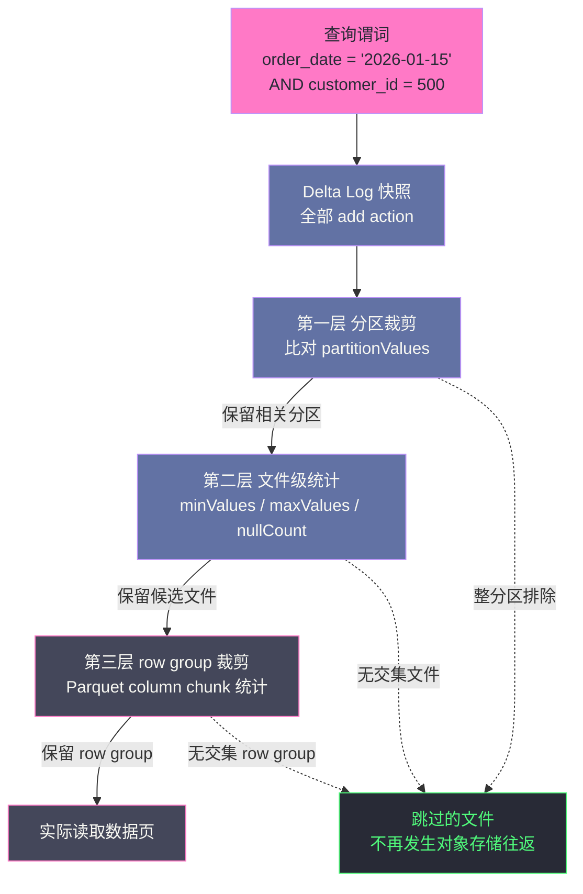
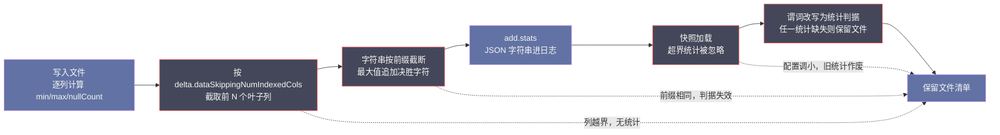
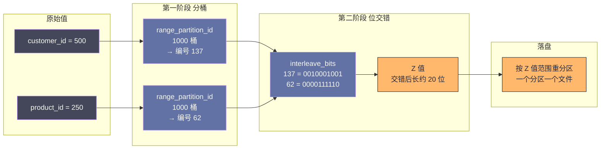
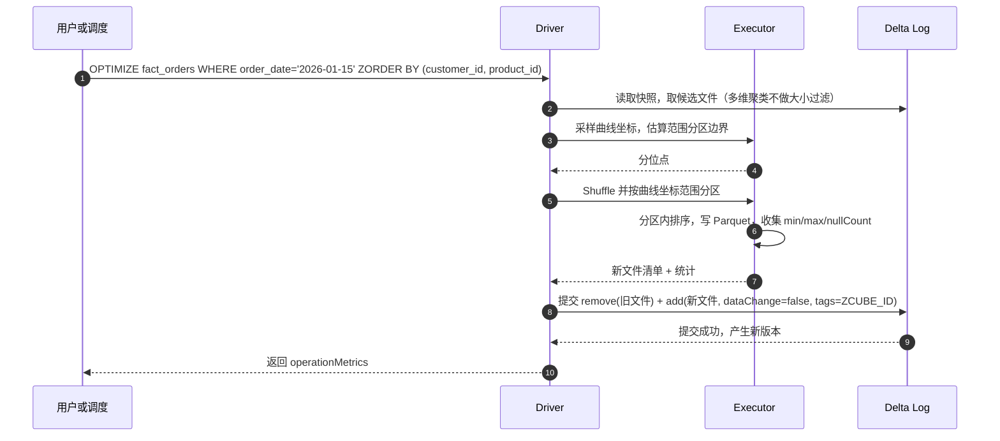

# 07 Z-Order 与数据跳过：查询加速的核心机制

**摘要：**

数据湖上的查询加速，最早卡在一个朴素的事实上：对象存储不会替你筛选数据，除非它认识数据。2019 年开源的 Delta Lake 在协议里就把每个数据文件的列级统计写进了事务日志的 `add` action，于是"哪些文件不可能包含目标行"这件事，从读取时的文件打开动作，前移成了 Driver 端一次内存计算。围绕这份统计，一套三层判据链逐渐成形：分区裁剪给出目录级的粗筛，文件级 `stats` 给出 min/max/nullCount 的中筛，Parquet 的 row group 统计给出文件内的细筛。Z-Order 排序则是在这套链路的下游动手，它不改变判据，只改变数据的物理聚簇，让第二层的 min/max 区间变窄。

本文沿三层判据展开，先讲清每一层的依据、代价与失效条件，再拆开 Z-Order 的数学：为什么把多列值先做分位分桶、再按位交错，就能用一次排序服务多个查询维度，以及这种局部性为什么随维度增加而衰减。随后交代 `OPTIMIZE ... ZORDER BY` 的真实执行过程与全表重写的代价，把它折算成一条可用的盈亏判断。文章后半段处理两个容易被误传的话题：Bloom Filter 在 Delta 里到底属于哪一层、由谁提供；Liquid Clustering 用聚类替代静态分区与 Z-Order 之后，增量维护省下的到底是什么。全文口径为 Delta Lake OSS 4.x，凡属 Databricks 平台能力而非开源协议的部分，均在出现处标明。

**关键词（Keywords）**: 数据跳过, Z-Order, 文件级统计, OPTIMIZE ZORDER BY, Liquid Clustering, Morton 曲线, row group, 字符串统计截断

---

## 第 1 章 判据链：一次点查要跨过几道闸

### 1.1 全扫描的代价不在算力，在寻址

在对象存储上做数据湖，最先撞上的不是 CPU 也不是内存，而是"打开一个文件"这个动作本身的价格。一次 `GET` 请求在对象存储上的往返，通常落在数十毫秒的量级（具体取决于厂商、地域与并发度），它与文件大小无关；一千个 Parquet 文件意味着上千次元数据往返，即便每个文件只读 1 MB，光是把这些往返排成队，也足以让一条本该秒级返回的查询拖到分钟级。

HDFS 时代这件事被掩盖过：NameNode 常驻内存、块地址批量可取，元数据寻址几乎免费，瓶颈压在磁盘带宽上。对象存储把成本结构翻了过来，元数据往返成了主导项，"少打开一个文件"的价值第一次超过"少读一兆字节"。

无统计信息的 Parquet 表里，一条 `WHERE order_id = 20260115` 的查询没有任何办法预判哪些文件相关：引擎只能先列出全部文件，再逐个打开读 Footer，看到 row group 的 min/max 才能决定是否跳过。判断发生得太晚，代价已经付掉了。

### 1.2 判据为什么要搬进事务日志

Delta Lake 的做法是把这份判据前移到写入时刻：写文件的时候顺手把每列的 min/max/nullCount 算好，连同文件路径、大小、分区值一起写进本次提交的 `add` action。这些 action 组成事务日志（Delta Log），一次列表操作就能拿到整张表的全部文件元数据，统计信息随文件描述一起进内存。

于是裁剪不再需要打开数据文件。Driver 端把谓词改写成针对 `minValues`、`maxValues`、`nullCount` 的表达式，对内存里的文件清单做一次过滤，只把通过的文件交给 Executor。代价从"每个文件一次对象存储往返"降到"一次日志读取加一次内存计算"，量级上的差别，不在同一档。

Delta 的 `filesForScan` 同时接受分区谓词与数据谓词，两者在同一处生效：先按 `add` action 里的 `partitionValues` 做分区级过滤，再对剩下的文件套用统计信息过滤。这个顺序不是实现细节，而是成本排序的必然结果——分区值的比较是字符串判等，比任何表达式求值都便宜。

### 1.3 三层串联的判据链

下图是一次查询从谓词到实际读取所经过的三道闸，每一道都在缩小集合，只是依据的数据结构与所处的进程不同。



三层判据的粒度、代价与失效条件是三套完全不同的账，把它们并排放，能看出为什么"数据跳过没生效"这个问题通常不只有一种答案。

| 层级 | 判据来源 | 生效位置 | 粒度 | 额外 I/O 代价 | 典型失效条件 |
|---|---|---|---|---|---|
| 分区裁剪 | `add.partitionValues` | Driver | 目录/分区 | 无 | 分区列不在谓词里；分区粒度过细导致小文件；分区值未规范化 |
| 文件级统计 | `add.stats` 的 min/max/nullCount | Driver | 单文件 | 无（随日志读入） | 列超出统计列范围；字符串前缀截断；统计缺失；谓词不可转换 |
| row group 裁剪 | Parquet Footer 的 column chunk 统计 | Executor | 单个 row group | 一次 Footer 读，已不可避免 | 文件过小只有一个 row group；文件内数据无序；谓词不可下推 |

前两层是**不开文件就能做的判断**，第三层是开了文件但不必全读的判断。很多团队把三层混为一谈，看到扫描量没降下来就去调 `ZORDER`，结果重写了整张表，命中率却纹丝不动——因为瓶颈可能压根不在第二层。

### 1.4 贯穿案例与版本口径

后文用一张电商订单事实表贯穿：`fact_orders` 以 `order_date` 分区，按天一个分区；分区内数据来源是多条并发的写入流，文件大小参差；查询侧主要是两类，一类按 `order_date` 加 `customer_id`、`product_id` 的组合条件拉明细，另一类按 `order_uuid`、`customer_email` 这类高基数字符串做等值查找。

举例来说，一个分区 1 TB、一千个 1 GB 文件、每个文件一百万行的量级，是这套机制能否发挥作用的典型战场：分区裁剪能砍掉绝大部分日期，但一个分区内部仍有一千个文件待筛，第二层的效果直接决定这条查询是读 1 TB 还是读 32 GB。

文中涉及的源码细节取自 delta-io/delta 主干与 4.x 分支，配置项名称以源码中的 `DeltaConfigs`、`DeltaSQLConf` 定义为准；凡标注"示例推算"的数字，都是用统一假设算出来的量级参考，不是某次基准测试的实测值。

---

## 第 2 章 前两层：分区裁剪与文件级统计

### 2.1 分区裁剪为什么最便宜

分区在物理上是目录，在逻辑上是 `add` action 里的一个 `Map[String, String]`。查询带 `order_date = '2026-01-15'` 时，裁剪只需在内存里比对这一对键值，把不匹配的文件整批剔除，被剔除的文件连元数据都不必再展开。

代价低到几乎没有，但收益有一个前提：谓词必须落在分区列上。第三层与第二层都失效的时候，分区裁剪依然稳固，因为它不依赖任何统计信息，只依赖写入时目录的划分方式。反过来说，它的粒度也是三层里最粗的：一旦某个分区成为热点，比如某一天的数据占了全表四成，这一层就再也帮不上忙。

分区设计最常见的两个错误都出在粒度上。粒度过细，譬如按小时甚至按租户再叠加日期分区，会让单分区文件数降到个位数、目录数涨到十万级，元数据列表反而成了新瓶颈，这正是"过度分区"的典型症状；粒度过粗，譬如只按月分区，单分区动辄几 TB，第二层的文件级统计要在一万个文件上做判断，裁剪率再好也抵不住单文件粒度的浪费。

### 2.2 add action 里的 stats 长什么样

统计信息不是独立的索引文件，它是 `add` action 里一个 JSON 字符串字段。下面这段是提交日志里真实存在的结构，字段名与协议（Protocol）中的定义一致。

```json
{
  "add": {
    "path": "order_date=2026-01-15/part-00000-8f2c.snappy.parquet",
    "partitionValues": { "order_date": "2026-01-15" },
    "size": 1048576312,
    "modificationTime": 1768435200000,
    "dataChange": true,
    "stats": "{\"numRecords\":1000000,\"minValues\":{\"customer_id\":50001,\"product_id\":1,\"amount\":10.5,\"order_uuid\":\"0a1b2c3d\"},\"maxValues\":{\"customer_id\":60000,\"product_id\":9999,\"amount\":9999.99,\"order_uuid\":\"9f8e7d6c\"},\"nullCount\":{\"customer_id\":0,\"product_id\":0,\"amount\":127,\"order_uuid\":0}}",
    "tags": { "ZCUBE_ID": "3f9c1a2e-..." }
  }
}
```

`stats` 里三组值的语义各有讲究，读协议文档的措辞比读二手资料可靠：

- `minValues` / `maxValues` 记录该列在文件内的最小与最大值，若整列全为 null 则不携带信息；
- `nullCount` 只有两个取值有意义，等于 0 表示该列全部非空，等于 `numRecords` 表示全部为空，中间值不携带信息；
- 当文件带删除向量（Deletion Vector）时，统计可能是"宽界"（wide bounds），此时 `stats.tightBounds` 为 `false`，min/max 只保证是全量有效值的下界与上界，不再保证紧致。

这最后一条影响不小。文件上挂删除向量之后，`nullCount` 的中间值不再可信，`minValues` 可能远小于真实最小值，于是裁剪判断会退化为保守的"不跳过"。删除向量让更新变便宜，代价就转移到了统计精度上——这是同一份元数据被两套机制争夺的典型场面。

### 2.3 谓词如何变成跳过判断

Driver 端的裁剪不是解释 SQL，而是把 Catalyst 表达式改写成一串针对统计字段的布尔表达式。改写只认列与字面量的比较，遇到无法转换的形态就放弃这一项，宁可不跳过也不误跳。

| 谓词形态 | 改写后的判据 | 备注 |
|---|---|---|
| `col = v` | 保留 `minValue <= v <= maxValue` 的文件 | 字符串列受前缀截断影响 |
| `col BETWEEN a AND b` | 保留 `maxValue >= a AND minValue <= b` | 与等值同构 |
| `col > v` | 保留 `maxValue > v` 的文件 | 开区间，边界需严格比较 |
| `col IS NULL` | 保留 `nullCount > 0` 的文件 | 依赖 nullCount 存在 |
| `col IS NOT NULL` | 保留 `nullCount < numRecords` 的文件 | 全空文件可跳 |
| `a = 1 AND b = 2` | 两侧判据同时成立 | 交集，最强 |
| `a = 1 OR b = 2` | 两侧判据任一成立 | 并集，收益随分支增加而衰减 |
| `col != v` | 等价改写后仍需 min/max 可判定 | 只有单值文件才可能被跳 |

只对特定类型收集统计这件事常被忽略：可跳过类型是数值型、日期、时间戳（含 NTZ）与字符串，布尔列与复杂类型不在名单里。于是 `WHERE is_paid = true` 这种谓词，无论数据怎么布局都拿不到文件级裁剪，它只能靠 row group 或数据本身的选择性。

### 2.4 只统计前 N 列：`delta.dataSkippingNumIndexedCols`

统计不是全列收集的。表属性 `delta.dataSkippingNumIndexedCols` 默认为 32，含义是该列在表结构中的位置索引：位置小于这个数字的列收集统计，超出的不收集。协议里还有一条容易踩的细节，嵌套字段的每一个叶子字段各算一列，所以一个三层 struct 展开之后可能瞬间吃掉好几个名额。

这个属性的语义比它看起来更微妙，官方文档写得很清楚：修改它不会触发历史统计的重新收集，它重新定义的是**统计模式**。也就是说，把 32 调到 8 之后，旧文件里已有的第 9 到第 32 列统计会被直接忽略；反过来把 8 调到 32，旧文件不会凭空长出统计，那些文件在涉及新列的谓词上一律"不跳过"，直到它们被重写。

于是有一类故障非常隐蔽：某张宽表为省统计开销把 `dataSkippingNumIndexedCols` 压到 10，半年后有人按 `merchant_id`（第 23 列）做查询并抱怨"数据跳过没效果"，而日志里一切正常。判据是看 `OPTIMIZE` 返回的 `operationMetrics` 里的 `numTableColumnsWithStats`，它等于属性值与表列数的较小者，一眼就能算出有多少列实际带统计。

到 4.x，源码里另有一个更精确的替代品 `delta.dataSkippingStatsColumns`，允许按列名指定收集范围，且优先级高于数字索引。它在 OSS 的 Table Properties Reference 页面上尚未收录，Databricks 文档标注要求 Runtime 13.3 LTS 及以上，用它之前应当以对应版本的文档和 `DeltaConfigs` 的实际定义为准，不要假定旧版本可用。

### 2.5 字符串前缀截断：min/max 为什么不总是紧的

字符串列的统计是被截断过的。协议脚注只有一句话，实现里却有一整套处理：字符串按固定前缀长度截断，缺省 32 个字符，可用表属性 `delta.dataSkippingStringPrefixLength` 或会话配置覆盖。

**截断的方向决定了它是否安全**。最小值直接截断取前缀，因为任何以更短前缀开头的字符串在字典序上都不会更大，截断后的下界依然成立。最大值不能简单截断：`"abcdefgh...zzz"` 截成 `"abcdefgh"` 之后，原值比它大，上界就被破坏了。所以实现会在截断后的前缀末尾追加一个"决胜字符"，让截断结果仍然不小于任何真实值——源码里用的是 ASCII 最大字符 `\u007F` 或 Unicode 最大码点，如果前缀已经顶到极限还会继续延长，直到找到安全的位置为止。

这个设计保证了正确性，却让等值查询失去了裁剪能力。设想订单号是 `ORD-20260115-000001` 这类格式，前缀 32 个字符里塞满了日期段，同一批次写入的文件前缀完全相同，于是：

- 文件的 `maxValue` 是 `"ORD-20260115-..."` 截断后追加决胜字符的结果；
- 查询值 `'ORD-20260115-000042'` 落在 `minValue` 与 `maxValue` 之间，判据无法排除；
- 一千个文件里可能只有一两个真正包含该订单，但判据会保留全部一千个。

于是长字符串在 min/max 体系里只剩下"前缀是否可能相同"这一层信息量。前缀越短、重复度越高，裁剪率越接近零。UUID 那种十六进制随机串反而更好一些，因为前缀的取值空间相对分散；真正糟糕的是带业务语义的定长编号。

### 2.6 时间戳的毫秒截断与 1 毫秒修正

时间戳有一个同源的坑。日志里的 JSON 序列化把时间戳截断到毫秒，一个只包含 `01:02:03.456789` 的文件会写成 `min = max = 01:02:03.456`。如果直接用它做上界判断，`WHERE ts > '...456789'` 就会错误地跳过这个文件。

Delta 的处理是在读取端给 `maxValues` 加 1 毫秒，代码里的 `getAdjustedTimestamp` 就是这么做的，并且专门处理了接近 `Long.MAX_VALUE` 时的溢出，饱和到最大值以保证"上界不小于真实值"。这 1 毫秒的补偿对裁剪率的影响微乎其微，但它保证了毫秒级谓词不会误跳文件。

### 2.7 统计缺失时，判据选择保守

统计信息可能根本不存在：从非 Delta 表转换而来、写入时被裁剪掉、或者老版本写下的文件。Delta 对这种情况的处理原则是"缺统计就不跳过"，实现上由一段专门的校验谓词保证：只要谓词引用的任一统计字段为 null，该文件一律保留。

源码注释里说得很直白——他们宁可让整个文件跳过失效，也不愿在统计缺失时做部分推断，因为校验每个统计项只做一次比按需校验更划算，而统计模式变化（不同版本文件 `stats` schema 不一致）属于小概率场景。

这条原则解释了一个常见现象：把普通 Parquet 表 `CONVERT TO DELTA` 之后，裁剪效果往往不如重新写入的表，因为转换只登记文件，不会重算统计。要修复只能显式重算统计（`ANALYZE TABLE ... COMPUTE DELTA STATISTICS` 或整表重写），否则那些文件会一直"永远参与扫描"。

### 2.8 第二层的收益边界

把前面几条并起来，第二层的生效条件可以写成一个乘积：命中率 ≈ 文件数 × 谓词选择性 × 参数与列的对齐度。三者缺一，Z-Order 都救不回来，缺哪一项、怎么补，第 6 章会连同收益边界一起交代。

把这份统计从"写入时收集"到"查询时判定"的全过程画成一条链，四次折损点就一目了然：写入时按列位置取舍、字符串按前缀截断、读取时按配置忽略越界统计、判定时遇到缺失就放弃裁剪。



第三层 row group 的同构问题，以及它为什么与 Z-Order 的执行细节强绑定，是下一章的内容。

---

## 第 3 章 第三层：文件内部的第二道闸

### 3.1 Parquet 的三级结构

Parquet 文件不是一整块不可分的黑盒。它在物理上分成若干个 row group（行组），row group 内按列切出 column chunk（列块），column chunk 再切成 page（页）。文件末尾的 Footer 里存着每个 row group、每个 column chunk 的统计，包括该列在该行组内的最小最大值、空值计数，以及可选的布隆过滤器与 page index。

这套结构与 Delta 的日志统计是同构的，只是层级不同：日志统计描述"整个文件"，Footer 统计描述"文件内的一块"。于是裁剪天然可以分两级做——先用日志砍掉文件，再用 Footer 砍掉文件内的 row group。

把文件想成一本书，row group 是章节，Footer 是目录：目录只交代每章的主题，不交代每页写了什么。第三层的分辨率就这样被"章节"这个粒度锁死，除非章节本身按查询关心的顺序排列——这是 3.4 节那个开关的由来。

row group 的大小由写入端决定，Parquet 的 `parquet.block.size` 缺省是 128 MB。一个 1 GB 的目标文件按这个设置大约切成 8 个 row group，这个数字决定了第三层最细能细到什么程度：一个 row group 内的数据无法再被统计信息拆开，只能整块读或整块跳。

### 3.2 读取器如何用上 Footer 统计

Spark 读取 Parquet 时会把查询谓词下推给 Parquet 的读取层，由后者在打开文件后、读取数据页前，用 Footer 里的统计判断哪些 row group 可以跳过。这条路径受 `spark.sql.parquet.filterPushdown` 控制，缺省开启；更细的页级过滤依赖 Parquet 的 column index（page index），是否启用取决于读取器实现与版本，不在 Delta 的控制范围内。

这句话划出了一条清晰的责任边界：Delta 负责"哪些文件不读"，Parquet 读取器负责"文件里哪些块不读"。所以当有人问"为什么加了 `ZORDER` 之后扫描量没变"，答案可能落在第三层——如果每个文件内部的数据没有按 Z 值有序排列，那么文件内每个 row group 的最小最大值都近似等于文件级的区间，第三层的判据退化成第二层的复制品，一点新的裁剪也带不来。

### 3.3 文件大小与 row group 数量的两难

目标文件大小是一个需要权衡的参数。文件越大，单个文件的 min/max 区间越宽，第二层越难精确；文件越小，元数据条目越多，Driver 端的列表与判断越重，对象存储往返也越多。1 GB 这个缺省值正是在这两个方向上折中的结果。

但还有第三个方向容易被忽略：row group 的数量。1 GB 文件配 128 MB 的 row group 只有 8 个块，第三层最多把读取量缩小到八分之一；如果把 `parquet.block.size` 调到 16 MB，一个文件就有 64 个 row group，第三层的分辨率提高八倍，代价是 Footer 变大、每块的数据压缩率下降、以及读取时的调度开销上升。

三者之间的关系可以粗略写成 **生效裁剪率 ≈ 1 − (文件命中率 × 行组命中率)**，其中行组命中率的下界是"单个 row group 覆盖的值域占文件值域的比例"。当文件内数据无序时，这个比例是 1，第三层完全失效。

### 3.4 文件内有序：一个默认关闭的开关

Delta 的多维聚类实现在写文件之前可以做一次分区内排序，对应配置 `spark.databricks.io.skipping.mdc.sortWithinFiles`，源码里的缺省值是 `false`。它的注释写得很清楚：开启后可以改善 row group 裁剪与压缩效果，代价是额外的排序开销。

这件事解释了为什么很多团队做完 `ZORDER` 后发现"文件数降了、扫描字节降得不多"：文件级的 min/max 确实收窄了，但每个文件内部仍是乱序，8 个 row group 各自的区间依旧宽得像整个文件。要吃到第三层的收益，必须让文件内的行也按曲线坐标有序，这要么靠这个配置，要么靠查询侧只约束文件级边界。

### 3.5 三层并起来的量级感

用一个统一的假设计算一遍：1 TB 分区、1000 个 1 GB 文件、每个文件 8 个 row group，查询按 `customer_id` 等值过滤，选择性百万分之一。

| 阶段 | 候选数量 | 依据 | 剩余比例（示例推算） |
|---|---|---|---|
| 进入扫描 | 1000 个文件 | 分区裁剪后 | 100% |
| 文件级裁剪 | 约 32 个文件 | 日志 min/max | 3.2% |
| 行组级裁剪（文件内乱序） | 约 32 × 8 个行组 | Footer min/max | 3.2% |
| 行组级裁剪（文件内有序） | 约 32 个行组 | Footer min/max | 0.4% |
| 真实命中 | 约 1 个行组 | 数据本身 | — |

表中的比例来自后文第 4 章的均匀分布模型，只用来比较量级。它想说明的是：文件级裁剪把 1000 缩到 32，行组级裁剪能不能再缩一个量级，取决于文件内是否有序；而无论第三层做得多好，"真实命中只有一个行组"这件事意味着还有 30 多个行组的读取是白费的——那是文件粒度带来的固有余量，只能靠更细的聚簇或更小的文件继续压。

---

## 第 4 章 Z-Order 的数学：把多维压成一维

### 4.1 单列排序只服务一个维度

先看一个不需要任何公式的反例。假设 `fact_orders` 的一个分区内部，数据按 `customer_id` 排序写入：每个文件覆盖一段连续的 `customer_id` 区间，文件的 min/max 窄到只有几千个取值。此时 `WHERE customer_id = 500` 能精确命中一两个文件，裁剪率接近百分之百。

但同一个分区上，`WHERE product_id = 250` 就没有任何好处。`product_id` 在按 `customer_id` 排好序的数据里是随机分布的，每个文件的产品 ID 区间都横跨 1 到 9999，判据无法排除任何一个文件。排序把信息量集中到了一个维度上，其余维度一无所获。

这就是分区与单列排序的共同局限：它们都是"按某个键把数据切开"，切法只有一条轴。业务查询却很少只约束一条轴——订单明细查询通常同时带客户、商品、时间、状态，四个条件各砍一刀。二维以上的裁剪需求，需要一种能同时服务多条轴的物理布局。

### 4.2 两步：先分桶，再交错

Delta 的 Z-Order 实现常被简化成"把列值的二进制位交错排列"，但源码里的第一步常被漏掉，而它恰恰决定了精度。真实的计算是两步，**先分位分桶，再按位交错**：

第一步，把每一列的值按近似分位数映射成一个区间编号（range id）。这一步由 `range_partition_id` 完成，它等价于一个近似的 rank 函数：对一列取值 `(0, 1, 3, 15, 36, 99)` 分三桶，会得到编号 `(0, 0, 1, 1, 2, 2)`。分桶数量由 `spark.databricks.io.skipping.mdc.rangeId.max` 控制，缺省 1000。

第二步，把这几个区间编号的二进制位按轮转方式交错（bit interleaving），得到一个多字节的曲线坐标，也就是 Z 值。交错函数 `interleave_bits` 的注释直接引用了 Z-order curve 的词条，并声明其性质：多维空间中相近的点，会映射到曲线上相近的位置。

下图是这个两步过程的形状。注意第一步把连续值压成了离散桶，这一步决定了每维的分辨率上限；第二步只负责把多个桶号编织成单一排序键。



分桶这一步还解释了一个实现细节上的取舍：为什么 Delta 不直接交错原始位的值。原始值分布可能是倾斜的，直接交错会把绝大多数点压到少数几个 z 区间里，输出文件大小严重不均。先做分位分桶，等于先把数据"拉平"，让每个桶的样本量相近，曲线坐标的分布随之均匀——这就是注释里说的"近似 rank"，它承担的是抗倾斜，而不是精度。

### 4.3 位交错为什么能保持邻近

交错排列保局部性的道理，可以用前缀来描述。两个点在多维空间里相近，意味着它们的每一个坐标都相近，也就意味着它们每个桶号的高位都相同；桶号的高位在交错之后排到了 z 值的高位，所以这两个点的 z 值高位也相同，落进同一个 z 区间。

反过来，两个点的 z 值高位相同，并不保证每个维度都相近，这是 Z 曲线相较 Hilbert 曲线的已知缺陷：曲线在某些位置会从一个象限突然跳到另一个象限，形成"折返"。举例来说，二维 Z 曲线在扫过一个 2×2 的方格组时，会以 N 字形的顺序穿过四个小方格，相邻的两次跳跃里有一次跨越了较远的距离。

这个缺陷对裁剪的影响是双向的：同一 z 区间内可能混进空间上不相邻的点，使文件的包围盒（每个维度上的 min/max）比理想情况更宽。Z 曲线不能做到的最优，正是 Hilbert 曲线在理论上的优势所在；两者的差距在数据倾斜时更明显。

### 4.4 局部性随维度衰减：一个定量模型

多维聚类最反直觉的一点是，维度越多，每一维上的精度反而越低。原因不是曲线不好，而是"文件数"这个预算是固定的，却要在多个维度上分摊。

设每维分成 R 个桶（缺省 R=1000），维度为 d，输出文件数为 F。整个空间有 R^d 个桶组合，平均每个文件覆盖 R^d / F 个组合。把这些组合投影到单一维度上，文件的包围盒宽度约为 (R^d / F)^(1/d) = R / F^(1/d) 个桶，占该维总宽度的比例是 F^(-1/d)。

这个比例就是单列等值谓词的文件命中率。把它代入 R=1000、F=1000 算一遍：

| 维度数 d | 单列命中率 F^(-1/d) | 命中文件数（示例推算） | 四列点查命中文件数 |
|---|---|---|---|
| 1 | 1/1000 | 约 1 | 不适用 |
| 2 | 约 3.2% | 约 32 | 约 1 |
| 3 | 10% | 约 100 | 约 1 |
| 4 | 约 17.8% | 约 178 | 约 1 |

表里的对比是全章最该记住的一句话：**Z-Order 的收益来自多列同时约束，而不是多列各自约束**。四列点查时，命中文件数稳定在个位数，无论维度是二还是四；但如果查询只约束其中一列，维度从二加到四，命中文件数从 32 涨到 178，裁剪效果反而退步了五倍多。

这也正是 Databricks 文档里那句经验规则的数学来源：表小于 10 TB 时，用更多聚类键会让单列过滤变差。文件总数 F 不够大时，F^(1/d) 的增长跟不上维度 d 的稀释，维度越多，每维分到的分辨率越少。

模型的假设需要说明清楚：数据在每维上均匀分布、各维之间无相关性、忽略噪声字节与采样的估计误差。真实数据里相关性极强（比如 `order_date` 与 `order_id` 单调相关），此时把两个相关列同时放进 `ZORDER BY` 是浪费维度，官方文档的建议是相关列只放一个。

### 4.5 噪声字节：治倾斜的代价

前面提到，`repartitionByRange` 的排序键有时不止曲线坐标一个。当 `spark.databricks.io.skipping.mdc.addNoise` 为真（缺省为真）时，实现会追加一个随机的字节列作为次序键，与曲线坐标组成复合排序键。

它的作用对象是倾斜：如果大量记录的曲线坐标完全相同（同一个桶组合里挤了太多行），按曲线坐标做范围分区会让某个分区特别大，写出一个超大文件，任务时长严重不均。加一个随机字节作为次序键，相当于在同一坐标内部再随机切分，把大块打散成多份。

代价出在裁剪上。同一坐标的记录被打散到最多 256 个连续输出分区里，于是针对该坐标的点查可能命中多个文件，而理想情况下应该只命中一个。源码注释毫不掩饰这个取舍：加噪声有助于处理倾斜，但可能对整体 min/max 裁剪效果产生负面影响。这条配置的存在本身就是一个提醒——物理布局的每一个参数都在"均匀"与"紧凑"之间选边，两者并不总是同向。

### 4.6 Hilbert 曲线与 ZORDER 的真实关系

关于 Hilbert 曲线在 Delta 里的角色，流传着不少错误说法，需要按源码校正一次。

`OPTIMIZE ... ZORDER BY` 使用的曲线在 `OptimizeTableStrategy` 里被硬编码为 `"zorder"`；策略类里既没有读取表属性来决定曲线的分支，也没有提供切换入口。开源版 Delta 的表属性参考里同样没有 `delta.layoutOptimization.strategy` 这一项。换句话说，在 OSS 的 Z-Order 命令上没有"换成 Hilbert 曲线"这个选项。

Hilbert 曲线的实现确实存在，位于 `MultiDimClusteringFunctions.hilbert_index`，但它服务的是另一次调用：Liquid Clustering 的 ClusteringStrategy 把曲线设成 `"hilbert"`。还有一个反直觉的分支——当聚类列只有一个时，`hilbert` 会回退到 Z-Order 实现，因为单列情况下 Hilbert 与 Z 曲线等价，没必要走更昂贵的希尔伯特索引计算。

所以准确的说法是：Z-Order 是"一次性的曲线排序"，曲线固定为 Z 曲线；Hilbert 是 Liquid Clustering 使用的聚类曲线。把两者混为一谈，会在排查"为什么换了配置没有效果"时绕远路。

### 4.7 一个比喻及其限定

把 Z-Order 想成图书馆上架。按单一分类号上架，等于只按作者排序：找某个作者的书极快，找某个主题的书就要跑遍全馆。Z-Order 的做法是给每本书同时算作者序号与主题序号，把两个序号交错成一个新的书架号，再按这个号排架——于是"某作者的某主题"这一类组合查询能一次定位到一小段书架。

比喻的限定有两处。其一，书架号交错之后，同一主题的书仍然分散在多个相邻书架段里，组合越具体定位越准，条件越单一反而越散，这正是 4.4 节那张表的含义。其二，图书馆的排架是一次性成本，但书还在源源不断进来；新书按原书架号插入会让排架逐渐失效，于是需要周期性地重新整架——这就是下一章要讨论的重写代价。

---

## 第 5 章 `OPTIMIZE ... ZORDER BY` 到底做了什么

### 5.1 候选文件：多维聚类不做大小过滤

普通的 `OPTIMIZE`（bin-packing）会先按文件大小过滤候选集：只有小于 `optimize.minFileSize`（缺省 1 GB）的文件才进入重写，已经达到目标大小的文件被跳过，所以它是幂等的，跑第二遍不会再动数据。

多维聚类走的是另一条分支。源码里 `filterCandidateFileList` 的第一行就是判断——如果当前是多维聚类，直接返回全部文件，不做大小过滤。原因不难理解：Z-Order 要重排的是整个分区的相对顺序，如果只挑小文件参与，重排后的大小文件混在一起，曲线坐标的连续性立刻断裂。

这一行判断决定了 Z-Order 的成本结构：**它永远重写目标分区内的全部数据**，而不是只重写需要整理的那部分。这也是官方文档明说 Z-Order 不幂等的原因——每执行一次，都会对分区内所有文件（包括上次 Z-Order 刚写出来的文件）重新聚类一次。

### 5.2 一个分区一个 bin，文件数由字节数决定

聚类的粒度单位是 bin。对 Z-Order 策略，`maxBinSize` 被设成 `Long.MaxValue`，等价于"每个分区只有一个 bin"，分区内的所有文件进同一个聚类作业。这与 bin-packing 的做法相反：后者按目标文件大小把文件切成若干 bin，每个 bin 独立合并。

输出文件数不是由聚类的桶数决定，而是由一个朴素的除法得出：`approxNumFiles = max(1, totalSize / maxFileSize)`，其中 `maxFileSize` 缺省 1 GB。1 TB 的分区就是一千个输出文件，10 GB 的分区就是十个。

笔者把这条除法当成判断分区是否值得优化的第一个筛子：分区大小除以目标文件大小，得到的数字如果只有个位数，聚类的分辨率从一开始就被限死了。

这个细节解释了一个常见的困惑：为什么对小分区做 Z-Order 几乎没用。如果分区只有 10 GB，输出文件只有 10 个，而每维桶数仍是 1000——曲线坐标被压缩到十个文件里，每个文件的包围盒宽度直接等于 1/10 的值域，任何单列谓词都要命中 10% 的文件。**聚类精度由文件数这个预算决定**，数据量不够时，再好的曲线也换不出窄区间。

### 5.3 三段执行：采样、Shuffle、落盘

`repartitionByRange` 是 Spark 的范围分区算子，它的执行分三段，每一段都在 Z-Order 里留下痕迹。

第一段是采样。`range_partition_id` 需要一份样本才能定出分位边界，`repartitionByRange` 还要对交错后的键再采一次；两个聚类列意味着三次采样。分桶越细采样开销越大，源码注释对此有明确提示——这是 Z-Order 相对普通写入多出来的第一笔固定成本。

第二段是 Shuffle。所有记录按曲线坐标重分布到新的分区，这一步必然全量落盘并走网络。曲线坐标本身是每行算出来的临时列，算完即弃，不写进数据文件。

第三段是排序写盘。每个分区按曲线坐标（以及可选的噪声字节）把记录写成 Parquet 文件，顺带收集新文件的列统计。如果开启了分区内排序，还会在写之前多一次排序。

下面的时序图把三段与提交阶段串起来，重点看旧的 `add` 如何被整体替换。



### 5.4 提交与打标：ZCube 身份

提交阶段除了常规的 `remove` 与 `add`，还有一个容易被忽略的动作：给新文件打标签。Z-Order 的 `add` action 会带上 `ZCUBE_ID` 与 `ZCUBE_ZORDER_BY` 两个 tag，`ZCUBE_ID` 是一次 `OPTIMIZE ZORDER BY` 运行的唯一标识，`ZCUBE_ZORDER_BY` 记录本次使用的列。

这组标签有两个用途。其一是可观测性，判断某个文件是不是聚簇产物、由哪次作业产生，不必反查历史；其二是增量优化与 `OPTIMIZE FULL` 的判据，聚类实现需要知道哪些文件已经聚过、用的是哪组列，才能决定要不要重写。

`dataChange=false` 是另一个关键标记。它声明本次提交没有产生新数据、只是重排了已有数据，于是变更数据流（Change Data Feed）不会为这次重排生成变更记录，下游增量消费者不会因为一次 `OPTIMIZE` 而收到一堆伪更新。把这个标记拿掉，一次优化可能变成一次全表"假变更"事件。

### 5.5 代价折算：一次重写要换回几次查询

把上述流程折算成 I/O：读全分区 S、Shuffle 落盘与网络约 S、写回约 S，总量大致是 3S 量级。再设查询侧优化前的扫描量为 S，优化后为 f·S（f 是命中文件比例），单次查询省下 (1 − f)·S。

盈亏平衡的条件是查询频次 q 满足 q·(1 − f)·S > 3S，也就是 q > 3/(1 − f)。

代入 4.4 节的模型：两列 ZORDER、F=1000、单列等值查询的 f ≈ 3.2%，得到 q > 3.1，即**一次全分区重写大约要换来四次以上的同量级查询才算回本**（示例推算）。若查询是四列组合条件、f 接近 0.1%，那么 q > 3 的门槛不变，但每次查询省下的量更大，回本更快；若查询只约束一列而聚类用了四列，f ≈ 17.8%，则需要 q > 3.6 且单次收益极小，很可能永远不回本。

这个式子还给出一条运维直觉：重写代价与查询收益都按分区规模同比例缩放，S 在不等式两边被约掉，**真正决定性价比的是查询频次与命中率**。大表之所以更值得做，不是因为"大"，而是因为它的查询频次高、且文件数多到能让 f 足够小。

### 5.6 失败形态：三种立刻报错的情况

`OPTIMIZE ... ZORDER BY` 有几个在分析阶段就会抛出的硬错误，知道它们能省掉大量猜测。

| 症状 | 异常或错误 | 根因 | 处置 |
|---|---|---|---|
| 对分区列做 ZORDER | `zOrderingOnPartitionColumnException` | 分区列已被目录布局约束，再排序无意义 | 从 ZORDER 列表中移除分区列 |
| ZORDER 列不在统计范围 | `zOrderingOnColumnWithNoStatsException` | 列位置超过 `dataSkippingNumIndexedCols`，或统计被列为空 | 提高索引列数、调整列顺序，或改用 `dataSkippingStatsColumns` |
| 聚簇表上执行 ZORDER | `clusteringWithZOrderByException` | Liquid Clustering 与 Z-Order 互斥 | 聚簇表改用 `OPTIMIZE`，让聚类列生效 |
| 聚簇表上带分区谓词 | `clusteringWithPartitionPredicatesException` | 聚簇表不允许分区 | 去掉 WHERE，或改用 `OPTIMIZE FULL` |
| 列不存在或类型不支持 | `zOrderingColumnDoesNotExistException` / 不支持类型 | 列名拼错，或对 geo 等类型做 ZORDER | 核对列名与类型 |

第二个错误值得单说。统计检查由 `spark.databricks.delta.optimize.zorder.checkStatsCollection.enabled` 控制，缺省开启；一旦某个 ZORDER 列没有统计，命令直接失败而不是"静默按无效方式执行"。这个设计是善意的：没有统计的列做 Z-Order，写出来的文件确实按曲线聚了类，但查询时没有任何判据能利用这种聚簇，纯属白写一遍。源码选择报错，等于替用户挡住了这种看起来做了优化的浪费：**让命令失败，比让它静默白写要好**。

### 5.7 增量策略：把重写限制在有价值的分区

既然全量重写的代价是 3S 量级，可行的落地方式只有一种：缩小 S。

- 按分区优化，`OPTIMIZE ... WHERE order_date = '...'` 只重写一个日期分区，S 从整表降到一个分区；
- 按变更优化，只对最近被写入或更新的分区做聚类，把历史分区视为"已经足够好"；
- 按查询热点优化，用查询日志统计出高频过滤条件涉及的列与分区，优先聚类这些分区。

前两种做法依赖一个前提：分区裁剪已经把候选集缩到了单分区。如果表本身没有分区，或者每次查询都跨几十个分区，"按分区增量"这条路走不通，此时该重新审视图的布局，而不是调度策略。

PySpark 的入口与 SQL 等价，适合嵌进调度脚本：

```python
from delta.tables import DeltaTable

dt = DeltaTable.forName(spark, "fact_orders")
# 只重写一个分区；ZORDER 列若没有统计，命令会直接报错而不是静默变慢
dt.optimize() \
  .where("order_date = '2026-01-15'") \
  .executeZOrderBy("customer_id", "product_id")
```

---

## 第 6 章 收益边界：什么条件下才划算

### 6.1 三个前提缺一不可

把前面几章的条件收拢，Z-Order 值得做的判断可以压缩成三条同时成立的命题。

第一，查询的选择性要高。谓词必须能把候选集从"整分区"砍到"千分之几"，如果一条查询本来就要读掉分区三成数据，那么裁剪的物理上限就是那三成，再优化布局也只是在这三成里挪动。

第二，数据量要大到"文件数足够多"。聚类的分辨率由输出文件数决定，文件数不够时每维只有极少数桶可用，前面那条 F^(-1/d) 的公式会直接把收益抹平。经验阈值可以借用官方对聚簇表的说法——小于 10 TB 时增加聚类键反而变差——反过来读就是：几 GB 到十几 GB 的表做 Z-Order，收益很难覆盖成本。

第三，被排序的列要同时满足"高基数"与"常出现在谓词里"。低基数列的 min/max 本来就窄，排序不会让它更窄，`status` 只有三个取值时，任何文件的区间都覆盖全部取值，判据永远无法排除。

### 6.2 一个可用的净收益不等式

把 5.5 节的折算再写细一点。设一个分区大小为 S，优化后单次查询扫描比例 f，该分区在一个维护周期内被查询 q 次，重写一次的 I/O 系数为 k（按 Shuffle 与读写的量级取 3），则净收益近似为：

q · (1 − f) · S − k · S

取值为正才值得做。三个变量里 q 最难估，也最容易被高估——把"这个表很重要"当成"这个分区查得多"，是布局优化最常见的自欺。可行的做法是从查询日志里按分区维度统计，或者干脆先用一次增量 `OPTIMIZE` 做小范围试跑，用 `operationMetrics` 里的输入字节数对比后续查询的扫描字节数。

### 6.3 变化率：布局会随时间失效

前面所有推导都假设布局是"做完就一直在"。真实表在持续写入，新写入的文件没有参与过聚类，它们带着宽区间混进候选集，把整体命中率拉回原点。

设一个维护周期内新写入文件占比为 α，聚簇文件的单次查询命中率为 s，则整体命中率约为 **α·1 + (1 − α)·s**。这个式子很粗糙，但它给出了维护频率的直觉：

| 每周期新增占比 α | 聚簇文件占比 | 有效命中率（s=3.2%） | 判断 |
|---|---|---|---|
| 1%（T+1 批量） | 99% | 约 4.1% | 布局基本稳定，周级维护够用 |
| 5%（小时级追加） | 95% | 约 8.0% | 需要日级维护 |
| 20%（准实时） | 80% | 约 22.6% | 维护追不上失效，应考虑增量聚类 |
| 50%（流式写入） | 50% | 约 51.6% | Z-Order 不适用 |

（表中数字为示例推算，用于比较趋势。）α 到了一定量级，Z-Order 就变成了"永远在做、永远做不完"的作业：每次重写都可能与并发写入争抢同一分区，提交冲突的概率随写入频率上升，而有效期只到下一批文件落盘为止。

这就是变化率高的表不适合 Z-Order 的根本原因，与"贵不贵"是两件事。批量 T+1 的表可以接受每天重写一次，因为一天之内布局是稳定的；每十分钟写一次的表，重写周期与写入周期同量级，重写本身变成了主要负载。

### 6.4 列怎么选

列的选择有一条清晰的排序：先看谓词频次，再看基数，最后看相关性。

| 情形 | 是否适合放进 ZORDER BY | 理由 |
|---|---|---|
| 高频等值/范围谓词 + 高基数数值列 | 适合 | min/max 收窄最直接 |
| 与分区列高度相关的列 | 不适合 | 分区已提供该维过滤，再加一维是浪费 |
| 低基数列（状态、类型） | 不适合 | 区间本来就覆盖全部取值 |
| 从不出现在谓词里的列 | 不适合 | 无收益，纯付代价 |
| 两列强相关（日期与自增 ID） | 只选一列 | 相关性使第二维不增加信息 |
| 长字符串列（订单号、UUID） | 效果有限 | 前缀截断吃掉判别力，见第 7 章 |

列数控制在 2 到 3 个是常见做法，背后的依据就是 4.4 节的衰减：每加一维，单列查询的命中率按 F^(-1/d) 变差，而组合查询的收益已经饱和。

### 6.5 与文件合并的关系

`OPTIMIZE` 的两个能力常被混着用：bin-packing 解决小文件，Z-Order 解决数据聚簇。两者在一次命令里可以同时发生（因为 Z-Order 本来就会重写全部候选文件并合并成目标大小），但代价模型不同。

只做 bin-packing 时，候选集按 `optimize.minFileSize` 过滤，通常是"很多小文件"才需要跑，跑完文件数下降、元数据变轻，幂等且可以频繁执行。做 Z-Order 时，候选集是分区全量，跑完文件数也下降，但主要收益在裁剪率，不幂等且代价高一个量级。

实践中的组合是：日常用自动合并控制小文件，周期性对热点分区做 Z-Order。把两者塞进同一个高频作业，每次都会全量重写分区，反倒制造写放大。

### 6.6 三类典型反例

**小表上做 Z-Order。** 10 GB 的表，重写一次约 30 GB I/O，查询本来读 10 GB。即便命中率做到 3%，单次查询也只省下 9.7 GB，需要三四次查询回本——账面上似乎还行，但漏算了三件事：小表的查询延迟本来就在秒级，省下的是"更快的秒级"；重写会占用整个集群并阻塞并发写入；几十 GB 级别的表通常查询模式是全表聚合，压根没有可裁剪的谓词。结论是这类表把精力放在文件合并与分区设计上更实际。

**高频更新的表做 Z-Order。** 症状是 `OPTIMIZE` 越来越慢、提交冲突变多、裁剪率却上不去。诊断依据是 `DESCRIBE HISTORY` 里 `OPTIMIZE` 与写入操作交替出现，每次优化后很快又被新文件稀释。处置方向不是加大优化频率，而是降低写入的碎文件量（优化写、控制分区粒度），或者直接转向增量聚类。

**排序列选错。** 三种选错方式各有特征：选了分区列，命令直接报错；选了低基数列，命令成功但扫描字节毫无变化；选了从不出现在谓词里的列，同样毫无变化。后两种情况都值得用一个小分区做前后对比——在同一个分区上比较优化前后的扫描字节数，如果没有差异，说明列选错了，而不是数据量不够。

---

## 第 7 章 Bloom Filter：一个已被平台弃用的补充

### 7.1 字符串等值为什么靠不住 min/max

第 2.5 节已经把根因说完了：字符串统计只保留前缀，最大值还要追加决胜字符，于是长字符串的 min/max 区间实际上退化成一个"前缀区间"。等值查询只要目标值的前缀落在区间内就无法跳过，而同一业务批次写入的记录前缀往往高度相同。

统计维度在这类查询上失效，剩下的选择只有两条：改变数据的物理顺序（Z-Order 对字符串同样起作用，因为前缀相同的值会聚集到一起，文件之间的前缀分布被拉开），或者给每个文件加一个"成员测试"结构，直接回答"这个值在不在文件里"。后者就是布隆过滤器（Bloom Filter）。

### 7.2 概率语义与位数组大小

布隆过滤器的语义只有一句需要记住：说"不在"一定不在，说"在"可能是误判。它用一个位数组加若干个哈希函数，把元素映射到位上；查询时若任一哈希位为 0，则元素必然不在集合中，若全为 1，元素可能在集合中。

误判率 p 与每个元素占用的位数 m/n 之间的关系是标准的：m/n = −ln p / (ln 2)²。代几个值看看：p = 0.1 时约 4.8 位/元素，p = 0.01 时约 9.6 位/元素，p = 0.001 时约 14.4 位/元素。误判率每降一个数量级，位数组大约要多占一半。

用它来算一个文件级索引的开销：一个文件一百万行、八十万个不同取值，p 取 0.01，索引大小约 80 万 × 9.6 / 8 ≈ 960 KB，相对 1 GB 的数据文件约占千分之一。空间上确实便宜，但它是"每个文件、每个被索引列"都要付一遍，而且要在每次写文件时重新构建。

### 7.3 归属核实：这是平台特性，不是 OSS 协议的一部分

关于 Bloom Filter 在 Delta 里的可用性，需要把话说准，因为它的归属与前几章讨论的机制完全不同。

开源 Delta Lake 仓库里没有布隆过滤器索引的实现：没有对应的表属性，没有建索引的命令，`OptimizeTableCommand` 与数据跳过读取器里也没有任何与之相关的分支。开源版的表属性参考同样不含 `delta.bloomFilter.*` 一类的条目。

布隆过滤器索引是 **Databricks 平台的能力**，通过 `CREATE BLOOMFILTER INDEX ON TABLE ... FOR COLUMNS (...)` 这类命令创建，索引文件放在表目录下的 `_delta_index` 子目录里，与数据文件分开存放。索引的误判率参数缺省为 0.1，即每项约 5 位，另外还有一个"预期不同取值数"的参数，设小了会严重退化、设大了浪费空间——这也是它被评价为"难以调参"的原因。

所以在这套机制里，正确的心智模型是：OSS 提供分区、文件统计、Z-Order、Liquid Clustering 这条主线；布隆过滤器索引属于平台的附加能力，用之前先确认运行环境是 Databricks Runtime 还是开源 Spark。把平台的建索引命令搬到开源环境，得到的不是"索引没生效"，而是命令本身不被识别。

### 7.4 平台侧已经弃用

Databricks 已经把布隆过滤器索引标注为弃用（deprecated），并建议移除已有索引。官方给出的理由相当直接：它会增加写入开销、难以调参，且已被更有效的机制取代。

被点名接替它的两项能力，恰好一旧一新：一项是基于 Photon 的 Predictive I/O，在运行时对全列做文件裁剪，不需要事先声明索引列；另一项就是第 8 章的 Liquid Clustering，用聚簇列从布局层面改善裁剪。两者都是平台能力，都不属于开源协议。

布隆过滤器索引确实解决了"min/max 对高基数字符串无效"这个真实痛点，但解法是在文件旁边再挂一份索引：列要人挑、误判率要人调、写入时要重建，维护成本全落在用户身上。当平台能在读取时按需裁剪，或者自动管理布局之后，这份外挂索引就成了历史包袱。

### 7.5 在纯 OSS 环境里怎么办

如果没有平台加持，又确实受困于高基数字符串的等值查询，可选的路径有这么几条，按成本从低到高排列。

把字符串的前缀拆成独立的短列并在其上做 Z-Order，是成本最低的一条：写入时用生成列截取固定长度前缀，查询时用前缀谓词配合原列过滤，让 min/max 在前缀列上恢复判别力。前缀长度要和取值分布对齐，太短会让聚簇失效，太长则退化成原始字符串。

把业务编号改造为可比较的数值列，是效果最彻底的一条，代价是要动上游数据模型。订单号里嵌入的时间段、序列号如果拆成数值列，等值查询立刻变成数值范围查询，min/max 与 Z-Order 都能用上。

Parquet 文件格式自身也有布隆过滤器，但它与 Delta 的布隆索引不是同一个东西，是否生效取决于读取器的实现，可以作为最后一道保险，不宜作为布局策略的主要依靠。

---

## 第 8 章 Liquid Clustering：把布局变成可维护的状态

### 8.1 静态布局的根本问题

分区与 Z-Order 都是"一次性决定、长期生效"的布局。分区列写进表定义，改动意味着重写历史数据；Z-Order 的列写进作业脚本，改列就要再全量重写一遍。业务查询模式却在变化——上线时按客户查，半年后按商家查，一年后两者都要。

这个矛盾的根源在于，静态布局把"布局决策"与"数据文件"绑死在一起：文件写下去的那一刻，它所在的目录与它内部的顺序就固定了，后续想改只能重写。Liquid Clustering 的思路是**把布局决策从文件里抽出来**，变成一份可以随时改写的元数据。

这个转变的分量，可以借仓储打个比方：过去的做法是给每个箱子焊死货位标签，货位改了就得把箱子全搬一遍；聚簇改成"仓库有一份可改的货位表，箱子本身不动"，改布局只是改表。比喻的限定在于，箱子进库时总要按当时的货位表放一次，所以改表不等于历史数据自动归位，仍然要靠 `OPTIMIZE FULL` 补做。

### 8.2 机制：聚类列存进 domainMetadata

启用方式是建表时声明 `CLUSTER BY (col1, col2)`，或者在已有未分区表上 `ALTER TABLE ... CLUSTER BY (...)`。表会升级到写者版本 7，并在写特性（writer features）里登记 `clustering` 与 `domainMetadata` 两个特性。

聚类列本身不写在表属性里，而是放在一种专门的日志动作 `domainMetadata` 中，域名为 `delta.clustering`，配置内容就是聚类列名。这个设计的用意很明确：聚类列是"可以被改写的元数据"，改它不需要动数据文件。

聚簇产物的身份记在 `add` action 的另一个字段上：`clusteringProvider`，值为 `liquid`。协议规定，聚类实现默认只重聚类那些 `clusteringProvider` 相同（或被当前实现取代）的文件，以及没有任何 `clusteringProvider` 的新文件——这条规则让"改聚类列之后旧数据不必重写"成为可能，旧文件保留旧的聚簇方式，新文件按新列聚簇，查询时两批文件各自提供自己那份裁剪能力。

协议层面的约定见 [Delta 协议规范](https://github.com/delta-io/delta/blob/master/PROTOCOL.md)，日志动作的读写路径与 [[大数据/数据湖/Delta-Lake-Lakehouse架构深度解析/02 事务日志 Delta Log：ACID 保证的基石|Delta Log]] 一节描述的快照机制一致。

### 8.3 增量维护：只碰没聚好的部分

聚类的执行单位是 Z-Cube，一组由同一次聚类作业产出、规模受阈值约束的文件集合，用 `ZCUBE_ID` 标签标识。新写入的数据先形成小 Z-Cube，`OPTIMIZE` 再把未聚簇文件与"未长满"的 Z-Cube 合并，长满的就不再动。

"长满"的判据是两个内部配置：`optimize.clustering.mergeStrategy.minCubeSize.threshold` 缺省为 100 倍目标文件大小（即 100 GB），超过它的 Z-Cube 不再参与合并；目标尺寸 `targetCubeSize` 缺省为该阈值的 1.5 倍（150 GB）。

这两个数字解释了增量维护为什么便宜：一次 `OPTIMIZE` 只重写"未聚簇文件 + 未满的 Z-Cube"，已经长满的几百 GB 数据完全不动。与 Z-Order 的全分区重写相比，**写放大从分区大小降到增量规模**。

下图是这套增量过程的形状，注意"新数据 → 小 Cube → 合并 → 长满 → 不再参与"这条主链路，以及 `OPTIMIZE FULL` 绕开满 Cube 判断的那条旁路。


### 8.4 曲线、列数与单列回退

Liquid Clustering 的聚类策略把曲线设为 `"hilbert"`，也就是前面提到的那条比 Z 曲线局部性更好的空间填充曲线。它的实现先对每列做分桶，再计算希尔伯特索引，桶数为 1000 时每列 10 位，维度数乘以位数决定索引位宽，超过 64 位时改用字节数组表示。

实现里有一个细节：当聚类列只有一个时，策略会退回 Z-Order 实现，因为单维情况下两条曲线等价。

聚类列的个数上限是 4，这个限制同时出现在源码的配置项（`clusteredTable.numClusteringColumnsLimit` 缺省 4）与官方文档里。原因与 4.4 节的衰减同源：维度越多，每维分到的分辨率越少；平台文档还补了一句经验判断——表小于 10 TB 时，四个键的单列过滤效果不如两个键。

### 8.5 版本与归属：把 OSS 与平台分开

这个特性的归属最容易说错，因为同一份功能在开源与平台上出现的时间、成熟度、周边能力都不一样。按官方文档核对，情况如下。

| 能力 | 归属 | 版本门槛 | 说明 |
|---|---|---|---|
| `CLUSTER BY` 建表、`OPTIMIZE` 增量聚类 | Delta Lake OSS | 3.1.0 起可预览（需开启预览开关），3.2 移除开关并支持改列 | 开源协议层面的能力 |
| 已有表上 `ALTER TABLE ... CLUSTER BY` | Delta Lake OSS | 3.3 起 | 不自动重聚历史数据 |
| `OPTIMIZE ... FULL` 强制重聚 | Delta Lake OSS | 3.3 起 | 改聚类列后必须执行 |
| Liquid Clustering 正式可用（GA） | Databricks 平台 | Runtime 15.4 LTS 起 | 平台版本节奏，与 OSS 版本号不对应 |
| `CLUSTER BY AUTO` 自动选键 | Databricks 平台 | Runtime 15.4 LTS 起，需 Predictive Optimization | 平台能力，OSS 无对应实现 |
| 分层聚类（`delta.liquid.hierarchicalClusteringColumns`） | Databricks 平台 | Runtime 17.1 起 | 平台能力 |
| `REPLACE PARTITIONED BY WITH CLUSTER BY` 分区表转换 | Databricks 平台 | Runtime 18.1 起 | 平台能力 |
| 写入时按阈值即时聚簇 | Databricks 平台 | 依 Runtime 版本 | 平台能力 |

表里前四行是开源协议与 Spark 连接器层面的能力，后四行属于 Databricks 平台，不是 OSS 协议的一部分。这个区分有实际后果：如果运行环境是开源 Spark，那么能用的只有 `CLUSTER BY` 加 `OPTIMIZE` 这一套，自动选键、分层聚类、分区表转换都用不上；如果运行在平台上，则还要注意平台版本与开源版本号不是一一对应的。

### 8.6 与 Z-Order 的取舍

两者不能共存：聚簇表上执行 `ZORDER BY` 会直接报错，带分区谓词的 `OPTIMIZE` 同样被拒。取舍的判断依据可以归纳成三条。

新表优先考虑聚簇：布局决策可以后置，改列不需要重写历史数据，写入时的维护也更轻。存量表如果已经按分区加 Z-Order 跑得稳定，迁移的收益主要是"改列成本"与"增量维护"，而不是查询性能的跃升——官方迁移建议也是把原来的分区列与 ZORDER 列直接当作聚类列，先把布局搬过去再说。

小表与稳定查询模式继续用 Z-Order 也没问题：分区加 `ZORDER` 的语义更直观，调优参数更少，团队更容易建立直觉。真正需要聚簇的是那些"查询模式会变、写入持续不断、分区键越来越不趁手"的表。

### 8.7 边界：读方协议与生态代价

聚簇表把写者版本抬到 7，并引入两个写特性，这意味着读方必须支持这些特性。开源文档给出的最低要求是读者版本 1、写者版本 7；平台上因为同时默认启用了删除向量、行跟踪等特性，实际要求更高——官方文档写的是写者版本 7、读者版本 3。

这条边界对多引擎环境是硬约束。Trino、Flink、Hive 的 Delta 连接器版本独立演进，它们对表特性的支持进度并不一致；一张聚簇表在 Spark 侧读写正常，换到某个旧版本连接器上可能直接报协议不支持。再加上聚簇表不允许分区，依赖分区目录做下游处理的外部作业也会一并失效。

还有一条容易忽略的限制：聚类列必须有统计。这继承自文件级裁剪的前提——聚簇只负责让区间变窄，判据仍来自统计，没有统计的列聚了也白聚。

---

## 第 9 章 边界与反例的收束

前面各章的条件、公式与反例，可以压成一张决策表，用来在拿到一张表时快速定位投入方向。

| 数据量 | 查询选择性 | 变化率 | 建议布局 | 主要理由 |
|---|---|---|---|---|
| 小于 10 GB | 任意 | 任意 | 分区 + 合并小文件 | 重写成本无法摊平，查询本来就快 |
| 10 GB 至 1 TB（分区内文件数足够） | 高，多列组合 | 低 | 分区 + Z-Order（2 列） | 裁剪收益明显，维护可周级 |
| 1 TB 以上 | 高，多列组合 | 低 | 分区 + Z-Order 或转聚簇 | 两者皆可，转聚簇看改列需求 |
| 任意 | 高 | 高（小时级写入） | 增量聚类（Liquid Clustering） | 静态布局会被新文件持续稀释 |
| 任意 | 低（大范围扫描） | 任意 | 不做布局优化，改查询或预聚合 | 裁剪的物理上限由选择性决定 |
| 任意 | 高基数字符串等值 | 任意 | 前缀列 + 聚簇，或平台裁剪能力 | min/max 被前缀截断吃掉判别力 |

观测是否生效，有两个可靠的落点。其一在写入侧：`OPTIMIZE` 返回的 `operationMetrics` 里有输入输出文件数、`partitionsOptimized`、`numTableColumnsWithStats` 等字段，`DESCRIBE HISTORY` 能回看历次运行的这些数字，用它们判断"到底重写了多少、统计覆盖了几列"。其二在查询侧：对比同一条查询在优化前后的文件读取量与扫描字节数，比对对象是物理计划里 FileScan 的统计与 Spark UI 上对应节点的指标。这两侧的数放在一起看，才能区分"布局没生效"与"布局生效了但查询用不上"。

```python
# operationMetrics 直接给出重写规模与统计覆盖列数，不必猜
dt.history(5).select("version", "operation", "operationMetrics").show(truncate=False)
```

关于小文件与统计维护的更细的运维手段，可参考 [[大数据/数据湖/Delta-Lake-Lakehouse架构深度解析/10 性能调优：小文件合并、缓存与统计信息维护|性能调优]] 一节。

行文至此，这套机制的轮廓已经清楚：数据跳过之所以有效，是因为它把查询的选择性提前编码进了元数据；三层判据各自在不同的粒度上兑现这份编码；Z-Order 并不产生新的判据，它只是通过重排数据让既有的 min/max 判据变得更锋利。代价则始终落在同一处——重写。所有"该不该做"的判断，最后都会回到那个不等式：省下的扫描量乘以查询次数，是否大过重写一次数据的代价。表越小、查询越散、写入越频繁，右边就越占优；反之则值得把布局当作一项**需要持续维护的资产**来经营。

---

## 参考资料

1. Delta Lake 官方文档《Optimizations》——数据跳过与 Z-Ordering 的开源版说明：https://docs.delta.io/optimizations-oss/
2. Delta Lake 官方文档《Delta Table Properties Reference》——`delta.dataSkippingNumIndexedCols` 的语义与缺省值：https://docs.delta.io/table-properties/
3. Delta Lake 官方文档《Use liquid clustering for Delta tables》——开源版聚簇能力的版本门槛与协议要求：https://docs.delta.io/delta-clustering/
4. Delta Lake 协议规范（PROTOCOL.md）——`add` action 字段、逐文件统计语义、Clustered Table 与 Domain Metadata：https://github.com/delta-io/delta/blob/master/PROTOCOL.md
5. 源码 `DeltaSQLConf.scala`——多维聚类桶数、噪声、分区内排序、字符串前缀长度等配置的缺省值：https://github.com/delta-io/delta/blob/master/spark/src/main/scala/org/apache/spark/sql/delta/sources/DeltaSQLConf.scala
6. 源码 `MultiDimClustering.scala`——分桶、位交错与希尔伯特索引的实现与曲线选择分支：https://github.com/delta-io/delta/blob/master/spark/src/main/scala/org/apache/spark/sql/delta/skipping/MultiDimClustering.scala
7. 源码 `OptimizeTableStrategy.scala`——Z-Order 与聚簇策略的曲线、bin 大小与候选文件规则：https://github.com/delta-io/delta/blob/master/spark/src/main/scala/org/apache/spark/sql/delta/commands/OptimizeTableStrategy.scala
8. 源码 `StatisticsCollection.scala`——字符串最小/最大值的截断与决胜字符处理：https://github.com/delta-io/delta/blob/master/spark/src/main/scala/org/apache/spark/sql/delta/stats/StatisticsCollection.scala
9. 源码 `DataSkippingReader.scala`——可跳过类型、统计缺失时的保守校验、时间戳毫秒修正：https://github.com/delta-io/delta/blob/master/spark/src/main/scala/org/apache/spark/sql/delta/stats/DataSkippingReader.scala
10. Databricks 文档《Bloom filter indexes (deprecated)》——布隆过滤器索引的弃用说明与替代能力：https://learn.microsoft.com/en-us/azure/databricks/optimizations/bloom-filters
11. Databricks 文档《Use liquid clustering for tables》——平台侧版本门槛、自动选键与分层聚类：https://learn.microsoft.com/en-us/azure/databricks/tables/clustering
12. Databricks 文档《Data skipping for Delta Lake》——`delta.dataSkippingStatsColumns` 的 Runtime 版本要求：https://learn.microsoft.com/en-us/azure/databricks/delta/data-skipping
13. Z-order curve 条目——曲线定义与局部性性质的背景资料：https://en.wikipedia.org/wiki/Z-order_curve

---

> [!note] 思考题
> 1. 4.4 节的模型假设各维独立同分布。如果查询的两列强相关（譬如日期与自增订单号），把它们同时放进 `ZORDER BY` 会浪费多少个维度的预算？如何用一次小范围实验验证这个判断？
> 2. 字符串前缀截断让等值查询的裁剪能力大幅下降。在不改动存储格式的前提下，除了"拆前缀列"还有哪些办法能让这类查询重新获得文件级裁剪？
> 3. 5.5 节给出的盈亏不等式里，查询频次 q 是最难估的量。你会用哪几个可采集的指标来估算它，误差主要来自哪里？
> 4. 增量聚簇用 Z-Cube 的"长满"阈值 100 GB 来控制写放大。这个阈值调小与调大各会让哪一类代价上升？它与目标文件大小之间是什么关系？
> 5. 如果一张表的查询模式每季度变化一次，而每次全表重写需要六小时，你会选择"定期重写布局"还是"改用可改列的增量聚簇"？判断依据落在哪几个数字上？
