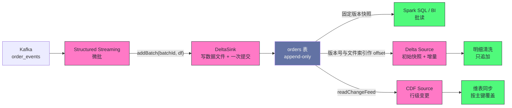
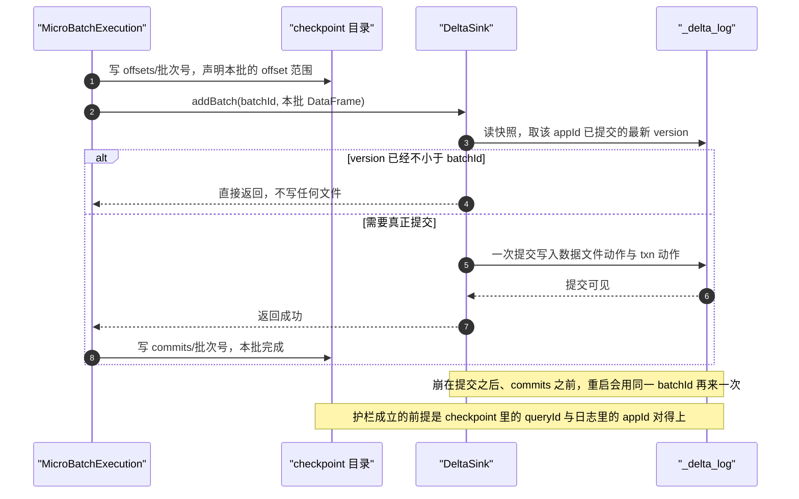
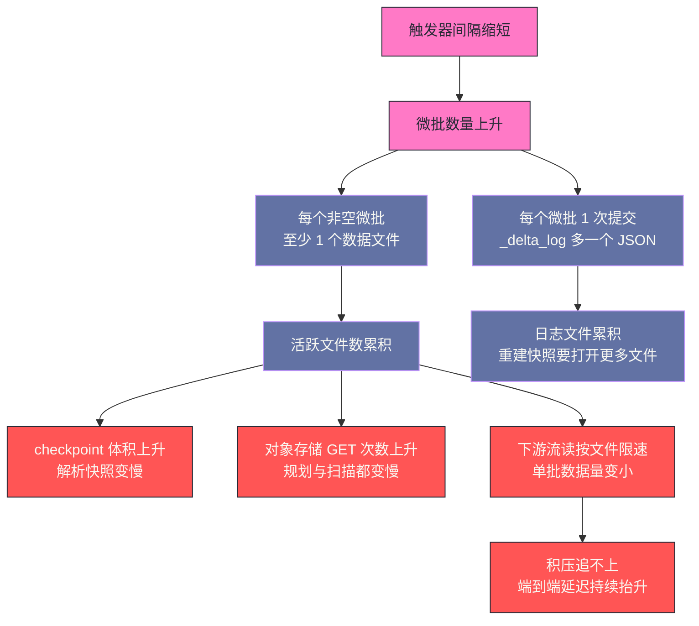
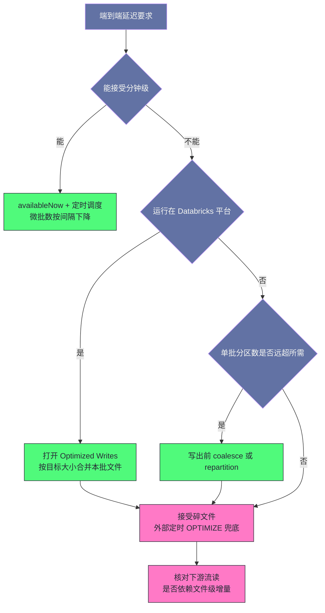
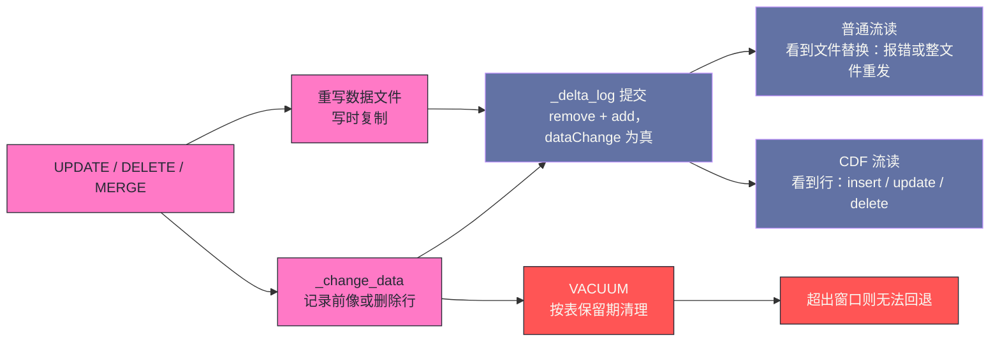

# 08 流批一体：Structured Streaming 写入与读取 Delta Lake

**摘要：**

Structured Streaming 与 Delta Lake 的组合常被一句话概括：同一张表既能当 Sink 又能当 Source，两端都精确一次。这句话省略了三处代价。写端的精确一次并不单靠 Delta 的原子提交，而靠 Spark 的 checkpoint 与日志里 `txn` 动作（协议名 SetTransaction）的配合：checkpoint 决定"这一批该不该重放"，`txn` 决定"重放时要不要真的再写一遍"，两者靠 `appId` 与批次号对齐，任何一方丢失都会把保证退化成至少一次。文件数则是微批结构的强制结果：一个非空微批至少落一个文件、至少产生一次提交，一秒一批的作业一天写八万多个文件、八万多次提交，而压住这些文件的三档手段各有账单：拉长触发间隔买延迟，写入端合并买平台依赖，外部压缩买一次读写放大。读端更微妙：普通流读以 Delta Log 版本为 offset，先吃一遍初始快照再转增量，增量只看"新文件"，于是 UPDATE 与 DELETE 要么被忽略、要么以整文件重发的形式被看见，真正要行级增量得换 Change Data Feed。本文沿一条订单表链路，拆开这三个问题的机制、量化代价与反例，并交代哪些手段属于 Databricks 平台能力而不在开源协议里。

---

## 第 1 章 同一张表的两副面孔

### 1.1 一段被消息队列惯坏了的期待

2018 年那篇讲述 Structured Streaming 的论文把流处理重写成"对无界输入表的持续查询"，同一套 DataFrame API 既跑批也跑流，这个承诺让很多人第一次觉得流批一体是件顺手的事。等到把链路从 Kafka 搬到数据湖上，期待往往是原样搬运的：Kafka 承诺分区内有序、按 offset 精确消费一次，那么湖上的表理应提供同等强度的保证，只是把 offset 换成一个数字而已。

落差就在这个"而已"上。Delta 表不是消息队列，它的消费进度不是一个可以被反复回溯的游标，而是表的一个版本号；它的一次提交不是把消息追加到日志尾部，而是往 `_delta_log` 里落一个 JSON 文件、声明这一版比上一版多了哪些文件、少了哪些文件；它对"一条数据"的计量单位也不是消息，而是文件。这三处差异各自都能牵出一串后果，而最要紧的那三条，最容易被一句"精确一次"盖过去。

第一处是写端。既然提交是"落一个 JSON 文件"，那么"这一批只提交一次"这件事就不可能由 Delta 单方面担保——它看不到 Spark 的批次概念，只看到一个自称某个 `appId` 的写入者要提交版本 N。担保必须由两套机制拼起来，拼缝处的裂缝恰好是最容易出事故的地方。

第二处是文件数。消息队列的存储单位是一条消息，追加一条消息的边际成本接近于零；Delta 的追加单位是一个文件，而流式写入的最小提交粒度是一个微批。这意味着触发器节奏直接翻译成文件数量，一秒一批的作业就是在用一个为分钟级批量设计的存储格式承载秒级写入。

第三处是读端。Kafka 消费者拿到的是消息，Delta 流读拿到的是"这一版新增了哪些文件"。**文件是行的容器，不是行本身**，于是"哪一行变了"这个问题在文件级增量里没有答案：一次只改了一百行的 UPDATE，在文件粒度上看是"几百 MB 的文件被移除、另一个几百 MB 的文件被加入"。

### 1.2 三个问题，一条表

把上面三处落差收窄，得到本文要回答的三个问题。作为 Sink 时，精确一次到底靠什么成立，哪些操作会让它悄悄失效？小文件为什么会必然出现，多到什么时候开始变成事故，能用什么手段压住？作为 Source 时，普通流读与 CDF 读的差别究竟是"精度"还是"语义"，为什么前者根本表达不了 DELETE？

这三个问题不该分开讲，因为它们在同一张表上互相牵制。压小文件的手段会把文件重写一遍，重写对下游流读就是一次"数据变更"；改用 CDF 能看见 UPDATE，代价是表属性、写放大与保留期全都跟着变；把触发间隔调大能减少文件，却把端到端延迟推高到分钟级。任何一个手段都不是免费的局部优化，动一处就会在另一处留下账单。

下图把这条链路的三个断面画在同一张图上：写端一次微批提交、表本身、以及三种读法。



### 1.3 贯穿案例与数字口径

后文用一条订单链路 `order_rt` 承载所有机制。上游是 Kafka 的 `order_events`，消息体是订单事件（`order_id`、`customer_id`、`amount`、`event_time`、`op`），落进 Delta 的 `orders` 表，写模式为追加、不做去重。第二张表 `dim_customer` 是客户维表，每天由批处理做一次 MERGE，启用了 CDF。第三张表 `fact_orders` 由 `foreachBatch` 里的 MERGE 维护，供报表使用。下游还有一个把 `orders` 增量同步到检索系统的作业，它读的是普通 Delta Source。

为了把数量级说清楚，文中给两组触发器口径：一组 30 秒一批，接近多数生产作业的默认选择；一组 1 秒一批，代表"想要低延迟"的诉求。两组都只用于示例推算，不代表任何实测口径，也没有考虑压缩率、分区数与并发度的真实分布；读者把它当量级参照即可，不要当基准测试结果。同理，后文出现的文件大小、提交体积、checkpoint 体积都是按每文件若干百字节元数据估算出来的，换一种编码格式就会变。

---

## 第 2 章 作为 Sink：谁在保证"每批只提交一次"

### 2.1 Spark 侧先把话说死：批次是幂等单元

Structured Streaming 的容错模型建立在一个很朴素的前提上：一批数据的处理结果，只由批次号与该批次要消费的 offset 范围决定。为了让这个前提在崩溃后仍然成立，微批执行引擎把每次尝试拆成三步，并且严格按序落盘。

第一步，把本批次打算消费的 offset 范围写进 checkpoint 的 `offsets/` 子目录，文件名就是批次号。这一步发生在任何用户代码执行之前，等于先声明"我要干什么"。第二步，调用 Sink 的 `addBatch(batchId, data)`，真正把数据写到外部系统。第三步，在 `commits/` 子目录里落下同名文件，等于宣告"我干完了"。恢复时引擎比对两个目录：有 offset 而没有 commit 的批次，就是上次被打断的那一批，必须重放；两边都有的批次已经完成，不再碰。

重放时交给 Sink 的 `batchId` 与上次完全相同，数据内容也相同，这是引擎对 Sink 的承诺，`Sink` 接口的注释把话写得很直白：同一个 `batchId` 可能被调用一次以上，实现方必须自己保证效果只发生一次。换句话说，Spark 保证的是"至少一次投递 + 内容确定"，而"精确一次"要靠 Sink 把重复的那次吞掉。这句话适用于所有 Sink，Delta 只是恰好把吞掉的动作做在了协议层。

### 2.2 Delta 侧的护栏：一个叫 SetTransaction 的动作

Delta 的做法是在提交里塞一张收据。每次 `addBatch`，Sink 先读出目标表上属于本查询的最新收据，如果它记录的版本号已经不小于本批次号，就认定这一批早已落定，打印一行 `Skipping already complete epoch` 后直接返回，连数据都不写。

这张收据就是日志里的 `txn` 动作，协议名 SetTransaction，三个字段：`appId` 标识写入者，`version` 是一个由写入者自行解释的整数，`lastUpdated` 是时间戳。快照重建时对同一个 `appId` 只保留最新的 `version`，这一点写在协议的动作归并规则里——同一 `appId` 的 `txn` 动作，后写的那条赢。

Delta 的流式 Sink 把两个字段填得很讲究。`appId` 用的是查询的 `queryId`，这个值不是进程内随机生成的，而是 checkpoint 元数据里记录的那个查询标识，启动时被读进 `StreamExecution.QUERY_ID_KEY` 这个线程局部属性；`version` 直接就是 Spark 的 `batchId`。比对逻辑因此异常简单：表上记录的版本大于等于本批号，就跳过。

真正让这套护栏站得住的是原子性。收据不是单独写一次，而是和数据文件的 add 动作、必要时的 remove 动作一起，被塞进同一个提交、落成同一个 JSON 文件。要么全部可见，要么全部不可见，不存在"数据写了但收据没写"的中间态。下图是这三步的时序，两个崩溃窗口的位置值得记住。



### 2.3 两个方向的故障，两种结果

先看第一个窗口：数据与收据都提交成功，`commits/` 还没落盘，进程死了。重启后引擎发现批次 N 有 offset 没 commit，于是重放，用完全相同的 `batchId` 再调一次 `addBatch`。此时 Delta 读到收据上记的版本正是 N，判定重复，直接返回。结果是一次不多、一次不少。这正是 `txn` 动作存在的全部意义——它把"重放"这个引擎层的必然动作，在存储层变成了空操作。

第二个窗口在提交之前：数据文件写了一半，JSON 文件没落定。重启重放时，Delta 看不到任何收据，于是老老实实写一遍。前一次写的那些孤儿文件既没有进日志，也不可读，最终由 VACUUM 清掉。结果同样正确，只是多花了一次写文件的算力。

两个窗口都不出错，前提是 checkpoint 还活着，且表上的收据还能被读到。把这两个前提逐个撤掉，护栏就开始失效。

### 2.4 撤掉前提：三种让护栏失效的操作

第一种，删掉或回滚 checkpoint。这大概是生产上最常见也最隐蔽的一种。checkpoint 目录一旦丢失，重启时引擎会把它当成一个全新的查询，生成新的 `queryId`；新 `appId` 在表上当然找不到收据，于是从它认定的起点开始重写一遍。已经写进表里的数据于是出现两份，而两份数据的 `order_id` 完全相同，下游任何一次 `count` 都会翻倍。

注意这里失效的不是 Delta 的原子性，而是**身份**。收据本身还在表里，只是签的是另一个名字。这条性质解释了一个常见的误解：很多人以为"Delta 有事务日志，所以重复写会被自动识别"。事务日志能识别的只是同一 `appId` 内的重复，跨 `appId` 它没有判断依据，也不该有——两个独立的流写同一张表是完全合法的。

第二种，把表恢复到更早的版本。`RESTORE` 到版本 N-10 之后，表上的收据退回十批之前，而 checkpoint 仍停在 N。重启后收据记的版本小于 `batchId`，护栏判定"没提交过"，于是这批数据被重新写入。同理，如果表是从别的备份整体覆盖回来的，效果一样。

第三种，给表设了 `delta.setTransactionRetentionDuration`。这个属性允许快照忽略过期的事务标识，一旦某个 `appId` 的最新 `txn` 动作超过保留期，读快照时就当作它不存在，`appId` 的版本于是返回空。护栏的判据从"已提交到 N"变成"从没提交过"，重复写入随之发生。这个属性默认为空，也就是无限期保留；设它的动机通常是省 checkpoint 体积，代价正是把幂等判据的保质期一并缩短了。

| 场景 | checkpoint | 表上收据 | 护栏是否生效 | 表象 |
|---|---|---|---|---|
| 提交成功、commits 未落盘 | 在，批次未提交 | appId 与版本对得上 | 生效 | 重放变空操作，无重复 |
| 提交前崩溃 | 在，批次未提交 | 无本次收据 | 不需要 | 重写一次，无重复 |
| checkpoint 丢失后重建 | 新 queryId | 旧 appId 的收据仍在 | 失效 | 从新起点重写，重复 |
| 表 RESTORE 到早版本 | 在，进度领先 | 版本落后于批次号 | 失效 | 落后区间的批次被重写 |
| setTransactionRetentionDuration 过期 | 在 | 收据被快照忽略 | 失效 | 与丢失 checkpoint 相同 |
| 两个作业共用一个 checkpoint 目录 | 同一 queryId | 同一 appId | 失效 | 互相覆盖进度，写入错乱 |

最后一行值得单独说一句。同一个 checkpoint 目录被两个作业共用时，两者的 `queryId` 相同，`batchId` 各自从零开始，于是 A 作业提交到第五批之后，B 作业的第五批会被护栏当成"已完成"直接跳过——数据静默丢失，日志里只有一行 Skipping。这条规则的反面同样是硬约束：多个流写同一张 Delta 表完全可行，但每个流必须有自己的 checkpoint 目录和自己的 queryId。

### 2.5 从幂等到端到端：一条链上的三个开关

把写端与读端接起来，端到端的精确一次由**三个开关串联**而成。读端的 checkpoint 保证"每条源数据至少被处理一次且内容确定"，写端的 `txn` 收据保证"同一批次不会被落两遍"，中间的转换如果是确定性函数，三者合起来才是精确一次。任何一环引入不确定性——`foreachBatch` 里调用了随机数、当前时间、或者一个会在两次重放之间改结果的 MERGE——都会在重放时写出不同的数据，护栏只认批次号，它拦不住内容已经变了的那一次。

这也解释了为什么 Complete 模式的写入对下游是灾难。Complete 每次把整表替换一遍：上一版的所有文件被 remove，新一版的所有文件被 add，`dataChange` 标记为真。写端自身的收据机制照常工作，不会重复提交；但从下游流读的视角看，这是每个微批都在"删掉全部旧文件、加入全部新文件"，**一次完整的表重写**。用这张表当流读源，要么直接报错，要么在开启忽略选项之后把整张表反复当成新增数据消费。流批一体的表适合当"只追加的事实表"，不适合当"每批整表重算的物化视图"。

---

## 第 3 章 小文件：微批结构的强制结果

### 3.1 一个微批至少一个文件

Delta 的提交单位是"文件集合"，一个微批必须把本批数据落成一批文件，再把这些文件登记进日志。文件数由写入端的并行度决定：每个承担写入任务的 Spark 分区至少产出独立文件，分区越多文件越多；再叠加 `partitionBy` 的分区列，一个分区值一个子目录、一组文件。所以严格说，"一个微批一个文件"是下限，真实数量通常等于本批的写入并行度。

把这个下限乘以触发器频率，小文件的增长速度就出来了。默认的 1 秒触发器意味着一小时三千六百个微批，一天八万六千四百批；即使每批只落一个文件，一天也是八万多个文件，每一次提交都在 `_delta_log` 下留下一个 JSON 文件，于是日志文件数同样是八万多个。把节奏放到 30 秒，两组数字同时缩到三十分之一。不同节奏的量级差别如下表，按每批一个文件、每文件元数据约三百字节估算。

| 触发间隔 | 每小时微批 | 每天数据文件 | 每天提交与日志文件 | 每天新增元数据（示例推算） | 一个月数据文件 |
|---|---|---|---|---|---|
| 1 秒 | 3600 | 86400 | 86400 | 约 26 MB | 约 259 万 |
| 5 秒 | 720 | 17280 | 17280 | 约 5 MB | 约 52 万 |
| 30 秒 | 120 | 2880 | 2880 | 约 0.9 MB | 约 8.6 万 |
| 1 分钟 | 60 | 1440 | 1440 | 约 0.4 MB | 约 4.3 万 |
| 5 分钟 | 12 | 288 | 288 | 约 0.1 MB | 约 0.9 万 |

表里最容易被忽略的是第三列和第五列。多数人盯的是"文件多不多"，真正压垮作业的往往是元数据：活跃文件数决定 checkpoint 的体量，因为一次快照必须把所有存活文件的 add 动作写进 checkpoint；提交数决定日志文件的堆积速度，也决定从日志重建快照时要打开多少个文件。一天八万次提交、一个月二百多万个活跃文件，快照文件的量级就奔着几百 MB 去了，而这份快照在每次作业启动、每次新查询规划快照时都要被读一遍。

### 3.2 放大链路：从一拍到一个慢作业

小文件的麻烦不在磁盘，而在一串被放大的代价。第一层是读取端：查询规划要枚举文件，文件越多，driver 上的元数据处理越重；对象存储上每个文件一次 GET，一百万个文件就是一百万次请求，延迟按请求数累加。第二层是流读端：下游的 `maxFilesPerTrigger` 是按文件计数的，源表文件越碎，单个微批能吃进去的数据量越小，同样的吞吐需要更多批次，追平积压的时间就越长。第三层是快照重建：checkpoint 体积随活跃文件数增长，作业重启时解析快照的时间线性上升，表现是"重启要等几分钟"。

下图把这条放大链路从上到下列出来：最上面一行是那个唯一可以人为调节的旋钮，下面每一层都是它的下游后果。



这条链条有一个反直觉的性质：**它不报错**。作业一直成功，指标一直正常，只是批次时长缓慢抬升、重启时间缓慢变长、下游越来越追不上。等到有人决定加资源时，问题已经变成结构性债务——加 Executor 只能加快扫描，解决不了 driver 上的元数据枚举，也解决不了下游按文件数限速这一层。

### 3.3 为什么不能靠"写大一点"一次解决

一个自然反应是让每个微批写大文件。这条路在批处理里成立：一次写几十 GB，随便怎么攒都是大文件。流式写入不成立，因为微批的数据量由触发器间隔决定，间隔越短、每批越小。想写大文件只有三条路：拉长间隔（牺牲延迟）、攒够再写（等于自己实现缓冲，状态与恢复复杂度陡增）、写入时合并（把同一批的小文件在提交前拼成较大的文件）。

第三条路正是 Databricks 平台上的 Optimized Writes 做的事：在写出前按目标文件大小做一次重组，把本批的碎文件合成若干接近目标大小的文件。它的关键前提是"本批内合并"，跨批的碎文件它管不了，所以它能把"每批 N 个小文件"压成"每批 M 个较大文件"，却不能把一天八万个小文件变成八百个。这是平台能力，写在 Databricks 的 Delta 文档里，与 Delta Lake 开源协议无关；开源版没有这个开关，同样的诉求只能自己在写出前 `coalesce` 或 `repartition`，或者事后跑 `OPTIMIZE`。

`coalesce` 这条路有个陷阱：它只减少分区，不改变顺序，遇到数据倾斜时被合并的那几个分区会变成新的长尾；`repartition` 能打散倾斜，代价是一次全量 shuffle，流式作业里 shuffle 的成本直接反映为批次时长。两者都改变本批数据的物理布局，也就改变了本批写出的文件数——这一点对下游流读是可见的，但对数据内容不可见，属于安全的重排。

这也解释了压缩为什么不构成设计上的解法。压缩是事后收拾，它的吞吐必须大于小文件的产生速度，才谈得上追平：若写入端一秒一批、一天产生八万多个文件，而一个压缩作业每小时只能合并几千个文件（示例推算，取决于并发度与被压缩文件的大小），账面上就是压缩永远追不上产生。压缩能兜住存量，兜不住流量，真正的解法只能落在产生速度那一端。
---

## 第 4 章 控制手段：从触发器到外部压缩

### 4.1 三档手段，三个作用点

治小文件的手段不多，但作用点完全不同，混着用就会各自抵消。第一档在触发器上，把微批的数量本身降下来，属于"少产生"；第二档在写入端，把每批的碎文件合并成较少的大文件，属于"少落盘"；第三档在表上，用一个独立作业把已经产生的碎文件重写成整齐的文件，属于"事后收拾"。三档对应三种成本：延迟、批次时长、额外的读写放大。

选哪一档，取决于这条链路真正在意什么。报表下游在意文件数与查询规划开销，晚几分钟无所谓，那么第一档最省事；同一份数据还要供秒级看板使用，延迟不能让步，那就只能在第二、三档里选。三档之上还有一条不写在文档里的约束：任何一轮重写都会改变文件的物理布局，而改变物理布局这件事，对下游的流读是可观测的。

### 4.2 第一档：用 `availableNow` 把流变成"增量批"

`Trigger.AvailableNow` 的语义是：这一次启动，把当前所有可用的数据按微批处理完，然后自行停止。它与 `Trigger.Once` 的差别常被忽略——后者是把所有可用数据塞进一个批次，前者允许多个批次。这个差别直接决定了两件事。

其一，限速选项是否有效。官方文档写得很明确，`maxBytesPerTrigger` 在 `Trigger.Once` 下被忽略；而 `AvailableNow` 走的是正常的微批规划路径，Delta 源在启动时先算出"这一次要追到哪个 offset 为止"，把这个上界记在内存里，随后一批一批往前推，直到抵达上界才停。于是 `maxFilesPerTrigger`、`maxBytesPerTrigger` 在 `AvailableNow` 下照常生效，一批吃多少由你说了算。

其二，作业形态从"常驻"变成"定时"。既然**跑完就退**，就可以交给调度器每五分钟拉一次，读的仍然是从上次 checkpoint 之后的增量，不需要重新扫全表。这就是所谓增量批：语义上是流，调度上是批，资源账按批结算。相比常驻作业，它省掉了空闲时段的资源占位；代价是延迟由调度间隔决定，且每次启动都要付一次作业启动与快照加载的固定开销。

```python
# 每 5 分钟被调度器拉起一次，只处理自上次 checkpoint 之后的新文件
query = (spark.readStream
    .format("delta")
    .option("maxFilesPerTrigger", 200)      # 单批上限，防止一次吃掉整段积压
    .option("maxBytesPerTrigger", "2g")     # 与文件数取先到者，软上限
    .load("s3://lake/orders")
    .writeStream
    .format("delta")
    .option("checkpointLocation", "s3://lake/_ckpt/orders_rollup")
    .trigger(availableNow=True)             # 追平即停，不做常驻
    .start("s3://lake/orders_rollup"))
# 注意：checkpoint 必须保留，它是"上次追到哪"的唯一记录
query.awaitTermination()
```

这段代码里最容易被删掉的是 `checkpointLocation`。有人觉得"反正每次都是增量，每次重新跑就行"，于是不设 checkpoint 或者每次用不同的目录；结果每次启动都会被当成新查询，先吃一遍初始快照，也就是整个表。增量批的"增量"二字，完全由那个目录撑着。

### 4.3 第二档：写入端合并，以及它为什么大多属于平台能力

在写出前把本批数据重新分桶，让每个桶的数据量接近目标文件大小，这样一批能产出少数几个大文件而不是几十个小文件。这套做法在 Databricks 平台上叫 Optimized Writes，由会话级开关打开，并有独立的目标文件大小参数；同一平台上还有 Auto Compaction，在提交之后自动对刚写入的小文件做一次小范围合并。

需要把话说清楚的是：这两项都是 Databricks 平台能力，不在 Delta Lake 开源协议里，也不属于 Spark 连接器的通用功能。开源栈里没有 `optimizeWrite` 的实现，把那个带 `spark.databricks` 前缀的配置写进开源 Spark 的会话，不会报错，但也不会生效——配置被**静默忽略**，作业看起来一切正常，文件数照旧。这种"配置写了但没作用"的情形比报错难查得多，因为没有任何日志提示它被丢弃。

开源栈里的等价物只有前文提到的 `coalesce` 与 `repartition`，以及在 `partitionBy` 的选择上做减法：分区列每多一个，文件数就乘一个维度。分区的收益是查询裁剪，代价是文件数与元数据；在流式写入的场景里，这个代价往往被低估，因为每批都在乘。

### 4.4 第三档：外部定时 `OPTIMIZE`

`OPTIMIZE` 是开源版的压缩命令：读出表里的一批小文件，重写成较大的文件，用一次提交把旧文件标为删除、新文件标为新增。它的成本结构是"读一遍写一遍"，所以适合放在低峰期由外部调度拉起，而不是塞进流作业里。

它和流读的相容性是一个常被误判的点。表面看，`OPTIMIZE` 的提交里既有 remove 又有 add，与 UPDATE 的提交长得一样，很多人据此认为"压缩会让下游流读报错"。实际机制藏在文件动作的一个布尔字段上：协议里每个 add 与 remove 都带 **`dataChange` 标记**，用来区分"业务数据变了"与"只是物理布局变了"。`OPTIMIZE` 重写时把 `dataChange` 置为假，Delta 源在做提交校验时只对 `dataChange` 为真的动作做判断，于是压缩提交既不触发"检测到数据更新"的错误，也不会把重写出来的文件当成新数据重新发给下游。

真正的 UPDATE、DELETE、MERGE 写的 remove 是 `dataChange` 为真，因此会撞上源端的校验。这就是同一个表上"压缩安全、更新不安全"的由来，判据不在操作名上，而在这个标记上。不过安全性有两处例外要记住：`OPTIMIZE` 与流写并发时，提交可能因为并发冲突而重试（乐观并发控制的正常行为，不是错误）；压缩会重写文件，正在读旧文件的查询若跨越了 `delta.deletedFileRetentionDuration`（默认一周）的窗口，可能读到已被物理删除的文件。

### 4.5 三档手段的适用面

| 手段 | 作用点 | 属于 OSS 还是平台 | 直接效果 | 主要代价 | 适用情形 |
|---|---|---|---|---|---|
| `availableNow` + 调度 | 触发器 | OSS（Spark 3.3 起） | 微批数按调度间隔下降 | 端到端延迟升到分钟级 | 报表、离线宽表、可容忍分钟级延迟 |
| 拉长 `processingTime` 间隔 | 触发器 | OSS | 同上，但作业仍常驻 | 延迟与资源占用的折中 | 常驻作业但不需要秒级 |
| 写出前 `coalesce`/`repartition` | 写入端 | OSS | 单批文件数下降 | shuffle 成本、倾斜风险 | 单批分区数远大于数据量所需 |
| Optimized Writes / Auto Compaction | 写入端 | Databricks 平台 | 单批文件按目标大小合并 | 依赖平台，开源无对应实现 | 已在平台上运行 |
| 外部定时 `OPTIMIZE` | 表 | OSS | 存量碎文件合并 | 读写放大、需低峰调度 | 存量已经碎掉，或其他手段不够 |
| 减少 `partitionBy` 列 | 表设计 | OSS | 文件数按维度下降 | 丧失部分查询裁剪 | 分区列基数高而收益低 |

这张表要连着看。第一行与第五行经常被一起用：常驻流以较大间隔写入，外部每小时压一次，等于把"少产生"与"事后收拾"叠起来。第二行与第四行则是替代关系：平台上有 Optimized Writes，就不必为单批文件数操心；没有，就得自己决定是牺牲延迟还是接受碎文件。

下图把选择过程收成一条判断链，起点是延迟要求，终点是具体手段。



---

## 第 5 章 作为 Source：快照、增量与限速

### 5.1 offset 是什么

Delta 流读的进度不是"读到第几条消息"，而是一个四元组：表标识、日志版本号、版本内的文件索引、以及一个标记"这一版属于初始快照还是增量"。它被序列化成 JSON 写进 checkpoint 的 `offsets/` 目录，重启时原样读回。

四个字段各管一件事。表标识用来在重启时校验"你读的还是原来那张表吗"，对不上就报错，因为表被删掉重建之后，同一个路径下已经是另一张表，版本号的含义完全不同。版本号是主进度。文件索引是为了把一个包含大量文件的版本切成多个批次——版本内的候选文件被逐条编号，一个批次消费一段编号，下一批从上一段的末尾继续；初始快照阶段的编号顺序按文件的修改时间与路径排定，因为快照本身没有"提交顺序"可言。第四个字段则记录"快照阶段还没走完"，它一旦为假就再也不会变回真，因为流读不允许从增量阶段倒回快照阶段。

理解这个结构，就能理解为什么 Delta 流读有两个阶段。第一个阶段没有实际的前序 offset，只有"当前最新版本"这一个坐标，此时源端会把这一版的全部数据文件当成待处理项，按索引切批，逐批交出去。走完之后进入第二阶段，此后每一批都是"从上一版到最新版之间新增的文件"。

### 5.2 初始快照：第一批为什么是全表

新建一个流查询、不指定起点时，行为是把表当前的全部数据先读一遍，再转增量；反过来，只要给出 `startingVersion` 或 `startingTimestamp`，快照阶段就被跳过，第一批直接从那个版本（含）开始按变更读，这也是"从某个版本起追增量"唯一的正确用法。这一点在源码的类注释里写得很直接：新建流时先在当前版本构造一个快照，这个快照被切成若干批次直到处理完，之后才开始追日志尾部。也就是说，流读的默认语义不是"从现在开始听新消息"，而是"**先把历史补齐，再听新的**"，与批处理读一遍全表的答案保持一致。

这个设计有它的道理：如果默认只读新数据，那么流作业的输出就无法通过"把同一张表批读一遍"来验证，流批一致的承诺立刻破功。但代价也很实在——一个运行三年的表，第一次流读要把三年数据全部吃一遍，期间的批次数量由 `maxFilesPerTrigger` 与文件数共同决定。一个五十万文件的表，按默认每批一千个文件算，光是把初始快照走完就要五百批。

于是"不设上限"这个念头特别危险。如果为了"赶紧追完"把 `maxFilesPerTrigger` 调到很大、或者干脆只给一个巨大的 `maxBytesPerTrigger`，第一批就会把整个快照吞进去：几百万文件在 driver 上排成一张文件清单，每个 task 分到一堆文件，内存与元数据开销同时爆掉；即使侥幸跑完，这一批的耗时也会长到让下游误以为作业挂了。反过来，把值调小能让批次短而密，进度可见，但总时长不变。

顺带说清一个默认值的细节：`maxFilesPerTrigger` 默认是一千，`maxBytesPerTrigger` 默认不设。两者同时给出时按先到者截断；只给 `maxBytesPerTrigger` 时，源码把文件数上限设成接近整型的最大值，等于文件数不设防，此时限速完全由字节数决定，遇到大量极小文件时仍然可能一批吃掉几十万个文件。

### 5.3 增量阶段：索引切分与空批次

进入增量阶段后，每一批要做的事是：从上次的版本号与索引出发，顺着日志往后读，收集 `dataChange` 为真的 add 动作，直到触到限速或者日志尾部，然后把收集到的文件包成一个 DataFrame 交出去，同时把新的四元组写进 offset 日志。

一段提交里的文件数超过限速时，这批只消费前一段，剩下的留到下一批，靠索引推进。这也解释了流读的一个表面现象：源表某个版本一次性写入了十万个文件，下游流读却要分一百批才吃得完，且每一批的耗时都差不多——不是它不想快，是**限速在起作用**。把限速调大能加快追赶，但单批的内存与时长会同步上升，这正是限速参数存在的理由：它把"积压"换成了"可控的批大小"。

### 5.4 非追加提交：三种忽略方式的差别

源端对"这一批提交能不能被消费"的判断，落在前面提过的 `dataChange` 标记上。一批提交里出现 `dataChange` 为真的 remove，且同时有 `dataChange` 为真的 add，源端认定"这是一次数据更新"，直接抛错并提示表名、版本号与涉及的移除文件路径；只有 remove 没有 add，则认定为删除，报另一种错，提示可以改用忽略删除的选项。

三种忽略方式的效果差别很大，混用会把语义搞乱：

- `skipChangeCommits`：把整批提交跳过，既不读它的 remove 也不读它的 add。下游看不到这次变更的任何痕迹，适合"这张表我只关心追加，更新与我无关"的链路。
- `ignoreDeletes`：只容忍删除，遇到更新仍然报错。适用于按分区整段清理历史数据的表，例如每天删掉过期分区。
- `ignoreChanges`：把因更新而重写的文件当成新数据重新发一遍。被改动的行会再出现一次，未被改动的行也会跟着出现，因此下游必须能处理重复。官方文档已把它标为废弃，推荐前者。

三种方式的共同点是都不解决"行级变更"这件事。它们只是在"要不要因为一次更新而让整个流停摆"这个维度上做取舍，真正的行级增量得靠下一章的 CDF。

### 5.5 起点的两个陷阱

`startingVersion` 与 `startingTimestamp` 看起来是把"从哪开始读"这件事交还给使用者的开关，实际上有两个陷阱。

第一个陷阱是时机。这两个选项只在一个流查询第一次启动、checkpoint 里还没有记录 offset 时生效；一旦 checkpoint 里有了进度，重启时它们被完全忽略。有人以为改一下参数就能让作业往前跳，实际作业纹丝不动——它忠实执行的是 checkpoint 里的进度。要真正改变起点，只能删掉 checkpoint 重来，而这又回到第 2 章讲的那条：删 checkpoint 意味着新 queryId，写端护栏失效。

第二个陷阱是 schema。即使从很早的版本开始读，源端使用的始终是表的当前 schema，而不是那个版本的 schema。文档对此说得很明白：从旧版本启动时，必须保证在这之后没有发生不兼容的 schema 变更，否则读出来的结果可能是错的。要规避这一点，需要表开启列映射并给出 `schemaTrackingLocation`，让流读按版本记录自己的读 schema；该目录必须位于 checkpoint 目录之内，且每个源表各用一个，不能共用。

### 5.6 追不上之后会发生什么

流作业停久了，日志会被清理。`delta.logRetentionDuration` 默认 30 天，每次写 checkpoint 时顺手清掉更老的日志。若 checkpoint 记的版本已经被清掉，源端只能从"当前可用的最早历史"继续，官方文档的措辞是"处理最新可用的历史，但不让流失败"——数据静默缺失。较新版本另有一层校验，发现日志中间缺了提交会抛错，提示某些提交之后的文件缺失，把静默丢数据变成显式失败。两种表现都要能认出来。

除了日志，还有数据文件。`delta.deletedFileRetentionDuration` 默认一周，它的注释明确提到流查询：如果流作业停止的时间超过这个窗口，重启后可能要读的文件已经被物理删除，查询无法恢复。这条约束把"流作业可以随时停"这个假设彻底否掉了——停多久是有一个硬上限的，上限由两个保留期与 `VACUUM` 的实际执行共同决定。

| 选项 | 作用阶段 | 默认值 | 关键约束 |
|---|---|---|---|
| `maxFilesPerTrigger` | 快照与增量都生效 | 1000 | 与字节上限同时给出时按先到者截断 |
| `maxBytesPerTrigger` | 快照与增量都生效 | 不设 | 软上限，允许超出；`Trigger.Once` 下被忽略 |
| `startingVersion` / `startingTimestamp` | 仅新查询首次启动 | 无 | 两者互斥；checkpoint 有进度后忽略 |
| `skipChangeCommits` | 提交校验 | 关闭 | 整批跳过，下游看不到该批任何行 |
| `ignoreDeletes` | 提交校验 | 关闭 | 只容忍删除；更新仍报错 |
| `ignoreChanges` | 提交校验 | 关闭 | 重写文件重新发送，下游需容忍重复 |
| `withEventTimeOrder` | 初始快照 | 关闭 | 有状态查询按事件时间分桶，避免快照阶段丢迟到数据；可用性按所用连接器版本核对 |
| `schemaTrackingLocation` | 全程 | 无 | 必须在 checkpoint 目录之内，每源表一个 |

---

## 第 6 章 CDF 作为 Source：从文件级到行级

### 6.1 文件级增量失真多少

先把这个差别量化。假设 `orders` 表一天两千万行、五百个文件，每个文件约 40 MB。夜间跑一次 MERGE，更新一万行客户归属字段，这一万行散落在全部五百个文件里。UPDATE 在写时复制模型下的动作是：读这五百个文件，改掉命中的行，写出五百个新文件，再把五百个旧文件标为删除。

对普通 Delta 流读来说，这一版提交里有五百个 `dataChange` 为真的 add 和五百个 remove，属于典型的更新，直接报错。加上 `ignoreChanges` 之后能读，读到的内容是新版的五百个文件，也就是两千万行——真正变化的只有一万行，放大了**两千倍**。若下游是个按主键覆盖的存储，把这两千万行全部 upsert 一遍，写放大就是灾难；若下游只追加，则每一轮更新都要把两千万行重新灌一遍，而其中真正变化的只有一万行，占万分之五。

CDF 读到的则是另一个量级：一万行更新对应一万条 update_preimage 与一万条 update_postimage，两万行、几 MB。这个对比不是精度上的微调，而是"能不能在增量链路上用"的分界。

### 6.2 CDF 记了什么

CDF 是 Delta 2.0.0 引入的能力，需要给出表属性才开启。开启之后，运行时会在表目录下维护一个 `_change_data` 子目录，把 UPDATE、DELETE、MERGE 影响的行写进去——insert 与整分区删除通常不必写入该目录，因为运行时能直接从日志与数据文件推出变化。

读出来的行比表多三列：`_change_type` 取值 `insert`、`update_preimage`、`update_postimage`、`delete`，另有 `_commit_version` 与 `_commit_timestamp`。前一组表达"这一行发生了什么"，后一组表达"哪一版发生"以及"什么时候提交"。一次更新在 CDF 里表现为成对的两行：变更前的旧值与变更后的新值，各自带着 `update_preimage` 与 `update_postimage` 标签，下游可以只取后像做覆盖，也可以成对消费做审计。

```python
# 只取"结果行"：新增与更新后的新值，丢弃删除与前像
cdf = (spark.readStream
    .format("delta")
    .option("readChangeFeed", "true")
    .option("startingVersion", "120")       # 不能早于启用 CDF 的版本
    .table("dim_customer"))

upserts = cdf.filter(
    col("_change_type").isin("insert", "update_postimage")
).drop("_change_type", "_commit_version", "_commit_timestamp")

(upserts.writeStream
    .foreachBatch(lambda df, _: merge_into_serving(df))   # 按 customer_id 覆盖
    .option("checkpointLocation", "s3://lake/_ckpt/dim_to_serving")
    .trigger(availableNow=True)
    .start())
```

### 6.3 三种读法摆在一起

| 维度 | 批读 | 普通流读 | CDF 流读 |
|---|---|---|---|
| 计量单位 | 表快照 | 新增文件 | 变更行（含变化前后像） |
| 进度坐标 | 版本或时间戳（一次查询） | 版本 + 版本内文件索引 | 版本 + 版本内变更文件索引 |
| 能看到 UPDATE | 看结果，看不到过程 | 看不到；或整文件重发 | 能，成对的前像与后像 |
| 能看到 DELETE | 结果里没有就是没有 | 不能，只能忽略或报错 | 能，`delete` 一行 |
| 新建查询的首批 | 全表 | 全表（标记为初始快照） | 全表（标记为 `insert`） |
| 额外成本 | 无 | 无 | 写时多落 `_change_data`，存储与写放大 |
| 前置条件 | 无 | 表基本 append-only | 表属性开启，版本不早于开启点 |

第三行与第四行是全部差别所在。普通流读的本质是"文件出现的顺序"，它能表达的只有"多了些文件"；**文件的粒度是几万行**，所以行级的 UPDATE 在它眼里是一次文件替换。CDF 把行从文件里拆出来，才第一次让"哪一行变了"成为可表达的语义。

第五行容易被低估。没有指定 `startingVersion` 的 CDF 流读，第一批不是空的，也不是变更，而是把当前快照里的全部行标成 `insert` 发出来。这个设计对下游很友好——按主键覆盖的消费者可以直接拿它做初始化，不必再单独跑一次全量——但如果不清楚这一点，就会误以为"第一批是变更，量很小"，实际那是整张表。

### 6.4 起点限制与保留期

CDF 读有一个硬边界：起点不能早于启用 CDF 的那个版本。给出的版本更早，或者在启用之前的时间戳，读端会直接报错，提示 CDF 未被启用。这就是"用 CDF 追所有历史变更"这个想法的真相——它追不到开启之前的任何东西，那段时间只有文件级的历史，没有行级的历史。想要历史行级变更，只能用批读加自建比对，或者从上游 CDC 重新导一遍。

另一个硬边界是保留期。`_change_data` 遵循表的数据保留策略，`VACUUM` 会把过期的变更数据一并删掉。于是 CDF 流的可回退窗口由 `VACUUM` 的执行与保留期共同决定，而不是由 checkpoint 决定。作业停了两周、表每天 VACUUM，重启时就会遇到"进度在，数据没了"的局面。

下图把同一次更新在两种读法上的分岔画出来：一边是文件替换，一边是行级变更，中间那条 `_change_data` 支路才是 CDF 的凭据。



### 6.5 CDF 的代价与边界

开启 CDF 的第一笔账单是写放大：每次更新都要额外写出变化的前像，`_change_data` 目录随更新频率线性增长。第二笔是读放大：批读 `table_changes()` 要把区间内的变更文件全部读一遍，区间越长越贵，不像直接读快照那样能靠分区裁剪。

第三笔是能力边界。CDF 只记录"行发生了变化"，不记录"为什么变"；它给不出事务边界，一次 MERGE 的一万行在 CDF 里是一万条独立记录，下游若要按提交原子地应用，得自己按 `_commit_version` 分组。开启列映射的表在 CDF 上有额外限制，跨引擎读 CDF 的能力则完全取决于那个引擎的 Delta 连接器版本——Trino、Flink 的连接器各有自己的发布节奏，不能假设它们与 Spark 侧同步。

还有一处语义落差最容易被忽略：CDF 把 `delete` 交出来了，但下游有没有能力真的删，是另一件事。把 CDF 接到一个只支持 upsert 的目标库上，`delete` 行会被当成普通行插入，结果是一张"删不掉"的表。消费 CDF 的代码必须显式处理四种 `_change_type`，而不只是过滤出后像。

---

## 第 7 章 `foreachBatch`：能力放开，责任转移

### 7.1 它把写端的保护换成了你的代码

原生 Delta Sink 只做一件事：把本批 DataFrame 按输出模式写进表，外加一张收据。它不支持 MERGE、不支持多目标、不支持只接受批写的连接器。`foreachBatch` 把这些限制全部打开——引擎把每批的输出与批次号交给一个普通函数，函数里可以任意调用 `DataFrame.write`、`MERGE INTO`、JDBC，甚至一次写三个地方。

代价在收据上。原生 Sink 由 `DeltaSink` 自己维护 `txn` 动作，重放时自动跳过；`foreachBatch` 里的写入是一次普通批写，它不知道这是第几次重放，除非你把批次号显式写进提交。失去了收据，语义就从精确一次**退到至少一次**：崩溃窗口里重放的那一批，会在目标表里再写一遍。

### 7.2 把收据交回来：`txnAppId` 与 `txnVersion`

Delta 在 2.0.0 把这个能力开放给了批写 API：写出时给出 `txnAppId` 与 `txnVersion` 两个选项，提交就会带上一条 `txn` 动作，与流式 Sink 用的是同一套协议。若目标表上该 `appId` 已记录的版本不小于本次给出的版本，写入被判定为重复并跳过。

```python
def upsert_orders(batch_df, batch_id):
    # 两个选项必须在同一次写出里给出，且 appId 全局唯一、version 单调
    (batch_df.write
        .format("delta")
        .mode("append")
        .option("txnAppId", "order_rt_fact_orders")   # 作业级稳定标识
        .option("txnVersion", batch_id)               # 重复提交会被识别并跳过
        .save("s3://lake/fact_orders_staging"))

    # 真正的 MERGE 放在下一跳，由 staging 表驱动，同样用批次号做幂等键
```

这段代码的重心不在写法，在三个约束上。`appId` 必须每个作业唯一且跨重启稳定，用随机串或主机名会让收据永远对不上；`version` 必须单调递增，`batchId` 天然满足，用时间戳则要保证不重复不倒退；两个选项必须同时给出，只给一个等于不启用。另有一条隐含约束：它保护的是"这一次提交"，不是"这一串副作用"。函数里若还写了 MySQL 与 ES，那两处仍在**收据之外**。

### 7.3 MERGE 的幂等性是个条件命题

很多资料说"MERGE 天然幂等，所以 `foreachBatch` 里重复执行没关系"。这句话只在特定条件下成立，条件至少要凑齐三条：源数据的主键唯一；MERGE 的分支只有匹配则更新、不匹配则插入；更新表达式是纯函数，不含当前时间、随机数、自增序列这类每次求值都会变的成分。

少一条就会走样。源数据里同一个 `order_id` 出现两次时，MERGE 在 Spark 上会因"同一行被多次更新"而报错，或者按不确定的顺序取其中一个；更新里写了 `current_timestamp()` 这类易变表达式，重放出来的行内容与第一次不同——收据能挡住"再写一遍"，却挡不住"写进去的东西不一样"。更难察觉的是第三条之外的一种情况：MERGE 的目标表在两次重放之间被别的作业改过，第二次 MERGE 面对的是一个已经变化的基线，结果自然不同。写端护栏假设"同一批的输入与目标状态都确定"，`foreachBatch` 里的 MERGE 只保证前者。

还有一笔账和第 3 章连着。MERGE 采用写时复制，每次都要重写命中的文件。一个 60 秒触发、每次命中五百个文件的作业，一天执行一千四百四十次，等于七十二万次文件替换，日志、快照与 checkpoint 全部按这个量级增长。把 MERGE 挂在秒级触发器上，等于同时制造两个问题：文件碎、提交多。

### 7.4 三条幂等路线

| 实现方式 | 幂等凭据 | 谁在保证 | 失效条件 |
|---|---|---|---|
| 原生 Delta Sink | `appId` + `batchId` 的 `txn` 收据 | Delta 协议与 Sink 实现 | checkpoint 丢失、表回退、收据过期 |
| `foreachBatch` + `txnAppId`/`txnVersion` | 同上的收据，由使用者显式给出 | 使用者代码加 Delta 提交 | `appId` 不稳定、版本不单调、只给一个选项 |
| `foreachBatch` + 目标库主键 | 目标库的唯一约束 | 目标存储 | 目标库无主键、或写入是删后插 |
| `foreachBatch` + 批次去重表 | 一张记录 `batchId` 的小表 | 使用者代码 | 去重表与业务写入不在同一事务 |

第四行最难做对，因为它要求"写业务数据"与"记批次号"要么同一事务、要么可重入。若两者分开写，崩溃可能落在中间：批次号写了、业务数据没写全，重放时被去重表挡住，数据永久缺失。要避免这一点，去重表必须与目标表在同一个库、同一个事务里，而这在很多目标库上并不成立。

### 7.5 自读自写时的那条依赖

有一种写法在流式管道里很常见：作业从 `orders` 流读，同时在 `foreachBatch` 里 MERGE 回 `orders`（例如打标、补字段）。它在语义上是一个自我更新的循环，靠 checkpoint 一轮轮推进。

这里有一处引擎层面的处理值得知道：当 Delta Sink 发现本次要写的表与查询读取的源是同一张表时，会在提交里显式注入一次全表读取，把这次提交标记成"有依赖"的提交。原因是流式引擎在启动事务之前就已经完成了数据裁剪，若不加这个标记，乐观并发控制会认为这是一次无依赖的追加，从而在并发场景下放过本应冲突的提交。注入之后，这类提交与并发写之间会正常参与冲突判定，代价是并发度下降、重试概率上升。

反过来说，如果这条循环依赖没有被识别——例如读的是 `orders`、写的却是 `orders` 的一个视图或符号链接路径——那么依赖标记就不会被注入，冲突检测的严密性也随之下降。这类问题不会立刻出错，往往在一次并发写入之后才以"数据被覆盖"的形式暴露。

---

## 第 8 章 反例与边界

### 8.1 用流读追"所有历史变更"

这是把 Delta 当 Kafka 用最典型的形态：新上线一个下游，希望像消费 Kafka 那样从最早的 offset 开始，把表的所有历史变更重放一遍。普通流读做不到，因为它的增量单位是文件，历史里那些 UPDATE 提交只留下"文件被替换"的痕迹，行级信息已经被覆盖掉。加上 `ignoreChanges` 能跑起来，读到的却是新文件的全量内容，不是变更。

CDF 也做不到"所有历史"，因为它的记录从启用表属性的那一刻开始，更早的版本没有行级变更；给出的起点早于启用点，读端直接报错，提示 CDF 未启用。真要重建历史，只有两条路：用批读加自建比对逐版本算差集，或者回到上游 CDC 日志重新导一遍。前者贵在算力，后者贵在源头是否还在。

识别这种误判的标志是需求描述本身：凡是"重放从建表以来所有变更"的要求，都隐含了一个消息队列式的日志假设，而 Delta 表提供的是版本快照加文件级差量，两者不等价。

### 8.2 不设限速，首批吃掉整个快照

表现是作业第一次启动就卡住，批次时长从秒级跳到几十分钟，driver 内存告警，`maxFilesPerTrigger` 却还停在默认值附近。成因通常是两个叠加：一是为了"快点追平"把限速调得极大，或者只给了 `maxBytesPerTrigger` 而没意识到此时文件数上限形同虚设；二是初始快照本身文件极碎（前一个问题留下的存量）。

这里的判据很直接：看首批的输入文件数与 `maxFilesPerTrigger` 的比值。若首批文件数远超设定值，说明限速没生效，检查是否只给了字节选项、或者用了 `Trigger.Once`（它忽略字节上限）。处置方向不是加大资源，而是把限速调回一个能接受的批大小，让它多跑几批——**总时长不会因为分批而变长多少**，因为瓶颈在元数据与 IO，不在批数。

### 8.3 把流读当 upsert 用

有一类需求长这样：源表会被更新，下游需要"跟着变"。于是有人给流读加 `ignoreChanges`，把重写后的文件读到下游，再按主键覆盖。它在源表很小时看起来是对的：每次更新都会带来新文件内容，覆盖之后下游就是最新状态。

问题在规模上。一次更新命中五百个文件，下游就要接收五百个文件的全部行并按主键覆盖两千万行，而真正变化的是一万行；变化率越低，浪费越大。更糟的是删除：`ignoreChanges` 不传播删除，下游会永远保留源表已删掉的行，直到某次全量重建。要"跟着变"，正确的工具是 CDF（行级、含删除）或批处理 MERGE（一次性、可重算），流读加覆盖只是在小规模下偶然成立的巧合。

### 8.4 对 `OPTIMIZE` 与流读的关系判断反了

两个方向的误判都会出现。其一，认为压缩会打断流读，于是在有下游流读的表上不敢跑 `OPTIMIZE`，任由小文件堆积——实际压缩提交的 `dataChange` 为假，源端的校验不会拦它。其二，认为压缩完全无害，于是在业务表上高频压缩，忘了压缩本身是一次读写放大：读一遍全部目标文件、写一遍新文件，代价按数据量算，高频执行等于让存储层替小文件买单两次。

正确的分寸是：压缩交给低峰期的独立作业，频率与增量数据量匹配，而不是与业务更新频率匹配；压缩目标表优先选"下游只有批读"的表，有流读的表要额外确认下游没有依赖文件级顺序的假设。

### 8.5 保留期与 checkpoint 的时间错配

流作业停了两周，回来重启，两种失败都可能出现。一种是日志被清理：`delta.logRetentionDuration` 默认 30 天，若停得更久，checkpoint 记的版本已不存在，源端要么从可用最早历史继续（数据静默缺失），要么在开启提交连续性校验时直接报错。另一种是数据文件被删：`delta.deletedFileRetentionDuration` 默认一周，且文档明确提示流查询的停止时间不应超过它，否则重启时无从读取旧文件。

这两种失败的共同特征是"checkpoint 还在、表也还在，就是**接不上**"。处置只有重置：删 checkpoint，选定一个起点重新开始，并接受起点之前的数据要靠批处理补。

### 8.6 反例速查

| 现象 | 常见误判 | 实际机制 | 处置方向 |
|---|---|---|---|
| 重启后同一批数据出现两份 | 引擎重复消费 | checkpoint 丢失或重建，`queryId` 变化，收据对不上 | 恢复 checkpoint；确认 appId 稳定 |
| 日志里出现 Skipping 却少了数据 | 认为跳过即幂等成功 | 两个作业共用 checkpoint，`batchId` 互相顶掉 | 一作业一 checkpoint 目录 |
| 首批批次时长几十分钟 | 资源不足、数据倾斜 | 初始快照未受限速，或只给了字节上限 | 设 `maxFilesPerTrigger`，必要时分批 |
| 流读报检测到数据更新 | 表坏了、版本不兼容 | 提交含 `dataChange` 为真的 remove | 用 `skipChangeCommits`、CDF，或改成 append-only |
| 压缩后流读报错 | `OPTIMIZE` 破坏了表 | 实为其他 UPDATE 提交触发；压缩本身 `dataChange` 为假 | 查 `DESCRIBE HISTORY` 定位真正的那次提交 |
| CDF 读报未启用 | 表属性写错了 | 起点早于启用 CDF 的版本 | 把起点抬到启用版本之后 |
| CDF 重启后变更缺失 | checkpoint 丢了 | `_change_data` 被 `VACUUM` 按保留期清掉 | 缩短停摆时间或延长保留期 |
| 下游永远保留已删除的行 | 认为是并发问题 | `ignoreChanges` 不传播删除 | 改用 CDF 并显式处理 `delete` |

---

## 第 9 章 落点

三个语义问题其实是同一个错位的三种投影。Delta 的计算单位是**文件与版本**：一次提交声明一批文件的增减，一份快照由存活文件清单构成，一个版本号是唯一的进度坐标。流式处理的计算单位是**批次与行**：一批输入对应一批输出，一行数据对应一次状态更新。当两者对接，文件被当成行的容器、版本被当成消息的 offset、提交被当成一次投递，所有麻烦都从这三处类比里长出来。

于是三个问题的答案也各有边界。精确一次不是 Delta 单方面给的，而是 checkpoint 与 `txn` 收据共同兜住的，缺任何一方就退回至少一次；它的可靠性等于 checkpoint 的可靠性，所以任何"删掉 checkpoint 重跑"的操作都要先想清楚写端会不会重复。小文件不是配置失误，而是"用文件粒度承载秒级写入"的必然结果，压它的三档手段分别用延迟、批次时长与读写放大付费，**没有免费的一档**。读端的精度不是调参能解决的：文件级增量在语义上就表达不了行级变更，要行级就得换 CDF，而 CDF 又有它自己的起点与保留期边界。

判断一条链路该用哪种读法，可以先问三个问题。下游需要的是"新增"还是"变化"——只有新增，普通流读足够，配 `skipChangeCommits` 把无关提交挡掉；需要变化，就必须上 CDF，并接受表属性、写放大和保留期的连带约束。这条链路的延迟底线是多少——能容忍分钟级，`availableNow` 加调度是最省心的形态，它把流的语义与批的调度结合起来，同时把限速选项真正用上。停摆的容忍窗口有多长——这个数字必须同时小于日志保留期与数据文件保留期，否则恢复方案就只剩重置。

至于三个问题会不会随着版本演进被抹平，目前仍然言之尚早。Deletion Vector 让"删一行"不必重写整个文件，行级追踪（Row Tracking）把行身份写进存储层，这些能力都在把"文件"这一层的粗糙度往下磨；但它们同时把表的协议门槛抬高，让"哪些引擎能读、哪些工具能写"变成新的约束。工具越强，边界越要靠使用者自己划。

---

## 参考资料

1. Delta Lake 文档：Table streaming reads and writes（流式读写、限速选项、起点选项、忽略变更的三种方式、foreachBatch 幂等写）。https://docs.delta.io/latest/delta-streaming.html
2. Delta Lake 文档：Change data feed（启用方式、`_change_data` 布局、读 schema、起始版本限制、与 VACUUM 的关系）。https://docs.delta.io/latest/delta-change-data-feed.html
3. Delta Lake 文档：Delta Table Properties Reference（`delta.logRetentionDuration`、`delta.deletedFileRetentionDuration`、`delta.setTransactionRetentionDuration` 等默认值）。https://docs.delta.io/latest/table-properties.html
4. Delta Lake 文档：How does Delta Lake manage feature compatibility（CDF 自 Delta Lake 2.0.0 起、`minWriterVersion` 为 4）。https://docs.delta.io/latest/versioning.html
5. Delta Kernel 文档：Idempotent writes（`SetTransaction` 的 `app_id` 与 `version` 语义、事务保留期）。https://docs.delta.io/kernel/rust/writing/idempotent_writes.html
6. Delta Lake 源码：`spark/src/main/scala/org/apache/spark/sql/delta/sources/DeltaSink.scala`（`txnVersion(queryId)` 判重、`SetTransaction` 与文件动作同批提交、Complete 模式的整表替换）。https://github.com/delta-io/delta/blob/master/spark/src/main/scala/org/apache/spark/sql/delta/sources/DeltaSink.scala
7. Delta Lake 源码：`spark/src/main/scala/org/apache/spark/sql/delta/sources/DeltaSource.scala`（`validateCommitAndDecideSkipping` 对 `dataChange` 的判定、`AdmissionLimits` 的限速实现、`AvailableNow` 的上界机制）。https://github.com/delta-io/delta/blob/master/spark/src/main/scala/org/apache/spark/sql/delta/sources/DeltaSource.scala
8. Delta Lake 源码：`spark/src/main/scala/org/apache/spark/sql/delta/sources/DeltaSourceOffset.scala`（offset 四元组、`index` 切分大提交、offset 只进不退的校验）。https://github.com/delta-io/delta/blob/master/spark/src/main/scala/org/apache/spark/sql/delta/sources/DeltaSourceOffset.scala
9. Delta Lake 协议规范：`PROTOCOL.md`（`txn` 动作的归并规则、`add`/`remove` 的 `dataChange` 字段）。https://github.com/delta-io/delta/blob/master/PROTOCOL.md
10. Armbrust M., Das T., Torres J., et al. Delta Lake: High-Performance ACID Table Storage over Cloud Object Stores. VLDB 2020.
11. Armbrust M., Das T., Torres J., et al. Structured Streaming: A Declarative API for Real-Time Applications in Apache Spark. SIGMOD 2018. https://doi.org/10.1145/3183713.3190664

---

> [!note] 思考题
> 1. Delta 把幂等判据放在表上（`txn` 收据），而不是让 Sink 自己去查 checkpoint。换来了哪些能力，又留下了哪些缺口？
> 2. 压缩提交被流读完全跳过，代价是下游看不到文件被重排。若下游需要感知文件布局变化（例如小文件监控或增量备份），该从哪个渠道拿这个信号？
> 3. CDF 把一次 MERGE 的一万行拆成一万条独立记录，事务边界消失。下游按 `_commit_version` 分组重放时，如何避免组内部分成功？
> 4. `availableNow` 让流作业跑完即停，checkpoint 成为唯一的进度记录。调度器误删了 checkpoint 目录，重启后的第一批会做什么，代价有多大？
> 5. 若把 `delta.deletedFileRetentionDuration` 从一周延长到一个月，换来的是什么，又付出什么？
