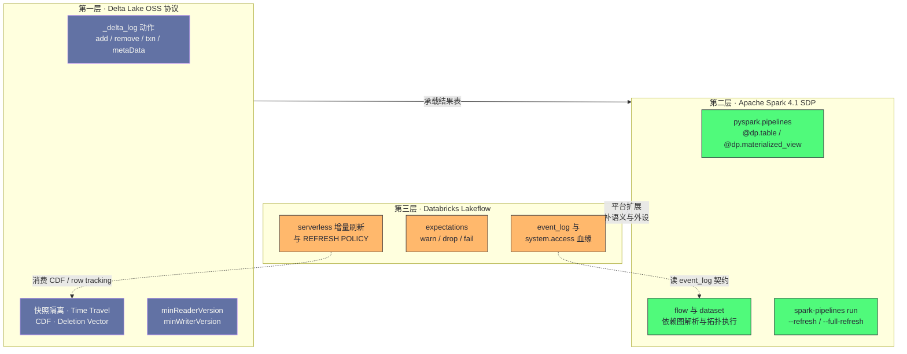
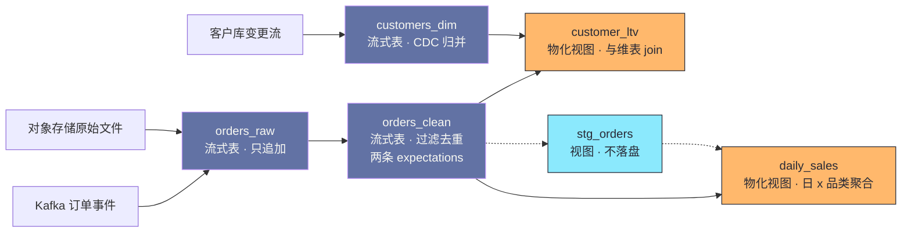
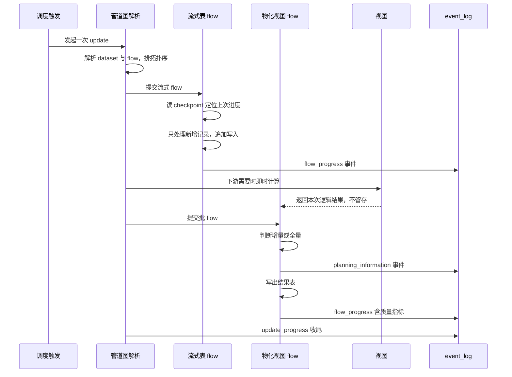
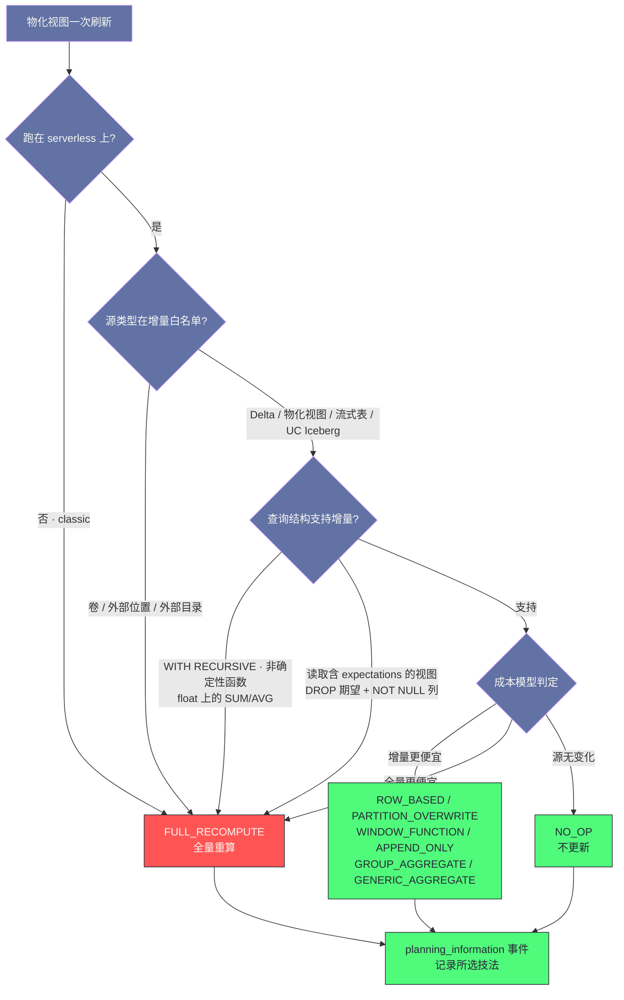
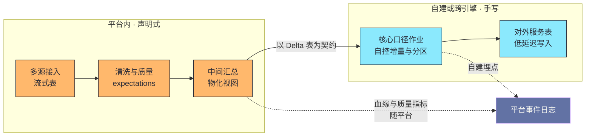

# 09 Delta Live Tables：声明式流批一体管道

**摘要：**

先立一条边界：Delta Live Tables 是 Databricks 的平台能力，不是 Delta Lake 开源协议的一部分。2021 年 5 月 26 日的 Data + AI Summit 上它被发布时，官方定性就是一项云服务，协议规范 `PROTOCOL.md` 里找不到任何与之对应的字段；2025 年它被并入 Lakeflow 产品线，改称 Lakeflow pipelines。真正值得写清楚的是另一件事：声明式管道这套编程模型在 2021 年是封闭的，直到 Apache Spark 4.1 才以 `pyspark.pipelines` 模块和 `spark-pipelines` 命令行进入开源（SPARK-51727 在 2025 年 11 月 14 日 resolve），于是"它属于谁"必须分三层回答——表格式里没有，开源引擎里有骨架，托管服务里才有完整语义。

本文沿一条订单链路（订单事件流、客户维表、两张汇总表）拆解三件事。第一是三个对象各自的刷新语义：流式表只处理"上次之后新增的记录"，官方文档明说它"用数据正确性换更低的时间与资源成本"；物化视图默认按批语义重算，增量刷新只在 serverless 上成立；视图不落盘、作用域限于一次更新。第二是声明式买到的东西：依赖图由框架推导、`flow_definition` 事件自带血缘、expectations 把质量约束变成管道的一部分，且 warn/drop/fail 三档动作的失败作用域并不相同。第三是代价：增量刷新会静默退化成全量、调试可见性依赖平台自己的日志契约、成本结构从"作业时长"变成"常驻与触发的混合计量"。文末用五组反例收束到迁移与选型。

---

## 第 1 章 先把归属划清：协议、引擎、服务

### 1.1 一个流传很广的错位

关于 DLT 最常见的误解，是把它当成 Delta Lake 的一个功能项，理由听上去也顺：名字里带着 Delta，写出来的表是 Delta 表，读写走的是 Delta 的日志。

这个推理在第一个环节就断了。Delta 的协议规范描述的是另一层东西：`_delta_log` 里的 JSON 动作、checkpoint 的 CheckpointMetadata、`add` 与 `remove` 的文件清单、`txn` 动作的幂等收据、`minReaderVersion` 与 `minWriterVersion` 的兼容门槛。协议管的是"一张表如何被多个引擎安全地读写"，它不描述"一张表该在什么时候算、算之前该等谁、算错了该不该拦下"。DLT 提供的全部语义——依赖推导、刷新策略、数据质量约束、事件日志——都落在表之外的那一层编排上。

发布的语境也能佐证。2021 年 5 月 26 日 Data + AI Summit 的公告里，Databricks 把它定义成"一项云服务"，当时的媒体报道写得更直接：这是平台上的一个专有组件，"至少目前不是开源的"。四年之后官方文档给它的新名字是 Lakeflow pipelines，并附了一句"此前叫 Delta Live Tables 的产品已更新为 Lakeflow pipelines"，需要迁移的动作是零，因为代码本来就在平台里跑。

把这个错位说透，对读者是有实际收益的：如果以为它是 Delta 的功能，选型时会去翻 Delta 的版本矩阵找对应特性，然后找不到；如果以为它是开源组件，架构评审时会把它写进"可自建"的清单，然后在落地阶段发现没有对应的自建路径。**归属错则全错**，后面关于能力、成本、迁移的判断都会跟着偏。

### 1.2 三层，每层给的东西不一样

把这件事拆成三层，边界立刻清楚：

| 层次 | 提供者 | 提供什么 | 谁可以用 | 与本文的关系 |
|---|---|---|---|---|
| 表格式与协议 | Delta Lake OSS | ACID 提交、快照隔离、Time Travel、CDF、Deletion Vector 等表级能力 | 任何实现协议的连接器 | 被 DLT 用来承载结果，本身不含管道语义 |
| 声明式运行时 | Apache Spark 4.1 起的 SDP | `pyspark.pipelines` 装饰器、flow 与 dataset 概念、依赖图解析、`spark-pipelines` CLI、全量刷新与 dry-run | 自建 Spark 集群 | 2025 年末起才有，是本文讨论的"模型层" |
| 托管服务 | Databricks Lakeflow | serverless 增量刷新、事件日志、expectations、continuous 模式、UC 血缘与系统表、DBU 计费 | Databricks 工作区 | 绝大部分"好用"的部分在这一层 |

这张表最容易让人踩空的是第二行与第三行之间的落差。开源那层给的是"骨架"：把多个查询组织成一张数据流图，框架负责拓扑顺序、并行与重试，流式表与物化视图作为两种 dataset 存在。托管那层给的是"语义与外设"：物化视图的增量刷新、行级质量约束、跨更新的可观测性、与目录服务的血缘打通。少了后一层，骨架仍然能跑，但"声明式"能兑现的承诺要少一大截。

下面这张图画的就是这三层的位置关系，以及一条流水线在层间如何借力。



图里的实线是"上层的产物落在下层"，虚线是"上层的语义依赖下层的机制"。两条虚线正是需要留意的地方：平台层的增量刷新要借助 Delta 的行追踪与变更数据，平台层的可观测性要依附开源层的图结构——一旦把流水线搬到没有行追踪、没有事件日志的栈上，虚线就断了，剩下的只有实线。

### 1.3 命名变化本身就是一份技术档案

2025 年的更名连带了一次 API 重构，而这次重构透露的设计信息比更名本身多得多。

旧接口是一个模块、一个装饰器：`import dlt`，`@dlt.table` 挂在一个返回 DataFrame 的函数上，返回的是流式 DataFrame 就得到流式表，返回的是批 DataFrame 就得到物化视图。新接口把这件事拆开：`from pyspark import pipelines as dp`，流式表用 `@dp.table`，物化视图用 `@dp.materialized_view`，视图从 `@dlt.view` 改名为 `@dp.temporary_view`。旧名字仍然能解析，官方给的建议是逐步迁移。

这个改动值得停下来看一眼。旧接口把"对象是哪种"这个决定藏在了返回值的形状里，新接口把它提到了装饰器名字上，等于把**隐式判断**换成了**显式声明**。这不是命名洁癖，而是因为两个对象的刷新语义根本不同：流式表只处理新增、不回溯已写数据；物化视图承诺与批查询等价、必要时全量重算。用同一个装饰器、靠 DataFrame 的类型去隐式决定，写代码时几乎无感，等到语义出问题时——比如改过一个过滤条件、发现历史数据没被重算——才会发现当初那个"返回值类型"承担了多大的判断责任。

同一轮调整里还有一处细节：`dlt` 这个模块名曾经被当成"平台专属"的同义词，现在它变成了 `pyspark.pipelines` 这个开源模块名。名字搬家的方向，恰好说明了模型在往引擎里下沉。

### 1.4 一条贯穿全文的订单链路

后面的机制讨论需要一个具体的对象，笔者用一条足够小、又能覆盖主要断面的链路。

源侧有两路输入。第一路是订单事件，从 Kafka 或对象存储持续进来，字段是订单标识、客户标识、品类、金额、下单时间戳。第二路是客户维表，来自业务库的变更流（insert / update / delete 三种操作），带版本号，需要通过 CDC 归并成"每个客户当前的状态"。

链路的下游是五张表：`orders_raw`（流式表，原样落地）、`orders_clean`（流式表，过滤与去重，带两条质量约束）、`customers_dim`（流式表，由 CDC 归并，只保留最新状态）、`daily_sales`（物化视图，按日与品类聚合金额与单量）、`customer_ltv`（物化视图，把聚合结果与客户维表 join 出生命周期价值）。

下图把这条链路画成 flow 图，实线是数据流，点线是视图被引用的关系；节点形状不区分对象类型，靠标签里的说明来识别。



这条链路里，三种对象都占到了位置，两个物化视图的难度也不同：`daily_sales` 只做分组聚合，是最容易增量的形态；`customer_ltv` 要 join 一张会被 CDC 反复更新的维表，增量化的门槛明显更高。后文的增量刷新判定、成本讨论和反例，都会回到这两张表上。

关于量化口径，本文出现的所有成本与耗时数字都是示例推算，用于比较数量级，不代表任一平台的实际定价或基准测试结果。

---

## 第 2 章 三个对象，三种刷新语义

### 2.1 流式表：只认"上次之后新增的记录"

**流式表**（streaming table）的定义方式是把一个流式读取作为返回值的来源，语义上它是一条追加写入的通道：新记录进来，按当前定义变换，追加到表尾。

它的刷新机制有一个容易被忽略的限定。官方文档的表述是，流式表的默认刷新"只评估上次更新以来到达的记录并追加"，已经写入的旧记录不会被重新处理，因此"那些会影响已写入数据的变更不会被应用"，文档为此给了一句非常直白的判词——用数据正确性换更低的时间与资源成本，笔者把它概括成**以正确性换成本**。

这句话不是在贬低它，而是在划一条责任线：流式表的正确性只对它"看到过"的那部分数据成立。于是有一类操作会悄悄地让它出错。假如 `orders_clean` 里原本有一条 `amount > 0` 的过滤，某天发现负数金额其实有效，把条件改成 `amount > -1000`，然后执行一次普通刷新——新进来的负金额订单会被保留，而历史里被过滤掉的那些不会回来。表能跑、指标能出、日报照发，只是数据在时间轴上不一致了。要修正，只能做一次全量刷新。

三种刷新动作的差别必须分清，它们是排障时最常见的误判源：

| 动作 | 对流式表做什么 | 数据是否保留 | 代价 | 典型触发场景 |
|---|---|---|---|---|
| 默认刷新 | 只处理上次 checkpoint 之后的新记录，追加写入 | 保留 | 与新增量成正比 | 日常调度 |
| 全量刷新 | 清空表数据、清空流 checkpoint、从源头重放全部记录 | 丢弃后重建 | 与源数据总量成正比，且受源保留期约束 | 定义或 schema 不兼容地变更 |
| 重置 checkpoint | 保留表内已有数据，只清 checkpoint，再重放全部记录 | 保留 | 与源数据总量成正比 | 改动了某条流的逻辑、希望历史按新逻辑再走一遍 |

全量刷新还有两个副作用值得单独记下来。其一，它读的是"源现在还能给出的数据"，如果 Kafka 主题已经过了保留期、或者被删过老文件，重放出来的结果会比原来少，删掉的数据回不来。其二，它不清理由 flow 写入的外部目标（sink）里的旧数据，所以带 sink 的管道做全量刷新，会在外部世界里留下重复。

还有一个纯工程层面的连带影响：默认刷新只处理增量，意味着流式表的文件增长是"按微批"累积的，长期运行的小文件问题会一直存在，需要靠表属性或平台侧的自动压缩去兜。这属于 Delta 表本身的老问题，但流式表把它变成了常态而非偶发。

### 2.2 物化视图：语义最强，成本最不确定

**物化视图**（materialized view）的定义返回一个批读取的 DataFrame，它承诺的东西比流式表强得多：刷新后的结果与直接跑那条批查询的结果一致，也就是**与批查询等价**。官方文档对此写得很清楚，默认刷新与全量刷新产出的数据完全相同，这也正是它敢让下游把它当"可信汇总"用的原因。

强承诺的代价在刷新方式上。物化视图的默认刷新会先尝试增量：识别自上次更新以来源数据的变化，只合并受影响的结果；当增量不可行或不划算时，退回全量重算。注意这里有两个"不可"——"不可行"是能力问题，由查询结构决定；"不划算"是经济问题，由成本模型决定。后一个更隐蔽：查询明明支持增量，平台仍可能判定全量更便宜，于是你以为的增量根本没有发生。

而增量这一档本身有硬前提：**增量只发生在 serverless 上**：classic 计算上的物化视图永远是全量重算。这条限制把"用不用增量"从一个查询写法问题变成了一个计算形态问题，也让成本讨论必须和计算选型绑在一起。

对本文的链路来说，`daily_sales` 是最理想的一档：源是 Delta 表，算子是分组聚合，键的基数可控，增量时只需要处理新增或变更订单影响到的那些（日期，品类）组合。`customer_ltv` 就麻烦一些：维表每天有几千条更新，join 的另一侧却在持续追加，增量算法要在"维表侧的变化会影响哪些历史聚合"上做额外功，落到行级合并甚至分区覆盖的概率显著更高。

### 2.3 视图：不落盘，作用域只有一次更新

第三种对象是**视图**（view），新接口里叫 `dp.temporary_view`。它不物化、不发布到目录，作用域就是一次管道更新的执行期：声明它的那次运行里，下游 dataset 可以引用它；运行结束，它就不存在了。

视图的价值在于把重复的中间逻辑收成一处。`stg_orders` 做一层字段清洗与类型转换，`daily_sales` 和 `customer_ltv` 都从它读，逻辑只写一遍。它不产生存储成本，也不会因为"要不要刷新"而产生额外判断。

但它有两个必须知道的副作用。第一，引用视图会形成依赖边，下游对它的每次读取都等于把那一段逻辑重新算一遍——视图不会替调用方缓存结果，两次引用就是两次计算。第二，质量约束挂在视图上会带来麻烦：官方增量刷新支持矩阵里明确写着，若物化视图读取的是"含有 expectations 的视图"，该物化视图就不能增量；另外视图只在被查询时才算，它的质量指标可能缺失，若被多个下游引用还会出现多份口径不同的指标。

### 2.4 一次更新里，三条路径分岔

把三个对象放进同一次更新，刷新过程其实是三条互不相同的路径。下图用一次触发的时序把它们摆在一起，注意流式表那一路的"进度"来源与物化视图那一路完全不同。



时序图里有一处容易被忽略的空白：视图那一路没有独立的事件。它不落盘，也就没有自己的进度与指标，质量与耗时都被记在引用它的下游身上。这解释了为什么"给视图挂 expectations"看起来优雅、实际会让排障变难。

同一次更新里，还可能有一批 dataset 根本不参与计算。物化视图在源数据没有变化时会被判为 `NO_OP`，既不重算也不更新，事件日志里留下一条"没有检测到变化"的记录。这一点常被误解成"管道跳过了整张图"，实际上是逐 dataset 判定的。

---

## 第 3 章 声明式买到的三样东西

### 3.1 依赖图由框架推导

声明式最直接的收益是省掉了调度顺序的维护。手写方案里，谁是上游、谁先跑、失败后谁重跑，这些信息要么写在 Airflow 的 DAG 里，要么写在一堆 `if` 判断里，要么只存在于某个人的记忆里。改写之后，依赖只由一处决定：某个查询读了谁。

框架的解析粒度是 flow。一个 dataset 可以由多条 flow 写入——比如流式表允许挂多个追加 flow，把不同区域的事件汇到同一张表；物化视图则恰好由一条批 flow 写入。图的解析发生在所有定义注册完之后，所以源文件里的定义顺序无关紧要，一个 dataset 可以引用写在它后面文件里的另一个 dataset。

与之配套的两个能力常被低估。其一，解析阶段就能发现环依赖、引用不存在的列、SQL 语法错误，`spark-pipelines dry-run` 把这些检查从"运行到一半才炸"提前到了"开跑前就报"，代价是不读写任何数据，因此它验证不了数据本身的问题。其二，失败的影响面是 flow，不是整条管道：一个 flow 失败不会牵连同层无依赖的其它 flow 一起回滚。

反过来说，手写方案在这一点上的失败形态非常典型：五十张表、上百条边，某天有人把中间表改了名，调度配置里漏改一处，下游读到的是上一次的旧数据，管道本身全是绿的，错误要等到业务方发现指标不对才被追溯。依赖由框架推导之后，这类错误在解析期就会暴露。

### 3.2 血缘是运行时产物，不是文档

第二样东西是血缘，而它的关键在于"由谁记录"。

框架在执行时会把每个 flow 的输入与输出写进事件日志，事件类型是 `flow_definition`，字段里带 `output_dataset`、`input_datasets`、`flow_type` 与该 flow 的 schema。这意味着血缘不是一张需要人工维护的表，而是执行过程的副产品：只要 flow 跑过，边就被记下来了。

这个性质带来三层实际用途。影响分析上，要改一张表的 schema，可以先把下游全找出来，不用靠翻代码猜。合规审计上，某个报表数字的来源链路可以被完整还原，这在被追问"这个数从哪来"的场合很关键。根因分析上，上游某一批数据异常时，血缘能直接限定污染范围，而不是把所有下游都重算一遍。

但也要把它的边界说清楚。血缘记录在平台的事件日志与目录系统里，换一个栈就不存在对应物；开源那层能给出图结构，却没有义务把它持久化成可查询的表。另外事件日志是尽力投递，官方明确写了"不保证每条事件都送达"，把它当成审计凭证时要留出这个缺口。还有一点：血缘反映的是"实际发生的读取"，如果某次运行的依赖因为参数变化而与预期不同，血缘会如实记下那个不同——这既是优点，也意味着不能用它替代设计文档。

### 3.3 EXPECTATIONS：把质量约束变成管道的一部分

第三样东西是把数据质量从"事后检查"变成"声明的一部分"。

写法是一行 SQL 布尔表达式，语义是逐行判定：条件为真表示这一行通过，为假表示触发动作。三种动作的差别不只是"处理方式"，还包括失败时的作用域和指标是否留存：

| 动作 | Python 装饰器 | SQL 子句 | 违规行的去向 | 指标 | 失败作用域 |
|---|---|---|---|---|---|
| 警告 | `dp.expect` | `CONSTRAINT x EXPECT (...)` | 照常写入目标表 | 有通过/失败计数 | 不阻断 |
| 丢弃 | `dp.expect_or_drop` | `... ON VIOLATION DROP ROW` | 写目标表之前被丢弃 | 有通过/失败计数，另有丢弃行数 | 不阻断 |
| 失败 | `dp.expect_or_fail` | `... ON VIOLATION FAIL UPDATE` | 更新被原子回滚 | 不记录（因为更新失败） | 见下文 |

多约束的组织方式在两套语法里并不对称。Python 侧有 `expect_all`、`expect_all_or_drop`、`expect_all_or_fail` 三个批量版本，参数是"名字到条件"的字典，可以把同一组规则复用到多个 dataset 上；SQL 侧只能逐条写 `CONSTRAINT`，要复用这组规则得靠生成语句，或者把规则搬到 Python 里。这条不对称会影响规范落地的方式：想把质量规则做成一个可版本化的规则库、再按标签批量套到 dataset 上，Python 是更顺的那条路。

失败那一档的作用域是全文最值得记住的细节之一。在触发式（triggered）管道里，一条 flow 的期望失败只回滚它自己，同层的其它 flow 继续更新；在持续式（continuous）管道里，失败会停掉该 flow 以及所有依赖它的 flow，管道随之停下并给出说明。这意味着同一段代码在两种运行模式下，"拦得住多少"是不一样的：有人在持续式里指望它当全局门禁，切到触发式之后这个门禁就只剩一道局部护栏。

约束的表达能力也有硬边界：必须是合法的 SQL 布尔表达式，不能用自定义 Python 函数，不能调外部服务，不能在条件里子查询别的表。名字在一个 dataset 内必须唯一。这些都是为了让约束能被嵌入查询计划、在流式执行中逐行求值。

三类动作之外，还有一个常见需求——聚合级别的校验，比如"被丢弃的行不能超过全量的 1%"、"两个表行数必须相等"、"主键必须唯一"。这类判断没法写成逐行条件，官方的推荐做法是单建一张校验表：先用聚合算出指标，再把约束挂在这张只有一行或少数几行的表上，用失败档动作。

```python
# 校验表模式：把"聚合断言"变成逐行断言
@dp.materialized_view(name="count_verification")
@dp.expect_or_fail("no_rows_dropped", "a_count = b_count")
def validate_row_counts():
    return spark.sql("""
        SELECT * FROM
          (SELECT COUNT(*) AS a_count FROM table_a),
          (SELECT COUNT(*) AS b_count FROM table_b)
    """)
```

这段写法的坑在于它并不构成门禁。官方文档专门提醒：下游去读校验表，并不会因此等待校验结果，校验失败也不会阻止下游表更新。要真正做到"校验不过就不许往下走"，得把校验与下游拆成两条管道，用作业任务的依赖关系串起来——期待它能拦住下游，是这套机制最常见的误用；**校验表不构成门禁**。

若既不想丢数据、又不想阻断，还有隔离（quarantine）模式：把违规行与合法行一起写进一张带标记列的私有表，再用两个视图把两侧分开，下游只读合法那一侧。它把"质量事件"变成"可复查的数据"，代价是多一次落盘与一套额外的视图。

最后是违规时的现场信息。期望失败会给出明确报错，包含 flow 名、违反的约束名、以及造成违规的输入与输出记录，形如 `[EXPECTATION_VIOLATION.VERBOSITY_ALL] Flow '...' failed to meet the expectation. Violated expectations: '...'. Input data: ... Output record: ...`。这条报错对定位"是哪一条脏数据炸的"极有价值，也解释了为什么失败档会改写查询计划——为了带上这份现场，它必须让计划多带一份追踪信息。

### 3.4 并行度与资源：控制点变少了

三样东西都建立在一个共同前提上：图由框架拥有。这个前提本身就带着一笔交易——控制点随之减少，资源与并行度不再是逐个作业去调配的事。

图解析完成后，谁和谁可以同时跑由边决定，而不是由调度配置决定。同一次更新里，没有依赖关系的 flow 天然并行：`orders_clean` 与 `customers_dim` 互不相干，可以同时起；`daily_sales` 与 `customer_ltv` 都要等 `orders_clean`；`customer_ltv` 还要额外等 `customers_dim`。这几条约束在声明式里一个字都不用写，由图自己算出来。

代价是控制点变少。手写方案里可以给每个作业配不同的队列、优先级与并发上限，也可以在特定时刻只跑其中一部分；声明式里一次更新是整体行为，能调的是集群规格、自动扩缩容范围，以及少数与单个 flow 相关的资源配置。想要"只跑某几张表"，只能在 dataset 粒度上用刷新选择参数做指定，做不到在作业粒度上重新编排。

资源侧的可观测性倒是有对应物。classic 计算上启用增强型自动扩缩容后，事件日志会记下 `autoscale` 事件（含 `RESIZING`、`SUCCEEDED`、`PARTIALLY_SUCCEEDED`、`FAILED` 等状态与请求的 executor 数）和 `cluster_resources` 事件（平均排队任务数、任务槽利用率、当前与最优 executor 数）。两者合起来能回答一条声明式管道最常被问的问题：这次更新慢，是数据多了，还是扩容没跟上。前者是成本问题，后者是配置问题，判错方向会把优化力气使在错误的地方。

还有一个连锁效应值得提前想到：既然并行由边决定，整体耗时就被"最长路径"封住。手写方案可以把关键路径单独提出来先跑、把旁支延后；声明式里旁支会与关键路径同时启动、抢同一批资源，关键路径反而可能变慢。真要优化，做法是拆管道，或者给不同 flow 指定不同的资源规格，而不是指望调度层主动让步。

---

## 第 4 章 增量刷新的真实边界

### 4.1 三道门：计算形态、数据来源、查询结构

物化视图能不能增量，要过三道门，缺一道就退回全量。

第一道是计算形态。增量刷新只发生在 serverless 管道的物化视图上；classic 计算上的物化视图永远全量。这一条把问题的性质改变了：不是"我的 SQL 写得够不够简单"，而是"我的管道跑在什么计算上"。

第二道是数据来源。可作为增量源的类型包括 Delta 表（含 UC 托管的托管表与外部表）、物化视图、流式表（包括 `AUTO CDC` 写入的目标表）、以及 UC 托管的 Iceberg v2/v3 表；卷（volume）、外部位置、外部目录这类来源不能增量，外部 Iceberg 表可以读但不能增量。

第三道是查询结构。这一道的细节最多，也最容易被"看起来能增量"的写法骗过去。下图把三道门连同成本模型的裁决画成一条判定路径。



图里 `E` 那个菱形是这张图最不直观的一处：即使查询结构与来源都合格，最终是否增量仍由平台的成本模型裁决，官方文档的说法是"基于查询结构、数据变化量与系统成本建模选择更划算的一种"。这也解释了为什么同一个物化视图可能今天增量、明天全量。

除了这三道明面上的门，还有一道容易漏掉的前置条件：行追踪（row tracking）。部分增量刷新操作要求被查询的源表开启行追踪，而这是 Delta 表的特性——物化视图、流式表与 UC 托管表都属于这个范畴。官方还建议同时开启 Deletion Vector，原因不难推：增量要按行定位变化，行身份越稳定、删除表达越精细，需要重写的文件就越少。

这里有一个常被旧资料误导的点。早期关于增量刷新的解释常把它说成"依赖 Change Data Feed"，实际口径已经变了：官方明确说明不需要打开传统的 CDF 表属性，在较新的运行时上，开启行追踪会连带启用自动变更数据；源表若已经打开了老式 CDF，则需要按迁移说明处理。把"增量靠 CDF"当成固定结论，会在做容量规划时错估存储与写放大。

### 4.2 支持矩阵里的那些"看起来没问题"

把官方支持矩阵摊开，能看出判定的规律：逐行变换、过滤、所有 join 类型、分组聚合、union all、窗口函数都在支持之列；当窗口函数要增量时，必须显式声明分区列；确定性内置函数与不可变 UDF 也算数。真正会导致退化的，是一批看着普通的写法：

| 写法 | 是否支持增量 | 后果与处置 |
|---|---|---|
| `WITH RECURSIVE`（递归 CTE） | 不支持 | 静默退回全量；递归语义本身也难以行级增量 |
| `float`/`double` 上的 `SUM`、`AVG`、协方差 | 不支持 | 浮点求和不满足可结合性，结果不确定；把列转成 `DECIMAL` 后可增量 |
| 非时间类非确定性函数 | 不支持 | 时间函数出现在 `WHERE` 里被允许，其它不行 |
| 读取"含 expectations 的视图" | 不支持 | 把约束移到物化视图自身，别放在视图上 |
| `DROP` 期望 + 表含 `NOT NULL` 列 | 不支持 | 两项能力叠加后无法推导增量 |
| 外部 Iceberg 表作源 | 不支持 | 可读、可全量，不能增量 |
| 变更过行为的 UDF | 无法自动识别 | 平台尽力检测，但套壳调用识别不到；需要人工全量刷新 |
| `REPLACE WHERE` flow 的目标表 | 不支持挂 expectations | 质量约束要挪到上游 |

这张表里最值得警惕的不是"不支持"三个字，而是"静默"两个字。除了 fail 档会明确报错，绝大多数退化只会体现在一次更新的耗时与账单上，不会主动告诉你"这次没有增量"。等到发现月度 DBU 翻倍时，往往已经过去几周。

### 4.3 把刷新策略钉死

针对这种不确定性，平台提供了刷新策略（`REFRESH POLICY`），四档语义清晰：

| 策略 | 行为 | 适用场景 |
|---|---|---|
| `AUTO`（默认） | 由成本模型在增量与全量间选择 | 多数场景，省心但结果不可预期 |
| `INCREMENTAL` | 尽量增量，不可行时退回全量 | 增量有收益、偶发全量可接受 |
| `INCREMENTAL STRICT` | 必须增量，不可行则创建或刷新失败 | 成本、时延有硬约束，宁可失败也不接受全量 |
| `FULL` | 永远全量 | 数据集小、查询经常改、增量无收益 |

`INCREMENTAL STRICT` 的价值不在于"更快"，而在于把隐式退化变成显式失败。对账单敏感的链路，宁可让一次更新失败、由人来看一眼，也不愿在无人察觉的情况下跑一次全量重算——这是一次把不确定性从小概率大损失换成确定性小损失的兑换。

### 4.4 怎么验证它到底是增量还是全量

增量刷新并非完全黑盒，前提是知道去哪个渠道拿信息，官方给了三层入口。

开发期看编辑器里的表面板，有一列 `Incrementalization`，取值是 `Incremental`、`Full recompute`、`No change`；有推荐修法时旁边会出现提示，点开能看到具体原因。这一列直接回答了"我这条查询到底算不算增量"。

运行期查事件日志里 `event_type = 'planning_information'` 的记录。它的 `details` 里带 `technique_information` 数组，每一项有 `maintenance_type`、`is_chosen`、`is_applicable`、`cost`，以及 `incrementalization_issues`（含 `issue_type`、`prevent_incrementalization`、`operator_name`、`expression_name` 等）。把它解析出来，等于拿到了一份"为什么没增量"的诊断书。日志里还有一条更好读的消息，形如 `Flow 'sales' has been planned to be executed as ROW_BASED.`；除 `ROW_BASED`、`PARTITION_OVERWRITE`、`WINDOW_FUNCTION`、`APPEND_ONLY`、`GROUP_AGGREGATE`、`GENERIC_AGGREGATE` 这六种技法，另有 `FULL_RECOMPUTE` 与 `NO_OP` 分别表示全量重算与源无变化。

排障期还有一个入口：查询计划画像里会出现 `FLOW_FULL_RECOMPUTE` 这类洞察，直接指出是全量的哪一类原因，并给出跳到对应源码行的入口。

掌握了这三层，"黑盒"这个说法要修正一半：物理执行计划确实不直接暴露，但"为什么没有增量"这件事是被记录的，只是记录在平台自己的日志契约里，换个栈就没有了。

---

## 第 5 章 代价：绑定、可见性、成本结构

### 5.1 能力边界随版本移动，但界线仍在

关于"哪些能力只属于平台"，Databricks 的文档里有一张对照表，按 2026 年 11 月的版本，明确标注为"不属于 Apache Spark"的项包括：`dp.update_flow`、事件日志、Auto CDC 相关 API、expectations、continuous 模式、`foreach` 类 sink。

这张表要谨慎使用，因为界线正在移动。Apache Spark 4.3 的官方编程指南里，Auto CDC 已经作为一节被完整记录（键与排序、乱序与重复、删除语义、目标格式要求一应俱全），这与对照表上"不在 Apache Spark"的标注形成了时间差——对照表写得早，引擎加得快。把它当成一条会漂移的线而不是一堵墙，才是准确的读法。

expectations 这一项相对稳定：官方在语言参考里点名它是 Databricks 运行时对开源能力之外的扩展。这与它的实现方式有关——它要改写查询计划、要在流式执行中逐行求值、要把指标写进平台的事件日志，三件事都依赖运行时与日志两侧的配合。

于是"能不能搬走"要按层回答：

| 能力 | 开源 Spark SDP | Databricks 平台 | 搬到自建栈的难度 |
|---|---|---|---|
| 流式表 / 物化视图 / 视图声明 | 有 | 有 | 低，语法基本兼容 |
| 依赖图解析与拓扑执行 | 有 | 有 | 低 |
| 全量刷新与 dry-run | 有 | 有 | 低 |
| 物化视图增量刷新 | 无 | 仅 serverless | 高，需自建等价机制 |
| expectations 三档动作 | 无 | 有 | 中高，需另建质量框架 |
| 事件日志与血缘表 | 无 | 有 | 中，需自建可观测层 |
| continuous 模式 | 无 | 有 | 中，可用长跑流作业近似 |
| UC 级血缘与权限 | 无 | 有 | 高，依赖目录服务 |

### 5.2 "黑盒"这个批评应该怎么修

对声明式管道的常见批评是"调试变成黑盒"：不知道它生成了什么计划、不知道它为什么这么调度、出错时只能看它给的错误。这个批评有一半成立，值得拆开说。

成立的那一半：物理计划不直接暴露。手写 Structured Streaming 时，`explain()` 能看到完整计划、可以逐算子加 `repartition`、可以把 `foreachBatch` 里的每一步打印出来。声明式之后，查询被包在 dataset 定义里，由框架决定优化与执行，能介入的旋钮明显变少。对做极致调优的人来说，这是真实的能力损失。

不成立的那一半：可观测性并没有消失，只是换了契约。事件日志里能查到每个 flow 的进度、行数、指标、规划信息；`planning_information` 能回答"为什么没增量"；`flow_definition` 能回答"它到底读了谁"；`stream_progress` 里有与 Structured Streaming 监听器高度相似的指标（少了 `numInputRows`、`inputRowsPerSecond`、`processedRowsPerSecond` 三项，Kafka 与 Kinesis 的 offset 字段过长时会被截断并另附 `...Truncated` 布尔标记）。这些都在，问题是它们不属于 Spark 的公共契约，而属于平台的产品契约——版本升级时字段会变，换栈时整体消失。

还有一层约束来自编写规约，它在报错之前就已经限制了调试手段。dataset 定义函数里不允许出现 `collect()`、`count()`、`toPandas()`、`save()`、`saveAsTable()`、`start()`，因为源码在一次更新中会被多次求值，任何副作用都会重复发生。这条规矩的本意是保证幂等，副作用是：做不到"在定义里打一行 print 看看数据长什么样"，只能通过建临时表、查事件日志、看采样结果来间接观察。

### 5.3 成本结构变了，不只是单价变了

手写流作业的成本模型相对好算：作业跑多久、集群开多久、按秒计费。声明式之后，有四个变量同时变化。

第一是**触发与常驻**的取舍。触发式管道跑完一次更新就结束，适合分钟级以上的时效；持续式管道常驻运行、按秒级延迟处理，计算资源不释放。延迟与成本在这条线上是直接兑换关系，没有第三条路。

第二是**serverless 与 classic** 的语义差异。这一条比价格差异更根本：增量刷新只在 serverless 上成立，classic 上的物化视图永远全量。于是"用 classic 省钱"这个直觉在物化视图占比高的管道里可能完全反过来——省下的是单价，付出的是每次全量重算的算力。这个反直觉之处，是很多迁移评估漏掉的一项。

第三是**不确定性折价**。由于是否增量由成本模型裁决，账单的方差会变大。示例推算一下：一条每天处理两千万条订单的管道，物化视图全量重算一次约 20 分钟、增量一次约 3 分钟，在同一规格（8 个 worker）下算力差接近 6 倍；若每月有 5 天因为改了查询结构而退化成全量，月度账单的波动可能达到 30% 量级。这不是精确数字，但它说明为什么要把"是否增量"当成一个需要监控的指标，而不是一个默认成立的假设。

第四是**连带成本**。流式表全量刷新要重放源全部数据，如果源在对象存储上，这个读取量可能远超日常增量；如果源是 Kafka 且保留期短，全量刷新还可能直接失败或丢数。也就是说，"出问题就全量刷一次"这个习惯动作，在声明式管道里的代价比手写方案更高。

---

## 第 6 章 与手写 Structured Streaming 的对照

### 6.1 能力差异逐项摊开

把两套做法放在同一组维度上比较，差异的分布比想象中更不均匀：不是全面领先或全面落后，而是在不同维度上各有胜负。

| 维度 | 声明式管道 | 手写 Structured Streaming + 调度器 |
|---|---|---|
| 依赖与顺序 | 由读取关系推导，改表名自动跟随 | 手写 DAG，改名需同步改调度配置 |
| 进度管理 | checkpoint 由框架管理，全量/重置是三种明确动作 | checkpoint 自行管理，路径与清理策略自定 |
| 质量约束 | 声明式三档动作，指标进事件日志 | 自行实现断言与埋点，灵活性更高 |
| 血缘 | 运行时记录，可查 | 需自建元数据或依赖目录工具 |
| 失败粒度 | flow 级，同层无依赖者不受牵连 | 作业级，需自己切分粒度 |
| 调试手段 | 事件日志 + 规划信息，无法直接看计划 | `explain()`、逐算子调参、本地复现 |
| 增量能力 | 物化视图可增量，但受 serverless 与查询结构约束 | 完全自控，可实现任意增量算法 |
| 延迟下限 | 触发式分钟级，持续式秒级 | 取决于微批间隔与集群常驻策略 |
| 可移植性 | 依赖平台运行时与服务层 | 任意 Spark 环境 |
| 治理集成 | 与目录服务、权限、血缘打通 | 需自行拼装 |

这张表里最容易被低估的是"失败粒度"那一行。手写方案里，一个作业里包含十个步骤，第十步失败，前九步的结果已经写下去了，重跑要么幂等、要么从头覆盖；声明式把粒度切到 flow，一个 flow 失败只回滚它，其它 flow 的产出仍可用。这个差异在长链路里的运维体验差距极大。

反过来，最容易被高估的是"增量能力"那一行。手写的确可以做任意增量算法——比如基于订单主键维护一张状态表、按客户维度做增量合并——但这意味着你要自己处理乱序、重复、迟到数据与状态膨胀。声明式把这件事收进框架，代价是只能用它支持的形态，超出形态就只能退回全量。

### 6.2 什么时候手写仍然更合适

有几类场景，笔者认为手写仍然是更合理的选择，不宜因为"声明式更先进"就一律迁过去。

第一类是需要在算子级别控制的场景。要在某个特定 shuffle 之后手工调整分区、要用自定义的 watermark 策略、要在微批之间插入外部调用并保证幂等——这些都需要直接操作执行计划，声明式的封装反而是障碍。

第二类是目标不落在 Delta 或平台目录里的场景。声明式的价值有很大一部分来自"表在目录里、血缘在系统里、权限在目录上"，如果最终目标是消息队列、外部数据库、或者自建的对象存储路径，这套协同就断了一半。

第三类是需要跨引擎消费的场景。上游用 Flink 写、下游用 Trino 读、中间还要给 Hive 兼容层留路，这种异构栈里，管道的编排往往已经由别的系统承担，再加一层声明式框架会多出一个需要同步的真相源。

第四类是强审计或强可复现要求的场景。声明式的执行细节由框架裁决，同一份代码在不同版本、不同计算形态下的行为可能不同；如果要求"同样的输入在任何时候都产出完全相同的中间结果与执行记录"，手写方案的可控性更好。

### 6.3 混合是常态

现实里更多见的是混合：接入层用声明式（源多、schema 变化频繁、质量约束密集），核心口径与对外服务层用手写（对延迟、对增量算法、对可移植性有硬要求），两层之间用表或视图衔接。下图画出这种分工，以及两侧的可观测性各自落在哪里。



这种切法的关键契约是那张 Delta 表：声明式侧保证它是"与批查询等价"的结果，手写侧把它当普通表读，不关心上游怎么刷新。两侧的可观测性各自独立，因此需要在一开始就约定好指标口径，否则同一份数据在两边看到的质量数字会对不上。

---

## 第 7 章 反例与边界

### 7.1 反例一：当成 Spark 的语法糖

这是最典型的一种误判，形态是"先用起来，反正就是几个装饰器，迁移的时候改改 import 就行"。

持这种判断的人会忽略掉一组事实：管道真正好用的部分，大半不在装饰器里。事件日志是平台表，质量指标是平台事件，血缘在目录系统，增量在 serverless，持续模式在平台调度，连"这条查询为什么没增量"的诊断都写在平台的日志契约里。一个用 DLT 写了半年的项目，代码量可能只有几百行，周边依赖却有：一套事件日志查询、一套质量看板、一套血缘影响分析流程、一套基于目录的权限模型。

迁移时的真实成本分布大致是这样：改写装饰器与 import 属于最低的一档，通常几天；把 expectations 换成自建质量框架属于中间一档，要重建指标口径与告警；把事件日志查询与看板重建属于较高一档，因为字段语义是平台定义的；最难的是血缘与权限，它们不是"代码里的一段逻辑"，而是"组织里的一套流程"。前两档能靠人力补，后两档往往需要引入新的元数据系统才能替代。

把"**语法糖**"这个判断证伪，有个简单的问法：如果把平台侧的一切都拿掉、只留代码，这条管道还能回答"昨天哪张表出了问题、影响了谁、脏数据从哪进来"吗？答不上来，说明依赖的就不只是语法糖。

### 7.2 反例二：在声明式里做无法增量的复杂聚合

第二种反例的形态更技术化：把一套在批处理里跑得好好的复杂 SQL 原样搬进物化视图，期望它自动获得增量能力。

典型写法是"每客户最近三个月排名前五的订单"这种需求：窗口函数按客户分区排序、加 `row_number()` 取前五、再与别的表做 `distinct` 与聚合。这套查询在批处理里没问题，放进物化视图后，增量判定大概率过不了——窗口要增量必须显式声明分区列，`distinct` 与多层嵌套会让增量推导失去着力点，若金额列还是 `double`，浮点求和又添一条硬伤。结果是一条看起来普通的查询，每次都全量重算。

更麻烦的是它不容易被发现。开发期在小数据量上跑，几秒钟出结果，感觉一切正常；上线后数据量涨上来，一次刷新从分钟级爬到小时级，账单跟着涨，但管道状态一直是绿的。等有人去查，才发现 `Incrementalization` 一列长期是 `Full recompute`。

处置有三条路，各有代价。其一，改语义：把"前五名"降级成"全部明细 + 下游查询时取前五"，让物化视图只承担可增量的聚合，把复杂的取数交给查询侧。其二，换对象：用流式表加自维护状态，把排名逻辑写进 `foreachBatch` 或自定义状态机，换取增量的可控性。其三，接受全量：把 `REFRESH POLICY` 显式设成 `FULL`，并把刷新频率降下来，至少让成本变成可预期的，而不是隐性的。

三条路没有哪条天然更优，但有一条共同的要求：先知道自己在哪一档。**从"我以为"走到"我确认"**，成本讨论才有意义。

### 7.3 反例三：把 EXPECTATIONS 当唯一的质量手段

第三种反例最隐蔽，因为它在前几个月看起来运转良好：几条约束挂上去，事件日志里有通过率曲线，质量看板漂亮，于是团队认为数据质量这块已经解决了。

问题会在四个地方冒头。

其一是丢弃档的静默性。`expect_or_drop` 会把违规行悄悄丢掉、把计数记进日志，然后管道继续跑。如果没人看那个计数，数据就是在无声地减少。一条约束从 0.1% 的违规率涨到 20%，管道依然全绿，下游指标下滑才会暴露问题——而此时已经丢了几周数据。丢弃档必须配一条基于丢弃行数的告警，否则它就是个**静默的数据销毁器**。

其二是失败档的作用域误判。前面说过，触发式下它只回滚一条 flow。一个团队若在持续式环境里验证过"失败会停管道"，迁到触发式后仍按同样预期设计告警，就会发现异常发生时管道只黄了一小块，整体更新状态仍是成功。

其三是聚合断言的越界期待。校验表模式能让"行数相等""主键唯一"这类判断变成逐行断言，但它不构成门禁：下游读校验表不会等待结果，校验失败也不会阻止下游更新。把它当"质量闸门"用，等于给自己一个虚假的安全感。

其四是覆盖面的假象。质量约束只能表达逐行 SQL 布尔条件，表达不了"两张表的分布是否一致""这批数据的时序是否连续""上游是否少发了一天的文件"这类跨表、跨批的判断。这些需要独立的对账作业、基于水位与分区的完整性检查，以及端到端的抽样比对。expectations 能覆盖的是"行内明显错误"，覆盖不了"系统性偏差"。

### 7.4 反例四：把"只追加"当成"总是正确"

流式表的只追加语义常被理解成"append-only 就是安全的"，于是有人拿它承载维表、承载需要 upsert 的目标、承载会被上游回填的源。

三个具体场景会出事。维表场景：客户地址变更后，流式表里会出现同一客户的两行，下游 join 时要么重复计数、要么需要额外去重，正确做法是用 CDC 归并语义（`AUTO CDC`）得到每键一行，而不是直接追加。上游回填场景：源侧补了一批历史数据，流式表按"新记录"处理它们，与已有数据的时间顺序错位，聚合结果出现重复计数。逻辑变更场景：改过过滤条件后只做默认刷新，历史数据仍按旧逻辑存在，表内出现两种口径并存。

这三种都不是"框架的 bug"，而是把"追加"误解成"幂等"。判断标准很简单：这张表的消费方是否假设"每行代表一个独立的、不再变化的事实"？是，追加成立；否，就该用 CDC 归并或换对象类型。

### 7.5 反例五：把全量刷新当日常操作

第五种反例更多出现在运维习惯里：出了任何问题先来一次全量刷新，理由是全量刷新"总能修好"。

在流式表上这个动作的代价被低估了。全量刷新要清空数据与 checkpoint、从源重放全部记录，而源往往已经不再保留全部历史——Kafka 的保留期、对象存储的生命周期策略、上游的归档动作，都可能让"重放"变成"重放现有的一部分"。结果是修复动作本身引入了一次数据丢失，而且这次丢失没有任何报错。

还有一个副作用是 sink：全量刷新不清理由 flow 写到外部目标的数据，若管道带 sink，外部世界会出现重复写入，需要额外清理。

正确的用法是把全量刷新当成一次有预案的变更：先确认源的保留窗口覆盖要重放的区间，再确认下游能否接受一次结果整体替换，最后确认 sink 侧是否需要人工清理。三项都能答"是"，再动手。

### 7.6 反例速查

| 反例 | 症状 | 判据 | 处置 |
|---|---|---|---|
| 当成语法糖 | 迁移评估只算代码改写量 | 拿掉平台后无法回答血缘与质量溯源 | 按代码/语义/运维/治理四层估迁移成本 |
| 复杂聚合求增量 | 刷新耗时随数据量线性上涨 | `Incrementalization` 长期是 `Full recompute` | 改语义、换对象类型，或显式设 `FULL` |
| 期望当唯一质量手段 | 质量看板好看但下游指标异常 | 丢弃计数无人监控，校验表被当门禁 | 丢弃告警、校验拆管道串依赖、补对账 |
| 只追加当幂等 | 维表重复行、回填后重复计数 | 消费方假设"每行是独立事实" | 用 CDC 归并或换对象类型 |
| 全量刷新当修复 | 刷新后数据变少、外部目标重复 | 源保留期短于要重放区间 | 先核对保留窗口与下游接受度 |
| 忽略运行模式的语义差 | 持续式验证过、触发式下表现不同 | 失败档作用域不同，指标留存不同 | 按实际运行模式重设告警与门禁 |
| 依赖事件日志做审计 | 审计查询偶发缺事件 | 官方明示事件为尽力投递 | 审计另建持久化通道 |

---

## 第 8 章 落点

声明式管道真正解决的问题，不是"少写代码"，而是把管道里那些原本靠人记住的约定，搬进了可被机器检查的结构：谁是上游、什么算干净、错了该不该拦、改一行会影响谁。这四件事一旦结构化，规模就不再是敌人——五十张表和五张表的管理开销接近。

但它换来的每一样东西都对应一笔账。依赖图由框架推导，代价是编排的自由度；血缘自动记录，代价是这套记录存在于平台的目录与日志里；质量约束成为声明的一部分，代价是约束的表达能力被限定在逐行 SQL 布尔表达式里；物化视图可以增量，代价是这份能力挂在 serverless 计算与一份会漂移的算子白名单上。

所以选型的第一问不该是"要不要用声明式"，而是"我的管道里，有多少比例的表是可以通过逐行条件与可增量聚合表达出来的"。比例高，声明式的收益就实；比例低，等于花平台的复杂度买了一套用不满的抽象。第二问是"我能不能接受把可观测性外包给平台"，因为排障时最需要的三类信息——为什么没增量、这次读了谁、哪条数据违规——全在平台的事件日志里。第三问是"如果三年后要搬走，我准备搬的是代码，还是这套语义"，答案不同，架构上的隔离点就该画在不同位置。

至于边界会不会继续移动，目前仍然言之尚早。开源引擎在 4.1 之后已经把声明式的骨架拿了进去，Auto CDC 也已在引擎文档里露面，语言层的锁定正在变薄；但增量刷新、质量指标、血缘系统表这些"服务层"能力，短期内看不到等价的开放实现。可以预期的形态是：写法和语义逐步标准化，而托管、增量与治理继续留在平台上。把可移植性设计在**语法层**、把不可移植的部分显式标注出来，是这一阶段比较务实的做法。

---

## 参考资料

1. Databricks 文档：What happened to Delta Live Tables (DLT)?（更名、`import dlt` → `pyspark.pipelines`、`@table`/`@materialized_view`/`@temporary_view` 的对应关系）。https://docs.databricks.com/aws/en/ldp/concepts/where-is-dlt
2. Databricks 文档：Lakeflow pipelines Python language reference（"属于 Apache Spark / 不属于 Apache Spark" 功能对照表、dataset 定义的编码约束）。https://docs.databricks.com/aws/en/ldp/developer/python-ref
3. Databricks 文档：How do pipelines refresh?（默认刷新、全量刷新、重置 checkpoint 三种语义，流式表"以正确性换成本"的表述）。https://learn.microsoft.com/en-us/azure/databricks/ldp/concepts/refresh
4. Databricks 文档：Incremental refresh for materialized views（serverless 前提、成本模型、`REFRESH POLICY` 四档、支持矩阵、`planning_information` 与技法枚举）。https://learn.microsoft.com/en-us/azure/databricks/ldp/incremental-refresh
5. Databricks 文档：Manage data quality with pipeline expectations（三档动作、SQL 与 Python 语法、失败作用域、指标字段、约束限制、`EXPECTATION_VIOLATION` 报错样例）。https://learn.microsoft.com/en-us/azure/databricks/ldp/expectations
6. Databricks 文档：Expectation recommendations and advanced patterns（校验表模式、校验表不构成门禁、隔离模式、规则复用）。https://learn.microsoft.com/en-us/azure/databricks/ldp/expectation-patterns
7. Databricks 文档：Pipeline event log（`event_log()` 查询、`flow_progress`/`flow_definition`/`planning_information`/`stream_progress` 字段、尽力投递说明）。https://learn.microsoft.com/en-us/azure/databricks/ldp/monitor-event-logs
8. Apache Spark 4.3.0 文档：Spark Declarative Pipelines Programming Guide（`pyspark.pipelines`、`spark-pipelines` CLI、`--refresh`/`--full-refresh`、Auto CDC、sink）。https://spark.apache.org/docs/latest/declarative-pipelines-programming-guide.html
9. Apache Spark JIRA：SPARK-51727 SPIP: Declarative Pipelines（2025-04-05 创建，2025-11-14 resolve，fix version 4.1.0；子任务清单含图创建、触发式执行、CLI、事件）。https://issues.apache.org/jira/browse/SPARK-51727
10. Databricks 博客：Announcing the Launch of Delta Live Tables（2021-05-27，Data + AI Summit 发布，定性为平台云服务）。https://www.databricks.com/blog/2021/05/27/announcing-the-launch-of-delta-live-tables-reliable-data-engineering-made-easy.html

---

> [!note] 思考题
> 1. 如果把"是否发生增量刷新"当成一条必须监控的指标，你会从事件日志的哪些字段构造它，又如何设定告警阈值？
> 2. 流式表的默认刷新只处理新增记录，这使它的正确性依赖于"定义不变"这个隐性前提。团队里应该由什么机制来守住这个前提？
> 3. expectations 的丢弃档会静默减少数据。在"不阻断管道"与"不静默丢数"之间，你会怎样设计一条既不被噪声淹没、又不会漏报的告警链路？
> 4. 校验表模式无法门禁下游，官方建议拆成两条管道用作业依赖串联。这个方案的失败模式是什么，与在单条管道里硬做门禁相比谁更脆弱？
> 5. 开源 Spark 4.1 之后声明式模型进入引擎，但增量刷新与质量指标仍在平台。这种"语法开源、服务闭源"的分层，会不会成为数据平台锁定的一种新常态？