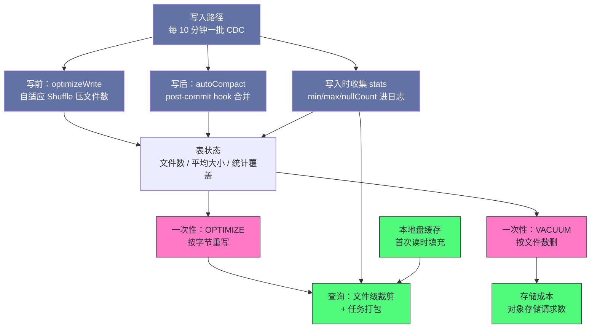
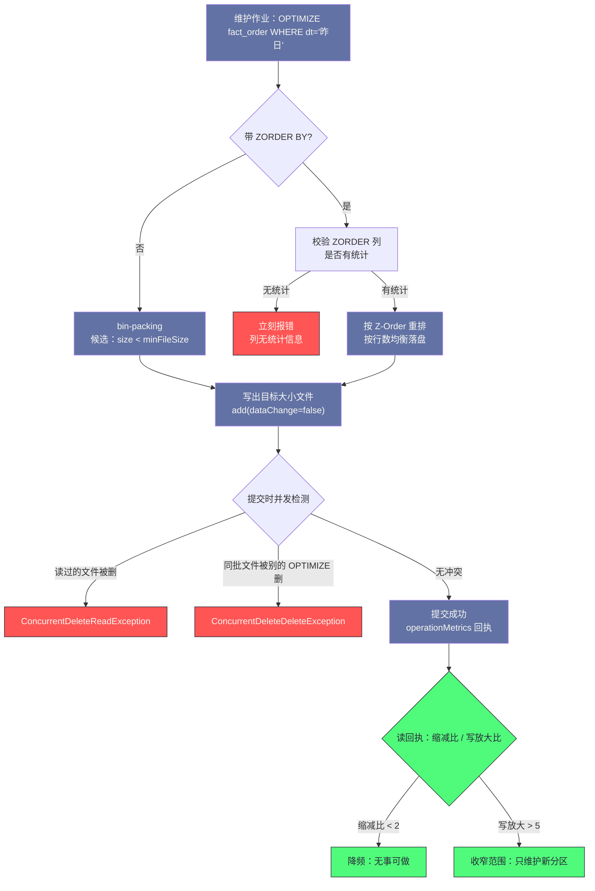
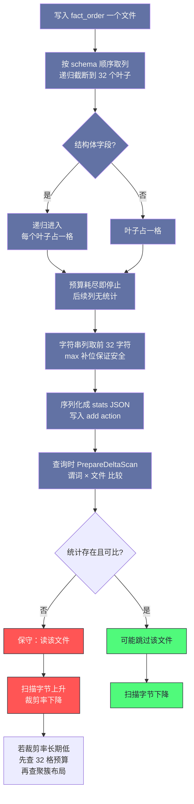
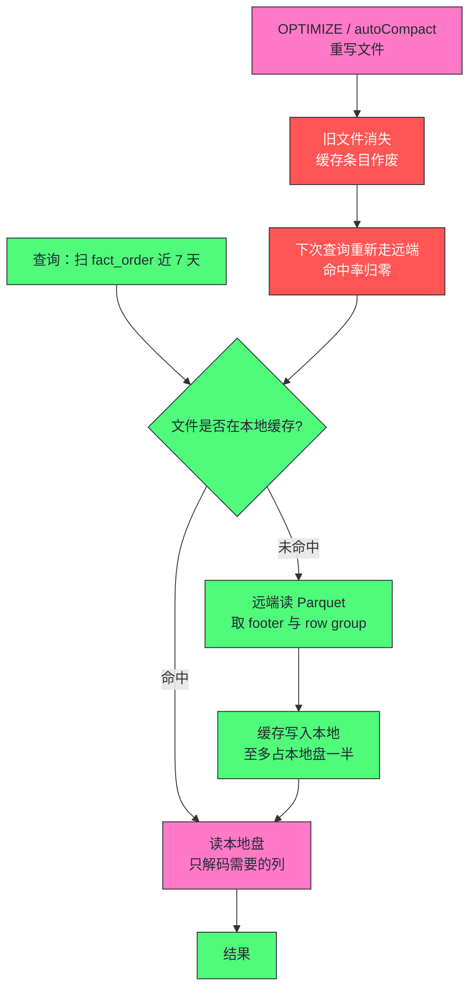

# 10 性能调优：小文件合并、缓存与统计信息维护

**摘要：**

维护工作最容易踩的坑不是不会用命令，而是不知道这些命令各自在替谁付账。`OPTIMIZE` 一次重写要按表大小的比例付钱，`optimizeWrite` 把代价摊进每一次写入，统计信息把代价摊进每一次读取，缓存则把代价提前押在本地盘上、等着被重复读命中。四种动作的付费方式不同，触发判据也不同，混在一起谈，就会得出"每天全表跑一遍 `OPTIMIZE` 更保险"这类结论。

本文只回答一个问题：什么时候该维护，维护的代价具体是多少。先把文件、统计、缓存三本账分开记，再把小文件的开销拆成请求、footer、元数据、任务调度四段，用 Spark 自己的 `openCostInBytes` 口径算出"1 MiB 的文件被当成 5 MiB 用"的放大；接着比较 `OPTIMIZE` 的装箱与排序两种代价模型，把 Auto Compaction、Optimized Write、Delta Cache 三样东西的归属逐条核实——前两者在 Delta Lake 3.1.0 起进入 OSS 文档，Delta Cache 则是 Databricks 的专有磁盘缓存，官方已把它改名以免被误当成协议的一部分；最后把统计信息拆成文件级与表级两套账，说明 `delta.dataSkippingNumIndexedCols` 的 32 格预算怎么被嵌套字段吃掉，以及 OSS 上 `ANALYZE TABLE` 为何对 Delta 表根本不可用。

**关键词（Keywords）**: OPTIMIZE, bin-packing, Z-Order, Auto Compaction, Optimized Write, Delta Cache, dataSkippingNumIndexedCols, ANALYZE TABLE, VACUUM, 维护节奏

---

## 第 1 章 三本账：维护动作在替谁付钱

### 1.1 一次越维护越慢的现场

有一类工单很难判断对错。某张按天分区的订单事实表，上线三个月后日报越来越慢，团队判断是小文件太多，于是加了一个每天凌晨的全表 `OPTIMIZE`。第一周确实有效，日报从四分半降到两分多；第二周开始成本账单涨了四成，日报时间却停在两分半不动；第三个月，`OPTIMIZE` 作业本身开始超时，凌晨的窗口装不下它。

复盘时把数字摊开才发现问题不在命令写错，而在三件事被混成了一件事：这张表当天新增的数据只有几十 GB，而全表有十几 TB；每天跑的不是"合并新数据"，而是"把整表的文件清单读一遍、把每个文件的统计信息算一遍、把仍然偏小的文件重写一遍"；至于日报慢，真正的原因可能是三个月前的分区没有按查询列聚簇，与文件大小关系不大。

同一批症状可以指向三种完全不同的病因，而三种病因对应三种付费方式不同的药。分不清账，就只能靠试，试出来的结果又会因为集群负载、数据分布变化而无法复现。

### 1.2 三种付费方式

Delta 的维护动作按"钱付在什么时刻"可以分成三类，这个分类比按命令名分类有用得多。

第一类是**一次性重写**：`OPTIMIZE`、`VACUUM`、以及 `REORG TABLE ... APPLY (PURGE)` 属于这一类。它们的代价集中在一段时间里，与要处理的规模成正比（`OPTIMIZE` 按字节，`VACUUM` 按文件数），跑完就结束，不会影响第二天的写入延迟。判断这类动作划不划算，看的是"这次重写换回来的查询收益，能不能在下次数据变更把它冲掉之前收回成本"。

第二类是**摊销到每次写入**：`delta.autoOptimize.optimizeWrite` 与 `delta.autoOptimize.autoCompact` 属于这一类。前者在写之前加一次自适应 Shuffle，把输出文件的个数压到与数据量匹配；后者在提交成功之后起一个 post-commit hook，把刚刚写进来的小文件与同分区里的小文件一起合并。代价是每次写入都多花一点，收益是从源头上不产生碎片。

第三类是**摊销到每次读取**：文件级统计信息与缓存属于这一类。统计信息在写入时顺手算好、存进事务日志，读取时被用来跳过文件；缓存在第一次读时把文件搬进本地盘，后续读取直接命中。它们的成本不在维护窗口里，而在写路径的元数据体积、以及本地盘的容量占用上。

把三类摆在一张图上，各自的着力点就很清楚了：



图里那条从"表状态"分出两条一次性动作的支路，是后面几章要反复回到的地方：`OPTIMIZE` 与 `VACUUM` 的代价口径完全不同，一个按字节，一个按文件数，把它们塞进同一个凌晨窗口并按同样的频率跑，是维护脚本里最常见的错配。

### 1.3 贯穿案例与数字口径

笔者把后面所有推算都压在同一张表上。`fact_order` 是一张电商订单事实表，按 `dt`（天）分区，全表约 15 TB、300 个分区，单分区平均 50 GB；写入侧有两条路，一条是 CDC 每 10 分钟一批、每批约 300 MB 的 `MERGE`，另一条是每天一次的历史回灌，单批 20 GB 左右的 `INSERT`；查询侧有三类，日报（扫整分区、按品类与渠道聚合）、订单号点查（等值谓词）、商家维表关联（按 `merchant_id` 过滤后与几十万行的维表 join）。

它承载的集群是一套 40 节点的 Spark on YARN，每节点 16 核，按 128 MiB 的分区读取粒度算，一个 50 GB 的分区大约需要 400 个读取任务。这个规模的好处是数字不夸张：小文件的代价看得见，但还没到把 driver 直接压垮的程度。

本文出现的所有数字分两类：一类是配置缺省值、协议字段、命令输出，这类以 Delta Lake 4.x 源码与官方文档为准，可直接引用；另一类是"示例推算"，用来展示量级关系，假设条件写在算式旁边，不代表任何厂商的承诺值。

### 1.4 判据先于工具

维护脚本里最贵的不是命令，是频率。频率定错的根源通常是把"我看到了小文件"当成了判据，而小文件本身不是问题，由小文件引起的放大才是问题。判据应当从三个可以直接测的量里取：

一是文件数除以分区字节数得到的平均文件大小，这个量决定打包效率与元数据体积；二是查询里被跳过的文件比例，这个量决定统计信息与聚簇布局是否值得继续投入；三是重写字节除以新增字节得到的写放大比，这个量决定 `OPTIMIZE` 的频率上限。

三个量各自能测、能对比、能设阈值，且都落在 `DESCRIBE DETAIL` 与 `DESCRIBE HISTORY` 的输出范围里。第 7 章会把它们整理成一张信号到动作的对照表，但在此之前，先把每个动作的代价算清楚，否则阈值只是拍脑袋。

---

## 第 2 章 小文件：把"每文件多少钱"算出来

### 2.1 四种产生路径

小文件在 Delta 上有四种稳定的产生路径，前两种来自写入结构，后两种来自提交结构。

第一种是微批结构。Structured Streaming 每触发一次就是一个提交，一次提交至少落一个文件，文件大小由这一批的数据量决定。CDC 每 10 分钟一批、每批 300 MB，若这次写入的 Shuffle 分区数是 200，落盘就是 200 个 1.5 MB 的文件；一天的 144 批就是 28800 个文件。这条路径的原因在结构本身：一次触发就是一个提交，提交的粒度直接变成了文件的粒度，于是文件数由提交次数决定，而不由数据量决定。

第二种是写前不收敛的批写。`INSERT` 或 `MERGE` 的输出分区数默认跟着 `spark.sql.shuffle.partitions` 走，这个值常常是上一个时代留下的 200 或 1000，而单批数据可能只有 20 MB，于是 20 MB 被切成 200 份。写前重分区能把这条路径掐掉，代价是写入时多一次 Shuffle。

第三种是过度分区。按 `dt + hour + region` 三层分区，会把一个分区切到只剩几 MB，此时无论怎么写都是小文件。分区裁剪的收益在查询谓词能命中分区列时才成立，而三层分区里的 `region` 通常并不出现在日报的过滤条件里，它只是把数据切碎了。

第四种是 CoW 的必然结果。`MERGE`、`UPDATE`、`DELETE` 走写时复制（[[大数据/数据湖/Delta-Lake-Lakehouse架构深度解析/04 DML 操作深度解析：MERGE、UPDATE 与 DELETE 的实现机制|MERGE 与删除的实现]]），命中一个文件就要重写整个文件；当更新稀疏到"改 100 行、重写 500 MB"，被重写的文件本身不算小，但当更新密集到"每个文件都被改一点"，重写产生的新文件会迅速碎片化。删除向量可以把这条路径上的重写省掉，但那是另一个话题。

### 2.2 四段开销里只有一段与字节数有关

一个 1.5 MB 的文件和一个 1 GiB 的文件，在存储成本上差的是字节数，在读取成本上差的是四段与字节数无关的固定开销。把这四段拆开看，量化才有落点。

第一段是**打开**。读一个 Parquet 文件必须先拿 footer，对象存储上这是一到两次尾部 range 请求：先取尾部 8 字节拿到 footer 长度，再按长度取 footer 本身。这段开销与文件大小基本无关，与请求的往返延迟强相关，几十毫秒量级。

第二段是**元数据**。Delta 为每个文件在[[大数据/数据湖/Delta-Lake-Lakehouse架构深度解析/02 事务日志 Delta Log：ACID 保证的基石|事务日志]]里留一条 `add` action，其中 `stats` 字段是一段 JSON，装着 `numRecords`、`minValues`、`maxValues`、`nullCount`。文件越多，这段 JSON 越多，它要进 JSON 提交文件，也要进 checkpoint 的 Parquet 列，读取快照时还要被反序列化成对象。

第三段是**规划**。查询开始时，`PrepareDeltaScan` 要拿谓词逐个文件比一遍统计信息，这个过程的时间复杂度是文件数乘谓词数。

第四段是**任务调度**。文件列表要打包成任务，任务要调度到 executor，每个任务的启动、序列化、结果回收都有一份固定成本。

四段里只有两处与文件内容有关：一是 footer 的大小（随列数增长），二是 `stats` 的宽度（同样随列数增长）；其余全是纯固定成本。这正是"把 28800 个文件合成 45 个"能立刻看到收益的原因：省掉的不是字节，是固定成本乘了 28800 次。

| 开销段 | 与文件大小的关系 | 与文件数的关系 | 主要成本项 | 可压缩手段 |
|---|---|---|---|---|
| 打开（footer 与 range 请求） | 弱相关 | 线性 | 对象存储请求数、往返延迟 | 合并文件、本地缓存 |
| 元数据（add action 与 stats） | 弱相关（随列数） | 线性 | 日志体积、checkpoint 体积、driver 堆 | 减少文件数、缩短 stats |
| 规划（谓词对统计） | 无关 | 线性 | driver CPU | 减少文件数、减少谓词列 |
| 任务调度 | 无关 | 线性 | 调度与序列化开销 | 减少文件数、提高打包上限 |

这张表里最反直觉的一行是"元数据"：它与文件大小无关，只与文件数有关。也就是说，把 10000 个 1 MB 的文件合成 100 个 100 MB 的文件，数据一个字节没少，日志里的 `add` action 从一万条变成一百条，checkpoint 的统计列跟着缩两个数量级。

### 2.3 Spark 自己给了一个单文件成本模型

不必自己编造"打开一个文件等于多少毫秒"，Spark 的读取规划里本来就有这个参数：`spark.sql.files.openCostInBytes`，缺省 4 MiB。它的定义写得很直白——打开一个文件的估计成本，折算成"在同样时间里能扫多少字节"，用于把多个文件打包进同一个分区。

这条口径可以直接拿来做放大倍数的估算。假设一批数据被写成 1 MiB 的小文件，Spark 规划时给每个文件记的账是 `1 MiB + 4 MiB = 5 MiB`，于是 128 MiB 的 `maxPartitionBytes` 预算下，一个分区只能装 25 个这样的文件、覆盖 25 MiB 实际数据。换成 128 MiB 的大文件，一个分区装一个，覆盖 128 MiB。同一个 128 MiB 的读取预算，小文件版本只用到五分之一的有效载荷。

把它套到贯穿案例上。一个 50 GB 的分区，若被写成 28800 个平均 1.5 MB 的文件，规划期的记账字节是 `28800 × (1.5 + 4) MiB ≈ 158 GB`，按 128 MiB 一个分区，约 1238 个读取任务；同一份数据写成 45 个 1.1 GB 的文件，记账字节 50 GB，约 400 个任务。任务数从 400 涨到 1238 是 3 倍，而真正被扫的字节几乎没变——多出来的三分之二任务，全都在处理固定开销。这是示例推算，换一组参数结论方向不变，倍数会变。

打包还有一个反向的边界值得记住：`openCostInBytes` 设得越大，Spark 越倾向于把更多文件塞进同一个任务。在文件很多、单个文件又极小的场景里，把它调大能减少任务数，但会让每个任务里的文件打开次数变多、任务粒度变粗，倾斜时更难切分。它是缓解手段，不是治理手段。

### 2.4 规划期的 O(文件数)

"查询变慢"这个现象在小文件场景里有三种完全不同的落点，区分它们要看时间花在哪一段。

第一处是快照构造。读取 Delta 表的第一步是拿到快照：列 `_delta_log` 目录，从最近的 checkpoint 开始，读 checkpoint 的 Parquet，再回放 checkpoint 之后的 JSON 提交。checkpoint 里每个 `add` 一行，包含路径、大小、分区值、`stats`。文件数一百万时，这个 checkpoint 就是一百万行，driver 要把它读进内存并构造出一百万个 `AddFile` 对象。

第二处是文件清单到任务的转换。快照给出文件列表后，还要按分区列与谓词过滤、按大小打包、生成任务描述、序列化后发到 executor。这一段的成本同样与文件数线性相关。

第三处是每条 `add` 里的 `stats` 的反序列化。这一段的实际成本取决于统计列有多少：一个 20 列的表，`minValues` 与 `maxValues` 各 20 个键，`nullCount` 20 个键，加上路径与分区值，一条 `add` 序列化后几百字节到一两 KB。二十万条就是几百 MB 的文本。

给一个示例推算，把量级感立起来。设单条 `add` 的 JSON 约 1.2 KB（20 列、其中 8 个字符串列按 32 字符截断），28,800 个文件的分区就是约 34 MB 的日志文本；全表 300 个分区、8.6 million 个文件，就是约 10 GB 的原始 JSON。这些内容进 checkpoint 后是 Parquet 列存加压缩，落盘体积会小一个数量级，但读进 driver 内存并转成对象后的体积不会因为压缩而变小。这正是"文件数上到千万级时，读取还没开始扫数据就先被元数据拖住"的机制解释。

一个可以立刻做的验证：对同一张表，分别执行 `DESCRIBE DETAIL` 与一次 `count()`，在 Spark UI 的 SQL 页看 Query Plan 里扫描节点的 `number of files` 与提交阶段耗时；把 `count()` 的时间与真正扫字节的作业对比，两者的差值就是规划与元数据的成本。这个差值在文件数翻十倍时会近似翻十倍，而扫描时间不会。

### 2.5 目标文件大小这条滑尺

目标大小不是一个"越大越好"的参数，它在两个方向上都有代价。`OPTIMIZE` 的输出目标由配置决定：OSS 侧是 `spark.databricks.delta.optimize.maxFileSize`，缺省 1024 MiB；候选文件的筛选阈值是 `spark.databricks.delta.optimize.minFileSize`，同样缺省 1024 MiB。这两个缺省值的含义是"小于 1 GiB 的文件才值得合并，合并到 1 GiB 左右"。

这里有一个容易忽略的归属差异。检索 Databricks 的表属性文档，会看到 `delta.targetFileSize` 这个表属性，默认值为空，设置后 `OPTIMIZE`、liquid clustering、auto compaction、optimized writes 都会尽力按它产出文件；但在 OSS 的表属性参考与 4.x 源码的配置表里，找不到 `targetFileSize` 这个键，OSS 侧的目标尺寸只能通过会话配置设定。

这是 Databricks 平台能力，不是 OSS 协议的一部分。这个差别在运维上很实际：在 Databricks 上可以把目标大小写进表属性、跟着表走；在 OSS 上，目标大小只存在于跑维护作业的那个 SparkSession 里，一旦有人换了作业模板、忘了带这个配置，`OPTIMIZE` 就退回 1 GiB 缺省，输出文件立刻变大，而表属性里看不出任何异常。

目标大小怎么选，取决于这张表被谁读、怎么读。把四种典型读法摆在一起：

| 目标文件大小 | 适合的读法 | 代价 | 不适用的场景 |
|---|---|---|---|
| 128–256 MB | 点查、按分区的小范围扫描、频繁 `MERGE` | 文件数多，元数据与任务开销上升 | 全表大扫描、文件数已上百万 |
| 512 MB | 报表类扫描与点查混合、按分区回灌 | 需要与 `minFileSize` 一起调，否则反复重写 | 单分区数据量小于目标大小 |
| 1 GiB（缺省） | 大分区、以整分区扫描为主、写入批量大 | 单任务读得久，部分更新要重写 1 GiB | 每批只写几十 MB 的高频 CDC |
| 2 GiB 以上 | 冷数据归档、只做全扫描 | 并行度低、单文件损坏影响面大 | 任何需要局部更新的表 |

滑尺的另一端是 `minFileSize`，它决定"什么样的文件会被选中重写"。两个参数的关系必须满足 `minFileSize < maxFileSize`，否则会产生一个很隐蔽的循环：把 `maxFileSize` 调到 256 MB，却忘了 `minFileSize` 还是 1 GiB，那么每次 `OPTIMIZE` 产出的 256 MB 文件在下一轮又全部低于 1 GiB 门槛，于是每一轮都被重新选中、重新重写。幂等性在这个配置组合下被悄悄破坏，作业看起来成功了，写放大却永久性地翻倍。这不是 OSS 独有的问题，Fabric 侧专门引入了文件级目标标记来避免"目标尺寸变化导致已合并文件被再次合并"，也说明这个坑确实存在。

### 2.6 反例：把文件调到 1 GB 为什么更慢

"文件越大越好"的直觉在两种场景下会立刻失效。

第一种是小批写入。CDC 每批 300 MB，如果目标大小是 1 GiB，那么每一批都远小于目标，`OPTIMIZE` 永远觉得需要合并，`autoCompact` 的 128 MiB 目标也会一直触发。合并的结果是每天几十次重写，而重写之后紧接着下一批写入又把文件打开、又产生新文件。此时文件"变大"的收益在打包上，代价却全部落在写路径上。

第二种是部分更新。CoW 模式下改一个文件就要重写整个文件，1 GiB 的文件意味着改 100 行要重写 1 GiB。如果这张表每天有几千次 `MERGE`，1 GiB 的目标会让写入成本按文件大小线性上升。这类表正确的方向是缩小文件、或者改用删除向量，而不是把文件合并到更大。

所以目标大小从来不是孤立参数，它与"写入的最小批量"和"更新的命中密度"三者要一起定。一个可用的经验式子是：目标大小应该落在"单次写入量"的 **4 到 20 倍**之间，低于 4 倍时合并收益抵不过重写开销，高于 20 倍时单文件重写在更新场景下会变成主要成本。这个区间是经验值，不是定理，但它解释了为什么流式写入的中间表普遍用 128 到 256 MB，而日批回灌的事实表用 512 MB 到 1 GiB。

---

## 第 3 章 `OPTIMIZE`：装箱与排序是两种代价

### 3.1 装箱只按大小，不碰顺序

`OPTIMIZE` 不带 `ZORDER BY` 时做的是 **bin-packing**，也就是按文件大小装箱：先把候选文件按大小排序，从大到小依次放进"箱子"，每个箱子装到接近目标大小就封箱，再写成一批新文件。整个过程不改变行内顺序，也不跨分区搬运数据。

bin-packing 有三个性质值得记住。它是**幂等**的，同一份数据跑两遍，第二遍没有效果，因为第一遍的输出已经接近目标大小、不再低于 `minFileSize` 门槛。它不减少数据量，只是把同样多的字节重新打包，因此 `OPTIMIZE` 的输出结果前后一致，读到一半的查询不会被打断。它是按文件粒度工作的，一个 900 MB 的文件在 1 GiB 目标下不会被拆开重写，哪怕它与旁边的文件加起来正好能凑成两个整箱。

候选集由 `minFileSize` 决定。缺省 1 GiB 意味着：一张刚做完 `OPTIMIZE` 的表，下一轮几乎不会被再次选中，除非又有新写入产生小文件。这个"只在有碎片时才动手"的设计，是 bin-packing 能每天跑的前提；一旦 `minFileSize` 被调错，前提就没了，第 2.5 节已经推过后果。

### 3.2 排序要按行数均衡，且不幂等

带 `ZORDER BY` 的 `OPTIMIZE` 是另一套算法（[[大数据/数据湖/Delta-Lake-Lakehouse架构深度解析/07 Z-Order 与数据跳过：查询加速的核心机制|Z-Order 与数据跳过]]），它先把候选文件里的行按 Z-Order 曲线重新分布，再按目标大小落盘。官方文档对这个行为的描述有两条关键限定：Z-Ordering **不幂等**，每跑一次都会尝试对分区内所有文件重新聚类；Z-Ordering 追求的是**每文件行数均衡**，而不是每文件字节均衡。

不幂等这一点决定了 Z-Order 不能进日常维护窗口。它每跑一次就重写整个分区，50 GB 的分区每天跑一次，就是每天 50 GB 的读加 50 GB 的写，无论当天新增了多少数据。字节均衡与行数均衡的差异则会在倾斜时显形：如果最近的行比历史行宽得多（字符串更长、数组更多），按行数均衡产出的文件大小会参差不齐，`OPTIMIZE` 自己的任务时长会跟着倾斜。

Z-Order 还有一个前置条件容易被忽略：Z-Order 的列必须有统计信息。`OPTIMIZE ... ZORDER BY` 在执行前会检查这些列是否落在统计 schema 里，缺失时直接抛错，而不是静默地退化成一次普通装箱。相关报错的语境是"这些列没有收集统计，Z-Order 不会有效果"，第 5 章会解释统计列是怎么被裁掉的、以及为什么这个错误其实是在帮忙。

### 3.3 提交语义：`dataChange=false` 与并发

`OPTIMIZE` 在提交时把被替换的文件写成 `remove`、把新文件写成 `add`，两者都带 `dataChange = false`。这个标记有两个直接后果：变更数据流（CDF）不会因为 `OPTIMIZE` 而产生记录，读者也不会把它当成一次数据变更；同时，它与纯追加的并发写入不冲突，因为追加事务只关心"我写的新文件有没有被别人删掉"。

它与删改类操作的关系就没那么宽松了。`OPTIMIZE` 会读取候选文件，如果这期间有并发的 `DELETE` 删掉了它读过的文件，提交时的冲突检测会发现"赢家删了我读的文件"，抛出 `ConcurrentDeleteReadException`；如果两个 `OPTIMIZE` 同时命中同一批文件、都要删同一批旧文件，第二个提交会撞上 `ConcurrentDeleteDeleteException`。这两类冲突都不是数据错误，重试即可，但它们解释了为什么维护作业要避开业务写入高峰，而不是"反正 Delta 支持并发"。

| 并发组合 | 冲突结果 | 处置 |
|---|---|---|
| `OPTIMIZE` 与纯追加 `INSERT` | 不冲突 | 无需处理 |
| `OPTIMIZE` 与命中同一文件的 `DELETE`/`UPDATE` | `ConcurrentDeleteReadException` | 重试或错峰 |
| 两个 `OPTIMIZE` 命中同一批文件 | `ConcurrentDeleteDeleteException` | 加互斥、按分区切片 |
| `OPTIMIZE` 与流式读取 | 不影响流，快照隔离 | 注意文件保留期 |

### 3.4 代价折算：写放大比

把 `OPTIMIZE` 的收益说清楚，只需要一个比值和一个除法。设一次 `OPTIMIZE` 重写了 R 字节，被重写的数据覆盖了分区里的 F 个文件，重写后变成 N 个文件，那么：

**写放大比** = R ÷ 当天新增字节；元数据缩减比 = F ÷ N。

前一个比值决定"这次维护值不值"，后一个决定"下次查询能省多少固定开销"。以贯穿案例的日分区为例：单分区 50 GB、当天新增 45 GB（回灌 20 GB 加 CDC 25 GB），若当天产生 28800 个小文件，`OPTIMIZE` 重写 50 GB、输出约 45 个文件，写放大比约 1.1，元数据缩减比 640。这种情况下维护是划算的：多写一遍 50 GB，换来六百多倍的文件数缩减。

反过来，如果这张表已经做过一次 `OPTIMIZE`、当天只新增 2 GB，此时全表跑一遍的写放大比是 `15 TB / 2 GB ≈ 7500`；即便大部分分区因为文件够大而被跳过、真正重写的字节远小于这个数，光是把 15 TB 的文件清单读一遍、把统计信息比一遍，就要付出与文件数成正比的规划成本。这就是"每天全表 `OPTIMIZE`"真正的代价所在：不是每天重写 15 TB，而是每天为 15 TB 的元数据付一次账，并且在配置错位时把重写也搭进去。

### 3.5 读回执：`DESCRIBE HISTORY` 里的 OPTIMIZE 指标

判断一次 `OPTIMIZE` 有没有白干，不必猜，历史里有回执。`DESCRIBE HISTORY` 的 `operationMetrics` 对 `OPTIMIZE` 提供了这几个键：`numAddedFiles`、`numRemovedFiles`、`numAddedBytes`、`numRemovedBytes`、`minFileSize`、`p25FileSize`、`p50FileSize`、`p75FileSize`、`maxFileSize`。

这组指标能回答三个问题。`numRemovedFiles ÷ numAddedFiles` 给出文件数缩减比，若接近 1，说明这次基本没合并到东西，多半是候选集选错了或 `minFileSize` 太低。`numAddedBytes ÷ numRemovedBytes` 给出体积变化，若大于 1 且明显偏大，说明重写引入了额外开销（压缩率变化、列顺序变化都可能造成）。`p50FileSize` 与 `maxFileSize` 的对比给出产出是否均匀，若 `maxFileSize` 远大于 `p50FileSize`，说明分区内数据量不均衡，Z-Order 的行数均衡假设不成立。

```sql
-- 看最近一次 OPTIMIZE 的收支
DESCRIBE HISTORY fact_order LIMIT 5;

-- 只看 OPTIMIZE 类型，把 operationMetrics 摊开对比
SELECT version, timestamp,
       operationMetrics['numAddedFiles']   AS added_files,
       operationMetrics['numRemovedFiles'] AS removed_files,
       operationMetrics['numAddedBytes']   AS added_bytes,
       operationMetrics['numRemovedBytes'] AS removed_bytes,
       operationMetrics['p50FileSize']     AS p50_size
FROM (DESCRIBE HISTORY fact_order)
WHERE operation = 'OPTIMIZE'
ORDER BY version DESC
LIMIT 20;
```

把这张表按天拉出来，写放大比与文件数缩减比就是一条趋势线。趋势线比任何经验阈值都好用：当缩减比连续几天低于 2，说明日常维护已经无事可做，频率该降；当写放大比连续几天高于 5，说明候选集选得太多，该把维护范围收窄到当天分区。

### 3.6 失败形态与三种立刻报错

`OPTIMIZE` 的失败大多不是运行时异常，而是语义不满足，报错来得早而且明确。

第一种是谓词不合法。`OPTIMIZE ... WHERE` 的谓词必须是分区谓词，写 `WHERE amount > 100` 会被拒绝，因为非分区谓词无法用来缩小候选集，命令不愿意做一次全表扫描再合并。这条限制把 `OPTIMIZE` 的适用面框在"按分区治理"上，跨分区的碎片只能分多次跑。

第二种是 ZORDER 列没有统计，报错为"这些列没有统计信息"，第 3.2 节已提过。它的实际含义是：即便命令硬跑，产出也不会有裁剪收益，所以宁可拒绝。

第三种是并发冲突，第 3.3 节的两种异常。这类失败的正确处置是重试与错峰，而不是把隔离级别调低。

还有一类不报错但很贵的形态：并行度过高。`spark.databricks.delta.optimize.maxThreads` 缺省 15，控制一次 `OPTIMIZE` 里能同时跑多少个重写作业；把它调大能让 `OPTIMIZE` 更快结束，代价是 driver 侧同时管理的作业数上升。维护窗口里为了赶时间把它调到几十，常见的结果是 driver 的作业调度成为瓶颈，整体时间不降反升。把这一章涉及的分支连起来画一遍，从候选筛选到提交冲突的路径就完整了：



图中最后两个出口是维护频率的调节器：缩减比低说明可以降频，写放大高说明范围太宽。这两个信号比固定的"每天一次"要可靠，因为它们直接来自上一步的真实收支。

---

## 第 4 章 写入路径上的两次机会：归属先分清

### 4.1 两个作用点

`OPTIMIZE` 是事后治理，写入路径上还有两次机会，作用点不同。

第一次在写之前：优化写入（Optimized Write）在落盘前加一次自适应 Shuffle，按目标大小把输出重分成若干桶，让每次写入产出的文件数与数据量匹配。它治的是"写入时不该产生的小文件"。

第二次在写之后：自动合并（Auto Compaction）在提交成功之后起一个钩子，把这次写入涉及的分区里的小文件合并一遍。它治的是"已经产生、但还来得及合并的小文件"。

两次机会的差别不只是时机，还有对写入延迟的影响方式：写前优化增加的是这一次写入的 Shuffle 与延迟，写后合并增加的是这一次作业的总时长。两者都会让写入变慢，区别在于前者把数据重新分布、后者把文件重新打包。

### 4.2 归属核实：OSS 里到底有什么

这一节的内容必须逐条核实，因为围绕这两个特性的错误说法流传得特别广。以 OSS 官方优化文档与 4.x 源码为准：

Auto Compaction 从 Delta Lake 3.1.0 起进入 OSS，文档写明它在写入成功之后触发、在执行写入的那个集群上同步运行。源码里对应的是一个 `PostCommitHook`，表属性是 `delta.autoOptimize.autoCompact`，会话配置是 `spark.databricks.delta.autoCompact.enabled`。缺省值全部来自源码：目标文件大小 128 MiB、触发所需最少小文件数 50、小文件阈值默认为目标大小的一半（64 MiB）、只处理本次事务修改过的分区、单次最多处理 128 个修改分区，还有一个"没有足够小文件就提前跳过"的短路开关。

Optimized Write 同样从 3.1.0 起进入 OSS，缺省关闭，可用表属性、会话配置、DataFrameWriter 选项三处开启，优先级从低到高。它的微调参数也在源码里：`optimizeWrite.binSize` 缺省 512 MiB，控制每个输出文件的目标内存体积；`maxShufflePartitions` 缺省 2000，控制输出桶数上限；`numShuffleBlocks` 缺省 5000 万，控制 Shuffle 块数量的目标。

这里有两个数字需要分开记：自动合并的缺省目标是 128 MiB，优化写入的缺省 bin 是 512 MiB。前者决定 `autoCompact` 产出的文件大小，后者决定 `optimizeWrite` 的装箱粒度，两个数字不同源，混用会让产出大小不符合预期。文档里"用 128 MB 作为目标文件大小"那句，说的是自动合并，不是优化写入。

还有一个前缀问题需要澄清。这两个特性的配置键都带 `spark.databricks.delta.` 前缀，看起来像平台专属，但在 OSS 里同样生效。Delta 源码里另有一处类似情况：字符串统计前缀长度的配置写作 `spark.databricks.io.skipping.stringPrefixLength`，源码注释专门解释了为什么 OSS 也要沿用这个前缀——因为 Databricks 的实现已经用了它，让 OSS 用户为同一个数据跳过参数维护两个不同的键没有好处。**前缀是历史命名**，不是归属标记，判断一个特性属不属于 OSS，要看文档与配置是否在开源仓库里，而不是看键名。

### 4.3 Databricks 侧的额外规则

平台侧在这个基础上又叠了一层自己的策略，这部分必须与 OSS 分开说。

在 Databricks Runtime 上，`MERGE`、`UPDATE`、`DELETE` 的自动合并与优化写入是强制开启的，无法关闭；`CTAS` 与 `INSERT` 在 SQL 仓库上同样开启，13.3 LTS 以上对 Unity Catalog 里的分区表默认开启。表属性接受的不只是 `true` 与 `false`，还有 `auto` 这个取值，让平台按表大小自动调目标文件大小；自动合并的行为也会出现在表历史里，表现为一次 `OPTIMIZE` 且 `operationParameters.auto` 为 `true`，手动执行的 `OPTIMIZE` 则是 `false`。

平台的自动调参有一张公开的对照表，可以直接引用它的量级：表小于 2.56 TB 时目标 256 MB；2.56 TB 到 10 TB 之间从 256 MB 线性长到 1 GB；超过 10 TB 固定 1 GB。同一份文档还给了按表大小推算的文件数示例：10 GB 表约 40 个文件，1 TB 表约 4096 个，100 TB 表约 114437 个。

这些都是 **Databricks 平台能力**，不是 OSS 协议的一部分。它们依赖 Unity Catalog 与平台侧的元数据服务，OSS 上既没有 `auto` 取值，也没有自动调参，更没有 predictive optimization 那种在服务端异步跑维护的机制。在 OSS 上做同等效果，只能自己写调度：按表大小算出目标尺寸、写进维护作业的会话配置、按分区切片执行。

| 能力 | 归属 | OSS 缺省 | 触发方式 | 备注 |
|---|---|---|---|---|
| `OPTIMIZE`（装箱） | OSS，1.2.0 起 | 目标 1 GiB | 手动或外部调度 | 幂等 |
| `OPTIMIZE ... ZORDER BY` | OSS，2.0.0 起 | — | 手动或外部调度 | 不幂等，列需有统计 |
| Auto Compaction | OSS，3.1.0 起 | 关闭 | 表属性或会话配置 | post-commit hook，同步执行 |
| Optimized Write | OSS，3.1.0 起 | 关闭 | 表属性、会话、Writer 选项 | bin 512 MiB |
| 对 `MERGE`/`UPDATE`/`DELETE` 强制自动合并 | Databricks 平台 | 无此行为 | 平台内建，不可关 | 平台策略 |
| 表属性 `delta.targetFileSize` | Databricks 平台 | OSS 无此键 | 建表或改表属性 | OSS 用会话配置 |
| 自动调参（`auto` 取值） | Databricks 平台 | 无 | 平台按表大小 | 需 Unity Catalog |
| Predictive Optimization | Databricks 平台 | 无 | 平台服务端异步 | 托管表专属 |

这张表可以用来做一件事：把团队里流传的"Delta 会自动合并小文件"这句话拆成八行，逐一标注它说的是哪一行的行为。多数误解来自把第五到第八行（平台侧那几行）当成了第一行的属性。

### 4.4 自动合并治不好的三种情况

自动合并有明确的适用面，越过这个面就会失效，而且失效时没有报错。

第一种是跨分区碎片。自动合并只处理本次事务修改过的分区，历史分区里遗留的碎片它永远碰不到。上新表时先做一次全表 `OPTIMIZE` 把基线打平，之后靠自动合并维持，这是唯一合理的组合；指望自动合并去清理历史遗留，等于指望它处理它从来不看的分区。

第二种是需要排序的场景。自动合并只做装箱，不做排序；`ZORDER BY` 只能手动执行。如果查询的收益来自多维局部性（点查与多条件过滤），自动合并带来的只是文件数缩减，裁剪率不会改善。

第三种是写入批量远小于目标大小。每批 300 MB、目标 128 MiB 时，自动合并每次都能触发，但它合并出的文件在下一批写入后又要被重写一遍——因为 CoW 下 `MERGE` 会重写被命中的文件。此时真正的解法是把批间隔放大、或者改用能避免重写的机制，而不是继续调合并参数。两次机会的位置与代价画在一起，谁在写前、谁在写后一目了然：


图里"第二个提交"这一格是关键：自动合并不是原地修改，它要再走一次 Delta 的提交路径，因此它同样受并发检测约束，也同样会给这张表留下一个新的版本号。观察 `DESCRIBE HISTORY` 时会看到一次写入对应两条记录，一条是写入本身，一条是 `OPTIMIZE`（`auto=true`）。

---

## 第 5 章 统计信息：文件级与表级是两套账

### 5.1 协议里给统计留的位置

Delta 的 `add` action 有一个可选字段 `stats`，协议规定它装三类信息：全局的 `numRecords` 与 `tightBounds`，以及按列镜像数据 schema 的 `minValues`、`maxValues`、`nullCount`。列统计的结构跟着数据 schema 走：数据是 `a.b.c` 三层结构，`minValues` 里也就是 `a.b.c` 三层结构。这种"镜像"设计让读取端可以直接按列路径取统计，不需要额外的映射表。

`tightBounds` 这个标记在删除向量出现之后变得重要：当文件上有删除向量时，文件里的物理行有一部分已经不合法，`min/max` 可能覆盖了已被删掉的值，于是边界从"紧"变成"宽"。宽边界对裁剪仍然安全（它只会让跳过变保守），但对"这个文件的极值到底是多少"这类推断不再可靠。

统计信息是在写入时顺手算出来的，这一点决定了它的成本结构：不是一次单独的扫描作业，而是每次写入多算几个聚合。代价藏在 `stats` 的字节数里，而字节数由统计了多少列决定。

### 5.2 32 格预算怎么被花掉

`delta.dataSkippingNumIndexedCols` 缺省 32，含义是"按 schema 顺序，前 32 个列收集统计"，取值 `-1` 表示全部列。这条规则在源码里的实现是一个递归下降的截断函数：遇到结构体就递归进去，每个叶子字段消耗一格预算，直到预算用完，剩下的字段（包括被截断在中间的结构体的后续字段）统统没有统计。

这段实现解释了三件事。

第一，**按叶子计数**：一个 `merchant` 结构体里有 `id`、`name`、`level` 三个叶子，它自己就吃掉三格。一张表前面若排了几个宽结构体，32 格预算可能在第五个逻辑列就用完了，后面的业务列一个统计都没有。

第二，截断可以发生在结构体内部。预算在结构体中间耗尽时，前面的叶子有统计、后面的没有，于是同一个结构体里一部分字段能裁剪、一部分不能。这种"半覆盖"状态在排查时最容易被误判成"统计坏了"。

第三，改这个属性不会重算已有统计。它只是重新定义了表的统计 schema：对之后的写入与 `OPTIMIZE` 生效，对已经写好的文件，超出范围的那部分统计仍然躺在日志里，只是读取端会按新 schema 忽略它们。这条规则在官方表属性文档里有明确说明，也是"为什么我调大了列数、老数据还是没被裁剪"的答案。

与它并存的是一个名单式配置 `delta.dataSkippingStatsColumns`，优先级高于按序号截断。指定某个结构体名字时，它的所有叶子都会被收集；指定不存在的列会被忽略。名单式的适用场景很明确：业务关心的就那五六列，其余列（尤其是长文本）不值得为它们付出日志体积。

### 5.3 字符串截断的 32 字符与 max 的补位

字符串列的统计不能完整存，否则一个 UUID 或一段 JSON 就能把一条 `add` 撑到几 KB。Delta 的做法是只存前缀，长度由 `spark.databricks.io.skipping.stringPrefixLength` 控制，缺省 32，表属性 `delta.dataSkippingStringPrefixLength` 可以覆盖。

截断要保证"跳过判断仍然保守"，这里有一个细节值得看源码。`min` 侧直接取前缀即可——前缀小于等于原值，作为下界安全。`max` 侧不能直接取前缀，因为前缀小于原值，会让"某个值大于 max"的推断出错；实现的做法是在前缀末尾补一个尽可能大的字符作为 tie-breaker，并且在 UTF-8 编码序与 Unicode 码点序可能冲突时逐步延长前缀，直到补位是安全的。源码注释把这条约束写得很清楚：任何值都必须小于等于截断后的 max。

这个细节的实际含义是：字符串统计的 min 是下界、max 是上位界，两者都可能偏保守。当一个查询谓词落在前缀的边界上（例如 `order_no LIKE 'A1B2%'` 而文件里的值恰好共享前 32 个字符），裁剪会失效，文件被读进来后在文件内部再过滤。这不是缺陷，是截断换日志体积的必然代价。

### 5.4 `ANALYZE TABLE` 在 OSS 上的真实状态

这里笔者必须处理一个流传很广的说法：定期跑 `ANALYZE TABLE ... COMPUTE STATISTICS` 为 Delta 表收集 CBO 统计。这个说法在 OSS 上不成立，原因在协议层，不在命令层。

Delta 表在 Spark 里注册为数据源 V2 表。Spark 的 `ANALYZE TABLE` 对 V2 表长期没有打通，Delta 侧对应的实现尝试是 PR #840，它需要 Spark 先提供"让数据源报告文件集合"的接口，而 Spark 侧的 SPARK-39420（支持对 V2 表执行 `ANALYZE TABLE`）长时间停在未解决状态，配套的 PR 也关闭未合。开源仓库里有一条 2025 年 7 月的 issue（#4884），标题就是"错误信息推荐了一个不存在的命令：ANALYZE TABLE"，正文写得很直接：这个命令对 Delta 表并不存在。

Databricks 侧是另一套东西，而且不是一条命令而是两条：

`ANALYZE TABLE ... COMPUTE DELTA STATISTICS`（14.3 LTS 起）重算的是 Delta 日志里的文件级统计，也就是第 5.1 节那些 `min/max/nullCount`；文档明确说明指定 `DELTA` 关键字时不收集面向查询优化器的常规统计。它在两个场景下必须用：调整了 `delta.dataSkippingNumIndexedCols` 或 `dataSkippingStatsColumns` 之后要让老数据也带上新列的统计；某批文件的统计缺失或损坏需要重算。注意它不支持 `FOR COLUMNS`、`NOSCAN`、`PARTITION` 这些子句，报错类是 `ANALYZE_TABLE_DELTA_STATS_UNEXPECTED_TOKEN`。

`ANALYZE TABLE ... COMPUTE STATISTICS` 收集的是面向 CBO 的表级与列级统计，存在 catalog 里，用于估算行数、基数、选择 join 策略。它与文件级统计是两套完全不同的东西：前者服务"跳过哪些文件"，后者服务"用什么顺序和策略算"。

这两条命令都是 Databricks 平台能力。OSS 上既没有前者，也没有后者；想在 OSS 上给 Delta 表补文件级统计，只能靠重写文件（`OPTIMIZE` 会为新写的文件重算统计），而丢失统计的老文件除了重写没有别的补救办法。

顺带说清一个前提：即便在能用 `ANALYZE` 的环境里，CBO 也不是默认开着的。Spark 的 `spark.sql.cbo.enabled` 缺省 `false`，而在 4.x 的 `DeltaTableV2` 里找不到向优化器上报统计的实现，快照与文件集合之外没有暴露表级统计。所以在纯 OSS 的 Spark 上，Delta 表既不进 CBO 的账本，也不具备把表级统计写进 catalog 的通道，`ANALYZE` 这条路是断的。

| 维度 | 文件级统计（`add.stats`） | 表级统计（catalog） |
|---|---|---|
| 存放位置 | Delta 事务日志与 checkpoint | Hive Metastore / Unity Catalog |
| 收集时机 | 写入时自动算 | 显式执行 `ANALYZE` |
| 粒度 | 每文件每列 | 每表每列 |
| 服务对象 | 数据跳过（读时裁文件） | CBO（估行数、选 join） |
| OSS 可用性 | 内建 | 对 Delta 表不可用 |
| 重算途径 | `OPTIMIZE` 重写；Databricks 侧有 `COMPUTE DELTA STATISTICS` | 仅 Databricks 侧有 `COMPUTE STATISTICS` |
| 与 `dataSkippingNumIndexedCols` 的关系 | 直接受其控制 | 无关 |

### 5.5 反例：把统计列设成 0

`delta.dataSkippingNumIndexedCols = 0` 看起来是一笔很划算的买卖：日志里的 `stats` 变空，元数据体积下降，写入变快。确实如此，但省下的是日志里的几百字节，付掉的是整层文件裁剪。

代价链条是这样的。没有统计，`PrepareDeltaScan` 无法判断一个文件是否可能包含谓词命中的行，只能把所有文件都算进候选集；`ZORDER BY` 会直接报错，因为它的收益完全建立在统计之上；`OPTIMIZE` 照样能合并文件，但合并之后仍然无法裁剪；第 2.4 节里"规划期的 O(文件数)"这一段确实轻了（没有统计可比），但代价被整体转移到读取：每个文件都必须被打开，省下的规划时间远不够赔。

真正需要节省日志体积的场景，正确的做法是缩短统计的宽度而不是关掉它：把长文本列排到 32 格之外，或者用 `dataSkippingStatsColumns` 只保留业务真正用于过滤的那几列。统计信息的价值不在"有多少列"，而在"被谓词用到的那些列有没有"。一张 200 列的表，真正出现在 where 条件里的可能只有 6 列；把这 6 列排进预算，其余靠后，既省了体积也保住了裁剪。把这条链路画出来，预算是在哪一步被耗尽的就清楚了：



图里那个"保守：读该文件"的分支，是统计缺失时唯一安全的选择。它不会报错，只会让查询慢一点，慢到你把 32 格预算翻开为止——这类问题的排查难点正在于它没有任何异常信号。

---

## 第 6 章 缓存：先分清它属于谁

### 6.1 一个被名字误导的特性

"Delta Cache"这个名字误导过很多人。它听起来像是 Delta 协议的一部分，实际上它是 Databricks 平台在计算节点本地盘上做的透明缓存，缓存的是 Parquet 文件的解压后内容；Databricks 后来把它改名为磁盘缓存（disk cache），理由写在文档里：这个改名是为了消除"它属于 Delta Lake 协议"的误解。

所以归属很清楚：Delta Cache（磁盘缓存）是 **Databricks 的专有特性**，不是 OSS 协议的一部分。OSS 上没有任何配置项能打开它，也没有任何 API 能查它的命中率。

平台侧的行为细节可以引用官方文档：首次读取某个 Parquet 文件时自动在本地存储放一份拷贝，之后读同一批数据走本地；缓存最多占用本地 SSD 的一半空间；失效方式是 LRU 淘汰加文件变更失效——当数据文件被创建、删除、修改或覆盖时，缓存会自动更新，不需要手动让它失效；可调参数有 `spark.databricks.io.cache.maxDiskUsage`、`maxMetaDataCache`、`compression.enabled`，开关是 `spark.databricks.io.cache.enabled`。14.2 以上的 Runtime 与 SQL 仓库里，`CACHE SELECT` 命令被忽略，改用增强的缓存算法。

最后这一条值得单独看：文件变更是缓存失效的触发条件。这直接连着第 3 章和第 4 章——每一次 `OPTIMIZE`、每一次 `autoCompact` 合并，都会让被重写的那批文件的缓存失效。维护动作把文件重新打包，缓存层看到的是"一批文件消失、另一批出现"，之前的缓存条目全部作废。这就是"维护越勤、缓存越冷"的耦合，也是把 `OPTIMIZE` 排在查询高峰之前要谨慎的原因：你不仅花了重写的钱，还把预热好的缓存清掉了。

### 6.2 与 Spark cache 的差别

两者经常被混为一谈，但它们的缓存对象、存放位置、生命周期完全不同。

Spark 的 `cache()` 缓存的是逻辑执行结果：DataFrame 物化后的行，放在 JVM 堆里（`MEMORY_ONLY`）或堆加磁盘里（`MEMORY_AND_DISK`）。它的粒度是整个 DataFrame 的所有列，即使查询只要三列，缓存里也是全列；它的生命周期是 SparkSession，作业结束就没了；它需要显式调用，代码里没写就没有。

磁盘缓存缓存的是物理文件：Parquet 文件的解压内容，放在节点本地盘上。它的粒度是文件，读取时仍然只解码需要的列；它跨 Session、跨作业存活，只有 LRU 或文件变更才失效；它完全透明，代码里不需要任何改动。

| 维度 | 磁盘缓存（Databricks 专有） | Spark cache |
|---|---|---|
| 缓存对象 | Parquet 文件内容 | DataFrame 计算结果 |
| 存放位置 | 节点本地 SSD | JVM 堆或堆加磁盘 |
| 容量 | 本地盘的至多一半 | 受 executor 内存约束 |
| 粒度 | 文件，读取时仍做列裁剪 | 整份物化结果，列裁剪失效 |
| 生命周期 | 跨作业，LRU 或文件变更时失效 | 单个 SparkSession |
| 代码侵入 | 无 | 需显式 `cache()` 与 `unpersist()` |
| 失效触发 | 数据文件变更 | 手动 unpersist 或 Session 结束 |
| 适用数据 | 被重复读的原始文件 | 作业内复用的中间结果 |

把这张表和 6.1 节的失效规则连起来看，可以得出一条选型判断：重复读同一批原始文件、且这批文件在两次读之间没被重写，磁盘缓存的收益最大；作业内反复复用同一份中间结果、且这份结果比原始数据小得多，Spark cache 更合适。反过来，如果表每十分钟就 `MERGE` 一次，磁盘缓存刚热就被打冷，收益会被维护频率吃掉。

### 6.3 收益模型与预热

缓存的收益可以用一个很朴素的模型估：设一次查询要扫 B 字节，远端吞吐 v，本地盘吞吐 w（w 通常远大于 v），缓存命中率 h，那么扫描时间的近似值是 `(1-h) × B/v + h × B/w`。命中率每提高 10 个百分点，省下的是那部分字节的远端往返。

这个模型里唯一不好估的是 h。h 取决于三件事：这张表被重复读的比例、两次读之间文件是否被重写、以及节点本地盘能否装下工作集。第三件事经常被忽略——缓存最多占用本地盘的一半，集群节点换了小盘机型之后，命中率会突然下降而没有任何配置改动。

预热是可行的，但方式要注意。在 Databricks 上，预热就是主动读一遍热点分区（例如最近 7 天），让缓存填充；没有专门的预热命令，`CACHE SELECT` 在高版本已被忽略。在 OSS 上，这个概念不存在，能做的只有让操作系统页面缓存或分布式缓存层去承接。

### 6.4 OSS 上的三条替代路径

在没有磁盘缓存的 OSS 环境里，能接住"重复读同一批文件"这个需求的只有三条路。

第一条是操作系统页面缓存。它对单机重复读有一定效果，但不受 Spark 控制、无法统计命中率、也不会跨节点共享；同一个查询换个 executor 就可能全落到远端。

第二条是分布式缓存层，例如 Alluxio 一类把远端存储挂到计算节点上的方案。它把"读远端"变成"读本地或读邻居"，命中率高时可以显著减少远端请求；代价是多一层运维、多一份一致性配置，且数据更新后要处理缓存失效。

第三条是 Spark 的 `persist`。它的适用面最窄：数据量要能装进内存或本地磁盘、要在同一个作业里复用、且能接受列裁剪失效带来的额外解码。把它当成"OSS 的 Delta Cache"，多半会在内存上撞墙。

三条路都解决不了同一个问题：它们都不能像磁盘缓存那样对代码完全透明。这是平台能力与自建方案之间最实在的差距，不是性能数字上的差距。把命中与失效画在一起，能看出维护动作在哪一步把命中率清零：



图右侧那条"重写 → 作废 → 重新远端读"的回路，说明了缓存与维护在时间上必须协调：如果每天凌晨两点做 `OPTIMIZE`，那么把需要预热的重查询排在两点之后，比排在之前更划算。

---

## 第 7 章 节奏：把维护排进时间轴

### 7.1 三个输入决定频率

维护频率不是拍出来的，它由三个输入决定。

第一个输入是写入频率与批量。每 10 分钟一批的 CDC 与每天一批的回灌，碎片产生速度差两个数量级，前者需要写前优化来压碎片产生率，后者只需要每日一次 `OPTIMIZE` 收尾。

第二个输入是查询 SLO。查询慢多少才值得投入维护？如果一张表只在月末报表用一次，文件数多两倍也无所谓；如果它支撑的是面向运营的看板，规划期多两秒就会被投诉。SLO 决定了可接受的元数据成本上限。

第三个输入是保留期与并发读者。`VACUUM` 的保留期必须长于最长并发事务与最长流式读取停顿，`delta.deletedFileRetentionDuration` 缺省一周、`delta.logRetentionDuration` 缺省 30 天，这两个值直接决定了"删文件"这件事能多激进。

三个输入合起来决定一条时间轴：什么时候合、合多大范围、多久清一次、清多狠。

### 7.2 四个信号到动作

笔者把可测的四个信号与对应动作列成表，维护脚本就有了判据，而不是靠"感觉文件有点多"。

| 信号 | 采集方式 | 阈值示例 | 对应动作 | 不要做的动作 |
|---|---|---|---|---|
| 平均文件大小 | `DESCRIBE DETAIL` 的 `sizeInBytes ÷ numFiles` | 低于目标大小的 1/4 | 对最近分区 `OPTIMIZE` | 全表重写 |
| 文件数与分区数之比 | `numFiles` 与 `SHOW PARTITIONS` 计数 | 单分区超 1000 文件 | 收窄分区粒度或加写前优化 | 只加 `OPTIMIZE` 频率 |
| 裁剪率 | Spark UI 里扫描节点的 `filesSkipped ÷ (filesSkipped + filesRead)` | 长期低于 30% | 补统计列、考虑 Z-Order | 一味调大 `numIndexedCols` |
| 写放大比 | `operationMetrics` 的 `numAddedBytes ÷ 当日新增字节` | 高于 5 | 收窄维护范围 | 提高并行度硬跑 |

四行里最容易误用的是第三行。裁剪率低不一定是统计列不够，也可能是谓词落在字符串前缀的边界上、或者数据本身没有局部性（`merchant_id` 在时间上均匀分布，怎么排都排不拢）。先看 `filesSkipped` 的绝对值，再看被跳过的文件是否集中在某些分区，比直接调参数有效。

### 7.3 `OPTIMIZE` 与 `VACUUM` 的顺序

这两个命令经常被写成相邻两行，但它们的顺序、间隔、以及彼此的约束关系需要分开对待。

顺序上，`OPTIMIZE` 在前、`VACUUM` 在后。`OPTIMIZE` 产生的旧文件以 `remove` action 的形式留下墓碑，真正的物理删除要等 `VACUUM`；反过来先 `VACUUM`、再 `OPTIMIZE`，本轮重写产生的旧文件要等到下一轮才被清理，空间会多占一个周期。

间隔上，`VACUUM` 必须等过 `delta.deletedFileRetentionDuration`（缺省一周）。这个保留期的存在不是为了省事，而是为了那些正在读旧快照的并发读者与落后的流式查询：它们手里的文件路径在 `OPTIMIZE` 之后已经不在当前快照里，如果 `VACUUM` 立刻删掉，读就会失败。

约束上，`VACUUM` 有一个安全阀，方向常常被说反：真正会触发拒绝的是**把保留期取得比表属性更短**。执行 `VACUUM ... RETAIN n HOURS` 时，若 `n` 小于 `delta.deletedFileRetentionDuration`（缺省一周），命令会以"保留期太短"拒绝，除非显式关掉 `spark.databricks.delta.retentionDurationCheck.enabled`。反过来，把 `RETAIN` 设成 30 天、比表属性的 7 天更长，是允许的，不需要关任何开关；此时真正的提醒来自你自己：表属性写着 7 天，而这条命令按 30 天保留，说明这张表上可能有停了三周的读者。

> [!warning] 保留期与读者
> `delta.deletedFileRetentionDuration` 保护的是手里拿着旧快照路径的并发读者与落后流。把它调短、或者用 `RETAIN` 压到它之下再关掉检查，等于把这份保护拆掉；拆之前先确认这张表上最长的事务与最长的流停顿。`VACUUM ... DRY RUN` 可以先看会删掉哪些文件，这是上线维护脚本前最便宜的一次验证。3.3 起还有 `VACUUM ... LITE`，它不列整个目录、只按日志判断哪些文件已经没有任何版本引用，对超大表明显更快，代价是当日志已被清理时会抛 `DELTA_CANNOT_VACUUM_LITE`。

`VACUUM` 的一个常见误解是"它会让表变小"。它删的是不再被任何版本引用的数据文件，与合并无关；如果一轮维护之后表的大小没变，多半是 `OPTIMIZE` 根本没重写多少东西，而不是 `VACUUM` 没生效。

### 7.4 与流式读的相互约束

维护与流式读取之间有一条硬约束：文件保留期必须**长于流的最长停顿**。流式查询按文件粒度追增量（[[大数据/数据湖/Delta-Lake-Lakehouse架构深度解析/08 流批一体：Structured Streaming 写入与读取 Delta Lake|流批一体]]），它记住的是上次处理到哪个版本；如果它停了超过保留期，期间被重写并 `VACUUM` 掉的文件已经不存在，重启时会因为找不到文件而失败。

这条约束在参数上表现为：`delta.deletedFileRetentionDuration` 要大于"这条流最坏情况下会停多久"。一周的缺省值对绝大多数流够用，但当流会因为下游故障停几天时，一周就不够了；反过来，如果流是分钟级不间断的，一周的保留期会让每次 `OPTIMIZE` 之后的空间多占一周，对 15 TB 的表来说是一笔可观的存储成本。

`OPTIMIZE` 对流本身是安全的：快照隔离保证正在跑的查询不被中断，`OPTIMIZE` 也不改变数据内容，因此对同一张表做流式源不会因为合并而丢数据或重复数据。真正需要协调的只有 `VACUUM` 的时机。

### 7.5 三套节奏样本

把参数落在具体场景上，节奏才有意义。下面是三套示例配置，参数取值为示例推算，不作为任何环境的推荐值。

第一套是高频 CDC 的事实表（贯穿案例）。写入每 10 分钟一批，查询以日报与点查为主：写前开优化写入把碎片产生率压住；写后开自动合并处理漏网的小文件；每天凌晨对当天分区跑一次 `OPTIMIZE`（只带分区谓词，不做 Z-Order）；每周对最近 7 天分区跑一次 `ZORDER BY`（按点查最常用的两列）；`VACUUM` 每周一次、保留期一周。

第二套是日批回灌的维表。单次写入 20 GB，一天一次，查询是小表广播 join：不需要写前优化（批量足够大），不需要自动合并（一天只有一次写入），每天一次 `OPTIMIZE` 顺手把统计补齐；因为这批数据要做广播，文件数越少越好，目标大小取 1 GiB；`VACUUM` 可以两周一次，因为这张表的读取方全是短查询、没有长事务。

第三套是只追加的日志宽表。写入是流式，查询是全表扫描加时间范围过滤，几乎不做点查：写前优化有价值，Z-Order 没有价值（没有高基数等值谓词），`OPTIMIZE` 可以只按周跑，甚至只在文件数超过阈值时跑；因为不更新，文件不会被重写，缓存的命中率反而最高，维护与缓存不冲突。

三套配置的差别不在命令，而在"哪个代价占主导"：第一套的痛点是元数据与规划，第二套的痛点是广播大小，第三套的痛点是扫描字节。把这三套混着用一个脚本，必然有一半参数是错配的。第一套配置的时间轴摊开来看，顺序关系比具体时刻更重要：

```mermaid
%%{init: {'theme': 'dracula'}}%%
gantt
    title 一周维护时间轴（示例，非推荐值）
    dateFormat HH:mm
    axisFormat %H:%M
    section 每日
    写前优化与自动合并（随写入，常开） :active, a1, 00:00, 24h
    当天分区 OPTIMIZE                     :a2, 02:00, 40m
    选批读回执（缩减比/写放大）           :a3, 02:45, 10m
    section 每周
    近 7 天分区 ZORDER BY                 :b1, 03:00, 2h
    VACUUM DRY RUN 核对清单               :b2, 05:05, 10m
    VACUUM RETAIN 168 HOURS               :b3, 05:20, 30m
    section 缓存
    热点分区预热（读近 7 天）             :c1, 06:00, 40m
    看板服务时段                         :c2, 08:00, 10h
```



这张图要表达的不是具体时刻，而是三件事的先后关系：重写类动作集中在低峰、删除类动作排在重写之后并留出保留期、预热排在维护之后。顺序错了，收益会被自己抵消。

### 7.6 四条反例的机制复盘

把前六章的反例收在一起，每条都给一句机制层面的原因，方便在设计评审时直接引用。

每天全表 `OPTIMIZE`：代价不是每天重写全表，而是每天为全表的文件清单与统计付一次规划成本，且当 `minFileSize` 与目标大小配错时，重写也会被卷进来。机制原因在 3.1 与 2.5：候选集由 `minFileSize` 决定，规划成本与文件数线性相关。

把文件一刀切调到 1 GiB：小批写入下每次产出都远低于目标，自动合并反复触发；更新密集时 CoW 要重写整个文件，改 100 行重写 1 GiB。机制原因在 2.6 与 3.2：目标大小与写入批量、更新密度三者互相约束。

把 `dataSkippingNumIndexedCols` 设成 0 以省空间：省掉的是日志里的几百字节，付掉的是整层文件裁剪与 Z-Order 能力。机制原因在 5.5：没有统计，扫描规划只能保守地把所有文件当候选。

把 `ANALYZE TABLE` 排进日常维护：在 OSS 上这个命令对 Delta 表不存在，脚本会直接失败；在 Databricks 上它有两条命令、两种语义，混用会把"重算文件级统计"误当成"更新 CBO 统计"。机制原因在 5.4：V2 表的 `ANALYZE` 通道没打通，而平台的 `COMPUTE DELTA STATISTICS` 是另一套东西。

四条反例的共同点是：它们都是"多做一点更保险"的思路，而维护恰恰是一个多做会亏的领域。判断该不该做，靠的是回执（`operationMetrics`）、信号（文件数、裁剪率）与保留期约束，而不是勤快程度。

---

## 小结

维护工作的核心不是掌握几个命令，而是把三本账分开记：文件这本账的开销与文件数线性相关、与文件大小几乎无关，所以治理的抓手是"文件数÷字节数"这个比值，而不是绝对大小；统计这本账的成本藏在日志体积里、收益藏在裁剪率里，32 格预算要按谓词的真实使用情况去分配，而不是按 schema 顺序；缓存这本账的收益随重复率上升、随重写频率归零，它与维护动作天然对立。

在归属上，Auto Compaction 与 Optimized Write 自 3.1.0 起属于 OSS，只是配置键沿用了 `spark.databricks.delta` 这一历史前缀；`delta.targetFileSize`、对 `MERGE`/`UPDATE`/`DELETE` 的强制合并、自动调参与 predictive optimization 属于 Databricks 平台；Delta Cache（磁盘缓存）是平台专有的本地盘缓存，官方已改名以免被误认为协议的一部分；`ANALYZE TABLE` 在 OSS 上对 Delta 表不可用，平台侧的 `COMPUTE DELTA STATISTICS` 与 `COMPUTE STATISTICS` 是两条不同的命令。

节奏由写入频率、查询 SLO、保留期三个输入决定，顺序上重写在前、删除在后、预热最后。这套判断没有普适参数，只有针对某张表的取值，而取值对不对，看回执就知道。

---

## 参考资料

1. [Delta Lake 优化文档（Compaction、Auto Compaction、Data Skipping、Z-Ordering、Optimized Write）](https://docs.delta.io/latest/optimizations-oss.html)
2. [Delta Lake 表属性参考（`delta.dataSkippingNumIndexedCols`、保留期与 checkpoint 策略）](https://docs.delta.io/latest/table-properties/)
3. [Delta Lake 表工具命令（VACUUM、DRY RUN、VACUUM LITE、`DESCRIBE HISTORY` 的 operationMetrics）](https://docs.delta.io/latest/delta-utility/)
4. [Delta Lake 协议规范：Per-file Statistics 与 checkpoint 中的 stats 字段](https://github.com/delta-io/delta/blob/master/PROTOCOL.md)
5. [Delta Lake 源码：`DeltaConfig.scala`（表属性定义与缺省值）](https://github.com/delta-io/delta/blob/master/spark/src/main/scala/org/apache/spark/sql/delta/DeltaConfig.scala)
6. [Delta Lake 源码：`DeltaSQLConf.scala`（`optimize.maxFileSize`/`minFileSize`、autoCompact、optimizeWrite 缺省值）](https://github.com/delta-io/delta/blob/master/spark/src/main/scala/org/apache/spark/sql/delta/sources/DeltaSQLConf.scala)
7. [Delta Lake 源码：`StatisticsCollection.scala`（`truncateSchema` 与字符串统计截断）](https://github.com/delta-io/delta/blob/master/spark/src/main/scala/org/apache/spark/sql/delta/stats/StatisticsCollection.scala)
8. [Delta Lake 源码：`AutoCompact.scala`（post-commit hook 与触发条件）](https://github.com/delta-io/delta/blob/master/spark/src/main/scala/org/apache/spark/sql/delta/hooks/AutoCompact.scala)
9. [Delta Lake 源码：`OptimizeTableCommand.scala`（候选筛选、ZORDER 校验、`dataChange=false`）](https://github.com/delta-io/delta/blob/master/spark/src/main/scala/org/apache/spark/sql/delta/commands/OptimizeTableCommand.scala)
10. [delta-io/delta issue #4884：错误信息推荐了不存在的命令 ANALYZE TABLE](https://github.com/delta-io/delta/issues/4884)
11. [SPARK-39420：Support ANALYZE TABLE on v2 tables](https://issues.apache.org/jira/browse/SPARK-39420)
12. [Databricks：Control data file size（`delta.targetFileSize`、自动调参对照表、自动合并的同步语义）](https://docs.databricks.com/aws/en/tables/tune-file-size)
13. [Databricks：ANALYZE TABLE … COMPUTE STATISTICS（含 `COMPUTE DELTA STATISTICS`）](https://docs.databricks.com/aws/en/sql/language-manual/sql-ref-syntax-aux-analyze-compute-statistics)
14. [Databricks：Optimize performance with caching（磁盘缓存即原 Delta Cache，专有特性）](https://docs.databricks.com/aws/en/optimizations/disk-cache)
15. [Databricks：Data skipping（32 列统计与嵌套字段计数）](https://docs.databricks.com/aws/en/delta/data-skipping)

---

> [!note] 思考题
> 1. 一个分区里的文件平均 1.5 MB、共 28800 个，`OPTIMIZE` 后变成 45 个文件。如果 `maxPartitionBytes` 足够大、打包后任务数不变，这时把小文件合并的收益主要来自哪一段开销？
> 2. `minFileSize` 与 `maxFileSize` 都取 1 GiB 时，一次 `OPTIMIZE` 之后再跑一次会做什么？如果把 `maxFileSize` 改成 256 MB 而忘了改 `minFileSize`，第二次会做什么？
> 3. 在只有 OSS Delta 的环境里，怎么让一批历史文件获得新增统计列的统计？除了重写文件，还有别的路径吗？
> 4. 每天凌晨两点的 `OPTIMIZE` 与每天上午九点的看板查询，谁该排在前面？如果把预热也放进这条时间线，顺序该怎么排？
> 5. 一张表 200 列，其中 6 列出现在 where 条件里，另外还有 4 个宽结构体排在 schema 前面。你会用 `dataSkippingNumIndexedCols` 还是 `dataSkippingStatsColumns`，为什么？