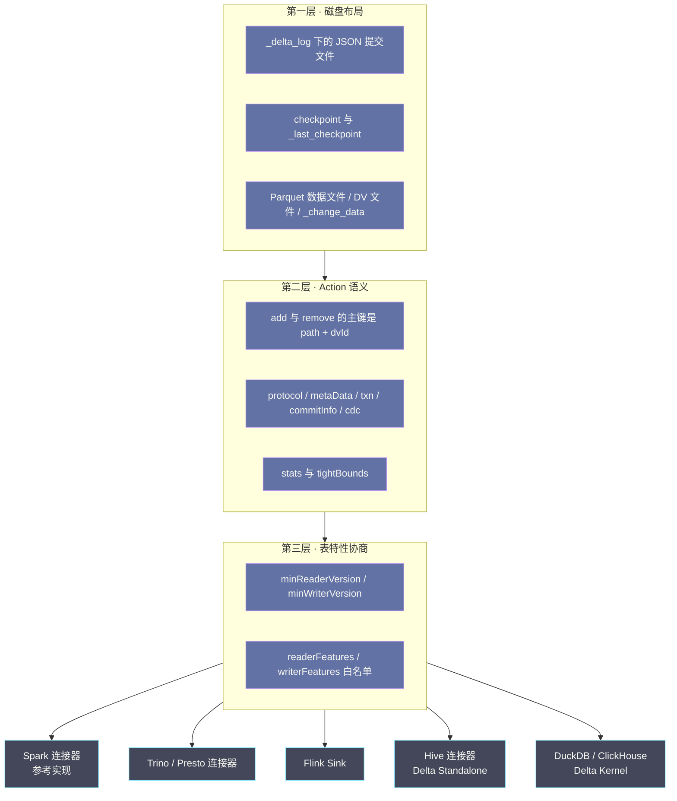
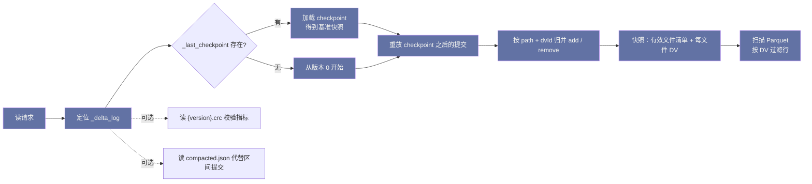
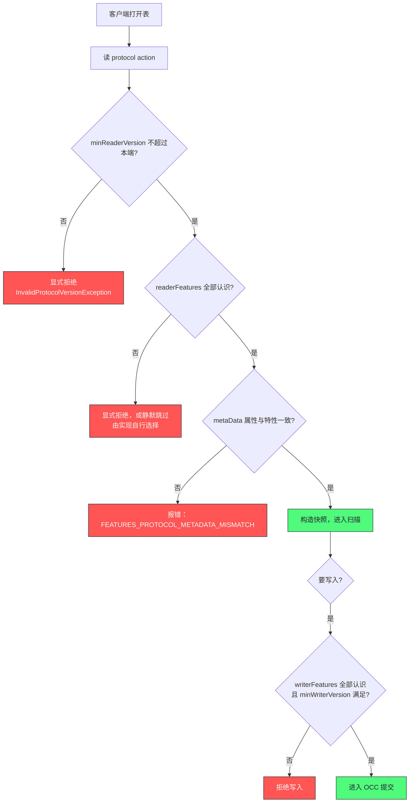
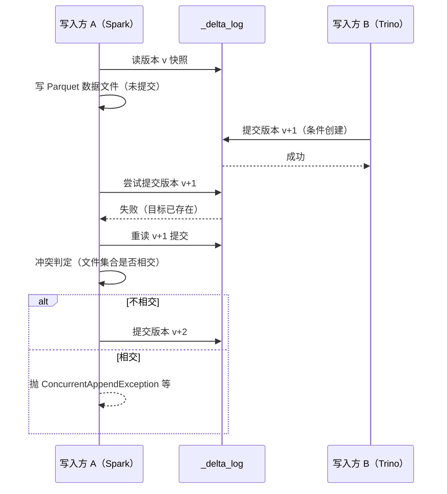
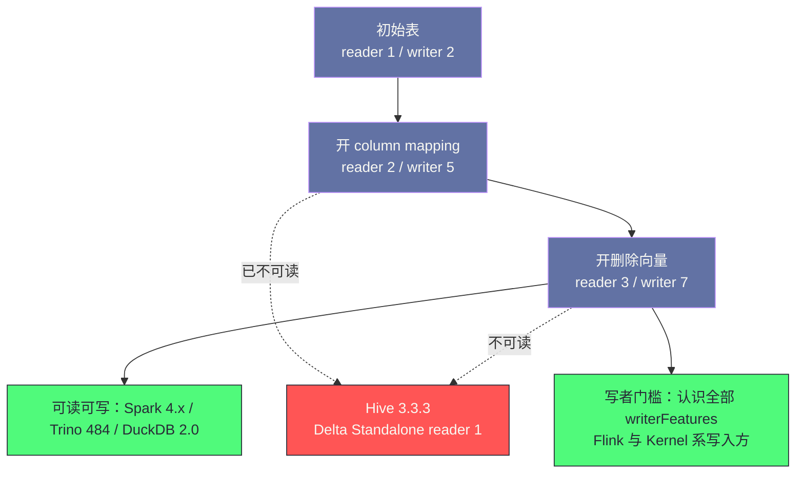

# 11 多引擎生态：Spark、Presto、Flink 与 Hive 的互操作

**摘要：**

“数据放在对象存储里，谁都能读”是 Lakehouse 最常被引用的一句话，也是最容易被误读的一句话。Delta 把“格式”拆成了互不重叠的三层：磁盘上的一组文件与目录、日志里每一行 action 的语义、表自己声明的读写协议与特性白名单。前两层决定一个客户端能不能把文件清单解析出来，第三层决定它解析出来之后敢不敢用；前者是解析问题，后者是契约问题。规范写在 `PROTOCOL.md` 里，不依赖任何实现，而每个引擎都是独立实现，于是“能读”与“读对”、“能写”与“写得对”分成了两组不同的问题。

本文沿这三层展开。先交代 `_delta_log` 的布局、checkpoint 与 `_last_checkpoint` 的读取契约，以及 `add`/`remove` 以 `(path, dvId)` 为主键这条最常被实现忽略的规则；再把协议版本与表特性的协商规则逐条拆开，说明哪些操作会把 `minReaderVersion` 抬上去、抬上去之后谁被锁在门外；随后给出 Spark、Trino/Presto、Flink、Hive、DuckDB、ClickHouse 以及 delta-rs 与 Delta Kernel 的能力矩阵，每一项标注核实来源；最后落到两类失败：读者侧的显式拒绝、静默消失与读错行，写者侧的提交原子性、`stats` 正确性与协议副作用。口径是 Delta Lake OSS 4.x，涉及 Databricks 平台能力的地方单独标注。

---

## 第 1 章 三层协议与两件不同的事

### 1.1 一条被误读的报错

合规团队要求清理 `orders` 表里一批注销用户的数据。Spark 侧开启了删除向量（Deletion Vector），一条 `DELETE` 提交成功，`SELECT count(*)` 少了十二万行，大家以为事情结束了。第二天凌晨，Hive 侧的历史报表作业全线失败，日志停在这么一段：

```
Delta protocol version (3,7) is too new for this version of Delta
Standalone Reader/Writer (1,2). Please upgrade to a newer release.
```

这段报错来自 Delta Standalone 的 `InvalidProtocolVersionException`，措辞像是“升级一下库就好”，于是有人去升级 Hive 连接器，发现 Maven 上 `delta-hive` 的最新版本停在 3.3.3，再往上就没有了。真正的答案不在版本号上：Hive 连接器依附的 Delta Standalone 在源码里把客户端支持的协议写死成 `readerVersion = 1`、`writerVersion = 2`，而开了删除向量的表已经声明 `minReaderVersion = 3`。两个数字对不上，读取被拒，与连接器“新不新”无关。

这条报错值得当作全篇的引子，因为它把三件本该分开看的事情揉成了一件：表的磁盘布局没有变，Action 的语义变了，协议协商没通过。排查时若只盯着“版本”两个字，很容易去升级一个根本没有新版本的组件。

### 1.2 三层：布局、语义、协商

把 Delta 的“格式”拆开，第一层是磁盘布局。一个表就是一组文件：`_delta_log/` 目录里是提交文件与 checkpoint，表根目录与分区子目录里是 Parquet 数据文件，另有删除向量文件、`_change_data/` 目录、以及 V2 checkpoint 用到的 `_sidecars/` 目录。这一层只要求会列目录、会读 JSON、会读 Parquet；日志的写入与快照构造细节，见 [[大数据/数据湖/Delta-Lake-Lakehouse架构深度解析/02 事务日志 Delta Log：ACID 保证的基石|事务日志]]。

第二层是 Action 语义。提交文件是换行分隔的 JSON，一行一个 action，字段含义由规范逐条固定：`path` 是 URI 编码的相对路径、分区值必须从日志读而不能从目录名猜、`add` 与 `remove` 的主键是 `(path, dvId)` 而不是 `path`、`stats` 是可选字段、`protocol` 一个版本最多一条。客户端能解析 JSON 不等于能正确解释这些语义，误读大部分发生在这里。

第三层是表特性协商。表在 `protocol` action 里声明自己要求的最低读版本、最低写版本，以及两份特性白名单。客户端必须拿自己的能力去对齐：版本不够就拒绝，特性不认识也必须拒绝，而不是“尽力而为地读一读”。这一层是唯一一层会主动把客户端挡在门外的，也是跨引擎协作中最需要提前设计的部分。

不妨用图书馆作比：第一层是排架规则，书按什么顺序插在哪个架子；第二层是编目规则，一条书目记录里的字段各是什么意思；第三层是借阅权限，某些书只对特定级别的读者开放。排架与编目是馆内事务，权限则要跟每一位读者核对。三者混为一谈，就会出现“书明明在架子上，读者却借不出来”的困惑——1.1 节的报错正是如此。

下图把三层与几类实现并排放置，后面每一章都在填充其中一层。



### 1.3 规范与实现：为什么“能读”不等于“读对”

`PROTOCOL.md` 是规范，它用 MUST / SHOULD 描述义务，不绑定编程语言，也不绑定某个引擎。规范里有两句话值得记住：客户端必须忽略自己不认识的字段与未知的 metadata domain；但客户端不得忽略自己不认识的表特性，因为特性是表明确声明“你必须理解我”的部分。前一句保证向前兼容，后一句保证正确性，两者方向相反，靠第三层区分。

实现有三条路线，差异就出在“支持到哪一步”。

第一条是 **参考实现**，即 Spark 的 `delta-spark`，用 `DeltaLog`、`OptimisticTransaction`、`Snapshot` 这套 JVM 类把规范逐条落地，协议版本跟得最紧，新特性通常先在它这里可用。

第二条是 **Kernel 路线**。`delta-kernel-rs` 是 Rust 与 C 的库，把日志解析、快照构造、扫描规划、提交协议封装成 API，引擎只需实现一个 `Engine` trait 负责读 JSON、读 Parquet、列举文件。DuckDB 的 `delta` 扩展、ClickHouse 的 DeltaLake 引擎、以及当前 Delta 仓库里的 Flink 连接器都建立在这条路线上，好处是协议细节只维护一份，代价是 Kernel 能做的事决定了连接器的天花板——`delta-kernel-rs` 的写入目前只有盲追加（blind append），所有基于它的连接器都只能在“追加”这个范围内写。

第三条是 **独立实现**。Trino 的 `delta_lake` 连接器用 Java 自己写了一套日志解析与提交逻辑，Delta 官方的 `delta-rs` 用 Rust 另写一套，两者都不依赖 Spark，也各自维护一份特性白名单。独立实现的好处是不受 Kernel 的能力约束，坏处是白名单与参考实现之间天然存在时差。

“能读”指的是能构造出快照，“读对”指的是快照之后再满足每一条语义：删除向量标记的行不能返回、column mapping 的物理列名与字段 ID 必须映射正确、`stats` 只能用于裁剪不能用于决定结果。前者是解析能力，后者是语义纪律，能力可以靠库补齐，纪律只能靠实现者一条条守。

### 1.4 “写得对”为什么更苛刻

读只需要对自己负责，读错了顶多是查询结果不对；写要对整张表负责，写错一次，后面所有引擎都会读到错的东西。写者身上压着四份责任：把提交做成原子的一步、把 `stats` 写准、把协议声明写对、把 metadata 与分区值写对。

这四份责任里，任何一份失守的表现都不是报错。某连接器写 `add` 时没有填 `numRecords`，带删除向量的文件上“逻辑行数”就不准了，读取方按 `(path, dvId)` 归并快照时还会把它当成合法文件；某连接器写 Parquet 时没有写入字段 ID，column mapping 的 `id` 模式读者就只能退回到按物理列名匹配，匹配不上时读到整列 null；某连接器把 `stats.tightBounds` 当成可选项忽略，读方会以为 min/max 是紧的，于是裁剪掉本不该裁剪的文件。这些错误在写入方那侧全是“成功”，在读取方那侧全是“无异常”，只在业务指标上表现为口径漂移。

正因如此，讨论多引擎生态时，“某个引擎能不能写这张表”这个问题的答案不能只看它有没有 `INSERT` 语法，还要看它提交时是否遵守 **乐观并发控制（OCC）** 的冲突判定、是否写对 `stats`、是否把表的协议声明维护在一致状态。这三件事里任何一件做不到，它就是一个不合格的写者。

### 1.5 贯穿案例与口径

后文用同一个场景贯穿：一张按 `order_date` 分区的订单事实表 `orders`，由 Spark 每日批量写入并做少量 `MERGE` 修正；一张 `customers` 维表，每日用 `MERGE` 更新约八千行。接入的引擎分工很典型：Spark 负责 ETL，Trino 负责 BI 看板，Flink 消费订单事件写入流表，Hive 跑历史遗留报表，DuckDB 与 ClickHouse 做临时分析。后来合规要求让 `orders` 开了删除向量，改名需求让 `customers` 开了 column mapping，这两次变更把“多引擎共存”从一句架构口号变成了具体的兼容性问题。

口径固定在 Delta Lake OSS 4.x。文中凡涉及特性，都标注引入版本；凡涉及引擎，都标注核实时的版本，因为连接器侧独立演进，写“Trino 支持”而不写版本号，过半年就可能变成错误陈述。

还有一条归属必须先讲清楚：Delta Lake OSS 指的是协议规范、Spark 连接器、Kernel、UniForm、Delta Sharing 这些开源部分；Databricks 平台能力指 Delta Live Tables、Predictive I/O、Photon、以及 Unity Catalog 提供的托管表语义。`catalogManaged` 这个表特性写进了 OSS 协议，因为“由 catalog 仲裁提交”是一个协议层概念；但真正托管这些表的 Unity Catalog 是商业产品。两者不要混用，否则讨论“某个引擎能否读某张表”时会得出互相矛盾的结论。

> [!info] 版本与归属口径
> 本文的协议事实以 `delta-io/delta` 仓库的 `PROTOCOL.md` 为准，引擎事实以各引擎当前文档与源码为准，核实点写在参考资料里。UniForm、Delta Kernel、Delta Standalone 都在开源仓库内；Delta Live Tables、Predictive I/O、Photon、Unity Catalog 托管表属于 **Databricks 平台能力**，**不是 OSS 协议的一部分**。

---

## 第 2 章 磁盘布局：账本的目录

### 2.1 一个表目录里到底有什么

一个 Delta 表在磁盘上就是一个目录，目录里最要紧的是 `_delta_log/`。以规范给出的示例改写成 `orders` 的样子，目录内容大致如下：`_delta_log/00000000000000000042.json` 是一份提交，`00000000000000000042.checkpoint.parquet` 是这一版的全量快照，`_delta_log/_last_checkpoint` 指向最近的 checkpoint，`_change_data/` 里是变更数据文件，表根目录里是 `part-...parquet` 与 `deletion_vector-....bin`。

提交文件的命名规则是“下一个可用版本号，零填充到二十位”。**二十位**不是排版讲究，是为了让字典序与版本序一致：在只支持按前缀分页列举的对象存储上，客户端可以从 `_last_checkpoint` 记录的版本出发，按字典序往后翻，翻到的就是更新的提交与 checkpoint，不必列出整个目录。一张跑三年、每天三百次提交的表会有三十多万个日志文件，全量 LIST 建快照在对象存储上是分钟级开销，这条命名规则就是为这种规模准备的。

下表把目录里出现的文件类型列全，并标注谁必须理解它。

| 文件或目录 | 命名规则 | 作用 | 谁必须理解 |
|---|---|---|---|
| JSON 提交文件 | `{version}.json`，版本零填充二十位 | 一个版本的原子 action 集合 | 所有读者与写者 |
| 经典 checkpoint | `{version}.checkpoint.parquet` | 某一版的全量状态，免去重放 | 所有读者（可选用） |
| V2 checkpoint | `{version}.checkpoint.{uuid}.json` 或 `.parquet` | 带 sidecar 的新式 checkpoint | 声明了 `v2Checkpoint` 特性的客户端 |
| sidecar 文件 | `_sidecars/{unique}.parquet` | 只装 add/remove 的分片 | 同上 |
| 多段 checkpoint | `{version}.checkpoint.{part}.{total}.parquet` | 旧式的分段 checkpoint | 读者必须忽略缺段的 checkpoint |
| `_last_checkpoint` | 单文件 JSON | 指向最近一次完整 checkpoint | 所有读者（可选用） |
| 日志压缩文件 | `{start}.{end}.compacted.json` | 区间内 action 的归并结果 | 可选消费 |
| 版本校验和 | `{version}.crc` | 该版本的 tableSizeBytes、numFiles 等指标 | 可选校验 |
| 数据文件 | `part-...parquet` | 实际数据 | 所有读者 |
| 删除向量文件 | `deletion_vector_{uuid}.bin` | 标记某些行已逻辑删除 | 声明支持 `deletionVectors` 的读者 |
| 变更数据文件 | `_change_data/cdc-...parquet` | `_change_type` 与前后像 | 读 CDF 的客户端 |
| 暂存提交 | `_staged_commits/{version}.{uuid}.json` | catalog-managed 表的提交暂存区 | 不应直接解析 |

### 2.2 checkpoint：把重放换成加载

checkpoint 是把“重放”换成“加载”的一次性投入。规范的要求写得克制：读者不得假设 checkpoint 存在，也不得假设它的频率；唯一的例外是元数据清理必须为保留期最老的那一版留下 checkpoint，否则被删的 JSON 提交会让快照无法重建。合格的实现必须随时能“从版本 0 一路重放到最新”，**checkpoint 只是快路径**。

写者侧的节奏由 `delta.checkpointInterval` 控制，默认 10，即每十次提交写一次 checkpoint；checkpoint 自身有保留期 `delta.checkpointRetentionDuration`，默认两天。两个默认值合起来的效果是：频繁提交的表会频繁写 checkpoint，老 checkpoint 又很快被清理，读取方通常能在“重放十个提交”与“加载一个 checkpoint”之间取得平衡。

V2 checkpoint 是另一条路径：checkpoint 本体可以只装元数据，把海量 add/remove 拆到 `_sidecars/` 目录下的分片文件里，然后用 `sidecar` action 引用。它要求表声明 `v2Checkpoint` 特性，且该特性同时出现在 `readerFeatures` 与 `writerFeatures` 中，协议门槛是 reader 3、writer 7。多段 checkpoint 则被规范标记为应当避免：它无法原子写入，读者必须忽略缺段的 checkpoint，否则会读到一个缺文件的快照。

### 2.3 读取方的最低义务

把规范里散落的读者义务收拢，构造快照至少有四条硬约束。第一条是从 `_last_checkpoint` 出发，而不是从目录列表出发；没有 checkpoint 时从版本 0 开始重放。第二条是遇到多段 checkpoint 缺段时忽略它，继续往前找。第三条是把同一条逻辑文件按 **`(path, dvId)`** 归并：`add` 与 `remove` 的比较不能只看路径，因为同一个数据文件可以在不同版本上携带不同的删除向量。第四条是分区值只信日志里的 `partitionValues`，目录名只是约定，不是协议。

这四条里最容易漏的是第三条。一个只看 `path` 的实现，在开启删除向量的表上会把“同一路径、不同 DV”的两次 `add` 当成重复文件合并，或者把“路径相同但 DV 已被清理”当成未删除。规范为此写了合法性约束：同一个提交里同一路径的同类型 action 至多一条；跨版本中若某路径以不同 `dvId` 出现在快照里，则必须同时出现对应 `remove`。

### 2.4 反例：绕过日志直接列 Parquet

早年为了兼容不支持 Delta 协议的引擎，生态里出现过两种绕法：一种是用清单文件，把有效文件路径导出成一个清单，让老引擎按清单读；另一种更粗暴，直接对表目录做 `listFiles`，把后缀为 `.parquet` 的文件全读进来，跳过 `_delta_log`。

第一种绕法在 Trino 373 与 Presto 269 之前的版本里是官方推荐路径，它的本质是一次离线快照：清单由 Spark 侧在每次写入后更新，老引擎读到的是“清单生成时刻”的表状态，既不实时，也不包含删除向量的过滤。第二种绕法连快照都不是：它会把已经被 `remove` 但尚未被 `VACUUM` 物理删除的文件读回来，把删除向量标记的行读回来，还会把 `_change_data/` 里的变更文件当成数据读进来。这类错误不会报错，只会让报表多出一批“已删除但仍在”的行。

清单方案今天只剩一个用途：给协议能力跟不上的引擎一条降级通道。使用时必须明确它的语义边界——读的是清单生成时刻的有效文件，不含 DV 过滤，且要额外维护清单文件；把它当成“等价于 Delta 读取”，就回到了 1.1 节那种困惑里。

读取路径的全貌如下图，虚线部分是可选路径。



---

## 第 3 章 Action 语义：一行 JSON 承担的责任

### 3.1 提交文件是原子单位

Delta 的原子性落在**提交文件**这个粒度上：一个版本的 action 集合写进一个文件，这个文件要么完整可见，要么不可见。规范对写者的要求只有一句但很硬——“写者不得覆盖已存在的日志条目，并应尽量使用底层文件系统的原子原语，保证并发写者不会互相覆盖”。

这句话读起来像实现细节，其实是整个并发模型的地基。HDFS 上靠重命名保证原子可见，对象存储上靠条件写或者外部协调者保证互斥；一旦某个写者的提交路径只是“普通 PUT”，两个并发写者就可能先后写到同一个版本号上，后写的覆盖前写的，前一个提交连同数据文件一起消失，而双方都收到成功。

`commitInfo` 是可选的溯源信息，记录操作名、参数、引擎版本、时间戳；`txn` 是应用级事务标识，用 `(appId, version)` 让外部系统做到幂等写入；`cdc` 引用变更数据文件，带 `_change_type` 列。这三类 action 都是“写者友善、读者可略”的部分，不理解它们的读者照样能读数据，只是读不到溯源与增量语义。

### 3.2 add 与 remove 的主键

规范里有一句容易被跳过的定义：逻辑文件的主键是 `(path, dvId)`，没有删除向量时主键退化为 `(path, NULL)`。这一句把删除向量从“一个附加文件”提升成了“文件身份的一部分”，也决定了快照归并算法的形状。

具体到实现，快照里维护的是一张以 `(path, dvId)` 为键的表；看到一个 `add`，就把对应键的值替换成新的 `AddFile`（统计信息、大小、修改时间都可能更新）；看到一个 `remove`，就把对应键标记为墓碑并保留到过期。`remove` 本身带时间戳，物理删除要等过期阈值之后由 `VACUUM` 执行，这段延迟是留给仍在读旧快照的并发读者的。

理解了主键，才能理解为什么有些连接器在开 DV 的表上会“读出多出来的行”：它按 `path` 归并，看到同一个路径先 `add` 后 `add`（第二个带 DV），就把两个都当成有效文件，于是同一份数据被算了两次；或者它只保留最后一个 `add` 却忽略了 DV 过滤，于是被删的行又回来了。

### 3.3 哪些 action 能忽略，哪些必须理解

把 action 按“读者是否必须理解”分三档。

第一档是必须理解，否则无法构造正确快照：`protocol`、`metaData`、`add`、`remove`。第二档是必须理解但只在特定场景：`cdc`（读 CDF 时）、`domainMetadata`（表声明了依赖它的特性时，例如行跟踪）、`sidecar` 与 `checkpointMetadata`（V2 checkpoint）、`txn`（幂等写入的回读）。第三档是可选：`commitInfo`，以及所有未知字段。

下表把常见 action 与忽略后果并排放置。

| Action | 记录什么 | 读者义务 | 忽略或写错的后果 |
|---|---|---|---|
| `protocol` | 最低读写版本与两份特性白名单 | 必须理解，不满足即拒绝 | 读不该读的表，或写坏表 |
| `metaData` | schema、分区列、表属性 | 必须理解 | 列错位、分区裁剪失效 |
| `add` | 文件路径、分区值、大小、统计、DV | 必须理解 | 漏文件、多文件、行数错 |
| `remove` | 被移除的路径与 DV、时间戳 | 必须理解 | 已删数据复活 |
| `cdc` | 变更数据文件（前像/后像） | 读 CDF 时理解 | 增量作业拿到错误的变更类型 |
| `txn` | `(appId, version)` | 幂等写入时理解 | 重复写入、断点恢复失败 |
| `domainMetadata` | 特性私有元数据，如行 ID 域 | 依赖该特性时必须理解 | 行 ID 错乱、维护操作冲突 |
| `sidecar` | 指向 checkpoint 分片 | 读 V2 checkpoint 时理解 | 快照缺文件 |
| `commitInfo` | 操作来源与时间戳 | 可选 | 溯源缺失，不影响结果 |

### 3.4 stats 与 tightBounds

`add.stats` 是一段 JSON，装 `numRecords`、`minValues`、`maxValues`、`nullCount`；在 checkpoint 里它既可能以 JSON 字符串存在（`delta.checkpoint.writeStatsAsJson`，默认开），也可能以 struct 存在（`delta.checkpoint.writeStatsAsStruct`，默认关）。这一点最常被误解的地方是“统计信息可以随便写”，规范里其实有三条硬约束。

第一条与删除向量绑定：带 DV 的逻辑文件必须在 `stats` 里给出准确的 `numRecords`，且它等于数据文件里的物理行数，不是有效行数。第二条是 `tightBounds`：删除向量会让统计信息变旧，`tightBounds = true` 表示 min/max 精确对应有效行，`false` 表示 min/max 只是包住有效行的宽界；字段缺省时按 `true` 处理。第三条与嵌套列有关：统计默认只收前 32 列（`delta.dataSkippingNumIndexedCols`），超出的列没有统计，不是“统计为 0”。

**`tightBounds`** 这一条是跨引擎读错的隐蔽来源。一个读方如果不知道删除向量，就不会去检查这个字段，于是把宽界当紧界用，裁剪掉明明包含目标值的文件；结果不是报错，而是“某些查询少了几行”。同样的道理，写方如果更新了 DV 却没有把 `tightBounds` 置为 `false`，所有依赖统计的读者都会开始在错误的前提下做跳过。

### 3.5 时间戳与时间旅行

没有开启 `inCommitTimestamp` 特性时，按时间做时间旅行依赖提交文件的修改时间，而对象存储与文件系统对这个字段的语义并不一致：有的存储按服务端接收时间写，有的按客户端时间写，跨引擎写入时这些时间戳的分布会更散。规范为此提供了 `inCommitTimestamp` 写者特性（writer 7），要求写者把 `commitInfo.inCommitTimestamp` 作为第一个 action 写入，并给出“提交成功时刻”的精确定义；读方在表启用该特性后，应优先使用这个字段而不是文件修改时间。

这件事对多引擎的意义在于可复现性：当 Spark、Flink、Trino 三个写者交替提交时，只靠 mtime 排序的时间旅行会依赖各引擎所在主机的时钟与存储实现，同一条时间轴查询在两次执行里可能落在不同版本上。要求所有写者支持 `inCommitTimestamp` 是一个协议层决定，代价是会把这个特性写进 `writerFeatures`，从而要求所有写者都理解它。

---

## 第 4 章 表特性协商：协议版本的两套账

### 4.1 粗粒度版本与细粒度特性

Delta 的协议版本控制有两代机制。第一代是粗粒度的：`minReaderVersion` 与 `minWriterVersion` 各一个整数，版本号捆绑一组能力，读到版本号就知道客户端得会什么。第二代从 reader 3 / writer 7 开始，引入了 **表特性（table features）**，把能力拆成一份份具名标记：客户端只要支持表上列出的全部特性，就能读写，不必支持该协议版本捆绑的所有能力。

两代机制并存，规则有明确的接缝。`readerFeatures` 只在 `minReaderVersion = 3` 时存在，`writerFeatures` 只在 `minWriterVersion = 7` 时存在；不允许只声明 reader 特性而不声明对应的 writer 特性（读该表的能力必然包含写该表所需的读能力）；也不允许创建 reader 3 而 writer 小于 7 的表。这条“reader 3 必须配 writer 7”的绑定，是很多实现报错时让人费解的原因：表并没有用任何读新特性，却因为写者要声明特性而把 reader 抬到了 3。

### 4.2 协商规则逐条

客户端打开表时要做三件事，顺序不能颠倒。

先核对版本：`minReaderVersion` 大于本端实现支持的读版本，直接拒绝；`minWriterVersion` 大于本端写版本，读可以继续、写必须拒绝。再核对特性：对 `readerFeatures` 里的每一项，本端必须认识并且实现，否则拒绝；对 `writerFeatures`，只在要写时核对。最后核对一致性：`metaData` 里的表属性（譬如 `delta.enableDeletionVectors`、`delta.columnMapping.mode`）必须与 `protocol` 里声明的特性吻合，不一致时规范要求报错而不是猜测。

这里有一条容易被误读的规范细节：客户端必须忽略不认识的字段、未知 action、未知 metadata domain，但不得忽略未知表特性。未知字段是该版本新增的可选信息，忽略它不影响正确性；未知特性则是表在说“不理解我你就读不对”。

### 4.3 特性门槛表

下表把特性与门槛列全，门槛取官方“按协议版本列特性”的页面，并与 `PROTOCOL.md` 交叉核对。两者在个别行上略有差异，以规范为准：例如规范允许“reader 2 + writer 7、只列 writerFeatures”的组合，文档表格更保守，下表按较严的一侧记录。

| 特性名 | 触发的操作或属性 | minReader | minWriter | 引入版本 |
|---|---|---|---|---|
| 基础能力 | 建表默认 | 1 | 2 | 0.x |
| `changeDataFeed` | `delta.enableChangeDataFeed = true` | 1 | 4 | 2.0 |
| `checkConstraints` | `CHECK` 约束 | 1 | 3 | 0.8 |
| `generatedColumns` | 生成列 | 1 | 4 | 1.0 |
| `columnMapping` | `delta.columnMapping.mode` 为 `id` 或 `name` | 2 | 5 | 1.2 |
| `identityColumns` | 标识列 | 1 | 6 | 3.3 |
| `deletionVectors` | `delta.enableDeletionVectors = true` | 3 | 7 | 2.3 |
| `timestampNtz` | schema 含 `TimestampNTZ` | 3 | 7 | 2.4 |
| `v2Checkpoint` | `delta.checkpointPolicy = v2` | 3 | 7 | 3.0 |
| `icebergCompatV1` | UniForm Iceberg（旧版） | 2 | 7 | 3.0 |
| `icebergCompatV2` | `delta.enableIcebergCompatV2 = true` | 2 | 7 | 3.1 |
| `vacuumProtocolCheck` | 启用该特性的表 | 3 | 7 | 3.x |
| `clustering` | Liquid Clustering | 3 | 7 | 3.1 |
| `rowTracking` | `delta.enableRowTracking = true` | 3 | 7 | 3.2 |
| `domainMetadata` | 依赖域元数据的特性（如行跟踪） | 3 | 7 | 3.0 |
| `typeWidening` | 类型拓宽（正式版） | 3 | 7 | 4.0 |
| `variantType` | `VARIANT` 列 | 3 | 7 | 4.0 |
| `catalogManaged` | 由 catalog 托管提交的表 | 3 | 7 | 4.x |

### 4.4 升级不可逆与“猜特性”

**协议升级是单向的**：`minReaderVersion` 一旦抬上去，没有“降级”命令；降回旧版本只能重建表。官方文档把这句话写在显眼位置，原因不是技术洁癖，而是读方生态的现实——你无法确认历史上哪个客户端读过哪一个版本，也无法要求它们回滚。

升级表特性时还有一条“就宽不就窄”的规则：客户端应尽力判断表历史上用过哪些特性，但在无法证明某特性“绝对没用过”时，必须假设用过。规范给的例子很典型：一张表曾经打开、使用、再关闭 `delta.enableChangeDataFeed`，只看当前版本看不到痕迹，但历史提交里确实有 `cdc` 文件；若把特性集算窄了，时间旅行读到那些版本时就会违反 `cdc` 语义。所以正确做法是按可回溯的历史范围取并集，而不是按当前表属性取快照。

这两条规则合起来，构成对“跨引擎共用一张表”的最强约束：协议版本不是某一方私有的实现细节，而是所有参与方的接口契约。它的版本号一旦变化，需要通知的不是运维一个人，而是所有读这张表的系统。

### 4.5 推演：orders 开了删除向量之后

把 1.5 节的场景算一遍。`orders` 原本是 reader 1 / writer 2 的普通表；合规删除前，Spark 执行 `ALTER TABLE orders SET TBLPROPERTIES ('delta.enableDeletionVectors' = 'true')`，这次操作会同时做两件事：把 `delta.enableDeletionVectors` 写进 `metaData.configuration`，并在 `protocol` 里声明 `minReaderVersion = 3`、`minWriterVersion = 7`、`readerFeatures = [deletionVectors]`、`writerFeatures` 至少包含 `deletionVectors`。

此后每个写者提交时都要重新核对自己的能力：Spark 4.x 认识全部特性，正常；Trino 484 的白名单里有 `deletionVectors`，正常；DuckDB 2.0 的 `delta` 扩展在特性列表里明确支持扫描带 DV 的表，正常；Hive 连接器依附的 Delta Standalone 停在 reader 1，直接在打开表时抛出版本异常；Flink 当前连接器是 sink-only，没有读路径，谈不上读；任何基于 Kernel 且只实现了盲追加的写入者，能不能写还要看它是否把 `writerFeatures` 里的每一项都认全。

这张表从 reader 1 跳到 reader 3 只用了一条 `ALTER`，影响面却覆盖所有读取方。这就是“协议版本是接口契约”的含义：它不是某一版软件的内部状态，而是一次对外通告。

协商流程如下图，注意“拒绝”与“静默跳过”是两条不同的分支，行为差异在第六章展开。



---

## 第 5 章 能力矩阵：七个实现的核实结果

### 5.1 Spark：参考实现

`delta-spark` 是参考实现，读版本支持到 3、写版本支持到 7，本文涉及的全部特性它都实现。版本对应关系随小版本变化：官方 releases 页给出的表里，Delta 4.0.x 至 4.3.x 对应 Spark 4.0.x 与 4.1.x；Maven 中央仓库里另有 `delta-spark_4.2_2.13`（4.4.x）的制品，说明 4.4 线已把 Spark 4.2 纳入支持范围。选版本时不要只记“Delta 4 配 Spark 4”，要对到具体小版本。

Spark 还是“规范的解释器”：`PROTOCOL.md` 里不少条目的措辞就是从它的实现里抽象出来的，遇到规范表述含糊的地方，看它的行为最接近本意。

### 5.2 Trino 与 Presto：读写的边界已经移动

Trino 从 373 起原生支持 Delta 表的读写，这个结论在两边的文档里都能对上。Trino 484 明确列出 `INSERT`、`DELETE`、`UPDATE`、`MERGE`，也支持 `CREATE TABLE`、`ALTER TABLE`、`VACUUM`、`OPTIMIZE` 这些表管理动作；所以“Trino 只能读”对 484 不成立。

写入能力要看细节。Trino 的 `DeltaLakeTableFeatures` 里维护两份白名单，读侧支持 `columnMapping`、`timestampNtz`、`typeWidening`（含 preview）、`deletionVectors`、`vacuumProtocolCheck`、`variantType`（含 preview）、`v2Checkpoint`；写侧支持 `appendOnly`、`deletionVectors`、`invariants`、`checkConstraints`、`changeDataFeed`、`columnMapping`、`timestampNtz`、`vacuumProtocolCheck`。`v2Checkpoint` 只在读侧白名单里，这意味着它可以读 V2 checkpoint 的表，但不能写这类表。CDF 同理：它按 `changeDataFeed` 特性的要求写出变更文件，读侧用 `table_changes` 表函数取增量，普通扫描不会合并 CDC 文件。

写入的并发安全还依赖存储。Trino 文档区分了两种 S3 写法：默认用条件写检测日志冲突，与同样使用条件写的引擎可以共存；关掉条件写后必须打开 `delta.enable-non-concurrent-writes`，此时它只保证“同一套 Trino 集群之间”不冲突，与其他引擎并发写会损坏表。这条约束把“Trino 能写”进一步收窄成“Trino 能在受控条件下写”。

Presto 的边界更清楚：从 0.269 起原生支持读取 Delta 表，不支持写；更早的版本靠清单文件降级。它的协议支持停在较早版本，具体到哪一版要看实际部署的连接器，文档里没有像 Trino 那样逐条列出的特性白名单。

### 5.3 Flink：sink-only 与 single committer

Flink 的情况与很多人的印象相反。Delta 仓库当前的 `flink/` 模块（README 里仍标注“this is a private build right now”）提供的连接器是 **sink-only**：基于 Flink Connector V2 API 与 Delta Kernel，只有一个全局 committer，靠 Flink checkpoint 做 exactly-once；它测试的 Flink 版本是 2.0 到 2.3，默认构建用 2.3.0。也就是说，当前这条线没有 source，不能从 Delta 表流式读。

它的写入语义有两个值得记住的点。第一是单全局 committer：所有并行子任务的提交都汇总到一个 committer 上完成，这避免了多个并行实例争抢同一版本号，代价是提交阶段成为串行瓶颈，且 committer 故障时恢复要依赖 checkpoint。第二是它默认给表设一条 Delta 属性——`delta.feature.v2Checkpoint = supported`。这条默认值会把 `v2Checkpoint` 写进表的 `writerFeatures`，从而让“只支持 v2Checkpoint 读、不支持它写”的引擎无法再写这张表。Trino 恰好就是这种引擎，于是出现一个很实用的推论：Flink 写过的表，Trino 可能能读但不能写。

历史上还有一条更早的 write-only 连接器线（基于 Delta Standalone，提供 `DeltaSink` 与 `DeltaSource` 的 Java API），那条线早已停止演进。查资料时若看到 `DeltaSource.forBoundedRowData` 这类写法，要注意它对应的版本与现在仓库里的连接器不是同一套代码。

### 5.4 Hive：被 Delta Standalone 的天花板锁死

Hive 连接器（`delta-hive`）是只读的，只支持外部表，Hive 2.x 与 3.x、MapReduce 与 Tez 引擎可用；使用前必须在 `hive-site.xml` 或会话里把 `hive.input.format` 与 `hive.tez.input.format` 指到 `io.delta.hive.HiveInputFormat`，否则连接器根本不生效。它还要求 `CREATE EXTERNAL TABLE` 里声明的 schema 与 Delta 元数据一致，不一致就报错；也不能直接查询别人在 HMS 里注册的同路径表，得自己建一张外部表指过去。

真正限制它的是底下的 Delta Standalone。`delta-hive` 依赖 `delta-standalone`，而 Standalone 的 `Action.readerVersion` **写死为 1**、`writerVersion` 为 2。于是 Hive 连接器只能读 `minReaderVersion = 1` 的表：一旦表开了 column mapping（reader 2）或删除向量（reader 3），Hive 侧就是 1.1 节那条报错，没有绕法。Delta Standalone 本身已被官方标记为弃用，推荐迁移到 Delta Kernel；`delta-hive` 的制品也停在 3.3.3，没有 4.x 版本。

Hive 的定位由此清楚：它能覆盖“从未开启过高级特性”的历史表，或者为报表保留的镜像表；任何一次特性升级都会以硬失败的方式把它排除在外。

### 5.5 DuckDB：内核路线的样本

DuckDB 的 `delta` 扩展基于 `delta-kernel-rs`，能力边界基本等于 Kernel 的读路径加上一层有限的写。读侧它能扫描带删除向量的表、支持 column mapping 的 `name` 与 `id` 两种模式、支持按版本与时间戳的时间旅行、支持域元数据读取；写侧只支持 `CREATE TABLE` 与 `INSERT`（盲追加），不支持 `UPDATE`、`DELETE`、`MERGE`、`ALTER`、`DROP`。

它的文档里有两处对跨引擎实践特别有用。一处是 `delta_list_files`，能列出一次扫描会读到的文件、每个文件的行数、分区值以及是否带删除向量，还能加 `delete_count` 看每个文件的 DV 删了多少行——这几乎是为“验证读得对不对”准备的接口。另一处是 `delta_column_mapping_policy`：`id` 模式的表要求每个数据文件都带 Parquet 字段 ID，而有些写者（包括 DuckDB 1.5.5 及更早版本）没写，DuckDB 2.0 默认 `strict`，遇到这种文件直接报错并指出文件名；设成 `lenient` 则退回按物理列名匹配并记警告。这条设置把“写者少写一个字段 ID”的后果暴露在了读侧，也是跨引擎排查列错位的入口。

它还有一条硬拒绝：带 `catalogManaged` 特性的表不能通过路径直接读，必须走 catalog（例如 `unity_catalog` 扩展）。这与规范里“catalog-managed 表不支持文件系统直读”的要求一致，属于新特性把老读法挡在门外的典型例子。

### 5.6 ClickHouse：25.10 之后的读写

ClickHouse 的 `DeltaLake` 表引擎早期是只读的，文档正文现在写着“支持读写（自 v25.10 起）”。写入需要 `SET allow_experimental_delta_lake_writes = 1`，且只支持 `INSERT`；表必须事先存在，不能通过 DDL 创建；写入走 Delta Kernel，目前支持 S3 与 GCS，不支持 Azure。读取仍走同一套内核，数据缓存机制与 S3 表引擎一致。

这条信息的意义是“只读引擎”与“可写引擎”的名单每年都在变，判断依据必须落在具体版本号与连接器实现上。三年前写“ClickHouse 只读”是对的，今天写就错了。

### 5.7 delta-rs 与 Delta Kernel：共享底座

`delta-rs` 是独立的 Rust 实现，提供 Python 绑定，既读也写，覆盖追加、覆盖、`MERGE`、`UPDATE`、`DELETE` 等高层操作，是 Python 生态最常用的 Delta 客户端。它与 Kernel 是两条独立的代码线，都不依赖 Spark。

`delta-kernel-rs` 是“给引擎作者用的库”：读路径完整（快照、扫描、谓词下推），写路径目前只有盲追加，API 明确标注为实验性，版本号还在 0.x。它对多引擎生态的价值在于把“解析日志、构造快照、规划扫描”这些最容易写错的活收拢到一处，让 DuckDB、ClickHouse、Flink 这类引擎只需实现文件读写与执行。它的局限同样明确：Kernel 不支持的写入语义，基于它的连接器一个也做不了。

### 5.8 能力矩阵总表

把上面的结论压成一张表。读、写两列回答“有没有”，协议列回答“能到哪一步”，备注列写核实到的关键限定。

| 引擎与版本 | 读 | 写 | 协议能力 | 核实到的关键限定 |
|---|---|---|---|---|
| Spark + delta-spark 4.x | 是 | 是 | reader 3 / writer 7，全特性 | 参考实现；4.0–4.3 对应 Spark 4.0/4.1，4.4.x 发布 Spark 4.2 制品 |
| Trino 484 | 是 | 是 | max reader 3 / max writer 7 | 支持 INSERT/UPDATE/DELETE/MERGE；`v2Checkpoint` 只读不写；S3 并发依赖条件写或单写模式 |
| Presto 0.269+ | 是 | 否 | 只读，白名单未公开列全 | 更早版本用清单文件降级 |
| Flink + delta-flink 4.3.x | 否 | 是 | sink-only，基于 Kernel | 单全局 committer；默认写 `v2Checkpoint` 特性；schema 变更只允许新增列 |
| Hive + delta-hive 3.3.3 | 是 | 否 | reader 1（Standalone 写死） | 外部表；需设 `hive.input.format`；开 CM 或 DV 后不可读 |
| DuckDB 2.0 `delta` 扩展 | 是 | 是 | 基于 Kernel：读完整、写仅追加 | 无 UPDATE/DELETE/MERGE；CM 的 `id` 模式有 `strict`/`lenient` 策略；catalogManaged 表需走 catalog |
| ClickHouse 25.10+ | 是 | 是 | 基于 Kernel，仅 INSERT | 需 `allow_experimental_delta_lake_writes`；表须已存在；写支持 S3/GCS |
| delta-rs | 是 | 是 | 独立实现，覆盖高层 DML | 不依赖 Spark 与 Kernel |
| Delta Kernel（Java/Rust） | 是 | 部分 | 读快照 + 盲追加 | 写路径实验性；库而非引擎 |

---

## 第 6 章 “能读”的陷阱：拒绝、消失与读错

### 6.1 显式拒绝：最好的一类失败

显式拒绝是三类失败里最安全的一种，因为它在“读之前”发生，业务方拿到的是报错而不是错数。触发条件只有两个：版本不够，或者特性不认识。

Spark 侧的报错类是 `InvalidProtocolVersionException`，错误类名 `DELTA_INVALID_PROTOCOL_VERSION`，消息里会同时给出表要求的版本与本端支持的版本集合；特性不认识时报 `DELTA_UNSUPPORTED_FEATURES_FOR_READ` 或 `DELTA_UNSUPPORTED_FEATURES_FOR_WRITE`，把不认识的特性名逐个列出来。Trino 侧的写路径报错是 `Unsupported writer features: [...]` 或 `Table xxx requires Delta Lake writer version N which is not supported`；读路径的版本或特性不支持时不会报错，而是静默跳过，这一点放到下一节讲。Hive 与 Delta Standalone 报的就是 1.1 节那段“protocol version too new”。

这些消息的共同点是可定位：它告诉你缺什么，处置也只有三条路——升级读方、重建表、或换读取路径。

### 6.2 静默消失：表在 catalog 里不见了

第二类失败（**静默消失**）比第一类隐蔽。Trino 的实现里，`getTableHandle` 遇到 `minReaderVersion` 超过 3 或含不认识的 reader 特性时，只在 DEBUG 日志里写一行 `Skip ...`（分别说明是版本不支持还是特性不支持），然后返回 null。对引擎来说，这等价于“表不存在”，SQL 层最终呈现的是 `TABLE_NOT_FOUND`。

从运维视角看，现场是“昨天还能查的表今天消失了”，而连接器日志都在 INFO 级别，看不到线索。两个排查习惯：把 Trino 的 DEBUG 打开看 `Skip` 日志；或者绕开引擎，直接读 `_delta_log` 里的 `protocol` action——后一个最快，用任何能读 JSON 的工具都能打开。

### 6.3 读错行：最危险的一类

第三类失败（**读错行**）不报错、不消失，只是结果不对。它通常源于三种语义被忽略。

第一种是删除向量。规范对读者的要求很直接：被 DV 标记的行不得出现在输出里。一个按 Parquet 直接扫描的实现（或者一个忘记 `deletionVector` 字段的老版本连接器）会把已删除的行读回来。在合规删除的场景里，这不是精度问题，是合规问题。

第二种是 column mapping。开启后每个字段有物理名（形如 `col-<uuid>`）与字段 ID，读者必须按物理名或 ID 映射。一个忽略它的实现会按逻辑列名去 Parquet 里找列，找不到就填 null，或者按位置错位匹配；结果是整列 null 或者两列数据对调。这类错误最容易被“行数对得上”掩盖：行数没错，错的是列。

第三种是统计信息。`tightBounds`、`numRecords`、`nullCount` 的语义在 DV 表上都会发生偏移，一个读者如果把宽界当紧界用，就会裁掉不该裁的文件；如果把 `numRecords` 当成有效行数，就会在 DV 表上算出偏大的基数。

三类语义都写在规范里，在 `PROTOCOL.md` 各有独立小节，也不依赖任何实现的语言。读方是否遵守，只能看它的实现或文档，不能靠“它支持 Delta 格式”这句宣传语推断。

### 6.4 为什么 count 校验抓不住

最常见的验证手段是对行数：`SELECT count(*)` 在两边跑一遍，相等就认为读对了。这个手段能抓住“漏文件”“多文件”这类错误，抓不住下面几类情形。

其一，列错位：行数是物理行数，与列映射无关，CM 表上列错位时行数完全相等。其二，DV 忽略：多数情况下已删行读回来会让 `count(*)` 偏大，能抓住；但两边错得一样多（例如共用一个库、同一条错误路径）时行数依然相等。其三，更新未生效：一次 `MERGE` 改了值但行数不变，只校验行数看不出来。

行数校验是必要条件，不是充分条件。要抓住列错位与更新未生效，必须做内容级校验：按分区聚合确定性校验和（例如把关键列拼接后取哈希再求和），或比对关键指标的分组结果；成本与扫描量成正比，通常只对关键表按周期执行。

### 6.5 失败形态一览

| 形态 | 典型触发 | 现场症状 | 判据 | 处置 |
|---|---|---|---|---|
| 版本拒绝 | reader 3 表 + reader 1 客户端 | 打开即报协议版本过新 | 报错原文含版本号 | 升级读方或重建表 |
| 特性拒绝 | 表含客户端不认识的 reader 特性 | 报错列出特性名 | `DELTA_UNSUPPORTED_FEATURES_FOR_READ` | 升级或换读取路径 |
| 静默消失 | Trino 不支持某 reader 特性 | 表在 catalog 中不存在 | DEBUG 日志的 `Skip` 行 | 查 `protocol` action |
| 读回已删行 | 忽略 DV、绕过日志直读 | 行数偏大、合规数据复现 | 与 Spark 侧 count 对比 | 修正读取路径 |
| 列错位 | 忽略 column mapping | 整列 null、两列对调 | 比对 schema 与样例值 | 修正映射或降级策略 |
| 统计裁剪错 | 误读 `tightBounds` | 查询少行、结果不稳定 | 关闭 data skipping 复测 | 修读方或重写统计 |
| 时间旅行漂移 | 各引擎 mtime 不一致 | 同时间点查到不同版本 | 对比 `DESCRIBE HISTORY` | 启用 `inCommitTimestamp` |

---

## 第 7 章 “写得对”：四份责任与三种结局

### 7.1 四份责任

写者要对四件事负责。第一是原子提交：一个版本一个文件，不覆盖、不跳号、不留下半成品。第二是 `stats` 正确：`numRecords`、`minValues`、`maxValues`、`nullCount` 与实际数据一致，带 DV 时还要正确设置 `tightBounds`。第三是协议声明正确：表用到哪些特性就声明哪些，不多不少，且 `metaData` 与 `protocol` 一致。第四是 metadata 正确：schema、分区列、分区值、`dataChange` 标记、删除向量的引用关系都要对。

这四份责任有一个共同点：写错的代价由别人承担。写者看到的是“提交成功”，读的人看到的是慢查询、错结果或表损坏。判断一个引擎能不能当写者，不能只看它有没有写接口。

### 7.2 提交原子性的物理基础

Delta 的提交协议把原子性委托给存储层，不同存储的保证不同，这是跨引擎并发写最容易出问题的地方。

HDFS 上靠重命名：先把提交写到临时路径，再 `rename` 到 `_delta_log/{version}.json`，重命名是原子的，读者要么看到完整文件，要么看不到。Delta 的 `HDFSLogStore` 源码注释把这条写得很清楚：用 `FileContext.rename` 保证原子可见性，HDFS 的目录列举是一致的。

对象存储上没有重命名，只有对象 PUT。S3 的 PUT 本身原子（读不到半截对象），但在对象存储支持“仅当不存在时写入”之前，两个并发写者都可能成功写到同一个 key 上。Delta 的经典做法是 `S3SingleDriverLogStore`：假设同一时刻只有一个 driver 在写，用本地缓存补上“写后列举不一致”的洞；这个假设在多引擎并发写时不成立。补偿方案有两条：`S3DynamoDBLogStore` 借 DynamoDB 的条件写做互斥，提交前先占位；或者用对象存储原生的条件写（`If-None-Match: *`）。Delta 仓库的设计文档描述了后者：S3A 具备条件创建能力（3.4.2 及以上并开启 `fs.s3a.create.conditional.enabled`）时自动选用原生 put-if-absent 的 LogStore，否则回退到单驱动实现并告警“无法协调并发 driver”。

这段细节的实用含义是：在 S3 上做多引擎并发写，必须确认三件事——各引擎是否都使用条件写或外部协调、有没有混用“单驱动模式”的写者、有没有混用“条件写”与“非条件写”。规范里那句“写者不得覆盖已存在的日志条目”是协议要求，能不能做到取决于存储与实现。

### 7.3 冲突判定与异常

OCC 分三段：读快照、写数据文件、提交前校验。提交时若发现目标版本已被占用（文件已存在或条件写失败），写者重读新提交，跑冲突判定，再决定重试还是失败。

冲突判定的粒度是“文件集合是否相交”，而不是“表是否被动过”。两个 `INSERT` 互不冲突；`INSERT` 与 `UPDATE`/`DELETE`/`MERGE` 可能冲突，取决于它们碰的文件是否相交；两个 compaction 可能冲突；`ALTER TABLE` 改元数据会触发元数据冲突。规范与文档把这些结局映射到不同的异常类：`ConcurrentAppendException`（并发写入了本事务读到的分区）、`ConcurrentDeleteReadException`（本事务读的文件被并发删除）、`ConcurrentDeleteDeleteException`（两边删同一批文件）、`MetadataChangedException`（元数据被改）、`ProtocolChangedException`（协议被改，通常是另一方升级了表）。

这些异常的基层类型是 `DeltaConcurrentModificationException`，Delta Standalone 侧对应 `ConcurrentModificationException`。Delta 仓库里有一个 `oss-compatibility-tests` 模块，专门用同一批日志动作校验“Standalone 与 OSS 实现对同一组并发场景是否给出相同的冲突结论”，这说明冲突判定本身也是互操作的一部分：两个写者对“算不算冲突”的判断不一致，就会出现一方以为成功、另一方覆盖的错乱。

### 7.4 stats 写错的后果

`stats` 是可选字段，这给了实现一个危险的空子：不写也不会立刻出错。规范只在两处强制——带 DV 的逻辑文件必须写准确的 `numRecords`；Iceberg 兼容类特性要求所有新 `add` 都带 `numRecords`。其余统计缺失时，读方只能退化为全量扫描，表现为“查询变慢”。

更隐蔽的是写错而不是不写。`nullCount` 写错会让读方误判“整列非空”并跳过文件；`minValues` 写宽了让裁剪失效，写窄了让正确结果丢失。`tightBounds` 在 DV 场景下写错，后果与读方误读一样，只是责任方从读变成了写。

写者要在这一点上合格，必须做到两件事：算统计时按物理行数而不是有效行数算 `numRecords`；在更新 DV 的同一个提交里把受影响的 `add` 的 `tightBounds` 置为 `false`。这两件事都不难，难的是每个写者都要做对，而它们没有任何跨引擎的强制校验。

### 7.5 协议写错的后果

协议声明写错的形态有三种：少声明（表用了特性但没写进 `protocol`）、多声明（写了没用到的特性，把不支持的客户端挡在门外）、不一致（`metaData` 属性与 `protocol` 特性不匹配）。

第二种在跨引擎场景里出现得比想象中多。Flink 连接器默认把 `delta.feature.v2Checkpoint` 设为 `supported`，于是它写过的表都会带上 `v2Checkpoint` 这个 writer 特性；Trino 的白名单里 `v2Checkpoint` 只在读侧，于是同一个表在 Trino 里能查、不能写。反过来，Spark 侧若给表开了行跟踪，`domainMetadata` 会进入 `writerFeatures`，而 Trino 的写侧白名单里没有它，同样会拒绝写入。协议声明是“所有人的接口契约”，一个引擎出于性能或默认值考虑多声明一项，代价由所有写者共同承担。

### 7.6 三种并发结局

两个引擎同时写同一张表，结局只有三种，前两种是安全的。

第一种是互不冲突，双方都提交成功。这只在操作的文件集合不相交时发生，例如两个按不同分区写入的 `INSERT`；这也是分区设计能降低冲突率的原理。

第二种是一方失败，另一方成功。失败方拿到上面列出的具体异常，任务重试或失败。此时的表是完好的，只是写入方需要处理重试逻辑。

第三种是双方都“成功”，但表已经不一致。这种结局只在**提交原子性**被破坏时出现——两个写者写到同一个版本号上、后写覆盖前写，或者一个写者只在数据目录里放了 Parquet 而没有提交日志。此时两个写者都收到成功，读者看到的是其中一方的数据，另一方的数据文件成了孤儿。孤儿文件不会报错，只会占存储，直到某次 `VACUUM` 或者一次审计发现文件数与 `_last_checkpoint` 里的 `numOfAddFiles` 对不上。

把第三种结局与 7.2 节的存储条件对上，就能得出多引擎写入的最低要求：所有写者必须共享同一套原子提交机制，要么都用条件写，要么都用同一个外部协调者，不能混用；任何一个写者用“单驱动模式”，它与其他写者的并发就是危险的。这条要求经常被“我们只在白天用 Trino 写、晚上 Spark 写”这类口头约定替代，而口头约定挡不住一次手动补数。

下图把一个典型的冲突重试画出来，注意冲突判定发生在提交失败之后，不是提交之前。



---

## 第 8 章 抬升协议：谁被锁在门外

### 8.1 哪些操作会抬高门槛

把第 4 章的门槛表按“读者受影响”重排，会得到一份更实用的清单。

只抬写者门槛、读者无感的操作：`CHECK` 约束（writer 3）、CDF（writer 4）、生成列（writer 4）、标识列（writer 6）。这些特性只要求写者理解并执行，读者即使不认识也能正确读出数据。

同时抬读者门槛的操作：column mapping（reader 2）、删除向量（reader 3）、无时区时间戳（reader 3）、V2 checkpoint（reader 3）、Iceberg 兼容 V2（reader 2）、Liquid Clustering（reader 3）、行跟踪（reader 3）、类型拓宽（reader 3）、VARIANT（reader 3）、以及所有同时列进 `readerFeatures` 的特性。

这里有一条容易忽略的连带效应：一旦表的 `minReaderVersion` 被抬到 3，按“reader 3 必须配 writer 7”的绑定，`minWriterVersion` 必然是 7，写者也被同步抬高。于是“只给表开一个读侧特性”这件事是不存在的，任何 reader 侧的升级都同时是一次写者侧的升级。

### 8.2 一张“谁读不了”的表

以 `orders` 表为例，把三种协议状态下的可读性列出来。表中的“可读”指能正确读出数据，不是指能连上。

| 表状态 | Spark 4.x | Trino 484 | DuckDB 2.0 | Hive 3.3.3 | Flink 连接器 |
|---|---|---|---|---|---|
| reader 1 / writer 2（初始） | 可读可写 | 可读可写 | 可读可写 | 可读 | 无读路径 |
| reader 2 / writer 5（开 column mapping） | 可读可写 | 可读可写 | 可读可写 | 不可读 | 无读路径 |
| reader 3 / writer 7（开 DV） | 可读可写 | 可读可写 | 可读可写 | 不可读 | 无读路径 |

这张表最值得注意的一列是 Flink。它没有读路径，所以“可读性”对它没有意义，但它作为写者受影响的方式是另一条：写者必须认识表上全部 `writerFeatures`。当表因为某些特性带上 `v2Checkpoint`、`domainMetadata` 或 `clustering` 时，一个只实现盲追加的写入者可能直接无法写。写者侧的“不可写”不会像读者侧那样在打开表时报错，而是在提交前的校验里失败，排查起来更绕。

协议抬升的传播路径可以画成一张单向图：每一次升级都缩窄一次可读范围，且不可逆。



### 8.3 升级顺序与接口契约

多引擎共存时，协议升级应按“读者覆盖度”排序，而不是按“谁先需要”：先盘点所有读取方的协议能力（第 5 章的矩阵可直接用），再按“能力最弱的读取方”决定升级窗口；最弱的一方无法升级时，为它保留镜像表，而不是让它去读一张读不动的表。

更稳妥的做法是把协议版本当作**接口版本**管理：记录每张表的 `minReaderVersion`、`minWriterVersion` 与特性白名单，任何会抬升版本的操作都走一次变更评审，评审内容包括“哪些系统会因此不可读”。这件事在 Spark 侧可以自动化——`DESCRIBE DETAIL` 的输出里直接有 `minReaderVersion` 与 `minWriterVersion` 两列，`DESCRIBE HISTORY` 里能看到每次协议变更的操作记录。

### 8.4 不可降级与重建

协议升级不可逆，这是规范层面的约束，不是实现偷懒。想“退回去”只有一条路：把数据按旧协议重建一张表（读出全部行，写到一张新表，再切换读方），或者对特定特性做代价更高的物理整理。以删除向量为例，官方文档给出的路径是 `REORG TABLE ... APPLY (PURGE)`，它把 DV 标记的行物理重写掉并清理 DV；这能清掉 DV 文件，但不会把 `minReaderVersion` 降回 2——协议版本已经写进历史，只能向上。

所以升级决策应当在“还没有读者依赖这张表”的时候做，或者在做之前就把所有读者的升级排期确定下来。把这一步省掉，后面每一次“某引擎读不了”都会变成一次跨团队协调。

### 8.5 UniForm 不是协议互通

UniForm（Universal Format）经常被当成“跨引擎互操作的终极方案”，这个理解需要修正。它做的事情不是让 Delta 客户端读 Iceberg，也不是让 Iceberg 客户端理解 Delta 协议；它是在 Delta 表目录下额外生成一套 Iceberg（或 Hudi）元数据，让 Iceberg 客户端按 Iceberg 协议去读同一批 Parquet 文件。两套元数据并存，两套协议各行其道，数据文件共享。

它的约束在官方文档里写得很清楚：表必须开启 column mapping；`minReaderVersion >= 2`、`minWriterVersion >= 7`；写必须用 Delta Lake 3.1 及以上（Iceberg）或 3.2 及以上（Hudi）；Iceberg 侧要求 Hive Metastore 作为 catalog；元数据是异步生成的，`converted_delta_version` 记录已转换到的 Delta 版本，转换完成前 Iceberg 客户端看到的是旧版本；带删除向量的表必须先 `REORG` 升级才能开 UniForm；Iceberg 与 Hudi 侧只读，若有外部写入者直接写 Iceberg 元数据，可能触发 Iceberg 的清理逻辑，把 Delta 认识的文件删掉，导致数据丢失。

因此 UniForm 解决的是“让只支持 Iceberg 的引擎能读”，不解决“让不同引擎安全地写同一张 Delta 表”。把它当成后者，会在第一次出现外部写入时付出代价。

---

## 第 9 章 验证：怎么证明“这个引擎读对了”

### 9.1 三层校验

验证一个引擎对某张表的读取是否正确，应该 **分三层** 做，成本从低到高。

第一层是元数据层：确认这个引擎看到的快照版本、文件数、表大小与权威侧一致。第二层是行级层：确认行数与分区分布一致。第三层是内容层：确认关键列的聚合值或校验和一致。三层覆盖的失败类型不同，只做其中一层都会留下盲区。

### 9.2 元数据层

最直接的入口是 `DESCRIBE DETAIL`，它输出的列里包含 `numFiles`、`sizeInBytes`、`minReaderVersion`、`minWriterVersion`、`partitionColumns`、`properties`。把这几个值与权威侧（通常是 Spark）比对，能立刻发现“文件数不符”（漏读或多读）与“协议不符”（读的是一张被升级过的表）。

第二个入口是版本校验和文件 `{version}.crc`。它是可选的，但如果写者写了，内容很实用：`numFiles`、`tableSizeBytes`、`protocol`、`metadata`、`setTransactions`，以及 `numDeletedRecordsOpt`、`numDeletionVectorsOpt` 这类可选指标。把读方算出的文件数与 `.crc` 里的 `numFiles` 比对，比用 `count(*)` 更早发现“漏文件”。规范明确：写者应当为每次提交生成校验和，且必须保证指标准确；读者可以据此校验表状态，校验失败时应当报错。

第三个入口是 `_last_checkpoint`。它给出最近 checkpoint 的 `version`、`size`（action 数）、`numOfAddFiles`，与读方加载后的结果比对能发现 checkpoint 解析差异；读方还应校验它内嵌的 MD5 校验和（若存在），不同实现对 checkpoint 的列裁剪策略不同。

### 9.3 行级与内容层

行级校验用分区级计数：按分区列分组 `count(*)` 与权威侧逐分区比对，而不是只比总数；这样既能定位问题范围，也能发现“某些分区被裁掉”。

内容层校验需要设计一个确定性摘要。一个可用的做法是：对每行取若干稳定列（主键、金额、时间戳）拼接后做哈希，再按分区求和，比较两边的和。哈希函数必须两边一致，且不能依赖浮点精度；金额这类字段建议转成定点或字符串再拼。这类校验的成本与扫描量成正比，通常只对关键表按天或按周执行，而不是每次查询都做。

上面这些耗时与规模都是示例推算，不是官方性能承诺；实际耗时取决于存储带宽、文件数与并发度。

### 9.4 各引擎的验证入口

Spark 侧：`DESCRIBE DETAIL`、`DESCRIBE HISTORY`、`SELECT count(*)` 与分区聚合。`DESCRIBE HISTORY` 的 `operationMetrics` 通常带 `numFiles`、`numOutputRows`、`numOutputBytes`，可交叉验证写入量。

Trino 侧：`$history` 与 `$partitions` 两张元数据表，前者对应提交历史，后者给出分区与文件级信息，可以直接与 Spark 的 `DESCRIBE HISTORY`、`DESCRIBE DETAIL` 对齐。

DuckDB 侧：`delta_list_files` 列出扫描会读到的文件、行数、分区值与是否带 DV，`delta_domain_metadata` 读出域元数据，两者都支持 `version` 参数。要验证“读的文件集合是否正确”，这是目前最省事的接口。

ClickHouse 侧：`delta_lake_metadata_log` 系统表记录元数据读取过程，可用于确认它读到的是哪个快照版本；引擎本身也支持 `SELECT count(*)` 这类常规校验。

Hive 侧：只能做行级校验，且必须先解决协议门槛问题；`count(*)` 与分区计数可用，但没有元数据表可用。

### 9.5 把校验做成巡检

一次性校验解决不了持续性问题。跨引擎共存的表应把校验做成定时巡检：每天跑元数据层比对（文件数、表大小、协议版本），每周跑行级与内容层比对，结果与 `DESCRIBE HISTORY` 对齐；发现“版本落后”或“文件数不一致”，先冻结该引擎的写入再排查。巡检指标的取舍可参考 [[大数据/数据湖/Delta-Lake-Lakehouse架构深度解析/12 生产运维手册：监控、数据质量与灾难恢复|生产运维手册]]。

巡检的价值在于把“读错”从业务侧的指标漂移，提前到运维侧的一张表上。第 6 章列出的七种失败形态里，除了“显式拒绝”，其余六种都能被巡检覆盖；而显式拒绝本来就会自己冒出来。

| 校验层级 | 入口 | 判据 | 能抓到的失败 | 抓不到的失败 |
|---|---|---|---|---|
| 元数据 | `DESCRIBE DETAIL` | `numFiles`、`sizeInBytes`、协议版本 | 漏读、多读、协议不一致 | 内容错误 |
| 校验和 | `{version}.crc` | `numFiles`、`numDeletedRecords` | 文件集合错误、DV 计数错误 | 列映射错误 |
| 快照指针 | `_last_checkpoint` | `version`、`size`、`numOfAddFiles` | checkpoint 解析差异 | 数据文件内容错误 |
| 行级 | 分区 `count(*)` | 逐分区行数 | 漏文件、读回已删行 | 列错位、更新未生效 |
| 内容级 | 确定性哈希/分组聚合 | 分区校验和 | 列错位、更新失效、值错 | 极低概率哈希碰撞 |
| 历史 | `DESCRIBE HISTORY` | 操作与版本序列 | 并发写丢失、协议突变 | 单次读取错误 |

---

## 第 10 章 边界与反例

### 10.1 反例一：用 Hive 读开了删除向量的表

这是本文开头的场景，也是最常见的误配：`orders` 为合规删除开了 DV，reader 升到 3，而 Hive 连接器的 Delta Standalone 只声明 reader 1，报表作业在打开表时硬失败。

有人会尝试“先把表复制一份给 Hive 用”。复制目录（`cp -r` 或对象存储 copy）得到的是含 `_delta_log` 的完整表，Hive 依然读不了；只复制 Parquet 数据文件，Hive 能读，但读到的是物理文件全集，包含被 DV 标记的已删行，恰好抵消合规删除的目的。正确做法是用 Spark 把过滤后的有效数据导出成新表或一组 Parquet 文件。

### 10.2 反例二：以为 Trino 能写就和 Spark 交替写

Trino 484 确实能写，但“能写”与“能与其他引擎并发写”是两回事。在 S3 上，关掉条件写而改用 `delta.enable-non-concurrent-writes` 时，它只保证同一套 Trino 集群内部不冲突；若 Spark 同时写，两个写者可能落到同一个版本号上，一方提交丢失，双方都返回成功。

这类问题在测试环境很难复现，因为测试环境的写入错峰、数据量小、重试少。可行的防线有两条：一是统一提交机制（都走条件写，或都走同一个外部协调者），二是在多写者场景下引入写入串行化（例如同一张表同一时刻只允许一个引擎写，用调度系统的互斥保证）。若两条都做不到，就应当明确把这张表定义为**单写多读**。

### 10.3 反例三：跨引擎共用一张表却不锁协议版本

某团队让 Spark 做 ETL、Trino 做补数，两边都往 `customers` 写。某天 Spark 侧为改列名开了 column mapping（reader 2 / writer 5），Trino 的白名单里有 `columnMapping`，读写正常，没人注意协议已经变了。几周后 Hive 报表作业上线，读这张表时报协议版本过新；排查才发现 Hive 作业此前指向的是另一张没开 CM 的镜像表。

这个反例的机制在 8.3 节：协议版本是接口契约，任何抬升都要通知所有读者。缺少这一步，问题不会在变更当天暴露，而会等到某个下游第一次真正去读时才暴露，届时排查成本远高于变更时做一次评审。

### 10.4 反例四：开了 UniForm 还在 Iceberg 侧写

UniForm 的 Iceberg 元数据是“派生视图”，不是第二个可写入口。官方文档明确写了这条风险：如果外部写入者（非 Delta Lake）直接写这个 Iceberg 表，Iceberg 的清理逻辑可能删掉 Delta 仍在引用的文件，导致数据丢失。同时带 DV 的表不能直接开 UniForm，必须先 `REORG` 升级。

更常见的误用是把 UniForm 当成“让 Snowflake 也能写”的方案。它不能：Iceberg 与 Hudi 侧只读，写仍然只能走 Delta；把写入方分流到两个协议上，得到的是两套互不知情的元数据。

### 10.5 反例五：把 Kernel 的盲追加当通用写入口

`delta-kernel-rs` 的写路径只有盲追加，且 API 标注为实验性。基于它构建的连接器（DuckDB、ClickHouse、Flink 当前线）因此只能追加，不能 `UPDATE`、`DELETE`、`MERGE`。有人看到“基于 Delta Kernel”就以为拿到了完整写入能力，用到需要更新的场景里，结果要么写不进去，要么用“先删表再重建”绕开，把历史与并发一起破坏。

选型要问的不是“有没有 Delta 连接器”，而是“写路径实现了协议里的哪几段”：盲追加只覆盖 `add` 与提交。

---

## 小结

多引擎互操作的难点不在“数据能不能读出来”，而在“读出来的是不是同一份数据”。Delta 把格式拆成三层：磁盘布局决定能否解析，Action 语义决定解析得对不对，**表特性协商**决定该不该读。前两层是格式问题，第三层是契约问题；真正危险的不是显式拒绝，而是既不拒绝也不报错地忽略删除向量、column mapping 与 `tightBounds`，读到错行、错列或错文件。

写者侧的门槛更高：原子提交依赖存储层的**条件写**或外部协调者，`stats` 要按物理行数与 `tightBounds` 写准，协议声明要与实际特性一致。两个引擎并发写的三种结局里，只有“一方失败”是安全的，“双方成功但表损坏”最难发现。把协议版本当作**接口契约**来管理，用元数据与内容两层巡检兜底，是这个生态里唯一稳妥的做法。

---

## 参考资料

1. [Delta Lake 协议规范 `PROTOCOL.md`（表特性、Deletion Vector、checkpoint、版本校验和、提交协议）](https://github.com/delta-io/delta/blob/master/PROTOCOL.md)
2. [Delta Lake 特性兼容与协议版本（按特性列 minReaderVersion / minWriterVersion）](https://docs.delta.io/latest/versioning/)
3. [Delta Lake 表属性参考（`checkpointInterval`、`deletionVectors` 保留期、统计列数）](https://docs.delta.io/latest/table-properties/)
4. [Delta Lake 表工具（`DESCRIBE DETAIL`、`DESCRIBE HISTORY` 的列与指标）](https://docs.delta.io/latest/delta-utility/)
5. [Delta Lake 版本与 Spark 兼容表](https://docs.delta.io/latest/releases/)
6. [Delta Lake UniForm 文档（column mapping、协议门槛、异步元数据、限制）](https://docs.delta.io/latest/delta-uniform/)
7. [Trino Delta Lake 连接器文档（读写语句、表特性支持、S3 条件写与单写模式）](https://trino.io/docs/current/connector/delta-lake.html)
8. [Trino 源码：`DeltaLakeTableFeatures.java`（读写特性白名单）与 `DeltaLakeMetadata.java`（MAX_READER_VERSION、跳过不支持特性的表、写版本报错）](https://github.com/trinodb/trino/tree/master/plugin/trino-delta-lake/src/main/java/io/trino/plugin/deltalake)
9. [Delta Lake 官方 Trino 集成页（Trino 373 起原生读写）](https://docs.delta.io/latest/delta-trino-integration/)
10. [Delta Lake 官方 Presto 集成页（Presto 0.269 起原生只读）](https://docs.delta.io/latest/delta-presto-integration/)
11. [Delta 仓库 Flink 连接器 README（sink-only、single global committer、默认 `v2Checkpoint` 属性、Flink 2.x）](https://github.com/delta-io/delta/blob/master/flink/README.md)
12. [delta-flink 制品版本列表（Maven 中央仓库）](https://repo1.maven.org/maven2/io/delta/delta-flink/)
13. [Hive 连接器 README（外部表、只读、`hive.input.format`、Hive 2.x/3.x）](https://github.com/delta-io/delta/blob/v3.3.3/connectors/hive/README.md)
14. [Delta Standalone `actions.scala`（`readerVersion = 1`、`writerVersion = 2`）](https://github.com/delta-io/delta/blob/v3.3.3/connectors/standalone/src/main/scala/io/delta/standalone/internal/actions/actions.scala)
15. [Delta Standalone 弃用说明（推荐迁移到 Delta Kernel）](https://docs.delta.io/latest/delta-standalone/)
16. [DuckDB Delta 扩展文档（delta-kernel-rs、读写范围、`delta_list_files`、column mapping 策略、catalogManaged 限制）](https://duckdb.org/docs/2.0/core_extensions/delta.html)
17. [ClickHouse DeltaLake 表引擎文档（读写自 25.10、`allow_experimental_delta_lake_writes`）](https://clickhouse.com/docs/en/engines/table-engines/integrations/deltalake)
18. [delta-kernel-rs README（读路径、实验性写入、blind append）](https://github.com/delta-io/delta-kernel-rs)
19. [delta-rs README（Rust/Python 独立实现）](https://github.com/delta-io/delta-rs)
20. [Delta Spark 源码 `S3_NATIVE_PUT_IF_ABSENT.md`（S3A 条件写、自动选择与单驱动回退）](https://github.com/delta-io/delta/blob/master/storage/S3_NATIVE_PUT_IF_ABSENT.md)
21. [Delta 源码 `HDFSLogStore.scala`（rename 原子可见性）](https://github.com/delta-io/delta/blob/master/spark/src/main/scala/org/apache/spark/sql/delta/storage/HDFSLogStore.scala)
22. [Delta 源码 `S3DynamoDBLogStore.java`（外部协调者做提交互斥）](https://github.com/delta-io/delta/blob/master/storage-s3-dynamodb/src/main/java/io/delta/storage/S3DynamoDBLogStore.java)
23. [Delta 源码 `DeltaErrors.scala`（`DELTA_INVALID_PROTOCOL_VERSION` 与并发冲突异常）](https://github.com/delta-io/delta/blob/master/spark/src/main/scala/org/apache/spark/sql/delta/DeltaErrors.scala)
24. [OssCompatibilitySuite 源码（Standalone 与 OSS 实现共享同一批冲突用例）](https://github.com/delta-io/delta/blob/v3.3.3/connectors/oss-compatibility-tests/src/test/scala/io/delta/standalone/internal/compatibility/tests/OssCompatibilitySuiteBase.scala)

---

> [!note] 思考题
> 1. 一张表开了删除向量之后，Trino 能读也能写，Hive 不能读；如果把 Hive 换成 Presto 0.269 的原生连接器，它能读吗？判断依据应该来自哪里，而不是来自某篇综述？
> 2. Flink 连接器默认给表写 `v2Checkpoint` 特性，这个默认值在单引擎环境里是有益的，在多引擎环境里却可能把一个写者挡在门外。你会选择关掉它、还是接受它并把其他写者升级？
> 3. 在 S3 上让 Spark 与 Trino 并发写同一张表，需要同时满足哪几个条件才算安全？如果只满足其中一个，风险具体表现为什么？
> 4. 一个引擎读到“列全为 null”的表，可能的原因有哪些？用哪几个元数据与文件级证据可以把 column mapping、schema 不一致、统计裁剪三种原因区分开？
> 5. 协议版本不可降级。如果业务要求“这张表必须能被一个无法升级的引擎读，同时又必须支持删除向量”，你会怎么设计表结构与读路径？
> 6. UniForm 让 Iceberg 客户端读到了 Delta 数据，但它不解决并发写。若某天财务团队要求用 Snowflake 直接更新这张表，你会怎么回应，依据是什么？