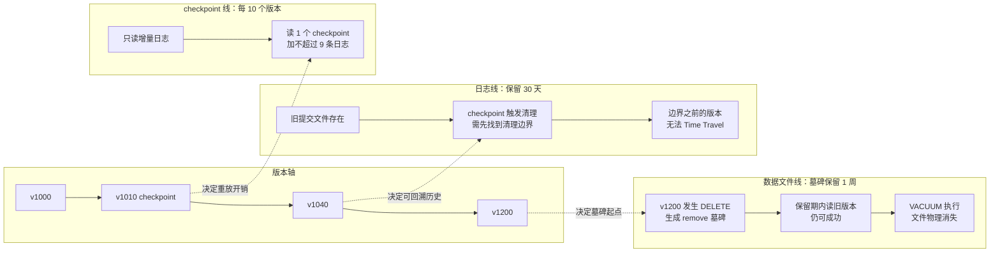
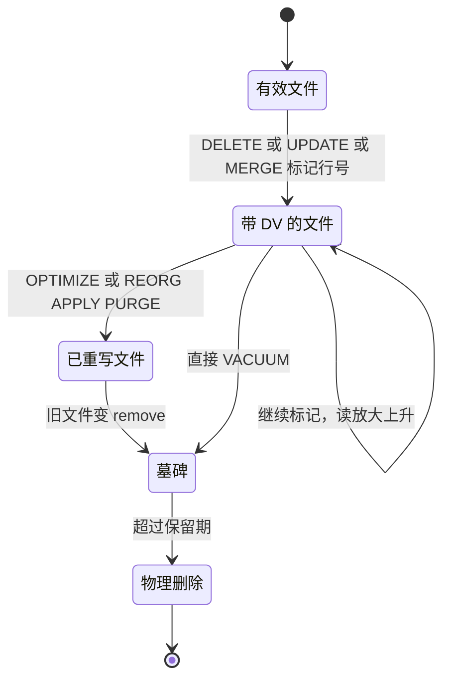
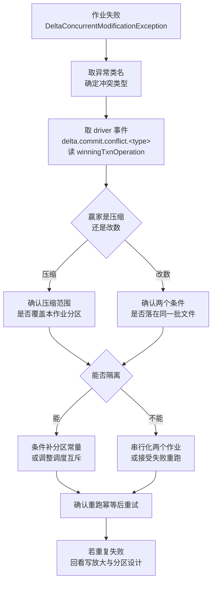
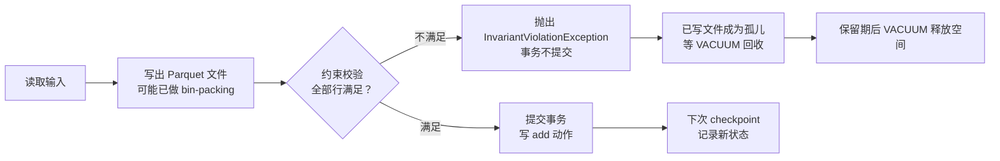
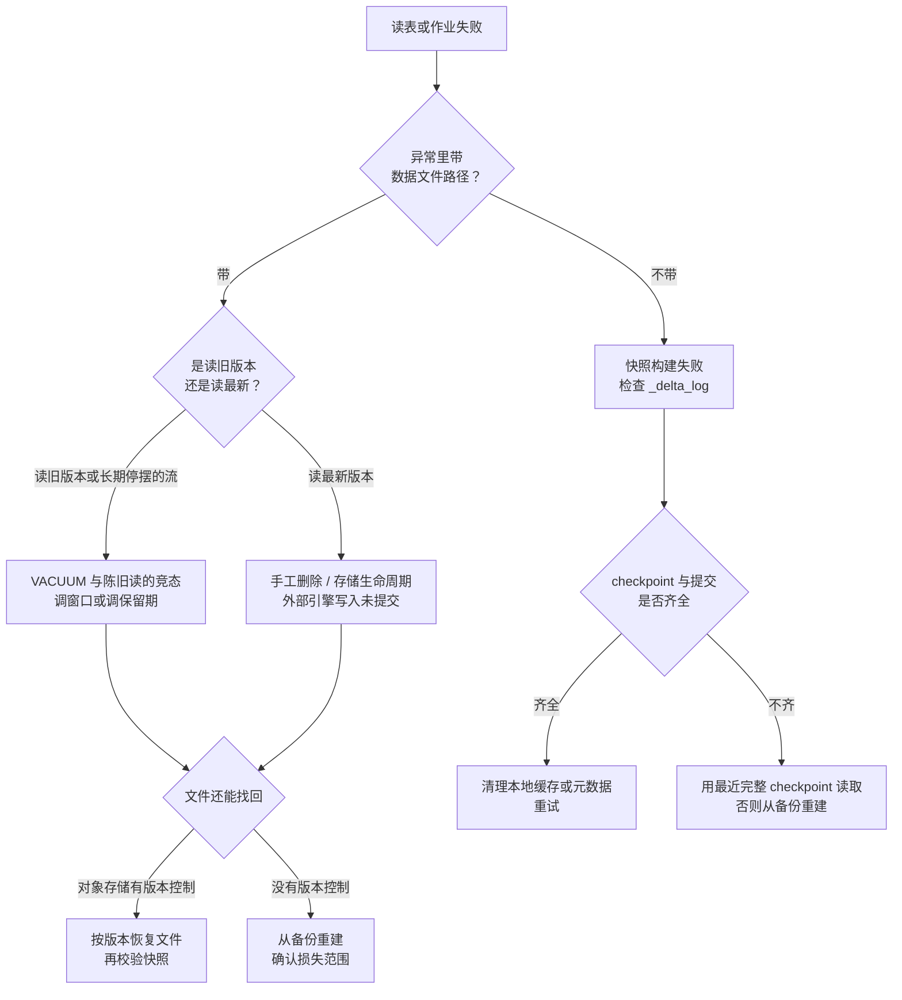
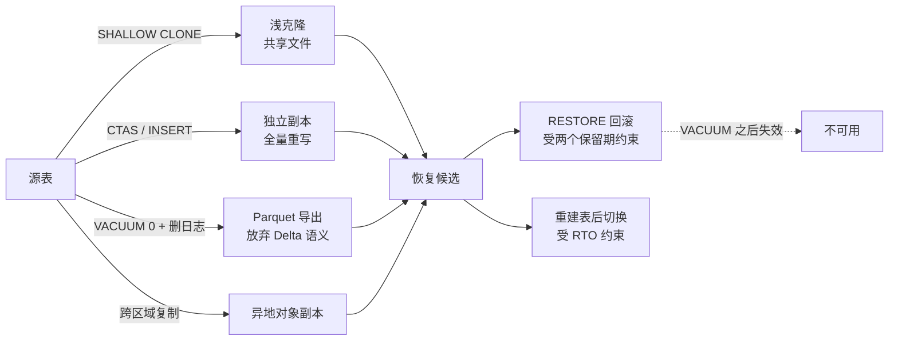

# 12 生产运维手册：监控、数据质量与灾难恢复

**摘要：**

Delta 表的运维难点不在命令怎么敲，而在于每个维护动作都挂着一个截止时间，错过之后代价不可逆。本文把这类约束整理成一份时间契约：数据文件的物理删除由 `VACUUM` 触发，墓碑保留期默认一周；提交日志的长度由 `delta.logRetentionDuration` 决定，默认三十天，且清理只能发生在 checkpoint 写出之后；`delta.checkpointInterval` 每十个版本压一次状态，决定快照重放要读多少文件；CDF、删除向量的 `PURGE`、`RESTORE` 与浅克隆各自被绑定在这几条线的某一段上。文章沿一张按天分区的订单事实表和一张半小时更新的商品维表，给出八个维护动作的截止时间表、四组健康度指标的取数与判读、五类故障的症状与处置顺序，并逐一核实哪些能力属于 Delta Lake 开源协议、哪些只是 Databricks 平台封装。贯穿全篇的判断规则只有一条：凡是会让文件或日志变少、变旧的维护动作，都要先确认它与其他动作的先后关系，再决定执行时机。文中所有规模数字均为示例推算，用于说明量级关系，不代表任何实测结论。

---

## 第 1 章 表没变，变的是维护动作的顺序

### 1.1 一次交接之后的两次事故

同一张订单表，原来的团队跑了半年没有出过事故，换成新团队接手，一周之内出了两次。配置没改，数据量没涨，集群规格没动，变的只是维护动作与写入动作之间的相对顺序：新团队把每周一次的 `VACUUM` 挪到了每天凌晨，并且顺手关掉了那条"保留期不能短于七天"的检查；第二次事故则来自另一个方向，一个补数作业要回溯十天前的版本，`RESTORE` 报出文件不存在，而十天前的数据文件早在第一次事故之后就随着每日 `VACUUM` 被物理删除，日志还好好地在三十天保留期里。

这类事故的共同点是事后无法补救。表结构没坏，日志没丢，元数据完好，缺的只是那些已经不在存储上的 Parquet 文件，而 Delta 的日志里记录的恰恰只是"文件在哪"，不是"文件是什么"。文件一旦被物理删除，日志再完整也只能确认损失范围，不能重建数据。由此引出一个容易被忽略的判断：Delta 表的运维对象不是数据，而是**时间**，具体说是数据文件、提交日志与 checkpoint 三者的存活窗口，以及维护动作落在这些窗口里的位置。

### 1.2 三个时钟

Delta 协议本身不定义"多久之后删除"，它定义的是"什么时候允许删除"。这句话落到实现上就是三个独立的时钟。

第一个是**数据文件时钟**，参数是 `delta.deletedFileRetentionDuration`，默认 `interval 1 week`。这个参数约束的不是文件在存储上的存活时间，而是逻辑删除之后墓碑还能被谁看见：当一次 `DELETE`、`UPDATE`、`MERGE` 或者 `OPTIMIZE` 把某些文件从最新快照里摘掉，日志里会留下对应的 `remove` 动作，协议把这类动作称为墓碑（tombstone），且明文说明它只为 `VACUUM` 服务，快照读取会直接忽略。墓碑按保留期过期之后，`VACUUM` 才有资格把这些文件从存储上真正删除。

第二个是**日志时钟**，参数是 `delta.logRetentionDuration`，默认 `interval 30 days`。它决定提交日志能被回溯多久，也就决定了 Time Travel 能往回看多远。但日志的清理并不是由时间单独触发的，官方文档的说法是"每次写出 checkpoint 时，Delta 会自动清理早于保留间隔的日志条目"，实现里还要额外满足一个前提：必须找到一个不晚于截止点的 checkpoint 作为清理边界。没有 checkpoint，清理不会推进，日志会一直堆着。

第三个是 **checkpoint 时钟**，参数是 `delta.checkpointInterval`，默认 10。含义是每十次提交写一次完整状态快照。它不是保留期，而是重放成本的分母：读取方只需要从最近的 checkpoint 出发，再重放它之后的若干条日志。这个数字决定了单次快照构建要读多少个文件，也决定了日志清理能不能找到边界。

三条线之外还有一条附带的窗口：`delta.checkpointRetentionDuration`，默认 `interval 2 days`，控制 checkpoint 文件与 V2 checkpoint 的 sidecar 文件在清理时被保护的时长，避免一次清理动作删掉并发写入正在引用的 checkpoint。它属于维护动作自己需要遵守的边界，不在用户视角的"数据能回溯多久"里。

### 1.3 保留期是条件时间，不是绝对时间

把这些参数读成"七天后删除"是常见误解。准确的读法是**条件命题**：数据文件在"被逻辑删除"且"距该动作超过保留期"且"`VACUUM` 被执行"三个条件同时成立时才会消失。三个条件里前两个由时间推进，第三个由人决定。因此，一张半年没有跑过 `VACUUM` 的表，文件数只增不减；而一旦某天有人手动跑了一次全表 `VACUUM`，从此以后能回溯的窗口就是"那次 `VACUUM` 的时刻减去保留期"。

下面的图把三条时间线叠在同一根版本轴上，可以看到各项能力的失效点并不重合。



| 参数 | 默认值 | 约束的对象 | 谁让到期生效 |
| --- | --- | --- | --- |
| `delta.deletedFileRetentionDuration` | `interval 1 week` | 逻辑删除的数据文件可以保留多久 | 只有 `VACUUM` 真正执行才释放 |
| `delta.logRetentionDuration` | `interval 30 days` | 提交日志长度与 Time Travel 范围 | 只有写出 checkpoint 后才触发清理 |
| `delta.checkpointInterval` | `10` | 每多少个版本压一次完整状态 | 由提交次数触发，与日历无关 |
| `delta.checkpointRetentionDuration` | `interval 2 days` | checkpoint 与 sidecar 的清理保护窗口 | checkpoint 清理动作 |
| `delta.enableExpiredLogCleanup` | `true` | 是否允许清理过期日志 | 每次 checkpoint 之后 |

由此可见，运维日历不是按天排的，而是按"这些条件什么时候会被触发"排的。日历里那句"每周日跑 `VACUUM`"的真正含义是：每周日重新设定一次七天的倒计时，并且在下次设定之前，任何跨越这条线的读都会被判死。

---

## 第 2 章 截止时间表：八个动作各自的死线

本章按动作逐个交代截止时间、默认阈值、错过之后发生什么，以及能不能补做。贯穿案例是两张表：订单事实表 `fact_order` 按 `dt` 分区、小时级微批写入，一天大约二十四个微批、每个分区落二十来个文件，示例推算下来一天新增四百到五百个文件、两百多个提交；商品维表 `dim_product` 不分区，全量约八千万行、单文件一 GB 上下，每十五分钟做一次 `MERGE` 增量更新。

### 2.1 OPTIMIZE：没有截止时间，但有斜率

`OPTIMIZE` 是唯一一个"不做也不会报错"的维护动作，这是它最危险的地方。文件数不会因为没人管就停止增长，它跟着提交次数单调上涨，而查询规划的成本大致跟着文件数线性上涨。一次微批至少落一个文件、至少产生一次提交，这条规律在流式写入上尤其明显：一天两百多个微批，就至少是两百多个新文件，再加上每个分区一个文件的分布，实际文件数会远高于批次数。

`OPTIMIZE` 做的事是 bin-packing（小文件治理的整体策略见 [[大数据/数据湖/Delta-Lake-Lakehouse架构深度解析/10 性能调优：小文件合并、缓存与统计信息维护|性能调优]]）：把小于目标尺寸的文件按分区重写成大文件，目标尺寸由内部配置 `spark.databricks.delta.optimize.maxFileSize` 控制，默认 1 GB。重写的产物是 `add`，被替换的旧文件变成 `remove` 墓碑，所以 `OPTIMIZE` 本身不释放存储，释放发生在下一次 `VACUUM`。这个先后关系决定了排期：如果压缩和 `VACUUM` 排在同一天，中间这七天的存储开销是双份的。

错过它的后果是渐进的，但存在拐点。文件数在几万的量级时，变慢表现为秒级抖动；到了几十万，变慢会集中在快照构建与任务切分上，表现为"某个早上所有查询同时变慢"，而慢的位置在 driver 侧而不是 executor 侧。这也是它容易被误判成资源不足的原因。`OPTIMIZE` 可以随时补做，补做的代价随积压量上涨，因为要重写的文件更多、读写放大更大。

### 2.2 VACUUM：唯一不可逆的动作

`VACUUM` 是整套维护动作里**唯一不可逆**的一步。它的语义是删除所有不再被最新快照引用、且早于保留阈值的文件，默认阈值七天，单位是小时而非天，可以由 `RETAIN <n> HOURS` 覆盖。它对目录的处理很粗暴：`VACUUM` 会删掉表目录下所有不属于 Delta 管理的文件，只跳过下划线开头的目录，所以把流作业的 checkpoint 放在表目录里而不加下划线前缀，会被它一并清掉。

源码里那层保护是 `spark.databricks.delta.retentionDurationCheck.enabled`，默认 `true`，作用是拦住保留期过短的调用，官方文档明说"如果确认没有操作会超过你设定的保留间隔，可以把它设为 false"。把它关掉、再把保留期设成 0，是数据团队最容易犯的单点错误：一条命令同时废掉 Time Travel、`RESTORE`、CDF 历史，以及所有正在读旧快照的长任务。而且这条错误在被发现之前不会有任何提示，因为表照常可读。

`VACUUM` 还有两个容易忽略的边界。其一，它只删数据文件，不删日志，日志由 checkpoint 之后的清理负责，所以"`VACUUM` 之后日志还在，是不是还能 Time Travel"这个联想是错的：日志在，指向的文件不在。其二，Delta 3.3 起提供 `VACUUM LITE` 模式，只用日志判断可删文件、不扫描整个目录，速度快得多，代价是当日志已被清理时会抛出 `DELTA_CANNOT_VACUUM_LITE`，因为它失去了判断依据。默认关闭，需要显式开启 `spark.databricks.delta.vacuum.lite.enabled`。

### 2.3 checkpoint：每十次提交写一次状态

checkpoint 的节奏由 `delta.checkpointInterval` 决定，默认 10，即每十次提交写一次。它不是可选的优化项，而是快照构建的成本上限：读取方先用 `_last_checkpoint` 找到最近的 checkpoint，从那里加载完整状态，再重放其后的日志，日志格式与快照构建的细节见 [[大数据/数据湖/Delta-Lake-Lakehouse架构深度解析/02 事务日志 Delta Log：ACID 保证的基石|Delta Log]]。没有 checkpoint，构建快照就要从版本 0 开始重放全部提交，这个成本随版本数线性上涨，最终表现为"表能读，但读之前要等几十秒"。

checkpoint 的另一个作用容易被忽略：它是**日志清理的前提**。协议规定的清理步骤要求先定位一个 checkpoint 作为边界，保留它以及它之后的所有提交，删除边界之前的日志、checkpoint 与校验文件。找不到边界就不清理。因此，把 `delta.checkpointInterval` 调得过大（譬如几百），表面上是减少了 checkpoint 写入，实际上会让日志清理停滞，`_delta_log` 目录持续膨胀，最终反过来拖慢每次提交时的目录列举。

`OPTIMIZE` 与 checkpoint 之间还有一个间接关系：每次 `OPTIMIZE` 提交会把一批 `add` 和 `remove` 写进日志，如果一次压缩涉及几万个文件，单条提交的体积会显著变大，checkpoint 的写入成本也随之上升。调整压缩粒度时，除了看输出文件大小，也要看单次提交涉及的文件数量。

### 2.4 CDF：保留期就是可见窗口

变更数据捕获（Change Data Feed，CDF）的记录单独放在表目录的 `_change_data` 下，但它不享受独立的保留策略。官方文档的表述是"`_change_data` 目录下的文件遵循表的保留策略，因此执行 `VACUUM` 时变更数据也会被删除"。换句话说，CDF 的可见窗口等于 `delta.deletedFileRetentionDuration`，默认七天，不会因为"下游要消费变更"而自动延长。

这条约束在流式链路上会变成硬故障。下游用 CDF 做增量同步，作业停摆三天，重启后从 checkpoint 记录的版本继续读，一切正常；停摆十天，重启时读取的起点版本对应的 `_change_data` 已被清理，报错指向文件不存在，而消费位点无法自动向前跳，因为跳过就意味着丢数据。处置只有两条：把停摆时间控制在保留期内，或者在停摆超期后做一次全量对齐。这也是把 `delta.deletedFileRetentionDuration` 从一周延长到一个月最常见的理由，代价是存储成本与 `VACUUM` 之后的一次性删除量同步上升。

还有一个起点约束：CDF 只能从启用该特性的版本往后读，早于启用版本的起点会直接报错。启用 CDF 需要在表上设置 `delta.enableChangeDataFeed=true`，而这个动作会把写协议抬到需要该特性的版本，老引擎写不进来。

### 2.5 Deletion Vector：两级延迟

Deletion Vector（DV）把"删一行"从"重写整个文件"变成"在旁路位图里标记行号"，代价是删除不再立即落地。据官方文档，DV 从 Delta Lake 2.3.0 起可用，且长期处于实验性支持阶段；`DELETE` 从 2.4.0 起支持、`UPDATE` 从 3.0.0 起、`MERGE` 从 3.1.0 起，删除向量的读能力与写能力都要把表的读协议升到 3、写协议升到 7，并在协议里登记 `deletionVectors` 特性。

于是删除变成**两级延迟**。第一级是标记：DV 产生之后，文件仍被引用，只是逻辑上少了若干行，读取时要额外读位图、跳过被标记的行。第二级是落地：要让标记真正消失，必须重写文件，触发条件包括关闭 DV 的 DML、`OPTIMIZE`，以及专门的 `REORG TABLE ... APPLY (PURGE)`。第三级才是释放：重写产生的新文件就位之后，旧文件要等 `VACUUM` 才被物理删除。

没有 PURGE 的表不会报错，只会一直背着读放大：一个文件的 DV 密度越高，每次扫描要跳过的行越多，且这类开销不进 `DESCRIBE DETAIL` 的 `numFiles`，单看文件数完全看不出来。只有遍历日志里的 `add.deletionVector` 才能统计出被标记的规模。运维上应当把 DV 密度当作独立指标，超过两成就排一次 `REORG TABLE ... APPLY (PURGE)`，并把 `PURGE` 之后的那次新版本时间作为 `VACUUM` 保留期的起算点，否则刚重写出来的旧文件还在窗口内，删不掉。把这条链路画成状态机，四个出口对应四种处置。



上面这张状态机里，右侧那条边是最危险的：带 DV 的文件如果直接走到墓碑，被标记的行还在旧文件里，而文件已经被删掉——数据是对的，只是"被删掉的内容"再也拿不出来，审计与回溯同时失效。

### 2.6 RESTORE：截止于最后一次 VACUUM

`RESTORE` 是 [[大数据/数据湖/Delta-Lake-Lakehouse架构深度解析/06 Time Travel：数据版本管理与回溯查询|Time Travel]] 系列能力里最强也最受限的一个，它的语义是把表恢复到某个历史版本或时间点，实现方式不是"回滚文件"，而是"提交一个新版本，用旧版本的 `add` 动作重建快照"。因此它的可用条件只有一条：目标版本引用的数据文件必须还在。官方文档把这条写得非常直接，"恢复到数据文件被手工删除或由 `VACUUM` 删除的旧版本会失败"，并补充说如果设置 `spark.sql.files.ignoreMissingFiles=true`，部分恢复仍然可能成功，代价是缺文件的那些分区被静默跳过。这不是恢复，是带缺口的降级。

`RESTORE` 还有一个副作用经常被忽略：它被算作数据变更操作，日志里新增的 `add` 动作 `dataChange` 为 `true`。对于下游的 Structured Streaming，这意味着一次回滚会把旧数据当作新数据重放一遍。文档给的例子里，`RESTORE` 到版本 1 会让版本 0 和版本 1 写入的行重新出现在变更流里，下游若不做幂等，重复数据就会沉到结果表。

恢复能回溯多远，还受一个开关影响：`delta.enableFullRetentionRollback` 默认 `true`，它允许回滚到日志保留期内的任意点，代价是需要每天把最老的日志文件转成 checkpoint；如果关掉，就只能回滚到 `delta.checkpointRetentionDuration` 覆盖的范围内。这个参数解释了为什么有些表的 `RESTORE` 突然只能回到两周前——不是配置被改，而是因为每天生成边界 checkpoint 的那一步没有发生。

### 2.7 浅克隆：借用别人的文件

`SHALLOW CLONE` 从 Delta Lake 2.3 起可用，它复制的是元数据，不是数据，新表引用源表的 Parquet 文件，因此创建成本极低，官方给出的事后修复手段也很明确：对源表跑了 `VACUUM` 之后，读克隆会抛 `FileNotFoundException`，此时用带 `replace` 的克隆重建即可。它克隆的元数据包括 schema、分区、不变量与可空性，不克隆表描述与用户自定义提交元数据；克隆表拥有独立历史，版本从 0 开始，所以针对源表的版本号在克隆表上不成立。

运维上它有两个用法：一是作为"低成本快照"用于短期实验，二是作为备份链里最便宜的一层。但它不能单独承担备份职责，因为克隆与源表共享同一份数据文件，源表的 `VACUUM`、源表的存储故障、源表的目录误删都会同时击穿克隆。真正需要独立副本时，需要把数据文件也复制出去，那是深拷贝的语义，属于 Databricks 平台的 `DEEP CLONE`，开源 Delta Lake 只提供浅克隆（后面第 8 章会集中交代能力归属）。

### 2.8 日志清理：checkpoint 是前提

日志清理由 `delta.enableExpiredLogCleanup` 控制，默认 `true`，触发时机是 checkpoint 写出之后。实现细节里有两处值得记住。其一，截止时间会被截断到零点：清理逻辑把"当前时间减去保留期"向下取整到当天的午夜，这意味着日志的实际保留期是 30 天到一个整天之间，永远不会短于 30 天。其二，清理必须找到边界 checkpoint，并保留边界版本自身的 JSON 提交文件，因为 checkpoint 不保存提交来源信息，某些特性还需要靠这条提交文件还原。

这个机制解释了两种看起来矛盾的现象：日志保留期设成 30 天，但有些表只能回溯 20 天，因为边界 checkpoint 只存在于 20 天前；另一些表保留期只有 7 天，却还能查到 40 天前的版本，因为清理一直没找到合适边界、或者写 checkpoint 的频率太低。判断一张表到底能回溯多久，看参数是不够的，要看 `_delta_log` 目录里实际存在的 checkpoint 与提交文件。

把八个动作的边界汇总成一张表，就是这份手册的第一页。

| 动作 | 默认阈值 | 触发方式 | 错过之后的后果 | 可否补做 |
| --- | --- | --- | --- | --- |
| `OPTIMIZE` | 目标文件 1 GB | 定时任务或手动 | 文件数上涨，规划变慢，无报错 | 可补，代价随积压上涨 |
| `VACUUM` | 保留 1 周 | 手动或定时，从不自动 | 文件永不释放，存储成本单调上升 | 可补，但一经执行不可撤销 |
| checkpoint | 每 10 个版本 | 提交次数驱动 | 重放成本线性上涨，日志清理停滞 | 下次提交自动补 |
| CDF 消费 | 跟随文件保留期 | 下游客端读取 | 停摆超期后起点失效，无法自动续读 | 只能全量重对齐 |
| `REORG ... PURGE` | 无默认节奏 | 手动 | DV 密度堆积，扫描读放大 | 可补，需重写文件 |
| `RESTORE` | 受日志与文件双重限制 | 手动 | 目标版本文件已删则失败 | 只能在截止前做 |
| `SHALLOW CLONE` | 无 | 手动 | 源表 `VACUUM` 后克隆失效 | 用 `replace` 重建 |
| 日志清理 | 30 天，按天截断 | checkpoint 之后 | 历史消失，无法回溯 | 不可补 |

---

## 第 3 章 健康度指标：从"表好不好"到"还剩多少余量"

### 3.1 绝对值没有意义，斜率才有

同一张十万文件的表，对一个每天提交两次的维表来说是病入膏肓，对一个每天提交两千次的流水表来说只是中午的正常水位。所以健康度指标不能只看绝对值，要看三样东西：绝对值、变化速率、以及与自身写入节奏的比值。十万文件配上两千次提交，平均每次提交只增五十个文件，属于健康；十万文件配上两次提交，意味着历史压缩从未发生。把这三个量摆在一起，指标才有判读价值。

按判读方向的差异，指标可以分成四组：规模（文件数、总字节、平均文件大小）、增长（提交速率、日志目录体量、checkpoint 数量）、质量（DV 密度、约束违规次数、缺文件）、并发（冲突事件数与冲突类型）。四组的取数位置不同，能回答的问题也不同：规模回答"现在有多糟"，增长回答"多久之后会糟"，质量回答"数据还可信吗"，并发回答"为什么作业时不时的失败"。

### 3.2 `DESCRIBE DETAIL` 给出三个数，也藏起三个数

`DESCRIBE DETAIL` 返回一行，字段包括表位置、创建时间、最后修改时间、分区列、`numFiles`、`sizeInBytes`、全部表属性，以及 `minReaderVersion` 与 `minWriterVersion`。运维判断用的主要是中间两个量，但它们的含义比字面窄。

| 字段 | 实际含义 | 判读价值 | 容易误读的地方 |
| --- | --- | --- | --- |
| `numFiles` | 最新快照里的逻辑文件数 | 规划成本的一阶近似 | 同一物理文件带不同 DV 会算作不同逻辑文件 |
| `sizeInBytes` | 最新快照的逻辑字节数 | 存储与扫描量的一阶近似 | 不含 `_delta_log`，不含未清理的旧文件 |
| `lastModified` | 最后一次提交时间 | 判断写入是否还活着 | 维护动作也会刷新它 |
| `properties` | 全部表属性 | 保留期、CDF、DV 开关都在这里 | 有些业务属性也混在这里 |
| `minReaderVersion` / `minWriterVersion` | 协议门槛 | 判断老引擎能否读写 | 表特性还在 `protocol` 里，此处看不到 |

`numFiles` 是逻辑文件数，带删除向量的文件按"路径加 DV 标识"计为一个逻辑文件，所以它既反映碎片化，也反映删除标记的分散程度。`sizeInBytes` 是最新快照的逻辑大小，既不含日志目录，也不含已经变成墓碑但还没被 `VACUUM` 的旧文件，因此"表那么大，为什么存储账单更大"这类问题要拿对象存储的实际用量去对，不能拿它去对。

更要紧的是它不告诉你的三件事：文件大小的分布、每个分区的文件数、日志目录的体量。平均文件大小可以用 `sizeInBytes` 除以 `numFiles` 估出来，但这个除法的失真程度取决于分布的形状：一半 1 GB、一半 1 MB 的表，平均值可能看起来很健康。真正反映分布的指标在别处——`OPTIMIZE` 的提交指标里有压缩之后的 `minFileSize`、`p25FileSize`、`p50FileSize`、`p75FileSize`、`maxFileSize`，这是官方口径下唯一能拿到文件尺寸分布的地方。小文件比例（譬如小于 128 MB 的文件占全部文件的比例）也只能从这一组指标或者直接统计日志里的 `add` 得到，`DESCRIBE DETAIL` 不提供按尺寸分桶的计数。

### 3.3 历史指标只有一种来源，而且会过期

每次提交都会在日志里留下一条 `commitInfo`，其中的 `operationMetrics` 是运维分析的**主矿脉**。它是按操作类型定义的一组键值对，名字在文档里有完整清单，取值依赖当次操作实际做了什么。

| 操作 | 关键指标 | 用来回答什么 |
| --- | --- | --- |
| `WRITE` / `CREATE TABLE AS SELECT` | `numFiles`、`numOutputBytes`、`numOutputRows` | 单次写入的产出规模与平均行宽 |
| `STREAMING UPDATE` | `numAddedFiles`、`numRemovedFiles`、`numOutputRows` | 微批的落盘粒度 |
| `DELETE` | `numRemovedFiles`、`numDeletedRows`、`numCopiedRows` | 删除是否触发了整文件重写 |
| `MERGE` | `numTargetRowsInserted`、`numTargetRowsUpdated`、`numTargetRowsCopied`、`numTargetFilesAdded` | 更新占比与写放大 |
| `UPDATE` | `numUpdatedRows`、`numCopiedRows`、`numAddedFiles` | 同上 |
| `OPTIMIZE` | `numAddedFiles`、`numRemovedFiles`、`numAddedBytes`、`p50FileSize`、`maxFileSize` | 压缩效果与输出尺寸分布 |
| `VACUUM` | `numDeletedFiles`、`numFilesToDelete`、`numVacuumedDirectories` | 清理是否真的发生 |
| `RESTORE` | `numRestoredFiles`、`numRemovedFiles`、`tableSizeAfterRestore` | 回滚影响面 |

这张表里最值得盯的是 `DELETE` 与 `MERGE` 的 `numCopiedRows`。这个数字的含义是"为了改几行，被整文件复制了多少行"，它除以 `numDeletedRows` 或 `numUpdatedRows`，就是这次操作的**写放大倍数**。一天几十次 `MERGE` 的维表，如果每次的写放大都在一百倍以上，说明分区或聚簇设计与更新条件不匹配，压缩做得再勤也只是在替写放大擦屁股。`VACUUM` 的 `numDeletedFiles` 则适合做校验：定时任务报"清理成功"，但指标是 0，说明保留期没到、或者根本没有墓碑，这次 `VACUUM` 只是白跑了一趟目录扫描。

这类指标只有一种取法：`DESCRIBE HISTORY`。它按版本倒序返回，默认保留 30 天，受 `delta.logRetentionDuration` 与清理进度双重约束。所以"上季度的压缩效果"是查不到的，需要自己把每次巡检的结果落到外部存储，形成独立于表的时间序列。这一点决定了监控体系的基本结构：Delta 只提供"当前状态"与"最近三十天的提交流水"，历史趋势必须由外部系统承接。

### 3.4 冲突率不在提交历史里

冲突无法从 `DESCRIBE HISTORY` 里统计，因为失败的事务不会产生提交，历史里只有成功的那一次。源码的实现是：捕获到 `DeltaConcurrentModificationException` 时记录一条 driver 事件，事件类型为 `delta.commit.conflict.<冲突类型>`，附带一个 `winningTxnOperation` 字段，写明赢家那次提交是什么操作。冲突指标要从这里取，或者从作业日志里的异常栈里数。

这个埋点位置本身说明了运维的判断顺序：先看冲突类型，再看赢家操作，最后才决定是改条件还是错峰。只统计"冲突多少次"没有意义，因为不同冲突类型的处置完全不同——读到被删文件的冲突靠隔离，元数据变更的冲突靠串行化，协议升级的冲突只能靠升级客户端。

### 3.5 采集链路与成本

一张表的健康检查是一次快照构建加一次历史扫描，成本与文件数量、日志长度正相关。示例推算：二十万文件的表，单次 `DESCRIBE DETAIL` 在冷缓存下要几秒，在几千张表的规模上每天全量扫一遍就是几十分钟的量级。所以采集要分层：核心表高频率、长尾表低频率、异常表临时提频。

巡检脚本的骨架可以很短，把四组指标压成一行输出即可，重点是每天跑、结果入时序库。

```python
# 逐表采集：一次 detail、一次 history，落到外部时序库
def collect(spark, table, window_days=1):
    d = spark.sql(f"DESCRIBE DETAIL {table}").collect()[0]
    h = spark.sql(f"DESCRIBE HISTORY {table} LIMIT 500").toPandas()

    files, size = d["numFiles"], d["sizeInBytes"]
    ops = h[h["timestamp"] >= (pd.Timestamp.utcnow() - pd.Timedelta(days=window_days))]

    # 压缩产出的尺寸分布只在这里能拿到，取最近一次成功的 OPTIMIZE
    opt = h[h["operation"] == "OPTIMIZE"]
    p50 = int(opt.iloc[0]["operationMetrics"].get("p50FileSize", 0)) if len(opt) else None

    return {
        "table": table,
        "num_files": files,
        "size_bytes": size,
        "avg_mb": round(size / max(files, 1) / 2**20, 1),
        "commits_24h": len(ops),
        "files_per_commit": round(files / max(len(ops), 1), 1),
        "last_optimize_p50_mb": None if p50 is None else round(p50 / 2**20, 1),
        "last_modified": d["lastModified"],
        "min_reader": d["minReaderVersion"],
        "min_writer": d["minWriterVersion"],
    }
```

判读时把"文件数 / 24 小时提交数"作为主指标，它比文件数本身稳定得多：这个比值在健康表上会围绕一个常量波动，一旦持续抬升，说明写入的落盘粒度在变碎，或者压缩的节奏跟不上；一旦跳变，通常意味着上游改了触发间隔。阈值不可通用，但斜率可比，这也解释了为什么巡检报表第一页放的应该是趋势而不是当前值。

---

## 第 4 章 并发：冲突不自动重试，重试是作业的事

### 4.1 提交层的重试不负责语义冲突

"并发冲突重试耗尽"这个说法在 Delta 上要拆成两半。源码里 `commitImpl` 捕获到 `DeltaConcurrentModificationException` 之后的动作是记录事件然后**原样抛出**，不做内部重试；迭代重试只针对另一类失败，即提交版本文件时撞上 `FileAlreadyExistsException`，或者抛出被标记为非冲突的 `CommitFailedException`。这两类重试的上限由两个内部配置控制：`maxCommitAttempts` 默认一千万，`maxNonConflictCommitAttempts` 默认十。前者大得离谱，是因为它兜的是"版本号被别人抢先占了"这种必然收敛的竞争；后者才是"存储抖了一下"的容忍度。

所以真正需要关心的不是"重试多少次"，而是"谁在重试"。**语义冲突**（读到被删的文件、元数据被改、协议被升）一次就抛给上层，重试发生在作业层：调度器重跑、Spark 任务重试、或者人工重跑。而作业层重跑是否安全，取决于这次写是否幂等——`MERGE` 重跑会把已经合并过的变更再合一次，`INSERT` 重跑会重复插入，只有带确定键的 `MERGE` 或者显式的事务标识才安全。把并发问题的处置寄托在"多试几次就好了"上，等于把一个正确性问题当成可用性问题处理。

### 4.2 冲突矩阵与它的判据

文档给出的冲突矩阵只区分三类操作：纯插入、改数（`UPDATE`、`DELETE`、`MERGE`）、压缩（`dataChange=false` 的 `OPTIMIZE`）。插入与插入不冲突，插入与其余两类不冲突，改数与改数、改数与压缩、压缩与压缩都可能冲突。

| 操作对 | 是否可能冲突 | 判据 |
| --- | --- | --- |
| 插入 vs 插入 | 否 | 两者都只追加，快照之间没有交集 |
| 插入 vs 改数 | 否 | 改数不改变"能不能再追加"这个事实 |
| 改数 vs 改数 | 是 | 两个条件读到了同一批文件 |
| 改数 vs 压缩 | 是 | 一方要删的文件正被另一方读 |
| 压缩 vs 压缩 | 是 | 两个压缩重写了同一批文件 |

关键在于"可能"二字：落在**同一批文件**上才算冲突。文档给出的标准解法是把操作条件写显式，让文件集合不相交——按 `date` 分区的表，两个只操作不同 `date` 的 `MERGE` 本来互不相干，但如果条件里不带 `date` 的常量约束，优化器会扫全表，冲突概率立刻回到最大值。分区是物理隔离，条件是逻辑隔离，两者都要写清楚，只做一半是不够的。

### 4.3 六类异常各自意味着什么

`DeltaConcurrentModificationException` 是父类，具体类型决定了处置方向。文档列出的六类可以这样对照：

| 异常 | 触发条件 | 常见来源 | 处置方向 |
| --- | --- | --- | --- |
| `ConcurrentAppendException` | 别人在你读的分区里加了文件 | 并发 `DELETE`/`MERGE`，条件过宽 | 条件里补分区常量，或错峰 |
| `ConcurrentDeleteReadException` | 你读的文件被别人删了 | 压缩与改数并发 | 压缩加 `WHERE` 限定，或串行化 |
| `ConcurrentDeleteDeleteException` | 你要删的文件别人也在删 | 两个压缩任务重叠 | 调度上加互斥，避免重复压缩 |
| `MetadataChangedException` | 表元数据被并发修改 | `ALTER TABLE`、schema 演进 | 把 DDL 排到写入窗口外 |
| `ConcurrentTransactionException` | 两个流用同一 checkpoint 写同一表 | 重复启动同一流作业 | 保证 checkpoint 唯一，禁止双跑 |
| `ProtocolChangedException` | 表协议被升级 | 特性启用、并发建表 | 升级客户端，或串行化建表动作 |

前四类靠隔离与错峰，第五类靠调度纪律，第六类只能靠版本对齐。第六类在多引擎环境里尤其麻烦：一个引擎为了启用 CDF 把写协议抬高，另一个只支持旧协议的引擎从此写不进来，报的正是这个异常，而报错位置往往在提交前的最后一步，前期计算全部白费。还要记得 Trino、Flink、Hive 这些引擎的 Delta 连接器版本各自独立演进，它们支持的协议门槛要按各自的发版说明核对，不能拿 Spark 连接器的版本去推断。

### 4.4 从冲突到处置的路径

下图的判断顺序对应真实排障：先确认冲突类型，再确认赢家是谁，再决定是不是同一批文件，最后才是重跑。



### 4.5 压缩窗口要避开写入高峰

运维日历里"每天凌晨两点跑全表 `OPTIMIZE`"这条约定，在未分区的维表上往往站不住：凌晨两点如果正好是上游补数与维表 `MERGE` 的窗口，压缩与改数撞车的概率接近必然，撞上之后的失败形态还不是报错，而是压缩失败的作业被调度器静默重试三次然后放弃，第二天早上文件数没有下降，没人注意到。避免这类静默失败的做法是把压缩写成"分区增量 + 显式条件"，并且把压缩任务与写入任务在调度图上做成互斥依赖，而不是靠时间点猜测。

对按天分区的订单表，压缩的目标应该只覆盖最近一到两天的分区，历史分区在写入当天就已经压缩过，再压一次只是重复读写。用 `WHERE` 限定范围还有一个附带好处：单次提交涉及的文件数量下降，日志条目变小，checkpoint 的写入成本也随之下降。

---

## 第 5 章 数据质量：约束在哪一刻生效，代价是什么

### 5.1 两类约束，两种强制强度

Delta 表支持两类标准 SQL 约束。`NOT NULL` 是 schema 的一部分，建表时写在列上，之后用 `ALTER TABLE ... CHANGE COLUMN ... DROP NOT NULL` 摘掉；它作用于所有写入路径，嵌套在 struct 里的列会连带约束父 struct，而 array 与 map 内部的元素不能加此约束。`CHECK` 约束是独立命名的布尔表达式，用 `ALTER TABLE ... ADD CONSTRAINT` 添加、`DROP CONSTRAINT` 删除，存储位置是元数据 `configuration` 里的键值对，键名格式为 `delta.constraints.{name}`，值要求是返回布尔值的 SQL 表达式。两类的违规都会抛出 `InvariantViolationException`，且整个写操作失败、表保持原样。

约束是**写协议特性**：写协议在 3 到 6 之间时 CHECK 约束始终可用，写协议为 7 时必须在协议规则里登记 `checkConstraints` 特性。这个门槛的运维含义是，加约束会把表推向更高的协议版本，外部引擎若跟不上就只能读不能写。

### 5.2 强制发生在文件写出之后、提交之前

协议对写入方的要求写得很直接：写入的每一行都必须满足约束，否则写操作失败、表不变。这个"写操作失败"掩盖了一个时序细节：数据文件是先写出去的，约束校验发生在提交阶段，校验不通过时事务不提交，那些已经落地的 Parquet 文件就成了**孤儿文件**——日志里没有引用它们，任何快照都看不见它们，只有 `VACUUM` 会按"表目录下未被引用的文件"把它们清掉。



这个时序决定了**先写后校验**的失败成本计算方式：一次失败的写入并不"什么都没发生"，它发生了两件事——占用了一批存储，以及给下一次 `VACUUM` 增加一批待删文件。失败成本大致等于该批次写出的字节数，与批次大小成正比，而不是与违规行数成正比。示例推算：一次 `MERGE` 重写五千个文件、每个三百 MB，其中一行金额越界，失败代价是这批约 1.5 TB 的无效写入加上后续清理，而真正的问题只是那一行。把写入路径上的三个位置画出来，失败的落点就很清楚。

### 5.3 给存量表加约束要全表验证

协议要求添加 CHECK 约束时必须校验表中已有数据，全部满足才能提交，否则写操作失败且表不变。这条规则的副作用是把一次 DDL 变成了一次全表扫描：八千万行的维表加约束，等于一次全量读，扫的时长决定了这次变更的窗口，也决定了失败时要重来的成本。

由此得到的操作顺序是先修数据、再加约束：把违规行找出来、改掉或者隔离到另一张表，然后 `ADD CONSTRAINT`，最后才是让上游开始依赖这个约束。反过来做，会得到一个"加了三次都失败、每次失败都要重新扫全表"的下午。约束失败时表不会留下半个约束，这一点倒是省心，不会出现"约束加了一半"的中间状态。

### 5.4 约束的连带代价

约束不是免费的强校验，它的代价有三笔。第一笔是写入路径上的额外计算：每个批次要对每一行求值布尔表达式，表达式里如果引用了多列、带了函数调用，开销会随表达式复杂度上升。第二笔是协议升级带来的兼容性风险：表被抬到更高写协议之后，只支持旧协议的引擎写不进来，多引擎场景要先确认读写两端都能接受。第三笔是失败时的重写成本，也就是上一节的孤儿文件。

把这三笔代价与"不做约束"的代价放在一起看，结论不是"约束越多越好"。约束真正适合拦的是那些一旦进表就必须回滚整条链路的错误：主键完整性、金额非负、状态值必须在枚举内。至于"某个字段偶发为空"这类可以容忍的问题，用它当闸门只会把正常写入也一起拦下。

### 5.5 与 DLT 的分工

声明式管道框架（Delta Live Tables，DLT）提供了另一套数据质量机制：期望（expectation）可以在管道层记录指标后继续、丢弃违规行后继续、或者直接让管道停止。两套机制的位置不同，处理违规的方式也不同。

| 机制 | 所在层 | 违规处理 | 归属 |
| --- | --- | --- | --- |
| `NOT NULL` / `CHECK` 约束 | 存储层，提交时强制 | 整个写事务失败，表不变 | Delta Lake 开源协议 |
| 管道层期望：仅记录 | 计算层，不阻断 | 记指标，数据继续流 | Databricks 平台能力（DLT） |
| 管道层期望：丢弃违规行 | 计算层，过滤 | 违规行被丢弃，其余继续 | Databricks 平台能力（DLT） |
| 管道层期望：失败停管道 | 计算层，阻断 | 管道停止，等待人工 | Databricks 平台能力（DLT） |

把两套机制叠起来的顺序是：能过滤的在管道层过滤，过滤不了、但绝对不能进表的放在存储层拦。管道层过滤的代价是一个额外的处理阶段；存储层拦截的代价是一次失败重写加一次人工介入。前者便宜，后者昂贵，所以存储层约束应该尽量少而硬，只放那几条"错了就等于事故"的规则。

需要说清的是 DLT 本身不在开源协议里，它是 Databricks 的平台产品。在纯开源栈上实现同样的分层，只能在写入作业里自己做过滤与计数，把命中规则的行写到一个旁路表，再把统计推给监控——机制不同，位置相同。

## 第 6 章 故障处置：分诊与五种形态

### 6.1 先用异常和路径把问题分成两类

Delta 表的读失败只有两个方向：要么日志齐全但数据文件缺了，要么数据文件在但日志读不全。前者的异常里带着具体的文件路径，后者的异常发生在快照构建阶段，还没走到读文件那一步。这个区别决定了处置完全不同——文件缺是**不可逆损失**，日志缺是**可用性降级**，前者要靠备份，后者常常只影响历史版本。分诊路径可以固定成下面这棵树。



### 6.2 FileNotFoundException：三种成因，一个原则

这个异常是运维线上最常见的一种，成因有三种，处置原则只有一条：先判断是"读得太旧"还是"删得太早"。

第一种是 `VACUUM` 与长任务或流读的竞态。一个作业在早上八点读到版本 1100 的快照，跑了两小时，其中某个分区到十点才被扫描；这期间运维跑了 `VACUUM`，保留期是七天，而该分区最后一批文件在七天前就被逻辑删除，于是这些文件被物理删除，作业在十点报文件不存在。判据很清楚：异常路径对应的文件在 `DESCRIBE HISTORY` 里能查到 `remove` 动作，且该 `remove` 的时间早于保留期。处置是让保留期大于最长任务时长，或者让 `VACUUM` 与长任务错峰。官方文档对这一条的建议是把保留间隔设得比最长可能运行的任务更长，并把流读的停摆上限也算进去。

第二种是浅克隆依赖的源文件被删。克隆表引用源表文件，源表一 `VACUUM`，克隆就废了，异常发生在读克隆的任意时刻，而不是读旧版本时。这条在处理上最简单，用带 `replace` 的克隆重建即可，但要查清楚为什么克隆表在源表 `VACUUM` 之后还在被使用——通常是有人把它当成了独立备份。

第三种是存储侧的手工删除与生命周期策略。对象存储的生命周期规则按"最后修改时间"把旧对象转成低频、归档、或者直接删除，它完全不知道 `_delta_log` 里还引用着这些对象。这类事故的判据是"缺失文件集中在某个时间点之前"，与 `VACUUM` 的历史对不上——因为根本不是 `VACUUM` 干的。

`spark.sql.files.ignoreMissingFiles=true` 只在一种场合值得用：只读抢救出还能读的那部分数据，把损失范围摸清楚。把它当成常态配置，等于让所有缺文件都不再报错，数据静默变少，比报错危险得多。

### 6.3 重试耗尽：这是作业层现象

并发冲突本身在上一章讲过，这里只补处置顺序。报"重试耗尽"的时候，实际发生的是作业层的重试次数用完了，而不是 Delta 的提交层放弃了。处置顺序是三步：先确认这次写是否幂等，不幂等就先禁止重跑；再确认冲突类型的隔离手段（补分区常量、调度互斥、错峰）；最后才是重跑。

顺序不能颠倒。先重跑的代价是把一个数据正确性问题变成数据重复问题：`MERGE` 的写放大、`INSERT` 的重复行都不在失败当下暴露，而是等下游对账时才浮出来，那时已经无从定位是哪一次重跑造成的。

### 6.4 日志不全：可用性降级，但不可重建

`_delta_log` 目录被手工删除一部分、被同步工具覆盖、或者被生命周期策略转冷，症状是快照构建阶段失败，或 Time Travel 到某个版本时报日志文件不存在。判断日志是否完整的方法很简单：`_last_checkpoint` 指向的那个 checkpoint 文件必须存在，该 checkpoint 版本对应的 JSON 提交文件必须存在，之后每个版本的提交文件也必须在。

协议对清理的要求恰好解释了这三条为什么必须同时成立：清理时要保留边界 checkpoint 以及边界版本自身的提交文件，因为 checkpoint 不保存提交来源信息；之后的所有提交都要保留，才能支撑边界与下一个 checkpoint 之间的 Time Travel。所以日志目录里缺的不是"冗余文件"，而是支撑快照与历史的**必要组成部分**。

日志不全的恢复手段有限：能找到最近一个完整 checkpoint 时，读取可以从那里出发，代价是丢掉边界之前的历史；找不到时只能从备份重建。这里要强调一个常被误解的点：`VACUUM` 不删日志，日志是被 checkpoint 之后的清理动作删的，所以出现"日志丢了"要先查目录操作与生命周期策略，而不是怀疑 `VACUUM`。

### 6.5 规划慢：元数据膨胀的几个来源

读一张表之前要先构建快照：找到 `_last_checkpoint`、读 checkpoint、再重放其后的提交。这条链路上任何一环变慢，表现都是"查询还没开始跑就已经过去了几十秒"，且慢在 driver 侧。来源有四个。

其一是提交数太多而 checkpoint 太少。`delta.checkpointInterval` 调大之后，每次构建快照要重放的日志条目变多，日志清理又因为找不到边界而停滞，目录里的文件数量反过来拖慢目录列举。其二是单次提交涉及的文件太多。一次 `OPTIMIZE` 重写几万个文件，这条提交本身就是几十 MB 的 JSON，读它要解析几十万条动作。其三是把表目录与海量无关对象混放，目录列举的代价随对象数量上涨，而 `VACUUM` 的 `FULL` 模式每次都要列全目录。其四是表被外部引擎非原子写入，日志里出现大量细碎提交。

处置按代价从低到高：把 checkpoint 频率调回默认的十；把压缩粒度拆细，单次提交控制在几千个文件以内；把表目录与流作业的 checkpoint、临时输出分开，必要时给流作业的 checkpoint 目录加下划线前缀以免被 `VACUUM` 误删；最后才是清理历史（`DROP FEATURE` 一类操作会涉及历史截断，那条路径有独立的等待窗口，不能当日常操作）。

### 6.6 RESTORE 之后：回滚不是终点

`RESTORE` 完成之后，表回到目标版本的状态，但存储层留下了三层碎片。第一层是文件引用关系的变化：回滚会把旧版本的 `add` 重新提交，同时删掉当前版本的 `add`，`numRestoredFiles` 与 `numRemovedFiles` 双双为正，文件数可能比回滚前更多。第二层是统计信息：旧文件的 `stats` 是当时写的，与当前数据一致，但被回滚掉的版本里可能已经产生过 `OPTIMIZE` 或 `PURGE`，回滚把这些动作的结果一并撤销，文件布局退回压缩之前。第三层是下游状态：`RESTORE` 的提交 `dataChange=true`，流式下游会把回滚涉及的数据当成新数据重放。

所以 `RESTORE` 的完整动作是四步而不是一步：确认回滚目标版本的数据正确、执行回滚、对回滚涉及的分区重跑压缩、通知或重置下游位点。少做后两步，事故会在两天后以"下游数据翻倍"的形式再发生一次。

### 6.7 故障速查

| 症状 | 判据 | 根因 | 处置 | 不可逆点 |
| --- | --- | --- | --- | --- |
| 读旧版本报文件不存在 | 异常路径对应日志里有 `remove`，且早于保留期 | `VACUUM` 与陈旧读竞态 | 调长保留期或错开窗口 | 文件已删，无法恢复 |
| 读克隆报文件不存在 | 克隆路径指向源表目录 | 源表被 `VACUUM` | 带 `replace` 重建克隆 | 克隆失效期内的读全部失败 |
| 读最新版本报文件不存在 | 缺失文件集中在某时间点之前 | 存储生命周期或手工删除 | 从对象存储版本历史恢复 | 无版本控制时数据丢失 |
| 作业报冲突且重试耗尽 | driver 事件里的冲突类型与赢家操作 | 并发写同一批文件 | 隔离条件、错峰、幂等重跑 | 无 |
| 快照构建失败 | `_last_checkpoint` 或提交文件缺失 | 日志被删或被转冷 | 用最近完整 checkpoint 读取 | 边界之前的历史丢失 |
| 查询规划慢 | driver 侧耗时占主导，提交数与目录对象数偏高 | 元数据膨胀 | 调回 checkpoint 频率、拆细压缩 | 无 |
| 回滚后文件数与存储上涨 | `numRestoredFiles` 正数，`numRemovedFiles` 正数 | 回滚重建旧引用 | 回滚后重跑压缩 | 旧版本布局不可复用 |
| 回滚后下游数据翻倍 | 下游出现重复业务键 | `RESTORE` 的 `dataChange=true` | 下游幂等或重置位点 | 重复数据已写入 |

---

## 第 7 章 备份：Time Travel 不是备份

### 7.1 三个边界让 Time Travel 不能当备份

Time Travel 能查历史版本，这件事让很多人把它当成备份。三个边界否掉了这个用法。日志保留期默认 30 天，且清理由 checkpoint 触发、截止点向下取整到零点，所以能回溯的时间是"30 天往上取整"，不是"任意时刻"。数据文件保留期默认 7 天，由 `VACUUM` 决定生效，一旦执行，7 天前的文件立刻消失，`RESTORE` 与 Time Travel 同时失效。而 `RESTORE` 本身依赖文件存在，官方文档写明的失败条件正是"恢复到数据文件被手工删除或由 `VACUUM` 删除的旧版本"。

三条合起来得到的结论是：Time Travel 只是一层**撤销能力**，覆盖范围由两个保留期与清理进度共同决定，并且可以被一条命令瞬间作废。真正的备份必须满足两条要求——独立于源表的物理载体，以及规定好的恢复时限（RTO）。

### 7.2 四条备份通道与它们的边界

| 通道 | 实现方式 | 成本 | 独立于源表 | 主要边界 |
| --- | --- | --- | --- | --- |
| 浅克隆 | `CREATE TABLE ... SHALLOW CLONE` | 最低，只写元数据 | 否 | 源表 `VACUUM` 后失效 |
| 深拷贝 | `CREATE TABLE AS SELECT` 或 `INSERT INTO` 重构 | 与数据量成正比 | 是 | 需要额外算力，重跑成本高 |
| 导出 Parquet | `VACUUM RETAIN 0 HOURS` 后删除 `_delta_log` | 低，但不可逆 | 是 | 失去 ACID 与增量能力 |
| 存储层复制 | 跨区域复制、对象版本控制、对象锁 | 存储费与请求费 | 是 | 与 `VACUUM` 的删除动作冲突 |

深拷贝这一行里要区分两个东西：开源的 Delta Lake 只提供浅克隆，`DEEP CLONE` 属于 Databricks 平台（下一章集中交代归属），在纯开源栈上做深拷贝只能自己 `SELECT` 出来再写一张新表，数据量大的时候就是一次全量重算。导出 Parquet 这条通道的实现恰好就是官方文档给出的"把 Delta 表转回 Parquet 表"的两步：先用保留期 0 的 `VACUUM` 删掉所有不属于最新版本的文件，再删掉 `_delta_log`。它顺带说明了一件事：`VACUUM RETAIN 0 HOURS` 的唯一合理用途是"确认要放弃这张表的 Delta 语义"，而不是"清理得更干净"。

存储层复制看似最稳，实际有两处坑。其一是复制的是对象而不是语义，日志与数据文件的复制延迟不同步，在复制延迟窗口内做恢复会得到一个"日志与文件对不上"的表，校验必须用 `DESCRIBE HISTORY` 逐版本确认，不能直接开始读。其二是对象锁与 `VACUUM` 的冲突：保留期内 `VACUUM` 的删除请求会被拒绝，表看起来"清理过了"，实际文件一份没少，指标上 `numDeletedFiles` 与账单都不动。这层保护在有合规要求时是刚需，在排障时却容易被误读成 `VACUUM` 失效。

### 7.3 增量备份要挂在保留期上

用 CDF 做增量备份是可行的，但它的可用窗口就是文件保留期。备份作业每天跑一次时，窗口七天足够；备份作业因为故障停了一周，重启时起点已经失效，只能回退到全量。所以增量备份的正确设计是把"备份作业的健康度"也纳入监控——它断掉的那一天，恰好是恢复能力开始缺口的那一天，而这件事在断掉当天不会有任何报错。

### 7.4 恢复演练：把 RTO 从估算变成实测

没有演练过的恢复方案只是一份文档。演练的设计要覆盖三种情形，并且要接受**预期失败**也是结果：在保留期之外执行 `RESTORE`，它应该失败，如果不失败，说明保留期配置与团队认知不一致；在保留期之内执行 `RESTORE`，记录耗时；从备份通道重建一张表，记录从发起请求到可查询的分钟数。三次记录下来，RTO 就不再是拍出来的数字。

演练还有一个副作用是有价值的：它逼着团队把"这张表从哪恢复、恢复到哪个时间点、恢复到哪台集群"写清楚。这三件事在事故当天现想，通常已经来不及。四条通道与两条恢复路径的相对位置如下图。



---

## 第 8 章 Delta Sharing：共享是协议，不是表的属性

### 8.1 归属核实

Delta Sharing 常被列在 Delta Lake 的功能清单里，但它的位置与 CDF、DV 这类表特性不同。官方文档对它的定义是"一个用于安全实时交换大型数据集的开放协议，使人能够在任何计算平台上实时共享数据，它是一套简单的 REST 协议，安全地授予部分云数据集的访问权"。也就是说，它是**独立协议**，有独立的协议规范与参考实现仓库，Delta Lake 的 Spark 连接器只是提供了读取端的数据源（`deltaSharing` 格式）。

这里必须把三层分清楚。第一层是协议规范，公开、与计算引擎无关，描述的是共享服务器如何暴露表、客户端如何取数据、以及预签名 URL 的用法。第二层是参考实现，包括服务端与客户端，开源可自建，也支持读取端的快照、Time Travel 与谓词下推。第三层是托管服务，包括托管共享服务器、接收方（recipient）管理、以及与统一元数据目录的集成，这些是 Databricks 平台的产品能力，不在开源协议与参考实现的范围里。

### 8.2 提供给共享方的三条运维约束

对数据提供方来说，共享不是"配置好就不管了"的动作，它把提供方的保留期设置暴露成了**对外承诺**。

其一，接收方能读到的历史受提供方 `VACUUM` 约束。共享出去的是文件访问能力，文件被提供方 `VACUUM` 掉之后，接收方读旧版本同样会失败，而接收方既看不到提供方的运维日历，也无法预判。运维上要么把共享表的保留期设得比一般表更长，要么在共享契约里写清历史窗口。

其二，历史共享需要显式开启。默认共享的是最新快照，要让接收方按版本或时间点读，需要提供方在共享配置里打开历史选项，这一步不做，接收方的 Time Travel 查询会直接失败。

其三，客户端版本门槛由表特性决定。表上启用了删除向量或列映射之后，接收方要用支持这些特性的读取端，官方说明是 `delta-sharing-spark` 3.1 起支持对这类表的读取。这就形成了一个跨组织的版本耦合：提供方在表上开一个新特性，接收方可能读不了，而报错发生在接收方那侧。

### 8.3 能力归属

| 能力 | 层次 | 归属 | 说明 |
| --- | --- | --- | --- |
| 共享协议规范 | 协议 | 开放协议，独立于 Delta 表协议 | 定义共享、schema、表、查询与预签名 URL |
| 参考服务端与客户端 | 实现 | 开源参考实现 | 可自建，读取端支持快照、时间旅行、谓词下推 |
| `deltaSharing` 数据源 | 连接器 | Delta Lake Spark 连接器提供读取端 | 只读，不支持写入共享表 |
| 托管共享服务与接收方管理 | 服务 | Databricks 平台能力 | 不是开源协议的一部分 |
| 与统一元数据目录的共享集成 | 服务 | Databricks 平台能力 | 同上 |

把这张表看懂之后，一个常见的误配就能避免：把"共享表"当成"备份表"。共享只是把读权限跨组织开放，底层仍是同一份文件、同一套保留期、同一个存储故障域，提供方一次误删依然会同时击穿共享与源表。

---

## 第 9 章 反例与落点

### 9.1 五个反例

第一个反例是把 `VACUUM` 保留期设成 0。这条命令通常出现在"我要把表转成 Parquet"或者"存储太贵想清干净"的语境里，执行之后表照常可读，问题要等到下一次需要回溯时才爆发，而那时所有旧文件都没有了。它之所以危险，是因为它的代价与收益在时间上完全错开。

第二个反例是无监控地跑半年。文件数从两万涨到八十万的过程里没有任何一次报错，唯一的症状是变慢，而变慢被归因于集群资源不足，于是加机器、加资源，慢的问题缓解一点又回来。等到有人翻出 `DESCRIBE DETAIL` 看到文件数，才发现半年的资源投入都在替一个维护动作买单。

第三个反例是把 Time Travel 当备份。这类团队通常会说"我们保留了 30 天历史"，但没人验证过 30 天这个数字在当前表上是否成立，也没人注意过 `VACUUM` 的执行频率。真正的检验方法很简单：在演练环境里对一张测试表执行 `RESTORE` 到 25 天前，看它成不成功。

第四个反例是频繁做深拷贝。每天全量拷贝一遍三 TB 的表，成本不只是存储，还有拷贝期间占用的算力与对源表的读放大，而它换来的恢复能力，与"每周一次独立副本加上一条可靠的增量通道"几乎等价。

第五个反例是把压缩排在写入高峰。压缩与改数撞车的后果不是报错就是静默重试，两种结果都会让第二天的文件数没有下降，而运维看到的报表是"任务成功"。

### 9.2 落点

把全篇的内容压成一句话：运维动作的价值不在于做没做，而在于是否赶在截止时间之前做，并且清楚它换走了什么。保留期越长，可回溯的窗口越大，存储与 `VACUUM` 之后的删除冲击也越大；checkpoint 越频繁，重放开销越小，但写入路径上的额外开销与目录里的文件数量同步上涨；约束越严，进入表的数据越干净，写入被整批拒绝的概率也越高。三组权衡没有通用的最优点，只有与这张表的写入节奏、下游的容忍度、以及团队的处置速度相匹配的点。

要让这些权衡可管理，唯一可行的办法是把时间契约显式化：把每个动作的阈值、触发者、错过后果写进运维日历，把每个指标的口径与取数位置固定下来，把每次恢复演练的实测数字记进运行手册。手册里的数字会随表长大而失效，但这种失效本身是可观测的，这比"配置看起来没问题"要可靠得多。

至于这些边界会不会被后续版本抹平，目前仍然言之尚早。checkpoint 的格式在演进，历史清理的策略在细化，表特性也在把越来越多原本靠"运维纪律"维持的约束搬进协议里；但保留期与不可逆删除这一对矛盾是存储层的物理事实，协议能做的只是让边界更清晰、让越界更早被发现。

---

## 参考资料

1. Delta Lake 文档：Table utility commands（`VACUUM` 保留阈值与安全检查、`VACUUM LITE` 与 `DELTA_CANNOT_VACUUM_LITE`、`DESCRIBE HISTORY` 的 `operationMetrics` 全量清单、`DESCRIBE DETAIL` 字段、`RESTORE` 的失败条件与指标、浅克隆及其 `FileNotFoundException`、Delta 表转 Parquet 的两步）。https://docs.delta.io/latest/delta-utility/
2. Delta Lake 协议规范：`PROTOCOL.md`（`remove` 墓碑与 VACUUM 的关系、checkpoint 三种命名与多部分 checkpoint、Metadata Cleanup 的边界 checkpoint 规则、CHECK 约束的 `delta.constraints.{name}` 存储与写入方校验要求、删除向量的读写协议要求）。https://github.com/delta-io/delta/blob/master/PROTOCOL.md
3. Delta Lake 文档：Delta Table Properties Reference（`delta.deletedFileRetentionDuration` 默认 `interval 1 week`、`delta.logRetentionDuration` 默认 `interval 30 days`、`delta.checkpointPolicy`）。https://docs.delta.io/latest/table-properties/
4. Delta Lake 源码：`spark/src/main/scala/org/apache/spark/sql/delta/DeltaConfig.scala`（`delta.checkpointInterval` 默认 10、`delta.checkpointRetentionDuration` 默认 `interval 2 days`、`delta.enableExpiredLogCleanup`、`delta.enableFullRetentionRollback` 的语义）。https://github.com/delta-io/delta/blob/master/spark/src/main/scala/org/apache/spark/sql/delta/DeltaConfig.scala
5. Delta Lake 源码：`spark/src/main/scala/org/apache/spark/sql/delta/MetadataCleanup.scala`（清理截止点按天截断、边界 checkpoint 查找、`checkpointRetentionDuration` 对 sidecar 的保护窗口）。https://github.com/delta-io/delta/blob/master/spark/src/main/scala/org/apache/spark/sql/delta/MetadataCleanup.scala
6. Delta Lake 文档：Constraints（`NOT NULL` 与 `CHECK`、添加约束时对已有数据的校验、违规抛 `InvariantViolationException`）。https://docs.delta.io/latest/delta-constraints/
7. Delta Lake 文档：Concurrency control（写冲突矩阵、六类冲突异常、用分区与显式条件隔离）。https://docs.delta.io/latest/concurrency-control/
8. Delta Lake 源码：`spark/src/main/scala/org/apache/spark/sql/delta/OptimisticTransaction.scala`（`CommitConflictFailure` 的可重试异常集合、`DeltaConcurrentModificationException` 抛出前记录的 `delta.commit.conflict.<type>` 事件与 `winningTxnOperation`）。https://github.com/delta-io/delta/blob/master/spark/src/main/scala/org/apache/spark/sql/delta/OptimisticTransaction.scala
9. Delta Lake 源码：`spark/src/main/scala/org/apache/spark/sql/delta/sources/DeltaSQLConf.scala`（`maxCommitAttempts` 与 `maxNonConflictCommitAttempts` 的默认值、`optimize.maxFileSize` 默认 1 GB、`retentionDurationCheck.enabled` 默认开启、`vacuum.lite.enabled` 默认关闭）。https://github.com/delta-io/delta/blob/master/spark/src/main/scala/org/apache/spark/sql/delta/sources/DeltaSQLConf.scala
10. Delta Lake 文档：What are deletion vectors（自 2.3.0 起可用且处于实验性支持、各操作首次支持版本、`REORG TABLE ... APPLY (PURGE)` 与 `VACUUM` 的先后关系）。https://docs.delta.io/latest/delta-deletion-vectors/
11. Delta Lake 文档：Change data feed（`_change_data` 跟随表保留策略、`VACUUM` 会删除变更数据、起点早于启用版本时报错）。https://docs.delta.io/latest/delta-change-data-feed/
12. Delta Lake 文档：Read Delta Sharing Tables（Delta Sharing 作为开放 REST 协议的定义、共享表的快照与时间旅行读取、`delta-sharing-spark` 3.1 起对删除向量与列映射的支持）。https://docs.delta.io/latest/delta-sharing/
13. Delta Sharing 协议规范与参考实现。https://github.com/delta-io/delta-sharing/blob/main/PROTOCOL.md
14. Databricks 文档：Clone a table（深克隆与浅克隆的差别、深克隆的指标；用于说明 `DEEP CLONE` 属平台能力）。https://docs.databricks.com/en/tables/operations/clone
15. Delta Lake 文档：How does Delta Lake manage feature compatibility（表特性与协议版本对照，含 `CHECK` 约束 0.8.0、CDF 2.0.0、删除向量 2.3.0、V2 checkpoint 3.0.0、行追踪 3.2.0、checkpoint 保护 4.0.0）。https://docs.delta.io/latest/versioning/
16. Armbrust M., Das T., Torres J., et al. Delta Lake: High-Performance ACID Table Storage over Cloud Object Stores. VLDB 2020.

---

> [!note] 思考题
> 1. 保留期是"条件时间"而不是"绝对时间"，这对备份策略的设计意味着什么？如果团队希望"任何时刻都能回到 30 天前"，需要哪些动作同时到位才成立？
> 2. 元数据清理要求先找到边界 checkpoint，而边界 checkpoint 由写入频率决定。当一张表的提交频率骤降时，它的日志清理会更强还是更弱，为什么？
> 3. 删除向量的三级延迟里，最危险的是哪一级？如果一张表长期只做 `DELETE` 而从不 `OPTIMIZE` 或 `PURGE`，从 `DESCRIBE DETAIL` 上能看出问题吗？
> 4. `RESTORE` 的提交 `dataChange=true`，这让回滚对下游而言等价于一次数据变更。有没有办法让下游区分"这是回滚"与"这是新增"，代价是什么？
> 5. 共享表的保留期由提供方单方面决定，接收方无从预判。这种跨组织的时序耦合应该用技术手段还是契约手段解决，各自留下什么残余风险？
