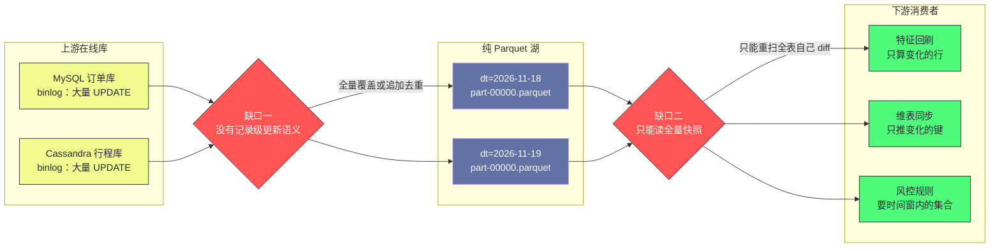
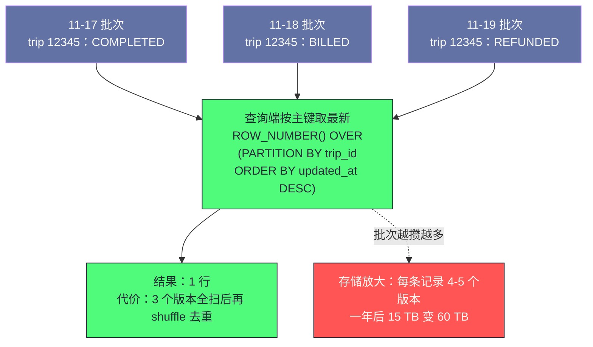
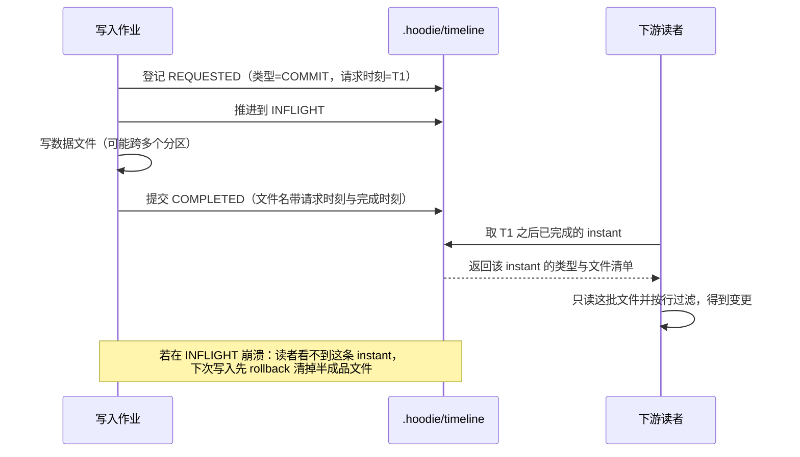
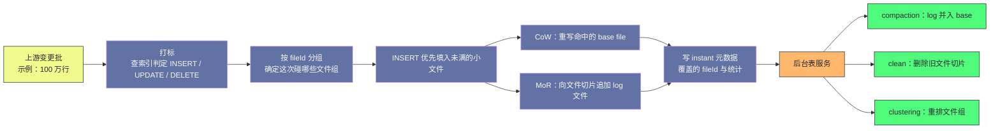
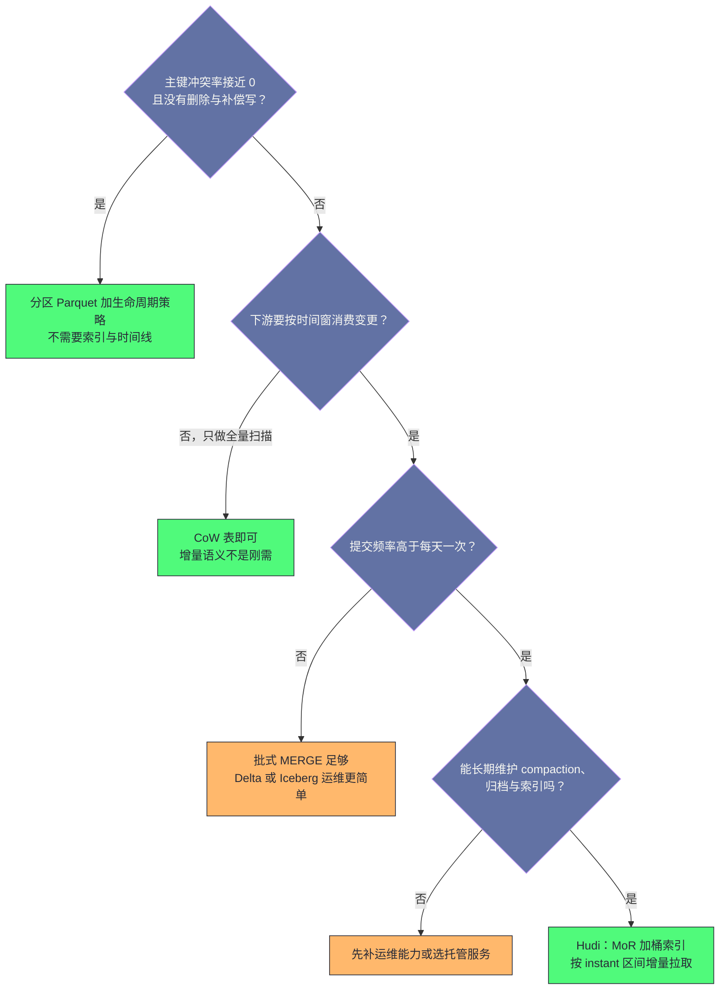

# 为什么需要 Hudi——Uber 的 CDC 增量数仓困境与 Timeline 解法

**摘要：**

Hudi 的起点不是"数据湖需要事务"这个一般命题，而是 2016 年 Uber 的一条具体流水线：行程表在 MySQL 里被反复更新，下游要近实时地看到"过去一小时哪些行程变了"。这条流水线在纯 Parquet 湖上撞上两个缺口。写侧没有记录级的更新语义，改一行要么全量重写、要么追加一份新版本再让查询端去重；读侧只有"当前全量快照"，拿不到"某个时间窗口内的变更集合"。本文用这一条流水线贯穿全篇，先分别算清两个缺口各自的账单，再拆 Hudi 的解法：把每一次写操作记成一个带类型（commit、deltacommit、compaction、clean 等）与生命周期（REQUESTED、INFLIGHT、COMPLETED）的 instant，让"时间窗内的变更"成为时间线上一个可查询的区间。这个记账方式推翻了数据湖的两条默认假设，换来 upsert 与 delete 的高效写入、以及按区间做增量拉取两种能力，代价是时间线自身成为运维对象、索引需要持续维护、CoW 与 MoR 必须二选一。文章最后把 Delta 的版本、Iceberg 的快照、Hudi 的时间线三种记账方式的读者路径并排对照，并给出四类不该用它的情况。

---

## 第 1 章 2016 年的两笔账

### 1.1 一条行程记录的一生

2016 年前后，Uber 的数据团队要把核心业务库（MySQL、Cassandra）里的行程、司机账单、订单同步进 Hadoop，供 Hive 与 Spark 分析。这件事的难点从第一句话就露出来了：同步的对象不是"一批新行"，而是"一批被改过的行"。

一条行程在库里的状态迁移大致如下，六次写入，只有第一次是插入。

| 时刻 | binlog 事件 | 行内容的变化 | 若湖是 append-only 会多出什么 |
|---|---|---|---|
| 10:00 | INSERT | `status=REQUESTED`，行程创建 | 第 1 行 |
| 10:03 | UPDATE | `status=ACCEPTED`，写入 `driver_id` | 第 2 行（与第 1 行同主键）|
| 10:05 | UPDATE | `status=IN_PROGRESS`，写入 `start_time` | 第 3 行 |
| 10:31 | UPDATE | `status=COMPLETED`，写入 `fare`、`end_time` | 第 4 行 |
| 11:02 | UPDATE | `status=BILLED`，写入 `payment_method` | 第 5 行 |
| 次日 03:00 | UPDATE | 退款冲正，`status=REFUNDED` | 第 6 行 |

一条逻辑记录被改了六次，前五次集中在同一天的十几个小时里，最后一次落在第二天凌晨——这个"长尾更新打到昨天的分区"的细节，后面会反复用到。Uber 每天新增数千万次行程，每次行程产生若干次状态变更，于是每天进入同步链路的行数是数十亿，其中真正新增的逻辑记录只有数千万。这两个数字的比值，决定了后文所有算术的量级。

### 1.2 写侧的第一笔账：改一行要付多少 I/O

先做一组示例推算，数字只用来固定量级，不是任何真实系统的指标。假设行程表保留 500 亿行历史，每行压缩后 300 字节，总量约 15 TB；每天有 3000 万行发生变更。

全量覆盖的做法是每晚把 500 亿行重新导出、重新落盘，读写各 15 TB，合计 30 TB。若集群聚合吞吐按 1 GB/s 估，纯 I/O 就是 8 小时以上，再加上上游导出、校验、下游任务等待，同步窗口稳稳超过 10 小时。而这一晚真正值得写入的新内容只有 3000 万行、约 9 GB。有效载荷占比不到千分之一。

这组数字的要害不在"慢"，而在成本与什么绑定：全量覆盖的成本随表的**历史规模**线性增长，与当天的**变更量**无关。表每年增长四成，同步窗口就每年长四成，直到某天窗口超过两次调度之间的间隔，这条链路就永久落后一天，再怎么加机器也追不回来——因为加机器提高的是吞吐，而落后的部分每天都在累积。

### 1.3 写侧的第二笔账：append 写不出"更新"这个动作

Parquet 文件一旦落盘就是不可变的字节序列，列存加 footer 的结构让"改中间某一行"必然演变成"重写整个文件"。于是 append-only 的湖处理更新只剩一个办法：把新版本当成一行新记录追加进去，把"取最新"的责任推给读的人。

这个办法能跑，但代价分三处落地。第一处是读放大：查询必须扫全部历史版本再按主键去重，扫描量随写入次数累积。第二处是存储放大，一条记录平均留下四到五个版本，一年之后 15 TB 变成 60 TB 上下。第三处最隐蔽，是正确性：湖上没有主键约束，"最新"由 SQL 作者用 `ROW_NUMBER() OVER (PARTITION BY trip_id ORDER BY updated_at DESC)` 这类写法定义，排序字段相同、上游乱序、重复投递、时钟偏差，任何一个都会让"最新"变成不确定的结果，而查询本身不会报错。

三处代价里，只有第一处是显性的。团队通常在上线半年后才意识到第二处，在某个对账日才发现第三处。

### 1.4 读侧的一笔账：下游要的不是现状

写侧的账算完，容易得出"那就把全量覆盖换成增量追加"的结论。但下游消费者的需求把这条路也堵了一半。

设想三个典型消费者。特征回刷只要"过去一小时状态发生过变化的行程"，重算这些行程的特征，3000 万行摊到 24 小时约 125 万行。维表同步要把司机表的最新状态推进服务侧的 KV，只需要变化的键，不需要整表。风控规则要"过去十分钟内被取消又重新下单的订单"，这是一个时间窗内的行为集合，本质上是变更序列，而不是任何时点的现状。

三者要的都是"变化"，而湖上的读接口只有一种语义：给我此刻这一版的全量文件。要用它回答"过去一小时变了什么"，下游只能把全表读出来自己 diff——成本等于把全量重写又付了一遍，只不过付在了读侧。这相当于把 1.2 里那 30 TB 从写侧搬到了读侧，而且一天要搬很多次。

### 1.5 两个缺口叠在一起，才是 Hudi 的问题

写侧缺"按主键更新"，读侧缺"按时间窗取变更"。这两个需求不是同一个问题的两面，但它们共用一个前提：湖不知道"某一次写操作"是什么。它只知道"目录里现在有哪些文件"。文件的集合没有身份、没有边界、没有类型，因此既无法把一条记录路由到它该去的文件，也无法回答某一批文件是被哪次写操作产生的。

Hudi 的选择是把前提补上。它没有在湖外面加一个事务管理器，而是在表目录里放了一本账：每次写操作登记为一个 instant，instant 带类型、带状态、带这次写碰过的文件清单。

下图把这条流水线与两个缺口的位置画出来，红色节点是湖本身缺的那两件事。

这里要澄清一处常被混同的地方。事务保证的是"一次写要么全可见要么全不可见"，它回答的是并发与失败的问题；Hudi 面对的，是"这次写改了哪些记录"这件事在湖上根本没有被记录。前者是正确性问题，后者是表达能力问题。ACID 能让一次分区覆盖变得安全，却不能让下游知道这个分区里哪几行变了。

| 需求 | 纯 Parquet 湖给出的答案 | 失败形态 |
|---|---|---|
| 按主键更新 | 重写整个分区，或追加新版本 | 同步窗口追不上；读时去重扫全量 |
| 取时间窗内的变更 | 只有当前全量快照 | 下游全表 diff，成本等于全量重写 |
| 从上次位置续读 | 没有"位置"这个概念 | 按 mtime 或分区猜，两个方向都会误判 |
| 删除 | 覆盖分区，或追加墓碑行 | 覆盖不可回滚；墓碑行参与去重后污染最新态 |

---

## 第 2 章 写侧：append-only 表达不了"这条记录被更新了"

### 2.1 文件的原子性就是记录更新的最小单位

数据湖上的"更新"从来不是"修改记录"，而是"替换文件"。原因在存储层：HDFS 与对象存储都不支持对已存在文件的随机改写，Parquet 又是列式布局加 footer 的结构，一列的数据分散在各个 row group 里，改一行要重写的不是一行字节，而是涉及该行的全部列块。工程上的结论因此很干脆：文件是湖上不可再分的写单位，记录级的更新只能通过"重写包含它的文件"或者"在文件之外另立一份增量"来近似。

这个约束可以借一间只能整排重排的书库来理解：想把一本书挪到另一个书架，管理员的办法是把那一排书全部取下、重新上架，而不是把书抽出来插进去。排对应文件，书对应行，而数据湖没有"抽出插进"这个动作。

Hive 时代对这个事实的应对是分区覆盖：既然文件粒度太细，那就把更新粒度抬到分区。这个选择在当时是合理的，代价则被推迟到了数据规模变大之后。

### 2.2 全量重写：算术上先崩

把 1.2 的账换成调度视角，会看到一个更硬的约束：同步链路的吞吐必须大于数据的增长率，而全量覆盖的吞吐**与表大小成反比**。

表每年增长四成，窗口固定在 8 小时以内。第一年 15 TB 刚好够用，第二年 21 TB 需要 11 小时，第三年 30 TB 需要 16 小时。与此同时，任何一次失败都会让第二天要处理两天的量，却没有两倍的窗口。这套系统的失效不是渐变，而是某一天彻底追不上，然后团队开始给同步链路加"跳过某些天"的补丁，口径从此不可信。

正确性上还有一处缝隙：覆盖写要么先删后写，要么先写后删，两种顺序都会在中间留下一个窗口，窗口内读取的下游看到的是半套数据。这一点与 2.4 的分区覆盖是同一个问题，只是全量覆盖把窗口放大到了整张表。

### 2.3 增量追加加读时去重：把成本从写侧搬到读侧

第二种办法是把成本挪到读侧：每天只追加当天变更的行，查询时按主键取最新。它的写入确实便宜了，写放大与当天的变更量成正比，但读侧要为这个便宜付利息。

下面这张图把版本堆叠与读时去重的结构画出来。同一条行程在三个批次里各留一行，查询端靠窗口函数收敛成一行。

除了读放大与存储放大，这个方案还有三处结构性弱点。其一，删除无法表达，只能追加一条墓碑行再在读时过滤，而墓碑行自己也要参与去重，逻辑复杂度陡增。其二，去重口径散落在每个下游的 SQL 里，同一条行程在两张报表里可能取到两个版本。其三，文件数与批次数量线性相关，一天 1440 个微批就是 1440 个文件，一年五十多万个，任何一次查询的启动时间都会先被文件列举吃掉。

| 方案 | 写放大 | 读放大 | 数据新鲜度 | 能否表达删除 |
|---|---|---|---|---|
| 全量覆盖 | 与表规模成正比 | 1 倍 | T+1，且随表增长而恶化 | 能，覆盖即删 |
| 追加加读时去重 | 与变更量成正比 | 与历史版本数成正比 | 分钟级到小时级 | 只能靠墓碑行 |
| 分区覆盖 | 与分区规模成正比 | 1 倍 | 与调度周期一致 | 能，但跨分区更新做不到 |

### 2.4 分区覆盖为什么救不了

分区覆盖是三种做法里最像"生产可用"的：按天分区，每天重算昨天，写放大从整表降到一天。但它把三个问题一起带进了设计里。

第一，分区是不可再分的重写单位，而更新会跨分区。行程前一天下单、第二天退款，一次退款要动两个分区；司机换了常住城市，维表的分区路径变了，旧分区里的那一行还得删掉。第二，分区的粒度与更新频率不匹配：按天分区意味着一天内的六次状态变更在湖上只呈现最终态，若业务需要小时级新鲜度，就必须把分区切到小时，而切细之后文件数与元数据规模同步上升，一年 8760 个分区，每个分区若干文件，分区列举本身成为瓶颈。第三，重写分区期间没有提交点，读者看到的是新旧文件混杂的目录，这个窗口在一天的写入里占了相当比例。

把分区切细能降低单次写放大，代价是把跨分区更新变成常态。这个取舍没有中间解，除非换一种记账方式：让"一次写"成为可以独立寻址的对象，从而把更新粒度从分区拉回到文件组，再从文件组拉到记录。

### 2.5 反事实：如果负载真的只有追加

把这一章的问题推到极端，会得到一个相反的结论：如果负载真的只有追加——主键冲突率为零、没有删除、下游按分区范围扫描——那么上面所有机制都是白付的成本，分区 Parquet 加生命周期策略是最便宜也最省心的方案。笔者会在第 7 章用这个结论作为第一个反例。

Uber 的行程表不属于这一类。它的负载特征是：更新集中在最近的数据上，长尾更新打到旧分区，同一主键反复改写。Hudi 的索引文档把这种形态称作"事实表的迟到更新"，并把它列为一类独立的工作负载——本文第 5 章的写路径就是围绕它设计的。

---

## 第 3 章 读侧：湖的读只有"全量快照"

### 3.1 快照读的语义边界

`spark.read.parquet(path)` 返回的是"此刻这些文件里的所有行"。这句话里没有"上一次读"的概念，没有"哪些行变过"的接口，也没有"这一行是哪次写进来的"这种信息——除非写的时候刻意加了列。读侧的贫乏不是引擎偷懒，而是文件集合本身不携带时间信息：目录里只有文件，文件里只有行。

可以把它想成一家只公布"当前库存总量"的仓库：你去问"今天进了哪些货"，管理员手里只有一张此刻的盘点表，唯一能给的答复是把仓库重数一遍。盘点表对应文件清单，重数对应全表扫描。

要让下游知道变化，只有两条路：写侧额外记录，或者读侧自己 diff。前者是 Hudi 的方向，后者在 3.2 里算过账。

### 3.2 三种"猜变化"的土办法

第一种是比文件修改时间。对象存储的 mtime 是"对象最后一次被覆盖的时间"，与"记录被改的时间"不是一回事。重写整个分区会把该分区所有文件的 mtime 刷成同一时刻，于是"今天变了一万行"被读成"整个分区都变了"；反过来，小文件合并或 compaction 会重写文件却不改变任何逻辑内容，mtime 变了而内容没变。两个方向的误判同时存在，且无法从文件系统层面区分。

第二种是比行数与校验和。它能发现"整体变了"，定位不到行；补偿写与删除会互相抵消，行数不变但内容全非。

第三种是拿上游快照对湖做全表 anti-join。语义上这是唯一正确的土办法，成本上它等于把全量重写又付了一遍，而且要求上游能提供同一时点的快照——对持续写入的在线库，这个前提本身就要停写才成立。

三种办法各自的误判方向不同，共同点是把"文件被写过"当成了"记录变了"。这个混同不是实现粗糙，而是因为湖上唯一可观测的对象是文件：mtime 属于文件，行数属于文件，校验和也属于文件，而更新发生在行上。

### 3.3 给行加一列写入时间为什么也不够

直觉上最省事的解法是给每行加一列 `ingest_time`，下游按这列过滤。这个方案在纯追加的表上成立，在会被重写的表上会同时犯四处错。

旧记录被更新时，所在的整个文件被重写，文件里的**其他**行也被重新写出，`ingest_time` 一起被刷新，于是"这一行变了"与"这个文件被写过"混同。删除不产生新行，过滤不到，下游永远保留已删的记录。compaction 把多个文件切片合并成一个，行数与内容都没变，但所有行的写入时间被刷新，下游会重复消费一整批。第四处错最难缠：若为了让 compaction 不刷新时间戳，改在新文件里保留原始 `ingest_time`，这条行与"它属于哪一次逻辑提交"又脱了钩，读者依然定位不到变更的边界。

四处错误指向同一个结构性事实：行的**物理重写**与逻辑**变更**是两件事，需要一层元数据把它们区分开。这一层元数据就是第 4 章的时间线，而区分的手段是给每次写操作标上类型。

### 3.4 读侧需求对写侧的反向约束

要回答"T1 到 T2 之间哪些记录变了"，系统必须能回答三件事：T1 与 T2 分别对应哪一次写操作；那次写碰了哪些文件；那些文件里哪些行是这次写进去的。第一件要求写操作有身份与顺序，第二件要求每次写登记自己影响的文件，第三件要求行上带上写操作的标识。三件事凑齐，读侧才能把"全表扫描"缩减为"扫一小批文件再按行过滤"。

这三件事正好对应 Hudi 的 instant 元数据与 `_hoodie_commit_time` 这类行级元字段。也就是说，读侧的需求不是读侧自己解决的，它反过来规定了写侧必须记什么账——这是本文接下来几章的主线。

---

## 第 4 章 时间线：把时间记成一本带凭证类型的日记账

### 4.1 一个会计学的比喻

会计有三本账，回答三个不同的问题。日记账（journal）按业务发生顺序逐笔记账，每一笔都注明凭证类型——收款、付款、冲销、结转；总账（ledger）按科目汇总余额，回答"现在有多少钱"；盘点表是某个时点的实物清点结果，回答"账实是否相符"。

三种数据湖记账方式恰好对应这三本账。Delta 的版本日志更像总账页码：翻到第 N 页，得到的是那一版的余额，也就是文件清单。Iceberg 的快照更像盘点表：某个时点的一组 manifest 描述了当时有哪些文件。Hudi 的时间线则是日记账：每一笔业务单独一行，带凭证类型，读者可以问"这段时间发生了什么"，而不只是"现在余额多少"。

这个比喻的技术限定在于：日记账的每一行必须能定位到它影响的凭证与金额，否则事后无法追溯；对应到 Hudi，就是 instant 必须带 action 类型与本次写覆盖的文件清单。缺了类型，读者只知道"有人记了一笔"，不知道这笔是真实业务还是月末整理凭证。

### 4.2 一个 instant 的四个字段

**instant** 是时间线上的原子单位，由四个字段构成。这四个字段的设计顺序，恰好也是"缺了它会怎样"的排列。

| 字段 | 含义 | 缺了它会怎样 |
|---|---|---|
| 请求时刻（requested instant）| 操作被登记的时刻，充当事务 id | 无法标识一次写，也无法判断两次写的并发关系 |
| 完成时刻（completed instant）| 操作真正完成的时刻，1.0 起显式记录 | 读者无法确定可见性顺序，串行化无从谈起 |
| 类型（action type）| 这次操作是数据写入还是物理整理 | 读者会把 compaction、clean 误当成新数据 |
| 状态（state）| REQUESTED、INFLIGHT、COMPLETED | 读者会读到写了一半的文件 |

1.x 的 instant 文件名把两个时刻都写进去，形如 `<请求时刻>_<完成时刻>.commit`；0.x 的文件名只有 `<instant>.commit`，未完成时带 `.requested` 或 `.inflight` 后缀。这个命名差异不是排版问题：有了完成时刻，读者才能把"按完成时间排出的串行顺序"与"按请求时间排出的并发窗口"分开；Hudi 1.0 引入的非阻塞并发控制（Non-Blocking Concurrency Control，NBCC）正是建立在"请求时刻的区间是否重叠"这一判断上，多个流式写入者往同一张表、甚至同一个文件组写，冲突留到读时与 compaction 时再解决。

### 4.3 类型字段：数据变更与物理整理要分开记账

时间线上的动作不止"提交数据"一种。Hudi 1.x 文档列出的类型包括提交、增量提交、替换提交，以及 compaction、log compaction、clustering、clean、rollback、savepoint、restore、indexing 这些运维动作。把它们的语义按"是否改变逻辑内容"分组，会看出为什么类型字段是时间线设计的核心。

| action | 触发者 | 是否改变逻辑内容 | 对增量读者的意义 |
|---|---|---|---|
| `commit` | 批量写入完成 | 是 | 这一批记录进了 base 文件 |
| `deltacommit` | MoR 表写入完成 | 是 | 这一批记录进了 log 文件 |
| `replacecommit` | insert_overwrite、delete_partition 等 | 是 | 一批文件组被整体替换 |
| `clustering` | 表服务 | 否 | 只是重排布局，记录集合不变 |
| `compaction` | 表服务 | 否 | 把 log 合并进 base，记录集合不变 |
| `logcompaction` | 表服务 | 否 | 合并小 log 文件，记录集合不变 |
| `clean` | 表服务 | 否 | 删除旧文件切片，不再可见的版本被物理删除 |
| `rollback` | 写入失败后 | 否 | 撤销未完成的写 |
| `savepoint` / `restore` | 人工或运维 | 否（restore 会改）| 保护或回到某个时间点 |
| `indexing` | 表服务 | 否 | 为列建索引 |

这张表里最要紧的两行是 `compaction` 与 `clean`。它们都不会新增或删除逻辑记录，但都会让"哪些文件存在"发生变化。如果时间线上只有一串匿名的 commit，下游看到一次提交就无法判断这是新数据来了，还是日志被合并了——后者会让行的物理位置与提交时间全部变一遍，增量消费者要么重复消费，要么漏掉。

Hudi 的处理方式是在请求阶段就把类型写定。compaction 完成时落到时间线上的是一条 `commit`，但它的请求时刻对应的是一条 `compaction` 记录，两条记录一配对，读者就能确认这次提交只做了物理整理。clustering 也类似：请求阶段是 `clustering`，完成阶段是 `replacecommit`。这种"类型在请求时确定、在完成时可能换名"的机制，让读者不必解析每份提交的细节就能做出正确判断。

### 4.4 可见性：只有 COMPLETED 算数

一次写操作在时间线上要走完三个状态：REQUESTED 表示已登记但未开始，INFLIGHT 表示正在执行，COMPLETED 表示数据与元数据都已就位。正常路径上状态单向推进，进程失败时会退回 REQUESTED 或重复 INFLIGHT（文档明确允许这两种转移），而当前状态取"记录过的最高状态"。

原子性靠对象存储的单对象 PUT 保证：三个状态文件按序出现，最后出现的那一个就是当前状态。读者只认 COMPLETED，因此 INFLIGHT 期间产生的半成品文件对读者不可见；如果进程在 INFLIGHT 崩溃，下次写入会先执行 rollback，把这次写的半成品清掉，再继续。下面的时序图把这条路径画出来。

这套机制有一个容易忽略的副作用：时间线上的顺序是**完成顺序**，不是业务发生顺序。两个并发写入者可以同时处于 INFLIGHT，谁先完成谁先进入历史。对于以事件时间排序的流式数据，业务顺序由记录上的排序字段决定，而不是由提交顺序决定；Hudi 1.0 把这层逻辑抽象成记录合并模式（record merge mode），用 `COMMIT_TIME_ORDERING` 或 `EVENT_TIME_ORDERING` 显式选择。这个区分在 CDC 场景里很要紧：binlog 的先后顺序不能靠提交完成时间推断。

### 4.5 三种记账方式的对照

把三种格式的读者路径并排放在一起，差别不在功能清单，而在"读者默认问什么"。下面这张图把三条路径画出来，注意分叉点都在"读者先拿到什么"这一步。

```mermaid
%%{init: {'theme': 'dracula'}}%%
flowchart TB
    subgraph DL["Delta：版本日志"]
        D1["读 _last_checkpoint"] --> D2["重放其后的 JSON 提交"]
        D2 --> D3["得到第 N 版的文件清单"]
        D3 --> D4["要变更：另存一份 CDF"]
    end
    subgraph IC["Iceberg：快照树"]
        I1["读 metadata.json"] --> I2["取当前 snapshot"]
        I2 --> I3["manifest list → manifest"]
        I3 --> I4["要变更：比两个快照的 manifest 差集"]
    end
    subgraph HD["Hudi：instant 序列"]
        H1["读 active timeline"] --> H2["取 T1 之后完成的 instant"]
        H2 --> H3["每个 instant 带类型与文件清单"]
        H3 --> H4["变更即这批 instant 里的记录"]
    end
    classDef a fill:#6272a4,stroke:#bd93f9,color:#f8f8f2
    classDef b fill:#50fa7b,stroke:#282a36,color:#282a36
    classDef c fill:#ffb86c,stroke:#282a36,color:#282a36
    class D1,D2,D3,I1,I2,I3,H1,H2,H3 a
    class D4,I4,H4 b
```

Delta 的读者从 `_delta_log` 的 checkpoint 与之后的 JSON 提交重放出当前版本的文件清单，回答"当前是哪一版"是它的主路径。要拿变更，得启用变更数据流（Change Data Feed，CDF），在提交时把变更行另存一份，这是显式打开的附加能力，并且有版本门槛（writer 4 起支持）。Iceberg 的读者从 `metadata.json` 取当前快照，再经 manifest list 与 manifest 文件得到文件清单，"此刻文件集合是什么"是它的主路径；要拿变更，走增量扫描，比较两个快照的 manifest 差集，得到的是"新增与删除的文件"，粒度停在文件，行级变更需要额外的删除文件或规范里更细的结构来还原，支持程度以对应版本的规范与引擎实现为准。Hudi 的读者从时间线取一段 instant，"这段时间发生了什么"是它的主路径，返回的粒度可以到记录。

| 维度 | Delta 版本日志 | Iceberg 快照树 | Hudi 时间线 |
|---|---|---|---|
| 读者先拿到什么 | 版本号对应的文件清单 | 某个快照对应的文件清单 | 一段 instant 及其类型 |
| "当前版本"怎么表达 | `_delta_log` 里的版本号 | `metadata.json` 里的 current snapshot | 时间线上最新完成的 instant |
| "T1 到 T2 的变更"怎么答 | CDF（writer 4 起，显式启用）| 两个快照的 manifest 差集 | 区间内 instant 的记录级元数据 |
| 变更的最小粒度 | 行（CDF 另存）| 文件 | 记录 |
| 历史保留的单位 | 日志与 checkpoint 文件 | 快照与 manifest | instant 与归档层 |
| 主路径之外的成本 | CDF 的额外存储与写入 | 元数据层级多，提交写放大 | 时间线归档、索引维护 |

把这张表横着读，会看到一个判断：三种方式都能做时间旅行，区别在**变更**是不是一等公民。在 Delta 与 Iceberg 里，变更是一层后加的投影，投影的精度受限于它依托的那层结构——CDF 依托提交，粒度是行；Iceberg 的增量扫描依托 manifest，粒度是文件。在 Hudi 里，变更就是主数据结构本身要回答的问题，这也是它的时间线必须区分动作类型的原因。

### 4.6 1.0 的重构：从归档文件堆到 LSM 树

0.x 的时间线分成两截：活动时间线只保留最近若干个 instant（`hoodie.keep.max.commits` 默认 30），更早的搬进 `.hoodie/archive` 下，每个归档批次生成一批小 Avro 文件。这个设计在表寿命不长时够用，在长寿命高写入的表上露出三个问题：归档区按批次堆小文件，而云对象存储不支持追加，只能不断产生新文件；读深历史要扫描并反序列化大量小文件，时间旅行的延迟随历史长度上升；活动时间线要为每次读写扫描一遍，instant 越多越慢。

1.0 的改法是把归档区换成一棵 LSM 树，放在 `.hoodie/timeline/history` 下：`_version_` 记录当前清单版本，`manifest_N` 记录当前有效的 Parquet 文件集合，`<最小时刻>_<最大时刻>_<层号>.parquet` 存放真正的 instant 明细。同一层的文件时间范围可以重叠，层数不设上限，每积累若干文件就合并到下一层（`hoodie.timeline.compaction.batch.size` 默认 10），并同时保留多个可用快照版本以便并发读写。

官方博客给出的微基准是：读一万个 instant 的时间戳约 32 毫秒，读完整元数据约 150 毫秒；到一千万 instant 的规模，完整元数据读取约 162 秒。这组数字是项目侧的微基准，不是通用承诺，但它说明了改造的方向：把"历史越长、读越慢"从线性变成分层。

不过这次改造没有取消归档与清理这件事，只是把归档从"堆小文件"变成"合并层"。LSM 树仍然要有合并任务、要有保留策略、要有版本清单；对运维来说，参数从"归档批次大小"换成了"合并批次与层数"。这层代价会在第 6 章算账。

---

## 第 5 章 从时间线推出来的两个能力

### 5.1 能力一：upsert 与 delete 只碰被命中的文件组

#### 5.1.1 键到文件组的映射

Hudi 的存储布局是三层：分区目录 → **文件组（fileId）** → 文件切片（file slice，由若干 base file 与 log file 组成）。一条记录由 HoodieKey 标识，即分区路径加记录键；它在第一次写入时被固定映射到某个 fileId，之后基本不再变动，只有 clustering 重排或"跨分区更新"被实现成删除加插入时才会重映射。

索引就是这张映射的检索结构。Hudi 1.x 文档把它分成几档，各自的定位方式与代价完全不同。

| 索引 | 怎么定位文件组 | 查找开销 | 键唯一性要求 | 典型负载 |
|---|---|---|---|---|
| SIMPLE | 与现有文件做一次 join | 与分区内文件数相关 | 分区内唯一 | 随机更新密集的维表 |
| BLOOM | 键范围剪枝加 bloom filter | 误判后要读文件确认 | 分区内唯一 | 更新集中在最近分区的事实表 |
| BUCKET | `hash(key) % 桶数` 直接算出 | 近似常数，不查映射 | 分区内唯一 | 高频小批量、键分布均匀 |
| RECORD_LEVEL_INDEX | 元数据表里的键到位置映射 | 点查，按分区缓存 | 分区内唯一 | 大分区、需要点查 |
| GLOBAL_RECORD_LEVEL_INDEX | 元数据表里的全局映射 | 与表规模弱相关 | 全表唯一 | 分区路径会变的维表 |
| HBASE | 外部 HBase 表 | 取决于 HBase | 全表唯一 | 已有 HBase 运维能力 |

其中 bucket 索引的思路值得单独说一句：它把"查找"换成了"计算"。写入时按哈希直接把键分到固定的桶，桶与文件组一一对应，于是 upsert 不需要任何映射查询；代价是桶数固定，数据增长后单桶文件变大，要重分布只能靠 clustering。打个比方，bloom 索引像先查楼层索引再逐架翻找，桶索引像给每件货物固定一个邮编，投递时不查地址簿，直接按邮编送到分拣口——邮编一旦划定，改邮编就等于全库重贴标签，这就是桶数不可变的真实代价。这实际上是把索引的维护成本换成了布局的刚性，是一笔典型的空间换时间、时间换灵活性的交易。

#### 5.1.2 一次 upsert 的六个步骤

把一次 upsert 摊开，能看清代价落在哪几步。下图是写路径的全景，接着的表逐步说明每一步读什么、写什么。

| 步骤 | 读什么 | 写什么 | 代价随什么增长 |
|---|---|---|---|
| 打标 | 索引（bloom 或元数据表映射） | 无 | 输入行数、索引误判率 |
| 分组 | 无（内存操作） | 无 | 命中文件组数 |
| 小文件处理 | 文件组的当前大小 | 可能新建文件组 | 提交频率 |
| 写（CoW） | 命中的 base file 全文 | 新的 base file | 命中文件大小之和 |
| 写（MoR） | 一般只读 log 索引 | 新的 log 文件 | 变更记录本身 |
| 记账 | 无 | instant 元数据 | 触碰的文件数 |
| 后台 | 文件切片清单 | 新 base file、删除旧切片 | 提交数与保留期 |

这张表最能说明设计取向的是"写（MoR）"那一行：它读的不是数据，而是 log 的索引。更新一条记录时，Hudi 把新版本追加到该文件切片的 log 里，读的时候再把 log 与 base 按主键合并。写侧因此与文件大小脱钩，代价转移到了读侧与 compaction。

#### 5.1.3 与"重写被命中的文件"的差别

讨论 Hudi 与另外两种格式的差别时，一个常见的简化是"它们也能 upsert，只是重写被命中的文件"。这句话有一半是对的，漏掉的是定位那一步的成本。

重写被命中的文件这个动作本身，三种格式都能做。差别在前面的**命中**怎么算出来。Delta 的 `MERGE INTO` 要对源表与目标表做连接，命中哪些文件由分区裁剪与文件统计决定；Iceberg 的 merge-on-read 用位置删除或等值删除文件把重写推迟到读时，但同样要先确定哪些文件里可能有匹配行，这一步靠 manifest 里的分区与列统计，仍然是一次扫描或连接。CDC 的变更往往散落在所有分区上（1.1 节里第六次更新打到昨天的分区，就是这个形态），分区裁剪的命中率因此不高，连接退化成接近全表的扫描。Hudi 把这一步换成了索引查询，代价是索引要建立、要随文件更新而更新。

Hudi 文档对此有一句直接的判断：没有索引的设计（文档点名 Hive 与 Iceberg）需要把所有 base file 与所有来的更新做合并，读放大高出 10 到 100 倍。这是项目侧的陈述，不是第三方基准，但它描述的机制与下面的算术一致。

做一组示例推算。假设表有 1000 个文件、每个 128 MB，合计 128 GB；每小时有 100 万条变更，每条约 300 字节，合计约 300 MB；存量按 30 天分区保留。若变更是"最近三天内活跃的行程"，命中约十分之一的文件，即 12.8 GB。走重写路径，每小时要写 12.8 GB；走 log 追加路径，每小时写 300 MB，差四十倍。若变更是维表那种散落全表的随机更新，重写路径就是每批 128 GB，此时真正的解不是索引而是换表类型——MoR 加 log 追加，或者干脆用带键值语义的存储。

这组数字解释了一个容易被误读的现象：Hudi 的写优势不来自"它的文件格式更先进"，而来自"它把定位这一步做成了索引，把追加这一步做成了文件组上的 log"。前者省的是扫描，后者省的是重写。两者叠加，才使"每小时一批、每批百万行、行散落在几十万个文件里"这种负载在湖上成立。

### 5.2 能力二：按 instant 区间做增量拉取

#### 5.2.1 区间语义：左开右闭，返回的是终态

增量拉取的接口是一对 instant：起始时刻与结束时刻，区间左开右闭。语义是"在 (T1, T2] 之间被写过的记录，取它们在 T2 时点的最新状态"。Spark 侧用 `hoodie.datasource.query.type=incremental` 配合起止 instant 配置，具体参数名与默认值以对应版本的文档为准；Flink 侧有对应的流式与批式增量读。

这里有一个几乎所有人第一次用都会踩的坑：它返回的不是变更流，而是"变化过的记录的最终快照"。同一主键在区间内被改了三次，只返回最后一条；硬删除的行不会出现，因为它已经不在表里；软删除的行会出现，但带着 `_hoodie_is_deleted` 标记，要下游自己过滤；拿不到修改前的值，因此做不了"从旧值同步到新值"这类下游。

把它当成**增量快照**而不是变更日志，接口的设计就自洽了：它读的是某几个 instant 碰过的文件，再按 `_hoodie_commit_time` 过滤出行，读放大与"这段时间碰过的文件数"成正比，而不是与表大小成正比。

#### 5.2.2 与 changelog 的差距

要真正的变更日志，得开 CDC 模式。Hudi 从 0.14 起引入这套能力（RFC-51），1.0 之后继续演进：建表时打开 CDC 开关，读取时把增量格式切成 CDC，写侧按配置的补充日志级别记录变更。级别分三档：只记键与操作类型、在此基础上加记修改前的值、修改前后都记。为了不影响普通读的性能，这些变更写进带 `-cdc` 后缀的日志文件，与数据文件放在一起，由读路径单独解析；Spark 侧提供 `hudi_table_changes` 之类的表函数直接查。

代价是写入放大：每批变更除了写数据，还要写一份变更记录。这笔成本与 5.2.1 的"便宜"直接冲突——latest_state 语义便宜，是因为它不需要额外记录；CDC 语义贵，是因为额外记录正是它提供的东西。这个取舍在选型时经常被忽略：团队既要低的写入成本，又要完整的 changelog，这两件事在 Hudi 里不能同时最优化。

#### 5.2.3 位点与窗口边界

下游记一个位点，下次从位点续读。位点不是随便一个时间戳就能对上，它受三类保留策略约束，三类策略的默认值在 0.x 与 1.x 上略有差异，下述数字以 0.x 的常见默认值为例，落地时以目标版本文档为准。

第一类是文件清理：cleaner 按提交数保留最近的若干次（`hoodie.cleaner.commits.retained` 默认 10），更早的文件切片被物理删除。第二类是活动时间线的归档：超过 `hoodie.keep.max.commits`（默认 30）的 instant 被搬进归档区，活动时间线只保留 `hoodie.keep.min.commits`（默认 20）那么多。第三类是 1.x 归档层的合并与清理，LSM 树把旧 instant 压成层文件，按合并批次与保留快照版本回收。

三者的耦合关系是：位点必须落在"文件还在、instant 还查得到"的窗口内，否则增量读要么报找不到起始 instant，要么退化成全表扫描。典型的失败形态是一个作业停了两周，恢复时位点早于清理窗口，任务直接失败或者悄悄变成全量扫描，而日志里只有一行异常。这不是 bug，是保留期与位点没有对齐的必然结果，只不过对齐这件事通常没人负责。

| 维度 | 快照读 | 增量拉取（latest_state）| CDC 读 |
|---|---|---|---|
| 返回什么 | 当前全量 | 区间内变过的记录的终态 | 区间内的变更事件序列 |
| 同一键多次更新 | 只看到最新 | 只看到最新 | 逐条可见 |
| 删除 | 不可见 | 硬删除不可见，软删除带标记 | 作为删除事件可见 |
| 修改前的值 | 无 | 无 | 按补充日志级别决定 |
| 额外写入成本 | 无 | 无 | 有，写 `-cdc` 日志 |

### 5.3 两个能力共用同一个前提

upsert 与增量拉取看起来是两件不相干的事：一个在写侧，一个在读侧。它们共用的前提是"每一次写是一个有类型、有边界、可寻址的对象"。

索引负责把记录路由到文件组，时间线负责把这次路由的结果登记下来。缺了索引，upsert 退化成全表连接；缺了时间线，增量拉取只能靠猜时间戳，而 3.2 已经说明猜不准。反过来说，理解了这两个能力的共同前提，也就理解了第 6 章那些代价的来源：账本记得越细，运维面就越大。

---

## 第 6 章 代价：记在时间线上的债

### 6.1 归档与清理：时间线成为运维对象

时间线的设计目标之一是把历史留住，但它同时必须把历史搬走，否则活动时间线会无限变长。于是每一张 Hudi 表都自带一组保留参数：活动时间线保留多少个 instant、归档区合并成多少层、cleaner 保留多少个文件切片。这三个参数互相耦合，任何一个调错都有一类对应的故障。

调得太紧，增量消费者一旦落后就断链；调得太松，元数据与小文件持续上涨，读时间线的延迟变成新的瓶颈。1.0 的 LSM 时间线把归档查询做便宜了，但没有让人不用管这件事——参数从"归档批次"换成了"合并批次、层数与保留版本数"，该定的策略一个不少。

接着用会计的比喻：日记账要定期装订成册、旧册要移进库房，否则桌面会堆满散页；记账频率越高，装订与搬运的次数越多，而事后验账时仍要从库房里把册子调出来。库房越规整，调阅越快，但库房本身永远需要有人管。

### 6.2 索引维护：写得越快，索引越贵

索引不是静态结构。bloom filter 要随文件内容重建，元数据表本身是一张 Hudi 表，也要走 compaction；桶索引省掉了查找，代价是桶数固定，数据增长后需要 clustering 重分布；全局索引（跨分区唯一）把查找代价变成与表规模相关，文档里直接写明其更新成本可能随表大小增长，这也是 Hudi 默认只保证分区内唯一的原因。

索引的维护成本有个不直观的特点：它与提交频率的乘积才是开销。提交越频繁，每次要更新的索引条目越多，而索引更新本身又要写入元数据表，追加写多了还要 compaction。高频小批量的写入在数据侧省下来的 I/O，会有一部分在索引侧还回去。

### 6.3 CoW 与 MoR 必须二选一

表类型在建表时定死，改类型要重写整表，这是 Hudi 使用者第一个必须做的决策。两种类型的分工可以压成一句话：CoW 用**写放大**换读放大，MoR 用**读放大**换写放大。

CoW 每次更新重写命中的 base file，读的时候只读 base file，延迟可预期，适合低频更新、读密集、要求稳定查询性能的场景。MoR 把更新追加成 log，写侧便宜，读的时候要合并 log 与 base，未合并的 log 越多读放大越大，因此必须有 compaction 跟上。compaction 是第三种作业：它要有调度、要占资源、要与保留期对齐，而且它的完成本身会在时间线上留下一条 commit 记录——这就是 4.3 里为什么要区分动作类型。

### 6.4 提交频率与小文件

把提交频率提上去，时间线与数据文件会同时承压。示例推算：每 30 秒一次提交，一天 2880 个 instant，一年约 105 万个；若每个 instant 至少落一个文件，而合并策略没有跟上，一年就是百万级的小文件。

1.0 的 LSM 时间线能承受这个量级——官方博客的说法是每 30 秒一次提交可以支撑十年以上，但那说的是**元数据**的容量，不是说数据文件也自动没问题。数据侧的小文件仍然要靠 clustering、小文件阈值与提交间隔三者的配合来控。

### 6.5 代价的症状与判据

把这些代价落到可观测的现象上，会得到一张排查表。它的用处不是背下来，而是在出问题时先判断"这是哪一层的债"，避免在南辕北辙的方向上加班。

| 现象 | 判据 | 根因 | 处置 |
|---|---|---|---|
| 增量作业报找不到起始 instant，或退化为全扫 | 位点早于 cleaner 或归档窗口 | 保留期与消费位点未对齐 | 全量初始化重跑，或放大保留参数 |
| 写入变慢、shuffle 暴涨 | 索引阶段的 join 占比升高 | 索引类型与负载不匹配、bloom 误判率高 | 换桶索引或记录级索引，键加有序前缀 |
| 查询变慢、扫描量随天数上涨 | 未合并 log 数与查询时延同向增长 | compaction 落后 | 提高 compaction 频率或改用 CoW |
| 文件数暴涨、作业启动慢 | 单分区文件数与提交次数同向增长 | 提交过密、小文件阈值失配 | 调提交间隔、调小文件阈值、排 clustering |
| 元数据操作变慢 | 活动时间线长度超出预期 | 归档参数未生效或被调宽 | 收紧保留参数、检查归档任务 |

---

## 第 7 章 反例：什么时候不该把变更做成可查询对象

### 7.1 反例一：纯追加负载用 Hudi

日志埋点、只增不改的事件流、按天归档的审计数据，是分区 Parquet 最擅长的场景：没有主键冲突，没有删除，下游按时间范围扫描。在这种负载上启用 Hudi，索引查不到任何需要更新的行，每次 upsert 都退化成纯插入，而索引与时间线的维护成本照付。更麻烦的是，团队会以为"用了 Hudi 就有了增量能力"，于是把下游设计成依赖增量拉取，实际上消费的是一个只有追加的流，多了一层没有收益的组件。

判断标准很直接：主键冲突率为零、删除请求为零、下游只按分区扫描，三条全中就该用更朴素的方案。用 Hudi 做纯追加，好比给一本只记收款的流水账配上一整套库存盘点流程：流程本身没有错，只是要盘点的对象根本不存在。

### 7.2 反例二：把 Hudi 当纯批存储

每天一次大批 MERGE、提交频率极低、没有流式消费需求，这是另一种常见误配。索引带来的"只碰命中文件"的优势，在一天的变更散落全表时被"一次要重写大半个表"抵消；而 MoR 的 log 与 compaction 机制在这种负载下纯属负担——一天一个 log，第二天就被合并，读放大没有发生，调度成本却照付。

这类负载用 CoW 表也并非不能用，只是它买的是一个"将来可能有的流式写入"的可能性，而不是当下的性能。如果那个将来确定不会来，Delta 或 Iceberg 的分区裁剪加 MERGE 在运维面更简单：没有 compaction 调度，没有 MoR 双写路径，没有小文件阈值的调参。

### 7.3 反例三：要 changelog 却只做增量拉取

下游要把变更同步进 KV、搜索索引或缓存，需要修改前后的值与删除事件。用 latest_state 语义的增量拉取，会出现三种症状：同一键在一小时内的多次更新只看到最后一次，中间态永久丢失；硬删除完全不可见，下游永远留着已删的行；拿不到旧值，无法做"这一行的哪个字段变了"的判断。

这是语义错配，不是配置错误。接口名字里没有 changelog 这个词，但很多团队按 changelog 的预期去用它，直到某次数据对账发现下游多了一批不该存在的行。解法有两条：开 CDC 模式并接受写入放大，或者把变更流的责任交给上游（binlog 进 Kafka，湖只做存档，下游直接消费 Kafka）。

### 7.4 反例四：把时间线当无限历史

"时间旅行能回到任意时刻"这句话在 Hudi 上受两层保留期约束：cleaner 删文件，归档搬 instant。官方文档在讲 savepoint 时专门说明，它的作用是标记某些文件切片不被 cleaner 删除——这个说明本身就暗示了默认策略会删。

把"任意历史可查"写进 SLA 之前，先算清两笔账：保留期要放大到多久、放大的存储与元数据成本是多少。反过来，如果有合规要求必须保留某个时点，正确做法是显式建 savepoint 并把它的保留写进运维文档，而不是依赖默认配置的偶然结果。

### 7.5 一条判据

下图把四个分叉显式化，其中"提交频率"这个分叉最容易被跳过：很多团队只在"要不要 upsert"上做判断，忽略了 Hudi 的优势随提交频率升高而放大，也随提交频率升高而付出索引与合并的代价。

| 场景 | 建议 | 主要理由 |
|---|---|---|
| 纯追加日志、无删除、无主键冲突 | 分区 Parquet 加生命周期策略 | 索引与时间线没有可服务的对象 |
| 有 upsert、下游只做全量扫描 | CoW 表（Hudi 或其他格式） | 写侧受益，读侧不需要增量语义 |
| 有 upsert、下游按窗口消费、提交频率低 | Delta 或 Iceberg 的批式 MERGE | 事务与时间旅行够用，运维面更小 |
| 有 upsert、下游按窗口消费、提交频率高 | Hudi MoR 加桶索引 | 索引省扫描、log 省重写，两点同时生效 |
| 需要完整 changelog | Hudi CDC 模式，或把流交给上游 | latest_state 语义覆盖不了删除与中间态 |
| 团队无人维护合并与归档 | 托管服务或更朴素的格式 | 否则债从"沼泽化"变成"compaction 债" |

---

## 第 8 章 小结：把一次写变成可寻址的对象

Hudi 解决的问题可以压缩成一句话：让"某一次写"成为湖上的一个可寻址对象。写侧由此获得记录级 upsert 的落点，读侧由此获得按区间取变更的接口，两者共用时间线这一本账。

三种记账方式的差别不在功能清单，而在默认问题。Delta 的版本日志默认回答"当前是哪一版"，Iceberg 的快照默认回答"此刻文件集合是什么"，Hudi 的时间线默认回答"这段时间发生了什么"。默认问题决定了附加能力的成本：在 Hudi 上做时间旅行是顺带的，在 Delta 上做 changelog 要显式启用并另存一份；反过来，在 Hudi 上做纯批扫描要绕过索引与合并机制，在 Delta 上做全量快照则是最自然的路径。

代价的形状也随之确定：账本要归档、索引要维护、CoW 与 MoR 要选边。这三笔开销不是实现缺陷，而是"把变更做成一等公民"的必然成本。判断该不该付，回到负载形状即可：更新是否集中在少数行上、下游是否需要按窗口消费、提交频率是否高到值得为每次写记账。三条都成立，这笔账划算；有一条不成立，朴素的分区 Parquet 或另一种格式往往更省。

---

## 参考资料

1. Uber Engineering. [Hudi: Uber Engineering's Incremental Processing Framework on Apache Hadoop](https://www.uber.com/en-US/blog/hoodie/). 2017：CDC 增量入湖的原始问题陈述与 fileId、commit、record key 的基本布局。
2. [Apache Hudi 官方文档](https://hudi.apache.org/docs/overview)：整体架构、表类型、查询类型与索引的总入口。
3. [Apache Hudi 文档：Timeline](https://hudi.apache.org/docs/timeline)：instant 的四个字段、动作类型全表、状态机、TrueTime、LSM 时间线与归档参数（本文第 4 章以该页为准）。
4. Dipankar Mazumdar. [Exploring Apache Hudi's New Log-Structured Merge (LSM) Timeline](https://hudi.apache.org/blog/2025/05/29/lsm-timeline/). 2025：LSM 时间线的设计动机、文件命名、合并与清理策略、微基准数据。
5. [Apache Hudi 文档：Indexes](https://hudi.apache.org/docs/indexes)：键到文件组的映射、无索引设计的读放大对比、各类索引的适用负载与配置。
6. Apache Hudi. [RFC-51: Hudi to support Change-Data-Capture](https://github.com/apache/hudi/blob/master/rfc/rfc-51/rfc-51.md)：CDC 模式的开关、补充日志级别与 `-cdc` 日志文件的设计。
7. [Apache Hudi 文档：Concurrency Control](https://hudi.apache.org/docs/concurrency_control)：非阻塞并发控制与完成时刻排序的关系。
8. [Delta 协议规范（PROTOCOL.md）](https://github.com/delta-io/delta/blob/master/PROTOCOL.md)：版本号、checkpoint、CDF 的 writer 版本门槛，用于第 4.5 节的对照。
9. [Apache Iceberg 规范](https://iceberg.apache.org/spec/)：metadata.json、snapshot、manifest list 与 manifest 文件的分层，以及位置删除与等值删除的语义。
10. Armbrust 等. [Delta Lake: High-Performance ACID Table Storage over Cloud Object Stores](https://www.vldb.org/pvldb/vol13/p3411-armbrust.pdf). VLDB 2020：对象存储上事务日志的取舍分析。

---

> [!note] 思考题
> 1. 增量拉取返回的是"变化过的记录的终态"，而不是变更流。如果下游必须做 eventually consistent 的镜像同步，你会把 changelog 的责任放在湖上（开 CDC），还是放在湖前的消息队列上？两种做法的故障边界分别在哪？
> 2. 时间线的动作类型把"数据变更"与"物理整理"分开记账。假如一个系统把这两类操作混在同一个序列里，读者要靠什么才能区分？这个区分能力对增量消费的幂等性有多重要？
> 3. 桶索引用 `hash(key) % 桶数` 把查找变成计算，代价是桶数不可变。当单桶文件从 128 MB 长到 2 GB，你会选 clustering 重分布还是改建表？重分布期间已经发出的增量位点怎么办？
> 4. 三种记账方式的默认问题不同，这决定了同一份数据在三种格式上"顺手"的操作不同。如果团队同时使用两种格式，你会用哪一条规则来决定哪张表放在哪种格式上？
> 5. 保留期与消费位点必须对齐，但这两件事通常由不同的人负责。你会用什么机制（监控、契约、默认值）把这条对齐关系变成可被检查的事？
> 6. 把 Hudi 的写路径与"重写命中文件"的路径并排算账，收益随变更的分散程度变化。在什么分散程度下，索引的维护成本会超过它省下的扫描成本？