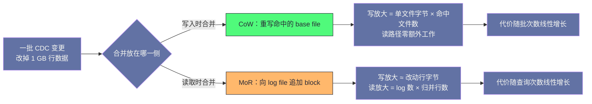
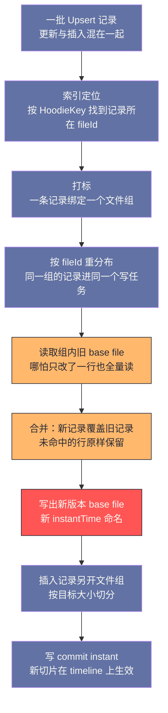
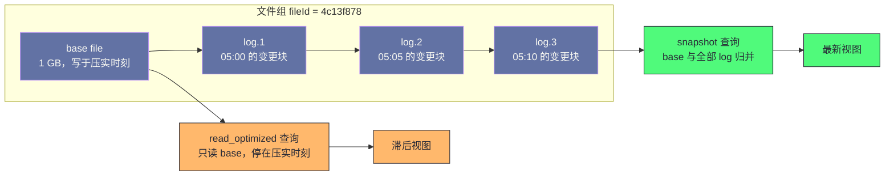
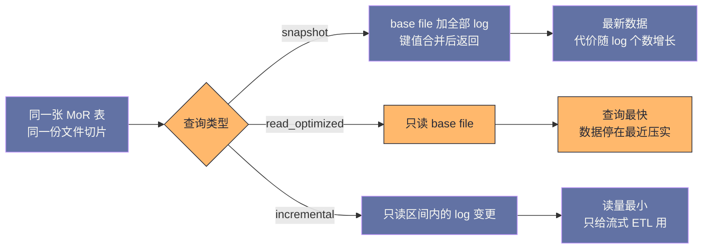
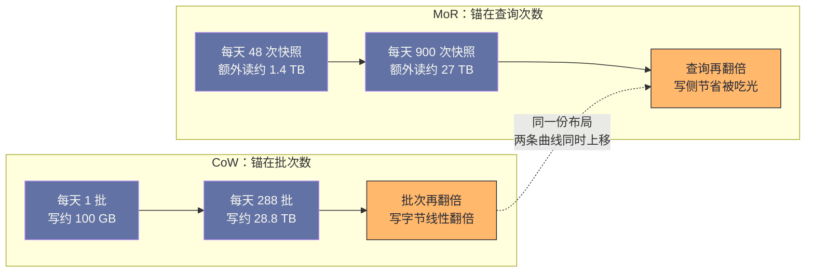

**摘要：**

一张 100 GB 的 Hudi 表，每 5 分钟吃进一批 CDC 变更。如果把"这一批要花多少 I/O"分别交给 Copy-on-Write（写时复制，CoW）与 Merge-on-Read（读时合并，MoR）来回答，得到的数字能差三个数量级，而两个答案都不算错——因为两种存储类型记的是两本不同的账。CoW 把代价记在"这一批命中了多少字节的 base file"上，MoR 把代价记在"这一批改了多少行"上，再把另一半推给读取时的归并。本文从文件组与文件切片这两个记账单位出发，拆开 CoW 的整文件重写路径与 MoR 的 log 追加路径，给出两条可以照着算的代价公式；再把 compaction 作为 MoR 的定期结算机制讲清楚，包括调度与执行的分工、触发策略、压实策略，以及 inline、async、offline 三种部署方式的取舍。文中用同一张行程表做了两组示例推算，回答两个具体问题：每天更新 1% 行与每天更新 50% 行时，两种模式的写放大分别是多少，盈亏平衡点又落在每天多少次快照查询上。最后把 Hudi 的"表属性"与 Iceberg、Delta Lake 的"每次操作可选"摆在一起对照，说明这个差别如何决定了迁移成本，并给出三类反例：MoR 不压实、CoW 扛高频小批、用 read_optimized 却要最新数据。

---

## 第 1 章 两条账本：写时合并与读时合并

### 1.1 同一批更新，两种差三个数量级的算法

设想一张 100 GB 的 Hudi 表，按主键 Upsert，每天从上游 CDC 收到 288 批变更，每批几千行。对着同一批数据，两位工程师给出两个完全不同的容量估算：一位说每批要重写 100 GB，另一位说每批只写几兆字节。两个人算得都没错，差别在于他们各自站在 CoW 与 MoR 的账本上。

理解 Hudi 的存储类型，先要接受一个前提：**Parquet 文件一旦写完就不可变**。对象存储与 HDFS 都不提供"打开一个 Parquet 文件、定位到第 1234 行、改一个字段、覆盖保存"这种操作，即便底层块设备支持随机写，Parquet 的 footer 里记着 row group 偏移、每列 min/max 与压缩块边界，改一行字节就要重写整份元数据。于是行级更新只能换算成"写一批新文件、让一批旧文件退出快照"。

换算方式有两种。第一种把合并做在写入时：找到被命中记录所在的文件，整份读出来、合并、再整份写回去，同一时刻读到的永远是完整合并后的文件。第二种把合并推迟到读取时：更新只追加进一个轻量的日志文件，原始 Parquet 不动，等查询发生时把日志叠加上去。前者是 CoW，后者是 MoR，业界管这两种思路叫**写时合并**与**读时合并**，而 Hudi 把它固化成了表的一个属性。

这个属性叫 `hoodie.table.type`，写在表根目录 `.hoodie/hoodie.properties` 里，取值 `COPY_ON_WRITE` 或 `MERGE_ON_READ`。它不是一个可以随便调的性能开关：整张表的写入路径、文件布局、查询语义乃至运维需要调度的表服务，都跟着它走。改这个值意味着重建表，第一章之后会反复回到这一点。

| 维度 | CoW | MoR |
|---|---|---|
| 磁盘上有什么 | 只有 base file | base file 加 log file |
| 一批更新的落点 | 重写命中 file group 的 base file | 向 log file 追加 block |
| 写放大的锚 | 单文件字节 × 命中文件数 | 改动行字节 |
| 读放大的锚 | 无 | log 个数 × file slice 数 × 归并行数 |
| 时间线上的提交动作 | `commit` | `deltacommit` |
| 额外要调度的表服务 | clean | compaction 加 clean |
| 数据新鲜度 | 每次提交后立即可见 | snapshot 可见，read_optimized 停在最近一次 compaction |
| 建表属性 | `hoodie.table.type=COPY_ON_WRITE` | `hoodie.table.type=MERGE_ON_READ` |

### 1.2 文件组与文件切片：Hudi 的两个记账单位

Hudi 的表目录按分区切分，分区内部按**文件组（File Group）**组织，每个文件组由一个全局唯一的 fileId 标识。一个文件组里会随时间积累多个**文件切片（File Slice）**，每个切片包含一份 base file（Parquet、ORC 或 HFile）以及一组 log file。base file 由某个提交写出并在之后被 compaction 版本化，log file 则由该 base file 之后、下一个 base file 之前完成的提交追加而成。

这两个概念是全文的地基。CoW 的一次更新，做法是为被命中的文件组生成一个新的文件切片，切片里只有新 base file 与若干旧 base file；MoR 的一次更新，做法是往被命中文件组当前切片的 log file 里追加一段。读者查询时，CoW 只要从每个文件组挑出最新切片的那份 base file，MoR 则要把最新切片的 base file 与它上面的所有 log file 合起来看。

文件命名把这个结构暴露在目录里。base file 形如 `{fileId}_{writeToken}_{instantTime}.parquet`，譬如 `136281f3-c24e-423b-a65a-95dbfbddce1d_1-0-1_20261119000500.parquet`；log file 以点号开头，形如 `.{fileId}_{baseInstantTime}.log.{version}_{writeToken}`，隐藏文件的前缀让很多 `ls` 与目录树工具默认看不到它。Hudi 1.x 还引入了 native log 格式，log 文件可以写成 `{fileId}_{writeToken}_{instantTime}_{version}.log.{suffix}`，后缀区分 `log`、`deletes` 与 `cdc` 三种内容，具体命名以 1.x 源码里的 `FileNameParser` 为准。

### 1.3 先把两个"放大"的口径钉死

讨论 Hudi 的两种存储类型，绕不开**写放大（Write Amplification）**与**读放大（Read Amplification）**这两个词。官方文档给的定义很直接：写放大是"为每一字节实际变更数据写入存储的字节数"，读放大是"为每一字节实际数据读取的字节数"。定义简单，口径却容易各说各话，笔者在本文里把口径固定成下面两条。

写放大按"一次操作"算：分母是这批操作真正改动或删掉的行的字节，分子是这次操作落盘写出的字节。CoW 的分母很小、分子很大，MoR 的分母与分子接近，但 MoR 的 compaction 是另一笔写，必须单独计入，不能藏在后台任务的账单里。读放大按"一次查询"算：分母是查询返回结果的字节，分子是这次查询为了产出结果读到的字节与需要归并的行数。MoR 在这里多出来的不是字节，是行——需要对每个带 log 的文件切片做一次归并，代价与 base file 的行数同阶。

把这两条口径写下来之后，CoW 与 MoR 的差异就不再是"哪个更快"这种会被 workload 反复推翻的判断，而变成了两本可以拿计算器核对的账。

### 1.4 两条路线的坐标

下图把两条路线摆在同一张图上：同一批变更，分别走写入时合并与读取时合并，代价落点完全不同，适合的读写比也正好相反。

---

## 第 2 章 CoW：把代价压在写入那一刻

### 2.1 目录里只有 base file

CoW 表的分区目录干净得可以当范本：只有 Parquet 文件，没有日志，没有额外的状态文件，`.hoodie` 目录之外的一切都能被任何支持 Parquet 的引擎直接读。一次提交之后，被命中的文件组会多出一个新版本的 base file，旧版本仍然留在目录里，直到 clean 按保留策略把它删掉。

这个"多版本同时存在"的细节值得单独说明，它经常被误读成存储泄漏。Hudi 用 MVCC 的思路管理提交：读者的查询绑定在某个 instant 上，只会看到该 instant 之前完成的切片，正在写的 inflight 文件对读者完全不可见。旧切片要留到所有可能引用它的快照都结束，因此 clean 会保留若干提交的历史。保留份数由 `hoodie.cleaner.commits.retained` 一类配置控制，默认保 10 个提交的旧切片，具体以对应版本的配置文档为准。

于是 CoW 表的物理占用大约是逻辑体积的十一倍（10 份历史加 1 份当前），直到 clean 把过期切片收走。高频写入时这个倍数会实打实地转成存储账单，这一点后文算账时还会用到。

### 2.2 一次 Upsert 的六段路径

CoW 的写入路径可以切成六段，其中第四段与第五段是全部代价的来源。下图是这五段的执行顺序，注意索引与打标只是决定"要碰哪些文件组"，真正的字节搬运发生在合并写出那一步。

第一段是按主键做索引定位，把每条更新记录映射到具体的 fileId。Hudi 的索引有多种实现，布隆过滤器、HBase、记录级索引各有适用面，选型与代价不在本篇展开，这里只需要知道它的产物是一张"记录主键到文件组"的映射表。

第二段打标与第三段按 fileId 重分布是同一次 shuffle 的两面：同一条记录必须和它所在文件组的其他记录进入同一个写任务，否则无法在同一份输出里完成合并。第四段与第五段才是重写：读出组内旧 base file 的全部行，用新记录覆盖同主键的旧行，把结果编码成一份新的 Parquet，重算 row group、重算列统计、重写 footer。第六段处理插入，插入记录没有旧文件可合并，会按目标文件大小开新的文件组。

关键点落在第四段：读取旧文件的动作与"改了几行"无关。改一行与改一百万行，读的都是整份文件；写出的也几乎是整份文件，因为未命中的行要原样拷贝过去。所谓"CoW 只在更新时重写"，重写的是整个文件组，不是一个记录块。

### 2.3 写放大的算术：单文件大小 × 命中文件数

把上面的路径翻译成公式，CoW 一次提交的写字节就是命中文件组的大小之和：

- 单批写字节 ≈ 命中文件数 × 单文件大小
- 写放大 ≈ 命中文件数 × 单文件大小 ÷ 本批改动行字节
- 日写字节 ≈ 每天批次数 × 命中文件数 × 单文件大小

公式里没有"改动行数"这一项，这是 CoW 最容易被误判的地方。一批 2000 行的更新，如果这 2000 行按主键散落在 100 个文件组里，那 100 个文件组全被命中，写量是 100 个文件的总和；如果这批更新恰好只落在一个文件组里，写量就只有 1 个文件。**命中集合由布局决定**，而不是由改动量决定。

下表是一组示例推算，取一张 100 GB 的表、每批更新命中全部文件组，比较不同单文件大小下的写量。行宽与压缩比按整表 100 GB、1000 万行每 GB 的量级估。

| 单文件大小 | 文件组数（总量 100 GB） | 单批命中文件组 | 单批写字节 | 每天 288 批的写字节 |
|---|---|---|---|---|
| 1 GB | 100 | 100（全部） | 约 100 GB | 约 28.8 TB |
| 256 MB | 400 | 400（全部） | 约 100 GB | 约 28.8 TB |
| 128 MB | 800 | 800（全部） | 约 100 GB | 约 28.8 TB |
| 1 GB，按天分区且只改当天 | 100（单分区 1 个） | 1 | 约 1 GB | 约 288 GB |

这张表要说的事情有点反直觉：把单文件从 1 GB 调到 128 MB，写字节一分没少，反而多出 8 倍的文件数与 8 倍的元数据开销。文件大小在同一命中集合内不改变总字节，它真正影响的是合并的并行粒度与单任务的内存占用。把 100 GB 打到 1 GB 的是布局——分区、聚簇、排序，让"要改的行"集中在极少数文件组里。

### 2.4 读路径为什么这么干净

CoW 的读者做的事情很少：查 timeline 拿到已完成提交的列表，每个文件组取最新切片，把那份 base file 交给扫描器。没有位图要解，没有 log 要打开，没有归并要排。查询计划与直接读一张 Parquet 表几乎一样，列裁剪、谓词下推、文件级统计跳过全部可用，Hudi 的元数据表还能把文件清单与列统计预先物化，把"列目录"这一步也省掉。

这份干净是 CoW 全部价值的来源。数据仓库里最常见的负载是白天大量 BI 查询、夜间一批 ETL 写入，读的次数远多于写，**读路径上每多一层开销，都会乘以白天的查询量**。CoW 用写入时的重写把这个乘法因子消掉了。

不过"读路径干净"有一个前提：表里不能有太多小文件。base file 数一旦失控，查询计划要先处理海量文件条目，元数据读取与打开文件的对象存储请求会成为新瓶颈。这个问题与表类型无关，CoW 与 MoR 都会遇到，区别只在于 CoW 每次重写都会顺带产出尺寸规整的文件，MoR 的 log 追加则完全不调整文件布局。

### 2.5 CoW 的四笔账

写放大是第一笔，另外三笔常被忽略。第二笔是文件数：每次提交对每个命中的文件组产出一份新 base file，288 批乘以 100 个文件组，一天就是 2.88 万个新文件，在 clean 追上之前，目录规模是逻辑文件数的十一倍。第三笔是 Parquet 全量重编码的 CPU：读进来解压、逐行判断、再压缩写出，CPU 往往先于带宽成为瓶颈，一批只改几百行的更新也能把写入任务拖到十几分钟。第四笔是提交竞争：命中集合越大，两个并发写任务撞在同一批文件组上的概率越高，Hudi 的乐观并发在检测到冲突后会让其中一个重试，重试率随命中集合线性上升。

四笔账叠起来的结论很朴素：CoW 适合"写入不频繁、每次写入批量大、命中集合相对集中"的场景。**批次数是它的敌人，改动行数是它的朋友**。

### 2.6 什么时候 CoW 就是对的选择

读多写少、批量大、更新集中，这三个条件同时成立时，CoW 几乎没有对手。典型的形态是夜间跑一批全量或增量同步，白天被 BI 与报表反复查询；或者是一张变化极慢的维表，一天改几十行，查询却要跑上千次。

还有一类场景经常被漏掉：只增不改的表。插入在 CoW 与 MoR 里的路径几乎一样，都写到新的 base file 里，MoR 的 log 对纯插入没有任何收益，反而多带了 compaction 的运维负担与读侧归并的可能。日志、事件流、埋点明细这些 append-only 的表，选 CoW 是更省心的答案。

---

## 第 3 章 MoR：把代价推到读取那一刻

### 3.1 base file 加 log file 的双层结构

MoR 把文件组内部的存储分成两层：base file 承载某个时间点的完整数据，log file 承载 base file 之后发生的变更。一个文件组在任意时刻只有一份 base file 属于当前切片，log file 可以有若干个，按提交顺序编号。目录里因此出现两种命名的文件，Parquet 的 base file 与以点号开头的 log file，后者的命名里带着它所依附的 base instant。

把 base file 单独拎出来看，MoR 的表布局与 CoW 完全一致——这正是 read_optimized 查询能直接读 base file 的原因。官方文档对此有一句很精炼的表述：base file 由 compaction 版本化，如果只看 base file，MoR 表看起来就是一张 CoW 表。

### 3.2 log file 里装的是什么

log file 不是一个可以随手 `cat` 的文本文件，它由若干个 block 串起来，每个 block 带自己的头部与元数据。三种块各司其职，读端按块类型分别处理：

| block 类型 | 装什么 | 读端怎么处理 | 什么时候出现 |
|---|---|---|---|
| 数据块 | 更新与插入的记录，默认 Avro 行式编码，1.x 也支持 Parquet 列式 | 按主键并入该切片的最新版本 | 每一批更新与插入 |
| 删除块 | 被删除记录的主键 | 从输出中剔除对应行 | 删除操作 |
| 命令块 | 控制信息，譬如某个提交失败后要求回滚的标记 | 按标记把对应的块视作作废 | 提交失败与回滚 |

数据块的默认编码是 Avro 行式记录，写入侧不需要解析 Parquet 的列式结构，把记录序列化进去即可，写路径因此非常轻。这也解释了"写快"的来源：MoR 的写入几乎没有读-改-写循环，只有序列化与追加。

Hudi 1.x 给 log 增加了更多选择。storage layout 文档里写明了三种数据块形态：行式 Avro 适合轻量快速写入，HFile 适合按主键做随机访问，列式 Parquet 适合归并时向量化读取。对应地，log 文件的格式也随表版本升级，表版本（table version）是一个单调递增的编号，每次存储格式发生不兼容变化时上调，读写端按表版本选择解析方式。存储格式的版本化意味着跨版本读写要按"先升读端、后升写端"的顺序推进，这一点在混合引擎的集群里尤其要留意。

### 3.3 写入路径：插入进 base，更新进 log，删除进删除块

MoR 的一次 Upsert 与 CoW 共享前两段：索引定位、打标、按 fileId 重分布。分岔从第三段开始：CoW 把命中的记录带进合并任务去重写 base file，MoR 则把这些记录按文件组序列化成数据块，追加到该文件组的 log file 末尾。没有读旧文件的动作，也没有重写 base 的动作，写入量基本上就是这批变更记录本身的字节，外加每块几十字节量级的头部开销。

插入与更新的落点不同：**插入进 base，更新进 log**，删除则进删除块。插入的处理与 CoW 相同，分配到新的文件组，写成 base file。删除的处理值得单独提一句：MoR 把被删记录的主键写进删除块，base file 一行不动；CoW 必须把删除记录所在的整个 base file 重写一遍，把那些行从输出里去掉。对"少量随机删除"这类负载，两者的差距比更新还要明显。

提交动作也因此不同：CoW 的成功提交在 timeline 上是一个 `commit` instant，MoR 是一个 `deltacommit` instant。查询端看到 `deltacommit` 就知道"这份变更还在 log 里，要做快照读就得归并"。文件组的数量、base file 的尺寸、log file 的个数，三者共同决定了一次 snapshot 查询要做多少次归并。

### 3.4 读时合并的真实成本：一次键值合并，不是"读两遍"

容易产生的误解是把"读时合并"理解成"读 base + 读 log，然后简单拼接"。真实的合并是按主键做的：log 块里同一个主键可能出现多次，先按版本取最新的一条，再拿它替换 base file 里同主键的行；base file 里没有对应主键的行原样输出，删除块里的主键则从输出中剔除。

实现上，引擎通常先把 log 里的最新记录读进一个可溢写的键值结构，再流式扫描 base file，逐行查表决定输出哪个版本。这个做法对内存友好，代价却很清楚：base file 的每一行都要过一遍查表与写出，哪怕这一行最近根本没有被更新过。

字节上，合并读的是 base 字节加 log 字节，log 通常远小于 base，所以字节放大的倍数不明显。行数上，情况完全不同——列式扫描在只查两列时能靠列裁剪把 I/O 压到全行宽的十分之一，合并却做不到这一点，因为它需要主键与版本列参与比较，而主键往往就是最宽的那几列之一。

所以 MoR 的读放大不适合只用字节衡量，它更像**行数放大**：一个带 log 的文件切片，查询要付出的处理行数是 base 行数加 log 行数，与查询本身需要多少列无关。文件组越多、带 log 的切片越多，这一项越大；同一个主键在一天里被更新过十次，log 里就躺着十个版本，合并时都要读出来再丢掉九个，这一层又叠加了一层放大。

### 3.5 增量查询不从归并里受益

MoR 还有第三种读法：增量查询（Incremental Query）。它只读某个时间区间内新产生的数据，对 MoR 表来说就是读这段时间的 log 块与 base file 的新增部分，不需要碰历史 base 的全量行。下游的流式 ETL 消费 CDC 变更时走这条路，读放大近乎为零，与表是 CoW 还是 MoR 关系不大。

这也解释了为什么 MoR 的典型架构是"两套读者"：下游增量同步任务用增量查询，拿到的是变更本身；分析师用 SQL 做全表聚合，走 snapshot 或 read_optimized。两种读者的代价曲线不一样，后文第 5 章会把这条分界线画清楚。

### 3.6 log 的累积是 MoR 的定时炸弹

**log 只增不减**，这是 MoR 读侧风险的源头。log file 本身不会自己变小。每来一批更新，它所在的文件组就多一个或几个 log 块；块数增长，snapshot 查询的归并行数与打开文件数一起增长。假设每 5 分钟一批、每批命中最热的 20 个文件组，一天下来单个文件组最多积累 288 个 log 文件，全表 100 个文件组累计接近三万份 log 文件。此时一次全表快照查询要打开的文件数是原来的三百倍，对象存储上的元数据请求先撑不住，归并的 CPU 再撑不住。

MoR 需要另一套机制来定期把 log 里的变更合并回 base file，这套机制就是 compaction。它不是可选的优化项，而是 MoR 表类型能长期工作的前提条件——缺少它，读侧成本会**随 log 个数线性增长**。

---

## 第 4 章 Compaction：MoR 的定期结算

### 4.1 调度与执行是两件事

Hudi 把 compaction 拆成两个阶段：调度（scheduling）扫描分区、挑选要压实的文件切片，把压实计划写进 timeline；执行（execution）读出计划、把 base file 与 log file 合并、写出新的 base file。拆开的好处是两者可以放在不同的进程、不同的时间窗口里跑，写入作业只负责把计划排上队，重活交给独立的计算资源。

在 timeline 上，一次压实是一个 instant，走 `requested`、`inflight`、`completed` 三个状态，与普通提交的状态机一致。这个一致很重要：压实与写入共用同一套并发控制与回滚机制，一次失败的压实不会让表进入半完成状态，读者看到的仍然是压实前的切片。Hudi 1.x 把 instant 的排序基准从请求时间改成了完成时间（见 HUDI-9073 的讨论），压实这类耗时长、完成时刻远晚于请求时刻的动作，在 1.x 的时间线上有了正确的先后关系。

### 4.2 触发策略：按提交数、按时间，还是两者组合

什么时候调度一次压实，由触发策略决定。Hudi 提供五种：按自上次压实以来的 delta commit 数触发、按自上次压实请求以来的提交数触发、按时间间隔触发、提交数与时间同时满足触发、两者任一满足触发。Spark 写入端对应的配置是 `hoodie.compact.inline.trigger.strategy`，默认值是按提交数，阈值由 `hoodie.compact.inline.max.delta.commits` 给出，默认 5 个 delta commit。

默认值 5 是按"高频小批"的负载设计的：每 5 次提交结算一次，log 个数有上界，snapshot 查询的归并量可控。但它不适合所有负载。更新占比很高时，每批日志本身就厚，攒几批再压能让一次重写吃掉更多变更，按 5 次提交就结算等于把本该合并的活儿拆碎了干，压实写量反而更高；写入很稀疏时，按提交数触发又可能几天才凑够 5 次，log 攒得比预期久。前者应该换成时间触发或更大的提交数阈值，后者应该补一条时间触发作为下限。

### 4.3 选哪些文件组压实：默认按日志体积

调度阶段还要回答"压实谁"。Hudi 的默认压实策略是 `LogFileSizeBasedCompactionStrategy`，按积累的未合并日志体积排序，优先压实日志最多的文件组，并把每轮压实的 I/O 限制在上限内。除此之外还有按日志文件个数排序的策略、按总 I/O 预算限制的策略、按分区新旧选择的策略，以及完全不做筛选的几种。

选哪种策略取决于读放大的来源，**归因决定选型**。读放大主要来自"带 log 的文件切片太多"，那就该按日志个数选，让每个切片的 log 个数都降下来；读放大主要来自少数热文件组的巨量 log，按体积选更合适；如果 read_optimized 查询集中在最新分区，用按分区选择的策略能让最新分区先回到干净状态，让 read_optimized 的新鲜度落在业务真正关心的那段数据上。

这几个策略的名字与参数在官方 Compaction 文档里列全了，选型时对照自己的读放大归因去挑，比抄一份默认配置更有意义。

### 4.4 inline、async、offline：三种部署方式的取舍

压实放在哪里跑，是一个纯粹的工程决策。Hudi 支持三种部署：与写入同步的内联压实、与写入并行的异步压实、完全独立的离线压实作业。官方文档的说法是，异步压实是默认形态，适用于把写入延迟放在第一位的场景；内联压实适合"希望新提交立刻可读、又不愿意多维护一个作业"的场景。

| 部署方式 | 谁执行 | 对写入的影响 | 主要配置或入口 | 适合的负载 |
|---|---|---|---|---|
| 内联压实 | 写入作业自身 | 提交变长，写入延迟上升 | `hoodie.compact.inline=true` 加提交数阈值 | 写入频率中等、要求压实与提交同界 |
| 异步压实 | 同一进程的后台线程或流式作业 | 写入基本不受阻塞，共享集群资源 | `hoodie.datasource.compaction.async.enable` 一类开关 | 流式写入、写入延迟敏感 |
| 调度内联、执行异步 | 写入端只排计划，工具执行 | 写入只多一次计划写入 | 排计划开关加 `HoodieCompactor` 工具 | 希望压实节奏可控、算力独立 |
| 离线压实 | 独立 Spark 或 Flink 作业 | 写入完全不感知 | `HoodieCompactor` 或 `HoodieFlinkCompactor` | 大规模表、压实时长不可预测 |

离线模式有一条容易踩的约束：写入作业与压实作业是两个独立进程，必须配置锁提供者，让它们对同一张表的并发操作能够互斥。没有锁就上线，典型症状是压实作业与写入作业同时修改同一个文件组，触发提交冲突或产生孤立文件。文档在这一点上写得很直白，"该模式需要为所有作业配置锁提供者"。

`HoodieCompactor` 的用法也值得记一笔：它按 `--base-path`、`--table-name`、`--schema-file` 定位表，`--instant-time` 可选，不给就执行时间线上最早的那个已排队的压实计划；`--seq` 决定执行顺序，默认从最新的计划开始，也可以改成先进先出；`--service` 让它以常驻服务的方式按间隔巡检并调度新的压实任务。这些参数决定了压实作业的调度语义，配错会让旧的计划一直排队。

### 4.5 压实不是免费的：摊销账与 clean 的配合

压实把 log 合并进 base，写出的是一份新的、完整的 base file——它的写字节等于被压实文件组的总和，与这批变更实际改了多少行无关。这一点与 CoW 的重写是同一笔账，只不过发生频率低得多。所以 MoR 的写侧账单必须写成两项：日常追加日志的字节，加上压实重写 base 的字节乘上频率。

压实之后还有 clean。旧切片在压实完成后退出快照，但物理文件要等 clean 按保留策略删除，压实的频率越高，目录里堆积的历史切片越多。保留份数的配置同时服务于时间旅行与故障恢复，调大它能多留几个版本，代价是存储乘以份数。压实、clean、时间旅行三者的保留期是同一套参数在管，改一个会牵动另外两个。

### 4.6 压实周期就是 read_optimized 的新鲜度承诺

read_optimized 查询只读 base file，因此它能看到的数据停在最近一次压实完成的时刻。这条因果关系把压实周期变成了一个 SLA 参数，**压实周期就是新鲜度承诺**：每小时压实一次，read_optimized 的新鲜度就是小时级；一天压实一次，就是天级；没有人调度压实，新鲜度会一直退回到建表或最后一次手工压实的时刻，而且不会报错。

**落在读侧的这一层滞后不会报错**，所以经常被当成 bug 报上来。排查顺序应该是先看 timeline 上最近一次 compaction 的完成时刻，再看 read_optimized 查询里 `max(updated_at)` 与 snapshot 查询的差距，两者一对，问题基本就定位了。要确认表里到底有多少 log 在等压实，用 Hudi CLI 的 `fsview` 看每个文件切片的 log 文件数，比翻目录猜要快。

---

## 第 5 章 查询类型：MoR 必须显式做的第二次选择

### 5.1 三种查询读的是三份不同的数据

选了 MoR 之后，还有第二个决策要做：每次查询走哪种读法。Hudi 提供三种查询类型，由 `hoodie.datasource.query.type` 指定，取值 `snapshot`、`read_optimized`、`incremental`。默认是 snapshot，也就是合并读，看到最新数据但要付归并代价；read_optimized 只读 base file，看到的是压实时刻的数据；incremental 只读某个 instant 之后的变更。

这三个选项不是同一张表上的三种性能档位，它们读的是**三份语义不同的数据**。把 read_optimized 当成"更快的 snapshot"来用，是这一章要防的主要误用。

| 查询类型 | 读什么 | 数据新鲜度 | 主要代价 | 典型用途 |
|---|---|---|---|---|
| snapshot | base file 加全部 log，归并后返回 | 最新一次提交 | 归并行数随 log 增长 | 需要最新数据的 SQL 与下游同步 |
| read_optimized | 只读 base file | 最近一次压实 | 与普通 Parquet 扫描相同 | 容忍滞后的 BI 报表 |
| incremental | 指定区间内的变更 | 区间内全部变更 | 只读变更，接近零放大 | 流式 ETL、CDC 消费 |

三种读法在文件系统上的分叉可以画成一张图：同一份文件切片，三种读者各取一部分，代价与新鲜度正好此消彼长。

### 5.2 两种读法的对照

snapshot 与 read_optimized 的差别，可以用"读同一张表的两个时刻"来概括。snapshot 读的是"现在"，代价是它必须把所有还在 log 里的变更归并进来；read_optimized 读的是"上一次结算之后的状态"，代价是它对 log 视而不见。官方文档给这两者的权衡表只有两行：数据延迟，snapshot 低、read_optimized 高；查询延迟，snapshot 高、read_optimized 低。

笔者建议把这两个读法理解成两个不同的接口，而不是一个接口的两种调优。如果一个下游任务在读取之后会写出结果表，而结果表被用来做增量对账，那它必须用 snapshot 或 incremental，read_optimized 会让它漏掉最近的变更，且漏得没有任何提示。反过来，如果查询只是给看板出当天的汇总，滞后一小时无伤大雅，read_optimized 能让查询成本降到与普通 Parquet 表一样。

### 5.3 引擎能力差异带来的静默滞后

MoR 的读侧还有一个只在异构集群里出现的坑：不是所有引擎都实现了 snapshot 读。部分引擎只能把 Hudi 表映射成"读 Parquet 目录"的形态，也就是事实上的 read_optimized 语义。用户在前端写一条 SQL，期望看到最新数据，实际拿到的是上次压实时的快照，查询成功、结果不报错、数字偏小。

这类问题的判据不看日志，看数字。同一时刻用两个引擎查同一个指标，若其中一个系统性地落后，且落后量与压实周期吻合，基本可以断定是读法差异；再对照该引擎的 Hudi 连接器版本与文档里支持的读取模式，就能确认。处置有两条路：把这类引擎的读取固定成 snapshot（如果它支持），或者在接入层把这张表拆成两份视图，一份明确标注为"滞后视图"，供只读报表使用。

### 5.4 把新鲜度写进口径

MoR 表的新鲜度不是一个可以口头承诺的数字，它由压实周期决定，也由查询类型决定。落地时最好把这两条写进数据字典：这张表的 snapshot 视图新鲜度是多少（受提交频率约束），read_optimized 视图新鲜度是多少（受压实周期约束），哪些引擎、哪些任务用的是哪一种。写清楚之后，第 8 章的三类反例里至少有两类不会发生。

---

## 第 6 章 定量：每天更新 1% 与每天更新 50%

### 6.1 推算口径

下面的数字全部是示例推算，用于说明量级关系，不代表任何实测值。统一假设如下，贯穿这一章。

- 表 `trips`：100 GB 逻辑体积，100 个文件组，每个 base file 1 GB、约 1000 万行，行宽按 100 字节，全表约 10 亿行；按天分区，主键 `trip_id`。
- 写入：每 5 分钟一批 CDC，每天 288 批；每批的更新按主键在文件组之间近似均匀分布，也就是"最坏但最常见"的分布。
- 场景 A：每天更新 1% 的行，合 1000 万行、约 1 GB 的行字节，每批约 3.5 万行。
- 场景 B：每天更新 50% 的行，合 5 亿行、约 50 GB 的行字节，每批约 174 万行。
- 读写同价，忽略对象存储的请求次数与 Parquet 编码的 CPU 差异；压实只压被命中的文件组。

### 6.2 场景 A：每天更新 1% 的行

先算 CoW。一批 3.5 万行散落到 100 个文件组，每个文件组被命中的概率几乎是 1（3.5 万行摊到 100 个组，任一组一行都没被命中的概率是 0.99 的 3.5 万次方，可以忽略），于是每批写 100 个文件组、约 100 GB。一天 288 批，写字节约 28.8 TB，而实际改动只有 1 GB——写放大约 2.88 万倍。换成按天分区且只改当天分区的布局，每批只命中 1 个文件组，写 1 GB，一天 288 GB，写放大 288 倍。

再算 MoR。每批只把 3.5 万行追加进 log，写字节约 3.5 MB，一天 1 GB 出头，写放大接近 1。代价转移到压实与读取：若每 24 个 delta commit 压实一次（约每 2 小时），一天 12 次，每次重写被命中的 100 个文件组共 100 GB，压实写字节约 1.2 TB。合起来 MoR 一天的写是"1 GB 日志加 1.2 TB 压实"，约 1.2 TB，还是 CoW 那 28.8 TB 的二十四分之一。

### 6.3 场景 B：每天更新 50% 的行

CoW 的答案几乎没变：每批 174 万行依旧散落全部文件组，每批照样重写 100 GB，一天还是 28.8 TB。改动量涨了 50 倍，写量一点没涨，写放大从 2.88 万倍掉到 576 倍。这组对比很能说明 CoW 的性质：它按"命中文件的字节"收费，不按"改了多少行"收费。改动足够大时，重写整份文件反而变得"划算"，因为确实有一半内容需要重写。

MoR 的答案变了。日志每天写 50 GB，写放大仍是 1 左右，压实的性价比却变差了：每 24 次提交积累的 log 只相当于全表的百分之四上下，而压实一次要把被命中的 100 GB base file 整份重写，等于用一百份写换四份合并。若保持 24 次一压的节奏，一天压实 1.2 TB，加上 50 GB 日志，合计约 1.25 TB，写放大约 25 倍。写侧依然优于 CoW，但读侧每次快照要多归并一半的表，压实的投入产出比也从"压一次省很多"变成"压一次省不多"。

### 6.4 CoW 的锚点是批次数，MoR 的锚点是查询次数

把两个场景并排看，两条公式浮出来了：

- CoW 日写 ≈ 批次数 × 命中文件字节。批次数翻倍，写翻倍；改动行数翻倍，写不变。
- MoR 日写 ≈ 改动行字节 + 每天压实次数 × 被压实文件字节。查询侧则要另算：每次 snapshot 查询多付一次归并，归并行数与 base 行数同阶。

于是两种模式的敌人在不同的地方：**写侧算批次，读侧算查询**。CoW 怕高频小批——批次数一多，每批都在为一个字节级的改动重写整份文件；MoR 怕高频查询——每次快照都要把带 log 的切片归并一遍，查询次数越多，读侧的账越厚。这一条把选型问题翻译成了 workload 画像问题：先数清楚一天有多少批、一天有多少次快照查询，再谈选哪个。

下图把两条代价曲线并排放置：左边是 CoW 随批次数增长，右边是 MoR 随查询次数增长，两条曲线的斜率都由布局决定，交点就是这张表该选哪种类型的临界条件。

下表把两个场景的四本账摆在一起，读侧按"每次快照查询的等效额外扫描"折算，示例取归并代价相当于 0.3 倍 base 字节（30 GB）。这个系数没有普适值，它取决于列宽、主键宽度与引擎实现，取值只用于演示量级。

| 场景 | CoW 日写 | CoW 写放大 | MoR 日写（日志加压实） | MoR 写放大 | MoR 每次快照额外读 | snapshot 盈亏平衡的日查询数 |
|---|---|---|---|---|---|---|
| A：每天更新 1% | 约 28.8 TB | 约 2.88 万倍 | 约 1.2 TB | 约 1200 倍 | 约 30 GB | 约 900 次 |
| B：每天更新 50% | 约 28.8 TB | 约 576 倍 | 约 1.25 TB | 约 25 倍 | 约 45 GB | 约 550 次 |

表里最后一列的算法很朴素：MoR 每天比 CoW 少写的字节，除以每次快照查询多付的读字节，就是它能承受的查询次数上限。场景 A 里这个上限约为每天 900 次，相当于平均每百秒一次；场景 B 因为要多归并一半的表，上限降到 550 次左右。超过这个量，MoR 写侧省下的字节会从读侧一分不少地还回去。

### 6.5 压实周期 T 的选择

压实周期是一个可以调的旋钮，调它的方向很清楚：周期越短，写侧压实成本越高、读侧 log 越少；周期越长，写越省、读越贵。下表按场景 A 的更新量给出三档周期的示例推算，压实的写字节按被命中文件组的总量估。

| 压实周期 | 每天压实次数 | 每天压实写字节 | 每文件组平均 log 数 | 快照查询的归并压力 | 适合的读侧要求 |
|---|---|---|---|---|---|
| 5 个 delta commit | 约 58 次 | 约 5.8 TB | 不超过 5 | 低 | 大量快照查询、新鲜度要求高 |
| 24 个 delta commit | 约 12 次 | 约 1.2 TB | 不超过 24 | 中 | 查询量中等，接受分钟级归并 |
| 288 个 delta commit | 1 次 | 约 100 GB | 最多 288 | 高 | 几乎不查快照，只做增量消费 |

默认值 5 落在第一档，它适合"写得不猛、查得很勤"的负载；如果真实负载是每 5 分钟一批、白天查询不断，第一档的正确性没问题，只是写侧会多花几倍字节，此时把周期放宽到 12 到 24 个提交，配合按体积选择的压实策略，通常是更平衡的取值。

### 6.6 更新占比接近整表时，两条路都不划算

场景 B 继续往极端推：如果每天更新的行超过整表的八成，MoR 的 log 已经与 base file 同量级，压实的输入输出翻倍，读侧归并一半的表，写侧的节省也被压实吃掉大半；CoW 每批重写整份文件，写放大逼近 1，但批次数还是 288 倍的关系。两条路都不理想。

这种"每天几乎整表重算"的负载，更合适的做法是放弃行级 Upsert，改成**分区覆盖写**：整分区重算后原子替换，一次提交只碰一个分区，读侧不需要任何归并。Hudi 的替换提交（replace commit）能表达这个语义，行级更新让位给分区级重写，账本立刻回到"写一次、读一次"的量级。这也是一条边界：MoR 是"少量频繁变更"的工具，不是"整表高频重算"的工具。

---

## 第 7 章 与 Iceberg、Delta Lake 的对照：选择发生在哪一层

### 7.1 三种格式，三个决策层次

CoW 与 MoR 不是 Hudi 独有的概念。Iceberg 的格式规范第 2 版引入了行级删除文件，位置删除与等值删除都是 MoR 思路的产物；Delta Lake 用删除向量（Deletion Vector，DV）把"软删"记成位图，也是同一类取舍。差别不在概念，而在"这个选择什么时候做、由谁做、改主意要付多少代价"。

| 对照项 | Apache Hudi | Apache Iceberg | Delta Lake |
|---|---|---|---|
| 形态选择在哪一层 | 建表时的表属性 | 每个写作业的写参数 | 表属性加语句内实现决策 |
| 切换方式 | 重建表 | 下次写入换参数 | 改表属性，协议升级 |
| 历史文件的物理形态 | 整表统一 | 可新旧混存 | 可新旧混存 |
| 读端要处理的形态 | 按表类型固定 | 两种都要支持 | 按文件是否带 DV 决定 |
| 主要风险 | 建表选错，迁移成本高 | 读端实现覆盖不全 | 协议升级后旧客户端不可写 |

这张表想说明的是**选择发生在哪一层**这件事，它比"谁更先进"更实际：选择发生的层次越靠下，灵活度越高，读端与运维要承担的不确定性也越多。

### 7.2 Iceberg：写参数逐次可选

Iceberg 把 CoW 与 MoR 做成写作业的参数。做删除、更新、合并时，可以分别指定 `write.delete.mode`、`write.update.mode`、`write.merge.mode`，取值 `copy-on-write` 或 `merge-on-read`，默认走 copy-on-write。也就是说，同一个数据湖里，夜间的大批量重写任务可以走 CoW，白天的流式小批任务可以走 MoR，两条路径写进同一张表，读者按格式规范同时处理两种文件。

灵活度换来的是读端义务。MoR 模式写出的删除文件必须被所有读取实现正确处理，位置删除按文件路径与行位置匹配，等值删除按列值匹配，读端要能同时处理这两种删除文件，还要处理"删除文件本身也被删除"这类版本关系。任何一环没实现，就会出现"某个引擎读出来的行数比另一个引擎多"的情况。

### 7.3 Delta Lake：表属性加实现决策

Delta Lake 的 MoR 实现是删除向量：开启 `delta.enableDeletionVectors` 之后，删除与部分更新可以只写一张位图挂在原数据文件上，读端按位图过滤行，不必重写整份文件。开启这个属性会提升表的协议版本，读端与写端都要满足对应的特性要求，旧客户端可能因此无法写入甚至无法读取。

位图路线与 Hudi 的 log 追加有一个本质差别：位图只表达"哪些行不再有效"，不携带变更后的值；被更新的新值仍然要写成新文件。因此 Delta 的 MoR 路径写放大是"改动行的字节"，与 Hudi MoR 接近；读侧则是"位图解码加行过滤"，与 Hudi 的键值合并不是同一种开销，而且位图会持续累积，需要物化（重写文件或专门清理）才能消除。

### 7.4 Hudi：建表时定终身

Hudi 把选择放在最下面一层：表类型写在 `hoodie.properties` 里，**建表时定终身**。此后这张表的写入路径、文件布局、查询语义都按这个类型走，没有"这个作业用 CoW、那个作业用 MoR"的说法，也没有把已有 CoW 表原地切换成 MoR 的命令。要换类型，实际路径是重建表并重写数据，代价与数据量成正比。

这个约束听起来僵化，但它换来两个东西。其一是可预测性：看到表类型就知道写路径的形态、读路径的代价、需要调度哪些表服务，容量规划不需要按作业逐个推断。其二是语义统一：MoR 表同时提供 snapshot 与 read_optimized 两种读法，读端不必处理"这张表里既有 CoW 文件又有 MoR 文件"的混合状态。

代价也在这里。选型阶段犯的错，会在数据量长到 PB 级之后变成一次不可承受的迁移。因此 Hudi 的选型不能只看"现在写得多不多"，还要看"一年后这张表的更新占比、查询频率、下游读法会怎么变"。

### 7.5 迁移成本为什么不同

三种格式的迁移成本差异，本质上是"历史文件的物理形态要不要跟着改"。Iceberg 换写参数只影响新写入的文件，历史文件保持原样，读端两种都支持；Delta 开 DV 影响的是之后写入的行为，历史文件只有在被重写时才换成带位图的形态；Hudi 换表类型要让所有历史文件都按新类型的布局重排，等于一次全量重写。

对多引擎环境，这个差别还会被放大。Hudi 的表类型决定了读端只需实现一套读路径，代价是类型不可变；Iceberg 与 Delta 给了写入端更大的自由度，代价是读端要覆盖全部形态，任何引擎能力缺口都会变成一次静默的语义偏差。选型时把这两边的代价摆在一起看，比单看某一项性能数字更有意义。

---

## 第 8 章 边界与反例

### 8.1 反例：MoR 表从不安排压实

症状是 snapshot 查询越来越慢，且慢得很均匀——不是某个分区特别慢，而是每次全表查询都比上一次更慢一点；写入侧一切正常，日志里没有任何报错。根因是压实从未被调度，或者被调度了但执行作业长期失败，log 文件只增不减，读侧每次都要归并越来越多的块。

判据有三条：看 timeline 上最近一次 compaction 的完成时刻，若它比最后一次 delta commit 早很多天，问题成立；用 `fsview` 看文件切片的 log 文件数，若单个切片的 log 数超过几十，读放大已经实质发生；对比 snapshot 与 read_optimized 的查询耗时，若前者是后者的数倍，归并开销已经成了主因。处置是补上压实调度，并检查执行作业失败的根因——算力不足、锁配置缺失、schema 不兼容都可能让压实长期排队。

### 8.2 反例：CoW 表扛高频小批量更新

症状是写入吞吐上不去，每个批次都跑得比预期久得多，Spark UI 上写的字节远大于源数据字节；与此同时，表目录里每天新增的文件数等于"批次数乘以命中文件组数"，存储账单涨得比数据量快。根因是用 CoW 去承接每几分钟一批、每批只改几千行的 CDC。

判据是算一次写放大：把一次提交的写字节除以这批的改动字节，若结果**破百倍**，说明 CoW 在为极小的改动手工搬运整份文件。处置有两条：把表类型换成 MoR（代价是重建表），或者在布局上把命中集合压下来——按更新时间分区、按主键聚簇，让每批只碰少数文件组。后者是更轻的做法，但它要求"更新模式与分区键相关"，迟到数据一混进来，命中集合立刻回到全表。

### 8.3 反例：用 read_optimized 查询却期待最新数据

症状最隐蔽，可以叫**静默滞后**：查询不报错，结果看起来也合理，只是数字偏小或偏旧，而且偏差量随时间波动。根因是查询走了 read_optimized，只读 base file，能看到的数据停在最近一次压实。若压实周期是一小时，这个查询最多滞后一小时；若压实没人管，滞后会一直往回退。

判据是对比同一时刻两种读取的结果：snapshot 查询的 `max(updated_at)` 与 read_optimized 查询的 `max(updated_at)` 之差，就是实际的滞后量；再与压实周期对照，若两者吻合，问题确认。处置是把新鲜度写进接口约定：要么让这类查询改走 snapshot 并承担归并代价，要么把压实周期写进 SLA 并在下游文档里标注这个视图的滞后上限。

### 8.4 边界：MoR 配过度压实

与 8.1 相反的失衡同样存在。压实周期设得太短，每几批就重写一次 base file，写侧成本逼近 CoW，log 还没来得及积累就被清掉，MoR 的写入优势荡然无存。典型症状是压实写字节占到总写字节的九成以上，而每次压实的输入只有很少的 log。

判据是看压实作业的输入输出比：输入是几十兆的 log、输出是 1 GB 的 base file，说明这个文件组根本不该被压实。处置是把触发策略从"按提交数"换成"按时间加体积"，让日志积累到一定比例再压；同时用按体积排序的压实策略，优先处理真正积累多的文件组。

### 8.5 边界：小表与宽表

小表上两种类型的差别会被其他因素淹没。一张 1 GB 的表，CoW 重写一次的成本可以忽略，MoR 的压实与归并开销反而成了额外负担，选 CoW 更简单。反过来，行宽特别大的表（几百字节的宽表）会让 MoR 的归并成本上升，因为归并需要读取主键与版本列参与比较，宽表的主键通常也宽，列裁剪帮不上忙。

判断的落点还是那两个锚点：批次数与查询次数。表小的时候两者都容易被单机资源盖过，此时优先选运维更简单的那一种。

### 8.6 边界：并发写与压实撞车

MoR 表的并发写比 CoW 更容易撞车，因为压实作业会重写整个文件组，而写入作业正在往同一个文件组追加 log。Hudi 用乐观并发加冲突检测处理这件事，撞车的一方失败重试。压实时长越长，撞车窗口越大；离线压实又没有配锁时，问题会更频繁。

判据是作业日志里的并发冲突异常计数与重试次数，若两者随压实作业的排期同步上升，说明压实与写入的资源窗口重叠得太多。处置是错开两者的调度窗口，或者给离线压实配上锁提供者，或者改用"调度内联、执行异步"的形态，让压实计划由写入端统一排，执行端按顺序消费。

### 8.7 反例速查表

| 症状 | 判据 | 根因 | 处置 |
|---|---|---|---|
| 快照查询持续变慢，写入正常 | 最近一次压实时刻远早于最新提交，切片 log 数持续增长 | MoR 没有压实或压实长期失败 | 补调度、查失败根因、加监控 |
| 写入慢且写字节远超源数据 | 单次写放大在百倍以上 | CoW 承接高频小批更新 | 换 MoR 或压缩命中集合 |
| 查询数字偏旧但不报错 | snapshot 与 read_optimized 的 `max(updated_at)` 有稳定差值 | 查询走了 read_optimized | 改读法或明确滞后 SLA |
| 压实写字节占九成以上 | 压实输入 log 很小、输出 base 很大 | 压实周期过短 | 放宽周期、换按体积或按时间的策略 |
| 压实与写入频繁冲突 | 并发异常与重试随压实排期上升 | 资源窗口重叠、离线压实未配锁 | 错开窗口、配锁、改调度内联 |
| 异构引擎查询结果不一致 | 某引擎结果系统性落后且滞后量与压实周期吻合 | 该引擎只实现了 base file 读取 | 固定读法或在接入层拆视图 |

---

## 第 9 章 落点

回到开头那道算术题。同样一批几千行的更新，CoW 算出来是"命中文件组的字节"，MoR 算出来是"改动行本身的字节"，两个答案的差距不在实现效率，而在代价被签在了哪张账单上。CoW 把账单签给写入，MoR 把账单分成两半，一半签给写入、一半签给读取，中间再插一个定时结算的 compaction。

由此可以给出一条按顺序执行的判断路径。第一步数批次数：一天几百批、每批只有几千行，CoW 的写放大必然爆掉，先排除它。第二步数查询次数：一天几千次快照查询、每次都要最新数据，MoR 的归并开销会被查询次数放大到与写侧节省同一量级，此时要么把查询挪到 read_optimized 并接受滞后，要么重新考虑表类型。第三步问运维：能不能保证压实作业按期跑完、压实窗口与写入窗口错开、异构引擎的读法都确认过，做不到的团队选 MoR 等于给自己埋一个延迟发作的故障。第四步看一年后的形态：这张表的更新占比会不会持续上升，查询方会不会增加，表类型改不了的约束在那时候才真正咬人。

这四步共享同一个前提：布局先于类型。分区、聚簇、排序决定了"一次更新命中多少字节"，而命中字节是两种模式共同的分母。同一张表若把命中集合从 100 个文件组压到 1 个，CoW 的日写会从 28.8 TB 掉到 288 GB，整整两个数量级；相比之下，类型选择改变的是同一份字节怎么花，收益在一个数量级上下。先做布局、再选类型，顺序反过来等于把最容易拿到的那段收益留在了桌上。

两条路线的代价锚点最后落在同一句话上：没有更快的数据湖表格式，只有代价被放在了正确位置的存储设计。批次数高的负载，把代价放在读取侧是划算的，因为读取次数少；查询次数高的负载，把代价放在写入侧是划算的，因为批次少。Hudi 把这两种安排做成了建表时的一次选择，Iceberg 把选择下放到了每次写入，Delta Lake 折中在表属性一层，选择发生的层次不同，承担后果的角色也不同——一个由数据平台的建表规范承担，一个由每个写作业的作者承担。

落笔时的版本口径需要交代清楚：本文讨论的表类型、文件组、文件切片、log 块结构、compaction 调度与执行、read_optimized 与 snapshot 语义，都在 Apache Hudi 1.x 的开源实现范围内；Hudi 1.0 起 timeline 以完成时间排序，log 格式与表版本随之升级，涉及具体版本行为时以对应版本文档与源码为准。商业托管平台上基于 Hudi 的自动压实、自动聚簇、监控增强属于平台侧能力，不在开源实现之内，本文未把它们当作机制依据。

---

## 参考资料

1. Apache Hudi 文档：Storage Layouts，文件组、文件切片、base file 与 log file、存储格式版本与表版本。https://hudi.apache.org/docs/1.1.1/storage_layouts/
2. Apache Hudi 文档：Table & Query Types，CoW 与 MoR 的权衡表、写放大与读放大定义、三种查询类型与配置。https://hudi.apache.org/docs/1.1.1/table_types/
3. Apache Hudi 文档：Compaction，调度与执行两阶段、触发策略、压实策略、inline 与 async 与 offline 部署、`HoodieCompactor` 参数。https://hudi.apache.org/docs/1.1.1/compaction/
4. Apache Hudi 文档：Cleaning，保留策略与旧切片的回收。https://hudi.apache.org/docs/1.1.1/cleaning/
5. Apache Hudi 文档：Write Operations，插入、更新、删除与替换提交的操作语义。https://hudi.apache.org/docs/1.1.1/write_operations/
6. Apache Hudi 源码：`FileNameParser.java`，base file 与 log file 的命名规则、native log 格式的后缀约定。https://github.com/apache/hudi/blob/master/hudi-common/src/main/java/org/apache/hudi/common/fs/FileNameParser.java
7. Apache Hudi 源码：`FSUtils.java`，base file 命名与提交时间提取。https://github.com/apache/hudi/blob/master/hudi-common/src/main/java/org/apache/hudi/common/fs/FSUtils.java
8. Apache Hudi JIRA HUDI-9073：Hudi 1.x 以完成时间替代请求时间做 instant 排序。https://issues.apache.org/jira/browse/HUDI-9073
9. Apache Iceberg 文档：Spark Write，`write.delete.mode` / `write.update.mode` / `write.merge.mode` 的 copy-on-write 与 merge-on-read 取值。https://iceberg.apache.org/docs/latest/spark-writes/
10. Delta Lake 文档：Deletion Vectors，启用方式、协议升级与物化触发点。https://docs.delta.io/delta-deletion-vectors/
11. Armbrust M., Das T., Sun L., et al. Delta Lake: High-Performance ACID Table Storage over Cloud Object Stores. VLDB 2020. https://www.vldb.org/pvldb/vol13/p3411-armbrust.pdf

---

> [!note] 思考题
> 1. CoW 的写量由"批次数 × 命中文件字节"决定，MoR 的读量由"查询次数 × 带 log 的切片归并行数"决定。如果一张表既高频写又高频查，你会先动布局、先动压实周期，还是先换表类型，判断依据是什么？
> 2. 压实周期放长能把写侧成本压到最低，但 read_optimized 的新鲜度会同步变差。假设业务能接受两小时滞后，压实周期应当设成多久，又该用哪些信号来验证这个设定仍然成立？
> 3. 同一张表里，增量查询、snapshot 查询、read_optimized 查询的代价曲线斜率不同。如果让你为这三种读者分别设计一条监控指标，你会选什么，为什么不是查询耗时？
> 4. Hudi 的表类型不可变，Iceberg 与 Delta 的形态可以按作业或按表属性调整。如果数据平台要求"表类型可以随时改"，需要付出哪些额外成本，这些成本最终落在谁身上？
> 5. 更新占比接近整表时，按分区覆盖写比行级 Upsert 更划算。这个结论在"更新跨多个历史分区"的迟到数据场景下还成立吗，需要在写入链路上做什么改造？