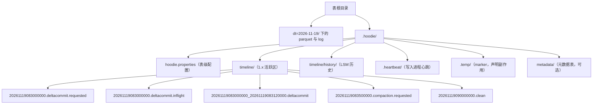
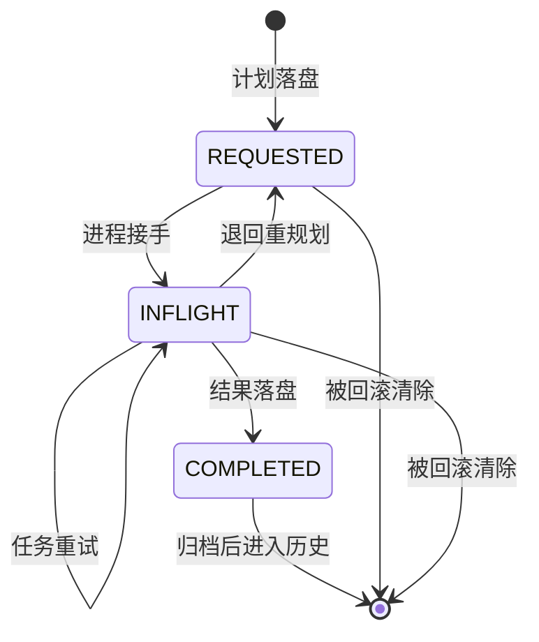
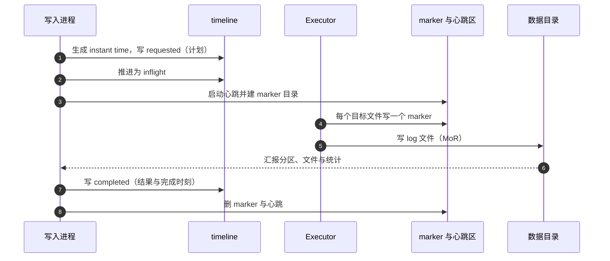
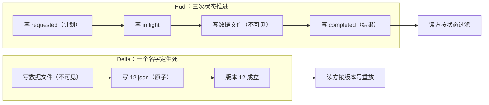
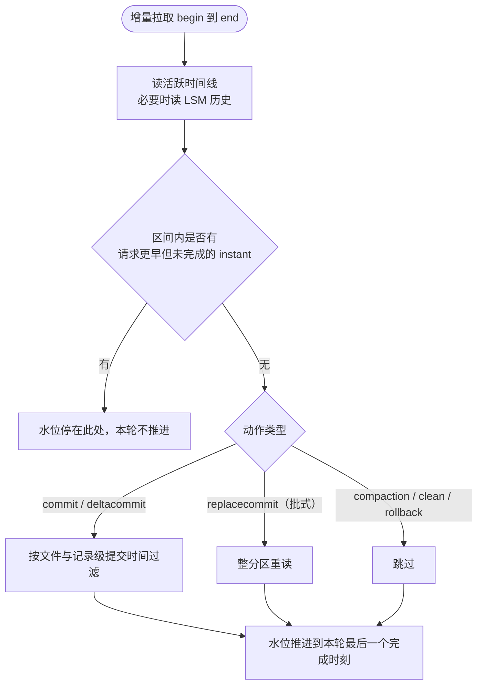
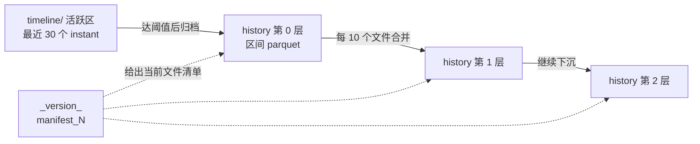

**摘要：**

一张 Hudi 表摊在对象存储上之后，除了分区目录里的 parquet 与日志文件，还有 `.hoodie/` 下一串以时间戳命名的小文件：`20261119083000000.deltacommit.requested`、`20261119083000000.deltacommit.inflight`、`20261119083000000_20261119083120000.deltacommit`。多数资料把它们笼统地叫作事务日志，但这个名字会误导——日志记录"发生过什么"，而这三个文件记录的是同一件事在三个不同时刻的状态。本文把 timeline 当作一台状态机来拆：先看 instant 的语法与内容，看清"时刻 + 动作 + 状态"这组三元组如何构成 Hudi 的记账单位；再解释 requested → inflight → completed 这条转移为什么必须存在，以及它如何把两阶段提交落到一个只有单文件原子写的存储上；再把 Delta Lake 的追加日志摆到旁边逐项对照，说明"预先占位 + 状态推进"与"写一个此前不存在的名字"这两种记法各自换来了什么、又付出了什么；接着指出动作类型在完成时会换标签，因此它只是粗粒度的过滤条件而非完备判据，并走一遍增量消费如何据此跳过 compaction 与 clustering、1.0 的 LSM timeline 如何取代活跃区与归档区的二分法；最后落在归档与清理的水位、inflight 悬挂与 clean 竞态这些故障形态，以及几类会把状态机弄坏的操作。

---

## 第 1 章 一个目录，两种记法

### 1.1 凌晨两点的那批残留文件

设想一个再普通不过的现场。某条 Flink CDC 作业每分钟向 `dwd.user_action` 写一批 upsert，凌晨两点被集群抢占打断，第二天早上作业重启，日志里没有报错，写入却慢了三四倍，而且越来越慢。运维打开 `.hoodie/` 目录，看到一串以时间戳开头的小文件，其中一批只有 `.deltacommit.requested` 和 `.deltacommit.inflight`，没有对应的完成文件；另一批则三个文件都在，甚至有些请求态的文件旁边还躺着完成态的文件。

多数人的第一反应是"事务日志脏了，删掉就好"。这一步删下去，事情会从"慢"变成"数据永远泄漏"，原因要到第 8 章才能讲清楚，但根子在这一章：这些文件不是日志条目，而是一台状态机的当前快照。日志里的一条记录写错了，再补一条冲销记录即可；状态机的一个状态缺了，就没人知道它走到哪一步了。

### 1.2 一个 instant 是什么

时间线上的一次操作叫 instant，它由三样东西构成，恰好对应文件名的三段。

第一段是时刻（instant time），一个字符串形式的时间戳，譬如 `20261119083000000`。它同时充当这次操作的事务 ID：同一个 instant time 在整个表的一生里只对应一次操作，任何写者拿去当自己的标识都不会撞车。

第二段是动作（action），说明这次操作想干什么——写一批记录、把日志压进基础文件、删掉一批旧文件切片、撤销一次失败的写入。

第三段是状态（state）。同一件事在生命周期里会经过请求（REQUESTED）、在途（INFLIGHT）、完成（COMPLETED）三步，每一步都用一个独立文件记录。表版本 6 的表（0.14 与 0.15 使用的版本）把完成态写成 `<instant>.<action>`，缺省的后缀就是"完成"；表版本 8 的表（1.0 起）改成 `<requested>_<completed>.<action>`，把完成时刻也写进文件名。中间态从 0.x 到 1.x 一直是 `<instant>.<action>.<state>` 的形态。

把这套语法合起来，`.hoodie/timeline` 下的每一个文件都读作一句话：某个时刻、某类动作、走到了某一步。

### 1.3 文件里装的是计划与结果，不是流水账

如果把 instant 文件打开，会看到两种截然不同的内容，而且它们的差别不是格式上的，是语义上的。

请求态的文件装的是计划（plan）：这次 upsert 用哪个 schema、操作类型是 UPSERT 还是 INSERT、重分区策略是什么；对 compaction 来说，计划里还带着"要把哪些日志文件压到哪个基础文件"的清单。计划一旦写出就不再修改，规范的措辞是"在请求操作之前，应该为该操作生成一个不可变的计划"。这句话解释了一个容易被忽略的设计：请求态的文件不是"我要开始了"的打招呼，而是一份可以交给另一个进程去执行的合同。

完成态的文件装的是结果：本次写入涉及哪些分区、每个文件组产生或替换了哪些文件、写了多少条记录、列级统计是什么、最小与最大的业务时间是多少。读快照时，读方需要的正是这份结果——它不必去列数据目录，只凭时间线上已完成的结果就能拼出"此刻这张表由哪些文件构成"。

以表版本 6 的 CoW 写入为例，完成态是一个 JSON 对象，内容节选如下。表版本 8 把这些内容改为 avro 序列化，字段语义不变，只是多了完成时刻。

```json
{
  "partitionToWriteStats": {
    "dt=2026-11-19": [
      {
        "fileId": "7c1e9b4a-3f22-4d1c-9a52-0e8f6b7c1d33",
        "path": "dt=2026-11-19/7c1e9b4a-3f22-4d1c-9a52-0e8f6b7c1d33_0-1-0_20261119083000000.parquet",
        "prevCommit": "20261119082900000",
        "numWrites": 18422,
        "numUpdateWrites": 15980,
        "numInserts": 2442,
        "totalWriteBytes": 25165824,
        "minEventTime": "2026-11-19T08:29:58",
        "maxEventTime": "2026-11-19T08:30:41"
      }
    ]
  },
  "commitTime": "20261119083000000",
  "operationType": "UPSERT"
}
```

`prevCommit` 指向被替换的旧文件版本，`numUpdateWrites` 与 `numInserts` 分开记，读方与表服务不必再打开数据文件就能知道这次写入的性质；这也是增量消费能只按元数据就完成"哪些分区值得读"这一步裁剪的原因。

一份合同加一份验收单，中间夹着执行过程，这三样东西恰好就是状态机的三个状态。日志没有这种结构：日志只有"记下来了"一种形态，写进去就是既成事实。

### 1.4 目录的形状与贯穿案例

为了让后面的机制有具体的着落，笔者用一张运行中的表贯穿全篇：`dwd.user_action`，MoR 表，按 `dt` 分区，约四百个分区、三千个文件组；上游是 CDC 流，每分钟一批 deltacommit，每五批触发一次异步 compaction，每天凌晨做一次 clustering，清理与归档由同一套表服务顺带跑完。这张表一天大约产生 1700 多个 instant，是个"写入很密、表服务很多"的典型形态，恰好能把时间线的各种边界都压出来。

下图是这张表某个时刻在存储上的形状。左侧是数据文件，右侧是 `.hoodie/` 里真正需要运维理解的那几个位置。



图里三个 `deltacommit` 文件属于同一个 instant，只是状态不同；黄色的 `.temp/` 与 `.heartbeat/` 不是时间线本身，但它们是状态机能够自我修复的两个前提，后面会反复用到。

把这几个位置的分工列成一张表，比按名字逐个记更实用：

| 位置 | 装什么 | 谁写 | 是否影响正确性 | 丢了会怎样 |
|---|---|---|---|---|
| instant 文件 | 一次操作的请求、在途、完成三态 | 写者、表服务 | 是，唯一事实来源 | 该操作的数据文件变成无人认领的孤儿 |
| `hoodie.properties` | 表名、类型、表版本、时间线布局版本、主键与分区字段 | 建表或升级时刻 | 是，决定用哪套语法读 | 读方可能用错误布局解析整个目录 |
| `.temp/` | marker，声明"这个 instant 产生了哪些文件" | Executor 写数据前 | 否，但回滚依赖它 | 回滚只能退化为扫表或按命名猜 |
| `.heartbeat/` | 每个在途 instant 一个心跳文件 | 写入进程后台线程 | 否，用于判定存活 | 表服务无法区分"写得慢"与"写崩了" |
| `timeline/history/` | 已归档 instant 与清单 | 归档服务 | 否，但读历史依赖它 | 超出活跃区的历史不可查，增量回溯受限 |
| `metadata/` | 元数据表（文件列表与列统计） | 元数据表写入器 | 否，可回退为列目录 | 元数据加速失效，读路径变慢 |

### 1.5 一个比喻：机场的状态牌

把时间线想成机场的航班状态牌。牌子上有三样信息：航班号（是哪一班）、执飞任务（飞哪里、什么机型，相当于动作）、当前状态（计划、登机中、已起飞、已到达）。旅客只看"已到达"，因为只有到达的航班才能接人；调度看的是全部状态牌，尤其是"计划中"和"登机中"，因为排机位、排行李转盘都要靠它。

比喻要加两条限定，否则会失真。其一，状态牌不是一本记录本，它是被替换的：一次状态推进不是在同一块牌子上改字，而是立一块新牌子，旧牌子不一定马上撤掉，于是同一次操作可能出现两个状态的文件并存，读方必须自己按"完成优先"的顺序裁决，而不是假设目录里只有唯一真相。其二，牌子立错了不会自动消失，得有人去把它连同它引发的后果一起撤销——数据文件在牌子立起来之前就已经写到磁盘上了，撤销意味着删除真实字节，这件事比改一块牌子贵得多。

---

## 第 2 章 三态：请求、在途、完成

### 2.1 状态转移的全集

规范给出的合法转移只有五条，比大多数人的想象要少，也比想象的要宽：

- `空 → REQUESTED`：动作被登记，但还没有任何进程开始执行；
- `REQUESTED → INFLIGHT`：某个进程接手，正在执行；
- `INFLIGHT → INFLIGHT`、`INFLIGHT → REQUESTED`：执行过程允许反复失败、退回重来；
- `INFLIGHT → COMPLETED`：动作成功，数据与元数据的全部改动在完成之前已经落地。

第三条是这套设计里最容易被读漏的一条。它明说"一个进程在执行动作时可以安全地失败很多次"，失败后的状态仍然是这个动作的状态，而不是"这次动作作废"。日志语义里没有这种位置——日志要么有一条记录，要么没有；状态机必须为"正在努力但还没成功"留一个位置，否则重试就得换一个事务 ID，而这会打破 instant time 作为事务标识的唯一性。

规范还给出了"当前状态"的判定规则：一次动作的当前状态，是时间线上为它记录过的最高状态，三个状态的次序是 `REQUESTED < INFLIGHT < COMPLETED`。这条规则带来一个很实用的性质——状态机对残留文件天然容错。完成之后若进程在删除 inflight 文件时崩掉，目录里会同时留着 inflight 与 completed 两个文件，读方按最高状态裁决，仍然认为它是完成的。这一点与"文件存在即状态"的直觉不同，也是后面判断"看到 inflight 不要慌"的依据。

下图把合法转移与几类终态画在一起：请求态与在途态被回滚清除、完成态在归档后进入历史，都是 instant 在时间线上的结局；而"完成之后仍残留一个在途文件"这种情况，读方必须能容忍，它不属于合法转移，只是删除动作没来得及做完。



不妨拿快递的扫描记录做个类比：揽收、在途、签收各扫一次码，包裹只有一个，状态却有三个。"在途"值得单独存在，是因为它让"这件东西现在由谁管"成为可查询的事实；而仓库盘点只认签收，因为在途件既不算入库也不算出库。限定在于，快递的三次扫描是同一个系统里的三次写，Hudi 的三次写必须落在三个不同文件上，且每一步都可能失败——这个类比只覆盖语义，不覆盖故障。

### 2.2 为什么必须有请求态

只用两个状态（在执行、已完成）也能表达"这件事做完了没有"，Hudi 却在前面加了一个请求态，原因有三个，一个比一个具体。

第一个是计划与执行分离。compaction 在 Hudi 里通常是"调度器写计划、执行器照计划干活"的两段式，两段可能相隔很久，甚至由两套作业承担：调度器在每次写入结束时顺带规划"接下来该压哪些文件组"，执行器是另一个独立的 Spark 作业，几十分钟后才跑。请求态文件就是这条流水线的交接凭证——计划落盘之后，调度器可以退出，执行器随时可以按 instant time 取走计划继续干。若没有请求态，计划只能在调度器的内存里，一次进程崩溃就白规划。

第二个是事务 ID 的可见性。instant time 一旦写进请求态文件，就等于向所有进程宣布"这个时刻被预订了"。其他写者生成新时间戳时会避开它，冲突检测会把它算进"别人正在做的事"，表服务也能据此判断某段区间是否已经有人占位。这是一份公开的占位声明，而不只是一条私有日志。

第三个是早冲突检测。默认情况下，Hudi 的写者要把数据写完、准备提交时才发现冲突，代价是一整轮数据写入白费。开启早冲突检测（`hoodie.early.conflict.detection.enable`，默认关闭）之后，写者能在真正动手之前先比对"我读过的文件集合"与"请求态之后已经完成的提交"，把注定失败的一轮提前掐掉。这个能力之所以能存在，恰恰因为"别人正在做什么"在时间线上是可见的——追加日志方案里，别人的提交在完成之前根本不存在，无从比对。

### 2.3 动作在完成时会换标签

本章更值得记住的一点是：动作类型不是常量。规范明确写道，同一个 instant 在完成态的动作类型可以与请求态、在途态不同——clustering 在请求与在途阶段叫 `clustering`，完成时记为 `replacecommit`；compaction 在请求与在途阶段叫 `compaction`，完成时记为 `commit`。

这件事在日志式的记账里是不可想象的：一条记录的类型字段不会因为"后来办成了"就从 A 变成 B。但在状态机里它很自然——动作的标签描述的是"这一步正在做什么"，而不是"这条记录属于哪一类"。于是同一份计划，在排期阶段是"一次聚簇任务"，在验收阶段是"一次文件组替换"；读方若只按完成态的动作过滤，看到的就是"一批文件组被换掉了"，而不需要额外理解聚簇这个概念。

理解这一点之后，第 5 章关于增量消费的讨论才有基础：增量消费者看到的永远是完成态，它面对的是 `commit`、`deltacommit`、`replacecommit` 这几类"结果型"动作，而不是 `compaction`、`clustering` 这些"过程型"名字。

| 动作（在途） | 完成态标签 | 谁产生 | 语义 |
|---|---|---|---|
| `commit` | `commit` | CoW 写入 | 一批记录原子写入基础文件 |
| `deltacommit` | `deltacommit` | MoR 写入 | 一批记录写入日志文件，可能部分进基础文件 |
| `compaction` | `commit` | 表服务 | 日志并入基础文件，产生新的文件切片 |
| `clustering` | `replacecommit` | 表服务 | 按新排序或新布局重写文件组 |
| `replacecommit` | `replacecommit` | 批式写入 | 用一组文件组替换另一组，如 `insert_overwrite` |
| `clean` | `clean` | 表服务 | 删除不再需要的旧文件切片 |
| `rollback` | `rollback` | 写者或表服务 | 撤销失败的写入及其副作用 |
| `savepoint` / `restore` | 同名 | 人工或工具 | 打标记、按标记回退 |
| `indexing` | `indexing` | 表服务 | 在指定列上建索引 |

### 2.4 读方怎么用三态

对读方来说，三态提供的是一张过滤清单，而不是一个需要额外理解的抽象。

快照查询只信 `COMPLETED`：请求态与在途态都不参与快照拼装，哪怕它们计划里的文件已经写完了。这条规则是 Hudi 的读取隔离的全部基石——"未完成的数据不可见"不靠锁，靠读方按状态过滤。这一点与 Delta Lake 的"未提交的版本根本不存在"殊途同归，只是过滤动作发生的位置不同：一个在读方枚举时间线时，一个在写方命名的唯一性上。

表服务则相反，它们要读请求态：compaction 执行器按 `compaction.requested` 取计划，clean 要避开仍在途的 instant，归档要确认待归档区间里没有未清理的副作用。同一份时间线，写者与读者看到的是不同的切片，这是状态机比日志更有表达力的地方。

---

## 第 3 章 提交被拆成两段

### 3.1 一次 MoR 写入的时序

把镜头拉近到一次具体的 deltacommit。下图是 `dwd.user_action` 在一分钟里发生的事：写入进程先占位、再推进状态、Executor 写数据、最后汇总结果。



时序里有两个位置值得单独盯住。

其一是第 3 到第 6 步：数据文件在完成文件之前就落到了磁盘上。这正是状态机式记账与追加日志式记账最根本的差别——在 Delta Lake 那边，提交之前写出的文件在语义上等同于不存在，不需要任何人去清理，`VACUUM` 会在保留期后把"日志里没有引用"的文件扫掉；在 Hudi 这边，这些文件是"已经存在的副作用"，必须有人按名单把它们删掉。清理者就是 rollback，而名单来自 marker。

其二是第 7 步：完成文件写下的那一刻，可见性才切换到新版本。此前表目录里的一切——新写的 log、被标记替换的旧基础文件——对快照读者都不存在。也就是说，原子性并不来自"一次写多个文件"，而来自"状态推进只有一个文件、且读方只认那个文件"。这与 Delta 把多条 Action 塞进一个 JSON 文件的思路等价，只是 Hudi 把"多条"换成了"多步"。

### 3.2 原子性落在哪里

Hudi 的原子性依赖两件事：单文件写入的原子性，以及 instant time 的唯一性。

单文件写入的原子性由存储提供：HDFS 上是一次 rename，S3 与 GCS 上是一次 PUT，本地文件系统上一次原子落盘。这部分与 Delta 完全一样，都是"利用存储的最小原子单位"。

instant time 的唯一性则要复杂一些。Delta 用文件名里的二十位序号解决"谁先谁后"，序号是计数的，不依赖时钟；Hudi 用的是时间戳，时间戳天然不唯一、还可能回退。规范的解法是让它具备 TrueTime 语义：要么由一个共享的时间生成器发号，要么各进程自己生成、但先在分布式锁内等待一个大于"最大时钟漂移"的不确定窗口，保证新生成的时间一定大于此前任何进程生成过的时间。规范里还提到一句很实在的话——Hudi 的目标事务时长在秒级，因此可以承受超过一百毫秒的不确定窗口，以换取极高的时间保真度。

这解释了第 4 章要展开的那个差别：Delta 的顺序是一个**计数器**，Hudi 的顺序是一个被约束成单调的**时间戳**。计数器的好处是零成本、与时钟无关；时间戳的好处是可以直接当业务时间用（记录上的 `_hoodie_commit_time`、文件名里的 instant time、增量查询的边界都是它），代价是要么集中发号，要么付出等待窗口。

### 3.3 计划为什么必须落盘

请求态文件里那份计划的存在，把 Hudi 的提交从"一次动作"变成了"两段式流水线"，这两段可以跨进程、跨作业、跨天。

对 compaction 来说，这个结构几乎是必需的。MoR 表的日志文件堆积速度取决于写入频率，而压实时机取决于文件组大小、日志块数量、查询负载，调度与执行在物理上就该分开：调度器在写入链路尾部快速扫一遍元数据，写下一份计划就走；执行器在资源便宜的时候拉起一个大作业，按计划压实。若计划不落盘，调度与执行就只能绑在同一个进程里，要么写入变慢，要么压实永远排不上。

对 clustering 来说，同样的结构还带来一个额外的能力：聚簇计划写好之后，执行器可以按当时的表状态判断"这份计划还成立吗"，如果期间有写入动了同一批文件组，直接放弃重排计划即可。这也是为什么在途状态允许退回请求态——退回去换一份计划，比重试一份已经失效的计划更合理。

### 3.4 完成态里为什么要有完成时间

表版本 8 把完成时间写进了文件名，这个改动看起来只是为了命名整齐，实际支撑的是一个新能力：按完成顺序排序。

在 1.0 之前，时间线上只有请求时刻，缺省语义是"请求早的提交先成立"。这个假设在单写者、串行提交的场景里成立，在非阻塞并发写入（1.0 引入的 NBCC）与异步表服务并行的场景里就不成立了：两个写者可能一个请求早、完成晚，另一个请求晚、完成早。若读方按请求时间推进水位，就可能出现"水位越过了一个还没完成的提交"的情况，等它完成后就永远落在水位之下。

完成时间进入文件名之后，读方可以按完成顺序建立序列号顺序，文件切片也可以按完成时刻对齐。代价是 instant 不再只是一个时间戳，而是一对时间戳，任何解析文件名的代码都必须能处理两种形态——这也是表版本 6 与表版本 8 之间读方难以通用的原因之一。

---

## 第 4 章 追加与占位的分野

### 4.1 Delta 的做法：写一个此前不存在的名字

在展开对比之前，先把 Delta Lake 的记账方式压缩到一句话：一次提交的所有工作，收缩成往 `_delta_log/` 里写一个此前不存在的文件。数据文件先写好，日志里记一批 `add` 与 `remove`；文件名的二十位版本号保证"此前不存在"，存储的单文件原子写保证"要么全有要么全无"。没有中间态，没有计划文件，没有状态推进——一次提交**要么成立，要么从未发生**。

这个结构的优雅之处在读路径：读方只需要按版本号枚举、按规则重放，不需要理解任何"进行中"的概念。它的代价也在这里：任何需要"进行中"信息的能力，都得绕道实现。流式写入的幂等靠 `txn` 动作，非数据变更的标记靠 `dataChange=false`，托管提交的中间状态靠 `_staged_commits/` 与目录服务——都是补丁式的。

这两种记法的差别，借两个日常场景能看得很直接。Delta 的做法像给新房间挂一块没人用过的门牌号，牌子挂上去，房间就算存在；Hudi 的做法像医院的挂号簿，先占一个号、在号后面写清要办什么，再逐个窗口盖章，章盖完才算办结。门牌号的好处是任何人走过都能判断房间在不在，挂号簿的好处是还没盖章的时候，后面排队的人也知道前面那一位在办什么。

### 4.2 Hudi 的做法：先占位，再推进

Hudi 反过来：先把这件事登记到时间线上（requested），再宣布开始执行（inflight），最后宣布完成（completed）。数据文件在这三步之间写出，可见性只由最后一步决定。

两种做法在"原子性"上的效果是等价的——读者都看不到未完成的写入。差别在于**中间态是否是一等公民**：Delta 的中间态是实现的细节，不进协议、不可查询、也不必被其他进程理解；Hudi 的中间态是协议的一部分，有文件名、有内容、有生命周期，任何进程都可以读、可以据此决策，也必须负责清理。

下图把两条路径并排放置：左侧 Delta 只有一次决定性的写，写完版本就成立；右侧 Hudi 要走三次状态推进，数据文件夹在中间落地。



### 4.3 六项后果

把差别摊开成六项，每一项都能在运维现场找到对应的现象。

第一项，可见的进行中状态。Hudi 的表服务可以"看见"彼此正在做什么，于是 compaction 可以在写入不停的情况下规划与执行，clean 可以避开在途的写入，归档可以等待副作用清理完毕。Delta 要实现类似的非阻塞表服务，只能靠 `dataChange=false` 的标记与乐观并发，做不到"在提交发生之前就被别人看到"。这项差别带来的直接后果是：Hudi 的运维必须学会区分**三类 pending**，而 Delta 的运维只需要关心"提交是否成功"。

第二项，非数据动作的表达层次不同。Delta 用提交内的一个布尔标记 `dataChange=false` 说明"这次不算新数据"，信息在提交完成时给出，粒度是"整个提交"；Hudi 用动作类型说明，compaction、clustering、clean、rollback 各有名字，且名字在请求阶段就已确定。前者简单，后者可查询——想统计"上周压了多少次实"这类问题，在 Hudi 里是一次时间线扫描，在 Delta 里要从 `commitInfo` 的 `operation` 字段里凑。

第三项，顺序的来源不同。Delta 的顺序是计数器，跨引擎无歧义；Hudi 的顺序是时间戳，需要 TrueTime 保证单调，表版本 8 之后还要区分请求时刻与完成时刻。这不是单纯的优劣：用时间戳换来的能力是"顺序可以直接当作业务水位"，增量消费的边界、记录的提交时间、时间旅行的基准，都是同一个值。

第四项，失败恢复的路径不同。Delta 的失败是"什么都没发生"，重试即可；Hudi 的失败是"发生了一半"，必须先承认、再撤销。撤销本身也是一个 instant（`rollback` 动作），于是失败恢复变成了一件可以被观察、也可以自己失败的事——第 8 章会看到，pending rollback 是一个真实的故障类别。

第五项，读路径的复杂度不同。Delta 的读方只有一条路径：找 checkpoint、重放 Action。Hudi 的读方要先做一次状态归并（把每个 instant 的多个状态文件压成"最高状态"），再做一次动作过滤（丢掉 clean、rollback 这类不改记录的动作），最后才拼快照。多出来的这两步是纯粹的负担，但它换来的是"读方可以看见表服务"。

第六项，元数据的增长方式不同。Delta 的日志线性增长，靠 checkpoint 把历史压成状态；Hudi 的时间线是"instant 数 × 状态数"个文件，靠归档把历史搬走。前者用一个定期的全量重写换常数读路径，后者用一个持续的后台搬迁换常数活跃区——第 6 章会看到，搬迁这件事本身在高写入吞吐下也会变成瓶颈。

| 维度 | Delta Lake | Hudi |
|---|---|---|
| 记账单位 | 一个提交文件内含多条 Action | 一次 instant 的三个状态文件加一份计划 |
| 顺序来源 | 二十位零填充版本号（计数器） | instant time（TrueTime 单调时间戳），1.0 起另记完成时刻 |
| 中间态 | 协议外，不可查询 | 协议内，有文件名、内容与生命周期 |
| 非数据动作 | `dataChange=false` 布尔标记 | compaction、clustering、clean 等独立动作类型 |
| 读方过滤 | 重放 Action | 先归并状态、再按动作过滤 |
| 失败恢复 | 未提交即不存在，重试即可 | 主动回滚，删除已写文件并记录 rollback instant |
| 元数据治理 | 追加日志加 checkpoint | 活跃区加归档（1.0 为 LSM 历史） |
| 未提交文件的清理 | `VACUUM` 按保留期扫全表 | rollback 按 marker 精确删除 |

### 4.4 反事实：各去掉一半会怎样

假设把 Hudi 的请求态与在途态拿掉，只保留完成态文件。表面上看时间线变干净了，实际上会同时失去四样东西：compaction 的调度与执行无法分离；多写者无法看到彼此的计划，早冲突检测无从谈起；进程崩溃后无法区分"这个 instant 正在被写"与"这个 instant 已经没人管了"，只能靠超时猜；表服务之间的非阻塞交错失去依据，因为"别人的进度"不再可见。这四样东西正是 Hudi 敢于让 compaction、clustering、clean 与写入并发跑的全部底气。

反过来，假设给 Delta 的日志加上请求态与在途态。它会立刻失去协议最珍贵的一条承诺：成功的版本才存在，读方不需要理解"半个提交"。所有引擎的读实现都要多一段状态归并逻辑，跨引擎一致性的维护成本会成倍上升。所以两边都没有走对方的路，这不是审美差异，是各自**把复杂度放在哪一侧**的选择——Hudi 放在读方与运维，Delta 放在写方与表服务。

---

## 第 5 章 增量语义如何长在时间线上

### 5.1 增量查询问的是哪个问题

增量查询要回答的问题是：在 instant A 到 instant B 之间，哪些记录发生了变化。这个问题能成立，靠的是两条腿：时间线提供"这段时间里有哪些已完成的写入"，记录上的 `_hoodie_commit_time` 提供"这条记录最后一次被写入是在哪个 instant"。

两步合起来，增量消费才有了确定的水位：读方按时间线枚举区间内的完成态写入，按动作类型筛掉不改记录的，再对保留下来的文件按记录级时间过滤。整个过程不需要扫全表，也不需要业务表上有更新时间字段。

### 5.2 动作类型就是过滤器

时间线的动作类型在这里第一次显示出它的实用价值：它把"物理上发生了事"与"逻辑上多了数据"分开了。

compaction 会把几十个日志文件压成一个基础文件，从文件角度看是一次大规模的创建与删除；从记录角度看，一条记录都没有变——压进去的还是那些记录，`_hoodie_commit_time` 也还是原来的值。logcompaction 同理，只是把多个小日志并成一个大日志。clean 删除的是旧文件切片，连记录都没碰。savepoint 只是打了个标记，restore 是回退。这些动作在时间线上都是完成态，都可以被枚举到，但增量消费者必须跳过它们。

反过来，clustering 这一条要留个心眼。它在完成态记作 `replacecommit`，语义是"换了一批文件组"，记录内容不变；但 `replacecommit` 这个标签同时也被 `insert_overwrite`、`delete_partition` 这类真正改数据的批式写入使用。**动作类型不是完备判据**，还需要看这次 replacecommit 的来源。这是状态机式记账的一个真实边界：动作名是粗粒度标签，不是语义的完备描述。

| 完成态动作 | 对记录内容的影响 | 增量消费的处理 |
|---|---|---|
| `commit` | 写入或更新记录 | 保留，按文件与 `_hoodie_commit_time` 过滤 |
| `deltacommit` | 写入记录（可能只在日志里） | 保留，MoR 表必须走快照或增量视图，不能用读优化视图 |
| `replacecommit`（clustering） | 记录不变，仅重排布局 | 跳过；若无法区分来源，按重叠窗口去重 |
| `replacecommit`（insert_overwrite 等） | 记录被替换或删除 | 保留，按新文件全量读取该分区 |
| `compaction` / `logcompaction` | 记录不变，仅重写文件 | 跳过 |
| `clean` | 无记录变化 | 跳过 |
| `rollback` | 撤销未完成的写入 | 跳过；若已消费过该 instant，说明水位推进有误 |
| `savepoint` / `restore` | 无记录变化 | 跳过 |

### 5.3 完成顺序与水位

第 3 章提到，表版本 8 把完成时刻写进了文件名。这个改动的必要性在增量消费上体现得最直接。

在 1.0 之前，读方只有请求时刻可用，于是"水位"隐含地按请求顺序推进：消费到 `20261119083000000` 之后，就认为比它早的 instant 都已经被处理过了。单写者场景下这个假设没问题；一旦允许多写者并发、允许 compaction 与写入交错，就可能出现请求早的提交完成得晚的情形。此时按请求时间推进水位，会把一个尚未完成的提交甩在水位之下，等它完成时，增量消费者已经走过去了。

正确的推进方式是按完成顺序：水位只推进到"连续完成"的最后一个 instant，中间有任何一个请求更早但尚未完成的，水位就停在那里等。这看起来是个细节，实质上是把"时间线是状态机"这件事用到了读方身上——序列的权威不是生成顺序，而是状态落定的顺序。

工程上还有一层保险：笔者见到的增量管道多数不会把水位顶到最新，而是保留一个重叠窗口（例如若干个 instant 或若干分钟），让下游有机会按主键去重。理由很朴素——状态机的完成时刻可能晚于业务期望，而 checkpoint 一旦写下去就很难回退。

下图是一次增量拉取从枚举到推进水位的完整判断链。



### 5.4 时间旅行与增量消费为什么不是一件事

两者都用时间线，但用的部分不同，这一点常被混起来。

时间旅行要的是"某个时刻的完整文件清单"，它需要把该时刻之前的所有完成态写入归并成快照，因此对归档的依赖是"历史 instant 的结果文件必须还能读到"。增量消费要的是"某段区间内发生了什么"，它对历史结果的依赖更弱，但对方位的依赖更强——begin 落在哪、end 落在哪、中间有没有悬挂。

这也解释了为什么两件事的保留窗口配置常常冲突：增量消费希望时间线留得长（begin 可以回溯很久），时间旅行希望数据文件留得长（clean 不能太激进），而归档与清理是两组独立的旋钮。把它们当成一个"保留期"来配，是第 7 章要讲的常见错误。

---

## 第 6 章 活跃与历史的两种形态

### 6.1 0.x 的二分法

表版本 6 的时间线是"活跃区加归档区"的结构：活跃区就是 `.hoodie/` 根目录下那一堆 instant 文件，归档区是 `.hoodie/archived/` 下的 avro 文件，文件名形如 `.commits_.archive.<序号>_<时间>.<时间>.avro`。

归档的触发由两个水位控制：活跃区的 instant 数超过 `hoodie.keep.max.commits`（默认 30）时开始搬，搬到只剩 `hoodie.keep.min.commits`（默认 20）为止；每次搬多少由 `hoodie.commits.archival.batch`（默认 10）控制；归档目录名由 `hoodie.archivelog.folder`（默认 `archived`）指定。

这套结构有一个必须先满足的前提，规范的措辞很明确：完成态与在途态动作产生的副作用（例如未提交的文件）必须在归档之前从存储上清除。换句话说，**归档不能早于回滚**。理由不难推：归档把"这个 instant 存在过"的事实搬出了活跃区，此后活跃区里不再有它的记录；若它当时还留着一批未提交的数据文件，就再没有任何进程知道该删哪些文件，那批字节会变成永久泄漏。这条约束在运维上表现为一个典型的症状——归档水位一直上不去，因为总有回滚没跑完。

### 6.2 二分法为什么不够

在每天几百个 instant 的表上，二分法运行得很好；在每天上千个 instant、写入又很密的表上，它开始露出三个问题。

第一个是活跃区太挤。所有写者与表服务都要列这个目录、读其中的文件，活跃区越大，每次提交的元数据阶段越慢。第二个是归档读放大。归档是 avro 文件，要查某个历史 instant 只能按段扫；一次跨越十几段归档的增量回溯，等于把几十兆的 avro 从头解析一遍。第三个是并发写者的协调成本：多个写者同时尝试推进归档，需要额外的互斥，而锁一旦引入，就与"非阻塞"的初衷相悖。

### 6.3 1.0 的 LSM 时间线

1.0 把二分法整个换掉了，改成一套 LSM 树结构，路径也从 `.hoodie/` 根目录搬到了 `.hoodie/timeline/`。

活跃区仍然是"一次 instant 一个文件"，但内容全部改成 avro 序列化，完成态的 instant 文件另外带上完成时刻。历史区在 `.hoodie/timeline/history/`，由三类文件组成：`_version_` 记录当前清单版本，`manifest_<N>` 记录清单（每个新操作产生新的 manifest），以及 `<min_time>_<max_time>_<level>.parquet` 这类按 instant 时间区间与层级命名的数据文件。越新的 instant 在越靠上的层级，累积到一定数量后向下合并，合并的批量由 `hoodie.timeline.compaction.batch.size`（默认 10）控制。

这套结构买到的是三样东西。其一是时间范围查询：历史按时间区间分文件，查一段历史只需打开与区间相交的那几个 parquet，而不是从头扫 avro。其二是无限历史：层级合并让历史在存储上保持"文件数随 instant 数亚线性增长"，不必为了控制文件数而截断历史。其三是快照隔离：每次操作产生新的 manifest 版本，读方拿一个 `_version_` 就能看到一份一致的文件清单，写者继续写不会影响到它。

下图是历史区从活跃区接收 instant、再逐层合并的过程。



### 6.4 表版本决定用哪套语法

两套布局不是靠配置开关切换的，而是由 `hoodie.properties` 里的表版本决定：表版本 6（0.14 与 0.15 使用的版本）使用时间线布局版本 1，即活跃区加归档区；表版本 8（1.0 起）使用布局版本 2，即 LSM 时间线。`HoodieTableVersion` 这个枚举里，版本号与布局版本是绑定的，这也解释了为什么 1.0 强调"可以写表版本 6 也可以写表版本 8"——写入方需要同时实现两套记账。

| 维度 | 表版本 6（0.x） | 表版本 8（1.0 起） |
|---|---|---|
| 活跃区路径 | `.hoodie/` 根目录 | `.hoodie/timeline/` |
| 历史区路径 | `.hoodie/archived/` | `.hoodie/timeline/history/` |
| instant 内容格式 | 完成态为 JSON，请求态另放计划 | 全部 avro 序列化 |
| 完成态命名 | `<instant>.<action>` | `<requested>_<completed>.<action>` |
| 历史组织形式 | 顺序 avro 段文件 | LSM 分层 parquet 加 manifest |
| 归档控制 | `hoodie.keep.max.commits` 等 | 归档阈值加 `hoodie.timeline.compaction.batch.size` |
| 历史查询代价 | 按段扫描 avro | 打开相交区间的 parquet |
| 时间范围查询 | 需扫全段归档 | 按区间直接定位 |

---

## 第 7 章 归档、清理与元数据水位

### 7.1 三组旋钮，两条独立水位

时间线的运维看起来有一大把配置，实际上只有三组，而且它们管的是两条相互独立的水位。

第一组管活跃区：`hoodie.keep.max.commits`（默认 30）与 `hoodie.keep.min.commits`（默认 20），决定活跃时间线留多少个 instant。第二组管数据文件：`hoodie.clean.automatic`（默认开启）、`hoodie.clean.policy`（默认 `KEEP_LATEST_COMMITS`）、`hoodie.clean.commits.retained`（默认 10），决定旧文件切片留多久。第三组管写入失败后的清理时机：`hoodie.cleaner.policy.failed.writes`，取值为 EAGER、LAZY 或 NEVER。

两条水位的独立性是许多误配的根源。活跃区水位决定"元数据留多长"，数据文件水位决定"字节留多长"。把活跃区调到很大、清理保持默认，结果是元数据堆积、数据正常回收；把清理窗口调到很大、活跃区保持默认，结果是数据文件还在、但时间线上已经没有对应的 instant 记录，于是那批文件既不能被 clean 回收，也不能被回滚识别。两种错法都"能跑"，只是以一种缓慢的方式变坏。

两条水位互不相干，像水库的溢洪道与放水闸：一个管坝上水位，一个管下游流量，单独拧错哪个都不会立刻出事，两个都拧错才会淹到人。

1.x 里这批键名经过一轮整理，`hoodie.cleaner.*` 与 `hoodie.clean.*` 两种写法在不同版本的文档里都能见到，写在作业参数里的旧名字多数仍然生效。同一个含义出现两个键名，是排查"配置到底生没生效"时的常见坑。

### 7.2 一次示例推算

以 `dwd.user_action` 的形态做一次示例推算，只为看清量级，不作为任何性能承诺。

每天约 1440 个 deltacommit、288 个 compaction、24 个 clean、1 到 2 个 clustering，合计约 1750 个 instant。每个 instant 稳态下有两个文件（请求态与完成态），在途时会短暂出现三个，于是活跃区的文件数约等于 instant 数乘以二。

若保持默认的 `hoodie.keep.max.commits=30`，活跃区只有六十个左右的文件，任何写者启动时列一遍目录、读几个文件，元数据阶段的开销是常数级的。若有人为了"多留点历史"把它调到 5000，活跃区文件数涨到一万量级，对象存储的列目录按每页一千个键计算要翻十页，每个写者、每个读者都要付这笔钱；按每次列目录几十毫秒估，元数据阶段就从几十毫秒变成几百毫秒到秒级，而且这是叠加在每次提交上的固定税。

历史区的账相反：LSM 每层按十比一合并，一千个 instant 在第 0 层是一百个文件，合并后第 1 层约十个，查一段跨百个 instant 的历史只需打开一两个文件。这就是 LSM 替换二分法的收益所在——历史从"按段扫 avro"变成"按区间开 parquet"，代价是多了一层合并任务与 manifest 的一致性维护。

### 7.3 清理元数据里的两个陷阱

clean 自己也是一个 instant，它的计划与结果都写在时间线上。1.x 的文档里有两条关于字段语义的说明，读起来琐碎，排查时却很要命。

其一，clean 的计划与元数据里记录的始终是 instant 的**开始时刻**，不是完成时刻，即便整个 1.x 的时间线已经按完成时刻排序。`earliestInstantToRetain.timestamp`、`earliestCommitToRetain` 都是开始时刻。其二，`lastCompletedCommitTimestamp` 这个名字会骗人：它的取值来自按完成时间排序的已完成序列的末尾，但记下来的却是那个 instant 的开始时刻。并发写入时，完成顺序与开始顺序可以不同，因此这个字段不一定是所有已完成提交里最大的开始时刻。

这两条合起来说明一件事：**清理水位按开始时刻计算**，所有关于"保留多久"的心算都要用开始时刻。用完成时刻去核对 clean 的水位，会得出"清理没跟上"或"清理超前了"的错误结论。

### 7.4 时间线过大与文件损坏

时间线过大的症状很好认：每次提交前停顿变长、`show commits` 之类的元数据命令越来越慢、对象存储的 LIST 请求费用上涨，而查询结果一切正常。判据是活跃区文件数远超 `hoodie.keep.max.commits` 的两倍，根因通常是归档一直没跑起来（被未清理的副作用卡住，或表服务的调度被关掉了），处置顺序是先看挂起的 instant，再让归档跑起来，最后才考虑调整水位。

文件损坏是另一类问题，形态更杂。常见的有时间线里出现同一时刻的两个文件（并发写者或时钟异常所致）、`hoodie.properties` 被改坏（布局版本与表版本不匹配）、以及早期的 clean 元数据格式问题。hudi-cli 的 `repair` 命令族覆盖了其中一部分：`repair overwrite-hoodie-props` 可以重写表属性，`repair corrupted clean files` 修清理元数据，`repair migrate-partition-meta` 迁移分区元数据；而 `repair deduplicate` 处理的是分区内的重复记录，不是时间线上的重复文件，两者别混为一谈。

这些命令能修的是"属性写错了、文件重复了、元数据格式旧了"，修不了"instant 的内容丢了"。时间线是事实来源，不是可以从别处重建的派生数据——这一点与 Delta 的 checkpoint 形成鲜明对照：checkpoint 删了可以从日志重放，时间线里的一个 instant 文件删了，那一批写入就永远无法被解释。

| 配置 | 默认值 | 管的是 | 调大的后果 |
|---|---|---|---|
| `hoodie.keep.max.commits` | 30 | 活跃区 instant 数上限 | 活跃区变大，每次提交的元数据开销上升 |
| `hoodie.keep.min.commits` | 20 | 归档后保留的 instant 数 | 归档搬动量变小、频率变高 |
| `hoodie.commits.archival.batch` | 10 | 每次归档读取的 instant 数 | 单次归档更重、次数更少 |
| `hoodie.timeline.compaction.batch.size` | 10 | LSM 每层合并的文件数 | 合并更重，层级数变少 |
| `hoodie.clean.automatic` | true | 提交后是否自动清理 | 关掉后数据文件只增不减 |
| `hoodie.clean.policy` | `KEEP_LATEST_COMMITS` | 清理策略 | 换成按文件版本会在时间语义上失准 |
| `hoodie.clean.commits.retained` | 10 | 保留的提交数 | 数据文件留得更久，增量回溯窗口更大 |
| `hoodie.cleaner.policy.failed.writes` | EAGER | 失败写入的清理时机 | NEVER 会让悬挂的 instant 永不回收 |

---

## 第 8 章 故障形态：悬挂、竞态、元数据膨胀

前文几次提到"三类 pending"，这里把它们摊开。请求态挂着，可能是正常的排期等待；在途态挂着，可能是写入正在进行，也可能是进程已经死了；回滚态挂着，则说明撤销本身出了问题。三类的外表一模一样——时间线上多出几个没有完成文件的 instant——处置方式却完全不同，判断依据分别是"计划有没有被接手""心跳还在不在""目标 instant 还在不在"。

### 8.1 inflight 悬挂

这是 Hudi 现场最常见的一类。症状是写入启动阶段变慢甚至报错，时间线上有一批只有请求态或在途态的 instant，迟迟不变成完成。

判据要分单写者与多写者两种场景。单写者模式下，下一个写者启动时会主动清扫未完成的 instant，所以悬挂通常表现为"下一次提交变慢"，清理完成后自愈。多写者模式下不能这么干——一个未完成的 instant 完全可能是别人正在写的，贸然回滚会毁掉一份有效的数据。Hudi 的解法是心跳：每个 instant 从开始写就有一个心跳文件在 `.hoodie/.heartbeat/<instant>`，写入进程用后台线程定期刷新它的修改时间，完成时删除。表服务在判定回滚对象时看的是心跳有没有超时，文档给出的经验判据是"若某个提交的心跳超过十分钟没有更新，就可以安全地认为原写入进程已经失败"。心跳文件不是锁，它更像病房门口的监护仪：拔掉监护仪不等于病人死了，但护士只能靠波形判断里面还有没有人。

根因通常是写入进程非正常退出：作业被抢占、driver 内存溢出、提交阶段的网络分区、人为 kill。多数情况下不需要人工介入——EAGER 模式下下一个写者顺手清掉，LAZY 模式下由清理链路按心跳超时清掉，两种模式都会同时删除数据文件与时间线文件。需要人工介入的只有 `NEVER` 模式，以及心跳文件本身被删或权限异常的情形。

处置时要抵抗一个很自然的冲动：手工删掉那些请求态与在途态文件。删掉它们，数据文件就失去了唯一的归属记录，回滚再也找不到该删什么，那批字节会永久占着存储；这比"时间线上多几个文件"严重得多。

### 8.2 回滚自身失败

回滚不是一个原子动作，它自己也是一个 instant：先写 `rollback` 的请求态，按 marker 与目标 instant 的结果文件算出要删的清单，执行删除，最后写完成态。这意味着回滚会失败，而且失败的位置很讨厌。

一个真实的历史缺陷就是这个形态：假设回滚 C1 的动作 C4 已经把 C1 的 instant 文件删掉，但还没来得及把自己从在途态推进到完成态就崩了。下一次重试 C4 时，逻辑要去找"被回滚的目标 instant C1"，却因为在时间线上找不到它而直接放弃，于是 C4 永远停在在途态。修复的方向是在目标 instant 缺失时仍按计划完成删除与状态推进。

判据是：时间线上有一个在途的 `rollback`，它要回滚的目标 instant 已经消失，而其他数据没有被清理干净。处置上，先确认没有活跃写入，再让回滚重试或由工具强制推进；这类操作必须在明确的时间窗口里做，因为回滚的并发安全性依赖"没有别人在写"。

### 8.3 clean 与写入、回滚的竞态

clean 删的是旧文件切片，它判断"旧"的依据是完成态写入的水位。问题在于写入与回滚都在动同一批文件：一个刚失败的写入，它的数据文件还没被回滚清掉，clean 可能已经把它的基础文件切片算作"旧"删掉了；反过来，回滚正在删文件时 clean 也在扫同一批文件，就可能出现清理元数据与实际文件不一致。

判定这类问题的证据是异常类型与服务日志：读方报某个 parquet 或 log 文件不存在，而时间线上那个 instant 是完成的；或者清理日志里出现"要删的文件已在别处消失"。历史上有专门的缺陷记录清理与失败写入回滚并发导致的问题，修复涉及清理与回滚的互斥顺序。

处置的原则不复杂：让清理窗口显著大于最长查询时长与增量消费的可能延迟，把 `hoodie.cleaner.policy.failed.writes` 设成与部署形态匹配的值（单写者可以 EAGER，多写者建议 LAZY），并在升级到 1.2 之后的版本上考虑用写前清理策略（`hoodie.prewrite.cleaner.policy`）把回滚与清理前移到每次写入之前，用一次可控的等待换掉随机的竞态。

### 8.4 归档卡住与增量回溯失败

归档卡住的症状是活跃区文件数只涨不降、时间线命令变慢，日志里没有任何错误。根因往往不是归档本身，而是它的前置条件没满足：待归档区间里还有未清理的副作用，归档就一直等。

增量回溯失败的症状是下游作业启动时卡在加载历史，或者直接报某个 instant 不存在。前者是读放大（历史区间跨了很多层或很多段归档文件），后者是数据保留窗口不够——时间线里还能查到那个 instant，但它引用的数据文件已经被 clean 删掉了。这两种症状的处理方向完全不同：前者要减少回溯跨度或优化归档合并，后者只能承认窗口不够，重灌下游。

### 8.5 一张处置表

| 症状 | 判据 | 根因 | 处置 |
|---|---|---|---|
| 提交启动阶段越来越慢 | 时间线有多个未完成 instant，心跳文件不更新 | 写入进程被杀，悬挂未清理 | 让 EAGER/LAZY 清理跑起来；不要手工删 instant |
| 回滚一直停在在途态 | 存在在途 `rollback`，其目标 instant 已消失 | 回滚中途崩溃 | 确认无活跃写入后重试回滚或强制推进 |
| 读表报文件不存在 | 异常指向已被 clean 的基础文件或日志文件 | 清理窗口短于查询时长 | 调大 `hoodie.clean.commits.retained`，并核对最长查询时长 |
| 活跃区文件数持续上涨 | 远超 `hoodie.keep.max.commits` 的两倍 | 归档被未清理副作用卡住 | 先清悬挂，再恢复归档任务 |
| 增量作业启动极慢 | 回溯区间跨多段归档或跨多层历史 | 历史读放大 | 收窄回溯跨度，检查 checkpoint 是否落后 |
| 增量作业报 instant 不存在 | 时间线里还能查到，数据文件已被删 | 数据保留窗口不足 | 接受窗口边界，重灌下游 |

---

## 第 9 章 反例：五种不该做的事

这五种操作的性质并不一样：有的瞬间不可逆，有的是几个月后才显形，但在笔者看来，它们共用一个根源——把时间线当成了流水账，于是顺手做了对流水账才合理的事。

### 9.1 手工删 `.hoodie/` 下的 instant 文件

这是破坏性最强的一种，而且动机往往很正当——时间线上有一堆看不懂的请求态文件，删掉看起来最干净。

删请求态文件，等于删掉了一份尚未执行的计划，影响仅限那次操作重来一遍，还算可控。删在途态文件就不同了：它删掉的是"这批数据文件属于谁"的唯一记录，数据文件仍在目录里，但没有任何 instant 声明它们存在，clean 不认识它们、rollback 找不到它们、快照读也看不见它们。删完成态文件更糟：它把一个已经成立的版本从历史里抹掉，此后 clean 的清理水位、增量消费的水位、时间旅行的基准全部失去参照，而被删掉的 instant 引用的文件也不会被自动回收。

正确做法只有一个：让状态机自己把悬挂的 instant 推到终态，或者让 rollback 把它撤销。

### 9.2 把时间线当无限历史

"把 `hoodie.keep.max.commits` 调到几千，历史就都留住了"是一个流传很广的误解。活跃区不是历史区，它的作用是让当前写入与读取有一个常数大小的元数据视图；真正的历史在归档区或 LSM 历史里。

把活跃区调大的直接后果是每个写者、每个读者、每个表服务都要为这份"用不上的历史"付列目录与读文件的成本，而且这个成本叠加在每次提交上。更要紧的是它与清理窗口并不联动——活跃区留了五千个 instant，数据文件却按十个提交清理，于是时间线上有大量 instant 指向已经被删的文件，任何回溯到那段区间的操作都会失败。这类表看起来很正常，直到有人真的去做一次时间旅行。

### 9.3 忽略 inflight 悬挂

悬挂的 instant 有两个直接代价：一是每个悬挂都带着一批未提交的数据文件，占着存储却永远不参与查询；二是它们会持续阻塞归档，因为归档的前置条件是副作用清理完毕。于是"几个悬挂的 instant"会演变成"活跃区无限膨胀"再演变成"整张表元数据变慢"，中间没有任何报错提示。

判断是否真的悬挂，要看心跳而不是看文件是否存在。有请求态文件是正常的，有一次表服务规划完就退出、执行器几十分钟后才接手，也有写者正在写、进程还活着——这两种都不该被当成故障。

### 9.4 手工编辑 `hoodie.properties`

表版本、时间线布局版本、主键字段、分区字段都在这个文件里。它们不是"建议性配置"，而是决定读方如何解析整个目录的元数据。把表版本从 8 改回 6，读方就会去 `.hoodie/` 根目录找 instant 文件，而 1.x 把它们放在 `timeline/` 下；把分区字段改掉，时间线里所有已完成 instant 的分区路径都对不上。

hudi-cli 提供了 `repair overwrite-hoodie-props` 来重写这个文件，但它的用途是"用一份正确的文件覆盖"，不是"手改一个字段试试"。升级与降级要走版本迁移流程，表版本 8 的引入有专门的滚动升级说明，其中明确要求先把异步表服务停干净。

### 9.5 把 `.hoodie` 当普通目录拷贝恢复

备份一张 Hudi 表，只拷数据目录、或者只拷 `.hoodie`，都会得到一个语法自洽但语义破碎的结果。数据文件的名字里带着写它的 instant time，时间线里的结果文件记录着它被哪次写入产生，两边一旦错位，时间线就成了"指向不存在文件的清单"。跨表拷 `.hoodie` 更危险：表名、主键、分区字段全都对不上，读出来的是一张身份错乱的表。

正确的恢复单位是"表根目录 + 一个一致的时间点"，而且要确认那份拷贝里没有在途的 instant——如果有，恢复之后它就是一个永远悬挂的 instant：原写入进程早已不在，心跳不会恢复，只能靠回滚把它清掉，而回滚又要依赖那份拷贝里的 marker 还在。

---

## 第 10 章 收束：把时间线当状态机来读

回到开头那个凌晨的现场。那批残留文件之所以让人想删，是因为把它们当成了日志里写坏的条目；一旦把它们看成状态机的当前值，"删掉它"这个动作就自动不成立了——你删的不是一条记录，是状态机的一步，而状态机的每一步都对应着磁盘上真实存在的字节。

这笔账可以算得更清楚一些。日志回答"发生过什么"，适合只读回放，适合让不同的读者各自算出同一份结果；状态机回答"现在处在什么状态"，适合多方协作，适合让写者、表服务、读者在不互相阻塞的前提下各自推进。Hudi 选了后者，于是它必须付出三样代价：读方要先归并状态再过滤动作；运维要能分辨三类 pending；任何绕过状态推进的写入都会留下无法解释的字节。它换回来的是 compaction 与 clustering 这类"物理整理"能被看见、能被跳过、能与写入交错执行——增量管道因此不必因为一次压实而重算，表服务因此不必为了安全而停写。

Delta Lake 选了前者，于是它的读协议极其干净：成功的版本才存在，未提交的字节从不进入语义。它付出的代价是表服务只能以"完成后的标记"来表达自己，任何"正在进行中"的协调都要靠外部机制补。两种选择都成立，边界在于业务需不需要"正在整理"这件事被看见——高频增量写入、需要压实与聚簇长期在线运行的表，会越来越需要；批式覆盖写、表服务可以离线跑的表，则为这份可见性付出的复杂度是净亏损。

笔者真要给一条可执行的结论，那就是把 `.hoodie/timeline` 当成数据库的系统表来对待：不手工编辑，不绕过状态推进写入，不让悬挂的 instant 长期堆积，活跃区的水位按元数据成本来设计而不是拍脑袋调大。做到这四条，这套看起来文件散乱的机制，就足以支撑一张每天上千次提交、长期在线压实的表。

---

## 参考资料

1. [Apache Hudi 文档 · Timeline](https://hudi.apache.org/docs/timeline/)：instant 的三态定义、动作类型清单、状态转移规则、TrueTime 语义，以及 1.x 的 LSM 时间线与历史区布局。
2. [Apache Hudi 文档 · Auto Rollbacks](https://hudi.apache.org/docs/rollbacks/)：单写者的即时回滚与多写者的心跳判定，`.hoodie/.heartbeat/` 的作用与超时语义。
3. [Apache Hudi 文档 · Cleaning](https://hudi.apache.org/docs/cleaning/)：清理策略、保留窗口、清理元数据里各类 instant 时间字段的真实含义。
4. [Apache Hudi 1.0 技术规范](https://hudi.apache.org/learn/tech-specs)：表版本 8 的格式定义，时间线、日志格式与并发控制的形式化描述。
5. [Apache Hudi Release 1.0](https://hudi.apache.org/releases/release-1.0/)：LSM 时间线、avro 序列化、完成时刻进入文件名、clustering 动作重命名等格式变更的官方说明。
6. [HoodieTableVersion.java](https://github.com/apache/hudi/blob/master/hudi-common/src/main/java/org/apache/hudi/common/table/HoodieTableVersion.java)：表版本号与时间线布局版本的绑定关系。
7. [HUDI-7665 · Rolling upgrade to table version 8](https://issues.apache.org/jira/browse/HUDI-7665)：表版本 8 的滚动升级约束，写者、读者与表服务的共存矩阵。
8. [HUDI-3720 · Rollback reattempt fails if the commit to roll back is not present](https://issues.apache.org/jira/browse/HUDI-3720)：回滚自身中断后的重试缺陷与修复思路。
9. [HUDI-7361 · Fix a concurrency issue caused by clean](https://issues.apache.org/jira/browse/HUDI-7361)：清理与失败写入回滚并发时的竞态记录。
10. [Delta Lake Protocol Specification](https://github.com/delta-io/delta/blob/master/PROTOCOL.md)：对照用的追加日志定义，提交文件、checkpoint 与动作结构。

---

> [!note] 思考题
> 1. 如果一次 deltacommit 的 completed 文件写成功之后、删除 inflight 文件之前进程崩溃，时间线上会同时存在两个状态的文件。读方按"最高状态"裁决能正确处理，那么哪些表服务会因为这两个文件同时存在而做出错误判断？
> 2. Hudi 用 TrueTime 保证 instant time 单调，Delta 用计数器保证版本号单调。假如让 Hudi 改用计数器，增量查询的边界、记录的 `_hoodie_commit_time`、时间旅行的基准这三处会分别失去什么？
> 3. clustering 在请求阶段叫 `clustering`、完成阶段叫 `replacecommit`，而 `replacecommit` 同时被 `insert_overwrite` 使用。如果你是增量管道的作者，会用什么办法可靠地区分"只是重排"与"真的改了数据"？
> 4. 归档的前置条件是副作用清理完毕。如果一张表的回滚链路长期失败，归档会一直等下去，此时活跃区会膨胀到什么程度，膨胀又会不会反过来让回滚更难成功？
> 5. 表版本 6 与表版本 8 的时间线是两套语法、两套路径、两套命名。在滚动升级期间，一个还在读表版本 6 布局的读者打开一张正在被 1.x 写者以表版本 8 写入的表，会看到什么、报什么错？