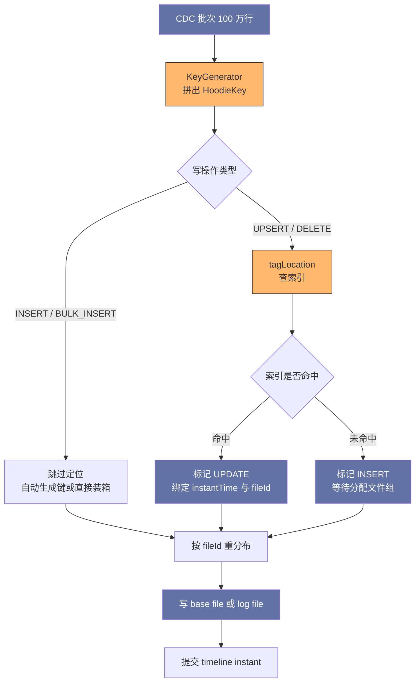
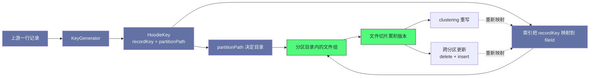
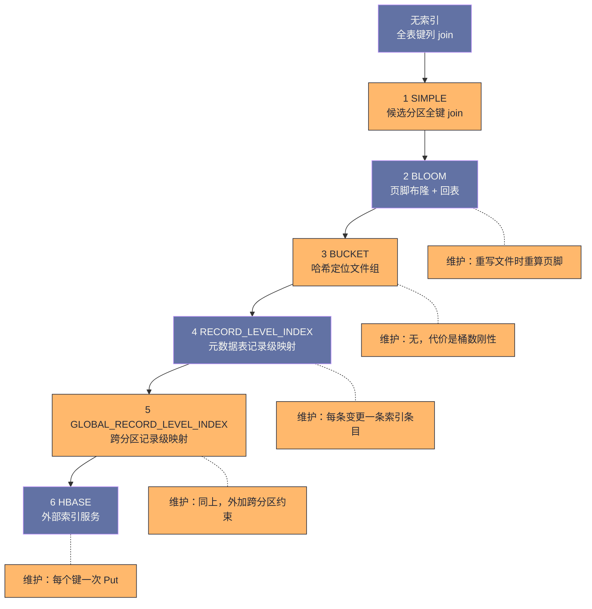
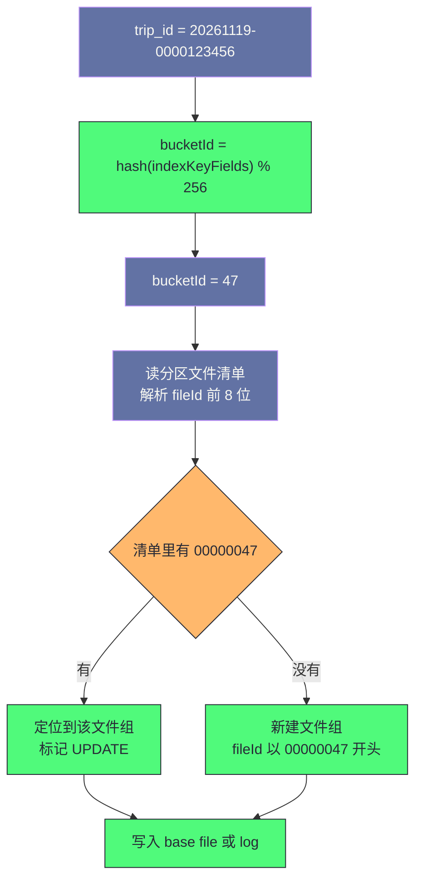
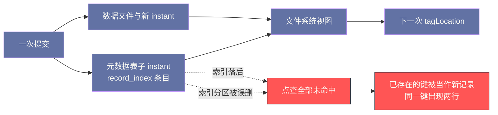

**摘要：**

数据湖上的 upsert 之所以能做到分钟级一批，靠的不是把文件写得更快，而是先回答一个定位问题：这条 key 现在的版本落在哪个文件的哪个位置。本文以一张 1 TB 的行程表贯穿全篇，把定位这件事拆成三段：HoodieKey 的构造、索引档位的选择、以及每一档要付的维护费。HoodieKey 是 recordKey 与 partitionPath 的二元组，partitionPath 必须由写入方算好并稳定复现，这条约束直接划定了非全局索引的能力边界。索引有六档：SIMPLE 用 join 扫候选分区的键列，BLOOM 在文件页脚存布隆过滤器并按 key 区间剪枝，BUCKET 把映射编码进文件名的哈希布局，RECORD_LEVEL_INDEX 与 GLOBAL_RECORD_LEVEL_INDEX 把映射写进元数据表，HBASE 把映射托管到外部服务。六档的定位精度递增，维护成本并不等比例递增，BUCKET 就几乎不维护索引，代价换成了桶数刚性。文中给出一组明确标注为示例推算的数字：同样 100 万行变更，六档索引定位阶段碰到的数据文件数能从 8,192 个降到 0 个，而定位之后必须改写的字节完全一样。落点是三类反例：小表上 HBASE、大表上 SIMPLE、全局索引配频繁变动的分区键。

---

## 第 1 章 定位：一次 upsert 到底在找什么

### 1.1 先把案例钉住

笔者设一张行程表 `trips`，上游是 MySQL binlog 经 Flink 入湖，主键 `trip_id`，分区列 `dt`，另有 `driver_id`、`city`、`status`、`amount`、`updated_at` 等列。表总量按 1 TB 估，90 个天分区，单文件 128 MB，每个分区约 91 个文件，全表约 8,192 个文件；按行宽 200 字节算，每个文件约 65 万行，全表约 54 亿行。上游每 5 分钟一批，高峰批次 100 万行，其中八成是更新、两成是插入，一批约 200 MB。`trip_id` 的形态是「日期前缀 + 序号」，例如 `20261119-0000123456`，分区路径形如 `dt=2026-11-19`。

现在来一批变更，其中一条 `trip_id=20261119-0000123456` 的 `status` 从 `ACCEPTED` 改成 `IN_PROGRESS`。Hudi 在动手写之前必须先回答：这条记录现有的版本在哪个文件里？

这个问题有两个层次。分区列已经告诉了写入方目录是 `dt=2026-11-19`，这一步不需要任何索引，因为分区路径是写入方自己算出来、自己拼进路径的。但那个目录下还有 91 个文件，这条记录在哪个文件里，没有任何目录信息能回答。CoW 表要把这个文件整份读出来、合并、再整份写回；MoR 表要往这个文件组当前的 log 里追加一段。两种表型都需要先知道 fileId，区别只在于拿到 fileId 之后做什么。

### 1.2 映射一旦建立就很稳定

Hudi 的物理结构是分区、文件组、文件切片三层。分区是目录，文件组由 fileId 唯一标识，一个文件组里随时间累积多个文件切片，每个切片是一份 base file 加若干 log file。索引要维护的映射就是「一条记录的 key」到「一个 fileId」的对应关系。

这个映射有一件不寻常的性质：一条记录的 key 第一次写入某个文件组之后，**映射几乎不再变化**。更新不会把记录搬到别的文件组，只是给同一个文件组追加一个新的文件切片；删除也是在同一文件组里写标记。官方文档把这句话说得很直白——映射在记录的第一个版本写入之后很少改变，只有 clustering 与「实现为删除加插入」的跨分区更新会重新映射。

理解这一点，才能理解为什么 Hudi 敢把索引做得这么轻。如果每次更新都要重写映射，索引本身就会变成第二个需要持续压缩、清理、版本化的表；正因为映射稳定，索引才可以只是「文件页脚里的一段布隆位图」，或者干脆什么都不存、直接从文件名里读出来。

### 1.3 没有索引时，成本锚在表的行数上

假设把索引拿掉，CoW 表收到这 100 万行变更，唯一的办法是把输入和表里已有的键做一次 join，看哪些键已经存在。做这件事最省的形式，是只读键列：每个文件只投影 `_hoodie_record_key` 与主键列，不读业务列。

按案例的假设，键列压缩后约占文件的 3%，也就是每个 128 MB 文件约 3.8 MB。若这批更新只落在最近 3 个分区（273 个文件），键列读量约 1.0 GB；若落到全表（8,192 个文件），约 31 GB。真正的大头还不是读，是 shuffle：join 需要把表侧的键重分布到与输入键相同的分区，3 个分区对应约 1.8 亿条表侧键，全表对应 54 亿条，按每条 24 字节算，后者单是 shuffle 数据量就在 130 GB 量级。

这笔账的要害在于它的自变量。无索引时，一次 upsert 的成本由**表的总行数**决定，与这一批改了多少行几乎无关：改 100 万行和改 1,000 行，要扫的键列、要 shuffle 的键数一模一样。Hudi 官方文档把这种代价称为读放大，并给出一个量级判断：没有索引组件的实现（文档举的例子是 Hive 与 Iceberg）要为每次 upsert 把全部 base file 与全部变更记录对齐，读放大是 10 到 100 倍。

这个说法需要一点修正才准确。Iceberg 这类格式并不是完全没有裁剪手段，分区裁剪与文件级 min/max 统计能把候选集压到「可能包含目标键的文件」。问题在于它们没有一份持久的「键到文件」映射，压缩的粒度停在文件级统计：键分布随机时，「可能包含」就退化成「几乎每个文件都可能包含」，候选集等于全集。有索引与没索引的差别，本质上不是「有没有裁剪」，而是「裁剪的结论是可能还是确定」。

### 1.4 定位发生在写之前，而且只对更新删除做

索引介入的位置很靠前。写入端拿到一批 `HoodieRecord` 之后，先调用 `tagLocation`，把每条记录标记成「已存在，位置是 (instantTime, fileId)」或者「新记录」。标记完成后才按 fileId 重分布、才决定写哪个文件、才进入真正的落盘阶段。

`HoodieIndex` 的抽象接口把这件事的契约写得清楚：`tagLocation` 负责查，`updateLocation` 负责写完数据之后更新索引，`rollbackCommit` 负责回滚时把索引一起回滚，`isGlobal` 说明映射是否依赖分区路径，`canIndexLogFiles` 说明能否把插入直接写进 log 文件，`isImplicitWithStorage` 说明「往文件切片里写数据」这件事本身是否已经顺带更新了索引。这六个方法基本就是一整套索引设计的坐标系，后文每一档都能在其中找到自己的位置。

还有一个容易被忽略的分支：**并非所有写操作都需要定位**。`requiresTagging` 的默认实现只在 `UPSERT`、`DELETE`、`DELETE_PREPPED` 三种操作上返回真，`INSERT` 与 `BULK_INSERT` 直接跳过索引。官方文档也说明，`INSERT`、`BULK_INSERT` 这类操作下 Hudi 会自动生成对存储与计算都友好的键。追加写入不需要知道「这条记录在不在表里」，自然也就不需要索引。

另有一条时间上的边界。`tagLocation` 看到的是最近一个已完成 instant 的文件系统视图，正在进行中的提交写出的文件对它不可见。这保证了定位结果与已提交快照一致，但也意味着两个并发写入方可能同时查到「这个键不存在」，然后各写一份。

### 1.5 把两种成本分开记

到这里可以把全文的分析框架立起来：一次 upsert 有两笔成本，一笔是**定位**，一笔是**改写**。

定位成本是「为了知道记录在哪，要读多少东西」，改写的成本是「知道位置之后，要重写多少字节」。六档索引的全部差异都在第一笔上；第二笔由键的物理布局决定，索引一动都不动它。下表把写路径的几个环节与各自的代价锚对齐，后面各章的讨论都落在这张表的第三、四列。

| 环节 | 做什么 | 代价锚 | 索引是否介入 |
|---|---|---|---|
| 生成键 | KeyGenerator 拼出 HoodieKey | 输入行数 | 否，但决定了索引粒度 |
| 定位 | `tagLocation` 查索引，标记 INSERT/UPDATE | 候选文件数与键数 | 是，六档差异全在这里 |
| 重分布 | 按 fileId 或桶号 shuffle | 命中文件组数 | 是，桶索引可省掉一次重分布 |
| 写文件 | CoW 重写 base file，MoR 追加 log | 命中文件的字节 | 间接，命中集由键的分布决定 |
| 提交 | 写 timeline instant，更新元数据 | 文件数 | 是，RLI 与 HBASE 要顺带写索引 |

下图是一次 upsert 的完整路径。注意分支的位置：定位在重分布之前，而「要不要定位」由写操作类型决定。



---

## 第 2 章 HoodieKey：索引的键，以及分区路径的契约

### 2.1 二元组，以及「可选」这两个字

Hudi 的每条记录由 `HoodieKey` 标识，它是 `recordKey` 与 `partitionPath` 的二元组。`recordKey` 是业务主键，可以是单字段，也可以是逗号分隔的多字段组合，取值统一经 `toString()` 转换；`partitionPath` 是记录所在的目录路径，非分区表里它是空字符串。

官方文档在定义里加了一个限定词：partition path 是**可选**的。这个「可选」不是随手写的。对分区级索引来说，唯一性的范围就是分区，键由二元组构成；对全局索引来说，唯一性覆盖整张表，键退化成单个 `recordKey`。`HoodieIndex.isGlobal` 的注释把这件事说得很准：一个索引是全局的，意味着「HoodieKey 到 fileId 的映射不依赖 partitionPath」，因此两个 recordKey 相同、partitionPath 不同的键，会得到同一个映射。

`recordKey` 还会被物化成数据文件里的 `_hoodie_record_key` 列。文档给的理由是：即使表的记录生成逻辑在生命周期中被改变，键唯一性仍要被维持。没有这一列，多年之后没人能证明「这批历史数据里这个新键确实是唯一的」。对索引来说，物化的意义更直接：BLOOM 与 SIMPLE 定位时读的就是这一列，它必须真的存在于文件里，而不能靠读时计算。

### 2.2 分区路径必须由写入方给出

索引能覆盖多大范围，取决于写入方给出的 partitionPath 质量。Hudi 提供了几个内置的 KeyGenerator，覆盖从单字段到时间格式化的常见需求。

| KeyGenerator | recordKey 来源 | partitionPath 来源 | 容易踩的约束 |
|---|---|---|---|
| SimpleKeyGenerator | 单个指定字段 | 单个指定字段 | 分区列取值必须能稳定复现 |
| ComplexKeyGenerator | 逗号分隔的多个字段 | 逗号分隔的多个字段 | 多级路径的拼接顺序影响目录 |
| NonpartitionedKeyGenerator | 单个字段 | 恒为空串 | 非分区表，全局索引才有意义 |
| TimestampBasedKeyGenerator | 单个字段 | 按时间格式与时区格式化 | 时区配置改变会改变整个目录结构 |
| CustomKeyGenerator | 单字段或多字段 | 字段与类型混合声明 | 声明格式写错会静默产出错误路径 |

配置项是 `hoodie.datasource.write.recordkey.field` 与 `hoodie.datasource.write.partitionpath.field`，前者是 `recordKey` 的来源，后者是 `partitionPath` 的来源；生成器通过 `hoodie.datasource.write.keygenerator.class` 或 `hoodie.datasource.write.keygenerator.type` 指定；是否使用 `dt=2026-11-19` 这种 Hive 风格目录由 `hoodie.datasource.write.hive_style_partitioning` 控制，路径值是否做 URL 编码由 `hoodie.datasource.write.partitionpath.urlencode` 控制。

真正构成契约的是这句话：一条记录被更新时，**写入方必须能算出与首次写入时相同的 partitionPath**。Hudi 无法从 recordKey 推出分区，因为分区通常由另一个字段决定，而索引查找的第一步就是把输入记录按 partitionPath 分桶。写入方如果算错了、或者用的分区列语义变了，索引不会报错，只会查不到——查不到在 upsert 语义里等于「这是个新键」，于是一条已存在的记录被重新插入一遍。

### 2.3 把分区路径放进键里，是一次成本决策

为什么 `partitionPath` 要进 `HoodieKey`，而不是让索引只管 `recordKey`？答案是成本。

假如索引只按 recordKey 建映射，那么任何一次更新都必须去整张表里找这个键，因为 key 有可能在任意分区。这就是全局索引的代价，官方文档写得坦白：全局索引的更新与删除成本仍会随表规模增长，量级是 O(表大小)，因为记录可能属于存储中的任意分区。

把 partitionPath 放进键里，等于把唯一性范围声明为**「分区内」**。索引只需在输入记录指向的那几个分区里找，查找成本与表的总规模脱钩，只与「这一批涉及多少分区、多少文件」有关。非全局索引能随写入量线性扩展，靠的就是这个收窄。

代价也在这里：收窄是不可逆的。一条记录一旦被写入 `dt=2026-11-19`，它就永久属于那个目录，除非用「删除加插入」把它搬到新目录。

### 2.4 分区路径可变时，三种结局

分区列选错是现场最常见的一类问题，而且出错的方式很安静。把 `city` 这种会变的字段当分区列，一条用户记录从上海搬到北京，写入方按新记录算出的 partitionPath 是 `city=beijing`，而记录实际躺在 `city=shanghai`。此时有三种结局，取决于索引档位与配置。

第一种是分区级索引下的重复。索引去 `city=beijing` 里找，找不到，标记为 INSERT，于是**同一个键在两张分区里各有一行**。之后无论查哪一边都能查到一半真相，而 upsert 的幂等性已经破了。

第二种是全局索引下的搬迁。`hoodie.bloom.index.update.partition.path`、`hoodie.simple.index.update.partition.path`、`hoodie.record.index.update.partition.path` 这几个开关为真时，Hudi 会在新分区插入、在旧分区删除，一次提交里完成两件事。读起来是「记录搬了家」，物理上是两个文件组各被改了一次，写放大翻倍，并发冲突的概率也翻倍。

第三种是全局索引下的原地更新。开关为假时，Hudi 只在旧分区原地更新，输入记录里的新分区值被忽略。HBASE 索引的 `hoodie.hbase.index.update.partition.path` 默认就是假，这意味着「分区列可变」这件事在 HBASE 上默认不被支持，需要显式打开。

由此得出一条选型规则：分区列必须是写入后不再变化、或者变化极少且能接受搬迁代价的字段。日期、租户、业务线合适；城市、状态、归属人这类会漂移的字段不合适。

### 2.5 键的形状还会影响后面几档

同一套索引在不同键形态下的表现差异很大，这一点在选档位之前就要想清楚。

键宽影响索引体积。全局 RLI 要为每条记录存一份映射，条目里含 recordKey、分区名与 fileId，键越宽，索引越大；一个 24 字节的键与一个 120 字节的复合键，索引体积能差一倍以上。

键的单调性影响布隆剪枝。BLOOM 除了布隆过滤器本身，还会用文件内键的最小值与最大值建一棵区间树，先按区间排除文件。键有单调前缀（`事件时间 + 事件 ID`）时，区间树能把候选集压得很小；键完全随机时，区间剪枝只剩额外开销，官方文档因此建议随机键场景把 `hoodie.bloom.index.prune.by.ranges` 关掉。

键的分布影响桶的均匀度。BUCKET 按哈希取模分桶，键若有热点（少数键占据大量记录，或者键的哈希分布本身倾斜），桶大小会严重不均。Hudi 为此提供了 `hoodie.bucket.index.hash.field`，允许用一个与 recordKey 不同的字段做哈希，但该字段同样必须稳定——它一变，记录就会路由到别的桶。

下图把 HoodieKey 在写路径上的流转画出来。左边是它决定目录，右边是它决定文件，两边最后在文件组上会合。



---

## 第 3 章 六档阶梯：映射放在哪里，就付哪份钱

### 3.1 先修正一句流传很广的话

常见的说法是「索引精度越高，维护成本越高」。这句话大体成立，但作为选型依据它会误导人，因为 Hudi 里有一个明显的反例：BUCKET 的定位精度到文件组级，写时却几乎不维护索引；HBASE 的维护成本最高，精度却与全局 RLI 同级，并不更高。

更准确的框架是问**「映射被放在哪里」**，答案只有三种位置。

第一种，放进数据的副产品里。布隆过滤器跟着 base file 的页脚走，桶号跟着文件名走。这类索引的维护成本嵌在「写文件」这个动作里，不需要额外的索引写入，也不需要跨文件记账，代价是精度被布局限制住——布隆只能回答「这个文件可能有」，桶只能回答「这个文件组」，而且桶数一旦写进布局就改不动。

第二种，放进元数据表。RLI 把每条记录的映射写成元数据表 `record_index` 分区里的条目，与数据提交同属一次事务。维护成本变成「每条变更多写一条索引条目」，换来记录级精度与跨分区能力。

第三种，放到外部服务。HBASE 把映射托管在一个独立的 HBase 表里，写时每个键一次 Put，查时每个键一次 Get。运维复杂度与集群成本都外置了。

于是六档阶梯的排序依据不是「精度」，而是「映射的位置与它的刚性」。把这三笔账分开记——每次提交的额外工作量、索引占的稳态存储、布局与运维的刚性——每一档的代价就能对上号。

### 3.2 第一档：SIMPLE，用 join 换掉索引

SIMPLE 是 Spark 引擎的默认索引，它的做法最朴素：把输入记录与从存储里抽出来的键做一次 join。所有候选分区里的键列都要读出来，没有前置剪枝，判断「在不在」完全交给 join。

它的优点是没有任何维护成本，也没有任何额外存储。表里没有第二份数据，索引不需要重建，也不需要清理。缺点是成本锚直接落在**候选分区的总键数**上：每次 upsert 都要把涉及分区的全部键读一遍、shuffle 一遍。这也是为什么它在小表或分区内文件不多的表上完全够用，而在一张 1 TB、8,192 个文件的表上，一次 100 万行的 upsert 要付出第 1 章算过的那笔账。

官方文档还给了它一个反直觉的推荐场景：随机更新与删除的维表。理由是这类表的更新会命中绝大多数文件，布隆过滤器的剪枝注定失败，与其花力气做无效剪枝，不如直接 join。这句话值得记住，它说明「更先进的索引」不是无条件更优，选型要看更新与文件布局的关系。

SIMPLE 只保证分区内唯一，配置上对应 `hoodie.index.type=SIMPLE`；全局版本是 `GLOBAL_SIMPLE`，查找范围扩到全表，成本随之变成 O(表大小)。SIMPLE 索引也有并行度与缓存配置，`hoodie.simple.index.parallelism` 控制查找阶段的并行度，`hoodie.simple.index.use.caching` 决定是否把输入 RDD 缓存下来避免重复计算。

### 3.3 第二档：BLOOM，文件级布隆加区间剪枝

BLOOM 在建文件时顺带把该文件里所有 recordKey 算一遍哈希，写成一个布隆过滤器放进 Parquet 页脚；查找时先读候选文件的页脚，用布隆过滤器排除「一定不包含」的文件，剩下的文件才是候选，再读这些文件的键列做精确验证。

布隆过滤器的性质决定了这一档的能力边界：说「不在」一定正确，说「在」可能是误判。误判的代价是回表——多读一个文件的键列。误判率由 `hoodie.index.bloom.fpp` 控制，默认值是 1e-9；过滤器的大小由每个文件的预期条目数 `hoodie.index.bloom.num_entries` 与误判率共同决定，默认条目数是 60,000，文档给的换算经验是每 5 万条约 4 KB。默认的 `hoodie.bloom.index.filter.type` 是 `DYNAMIC_V0`，会按实际写入的键数动态调整大小。

这里有一个参数联动容易被忽略：文档明确写了，如果实际加入的条目数超过 `num_entries`，配置的 fpp 就不再被保证。案例里的文件是 65 万行，而默认条目数是 6 万，差了一个数量级；按 1e-9 的误判率与 65 万个键算，布隆位图需要每键约 43 位，也就是约 3.5 MB，与键列的 3.8 MB 几乎同阶。这不是配置错误，而是布隆过滤器在「大文件 + 极低误判率」组合下的真实体积。

于是 BLOOM 的收益不能只用「读的字节少」来解释。它省下的是两样东西：一是 shuffle，SIMPLE 要把表侧几十亿条键重分布，BLOOM 只把输入键与候选文件做小范围比对；二是无效的键列解码，页脚里的布隆位图读完就知道整个文件可以跳过，不必解码键列。当更新足够稀疏时，这两个节省非常可观；当更新铺满所有候选文件时，BLOOM 退化成一件事——**读一遍页脚，然后照样回表所有文件**。

还有两条机制能把它救回来。第一条是区间剪枝，靠文件内键的最小值与最大值建区间树，先把区间不重叠的文件整批排除，`hoodie.bloom.index.use.treebased.filter` 默认开启。第二条是把布隆过滤器搬进元数据表，`hoodie.bloom.index.use.metadata` 打开后，查找时从元数据表的 `bloom_filter` 分区读，而不是去逐个数据文件读页脚；这个分区由 `hoodie.metadata.index.bloom.filter.enable` 控制建立，默认关闭。

官方文档对 BLOOM 的适用场景给了两个具体形态：一是事实表的迟到更新，更新集中在最新几个分区，少数落到老分区；二是事件表的去重，把键设计成 `事件时间 + 事件 ID` 这样的单调序列，让区间剪枝在最新分区内部也能继续削。两者共同的隐含条件是「更新相对文件数足够稀疏」，一旦这个条件不成立，BLOOM 就变成 SIMPLE 加一层开销。

### 3.4 第三档：BUCKET，把映射编码进布局

BUCKET 换了一条路：不存映射，而是让映射从文件名里直接读出来。写入方按 `(hashKeyFields.hashCode() & Integer.MAX_VALUE) % numBuckets` 算出桶号，把 fileId 的前 8 位写成补零的桶号，于是「桶号到 fileId」的对应关系不需要任何索引结构，扫一遍分区里的文件名就能重建。

它的定位成本因此降到「一次哈希计算加一次分区文件清单读取」，与表的总规模无关；写时也不维护索引，`updateLocation` 直接把写入状态原样返回。代价是布局刚性：桶数写在文件名里，改桶数等于重写整张表。这一档的细节留到第 4 章展开，此处只需记住它在阶梯上的位置——定位精度与 RLI 同级，写时维护成本比 RLI 低，刚性比 RLI 高。

### 3.5 第四档：RECORD_LEVEL_INDEX，把映射写进元数据表

记录级索引把每条记录的映射写进元数据表的 `record_index` 分区。条目里存的是分区名、fileId 的编码形式与文件组内序号；从源码注释看，一个 UUID 形态的 fileId 会被拆成高低两个 64 位整数加一个 fileIndex 来存，这样单条索引的体积能压到几十字节。

查找变成点查：输入 100 万个键，就到索引里做 100 万次点查，拿到每条记录的 (partitionPath, fileId)。因为元数据表用 HFile 这种类 SSTable 的格式做 base file，点查可以只读文件的一小段，不必扫全表。索引本身没有误判，查到就是查到，查不到就是真的没有。

这一档有两个变体，名字接近，配置容易混。

`RECORD_LEVEL_INDEX` 是分区级变体，从 1.1.0 起提供，只保证分区内唯一，查找只在输入记录涉及的分区里做，适合分区数量多、每分区数据量大的表。`GLOBAL_RECORD_LEVEL_INDEX` 是全局变体，保证跨分区唯一，查找要覆盖整张表的索引分片，适合主键真正的全表唯一、且分区路径可能变化的表。

配置上要成对给。分区级变体用 `hoodie.index.type=RECORD_LEVEL_INDEX` 配合 `hoodie.metadata.record.level.index.enable=true`；全局变体用 `hoodie.index.type=GLOBAL_RECORD_LEVEL_INDEX` 配合 `hoodie.metadata.global.record.level.index.enable=true`。0.14.0 引入的旧名字 `RECORD_INDEX` 已被标记为废弃，它指向的是全局变体；在老表上看到的 `hoodie.metadata.record.index.enable` 也是同一件事的旧开关。索引分片数有上下限：全局变体默认最少 10 个、最多 10,000 个文件组，分区级变体默认最少 1 个、最多 10 个，单个文件组最大 1 GB。分片数还会按 `hoodie.metadata.record.index.growth.factor`（默认 2.0）随记录数增长预估。

这一档的成本结构很清楚：写时维护与变更行数成正比，查时成本与点查次数成正比，两者都与表的总行数脱钩；但**索引的稳态体积与总行数成正比**。案例里的 54 亿行，按每条 60 字节量级估，索引原始体积约 300 GB，HFile 压缩后大致是表体积的 10% 到 17%。这是为「记录级精度」付的存储费。

### 3.6 第五档：GLOBAL_RECORD_LEVEL_INDEX，跨分区的代价

全局变体与分区级变体的机制相同，差别在查找范围与一致性语义。

查找范围上，全局索引不能假设「记录只可能在输入给出的分区里」，因为键可能在任意分区。官方文档对此的判断是：全局索引的更新与删除成本会随表规模增长，量级为 O(表大小)。这句话在 RLI 上的具体表现，是查找要扫全表的索引分片；由于索引分片按哈希分布，一次 100 万键的点查会均匀撒在成百上千个文件组上，随机读的次数随之上升。

一致性语义上，全局变体是唯一能处理「键换分区」的档位。分区级索引在键换分区时只会写入新分区，旧分区的那一行留在原地，形成重复；全局索引配合 `hoodie.record.index.update.partition.path` 才能把旧行删掉。这个开关默认是假，意味着即便用了全局 RLI，Hudi 也默认选择「原地更新、忽略新分区值」，要搬分区必须显式打开。

### 3.7 第六档：HBASE，把映射托管出去

HBASE 档把映射放进一个外部 HBase 表，天然是全局索引。写时每个键一次 Put，查时每个键一次 Get，HBase 的行键设计与批量接口能把延迟压到毫秒级。

它的优势在运维上不在性能上：如果公司已经有成熟的 HBase 集群，索引的可用性、监控、容量规划都可以复用现有体系；索引体积也不再占用数据湖的存储配额。它的劣势同样在运维上：多一个必须与被写表同步演进的系统，HBase 集群抖动会直接变成写入抖动，索引条目与数据提交分属两套系统，提交失败时两者可能短暂不一致，恢复只能靠校验条目有效性或者重建索引。

Hudi 还留了一个「自带索引」的扩展点：`hoodie.index.class` 可以指定一个 `HoodieIndex` 的子类，优先级高于 `hoodie.index.type`。这一档与 RLI 的取舍，本质上是「把索引交给湖格式自己管」还是「交给一个专门的 KV 系统管」。

### 3.8 阶梯的正确读法

把六档放在一张表里，最容易看错的列是「写时维护」。

| 档位 | 映射存在哪 | 定位一次要找什么 | 写时维护 | 全局唯一 | 典型适用规模 |
|---|---|---|---|---|---|
| SIMPLE | 不存在，现算 | 候选分区全部键列 | 无 | 否 | 单分区文件数少、随机更新维表 |
| BLOOM | 数据文件页脚 | 候选文件页脚，再回表 | 重写文件时重算布隆 | 否 | 中等规模、更新稀疏或有单调键 |
| BUCKET | fileId 前 8 位 | 一次哈希加分区文件清单 | 无，代价是桶数刚性 | 否 | 大表、流式写入、键分布均匀 |
| RECORD_LEVEL_INDEX | 元数据表索引分区 | 100 万次点查 | 每条变更一条索引条目 | 否 | 大分区表、需要记录级精度 |
| GLOBAL_RECORD_LEVEL_INDEX | 元数据表索引分区 | 点查，覆盖全表分片 | 同上，外加搬分区约束 | 是 | 全局唯一主键、分区路径可能变 |
| HBASE | 外部 HBase 表 | 100 万次 Get | 每个键一次 Put | 是 | 已有 HBase 体系、点查密集 |

严格按「定位精度」排，六档是一根单调上升的线；按「总代价」排，它就不是线，而是一张**兑换表**：BUCKET 用刚性换精度，RLI 用存储与写时维护换精度与全局性，HBASE 用运维复杂度换外部化。下面这张图画的是阶梯本身，虚线标出每一档的维护费落在哪里。



---

## 第 4 章 Bucket Index：把映射编码进布局

### 4.1 哈希的算术

桶索引的全部机制可以写成一行代码：

```text
bucketId = (hashKeyFields.hashCode() & Integer.MAX_VALUE) % numBuckets
```

`hashKeyFields` 默认就是 recordKey 的字段列表，可以通过 `hoodie.bucket.index.hash.field` 改成别的字段组合。桶号算出来之后，fileId 的前 8 位被写成补零的桶号，例如桶 47 对应的 fileId 是 `00000047-xxxx-...`；Hudi 的做法是生成一个普通 fileId，再把前 8 位替换成桶号。因此从文件名反解桶号只需要截取前 8 个字符并转成整数。

映射就这样被编码进了文件名。一个分区里有多少个桶，就有多少个文件组；`numBuckets` 是表级配置，每个分区都按同样的桶数切分。当前文档给的默认值是 256，较早的版本默认值是 4，跨版本升级时不能假设默认桶数。

这里没有排序，也没有桶内二分。有些系统把桶里的记录按 key 排好序，定位时先算桶号、再在桶内二分，因为一个桶里装的是成千上万条记录；Hudi 的桶与文件组是一一对应的，桶号算出来就直接指向唯一一个文件组，桶内既不需要有序，也不需要二次查找。源码里 `getBucketId` 只做一次取模，`bucketIdFromFileId` 只截取前 8 个字符，中间没有任何比较逻辑。把这一点与「桶内有序 + 二分」的经典分桶索引区分开，才不会在调优时去找一个并不存在的排序参数。

### 4.2 查找的真实过程

用桶索引查找一条记录，实际发生的是三步。

第一步算哈希，得到桶号。第二步读这个分区的文件清单，把每个文件组解析成「桶号到 (commitTime, fileId)」的映射。第三步按桶号取位置，取到就是 UPDATE，取不到就是 INSERT。

第二步容易被低估。桶索引确实不读任何数据文件的内容，但它不是零 IO：它需要「这个分区现在有哪些文件组」这份清单。清单的来源与元数据表开关有关——开了元数据表，清单从 `files` 分区读，是一次小范围的点查；没开，就是一次对象存储的 list 操作。清单量也很小，一个 256 桶的分区只有 256 条文件记录。

清单读进来之后会缓存在每个 task 的局部映射里，同一分区后续的记录直接查内存。这个缓存是按分区懒加载的，源码里的实现用一个 `partitionToIndexFunctionMap` 保存每个分区的位置函数。

同一个桶号出现两个文件组时，桶索引会直接报错，异常信息里会带上分区、桶号与需要回滚的 instant，并提示用 `rollback_to_instant` 回退。这类错误在多写者场景下并不罕见：两个写入方各自给同一个桶分配了新文件组，提交之后才发现桶号撞了。

### 4.3 为什么它不需要维护索引

`HoodieBucketIndex` 里有两处几乎不干活的实现，最能说明这一档的设计意图。`updateLocation` 直接把写入状态返回，什么都不做；`isImplicitWithStorage` 返回真，意思是「往文件切片里写数据」这个动作本身就已经更新了索引，不需要再维护一份独立的映射。

这两句话合起来，等于说桶索引把**索引的维护成本降到了零**。代价是它把「映射」换成了「布局」：布局一旦写进文件名，就不再是一个可以单独更新的数据结构，而变成了表的一部分。

同一份源码里还有两个返回值值得看一眼。`isGlobal` 返回假——桶索引是分区级的，桶号只在分区内有意义，同一个键在不同分区会落到各自的桶里；`canIndexLogFiles` 返回真——桶索引可以把插入直接写进 log 文件，这对 MoR 的流式写入很关键，因为新记录不必等 compaction 产生 base file 就能落盘。

### 4.4 代价一：桶数是布局里的一根钉子

`hoodie.index.bucket.engine` 有两个取值。默认的 `SIMPLE` 引擎用固定桶数，官方文档的原话是「桶数一旦设定就不能增减」；固定桶数对所有分区一视同仁，分区大小差异大或者数据倾斜时就会别扭。

`CONSISTENT_HASHING` 引擎是 0.11.0 起提供的一致性哈希方案，允许桶数在 `hoodie.bucket.index.min.num.buckets` 与 `hoodie.bucket.index.max.num.buckets` 之间动态扩缩，扩缩靠 clustering 完成。它有两条硬约束：只适用于 MoR 表，且 Flink 目前只能调度扩缩计划，执行要靠 Spark。触发条件是文件切片大小：超过 `hoodie.xxxx.max.file.size × hoodie.bucket.index.split.threshold`（默认 2.0）触发分裂，低于 `× hoodie.bucket.index.merge.threshold`（默认 0.2）进入合并候选。

第三个变体是分区级桶索引，用 `hoodie.bucket.index.partition.expressions` 按正则给不同分区配不同桶数，`hoodie.bucket.index.partition.rule.type` 默认是 `regex`。已存在的固定桶数表可以用 Spark 的 `partition_bucket_index_manager` 过程升级，升级会重写受影响的分区。

三种变体的共同点是「桶数必须提前想清楚」。固定桶数的表要改桶数只能重建；一致性哈希虽然能扩，但绑死 MoR 与 Spark 执行；分区级桶索引能缓解大小分区混在一起的问题，但仍要先把规则写对。

### 4.5 桶数怎么定

从目标文件大小倒推最直接：一个分区期望存多少数据，除以期望的单文件大小，就是桶数。案例里每个天分区约 11 GB，想维持 128 MB 的文件，就要 88 个桶，取整到 128 更稳妥；若按 256 个桶，单文件约 45 MB。

估算要用未压缩的数据量，不能用压缩后的 Parquet 体积。原因很直接：桶的大小由写入时的行数与行宽决定，压缩比是事后结果；按压缩后体积配桶数，会得到一批偏小的文件。

桶数偏小的后果是文件过大与并行度不足。一个桶对应一个文件组，桶数就是写入端能并行处理的最大文件组数；桶数太少时，一批数据只能拆成很少几个文件，单文件超过目标大小之后写入端也不会自动切分（固定桶数下没有分裂机制）。

桶数偏大的后果是小文件与清单膨胀。每分区 1,024 个桶、文件只有十几 MB，读侧打开文件的开销与元数据规模都会上去，点查时也没占到便宜。

比绝对桶数更值得盯的是桶间方差。哈希取模理论上均匀，但真实数据的键分布很少均匀：如果键带明显前缀（比如时间戳前缀的 trip_id），前缀相近的键哈希之后仍可能扎堆。判断方法是看每个桶的文件大小分布，P99 与中位数的比值一旦超过两三倍，就该考虑换 `hoodie.bucket.index.hash.field` 或者改用一致性哈希引擎。

### 4.6 一个反直觉的推论：桶索引不减少改写

桶索引把定位做到了常数时间，但**定位快不等于改写少**。一批 100 万行的更新，如果键均匀分布在 3 个分区的 256 个桶里，每个桶都会分到几千条更新，于是 768 个桶文件全部要改写；这批桶文件按 45 MB 算，改写量约 35 GB，与 SIMPLE 档下改写 273 个 128 MB 文件的总量一模一样。

差别只在文件粒度：桶索引把一次改写切成了更多、更小的文件。当更新散落全表时，这个推论会更刺眼——90 个分区、每个 256 个桶，几乎每个桶都会分到更新，整张 1 TB 表都要改写。

所以桶索引解决的问题始终是「怎么找到」，不是「要改多少」。它的收益在写入端的 CPU 与延迟，不在写放大。这一点想清楚了，就不会指望换成桶索引之后写放大消失。

下图是桶索引的定位路径与文件布局。注意清单那一步：桶索引省掉的是读文件内容，不是读文件清单。



---

## 第 5 章 索引与表类型的耦合

### 5.1 只有主键表需要定位索引

「索引是 upsert 的前提」这句话有一个前提：**这张表确实是主键表，而且确实在做行级更新**。

追加表只有 `INSERT`、`BULK_INSERT`、`INSERT_OVERWRITE` 三类写操作，前两类不查索引，第三类按分区整体覆盖也不查索引。第 1 章提到过，`requiresTagging` 的默认实现只对 `UPSERT`、`DELETE`、`DELETE_PREPPED` 返回真；`INSERT` 与 `BULK_INSERT` 时 Hudi 会自动生成键，键的作用变成「让后续可能的更新能定位」，而不是「这次要拿它去查」。

这里要区分两类索引，它们很容易被混为一谈。一类是写入侧的定位索引，本文讨论的就是这一类，只对主键表有意义。另一类是读侧的元数据索引，元数据表里的 `files`、`column_stats`、`partition_stats` 分区，用来加速文件清单获取与查询裁剪，任何表——包括纯追加表——都会受益。官方文档说得很明确：只要元数据表开启，`files` 索引默认就会建立。一张纯追加表完全没有定位索引，却照样有 `files` 索引，这不矛盾，两者服务的对象不同。

### 5.2 CoW 与 MoR 对索引的用法不同

CoW 表里，索引的输出直接等于写放大的范围：定位到几个文件，就要重写几个文件。

MoR 表里，索引多了一层作用——它限定了每个 base file 需要与多少条变更记录做归并。官方文档的表述是，对 MoR 表，索引让 Hudi 能把「某个 base file 需要归并多少变更记录」限制住：一个 base file 只需要与「属于它的那些记录的更新」归并。没有这个限定，每次查询都要把所有 base file 与所有变更对齐，读放大同样是 10 到 100 倍。

`canIndexLogFiles` 这个返回值在 MoR 上是实打实的能力开关。它决定存储层能不能把插入直接写进 log：一个还没有 base file 的文件切片，如果索引能覆盖 log 文件，插入就可以只写 log，等 compaction 时再物化。桶索引返回真，所以它特别适合 MoR 的流式写入。

### 5.3 索引档位与表类型、引擎的组合约束

不是任意组合都成立，几条硬约束如下。

固定桶数的桶索引在 CoW 与 MoR 上都能用；一致性哈希引擎只支持 MoR。RLI 依赖元数据表，而元数据表本身是一张内部的 MoR 表，但这与数据表是 CoW 还是 MoR 无关——CoW 数据表同样可以挂 RLI。HBASE 索引与表类型无关，任何表都能用，代价是外部依赖。

引擎之间的组合同样有约束。Flink 写入的默认索引是 `FLINK_STATE`，映射存在 Flink 的状态后端里，不落数据湖的存储；Spark 的默认是 `SIMPLE`。同一张表既有 Flink 作业写、又有 Spark 作业写时，Flink 的 state 索引看不到 Spark 写入的键，会把它当成新键再插一份；Spark 那边的 SIMPLE 或 BLOOM 虽然能扫到 Flink 写的键，代价是每次都要把候选分区的键列读一遍。要让多引擎共享同一份映射，索引必须选一个「落盘可见」的形态——桶索引把映射写进布局，RLI 把映射写进元数据表，两者都能跨引擎；桶索引因为不依赖元数据表的读路径，是更常见的选择。

多引擎并发写还有一层要求：写并发控制。索引保证的是「在某个已完成 instant 的快照上，这个键在哪」，它不提供锁。两个 writer 同时查到「键不存在」然后各写一份，索引拦不住，需要靠锁 provider 与乐观并发控制来串行化。

### 5.4 换索引不是改配置，是换表

索引档位写在表属性里，但它的影响远大于一个可调参数。

桶索引改的是文件布局。桶数、哈希字段都编码在文件名里，换成桶索引或改桶数，等于重写整张表的分区布局。

RLI 改的是元数据表。给存量表加 RLI 需要 bootstrap，扫一遍全表把每条记录的映射写进索引，代价与表规模成正比；索引建好之前，写入端要么降级到别的索引，要么等待。

HBASE 改的是外部系统。索引表要单独建、单独灌、单独监控，切换期间两套索引并存的窗口需要额外的一致性方案。

因此业界的运维规范里常见一条硬规定：禁止修改已经在生产的表的索引类型。这条规定的实质不是保守，而是承认**「索引与布局耦合」**——它不是一个可以事后调整的性能参数，而是建表时的一次性决策。

---

## 第 6 章 量化：100 万行变更要读多少文件

### 6.1 口径先说清楚

下面所有数字都是示例推算，用于说明量级关系，不代表任何真实系统的实测值。统一假设：表 1 TB，8,192 个 128 MB 文件，每文件约 65 万行，全表约 54 亿行，行宽 200 字节；一批 100 万行更新，约 200 MB；键列压缩后约占文件的 3%，即每文件约 3.8 MB；布隆过滤器按每键 3 到 5.4 字节、每文件 2 到 4 MB 估。

两个场景用于区分键的分布。场景 A：更新集中在最近 3 个分区，涉及 273 个文件。场景 B：更新均匀散落 90 个分区，涉及 8,192 个文件。两者的差别不是索引档位，而是「命中的文件集」有多宽——这一点后面会看到，它比索引档位更能决定总成本。

### 6.2 定位阶段：读多少文件

| 档位 | 定位读的数据文件数（A / B） | 定位读的索引或元数据 | shuffle 的键量级（A / B） | 定位后必须改写的字节（A / B） |
|---|---|---|---|---|
| SIMPLE | 273 / 8,192，只读键列 | 无 | 1.8 亿 / 54 亿条表侧键 | 约 35 GB / 约 1 TB |
| BLOOM | 273 / 8,192 个页脚，再加同数量回表 | 页脚布隆与区间树，约 0.8 GB / 25 GB | 百万级键与候选文件的配对 | 约 35 GB / 约 1 TB |
| BUCKET | 0 / 0 | 3 个 / 90 个分区的文件清单，约 150 KB / 4.5 MB | 无表侧键 shuffle | 768 个桶文件约 35 GB / 23,040 个约 1 TB |
| RECORD_LEVEL_INDEX | 0 / 0 | 100 万次点查，约 0.5 到 2 GB 索引块 | 无表侧键 shuffle | 约 35 GB / 约 1 TB |
| GLOBAL_RECORD_LEVEL_INDEX | 0 / 0 | 点查覆盖全表分片，约 1 到 3 GB | 无表侧键 shuffle | 约 35 GB / 约 1 TB，搬分区时翻倍 |
| HBASE | 0 / 0 | 约 1 万次批量 Get，返回约 50 MB | 无表侧键 shuffle | 约 35 GB / 约 1 TB |

这张表最该看的是第一列与最后一列的反差。定位阶段，SIMPLE 与 BLOOM 要碰几百到几千个数据文件，桶索引与 RLI 一个都不碰，HBASE 更是把查找完全外置；而定位结束之后，六档要改写的字节几乎完全相同，因为「哪些文件包含这批键」是键的物理分布决定的，跟用什么办法找到它们无关。

第二列也值得单独说一句。BLOOM 在场景 A 下的页脚读量约 0.8 GB，回表读量约 1.0 GB，合计与 SIMPLE 的键列读量同阶；它的净收益在 shuffle 那一列——表侧的 1.8 亿条键不必重分布。到了场景 B，页脚读量涨到 25 GB，回表涨到 31 GB，合计 56 GB，反而比 SIMPLE 的 31 GB 键列读得多，但仍然省掉了 54 亿条键的 shuffle。这就是「布隆过滤器省的是 shuffle 与无效解码，不是字节」的具体数字。

桶索引与 RLI 那两列，是整张表里最能说明问题的部分：定位成本从「GB 级、随文件数增长」变成**「MB 级、随分区数或键数增长」**。这也解释了为什么大表上换索引能把写入延迟压下一个数量级——瓶颈原本就不在写文件，而在找文件。

### 6.3 索引自身的账

定位省下来的钱，有一部分要在别处付。下表是同一组假设下六档的写时开销与稳态体积。

| 档位 | 每批额外写 | 稳态索引体积 | 能否事后补建 |
|---|---|---|---|
| SIMPLE | 0 | 0 | 不需要 |
| BLOOM | 重写文件时重算这些文件的布隆，CPU 随重写行数走 | 每文件 2 到 4 MB，全表约 16 到 33 GB | 随文件重写自然重建 |
| BUCKET | 0 | 0，布局即索引 | 不能，要重建表 |
| RECORD_LEVEL_INDEX | 约 100 万条索引条目，按每条 60 字节算约 64 MB | 约 100 到 170 GB | 能，bootstrap 扫全表 |
| GLOBAL_RECORD_LEVEL_INDEX | 同上 | 同上 | 能，同上 |
| HBASE | 约 100 万次 Put | 外部集群按行数线性增长 | 能，全表灌入 |

RLI 那一行值得展开。一批 100 万行变更多写 64 MB 索引，按每天 288 批算，一天的索引写入量约 18 GB；元数据表本身是 MoR 表，这些条目先写进 log，再由 compaction 合并成 HFile，于是索引的写放大与 compaction 开销都被带进了写入链路。稳态索引体积 100 到 170 GB，相当于表体积的一成多，这是「记录级精度」在存储上要付的账。

BLOOM 那一行的「额外写」不是额外 IO，而是 CPU：文件重写时要对文件里的全部键重新算一遍布隆位图。文件越大、键越宽，这笔 CPU 越明显。它没有跨文件记账，所以不存在「索引落后于数据」的问题——布隆天生跟着文件版本走。

### 6.4 什么时候定位成为瓶颈

索引查找占写入时间的比例决定了整条链路的形态。SIMPLE 与 BLOOM 在大表上的查找阶段要读几十 GB、shuffle 上亿条键，写入本身只有 200 MB，查找占大头是常态；桶索引与 RLI 把查找压到 MB 级之后，写入阶段的 IO 与 compaction 才会浮上来成为新瓶颈。

判断方法不复杂：把一次 upsert 的耗时拆成「定位」与「写文件」两段，看哪一段更长。定位段可以看 Spark UI 里索引任务的时间占比，也可以直接看索引相关的并行度配置是否成为串行点。切换档位之前，先确认瓶颈确实在定位；如果瓶颈已经在写文件与 compaction 上，换索引只会让报表更难看。

---

## 第 7 章 故障形态

索引与数据是两个需要同步演进的东西，故障也集中在这条边界上。下面五种形态覆盖了笔者见过的大部分现场。

### 7.1 索引落后于提交

症状是同一批数据反复被插入：跑一次 upsert 之后，表里出现了重复键，重跑一次又多一份。

判据是元数据表与数据表的 timeline 是否对齐。元数据表与数据表的 timeline 是父子关系，正常情况下同一次提交会同时推进两个 timeline；如果元数据表的子 instant 停在某个较早的位置，说明索引落后了。具体可以看 `.hoodie/metadata` 下的 timeline 目录，与数据表 `.hoodie` 下 timeline 的最新 instant 做对比。

根因通常是元数据表被临时关闭过，或者异步索引器没有跑到最新。Hudi 文档对关闭元数据表有一句提醒：关掉之后要等几次提交，让元数据表清理干净，再重新打开。跳过这个等待直接重开，索引可能在一个不完整的状态上重建。

处置上，先确认写入是否已停止、元数据表是否还在推进；如果索引确实落后，要么等 compaction 与索引进度追平，要么按 7.2 节的流程重建。

### 7.2 索引分区被误删

这是比落后更隐蔽的一种：索引落后至少还在往回追，索引分区被删则是直接退化成「什么都没有」。

症状是 RLI 表的查找突然全部未命中，写入端把大批已存在的键当成新键插入，表里迅速出现重复行。

判据看元数据表的分区列表。`record_index` 分区是否还在、`files` 分区是否还正常，可以直接查元数据表的分区目录。如果 `record_index` 消失而 `files` 还在，基本可以确认是「索引被当成已禁用的索引清理掉了」。

根因有两类。一类是**配置漂移**：Hudi 1.2.0 起，写入配置里没有开启的索引会被自动删除对应的元数据分区，开关是 `hoodie.metadata.auto.delete.partitions`，默认值为真。多写者环境下，只要有一个 writer 的配置里少了 RLI 开关，它提交一次就可能把别人的索引分区删掉。另一类是人为操作：手工 DROP INDEX 之后忘了重建，或者把索引开关关掉当作临时排障手段。

处置是先把配置对齐，所有 writer 的索引开关必须一致；再把自动删除关掉，改成用显式的 `DROP INDEX` 管理索引生命周期；最后重建索引分区，重建代价与表规模成正比。

### 7.3 跨分区搬迁与并发冲突

症状有两种表现。全局索引的表上，是作业日志里出现并发修改类异常并伴随重试；桶索引的表上，是提交时直接失败，异常信息里带着分区、桶号与「同一个桶号出现多个文件」的说明。

判据看输入记录的分区路径与存储里的分区路径是否一致。全局索引下，一条记录的 `city` 变了，写入方按新值算出新分区，Hudi 要删旧插新，一次提交碰两个文件组；两个 writer 同时改同一个键时，它们会在同一批文件组上撞车。桶索引下，两个 writer 各自给同一个桶分配了新文件组，提交后桶号重复，索引直接拒绝继续。

处置分两层。语义层要回答一个问题：这个分区列到底该不该变。如果答案是「不该」，就把分区列换成稳定字段；如果答案是「会变但很少」，就用全局索引并把 `update.partition.path` 显式打开，同时接受写放大翻倍。工程层要把同一个键的写入串行化，或者按分区划分写入职责，避免两个 writer 在同一批文件组上竞争。

桶索引撞号之后不能靠重试解决，必须按异常提示回滚到冲突之前的 instant，再重跑。这也说明桶索引的可用性依赖写入端的路由一致性：同一个键必须在所有 writer 上算出同一个桶号，哈希字段、桶数、分区路径三者任一不一致，都会撞号。

### 7.4 桶数错配与热点

症状是少数文件异常大，写入并行度上不去，或者反过来，分区里堆着大量十几 MB 的小文件。

判据看桶文件大小的分布。P99 与中位数比值超过两三倍说明有热点；最大文件接近或超过目标文件大小的两倍，说明桶数偏小；中位数远低于目标大小，说明桶数偏大。

根因是桶数按拍脑袋的数字设定，或者哈希字段选错。案例里的 `trip_id` 带日期前缀，如果哈希字段只取 `trip_id` 的前几位，同一天的记录会挤进少数桶；改成完整字段或复合键就能缓解。

处置要先判断引擎类型。固定桶数的表没有在线扩缩能力，热点只能靠改哈希字段或者重建表；一致性哈希引擎可以靠 clustering 扩缩，但只适用于 MoR 表且执行要 Spark。

### 7.5 布隆参数失效

症状是 BLOOM 表的索引阶段越来越慢，回表的文件数明显多于预期。

判据有两个：一是每个文件的实际行数与 `hoodie.index.bloom.num_entries` 的比值，二是 `hoodie.index.bloom.fpp` 是否还在生效区间。文档写过，条目数超过配置值时 fpp 不再被保证；案例里 65 万行的文件配 6 万条默认值，已经越界一个数量级。

根因是参数按「默认值够用」的心态留着没调。布隆过滤器的大小是按配置的条目数算的，文件实际行数一旦超过它，位图被填满，误判率迅速上升，回表次数随之上升。

处置是把 `num_entries` 调到与单文件行数匹配，或者保留 `DYNAMIC_V0` 让它按实际键数动态调整；如果文件行数本身就很大，考虑让布隆过滤器改由元数据表托管，减少页脚读取的随机 IO。

### 7.6 一张速查表

| 症状 | 判据 | 根因 | 处置 |
|---|---|---|---|
| 重复键越跑越多 | 元数据表 timeline 落后于数据表 | 索引落后或元数据表被临时关闭 | 等追平或按流程重建索引 |
| RLI 查找突然全 miss | `record_index` 分区消失而 `files` 还在 | 配置漂移触发索引分区自动删除 | 对齐 writer 配置，关掉自动删除，重建分区 |
| 全局索引写入频繁重试 | 日志出现并发修改异常 | 跨分区搬迁导致两个文件组被同时改 | 稳定分区列，或串行化同键写入 |
| 桶提交报同桶号多文件 | 异常信息带分区、桶号与待回滚 instant | 多写者路由不一致 | 回滚到冲突前 instant，统一哈希参数 |
| 少数桶文件异常大 | 桶文件大小 P99 与中位数比值偏高 | 哈希倾斜或桶数偏小 | 改哈希字段，或重建表扩桶 |
| BLOOM 回表数暴涨 | 单文件行数远超 `num_entries` | 布隆位图被填满，fpp 失效 | 调大条目数，或启用元数据表布隆 |

下面这张图画的是 7.1 与 7.2 的共同后果：索引与数据在提交处短暂地可以分叉，一旦分叉没有被追平或修复，下一次定位就会把已存在的键当成新键。



---

## 第 8 章 边界与反例

### 8.1 反例：小表用 HBASE

一张 5 GB、几十个文件的维表，配一个 HBase 索引集群。表面上看索引精度最高、查找最快，实际代价是：索引表的行数与数据表相同，HBase 的存储、Region、监控、备份全部要为它单独准备一套；每次 upsert 的每个键多一次 Put，写入链路上多了一个网络跳点；表被重建或者索引需要切换时，HBase 里的旧映射只能靠全量重灌来对齐。

这个规模上，SIMPLE 一次查找读几十个文件的键列，耗时在秒级以内，换成任何一档索引都不会带来可感知的收益。索引的收益随表规模增长，小表上它只是多出来的系统。

### 8.2 反例：大表用 SIMPLE

反过来，一张 TB 级、文件上万的表如果留在默认的 SIMPLE 上，每次 upsert 都要把候选分区的键列全读一遍、把全表键 shuffle 一遍。第 6 章算过，1 TB 表上一批 100 万行变更，SIMPLE 要读 31 GB 键列、shuffle 54 亿条键。

这个现场的特征很好认：写入任务的耗时与「表有多大」强相关，与「改了多少行」弱相关；把批次从 100 万行降到 10 万行，耗时几乎不变。看到这种相关性，就该怀疑索引档位而不是集群资源。

### 8.3 反例：全局索引配频繁变动的分区键

一张用户表按 `city` 分区，用户搬家是常态。用全局 RLI 能保证键唯一，代价是每次搬家都要删旧插新：两个文件组被改，索引条目重写，跨分区的事务冲突概率上升。高峰期搬迁量一大，写入延迟与重试率会同时恶化。

这类表的正解是换分区列——按注册日期、按租户、或者干脆不分区——而不是升级索引档位。分区列稳定之后，分区级索引就够用，查找范围还更小。

### 8.4 反例：随机更新表用 BLOOM

官方文档在讲布隆过滤器时专门提过这个场景：维表的更新随机散布在大量文件里，布隆过滤器对每个文件都返回「可能存在」，剪枝全部落空，最后还是要拿输入与所有文件比对。这时候 BLOOM 比 SIMPLE 多做了一件事——读页脚——而回表一个也没少。

判断标准是「更新键与候选文件数的比值」。一批更新只涉及几十个文件时，布隆剪枝有实际收益；一批更新铺满所有文件时，剪枝只是额外开销。后者应该直接上 SIMPLE 或者换桶索引。

### 8.5 边界：索引不保证并发下的唯一性

索引保证的是「在某个已完成快照上，这个键在哪」。两个 writer 同时查到「键不存在」，然后各写一份，索引在两次查找之间没有互斥能力。全局索引也一样：它把唯一性检查的范围扩大到了全表，但检查本身是一次读，读与写之间没有锁。

真正的唯一性要靠写并发控制。Hudi 的乐观并发控制与锁 provider 负责在提交阶段检测冲突，冲突的判定单位是文件组；两个 writer 写不同文件组时不会冲突，所以并发插入同一个键仍可能产生重复。需要强唯一性的场景，要么把写入串行化，要么在应用层做去重，不能把责任推给索引。

### 8.6 边界：索引不减少改写

第 4 章已经推过一遍：桶索引定位到 768 个文件，改写量与 SIMPLE 定位到 273 个文件时相同。RLI 更极端，它把定位成本压到几乎为零，但定位之后要改写的仍是「包含这批键的那些文件」，一个不少。

**索引改变的是「找到」的代价，不是「改动」的代价**。这两笔账在讨论 upsert 性能时必须分开记，否则很容易得出「换了索引就能解决写放大」的错误结论。写放大的解法在布局——分区、聚簇、排序，让要改的行集中在少数文件里。

---

## 第 9 章 落点

把六档索引放在一起看，它们其实是同一个问题的六种回答，问题只有一个：键到文件的映射，存在哪里，谁来维护。

笔者的判断顺序是这样的。第一步看布局，问「这批更新会命中多少文件」。命中集决定了改写成本，也决定了布隆剪枝有没有意义；如果命中集接近全表，先别选索引档位，去改分区列、聚簇或者拆分迟到数据链路，收益通常是十倍量级。第二步看唯一性范围，问「主键是否真的全表唯一、分区路径是否会变」。答案是不会变，分区级索引就够；答案是会变，才需要全局索引，而且要接受搬分区带来的写放大与冲突。第三步看规模，问「表的文件数与行数是否已经让定位成为主瓶颈」。小表上任何一档都能跑，中表上 BLOOM 是默认的性价比选择，大表上才需要把映射外置到布局（桶）或者元数据表（RLI）。

三档主流方案各自守着一个边界。BLOOM 的边界是「更新相对文件数足够稀疏」，越过这条线它退化成 SIMPLE 加一层页脚开销。BUCKET 的边界是「桶数一次定对、键分布足够均匀」，越过这条线它要么热点要么小文件。RLI 的边界是「索引体积与写时维护可接受」，它的精度最高，代价是每条记录一份映射、每次提交一笔索引写。HBASE 没有技术边界，只有运维边界：能接受多一个必须与数据同步的系统，它就能用。

还有一条容易被忽视的落点：**索引类型一旦选定，就是表的一部分，不是配置**。桶数写进文件名，RLI 写进元数据表，HBASE 写进外部集群；建表时的一次选择，会跟着这张表走到生命周期的尽头。建表评审时把索引档位与分区列放在一起看，比上线之后调参有效得多。

本文讨论的都是 Apache Hudi 开源版本里由引擎内置的索引能力，版本口径以 1.x 为准，涉及具体配置时以目标版本文档与源码为准。托管平台在这套机制之上可能提供额外的索引服务或托管优化，那属于平台能力，不在开源协议与引擎内置能力的范围内。

---

## 参考资料

1. Apache Hudi 文档：Indexes，索引类型清单、全局与非全局索引的成本差异、Bucket 索引的三种变体与配置、工作负载选型建议。https://hudi.apache.org/docs/indexes
2. Apache Hudi 文档：Key Generation，HoodieKey 的构成、record key 的物化、内置 KeyGenerator 与配置。https://hudi.apache.org/docs/key_generation
3. Apache Hudi 文档：Storage Layouts，分区、文件组、文件切片的组织方式。https://hudi.apache.org/docs/storage_layouts
4. Apache Hudi 文档：Table Metadata，元数据表的 MoR 结构、files 与 record_index 分区、父子 timeline、关闭与重开的注意事项。https://hudi.apache.org/docs/metadata
5. Apache Hudi 文档：Metadata Indexing，并发索引的调度与执行、异步索引的约束。https://hudi.apache.org/docs/metadata_indexing
6. Apache Hudi 文档：Configurations，`hoodie.index.type`、`hoodie.index.bloom.fpp`、`hoodie.index.bloom.num_entries`、`hoodie.bucket.index.num.buckets`、`hoodie.index.bucket.engine`、`hoodie.metadata.*` 的默认值与说明。https://hudi.apache.org/docs/configurations
7. Hudi 源码：`HoodieIndex.java`，`tagLocation`、`updateLocation`、`isGlobal`、`canIndexLogFiles`、`isImplicitWithStorage` 的契约与 `requiresTagging` 的默认实现。https://github.com/apache/hudi/blob/master/hudi-client/hudi-client-common/src/main/java/org/apache/hudi/index/HoodieIndex.java
8. Hudi 源码：`BucketIdentifier.java`，桶号计算、8 位桶号前缀、从 fileId 反解桶号。https://github.com/apache/hudi/blob/master/hudi-client/hudi-client-common/src/main/java/org/apache/hudi/index/bucket/BucketIdentifier.java
9. Hudi 源码：`HoodieBucketIndex.java`，`updateLocation` 空实现与 `isImplicitWithStorage` 的语义。https://github.com/apache/hudi/blob/master/hudi-client/hudi-client-common/src/main/java/org/apache/hudi/index/bucket/HoodieBucketIndex.java
10. Hudi 源码：`HoodieTableMetadataUtil.java`，记录级索引条目的分区名、fileId 高低位与 fileIndex 编码。https://github.com/apache/hudi/blob/master/hudi-common/src/main/java/org/apache/hudi/metadata/HoodieTableMetadataUtil.java
11. RFC-42：Consistent Hashing Index for Dynamic Bucket Number，一致性哈希桶索引的扩缩容设计。https://github.com/apache/hudi/blob/master/rfc/rfc-42/rfc-42.md
12. Apache Hudi Blog：Record Level Index，RLI 的动机、条目结构与元数据表分区。https://hudi.apache.org/blog/2023/11/01/record-level-index/

---

> [!note] 思考题
> 1. 本文把「定位」与「改写」当成两笔独立的账。如果让你给一张已经上线两年的 1 TB 表做一次索引优化，你会用什么指标判断瓶颈到底在定位还是改写？
> 2. 桶索引把映射编码进文件名，换来零维护，代价是桶数不可变。一致性哈希引擎把这条约束放宽成「可在 MoR 表上扩缩」，它为什么不能同时支持 CoW？
> 3. 分区级 RLI 与全局 RLI 的差别只在查找范围与搬分区语义上。一张分区路径稳定、主键全表唯一的表，用分区级 RLI 会在什么情况下产生重复记录？
> 4. 布隆过滤器在「大文件 + 极低误判率」下会膨胀到与键列同阶的体积。这种情况下，让元数据表托管布隆过滤器，能省掉什么，又不能省掉什么？
> 5. 索引不提供并发互斥，两个 writer 同时查到「键不存在」时仍会写出重复行。如果让你在不引入外部锁系统的前提下降低这个概率，你会从哪几个环节入手？