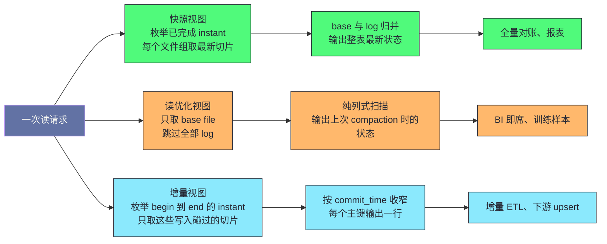
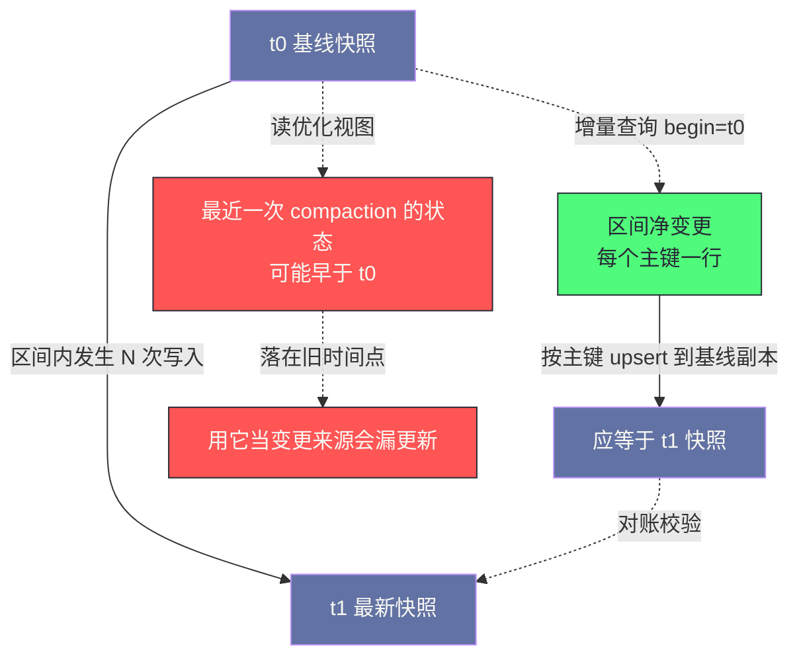
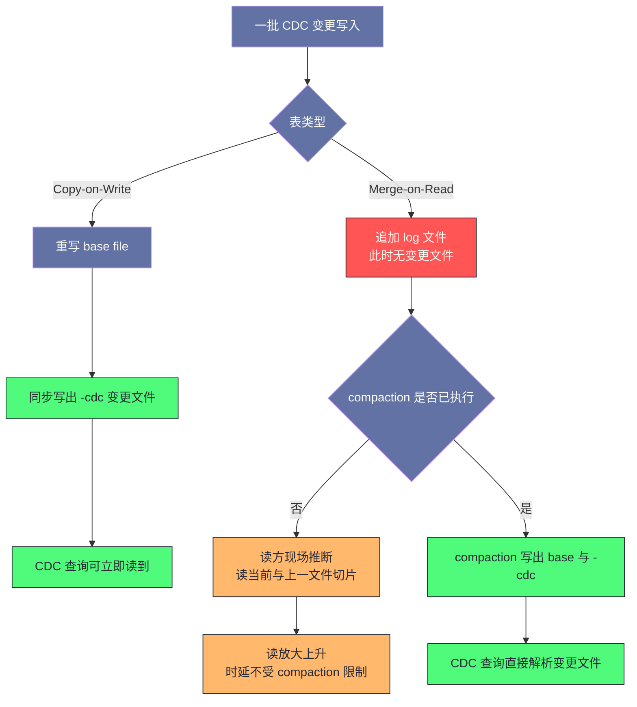
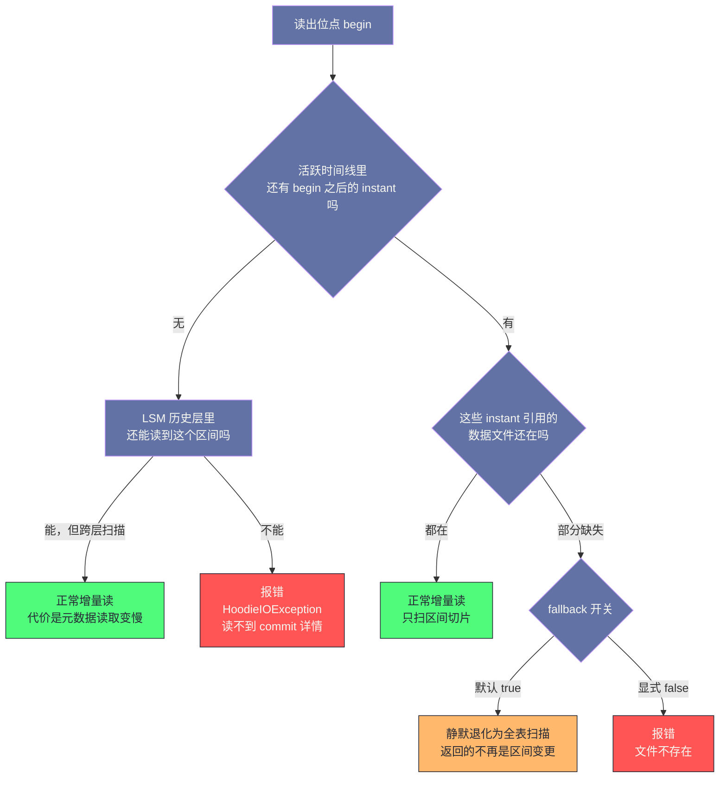
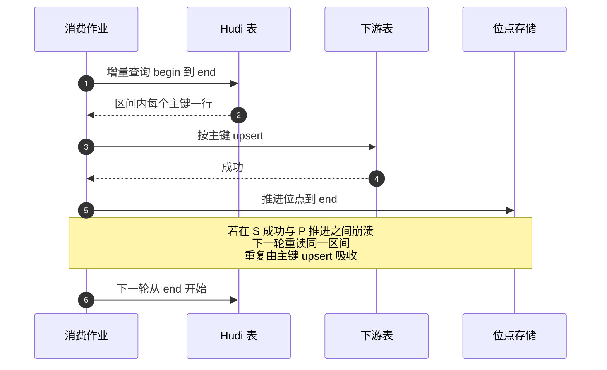
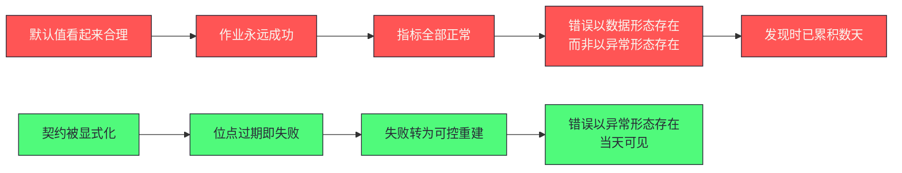

**摘要：**

增量查询常被介绍成"只扫变更文件，所以快"。这个说法把它的定位讲窄了：它真正提供的是一套按时间区间读取表内变更的能力，读的是 instant 区间内完成的写入所覆盖的记录，而不是"新出现的文件"。文件在 Hudi 里既会被追加、也会被重写和删除，所以"新文件"这个视角既表达不了更新，也表达不了删除。本文把这条读路径拆成三层语义：快照视图给某时刻的全量，读优化视图给某次 compaction 时刻的全量，增量视图给区间的净变更，三者的契约不同，混用会以"数据看起来对、数字对不上"的方式坏掉。随后把增量查询与 CDC 日志摆在一起对照：前者每个主键只回一行最终状态，硬删除不可见；后者回的是带 `I`/`U`/`D` 与前后镜像的变更流水，代价是写入侧多养一份 `-cdc` 文件。再往下是全文的重心——位点。增量消费必须携带 `beginInstantTime`，而这个位点会被三类保留策略同时挤压：cleaner 删数据文件、活跃时间线只留三十个 instant、历史层可读性随时延下降。位点过期有两种结局，缺数据文件时读方默认静默退化为全表扫描，缺元数据时抛 `HoodieIOException`，前者比后者危险得多。最后给出 Spark 与 Flink 的集成形态、保留期预算的算式、三类会安静坏掉的管道，以及一份上线核对清单。

---

## 第 1 章 增量查询读的是什么

### 1.1 一条链路与一个被用坏的直觉

设想一张每天被写了上千次的表：`dwd.user_action`，Merge-on-Read，按 `dt` 分区，约四百个分区、三千个文件组，上游是一条 CDC 流，每分钟落一批 `deltacommit`。它的下游是风控画像 `dws.risk_user_profile`，按 `user_id` 做 upsert，每十分钟跑一次增量 ETL；另一条旁路把同一张表喂给审计系统，审计要求看到每一次操作的类型与前后镜像。

两条链路共用一张表，却是两种截然不同的消费语义。前者只需要"过去十分钟里哪些用户的行为变了、变成什么样"，后者需要"这些用户分别被插入、更新还是删除，更新前后的值各是什么"。把两者混为一谈，是增量消费在工程上最常见的起点错误。

先排除一个很自然的直觉：既然每次提交都会产生新文件，那么"扫描目录、找出比上次更新的文件"不就行了？这个做法在 Hudi 上有三处硬伤，而且三处都不是实现细节，是语义层面的。

其一，Hudi 的一次更新并不必然产生"内容不同的新文件"。CoW 表会为被命中的文件组写出新版本的 base file，这份新文件里既有改过的行，也有大量没改、只是被重新写出的行；MoR 表则把变更追加进 `.log` 文件，base file 可能几个小时内没有任何变化。按"新出现的文件"去读，CoW 上会把整份重写文件当成新增记录，MoR 上会漏掉全部只落在日志里的更新。

其二，文件的消失不等于记录的删除。cleaner 会周期性删除不再需要的旧文件切片，一次清理产出的"消失文件"列表与被删记录没有任何对应关系。把它当作删除信号，会让下游出现大批幽灵删除。

其三，重写不等于整文件都变了。CoW 的一次 upsert 需要重写整个 base file，里面可能有上万行，真正的变更只有几十行。按文件粒度判断"哪里变了"，粒度太粗；而按行判断"值有没有变"，读路径本身给不出答案——它只知道这一行在区间内被重新写出过。官方文档的措辞是"自某个 instant 以来写入的新数据"，强调的是写入，不是"值发生了差异"。

增量查询要解决的就是这件事：把"文件系统上的动作"翻译成"表内记录的变更"。翻译的锚点有两个：**提交批次的区间**，以及**每行记录上自带的提交时刻**。

### 1.2 两层过滤：instant 区间与行级提交时刻

Hudi 在每条记录上注入一组元字段，其中承担增量语义的是 `_hoodie_commit_time`：这条记录最后一次被写入时对应的 instant。它是一行数据自身的属性，与目录结构、文件位置、业务字段都无关。另一个锚点是 `.hoodie/timeline` 下的 instant 序列，它记录"哪一批写入在什么时刻完成、动用了哪些文件"。

增量查询把两者接起来，过程可以拆成四步：

1. 读时间线，枚举 `(begin, end]` 区间内所有已完成（completed）的写入 instant，并按动作类型筛掉不改记录的那些（clean、rollback 等）；
2. 由这些 instant 的元数据拿到它们写过的文件切片——CoW 上是新版本的 base file，MoR 上是 base file 加若干 `.log`；
3. 只扫这些文件切片，而不是整张表的全部文件；
4. 按 `_hoodie_commit_time` 与记录键做归并，让**每个主键只输出一行**，取区间末的最新版本。

第二、三步是性能的来源：如果一小时里只有十个文件切片被写过，增量查询就读这十个文件，不必碰其余九千个。第四步是语义的来源：文件切片里可能有同一主键的多个版本，也可能有在区间之前就已存在、只是被重写牵连进来的行，归并与时间比较之后，输出的是"每个主键在区间末的样子"。



这张图里最容易被忽略的是中间那一层：三条路径读的是同一批文件，但选文件的规则完全不同。快照视图按"每个文件组的最新切片"选，读优化视图按"有 base file 的切片"选，增量视图按"区间内被写过的切片"选。选文件的规则一旦用错，后面的归并再正确也救不回来。

### 1.3 为什么它能表达更新，而"文件"不能

把四种常见的"找增量"手段摆在一起，差别一目了然。表里第二列是关键：能不能把"一次更新"识别成"同一主键的一个新版本"，而不是"多出来一条记录"。

| 做法 | 依据 | 能否表达更新 | 能否表达删除 | 受表服务影响 |
|---|---|---|---|---|
| 扫目录找新文件 | 文件创建时间或文件名 | 否，重写被当成新增 | 否，清理被当成删除 | 严重，clean 与 compaction 都在增删文件 |
| 业务时间戳列过滤 | 表内的 `updated_at` 之类 | 是，但依赖上游填写正确 | 否，物理删除后无行可查 | 无 |
| 增量查询（latest_state） | instant 区间加 `_hoodie_commit_time` | 是，同一主键归并成一行 | 软删除可见，硬删除不可见 | 只受保留期影响 |
| CDC 格式增量查询 | 同上，外加 `-cdc` 变更文件 | 是，且保留操作类型 | 是，删除以 `D` 出现 | 受保留期与 compaction 频率影响 |

业务时间戳那一行需要多说几句。它看似简单，代价却压在三个地方：上游必须可靠地维护这一列，任何一次忘记更新都会造成永久漏数；删除无法表达，因为行已经不在了；迟到数据与回填会打乱水位，一个上月事件的补录会把水位推来推去。增量查询把这三个问题都挪到了表内部：提交时刻由系统写，删除有专门的表达方式，迟到数据落在一个新 instant 里就自然被下一轮消费捞到。这不是"更快"，是"更可靠"。

### 1.4 代价：省掉的是未变更的文件，不是变更文件里的行

增量查询的收益容易讲过头。它省掉的是"没被这次写入碰过的文件切片"，而不是"没变的行"。落到物理读上，单次增量查询的读量约等于区间内被写入的文件切片的总字节数，与真实变更行数没有固定比例。

以 CoW 表为例做一次示例推算。三千个文件组，平均每个 base file 32 MB，表总大小约 96 GB；一批 CDC 变更落在 300 个文件组里，每个文件组平均只改 5 行。增量查询要读 300 个文件切片，即约 9.6 GB，换回 1500 行变更；若查询只需要三列，列裁剪能把读量压到十分之一以内，但仍与"1500 行"这个量级无关。同样场景换成 MoR 表，变更先落进 log，假设每批每个命中文件组追加 1 MB 日志，读量约 300 MB。这就是 CoW 与 MoR 在增量消费上的真实差距：不在"扫不扫全表"，而在"变更的物理载体有多大"。两种存储类型的写放大与读放大可对照 [[大数据/数据湖/Hudi/02 存储类型深度解析——CoW vs MoR 的设计权衡与适用场景|CoW 与 MoR]]，这里只取它对增量读量的影响。

这条算术解释了两件事。第一，增量查询不是无条件划算：当一批变更命中了大半文件组时（譬如一次全量回刷、一次大范围状态迁移），扫全表反而更便宜，这也是第 5 章里"降级为全表"这个设计存在的现实基础。第二，控制增量查询的成本，主要手段不在查询侧，而在写入侧——文件大小、批次频率、分区粒度、CoW 与 MoR 的选择，决定了每次增量要碰多少字节。

---

## 第 2 章 三种视图，三种契约

### 2.1 快照视图：给的是"现在长什么样"

快照视图回答"此刻这张表是什么样子"，读法是取每个文件组的最新切片，MoR 上再把 base file 与 log 归并。它能给下游的东西很完整：任意主键的最新值、跨文件组一致的一个时间点、以及全部历史字段（只要没被 schema 变更删掉）。

它给不了的是"变了什么"。想从快照里得到变更集合，只能拿两个时刻的快照做差集，代价是两次全量读加一次大 Join；而且差集只能得出"值不一样"，得不出"中间改过几次"，更得不出删除（两个快照都没有的行，可能是被删了，也可能从来不存在）。

快照视图的另一个常被忽略的性质是它的时间基准：它对齐的是"最新完成的那个 instant"，而不是"当前墙上时间"。两次快照查询之间如果发生了一次提交，两次结果就来自两个不同的时间点，做对账时必须显式固定 `as.of.instant`，否则账永远对不平。

### 2.2 读优化视图：一份合法但陈旧的快照

读优化视图只存在于 MoR 表上，它只读 base file，完全跳过 log。这让它成为三种视图里扫描最快的一种：纯列式、无归并、无日志解析，BI 引擎最喜欢这种形态。

但它给的并不是"某个时刻的快照"，而是**上一次 compaction 完成时的快照**。这个差别在增量场景里是致命的：一份刚写进 log 的更新，在读优化视图里根本不存在；一次硬删除写在 log 里，读优化视图照样返回旧行。把读优化视图当作增量管道的数据源，症状是下游数据"总是慢半拍"，而且慢的时长不固定——取决于 compaction 什么时候被调度、有没有被阻塞。

有一个例外：当表上配置了 `hoodie.compact.inline` 或 compaction 被调度得足够密时，读优化视图的新鲜度可以被压到分钟级。这时它常被拿来做"低成本近似快照"，但它的语义仍然不是"最新"，只是"最近一次压实"。用它做全量对账可以接受，用它做增量来源不可接受。

### 2.3 增量视图：给的是区间的净变更

增量视图回答"从 begin 到 end 之间，哪些主键发生了变化、变成什么样"，输出是每个主键一行，取区间末的版本。它是唯一一个"输出行数与全表规模解耦"的视图，也是唯一一个能在不读全表的前提下支撑下游 upsert 的视图。

它能给的东西：区间内被写入的主键集合、每个主键的最新值、行级的最后提交时刻、软删除标记。它给不了的东西同样清楚：操作类型（是插入还是更新，只能靠下游自己判断）、更新前的值、同一主键在区间内的中间版本、以及硬删除（被硬删的主键在结果里根本不出现）。

还有一处契约容易被误读：增量视图的"变更"是按写入判定的。CoW 表上一次小更新会重写整个 base file，被重写出来的行通常带着本次的提交时刻（这与写入路径有关，可用一次对账确认），因此按主键统计的增量行数可能明显大于业务上真正变化的行数。想验证自己的表是不是这样，做一次对账即可：拿业务侧的变更行数与增量结果行数比一比，差值稳定存在就说明这个放大在你的表上是真实存在的。

### 2.4 三者的关系与混用的后果

把三个视图放在同一根时间轴上，关系会清楚很多：读优化视图永远落在某个 compaction 边界上，快照视图落在最新完成提交上，增量视图则是一段区间。三者不是"同一份数据的三种精度"，而是三个不同的契约。



图里那条虚线对账关系，是增量管道最重要的验收手段：**基线快照加区间增量，按主键合并后必须等于区间末的快照**。这条恒等式在正常写入下成立，在 compaction、clustering 之后依然成立（它们不改记录内容），在硬删除之后会被打破——因为增量里没有删除。一旦对账不平，先怀疑删除，再怀疑位点，最后才怀疑引擎。

| 维度 | 快照视图 | 读优化视图 | 增量视图 |
|---|---|---|---|
| 语义 | 某时刻的全量 | 某次 compaction 时刻的全量 | 区间的净变更 |
| 新鲜度 | 最新完成提交 | 滞后到上次 compaction | 到 end instant 为止 |
| 实际读什么 | 每文件组最新切片，base 加 log | 只有 base file | 区间内被写入的文件切片 |
| 删除的表达 | 需与旧快照对比才能推断 | 只反映已压实的删除 | 软删除可见，硬删除不可见 |
| 读放大 | 与变更行相关，需归并 | 最低 | 与命中文件切片的字节数成正比 |
| 典型下游 | 报表、对账、全量覆盖 | BI 即席、训练样本 | 增量 ETL、下游 upsert |
| 误用后的症状 | 全量重算，成本失控 | 数据永远慢半拍 | 当 CDC 用会漏删除 |

---

## 第 3 章 一行一主键：增量结果的形状与边界

### 3.1 区间的开闭，以及 begin 到底该填什么

增量查询的两个参数是 `hoodie.datasource.read.begin.instanttime` 与 `hoodie.datasource.read.end.instanttime`。前者必填，后者省略时以时间线上最新的完成时刻为界。语义上区间是左开右闭：begin 对应的那个 instant 本身不被包含，end 对应的 instant 被包含。

这里有一处文档表述不一致，工程上必须以"**左开**"为准。配置页对 begin 的描述是"完成时间大于等于 START_COMMIT 的数据会被取出"，而同一版本文档的查询类型页写的是"instant_time 严格大于 begin"；两者的差别恰好是一个 instant。实践中的处理办法很朴素：把上一次处理到的最后一个 instant 原样作为 begin 传进去。如果引擎按左开处理，正好不重不漏；如果某个版本按闭区间处理，最多重复一个 instant 的数据，而增量结果按主键归并、下游按主键 upsert，重复一批是可以被吸收的。反过来把 begin 填成"最后一个 instant 的下一个"就危险了，一旦引擎真按左开处理，中间那批就永久丢失。

begin 不必是时间线上真实存在的 instant。它的本质是一个时间戳下界，引擎会找出所有完成时刻大于它的 instant。这一条在恢复场景里很有用：位点文件里存的可能是"上次成功处理的那一批"，只要时间戳可比较，哪怕那一批后来被回滚、被清理，位点的比较本身仍然成立。

1.2.1 的文档里，begin 接受多种格式：`yyyyMMddHHmmss` 与带毫秒的变体、`yyyy-MM-dd`、带时分秒的日期时间、epoch 秒与毫秒，以及关键字 `earliest`。`earliest` 的含义是"从时间线可读的最早位置开始"，适合初始化与回刷，但它并不保证能走到表的起点——能走多远，取决于第 5 章的保留期。

还有一个只在并发写者场景下才会咬人的细节：默认情况下，比较用的是 instant 的提交时刻（也就是请求时刻），而 1.0 的表版本把完成时刻也记进了文件名。如果表上有并发写者，请求早的提交可能完成得晚，此时按请求时刻推进水位会跨过尚未完成的提交。Hudi 为此准备了一组策略：`hoodie.read.timeline.holes.resolution.policy` 取 `FAIL`（默认）、`BLOCK` 或 `USE_TRANSITION_TIME`，读侧对应选项 `hoodie.datasource.read.handle.hollow.commit`。取 `BLOCK` 时读方会把水位停在空洞之前，取 `USE_TRANSITION_TIME` 时改用完成时刻比较。单写者表上这个配置几乎从不被触发，多写者表上它是正确性的最后一道闸。

### 3.2 每个主键一行，意味着什么

增量结果的输出契约是：区间内发生过写入的每个主键，输出一行，取区间末的版本。这让它天然适配下游的 upsert——无论同一主键在区间里被改了多少次，下游只需要写一次。

这条契约在几种写入序列下的表现值得逐一列清楚。主键先插入再更新两次，结果是一行最终值；主键先插入再被软删除，结果是一行带删除标记的记录；主键先插入再被硬删除，结果是零行。前两种情况下游的 upsert 都能得到正确结果，第三种情况需要下游自己知道"这个主键被删了"，而增量结果不会告诉它。

一次提交内同一主键出现多条记录时，写入侧会先做 precombine，只保留排序字段最大的那一条。这意味着同一批里"先改成 A、再改成 B"的中间状态在落盘前就消失了，增量结果里只会有 B。对于把 Hudi 当作镜像表的场景这是优点（省去下游去重），对于审计场景这是信息损失。

### 3.3 主键是组合键，分区列是一条暗线

Hudi 的主键不是单个字段，而是 `(record key, partition path)` 的组合。这一条决定了一个容易被低估的问题：如果分区列本身是可变的业务字段，更新分区列会发生什么？

在全局索引（例如全局 Bloom 索引）下，写入方会在新分区插入一条、并在旧分区把旧记录删掉。增量查询在新区间里只返回新分区的那一行，旧分区那行以"删除"的形式发生，而下游看不到这次删除。若下游按 `(主键, 分区)` 做键，旧分区的残留行会一直留着；若下游只按主键做键，这次移动恰好表现为一次普通更新，反而是正确的。

在非全局索引（默认的 Bloom 索引按分区隔离）下，写入方在旧分区找不到新分区的记录，于是两个分区各留一份。此时连快照视图都会出现重复主键，问题已经从增量语义升级为表设计缺陷。

结论很直接：**分区列必须是不可变的**。`dt`、`region`、`tenant` 这类维度可以作为分区，订单状态、用户等级这类会变的字段不能。这不是 Hudi 独有的约束，任何以"分区加主键"为唯一性基础的存储都有同一条暗线；只是增量消费者会把它的后果放大成"下游凭空多出一批行"。

### 3.4 删除：软删除看得见，硬删除看不见

Hudi 官方 FAQ 把这件事写得很直白：软删除与硬删除的区别之一，是软删除会出现在增量拉取的结果里，硬删除不会。软删除的实现方式是在记录上置 `_hoodie_is_deleted` 标记，记录本身仍在文件里，因此它是一条普通的"被写入的行"；硬删除在 MoR 上表现为 log 里的删除块，在 CoW 上表现为重写文件时不再写出该行，两者在增量视图的归并结果里都表现为"这个主键不存在"——**硬删除不会出现在增量结果里**。

这就是"拿增量查询当 CDC"最典型的坏法：下游是一张按主键 upsert 的表，删除在源端发生了，增量结果里没有对应的行，下游那张表就永远留着旧记录。对账时表现为"下游比上游多出一批主键"，而且多出来的主键恰好是历史上被删除的那些。排查时如果只看"增量行数"和"是否有报错"，永远发现不了这件事。

要让删除被传播，只有两条路：把写入方式改成软删除，让删除以标记行的形式进入增量结果；或者改用 CDC 格式，让删除以独立的变更行出现。前者改动在写入侧，后者改动在读取侧，取舍见第 4 章。

| 变更类型 | latest_state 增量结果 | CDC 格式结果 | 下游按主键 upsert 的结果 |
|---|---|---|---|
| 新增 | 一行，值等于插入值 | `op=I`，`after` 有值 | 正确 |
| 更新 | 一行，值等于最终值 | `op=U`，`before` 与 `after` 都有值 | 正确 |
| 软删除 | 一行，带删除标记 | `op=D`，`before` 有值 | 需下游识别标记 |
| 硬删除 | 不出现 | `op=D`，`before` 有值 | 错误，旧行残留 |
| 分区列变更（全局索引） | 新分区一行，旧分区删除不可见 | `op=D` 与 `op=I` 各一行 | 按主键正确，按组合键错误 |
| 分区列变更（非全局索引） | 两个分区各一行 | 视写入路径而定 | 表本身已产生重复 |

### 3.5 只能按提交时间，不能按业务时间

增量查询的区间锚在提交时刻上，这一点决定了它的能力边界。上游迟到一小时的数据在今天落进一个新 instant，它会出现在今天的增量里，这是优点；但如果下游想"重放昨天业务时间的数据"，增量查询帮不上忙——它没有按业务时间索引的能力，只能靠时间旅行回看某个时刻的全量，再自行做差。

同样地，增量查询不能回答"某个主键在区间内被改了几次"，也不能回答"这次变更来自哪条上游事件"。需要这些问题的时候，读的不是增量视图，而是变更流水——也就是下一章的内容。

---

## 第 4 章 CDC 日志：表自己的变更流水

### 4.1 同一个入口，两种输出格式

增量查询的读配置里有一个决定输出形态的开关：`hoodie.datasource.query.incremental.format`，取值 `latest_state`（默认）与 `cdc`。前者就是上一章讲的一行一主键，后者的输出是变更行，每行带操作类型与前后镜像。

形如：

```sql
-- 一次 CDC 查询：表名、格式、begin、end
SELECT op, ts_ms, before, after
FROM hudi_table_changes('dws.user_action', 'cdc', '20261119083000000', '20261119090000000');

-- 同一张表的 latest_state 查询，行数与语义都不同
SELECT user_id, action, _hoodie_commit_time
FROM hudi_table_changes('dws.user_action', 'latest_state', '20261119083000000', '20261119090000000');
```

`hudi_table_changes` 是 Hudi 提供的表值函数，把增量读封装成可以直接写在 `FROM` 子句里的形式；它接受表名（可带库名）、格式、起始位点与可选的结束位点。用 DataFrame 写法时则是对应的选项组合：

```python
cdc_df = (spark.read.format("hudi")
    .option("hoodie.datasource.query.type", "incremental")
    .option("hoodie.datasource.query.incremental.format", "cdc")
    .option("hoodie.datasource.read.begin.instanttime", begin)
    .option("hoodie.datasource.read.end.instanttime", end)
    .load("s3://lake/dwd/user_action"))
```

两种格式共用同一个入口、同一套位点、同一段保留期，但契约不同：**一个给状态，一个给过程**。这个区别不是风格问题，它决定了下游能不能正确删除、能不能做审计、能不能重放。

### 4.2 `-cdc` 文件与它的产出时点

CDC 格式的物理基础是写在数据目录里的变更文件，文件名带 `-cdc` 后缀，与 base file、log file 同路径存放。它记录的是"这次写入对哪些行做了什么"：操作类型、记录键，以及在补充日志模式下额外保存的前后镜像。读取时若变更文件在场，直接解析即可；若不在场，读方需要现场推断——拿当前文件切片与上一个切片对比，反推出插入、更新与删除。

产出时点在不同表类型上不一样，这一条直接决定了 CDC 数据的时延下限。



CoW 表的 CDC 是"写时物化"：每次重写 base file，顺手写一份变更文件。代价摊在写入路径上，换来的是查询侧最省。MoR 表则把变更先追加进 log，通常要等 compaction 把 log 并进 base file 时才产出变更文件（少数写入路径会在新文件组首次落 base file 时直接产出）；Flink 侧的读选项 `read.cdc.from.changelog` 默认取 `true`，含义是"只从 changelog 文件读"，于是 MoR 表的 CDC 查询新鲜度被 compaction 的调度频率绑住——compaction 没跑，CDC 里就没有这批变更。把它设为 `false` 才会退回到现场推断，时延下来了，读放大上去了。流存储方向上的同类设计（把变更日志作为一等产物）可对照 [[大数据/数据湖/paimon/04 Changelog Producer——CDC 语义的流式生产与消费|Changelog Producer]]，两者的差别在于变更是在写入时物化，还是在读时推断。

补充日志模式决定"物化多少"，是写入成本与读成本的调节旋钮。

| 模式 | 写时保存什么 | 存储成本 | 读时成本 | 适用场景 |
|---|---|---|---|---|
| `OP_KEY_ONLY` | 记录键与操作类型 | 最低 | 最高，需读旧切片反推前后镜像 | 存储敏感、变更稀疏 |
| `DATA_BEFORE` | 上者加更新前镜像 | 中等 | 中等，需现场取更新后值 | 只关心删除与被覆盖的旧值 |
| `DATA_BEFORE_AFTER` | 上者加更新后镜像 | 最高，接近一份完整行宽 | 最低，可直接产出 | 审计、需要完整流水（默认） |

### 4.3 写侧与读侧的账单

CDC 不是免费的开关。CoW 表上，它让每次重写的写入字节增加约一份变更数据的体量；MoR 表上，它让 compaction 变重，同时把 CDC 数据的可用时延绑到 compaction 周期上。

做一次示例推算：一张 96 GB 的 CoW 表，行宽 1 KB，约一亿行；每天有 1% 的行发生变更，即一百万行、约 1 GB 的逻辑变更量。开启 CDC 并使用 `DATA_BEFORE_AFTER` 后，变更文件大致要存"更新前 + 更新后"两份镜像，未压缩约 2 GB 量级。与每天因更新而重写的 base file 字节数相比这不算什么（后者取决于命中的文件组数量，往往在几十 GB 量级），但与"只写变更行"的理想值相比，它翻了一倍。若把模式降到 `OP_KEY_ONLY`，变更文件缩到几十 MB，代价转移到读侧——每次查询都要回到旧文件切片里取镜像，读放大可能高达数倍。

对 MoR 表，这笔账要换个算法：CDC 文件在 compaction 时产出，其大小与 compaction 的输入相关，通常介于"变更行"与"被压实文件组"之间。真正需要盯的不是存储，而是 compaction 的调度延迟——它同时是 CDC 的时效上限。

### 4.4 正确性边界：CDC 覆盖的是表内的变更

把 CDC 格式当成"上游数据库的 binlog 镜像"是最容易犯的第二次错误。CDC 记录的是**Hudi 表内**发生的变更，而表内变更已经过一轮写入侧的合并与去重，与上游事件不是一一对应。

具体有三处失真。其一，一批写入里同一主键出现多次时，precombine 只留最后一条，CDC 也就只有一条，中间那几次上游变更不可见。其二，写入侧的 `insert` 与 `upsert` 在表上的效果可能相同（都是"这个主键不存在，于是写入"），CDC 无法区分这次写入来自上游的插入还是上游的更新。其三，一次批式的 `insert_overwrite` 或 `delete_partition` 在时间线上是 `replacecommit`，CDC 会把被替换掉的整批记录都推断成删除，这与"上游删了几行"是两件事。

所以判断标准很清晰：要审计"上游每一次变更"，保留上游的日志（Kafka、binlog、CDC 连接器的中间主题），Hudi 的 CDC 只能作为"表级变更"的证据；要驱动下游系统做增删改同步，Hudi 的 CDC 足够，前提是下游能接受"批内合并"这件事。

还有一条容易忽略的限制：CDC 查询只能读活跃时间线里的 instant。这条限制在 RFC 里写得很明确，落到运维上意味着 CDC 链路对保留期的要求比 latest_state 更高——它不但要数据文件在，还要元数据在活跃区。

| 维度 | latest_state | cdc |
|---|---|---|
| 输出单位 | 每个主键一行最终状态 | 每条变更一行 |
| 操作类型 | 无，只能从有无推断 | `I`/`U`/`D` |
| 更新前镜像 | 无 | 有，取决于补充日志模式 |
| 硬删除 | 不可见 | 可见，`op=D` |
| 窗口内多次变更 | 合并为一行 | 逐次输出（批内仍受 precombine 影响） |
| 读时延 | 跟随提交 | CoW 跟随提交，MoR 常跟随 compaction |
| 写时成本 | 无额外字节 | 变更文件与补充日志 |
| 读时成本 | 低到中 | 低（物化）到高（现场推断） |
| 典型下游 | 数仓分层传播、镜像表 | 审计、跨系统同步、下游需要删除语义 |

---

## 第 5 章 位点：一条比 Kafka offset 更脆的水位

### 5.1 位点不属于表，属于消费者

Kafka 的 offset 由 broker 保管，消费者提交到 `__consumer_offsets`，过期与否由 broker 的保留策略决定，而保留策略的计量单位与消费进度是同一套坐标。Hudi 没有这层服务：表只知道"我有哪些 instant"，不知道"你读到哪了"。所谓位点，完全是消费者自己在外部存下的一个字符串时间戳。

这带来两个直接后果。第一，位点可以被写成任何时间戳，包括未来的、不存在的、比表还老的，表不会拒绝，读方只会按比较结果返回空集或全量。第二，**位点的有效期不由消费者决定**，而由表的物理生命周期决定：cleaner 什么时候删文件、归档什么时候搬元数据、compaction 什么时候重写文件组，都在消费者看不见的地方改变着"这个位点还能不能读"。

与 Kafka 的第二个差别更隐蔽。Kafka 的保留期按字节或时间算，消费延迟只要小于保留期就安全；Hudi 的保留期按 instant 个数算，instant 的产生频率由写入侧决定，而写入侧的频率与消费者的节奏往往毫不相干。一条每小时跑一次的 ETL，配上每分钟一批的表，默认配置下位点几乎必然过期——这个结论下一节会用算术推一遍。

### 5.2 三类保留策略同时挤压位点

位点能不能用，取决于三件事是否同时成立：区间内的 instant 元数据还读得到；这些 instant 写过的数据文件还在；以及（对 CDC 格式）变更文件还没被清掉。三件事由三套完全独立的机制控制。



清理与归档两套机制的细节在 [[大数据/数据湖/Hudi/03 Timeline 机制——Hudi 事务与增量语义的核心|Timeline 机制]] 里按机制拆过，这里只取它们对位点的影响。第一套是清理（cleaner）。`hoodie.clean.policy` 默认取 `KEEP_LATEST_COMMITS`，配套参数 `hoodie.clean.commits.retained` 默认 10，文档对它的说明写得很直接：这个值同时决定了表能为增量查询提供多长的数据保留。另外两种策略是 `KEEP_LATEST_FILE_VERSIONS`（保留最后 N 个文件切片版本）与 `KEEP_LATEST_BY_HOURS`（按提交时刻保留 N 小时），三者互斥，配置里同时给出多个时以 `KEEP_LATEST_COMMITS` 为准。清理的触发由 `hoodie.clean.trigger.max.commits` 控制，默认每 1 个提交之后就可能调度一次，异步执行。

第二套是归档。活跃时间线只保留有限个 instant，`hoodie.keep.max.commits` 默认 30、`hoodie.keep.min.commits` 默认 20；超过上限就搬到历史区，搬到只剩 20 个为止。Flink 侧的默认值不一样，`archive.max_commits` 是 50、`archive.min_commits` 是 40。归档搬的是元数据，不动数据文件，因此它对位点的影响不是"读不到"，而是"读得更贵"：1.0 的表版本把历史 instant 存成层叠的 parquet 与 manifest，读一个远期位点要按层往下找，`hoodie.timeline.compaction.batch.size`（默认 10）决定每层多少个文件会被合并成一个，层数越深，定位越慢。

第三套是历史层本身的可读性。这部分需要澄清一个常见误解：LSM 历史层的合并是"把小的历史 parquet 并成大的"，并不删除 instant，所以归档本身不会让一个合法的位点失效。真正让它失效的是表版本迁移、时间线布局重建这类结构性变更——Hudi 1.0 前后的版本里出现过两个具体缺陷：一个与增量查询的起始完成时刻落在历史区有关，一个与读者默认打开元数据表后对时间线目录结构的假设有关，两者都表现为读取历史 instant 的提交详情时抛出 `HoodieIOException`（HUDI-8602、HUDI-8613）。这类问题的特点是只在跨版本、跨布局的窗口期出现，升级完成后就消失，但恰好落在这个窗口期里的消费作业会全部失败。

| 机制 | 动的是什么 | 关键参数（默认值） | 位点过期时的表现 |
|---|---|---|---|
| clean | 数据文件，删除旧文件切片 | `hoodie.clean.commits.retained`=10；Flink `clean.retain_commits`=30 | 文件缺失，默认静默退化为全表扫描 |
| archive | 元数据，活跃区 instant 搬进历史层 | `hoodie.keep.max.commits`=30、`min`=20；Flink 50/40 | 仍可读，但元数据读取变慢 |
| 历史层合并 | 历史 parquet 的层叠与合并，不删 instant | `hoodie.timeline.compaction.batch.size`=10 | 读取成本随层数上升 |
| 表版本迁移 | 时间线布局、文件名格式 | `hoodie.table.version` | 窗口期内可能直接报错 |
| CDC 变更文件 | 随 base 文件一起被 clean | 与 clean 水位一致 | CDC 查询查不到对应区间 |

关于参数名，有两处坑要单独交代。第一，1.x 把 `hoodie.cleaner.*` 系列逐步改名为 `hoodie.clean.*`，`hoodie.cleaner.commits.retained` 这个旧名在多个版本上仍被识别，但同一个含义出现两个键名，会让"配置到底生没生效"变成一件需要验证的事。第二，有些材料把保留参数写成 `hoodie.table.retainCommits`，1.2.1 的配置表里并没有这一项——Spark 与表级是 `hoodie.clean.commits.retained`，Flink 是 `clean.retain_commits`。写错的键不会报错，只会安静地不生效，这是排查"为什么保留期没变长"时最常见的假象。

### 5.3 能回溯多久是算出来的

把上面的参数换算成墙钟时间，只有一个近似公式：

`可回溯时长 ≈ min(clean 保留的 instant 数, 活跃区保留的 instant 数) × 提交间隔`

乘以提交间隔这一步，是把**instant 计数换成时间**的唯一桥梁，也是误配最集中的地方。默认值 10 在按天提交的表上意味着十天，在按分钟提交的表上意味着十分钟，相差三个数量级。

| 提交间隔 | 保留 10 个 instant | 保留 30 个 instant | 保留 100 个 instant |
|---|---|---|---|
| 1 分钟 | 约 10 分钟 | 约 30 分钟 | 约 100 分钟 |
| 5 分钟 | 约 50 分钟 | 约 2.5 小时 | 约 8.3 小时 |
| 1 小时 | 约 10 小时 | 约 30 小时 | 约 4 天 |

这是一张示例推算表，实际窗口还要再打两个折扣。其一，instant 的计数里混着表服务：一天 1440 个 `deltacommit` 的写入节奏，加上 288 次 compaction、24 次 clean、若干次 clustering，一天接近 1800 个 instant，一年下来六十多万个；保留 N 个 instant 意味着写入与表服务共同消耗这个额度，实际可回溯的写入批次比 N 少。其二，clean 是异步的、按触发阈值调度的，清理跑得慢时窗口会略大于配置值，跑得快时贴着配置值，不能把配置值当作硬保证。

由此得到第一条判断：消费延迟必须显著小于保留窗口。工程上取三倍余量比较稳妥——消费延迟 20 分钟的链路，保留窗口至少要 60 分钟，对应 1 分钟提交的表要把 `hoodie.clean.commits.retained` 从 10 调到 60 以上，并同步确认活跃区与 Flink 归档水位不低于这个数，否则元数据可读性会成为新的瓶颈。

### 5.4 位点过期的两种结局

位点过期不是一个错误，而是两种截然不同的结果，取决于缺的是数据文件还是元数据。

缺数据文件时，读方的默认行为是**静默降级**。配置项 `hoodie.datasource.read.incr.fallback.fulltablescan.enable` 默认取 `true`，含义是"增量查询遇到文件不存在时，退化为全表扫描"。这个开关的初衷是可用性：0.14.1 引入它，是为了让对象存储上因清理产生的文件缺失不至于让作业直接失败。但它的副作用很重——返回的结果不再是"区间变更"，而是另一套东西，下游没有任何信号知道自己在读全量。

对下游的破坏分两种形态。append-only 的下游，譬如事件表、流水表，会把一次全表扫描当成一大批新变更，重复计入，数字瞬间翻倍；upsert 型下游则可能"恰好正确"，因为全量按主键覆盖一遍的结果与逐步增量累加的结果相同——问题被掩盖下来，直到某天清理时机变化、只缺了一部分文件，结果才变得似是而非。这种"有时对、有时错、从不报错"的故障，是增量管道里最难查的一类。

缺元数据时，读方会显式失败。典型报错是读取提交详情失败，堆栈指向 `.hoodie/timeline` 下某个历史文件；CDC 格式还有一层额外限制，它只能读活跃时间线里的 instant，位点落在活跃区之外时直接失败。显式失败比静默降级好排查，代价是作业停摆——所以很多团队宁可保留 fallback，也不愿意让凌晨的作业因为一个位点问题全线告警。

笔者的建议是把这条边界显式化，而不是交给默认值：生产链路上把 fallback 设为 `false`，让"位点过期"以失败的形式暴露；同时在作业里捕获这类失败，转为"从基线快照重建"的显式分支。重建流程是可控的（读一次全量快照，写入下游，同时把位点置为快照对应的 instant），而静默全表是不可控的。把不可控的降级换成可控的重建，是这条边界上唯一值得做的取舍。

### 5.5 位点推进的工程细节

位点不只要"存下来"，还要"存得对"。三条规则足够覆盖大多数场景。

第一，先写数据、后推进位点。失败时位点不动，下一轮重读同一区间，结果可能重复，但不会漏。配合下游按主键 upsert，这批重复会被吸收；如果下游是 append-only，就必须在写入侧做去重（例如用 `(主键, _hoodie_commit_time)` 作为幂等键）。

第二，位点要存成"已成功处理的最后一个 instant"，并且写入要原子。常见的坏法是先把位点目录删掉再写新目录，中间崩溃就得到一个不存在的位点；正确做法是写临时位置再原子改名，或者存进带事务的外部存储。

第三，保留一个重叠窗口。把 begin 回退若干个 instant 或若干分钟，让"上一次处理到一半就失败"的那批有机会被重新处理。重叠窗口的代价是重复，收益是把"边界上的漏读"变成"可去重的重复"，后者便宜得多。这与第 3 章讲的左开右闭是同一件事的两面：位点宁可保守，不可激进。

---

## 第 6 章 集成形态：谁持有位点，谁负责提交

### 6.1 Spark 批式：把区间两端都钉死

批式增量是最容易看清全貌的形态：每轮读一次位点、跑一次增量查询、写一次下游、推一次位点。代码骨架大致如下。

```python
def run_once(spark, table, sink, pos_store):
    begin = pos_store.read("user_action", default="earliest")
    # 读时间线取最新完成时刻。不要用全表 max(_hoodie_commit_time)，
    # 那个聚合本身就把整张表扫了一遍
    end = latest_completed_instant(table)

    inc = (spark.read.format("hudi")
           .option("hoodie.datasource.query.type", "incremental")
           .option("hoodie.datasource.read.begin.instanttime", begin)
           .option("hoodie.datasource.read.end.instanttime", end)
           .option("hoodie.datasource.read.incr.fallback.fulltablescan.enable", "false")
           .load(table))

    (inc.write.format("hudi")
        .option("hoodie.datasource.write.operation", "upsert")
        .option("hoodie.datasource.write.recordkey.field", "user_id")
        .option("hoodie.datasource.write.precombine.field", "updated_at")
        .mode("append").save(sink))

    pos_store.write("user_action", end)   # 写完再推，失败则重读
```

这段骨架里有两处必须坚持。`end` 要显式取"当前最新的已完成时刻"，而不是省略让引擎自己取最新：省略时，查询开始与计划执行之间若有新提交，两次运行的结果边界会漂移，排查问题时无法复现。fallback 要显式关掉，理由上一章已经说过。

### 6.2 Spark Structured Streaming：位点藏在 checkpoint 里

Hudi 的 Spark 流式读建立在增量查询之上，官方文档对这件事的表述很直接：流式读基于增量查询能力，因此只能返回"尚未被 cleaner 删除的提交与 base file"的数据。这句话把流式模式与保留期的耦合讲透了——流式消费不会让保留期问题消失，只是把"每次手工指位点"变成"检查点里的位点"，过期时同样出问题。

流式形态下，位点由 Spark 的 checkpoint 持有（offset log 中记录每批消费到的 instant），下游 Hudi 写入则需要自己的 `checkpointLocation`。不过，这里有一个只属于写端的坑：Hudi 的流式 sink 会记录"哪一批 id 已经写过"，但如果这个标识不配置，写入方只在内存里跟踪批次号，一旦 Spark 的 checkpoint 写入失败而作业重启，Spark 会重放上一批，Hudi 端就会重复写一次。参数 `hoodie.datasource.write.streaming.checkpoint.identifier`（0.13 起）就是为这个场景准备的，多写者时还必须保证每个写者取不同的值。

读端还有一处与 Flink 相反的默认值，容易被跨引擎团队忽略：Spark 侧 `hoodie.datasource.read.incr.skip_compact` 与 `hoodie.datasource.read.incr.skip_cluster` 默认都是 `false`（1.0.1 引入），也就是默认**不跳过** compaction 与 clustering 产生的 instant；Flink 侧的 `read.streaming.skip_compaction` 与 `read.streaming.skip_clustering` 默认都是 `true`。同一张 MoR 表，在 compaction 之后用两个引擎读增量，拿到的结果集可能不一致：跳过的一侧不会重复投递被 compaction 重写的那批记录，不跳过的一侧可能把它们再算一遍。两条链路必须统一这份约定，否则跨引擎的对账永远差一截。

### 6.3 Flink：连续消费与 CDC 输出

Flink 的集成把"持续消费新提交"做成了一等公民：`read.streaming.enabled` 打开流式读，`read.start-commit` 指定位点（省略时从最新开始），`read.streaming.check-interval` 控制轮询新 instant 的间隔（默认 60 秒），`read.commits.limit` 限制每次轮询最多读多少个提交，用于给积压场景限速。CDC 输出通过 `cdc.enabled` 打开，配合 `read.cdc.from.changelog` 决定"只读 changelog 文件"还是"现场推断"。

1.2.0 起还提供了基于 FLIP-27 的 Source V2，`read.source-v2.enabled` 打开后参与 Flink 的检查点协议，支持更细粒度的恢复与分区裁剪。它与旧 source 的 savepoint 不兼容，切换时必须从新作业启动，这一点在升级方案里要单独列出。

Flink 侧的位点由 checkpoint 与 savepoint 持有，sink 的提交与检查点绑定：检查点成功，这一批才算提交。这条机制让"位点推进"与"数据可见"在同一个原子边界内完成，代价是端到端时延被检查点间隔托底——检查点间隔 1 分钟，两跳链路的端到端时延下限就是 2 分钟量级。

### 6.4 投递语义是组合出来的

三种形态的位点归属与提交时机不同，但只能给出同一类保证。



读端能保证的只有 **at-least-once**：失败重跑必然重读，任何声称"读端 exactly-once"的说法都要打问号，因为位点存储与数据写入不可能在对象存储上做成一个事务。所谓端到端 exactly-once，实际是"at-least-once 加幂等写"的效果等价，幂等性必须由下游提供——下游是 Hudi 表时由主键 upsert 提供，下游是消息队列或 append-only 表时由业务侧去重提供。

| 形态 | 位点持有者 | 推进时机 | 重复的可能来源 | 适用节奏 |
|---|---|---|---|---|
| Spark 批式 | 外部状态存储或表 | 下游写成功后 | 失败重跑、手工重放 | 分钟到小时 |
| Spark Structured Streaming | Spark checkpoint | 每批成功提交后 | 写端批次标识缺失、检查点写失败 | 秒到分钟 |
| Flink 流式 | Flink checkpoint 与 savepoint | 检查点完成时 | 作业恢复重放、旧 source 与 Source V2 切换 | 秒级连续 |
| Hudi Streamer | 工具内部 checkpoint | 每批提交后 | 位点文件回滚 | 现成摄入链路 |

---

## 第 7 章 反例：三类会安静坏掉的管道

### 7.1 把增量查询当 CDC

第一种坏法几乎每个团队都踩过一次：下游需要"顺序同步增删改"，实现时用了 `latest_state` 增量查询，按主键 upsert。上线后一切正常，直到某天业务方问"为什么这张表里还有三个月前就删除的用户"。

根因在第 3 章：硬删除在 latest_state 里不出现。这条链路的失败方式很温和——增量结果永远非空，作业永远成功，行数永远在涨，只有"删除"这一种变更被系统性地吞掉。判据有两条：源端与下游的主键集合做一次反连接，若多出来的恰好是历史上被删除的主键，基本可以定案；再看下游的删除行数是否为 0，而源端明显有删除。处置有两条路，改成软删除让标记进入增量结果，或把读格式切到 `cdc`，并在下游按 `op` 分派插入、更新、删除。

这里还有一个容易忽略的次生问题：切到 CDC 之后，下游的 upsert 逻辑不能直接复用。CDC 的 `D` 行里业务字段可能只带主键（取决于补充日志模式与写入路径），拿它去做整行覆盖会把其他字段清空；正确做法是按主键删除，或者用 `before` 镜像做条件更新。

### 7.2 位点没有持久化，或者持久化错了

第二种坏法的表现是"重复"与"漏读"交替出现，具体形态取决于位点怎么丢的。

每次从最新开始读，漏的是"两轮之间的全部变更"。这条链路单看每一轮都正确，行数也对，只有把区间拼起来才发现中间有空档。触发条件往往是一次发布：作业重启，位点变量回到默认值，从最新起跑，上一次运行结束到本次启动之间的变更被永久跳过。

每次从最早开始读，重复的是全历史。append-only 下游会以肉眼可见的速度膨胀，upsert 下游则表现为"每次重启后处理时长暴涨"，因为没有报错，很难联想到位点。

位点存了但推进时序错了，是最隐蔽的一种。先推位点、再写下游，一旦写下游失败，位点已经前进，那批数据再也没有机会被处理。判据是看代码里的提交顺序，而不是看日志；这类 bug 在正常运行时完全不可见，只有在失败重试的路径上才暴露。

处置的三条规则在第 5 章已经写过：先写数据后推位点、位点原子替换、保留重叠窗口。补充一条运维层面的：位点文件要带写入时间与写入者标识，多实例部署时用版本号或条件写避免互相覆盖；两个实例同时跑同一张表、各自持有一份位点，是"重复但不报错"的经典来源。

### 7.3 保留期短于消费延迟

第三种坏法要展开讲，因为它把一个配置问题变成了一个数据正确性问题。

现场通常是这样：一条小时级 ETL 读一张每分钟提交一次的表，`hoodie.clean.commits.retained` 沿用默认 10。前几周一切正常，因为作业从没延迟超过十分钟；某天上游积压，作业延迟到四十分钟，cleaner 早已把区间内的文件清掉。增量查询发现文件不存在，fallback 默认打开，于是这一轮读的是全表——不是**读不到**，而是**读多了**。下游是 upsert 表，全量覆盖一遍，结果看起来正确；运维看到作业时长从 20 分钟变成 2 小时，只当是数据量涨了。

真正的破坏出现在下一次：清理只删掉了一部分旧文件，fallback 触发时读到的文件集合既不完整也不对应任何一致快照，下游被写入一批"半全量"的记录。此时作业依旧成功，对账偏差开始出现，而所有监控指标（作业状态、行数、延迟）都正常。等到有人发现数字不对，往往已经过去好几天。

判据不用猜：把 begin 与时间线上最早可读的 instant 比一比，若 begin 更早，这个链路就处在危险区；再查作业日志里是否出现过 fallback 相关的提示；最后看增量结果的 `_hoodie_commit_time` 分布，正常增量应该集中在区间内，退化成全表时分布会横跨整张表的历史。

处置分三步：先停作业，避免继续污染；再做一次显式重建，用某个时刻的全量快照覆盖下游，并把位点置为该快照对应的 instant；最后把保留窗口按消费延迟的三倍重设，并把 fallback 显式关掉，让同类问题下次以失败的形式出现，而不是以数据的形式出现。

### 7.4 其余几类边界

共用位点。多个消费者读同一张表、共用一份位点文件，谁跑得快谁把位点推走，慢的那个下一轮直接从别人的位置开始，中间那段被跳过。判据是位点的写入者不止一个；处置是按消费者拆位点，一个消费者一份。

手工改位点。为了"补一段数据"把位点往前调，或者为了"跳过一次坏批次"把位点往后挪，都是把正确性交给人的记忆。真要补数，应该新建一个一次性作业、显式指定 `begin` 与 `end`、写到临时表再合并；改主链路的位点等于在生产上做没有回滚方案的手术。

表升级与布局迁移。1.0 的表版本引入了新的时间线布局与文件名格式，读者的表版本假设与实际不一致时，增量查询会在读取历史 instant 时失败。这类问题有成套的规避方案（升级前统一读写版本、升级窗口内暂停增量链路、升级后做一次对账），关键是要把它列进升级方案，而不是等作业报错才发现。

把三类主要反例的共同结构画出来，会看到它们都不是"某个功能没开"，而是"某个契约被默认值掩盖了"。



| 故障 | 症状 | 判据 | 根因 | 处置 |
|---|---|---|---|---|
| 增量当 CDC | 下游残留已删除的主键 | 主键反连接差集恰为历史删除项 | 硬删除在 latest_state 中不可见 | 改软删除或切 CDC 格式 |
| 位点丢失 | 重启后重复或跳段 | 位点文件缺失、默认值被使用 | 位点未持久化或非原子写 | 外部存储加原子替换 |
| 位点早推 | 失败重试后少一批 | 代码提交顺序为先推后写 | 推进时机错误 | 改为先写后推并加重叠窗口 |
| 保留期过短 | 作业变慢、数字偏差、无报错 | begin 早于最早可读 instant | clean 跑过位点且 fallback 开启 | 关 fallback、显式重建、调大保留 |
| 共用位点 | 随机跳段 | 位点写入者不止一个 | 多消费者共享状态 | 一消费者一位点 |
| 表升级窗口 | 增量读报 commit 详情读取失败 | 堆栈指向历史 instant 文件 | 读写表版本假设不一致 | 升级窗口停链路并对账 |

---

## 第 8 章 落地：预算、配置与验收

### 8.1 先把位点设计定下来

笔者建议位点设计在写代码之前定下来，因为它的形状决定了后面所有容错逻辑。四个问题必须回答：存在哪、谁写、什么时候写、失败后怎么办。

存在哪，取决于消费形态：批式作业存在外部状态存储或一张控制表里，流式作业交给引擎的 checkpoint，跨引擎复用的链路建议独立存一份（引擎的 checkpoint 不便于人工查看与干预）。谁写，必须是唯一的写入者，或者用版本号做条件写。什么时候写，只在下游成功之后。失败后怎么办，只有两种合法答案：重读同一区间（依赖幂等），或从基线重建（依赖一次全量快照），不允许"跳过"。

### 8.2 保留期预算与配置对照

预算的算式在第 5 章给过，落到配置上要同时满足三个下限：clean 保留的 instant 数、活跃时间线保留的 instant 数、Flink 归档水位。任何一个不够，位点就会从不同的路径失效。经验值是消费延迟的三倍，再加上一个回滚窗口（例如一周的补数能力），取两者较大值。

| 用途 | Spark 与表级键 | 默认值 | Flink 键 | 默认值 | 建议 |
|---|---|---|---|---|---|
| 数据文件保留 | `hoodie.clean.commits.retained` | 10 | `clean.retain_commits` | 30 | 按消费延迟三倍以上设置 |
| 清理策略 | `hoodie.clean.policy` | `KEEP_LATEST_COMMITS` | `clean.policy` | 同 | 与保留参数配套，不要混用 |
| 活跃时间线 | `hoodie.keep.max.commits` 与 `min` | 30 与 20 | `archive.max_commits` 与 `min` | 50 与 40 | 不低于 clean 保留数 |
| 跳过 compaction | `hoodie.datasource.read.incr.skip_compact` | false | `read.streaming.skip_compaction` | true | 跨引擎链路必须统一 |
| 跳过 clustering | `hoodie.datasource.read.incr.skip_cluster` | false | `read.streaming.skip_clustering` | true | 同上 |
| 起始位点 | `hoodie.datasource.read.begin.instanttime` | 必填 | `read.start-commit` | 最新 | 生产禁用"默认最新" |
| 轮询间隔 | 由触发周期决定 | 无 | `read.streaming.check-interval` | 60 秒 | 按新鲜度要求下调 |
| 全表降级 | `hoodie.datasource.read.incr.fallback.fulltablescan.enable` | true | 无对应项 | 无 | 生产设为 false |
| CDC 输出 | `hoodie.datasource.query.incremental.format` | `latest_state` | `cdc.enabled` | false | 审计链路显式打开 |
| 补充日志 | `hoodie.table.cdc.supplemental.logging.mode` | `DATA_BEFORE_AFTER` | 同名键 | 同 | 存储紧张时降级 |

### 8.3 验收靠一条恒等式

第 2 章给的对账关系，是这条链路唯一值得写进上线清单的自动校验：取 begin 时刻的快照作为基线，把区间增量按主键合并上去，结果必须等于 end 时刻的快照。校验可以对三个维度做：主键集合、数值列求和、以及删除行数。

这条恒等式在三种情况下会合理地不成立，需要提前区分：硬删除（增量里没有删除行）、区间内有 `insert_overwrite` 这类批式替换（增量返回的是替换后的整批记录，语义上不是"变更"）、以及表上有 clustering 但读侧没跳过（重复计入）。把这三种情况加入白名单之后再跑校验，剩下的偏差就都是真问题。

运行时的监控指标有五个：消费延迟（小时级以 instant 数计）、最早可读 instant（对比当前位点）、clean 与 archive 的水位、fallback 触发次数、以及每批增量的文件切片数与字节数。前三个防位点过期，第四个防静默降级，第五个防读放大失控。

### 8.4 上线核对清单

1. 读格式显式指定：`latest_state` 还是 `cdc`，由下游是否需要删除语义与操作类型决定。
2. 若选 `latest_state`，确认下游能处理软删除标记，并接受硬删除不可见。
3. 若选 `cdc`，确认补充日志模式、确认 compaction 频率与可接受的 CDC 时延匹配。
4. 起始位点必须显式给出，禁止"省略即最新"。
5. 结束位点显式取当前最新的已完成 instant，保证结果可复现。
6. `fallback.fulltablescan.enable` 设为 `false`，让位点过期以失败形式暴露。
7. clean 保留、活跃区保留、Flink 归档三项水位同时满足消费延迟的三倍。
8. 跨引擎链路统一"跳过 compaction 与 clustering"的约定，避免两侧结果集不一致。
9. 位点先写数据后推进、原子替换、单写入者，并保留重叠窗口。
10. 上线后跑一次恒等式对账，之后按周跑；对账白名单里显式列出硬删除与批式替换。

---

## 第 9 章 取舍的落点

回到开头那两条共用一张表的链路。风控画像需要的是"哪些用户变了、变成什么样"，用 `latest_state` 增量查询，每轮只处理变化的主键，成本与变更量成正比；审计系统需要的是"每一次操作及其前后值"，用 CDC 格式，付出变更文件与补充日志的存储成本，换来删除可见与操作类型可查。两者共用同一份位点语义，但保留期的要求不同——CDC 只能读活跃时间线，它的位点比 `latest_state` 更脆，必须按更严的那一侧做预算。

三层语义的价值不在于"三种读法"，而在于它们把三个不同的问题拆开了：快照回答"现在是什么"，读优化回答"便宜地看到什么"，增量回答"变了什么"。把问题拆开之后，混用的代价才变得可见——用读优化做增量会漏更新，用增量做 CDC 会漏删除，用快照做增量会全量重算。三种误用没有一种会报错，这是它们危险的地方。

位点的本质是**一条有期限的凭证**。它不属于表，也不由消费者单方面决定，而是被 clean、归档、历史层可读性三套机制共同约束。把它当成 Kafka 的 offset 来用，就会在某个凌晨遇到一个不报错的数据问题；把它当成有期限的凭证来设计，就会去算保留期、会关掉静默降级、会准备重建流程。

在这条能力线上，Hudi 给出的默认值是"可用性优先"的：fallback 打开，保留期偏短，删除不进入增量结果。默认值服务的是第一次跑通，不是长期正确。真正决定这条管道能活多久的，是把这些默认值逐个显式化的那几行配置，以及一套能在位点过期时把错误变成可控重建的运维流程。增量消费省下的算力，最终要靠这份纪律来兑现。

---

## 参考资料

1. [Apache Hudi 文档 · Table & Query Types](https://hudi.apache.org/docs/table_types/)：三种查询类型与 CDC 格式的定义、增量查询的 `begin`/`end` 语义与查询选项表。
2. [Apache Hudi 文档 · All Configurations](https://hudi.apache.org/docs/configurations/)：clean、archive、CDC、增量读与流式读各配置项的默认值与说明，含 `hoodie.clean.commits.retained` 与增量保留期的对应关系。
3. [Apache Hudi 文档 · Streaming Reads](https://hudi.apache.org/docs/reading_tables_streaming_reads/)：流式读基于增量查询、只覆盖尚未被 cleaner 删除的提交这一约束。
4. [Apache Hudi 文档 · Timeline](https://hudi.apache.org/docs/timeline/)：活跃时间线、LSM 历史层、归档配置与 `hoodie.timeline.compaction.batch.size` 的作用。
5. [RFC-51 · Hudi to support Change-Data-Capture](https://github.com/apache/hudi/blob/master/rfc/rfc-51/rfc-51.md)：`-cdc` 文件的布局、补充日志模式、CDC 读的推断规则，以及"只能查询活跃 instant"的限制。
6. [HUDI-7003 · Add option to fallback to full table scan](https://issues.apache.org/jira/browse/HUDI-7003)：全表降级开关的来源与版本（0.14.1）。
7. [HUDI-8602 · Incremental query failed if the start completion time is in the history of the timeline](https://issues.apache.org/jira/browse/HUDI-8602)：位点落在历史区时读取提交详情失败的现场与堆栈。
8. [HUDI-8613 · Incremental query failed after MDT is enabled by default on the reader](https://issues.apache.org/jira/browse/HUDI-8613)：表版本与时间线布局不一致时增量查询失败的修复记录。
9. [HUDI-6223 · Incremental read via Spark SQL table valued function](https://issues.apache.org/jira/browse/HUDI-6223)：`hudi_table_changes` 表值函数的设计与用法。
10. [Apache Hudi FAQ · Querying Tables](https://hudi.apache.org/docs/0.14.2/faq_querying_tables/)：软删除会出现在增量结果、硬删除不会的官方说明。

---

> [!note] 思考题
> 1. 增量查询的 begin 做成左开右闭，而位点存储可能把"最后处理的 instant"写成完成时刻。如果某批写入在时间线上的完成时刻与它的请求时刻相差几分钟，这两种口径会不会让位点跨过一批数据？
> 2. 一张 CoW 表上某批 upsert 只改了十行，却重写了三个 base file。增量查询返回的行数会接近十行还是接近三个文件里的总行数？拿自己的表跑一次对账，结果与文档措辞是否一致？
> 3. 如果把 `fallback.fulltablescan.enable` 设为 false，位点过期会让作业直接失败。你所在的团队能否接受一次凌晨失败，换来一个不会静默出错的数据链路？
> 4. CDC 格式在 MoR 表上的时效受 compaction 频率约束，而 compaction 又被 `hoodie.compact.inline.max.delta.commits` 与调度策略影响。要让审计链路的时延稳定在五分钟内，应该调 compaction 还是改读法？
> 5. 同一张表被 Spark 与 Flink 两条增量链路同时消费，两侧对 compaction 与 clustering 的跳过策略默认相反。你会把这份约定写在哪里，才能保证后来者不会改错？
