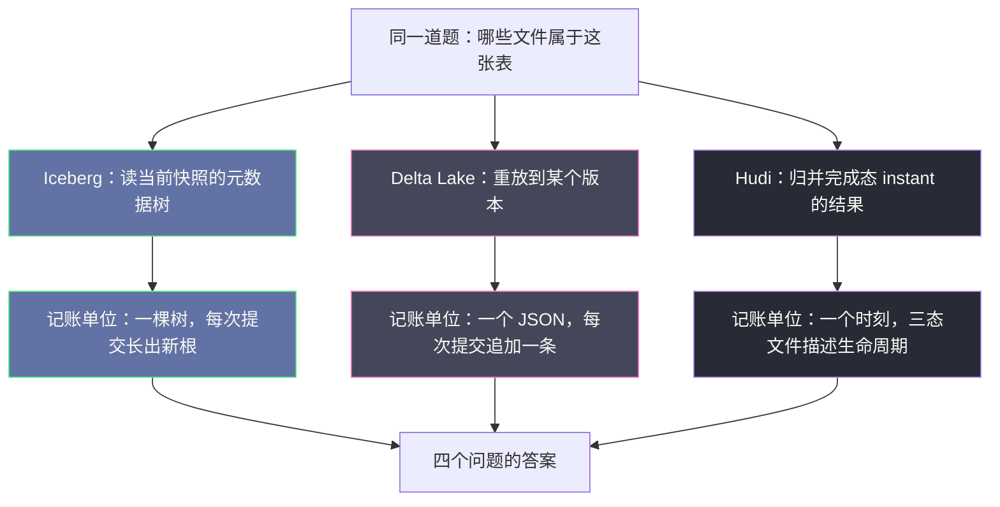
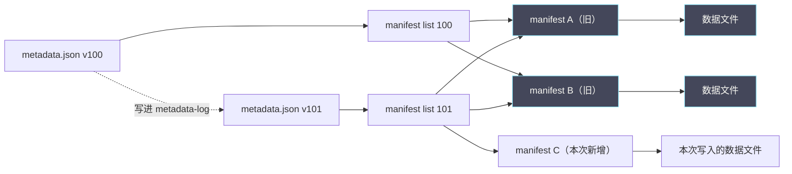
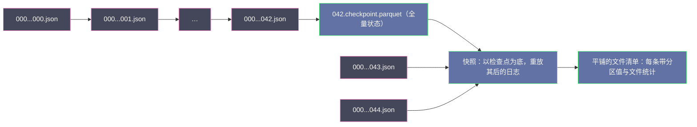
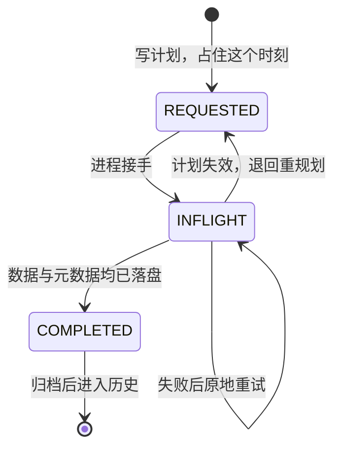
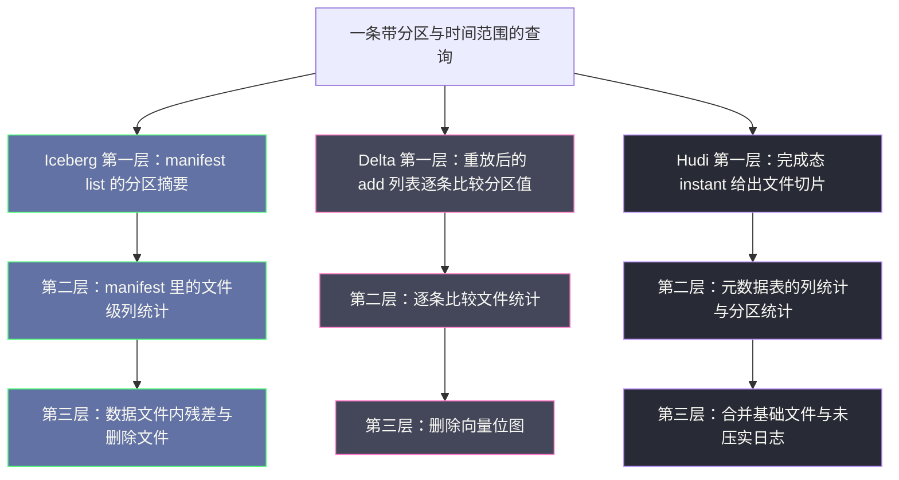

**摘要：**

Hudi、Delta Lake 与 Iceberg 的对比文章已经足够多，多数从特性清单、引擎矩阵或基准测试切入，读完之后仍然解释不了一个很具体的问题：同样是"改两千行"，这三张表付出的写入字节为何能差出三个数量级。本文只从记账方式这一个视角切入，把"一堆不可变的文件如何被解释成一张表在某一刻的状态"拆成四个问题——哪些文件属于这张表、哪次修改在后、未完成的修改为何看不见、历史状态从哪里取——再逐一对账：Iceberg 记的是一棵不可变的元数据树，每次提交长出一个新根，旧树原地不动；Delta Lake 记的是一条按版本号追加的日志，快照由重放得出；Hudi 记的是一条时间线，每个操作是一个走过请求、在途、完成三态的时刻。记账单位不同，可裁剪的索引就只长在 Iceberg 的树上，Delta 的裁剪只能停在文件级平铺，而 compaction 与 clustering 这类动作也只有在时间线上才是一等公民。本文用一张订单明细表的 CDC 入湖场景贯穿，给出写路径的算术、读路径的裁剪层级、三本账各自的摊销方式与后台动作清单，最后把选型折成一张按"代价落在谁头上"排序的判据表，并交代三种常见的选错方式。这里不做三种格式的全面对比，规范开放性与流存储能力属于另外的题目，混进来只会得到一张没有决策价值的总分表。

---

## 第 1 章 同一道题，三种答法

### 1.1 一次对不上的盘点

笔者见过一次很典型的迁移前盘点。一个团队要把仓库里跑了三年的订单明细表换一个存储桶，迁移之前先做资产核对：用对象存储的工具把源目录扫了一遍，十二万个对象，其中数据文件一万两千个左右，剩下的全是侧车元数据。核对的人盯着这个数字发了很久的呆——他手上的 SQL 查询能返回一行不差的结果，却没有任何命令能直接告诉他"此刻这张表由哪一万两千个文件组成"。答案不在数据文件里，而在另一批小文件里，而三种格式把这批小文件组织成了三种完全不同的形状。

Iceberg 的答案是打开一份清单：当前快照指向的 manifest list 里，列着若干个 manifest，每个 manifest 里列着一批数据文件的路径、分区元组与列统计。要数出活跃文件，顺着这棵树数叶子即可，不需要访问任何数据文件。Delta Lake 的答案要绕一道：先找到最近的检查点，从里面读出截至那个版本的完整状态，再把其后不超过十次的提交逐条重放一遍，把 `add` 与 `remove` 相互抵消，才得到那个一万两千。Hudi 的答案最短也最含糊：先看时间线上哪些时刻已经完成，把每个完成时刻的结果文件归并起来，得到的是"文件切片"而不是"文件"，其中一部分切片还带着尚未压实的日志块。

三种回答方式指向同一件事。会计上把这件事叫作**记账**：原始凭证本身不会说话，是账簿把它们解释成一笔笔业务、一个期末余额。三种表格式就是三本账簿，数据文件都是凭证，区别在于账页怎么组织、余额怎么算出来、谁负责在期末结账。

### 1.2 记账要回答的四个问题

把这个类比收紧一点，一套表格式的记账规则必须回答四个问题，缺任何一个都不成其为表。

第一个是**归集**：哪些文件属于这张表。对象存储只提供按键列举，不提供"表"这个概念，所以必须有一份记录告诉读方从哪里开始、到哪里结束。第二个是**定序**：哪一次修改在后。并发写入与重试会让修改的物理落地顺序与逻辑顺序不一致，表必须自己给出一个唯一的顺序，否则"最新的值"无从谈起。第三个是**隔离**：未完成的修改为什么看不见。写入中途崩溃时，磁盘上一定会留下半成品，读方必须有一条与写入协作的规则，把这些半成品排除在外。第四个是**追溯**：三天前的表长什么样。审计、回溯、重跑都要用，而它恰好是前三个问题的副产品——能把当前状态算出来，通常也就能把任一历史状态算出来。

三种格式对这四个问题的回答方式差别很大，而所有能力与代价的差异，都是这四行答案的推论。

| 问题 | Iceberg | Delta Lake | Hudi |
|---|---|---|---|
| 归集 | 当前快照指向的 manifest 集合里的活跃文件 | 重放 `add` 与 `remove` 后得到的文件集合 | 完成态 instant 的结果归并成文件切片 |
| 定序 | sequence number，快照 ID 只作唯一标识 | 二十位版本号，本质是计数器 | instant time，本质是被约束成单调的时间戳 |
| 隔离 | 新元数据树写完才切换根指针，旧树不可变 | 该版本对应的文件不存在，就等于不存在 | 读方只认 COMPLETED 状态 |
| 追溯 | 取旧快照，每个快照都是一棵完整的树 | 取旧版本号重新重放 | 按时间线归并历史 instant 的状态 |
| 记账单位 | 一棵树 | 一个 JSON 文件 | 一个带状态的时刻 |

### 1.3 三种记账单位

表里最后一行是理解全文的钥匙。记账单位决定一次提交要写多少东西、一次读取要打开多少东西、后台要多久整理一次账，这三件事合起来，就是一张表的运维形态。

下图把三种记账单位并排放置，后面三章分别展开。



一棵树的写入是"重写路径"，一条日志的写入是"追加一条"，一个状态机的写入是"推进一格"。三种动作的代价结构完全不同，而它们各自催生了一整套配套机制：树需要合并与过期，日志需要检查点与清理，状态机需要归档与回滚。

### 1.4 本篇的范围

需要先把边界划清：这里只讨论记账方式。三种格式在规范开放性上的差异——reader 与 writer 版本门槛、catalog 生态、跨引擎一致性——属于另一类问题；三种格式在流式写入延迟、changelog 语义上的差异，也属于另一类问题。把这些维度混在一张表里打分，得到的排名会随权重变化而翻转，对具体决策没有帮助。

因此本文不回答"哪个格式更好"，只回答三个更窄的问题：三种记账方式各自把复杂度放在了哪里、这些复杂度最终以什么形式出现在运维账单上、以及在什么约束下应该选哪一本账。

---

## 第 2 章 元数据树与快照：Iceberg 的记法

### 2.1 一棵树怎么回答四个问题

Iceberg 把表的状态组织成一棵树，从根到叶依次是表级元数据、快照、manifest list、manifest，最末是 manifest 里的数据文件条目。根是 `metadata.json`，里面记着当前快照的 ID、全部快照的列表、schema 版本、分区规格、以及一条 `metadata-log`——每生成一版元数据，就把上一版的位置追加进去。它列出的每个快照指向一个 manifest list，manifest list 列出若干 manifest，manifest 里每条记录对应一个数据文件，带着分区元组、行数、文件大小与列级的下界、上界、空值计数。

```text
# 从根到叶的链路（字段做了节选）
metadata/v3.metadata.json
  current-snapshot-id: 8076723918...
  snapshots: [ { snapshot-id, manifest-list: "snap-8076...avro", sequence-number } ]
  metadata-log: [ { timestamp-ms, metadata-file: "v2.metadata.json" } ]

metadata/snap-8076723918-1-<uuid>.avro       # manifest list：每个 manifest 一条记录
  { manifest_path, partition_spec_id, partitions: { dt: { lower_bound, upper_bound } },
    added_files_count, existing_files_count, deleted_files_count }

metadata/<uuid>-m0.avro                       # manifest：每个数据文件一条记录
  { status: ADDED | EXISTING | DELETED, data_file: { file_path, partition, record_count,
    lower_bounds, upper_bounds, null_value_counts } }
```

把四个问题放进去看，答案都是树的性质。归集：当前快照的 manifest 里状态为活跃的那些文件，一条不差，且规范要求同一个内容文件在一个快照里只能被一个活跃 manifest 条目引用。定序：每次成功提交分配一个单调递增的 sequence number，快照 ID 只是一个唯一标识（规范建议用伪随机值以避免冲突，而不是用时间戳递增），删除文件是否作用于某个数据文件同样由 sequence number 判定。隔离：写者先在旁边造一棵新树，造完才去动"当前快照"这根指针，旧树一个字节都不改，读方看到的永远是某一棵完整的树。追溯：每个快照都是一棵完整的树，取旧的根就能得到旧的表，不需要把中间的修改重放一遍。

最后一条是树与日志最根本的分岔，值得单独说一句。Iceberg 的历史不依赖"从某个起点重放"，它把每个历史时刻都物化成一棵完整的树，所以快照之间是并列的事实，而不是一条序列上的前缀。代价也随之而来：这些事实都要占对象存储，过期快照必须显式清理。

### 2.2 一次提交只重写一条从根到叶的路径

树的写入方式可以用一句话概括为**重写路径**：从根到叶的那条链上每个节点都要全量重写，链外的节点共享。

一次追加写提交的完整动作是这样：数据文件先落到对象存储；写一个新的 manifest，里面只记本次新增与删除的文件条目；写一个新的 manifest list，把旧快照里没被改动的 manifest 原样引用过来，再加上新 manifest；写一个新的 `metadata.json`，复制旧内容、追加一个新快照条目、把旧元数据文件记进 `metadata-log`；最后通过 catalog 把"当前元数据"这根指针换到新文件上。整个过程里，没被动过的 manifest 一个字节都没重写。

下图把两次相邻提交的树画在一起，浅色节点是被复用的部分。



规范里有两句话正好描述这个设计：manifest 文件会在快照之间复用，以避免重写那些变化缓慢的元数据；追加操作可以新增一个 manifest 来最小化写入量，而不必改写并追加到已有 manifest 里，这种做法被称为 fast append。

由此可以写出提交代价的表达式：一次提交的重写量约等于一份 `metadata.json` 加一份 manifest list，再加本次新增的若干 manifest，与数据文件总数无关。manifest list 是每次提交都要全量重写的那个节点，所以提交代价与 manifest 数成正比，而不是与文件数成正比。树的结构在这里既帮了忙也收了费：帮手在于路径很浅，收费在于路径上的每个节点都是全量的。

### 2.3 树送给读方的礼物：分级裁剪

树的结构给读方带来的是**分级裁剪**，这是 Iceberg 在元数据级做 skipping 的结构基础。一条带分区谓词与时间范围的查询，会在打开数据文件之前经过三道筛选。

第一道在 manifest list 上。manifest list 的每条记录带着该 manifest 内分区字段的摘要——下界、上界、是否含空值——于是一个只覆盖三月份分区的 manifest，可以在不打开它的情况下被整片排除。第二道在 manifest 上，每条数据文件记录带着分区元组与列级上下界，可以排除掉不满足谓词的文件。第三道在数据文件内部，谓词以残差的形式下推到 Parquet 的行组统计。行级删除另算一路：位置删除文件带着文件路径与行位置，等值删除文件带着键值，读方要按 sequence number 判断某条删除是否作用于某个数据文件。

前三道筛选的本质是同一件事：每一层都先排除一批，再决定是否打开下一层。这让读方打开的元数据量与"命中的文件数"挂钩，而不是与"表的文件总数"挂钩。这也是 Iceberg 能在超大规模表上维持可接受规划时间的原因，代价则要在下一节算。

### 2.4 树的账单

树的账单分三笔：提交、读取、维护。下表把它们与常见症状列在一起，症状是排查时最先看到的东西。

| 动作 | 写什么 | 代价与什么成正比 | 不治理时的症状 |
|---|---|---|---|
| 提交 | 1 个 metadata.json、1 个 manifest list、若干 manifest | manifest 数 | 提交前停顿变长，catalog 往返成为写入 P99 |
| 读取 | 根、manifest list、命中的 manifest、命中的数据文件 | 打开的 manifest 数 | 查询规划时间随表的年龄增长 |
| 维护 | 合并小 manifest、过期快照、清孤儿文件、重写小文件 | 提交频率与文件数 | 元数据对象膨胀，存储费用上涨 |

三件维护动作没有一件是自动完成的。manifest 不合并，数量就随提交次数线性增长，规划成本跟着涨；快照不过期，历史元数据与旧数据文件都会一直占着存储；孤儿文件不清理，失败提交留下的字节永远不会被任何逻辑认领。

这里做一次示例推算，数字只为看清量级，不作为任何性能承诺。假设一张表有两万个数据文件，每天发生五十次提交，每次提交触及一个分区，因此新增一个 manifest，一年约一万八千次提交。若每个 manifest 承载约一百个文件，初始约两百个 manifest；再假设从不合并，一年后 manifest 数约为一万八千两百个，manifest list 的条目数接近两万，按每条记录一千字节估算，单份 manifest list 就在二十兆上下，而每个查询都要把它拉下来、解析、再裁剪。规划时间从毫秒级涨到秒级，是在这个数量级上发生的，与数据量翻倍无关。

这解释了为什么 Iceberg 的运维清单里，"合并 manifest"与"过期快照"不是可选项。树把"当前状态"物化成了一条路径，路径上每个节点都全量，所以必须定期把细碎的节点合起来、把过期的节点扔掉。

### 2.5 未达账项

会计上有一类科目叫未达账项：一方已经记账、另一方还没收到通知的款项。Iceberg 的对应物是孤儿文件。

提交是分步的，每一步都可能失败。数据文件与 manifest 都写成功了，轮到 manifest list 时进程被杀，那么这批数据文件与那个 manifest 就成了树上的孤儿——它们不影响正确性，因为当前快照的指针没有动，读方看不到它们；但它们占着存储，而且没有任何名字能让清理逻辑顺着树找到它们。清理只能反过来做：列举数据目录，与树上所有活跃引用的集合做差集，把差集里的文件按保留期删掉。

这个形态值得记住，因为它把三种记账方式对"未提交副作用"的处理方式分开了。Iceberg 的未提交文件是"树不知道的孤儿"，靠扫描清理；Delta Lake 的未提交文件是"日志里没有引用的文件"，靠 VACUUM 按保留期扫；Hudi 的未提交文件是"已经存在的副作用"，靠 rollback 按 marker 名单精确删除。三本账对坏账的处理方式，与它们的记账方式是同一件事的两面。

---

## 第 3 章 追加日志与版本号：Delta 的记法

### 3.1 一条日志怎么回答四个问题

Delta Lake 把表的状态记成一条按版本号追加的日志。表目录下的 `_delta_log` 里，每个版本一个文件，文件名是二十位零填充的版本号加 `.json`，内容是行分隔的 JSON，每一行一个 action。

```text
# 00000000000000000012.json 里的一批 action（字段做了节选）
{"commitInfo": {"timestamp": 1763500000000, "operation": "MERGE"}}
{"add": {"path": "dt=2026-11-19/part-0007.parquet", "partitionValues": {"dt": "2026-11-19"},
         "size": 10485760, "modificationTime": 1763500000000, "dataChange": true,
         "stats": "{\"numRecords\":50000,\"minValues\":{\"amount\":1},\"maxValues\":{\"amount\":9999}}"}}
{"remove": {"path": "dt=2026-11-19/part-0003.parquet", "deletionTimestamp": 1763500000000,
            "dataChange": true, "size": 10485760}}
```

四个问题在这条日志里同样有答案。归集：从某个版本重放，`add` 与 `remove` 相互抵消之后剩下的路径集合就是当前文件集合，同一个逻辑文件以"路径加删除向量 ID"为主键。定序：版本号是一个计数器，与时钟无关，跨引擎无歧义。隔离：写者先算出下一个版本号，往一个此前不存在的文件里写，写入成功即提交，失败即冲突；没写成功的版本在存储上根本不存在，读方不需要任何"在途"概念。追溯：任取一个历史版本号重放即可，前提是那个版本的日志还在保留期内。

规范里有一句话最能代表这套世界观：数据文件的分区值必须从事务日志里读，目录名只是沿用既有惯例。这句话的意思是，目录结构不承担语义，一切都以日志为准。理解了这一点，才能理解 Delta 为什么没有"分区级索引"——它的世界里只有一条一条的文件条目。

### 3.2 快照是重放出来的

重放的成本必须被压下去，否则表的年龄会直接变成查询延迟。Delta 的办法是**检查点**：每隔若干次提交，把截至该版本的完整状态写成一个 Parquet 文件，此后读方只需要读最新检查点，再重放其后的少量日志。

规范对检查点的定义很干脆：检查点包含截至该版本的、所有 action 的完整重放结果，失效的 action 已被去掉，另外还保留尚未过期的 `remove` 墓碑，供清理与并发读使用。检查点文件与日志文件一起构成完整的变更记录，而 `_last_checkpoint` 这个文件告诉读方最新检查点在哪里、分了几段、覆盖到哪个版本。

下图把一条日志与它的检查点画在一起，右端是读方最终拿到的快照。



规范还给读方加了一条约束：不得假设检查点一定存在、也不得假设它的生成频率，只有一条例外——元数据清理必须为它所保留的最老版本提供一个检查点。这条约束的含义是，读实现必须永远保留"从头重放"这条路径，检查点只是加速手段，不是必需品。这个设计取舍与 Iceberg 正相反：Iceberg 把每个历史时刻都物化，Delta 只物化"便于重放"的起点。

参考实现默认每十次提交写一个检查点，这个数字不是协议规定，而是实现经验值。它决定了两个量：一次查询最多要重放多少个日志文件，以及日志清理的粒度。

### 3.3 重放的成本落在哪

把成本拆开看，重放模式有三处开销，且都落在"文件数"而不是"数据量"上。

第一处是检查点的写入。检查点是一次全量重写，内容包含表内所有活跃文件条目，写入成本与文件数成正比；它每十次提交摊一次，于是单次提交的摊销成本约等于文件数的十分之一。第二处是读取时的解析，读方要读一个包含全部文件条目的 Parquet，再重放最多十个 JSON，解析量同样与文件数成正比。第三处是清理的耦合，日志不能随便删，只有检查点覆盖之后的日志才能删，而且清理时必须保留 cutoff 版本对应的那个 JSON——因为检查点不保留 `commitInfo` 这类提交溯源信息，某些表特性依赖它。

日志保留期默认是三十天，这个参数同时决定了时间旅行的窗口。超出保留期的历史版本不是"读起来慢"，而是"读不到"，因为对应的 JSON 已经被清掉了。这一点与 Iceberg 的"快照过期"是同一类动作，但语义位置不同：Iceberg 过期的是物化的历史事实，Delta 过期的是重放脚本。

同样做一次示例推算。沿用两万个文件、每天五十次提交的规模，一年约一万八千个日志文件，检查点约一千八百个。读一次表：读一个检查点，解析两万条文件条目，再重放不超过十个 JSON。假设检查点里两万条条目的 Parquet 在几兆到十几兆之间（取决于列统计的写法），这个量级在秒级以内，可以接受。真正的压力点在后面：如果文件数涨到五十万，每次检查点写入就是五十万条条目，每十次提交摊一次，写入侧开始出现明显抖动；如果提交频率涨到每天五千次，检查点数量与日志条数同步膨胀，元数据清理会成为一项持续的后台工作。

### 3.4 平铺索引的边界

日志重放出来的是一个**平铺的文件清单**，这个形状决定了 Delta 的裁剪能力边界。

分区裁剪只能逐条比较。每个 `add` 记录自带 `partitionValues`，读方要把两万条记录的字段逐个拿出来与谓词比对。目录名不能用来裁剪，规范明确说分区值以日志为准，所以哪怕目录是按 `dt=2026-11-19` 组织的，读方也不能直接用它做分区剪枝，否则遇到不规范写入就会算错。这就意味着 Delta 不存在 Iceberg 那种"第一层就把整片分区排除掉"的动作——它没有分区级摘要这种中间结构。

文件级统计也存在硬限制。`add.stats` 是可选的，列统计默认只收集前 32 列（`delta.dataSkippingNumIndexedCols` 的默认值），超出这个序号的列连统计都不写；检查点里的统计默认以 JSON 字符串形式存放，读方要多做一次解析。这些限制谈不上缺陷，只是"平铺"这种形状的必然结果：没有中间层可以挂摘要，所有摘要就只能挂在叶子旁边。

更细的统计在 Delta 的协议里没有位置。开源的 `delta-spark` 没有 Z-Order，也没有 Liquid Clustering，这两项属于 Databricks 平台能力——用它们做选型判断时，必须把开源项目能力与商业平台能力分开记，否则会把平台的重排数据能力误当成格式能力。平台的做法是通过重排数据让 min/max 更有效，格式本身并没有多出一层索引。

Delta 近年的演进方向恰好都是给这个平铺模型打补丁：删除向量把"删一行"变成一张位图，行追踪（row tracking）给行分配稳定的 ID，catalog 托管表把提交仲裁交给 catalog。每一项都在补一个 Iceberg 从设计起点就有的能力，而补丁的形态又必须与"日志即事实"这条基线兼容。

### 3.5 与 Spark 的绑定是记账方式的后果

常有文章把 Delta 与 Spark 的深度绑定解释为商业策略，这个解释只对了一半。从记账方式看，绑定有更硬的技术原因。

Spark 的读路径本来就是"列举文件、切分任务、扫描文件"，文件列举是它最自然的入口。Delta 用日志替代列举，得到的是一个形状完全相同的文件清单，于是 Spark 的规划器几乎不需要为新格式做结构性改动。反过来，Iceberg 要求规划器理解"目录的目录"——manifest list 的摘要、manifest 的统计、快照的指针，Spark 侧必须实现一整套分级裁剪；Hudi 要求规划器理解状态机——哪些 instant 完成了、文件切片怎么合并，引擎侧要写的代码更多。

这条差别反过来也解释了 Delta 跨引擎时的相对优势：解析日志、重放到某个版本，是一个既不需要理解树、也不需要理解状态机的算法，任何引擎都能实现，实现出来的语义也容易一致。简单是这个记账方式最大的资产，也是它最大的负债——需要"进行中"信息的能力，在日志模型里没有位置，只能靠补丁绕道。

---

## 第 4 章 时间线与 instant 状态机：Hudi 的记法

### 4.1 一个 instant 怎么回答四个问题

Hudi 把每一次操作记成一个 instant，由三样东西组成：时刻、动作、状态。时刻是一个时间戳字符串，同时充当这次操作的事务 ID；动作说明这次操作想做什么；状态记录它走到了哪一步——请求、在途、完成。同一件事在生命周期里留下三个文件，表版本 8 的表还把完成时刻写进完成态的文件名，于是名字变成一对时间戳。时间线的语法与状态转移可参照 [[大数据/数据湖/Hudi/03 Timeline 机制——Hudi 事务与增量语义的核心|Timeline 机制]]，本节只取对记账方式有用的部分。

四个问题在时间线上各有答案。归集：把完成态 instant 的结果归并起来，每个完成的写入都记录了它产生或替换了哪些文件切片。定序：按 instant time 排序，而 instant time 要满足 TrueTime 语义，即保证新生成的时刻一定大于此前任何进程生成过的时刻；1.0 起还可以按完成时刻排序，得到与关系数据库一致的串行化顺序。隔离：读方只认 COMPLETED，请求态与在途态一律不参与快照拼装，未完成的数据不可见不靠锁，靠读方按状态过滤。追溯：按 instant 归并历史状态。

这里最容易被漏掉的一点是记账单位。Hudi 记的不是"文件"，而是**文件切片**——同一个文件组在某个时刻的那个版本，由一个基础文件加若干日志块组成。快照查询回答的是"此刻每个文件组取哪个切片"，而不是"此刻有哪些文件"。这个差别在第 5 章会兑现成写路径上的能力差异。

### 4.2 预占位与状态推进

一次写入的时序分三段：写请求态，把一份不可变的计划落盘；推进到在途态，宣布开始执行；数据文件落盘、汇总结果之后，写完成态。可见性在最后一步才切换。

下图是这台状态机的形状，与追加日志的"要么成立、要么从未发生"形成对照。



请求态不是"我要开始了"的打招呼，而是一份可以交给另一个进程执行的合同，理由有三个。其一，计划与执行分离：compaction 通常由调度器写计划、由另一个作业执行，两者可以相隔几十分钟甚至跨天，计划不落盘，一次进程崩溃就白规划。其二，事务 ID 的公开占位：时刻一写进请求态文件，就等于向所有进程宣布这个时刻被预订了，其他写者生成新时刻时会避开它。其三，早冲突检测：别人正在做什么在时间线上是可见的，写者可以在动手之前先比对，把注定失败的一轮提前掐掉——而追加日志方案里，别人的提交在完成之前根本不存在，无从比对。

状态机对残留文件还有一种天然的容错：当前状态取时间线上记录过的最高状态，于是完成之后若进程在删除在途文件时崩掉，目录里同时留着在途与完成两个文件，读方仍然判定它是完成的。这个性质说明"文件存在即状态"的直觉是错的，读方必须按状态归并。

两种记法在原子性上的效果等价，差别在**中间态**是不是一等公民。追加日志的中间态是实现的细节，不进协议、不可查询；Hudi 的中间态有文件名、有内容、有生命周期，任何进程都能读、能据它决策，也必须负责清理。

### 4.3 状态机换来的表达力

状态机真正换来的东西，是"动作"这件事可以被表达。追加日志里，一次操作只有"成功"与"未发生"两种形态，于是 compaction、clustering 这类"不改变记录内容、只重排物理布局"的动作，只能借一个布尔标记（`dataChange=false`）说明"这次不算新数据"。Hudi 则给每类动作一个名字与一条独立的时间线记录。

| 动作 | 谁产生 | 对记录内容的影响 | 完成态标签 |
|---|---|---|---|
| `commit` | CoW 写入 | 写入或更新记录 | `commit` |
| `deltacommit` | MoR 写入 | 写入记录，可能只在日志文件里 | `deltacommit` |
| `compaction` | 表服务 | 无，仅把日志并入基础文件 | `commit` |
| `clustering` | 表服务 | 无，仅重排文件组布局 | `replacecommit` |
| `clean` | 表服务 | 无，删除过期文件切片 | `clean` |
| `rollback` | 写者或表服务 | 撤销一次失败写入的副作用 | `rollback` |

这张表解释了 Hudi 为什么敢让 compaction、clustering、clean 与写入并发跑：表服务能看见彼此正在做什么，能避开在途写入，能在计划失效时退回重规划。也解释了另一件事——动作标签是粗粒度的。clustering 完成时记为 `replacecommit`，而 `replacecommit` 这个标签也被批式覆盖写使用，想区分两者得回头看来源。状态机给你的是可见性与表达力，不是完备的分类。

### 4.4 状态机的账单

回头看这笔账单，一共五项，每一项都对应一个具体的运维动作。

第一项是元数据规模。instant 数乘以状态数就是时间线上的文件数，譬如一天产生一千七百个 instant 的表，活跃区若不加裁剪，每次提交前的元数据阶段都要为这个数量付费。裁剪的手段是归档：把历史 instant 搬进历史区，1.0 之后历史区是 LSM 树，按时间区间分层合并，好处是时间范围查询只需要打开相交区间的文件。

第二项是归档的前置条件。规范明确要求，完成态与在途态动作产生的副作用（例如未提交的文件）必须在归档之前从存储上清除，换句话说，归档不能早于回滚。这条约束在运维上表现为一个典型症状：归档水位一直上不去，因为总有回滚没跑完。

第三项是清理的两条水位。活跃区水位决定"元数据留多长"，数据文件清理水位决定"字节留多长"，两者相互独立。把活跃区调大而清理保持默认，结果是元数据堆积、数据正常回收；反过来则是数据文件还在、时间线上已经没有对应记录，那批文件既不能被清理逻辑回收，也不能被回滚识别。两种错法都不会立刻报错，只会以缓慢的方式变坏。

第四项是悬挂恢复。写入进程非正常退出会在时间线上留下一批只有请求态或的在途态 instant。单写者模式下，下一个写者启动时会顺手清扫；多写者模式下不能这么干，因为一个未完成的 instant 完全可能是别人正在写的。Hudi 的解法是心跳：每个在途 instant 有一个心跳文件，表服务按心跳超时判定存活，再做回滚。这条路径的细节与故障形态可参照 [[大数据/数据湖/Hudi/03 Timeline 机制——Hudi 事务与增量语义的核心|Timeline 机制]] 中关于悬挂与回滚的一章，这里只记住结论：状态机必须有人负责把"发生了一半"的事情收尾。

第五项是时钟。instant time 要保证单调，要么由一个共享发号器发号，要么各进程自己生成、但先在分布式锁内等待一个大于最大时钟漂移的窗口。后者是拿写入延迟换时间保真度——Hudi 的目标事务时长在秒级，因此可以承受百毫秒级的不确定窗口。这条代价与 Delta 的"版本号是计数器、零成本"形成鲜明对照：计数器不需要时钟，但也做不了业务时间水位。

把这五项与第 3 章拆开的三处开销放在一起看，会得到一个不太直观的结论：状态机把复杂度放在了读方与运维一侧，日志把复杂度放在了写方与表服务一侧。两者都没有消灭复杂度，只是选了不同的承担者。

---

## 第 5 章 写路径：重写命中文件，还是定位后追加

### 5.1 一道算术题

把三种格式的写路径差异换算成字节，最快的方式是算一笔账。以下是一次示例推算，数字只为说明量级，不作为性能承诺。

一张订单明细表，两百吉字节，两万个数据文件，平均每个文件十兆字节；按每行两百字节估算，每个文件约五万行。上游是 MySQL 的 CDC 流，每半小时一批，每批改动两千行，这些行按业务时间散落在约四十个文件里。

按"重写命中文件"的方式更新，需要重写这四十个文件，即四百兆字节的读写，换来的逻辑变化大约四百千字节，写放大约一千倍。一天五十批，就是二十吉字节的写入量；一年下来，写放大带来的累计写入量在七太字节量级，而这张表的净数据增长可能只有几十吉字节。

按"定位后追加"的方式更新，这四十个文件组各追加一小段日志，写入量约等于改动本身，写放大约等于一，代价转移到读取时的合并与后台的压实。两种算术没有对错，它们是两种记账方式在写路径上的必然结果。

这笔账里最关键的一点是**写放大的分子**：命中文件的字节数。它与你改了多少行无关，只与你"不得不重写多少文件"有关。而"不得不重写多少文件"取决于你能不能精确知道要改的那几行在哪个文件里——这正是"有没有记录级索引"的分水岭。

### 5.2 Iceberg 与 Delta 的"更新"

Iceberg 与 Delta 都没有记录级索引，所以它们执行一次更新的方式是一样的：先用元数据筛出候选文件，再把命中的文件整份重写，提交时把旧文件标为删除、新文件标为新增。

两者的区别只在"补丁的形态"。Iceberg 在 format-version 2 引入两种删除文件：位置删除文件记录"某文件的某几行被删了"，等值删除文件记录"满足某个键值条件的行被删了"。读方按 sequence number 判断一条删除是否作用于某个数据文件，属于行级删除，但删除本身仍是一个需要被读取与合并的文件。Delta 用删除向量把删除做成位图，一张位图能覆盖一个数据文件里的多行，读时按位过滤，比等值删除省一次 join，但位图本身也有大小与维护成本，超过一定规模时写入方会退回整文件重写（具体阈值以对应版本文档为准）。

拿改错字打个比方：Iceberg 与 Delta 其实都在"重印整页"，区别只在于允许你在页边夹一张勘误页（Iceberg 的删除文件），或者在被改的行上贴一枚小标签（Delta 的删除向量），正文页本身仍要整页重印；Hudi 的 MoR 连重印都省了，直接往页边贴补丁，代价是读的时候要把补丁与正文叠在一起看。这个比喻要加一条限定：勘误页与标签都要在读的时候被找到并应用，读方多了一道工序，工序的成本随删除文件数量增长。

### 5.3 Hudi 的定位与追加

Hudi 从设计起点走的是另一条路：**定位加追加**。定位由索引完成，索引回答的问题是"这条记录属于哪个文件组"，答案的形式随索引类型而变——布隆过滤器给出"可能存在"的概率判断，桶索引按主键哈希直接算出桶号，记录级索引维护一张全局的键到位次映射。索引的细节与误判代价可参照 [[大数据/数据湖/Hudi/04 Upsert 写入路径——Index 机制、HoodieKey 与 Bucket Index|Upsert 写入路径]]。

定位之后有两条分支。CoW 重写命中的文件切片，与 Iceberg 和 Delta 的重写没有本质区别，只是定位更准，不会把不相关的文件拖进来。MoR 则把改动写成日志块追加到文件组，写放大接近一，代价推到读取时的合并与后台的 compaction。两种存储类型的完整权衡可参照 [[大数据/数据湖/Hudi/02 存储类型深度解析——CoW vs MoR 的设计权衡与适用场景|CoW 与 MoR]]。索引与时间线在这里是配套的两件事：索引回答"写到哪里去"，时间线回答"这一批什么时候算数"，缺了前者只能整份重写，缺了后者追加下去的日志块无法归属到某个批次。

下表把三条写路径并排放置。

| 维度 | Iceberg | Delta Lake | Hudi |
|---|---|---|---|
| 定位目标 | 元数据裁剪出候选文件 | 元数据裁剪出候选文件 | 记录级索引定位文件组 |
| 写单位 | 数据文件，或删除文件 | 数据文件，或删除向量 | 文件切片，或日志块 |
| 写放大来源 | 命中文件的字节数 | 命中文件的字节数 | CoW 为命中切片字节，MoR 为改动行数 |
| 代价转移 | 读时合并删除文件 | 读时过滤删除向量 | 读时合并日志块，后台压实 |
| 典型恶化 | 小文件过多、manifest 过多 | 频繁 DML 触发整文件重写 | compaction 滞后导致读放大 |

### 5.4 补丁的语义税

补丁不是免费的，它把成本从写挪到读，同时留下一些语义上的尾巴。

Iceberg 的位置删除要按 sequence number 判定生效范围，读方必须把删除文件按目标文件分组，再逐行应用；等值删除需要与数据做 join，代价更高，以至于 v4 的规范草案里已经写明不再允许写入新的等值删除文件，方向是把行级删除统一收敛到删除向量上。Delta 的删除向量让统计信息从紧上界退化为宽上界，数据跳过因此变保守，删除越多，能跳过的文件越少。Hudi 的 MoR 同样有尾巴：读放大等于未压实日志量，compaction 不是优化项而是必选项，压实滞后一周与滞后一天的读代价不在一个量级（具体倍数取决于日志堆了多少，属于示例推算的方向而非承诺）。

三者都在"写放大"与"读放大"之间选了一边，区别在于是不是设计起点。设计起点决定了周边机制是否配套——Hudi 的索引、时间线、表服务全部围绕"定位加追加"生长；而 Iceberg 与 Delta 的行级删除是后来加的，周边机制（合并策略、统计口径、清理流程）只能跟着补丁一起补。

---

## 第 6 章 读路径：裁剪发生在第几层

### 6.1 三种裁剪的形状

读路径的差别可以归结为一句话：裁剪发生在第几层。下图把三种格式的裁剪链路并排画出，每一层都标出它依赖的元数据结构。



三列的形状不同，代价也就不同。Iceberg 的第一层是真正的**裁剪元数据**——用一个摘要把整片分区排除，连 manifest 都不用打开；Delta 的第一层是**扫描元数据**——把所有文件条目读出来逐条比对；Hudi 的第一层是**按状态过滤**——时间线直接给出快照该取哪些切片，连目录列举都省了。

### 6.2 Iceberg：裁剪元数据

Iceberg 的读路径是一条从根到叶的下行链路，每一层只打开上一层允许打开的那部分，判定依据全都写在上一层的元数据里。这条链路的机制在第 2 章已经拆过，这里只算它的代价。

代价的形状很清晰：读方打开的量与"命中的 manifest 数"挂钩。表越老、manifest 越碎，规划越慢；反过来，只要定期合并 manifest，规划时间可以维持在常数附近，与数据量无关。这也是为什么 Iceberg 的运维清单里必须有人负责合并——读性能的成本不在查询里，而在后台。

### 6.3 Delta：扫描元数据

Delta 的读路径先把状态重放出来，再在平铺的清单上筛。读 `_last_checkpoint` 找到最新检查点，读检查点得到全部文件条目，重放其后的日志更新这份清单，然后逐条比较 `partitionValues` 与 `stats`。

没有中间摘要层，意味着两件事。第一，分区裁剪的成本随文件数线性增长，因为每条记录都要被取出来比一次；这一点在文件数两万时几乎无感，在五十万时就会变成可观的固定开销。第二，列统计的覆盖范围受写入侧设置限制，默认只收前 32 列，且检查点里以 JSON 字符串存放时还要多一次解析。Delta 的读优化空间更多落在"减少文件数"上——通过 OPTIMIZE 之类的手段合并小文件，让平铺清单变短，而不是靠加一层索引。

### 6.4 Hudi：按状态过滤，再合并日志

Hudi 的读路径先做一次状态归并：把每个 instant 的多个状态文件压成"最高状态"，只保留完成态，再按动作类型过滤掉不改记录的那些，得到快照对应的文件切片清单。这一步不需要列举数据目录，若开启了元数据表，连对象存储的 LIST 调用都可以省掉——元数据表本身是一张 MoR 的 Hudi 表，用同一套时间线记账，属于自举。

裁剪的第三层是统计。元数据表的 `column_stats` 分区提供文件级列统计，`partition_stats` 分区提供分区级聚合统计，后者相当于 Hudi 给自己补了一层"目录的目录"，让分区裁剪不必逐条看文件统计。点查还有记录级索引可用。

MoR 表还要多一道工序：基础文件与未压实的日志块要合并。这道工序是读放大的来源，日志堆得越多，读得越慢，而日志堆多少取决于 compaction 的频率。CoW 表没有这道工序，代价则落在写路径上。

### 6.5 三种读代价的形状

把三者的读代价放在一起，会看到三种完全不同的形状。

| 裁剪层 | Iceberg | Delta Lake | Hudi |
|---|---|---|---|
| 第一层 | manifest list 的分区摘要 | 逐条 `add` 的分区值 | 完成态 instant 的文件切片 |
| 第二层 | manifest 的文件级统计 | 逐条 `add` 的 `stats` | 元数据表的列统计与分区统计 |
| 第三层 | 数据文件残差与删除文件 | 删除向量位图 | 基础文件与日志块合并 |
| 代价与什么成正比 | 打开的 manifest 数 | 扫描的文件条目数 | 未压实日志量 |
| 何时恶化 | manifest 长期不合并 | 文件数膨胀、日志变长 | compaction 滞后 |

三种形状对应三种"看起来正常但实际在变慢"的症状：Iceberg 是查询规划时间缓慢爬升，Delta 是元数据读取量随文件数增长，Hudi 是同一分区读得越来越慢。三种症状都不会报错，只会让成本曲线慢慢抬头。

---

## 第 7 章 三本账的代价落在哪里

### 7.1 谁是可重建的派生数据

三本账对"什么是事实、什么是派生"的划分不同，这个划分决定了哪些文件绝对不能删，也决定了故障恢复的边界。

Iceberg 的**事实**是元数据树本身：保留期内的每个快照都是一份完整事实，可以独立读取。manifest 是可合并的派生结构，快照过期是主动丢弃历史事实。Delta 的事实是日志序列，检查点是从日志算出来的派生数据，理论上可以删掉重建，只是重建的代价是从更早的检查点重新重放。Hudi 的事实是时间线 instant，数据文件反而是"副作用"，时间线上的一个 instant 文件被删，那一批写入就永远无法被解释——这一点与 Delta 的检查点正好相反，检查点删了还能重放出来，instant 删了不能。

| 项 | Iceberg | Delta Lake | Hudi |
|---|---|---|---|
| 事实来源 | metadata.json 链与其中的快照 | JSON 日志序列 | 时间线的 instant |
| 派生数据 | manifest 可合并、可重写 | 检查点可重建 | 元数据表可从数据目录重建 |
| 不能删的 | 保留期内的元数据文件 | cutoff 检查点及其后的日志 | 时间线上的 instant 文件 |
| 未提交文件 | 树不知道的孤儿 | 日志未引用，VACUUM 扫 | 已存在副作用，rollback 按 marker 删 |

这张表可以直接翻译成运维纪律。Iceberg 不允许手工删 `metadata/` 下的文件；Delta 不允许绕过 checkpoint 谈日志保留；Hudi 不允许手工删 `.hoodie/timeline` 下的文件——删掉它们，回滚就再也找不到该删什么，那批字节会永久占着存储。

### 7.2 元数据增长的三种摊销方式

三种记账方式都在用**定期重写**把元数据的读取成本摊平，只是摊的位置不同。

Iceberg 靠过期与合并：把细碎的 manifest 合成大的，把过期的快照与元数据文件丢掉。Delta 靠检查点：每十次提交做一次全量重写，把"重放长度"压回到十以内。Hudi 靠归档与清理：把历史 instant 搬进 LSM 层，把过期的文件切片删掉，让活跃区保持常数大小。

| 摊销动作 | Iceberg | Delta Lake | Hudi |
|---|---|---|---|
| 核心手段 | 合并 manifest、过期快照 | 定期全量检查点 | 归档历史、清理切片、压实日志 |
| 触发方式 | 外部过程，需排期 | 写入侧自动，频率可配 | 表服务，需调度 |
| 读路径因此 | 打开的 manifest 数受控 | 重放长度受控 | 活跃区与日志量受控 |
| 不做的后果 | 规划时间上升、对象膨胀 | 重放变长、检查点变大 | 活跃区膨胀、读放大 |

同样以两万文件、每天五十次提交做示例推算。Iceberg 一年累积约一万八千次提交，若不合并，manifest 数从两百涨到近两万，每次查询都要读一份二十兆量级的 manifest list；Delta 一年累积约一万八千个日志文件与一千八百个检查点，每个检查点包含两万条文件条目，读一次表的成本约是一个检查点加十个日志；Hudi 把活跃区控制在几十个 instant，读方归并的是这个常数，历史则沉在 LSM 层里按区间打开。三者的稳态读成本量级相近，差别在于维持稳态需要谁、以什么频率去做什么动作。

### 7.3 后台账务员清单

把"必须有人认领"的动作列成清单，比任何特性对比都更接近落地。三种格式各有一本需要人维护的账。

| 格式 | 必须有人认领的动作 | 大致频率 | 不做的后果 |
|---|---|---|---|
| Iceberg | 过期快照、合并 manifest、清孤儿文件、重写小文件 | 每日到每周 | 元数据膨胀、规划变慢、存储费用上涨 |
| Delta Lake | VACUUM、合并小文件、盯住检查点与日志保留 | 每日 | 历史文件堆积、小文件多、时间旅行窗口受限 |
| Hudi | compaction、clean、archive、clustering | 分钟到小时 | 读放大增长、活跃区膨胀、查询变慢 |

这张清单里有一处不对称值得指出。Hudi 的 compaction 在关键路径上——不跑，读就变慢，而且是单调变慢；Iceberg 与 Delta 的维护动作更多影响成本与规划时间，不跑不会立刻让查询变慢，只是让账单慢慢变贵。这个差别意味着：Hudi 需要一支能保证表服务稳定运行的运维力量，另两家需要的是能定期跑批的调度习惯。选型时如果只比较"支持的引擎"和"查询性能"，这一层差异会被完全漏掉。

### 7.4 拐点

记账方式的代价不是线性出现的，它在几个拐点上突然显形。

文件数是第一个拐点。Delta 的检查点写入与读取成本、Iceberg 的 manifest 数、Hudi 的元数据表规模，都与文件数相关，只是相关的方式不同：Delta 是每次检查点全量写一遍，Iceberg 是每个查询读一遍 manifest list，Hudi 是每次列举都靠元数据表替代。文件数从两万涨到五十万时，三种代价都会上升，上升的斜率不同。

提交频率是第二个拐点。每次提交产生的元数据对象数固定：Iceberg 至少三个，Delta 一个，Hudi 三个加计划与结果。表数量多、单表小、提交频繁的场景里，这个固定成本占比很高——几千张表每张每分钟一次提交，元数据对象的产生速率会是惊人的，而这种场景恰恰是很多团队的常态。

更新密度是第三个拐点。它直接决定写放大，而写放大又决定读放大的积累速度。更新越密，MoR 的优势越明显，compaction 的压力也越大。

---

## 第 8 章 按代价的位置选型

### 8.1 判据表

选型的第一步不是问"谁更快"，而是问"这张表上最贵的代价是什么，**代价落在谁头上**"。下表按这个思路组织，每一行都先定位代价，再给倾向。

| 约束 | 代价落在哪 | 倾向 | 但要注意 |
|---|---|---|---|
| 按主键改少量行、批次密 | 写放大，命中文件被反复重写 | Hudi（MoR） | 读合并与 compaction 会转成运维负担 |
| 整批追加为主、DML 偶发 | 偶发的整文件重写与重放成本 | Delta Lake 或 Iceberg | 都需接受"更新等于重写" |
| 多引擎读、查询靠分区与列裁剪 | 规划的元数据量与 catalog 依赖 | Iceberg | 必须有人合并 manifest、过期快照 |
| 几千张小表、高频小提交 | 每次提交的固定元数据开销 | Delta Lake | 检查点全量重写的摊销要算清 |
| 没有专人跑后台作业 | 后台动作没人认领 | 避开 MoR 与需要 compaction 的方案 | 另两家的维护动作可延后，但不能不做 |
| 多写者并发写入 | 提交仲裁与冲突重试 | Iceberg（catalog 仲裁）或 Hudi（非阻塞并发） | Delta 依赖存储原语与重试 |
| 长回溯窗口、审计要求高 | 历史物化与保留期 | Iceberg（快照树）或 Hudi（时间线） | Delta 受日志保留期约束 |
| 对象存储、无独立 catalog 服务 | 提交原子性的来源 | Delta Lake（自描述） | catalog 托管的表会强制依赖 catalog |

这张表的价值在于它的排序依据。特性清单告诉你"能不能做"，代价表告诉你"做了之后谁付钱"——选型出错的案例里，多数是前者满足、后者没算。

### 8.2 三个反例

第一个反例是把支持列表当账本。某个引擎在文档里写着支持某种格式，这句话只说明它能把账本翻译一遍，不说明翻译的代价落在哪里，也不说明翻译出来的语义是否完整。三种记账方式各有各的"翻译难点"：树的翻译要理解多级裁剪，日志的翻译要理解重放与检查点，状态机的翻译要理解哪些动作不改变记录。只看支持列表，等于只看"这家银行能不能汇款"，不看手续费和到账时间。

第二个反例是忽略团队已有人力。第 7 章那张清单上的动作，没有一项会自己发生。团队里如果没有能保证表服务稳定运行的人，选择需要 compaction 的方案就是把一个必选项交给运气；如果没有能定期跑维护作业的习惯，选择需要合并 manifest 的方案就是让规划时间慢慢爬升。反过来，如果团队已经有一整套调度与监控，那么维护成本反而是可以接受的开销——判断依据是"谁来做"，不是"理论上多先进"。

第三个反例是把某一篇基准当结论。基准测的通常是"刚写完的表、既定的查询集、指定的引擎版本"，这个设置恰好把三种记账方式最关键的差异抹平了：刚写完的表没有未压实日志，没有膨胀的 manifest，也没有待清理的快照，三本账都处在最理想的账面状态。真实环境里的差异，恰恰出现在写完一周之后——日志堆了多少、manifest 碎了多少、快照占了多少存储。看基准时要先看它有没有交代文件数、数据分布、compaction 与优化状态，没有这些信息的排名，只能证明"在理想账面状态下谁更快"，不能证明"在你的稳态下谁更省"。

### 8.3 组合与分层

一张表只能有一种记账方式，但一个平台可以同时有多本账。分层的依据不是数据新旧，而是"这一层上最贵的代价是什么"。

写入最密、更新最频繁的明细层，代价在写放大上，适合交给为定位加追加设计的账本；读方最多、查询模式以分区与列裁剪为主的汇总层，代价在规划与元数据上，适合交给树；平台闭环、以 Spark 为主的分析层，代价在集成与运维上，适合交给日志。这个分层不承诺哪种格式更先进，只承诺每一层都用对了它擅长的那一面。

还要提醒一句迁移成本。换格式不是换配置，是换账本：数据要重写一遍，元数据要按新规则重建，历史快照与时间线一般无法平移。这个成本经常被低估，而它恰恰是"已经在跑的表"最常见的选型约束——不是新方案不好，而是旧账本的历史太重。

---

## 第 9 章 边界：三本账都在互相借

### 9.1 三种借法

行文至此，三种记账方式各自的长处与账单都已经摊开。有意思的是，三者近年的演进都在借对方的东西。

Iceberg 借的是行级删除与更便宜的提交。format-version 2 引入位置删除与等值删除，把一部分写放大换成读时合并；format-version 3 引入删除向量，把删除收敛成 Puffin 文件里的位图；规范的 v4 草案则要重排元数据的组织方式，讨论的方向里有自适应元数据树，目标是让高频小提交更便宜。树在向"更好的摊还"演进，方向是减少每次提交必须重写的路径长度。

Delta 借的是提交外置与行级删除。catalog 托管表把提交仲裁交给 catalog，禁止文件系统直读直写，这是把提交点从存储层挪到服务层——Iceberg 从设计起点就这么做。删除向量则补上了行级删除。两项补丁都在朝同一个方向：在不放弃"日志即事实"的前提下，补上原本只有树与状态机才有的能力。

Hudi 借的是索引。1.0 把活跃区与归档区的二分法换成 LSM 树，让历史变成可以按区间裁剪的索引结构；元数据表里的分区统计又给它补了一层"目录的目录"。状态机也在长索引，因为时间线本身随着 instant 数量增长，必须变成可裁剪的结构才撑得住无限历史。

三种借法的共同点是：借来的都是**附加物**，记账单位没有变。树仍然是树，日志仍然是日志，状态机仍然是状态机。

### 9.2 借来的机制带语义税

附加物不会改变账本本身的代价形状，只会挪动其中一部分，而且每一笔挪动都带一点语义税。

删除向量让 Delta 的删除变便宜，但读时要合并位图，统计从紧上界退化为宽上界，删除越多、能跳过的文件越少。Iceberg 的位置删除要按 sequence number 解，等值删除要 join，规范在 v4 里索性不再允许写入新的等值删除。Hudi 的 LSM 时间线让历史查询变快，代价是多了一套层间合并任务与清单版本的一致性维护，活跃区与历史区的边界也变成了需要理解的细节。

这些税在单点上看都很小，合起来却决定了"能不能把补丁当原生机能用"。一个常见的误判是把补丁能力写进选型清单，却不把补丁的读代价写进去，于是在压测里看到写入变快了，上线后发现查询变慢了。

### 9.3 记账方式回答不了的问题

最后要给这份分析划一条边界。记账方式回答的是"状态怎么算出来、代价落在哪里"，它回答不了治理问题、成本口径问题、数据质量问题，也回答不了团队能力问题。

权限模型设计得好不好，与表格式无关；成本归集的口径清不清楚，与表格式无关；上游 CDC 的数据质量，与表格式更无关。三本账都能记清楚"哪些文件属于这张表"，但没有一本能替你决定"谁可以改这张表"。

所以选型的落点不是选一本"最好的账簿"，而是先算清这张表上最贵的代价是什么、谁有能力承担它。账簿只是格式，能不能记好账，取决于有没有人愿意每天结账——这大概是三种格式之间最不像技术差异的那条差异，也是落地时最常决定成败的那条。

---

## 参考资料

1. [Apache Iceberg Table Spec](https://iceberg.apache.org/spec/)：表级元数据字段、`metadata-log` 与 `snapshot-log`、快照与 manifest list、manifest 条目状态、列级统计、sequence number、删除文件、manifest 复用与 fast append，以及 v4 草案中的自适应元数据树。
2. [Apache Iceberg Puffin Spec](https://iceberg.apache.org/puffin-spec/)：侧车统计与索引文件格式，`deletion-vector-v1` blob 的定义与位图编码。
3. [Iceberg Spark Procedures](https://iceberg.apache.org/docs/latest/spark-procedures/)：`rewrite_manifests`、`expire_snapshots`、`remove_orphan_files`、`rewrite_data_files` 等维护过程的语义。
4. [Delta Lake Transaction Log Protocol](https://github.com/delta-io/delta/blob/master/PROTOCOL.md)：日志文件与原子性、`add`/`remove`/`metaData` action、检查点定义与三种检查点形态、`_last_checkpoint`、元数据清理规则、删除向量。
5. [Delta Lake Table Properties](https://docs.delta.io/latest/table-properties.html)：`delta.checkpointInterval`、`delta.logRetentionDuration`（默认 30 天）、`delta.dataSkippingNumIndexedCols`（默认 32）、`delta.deletedFileRetentionDuration` 等参数含义。
6. [Delta Lake Deletion Vectors](https://docs.delta.io/latest/delta-deletion-vectors.html)：删除向量的启用方式、读侧要求与统计信息口径变化。
7. [Apache Hudi Technical Specifications](https://hudi.apache.org/learn/tech-specs/)：表版本与时间线布局、instant 的属性与状态转移、文件组与日志文件格式、动作类型。
8. [Apache Hudi Timeline](https://hudi.apache.org/docs/timeline/)：活跃时间线与 LSM 历史、完成时刻排序、归档不早于副作用清理的约束、TrueTime 语义。
9. [Apache Hudi Metadata Table](https://hudi.apache.org/docs/metadata)：`files`、`column_stats`、`partition_stats` 等分区的作用与启用方式。
10. [Apache Hudi 1.0 Release Notes](https://hudi.apache.org/releases/release-1.0/)：LSM 时间线、表版本 8、instant 文件改为 Avro 序列化、完成时间写入文件名的格式变更。
11. [Apache Hudi Concepts](https://hudi.apache.org/docs/concepts)：CoW 与 MoR、文件组与文件切片、表服务（compaction、clustering、clean）的基本概念。
12. [Apache Iceberg](https://iceberg.apache.org/)：项目文档入口，用于核对各版本对 format-version 的支持节奏。

---

> [!note] 思考题
> 1. 如果把三种记账方式看成三种"把文件解释成表"的规则，那么"表格式"这个概念里，哪些部分是不可替换的，哪些部分其实是可以由引擎侧补上的？
> 2. Iceberg 每次提交都要重写从根到 manifest list 的路径，Delta 每次提交只追加一个文件却要把重放成本摊到检查点上。这两种摊还方式在什么样的表规模与提交频率组合下会互相反超？
> 3. Hudi 的 compaction 是必选项，另两家的维护动作多为可选项。这个差别对团队的组织形态提出了什么要求，又该如何在选型阶段把它量化？
> 4. 三种格式都在借对方的能力，但记账单位没有变。什么情况下"附加物"会累积到足以改变记账单位的程度，从而让一次迁移变得划算？
> 5. 如果让你只用"最贵的代价落在谁头上"这一个判据来选型，你会先收集哪三类事实？这三类事实在你的环境里分别由谁提供？