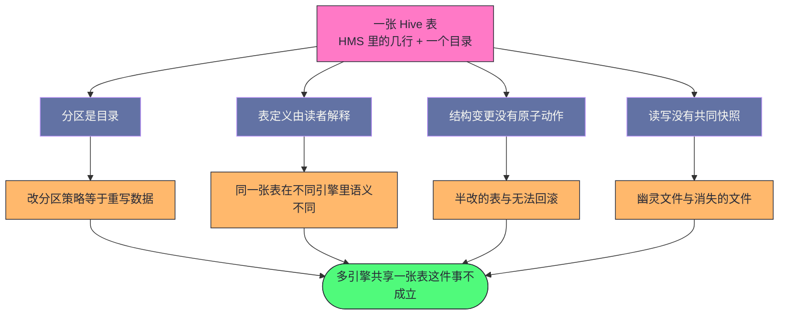
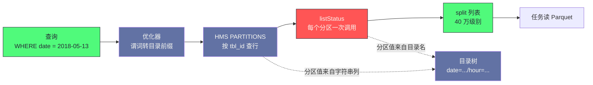
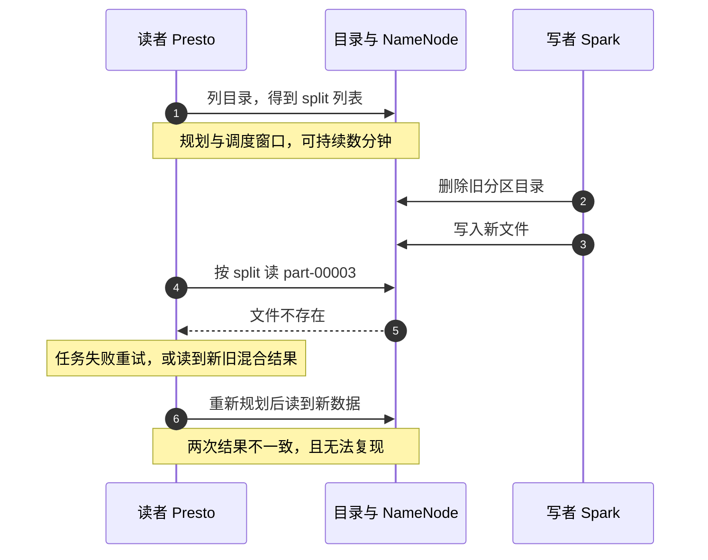
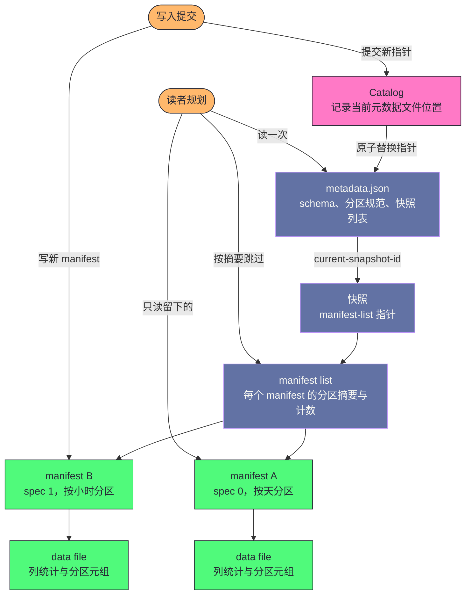
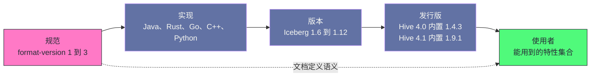

# 01 为什么需要 Iceberg——Netflix 的多引擎困境与开放表格式

**摘要：**

2018 年 9 月，Netflix 的两位工程师在 Strata NY 上给出一组数字：一张 Atlas 历史指标表，一个月里有 270 万个文件散落在 2,688 个分区中；同一条聚合查询，用 Hive 表跑，仅生成执行计划就要 9.6 分钟，换成 Iceberg 表做分区过滤，规划降到 10 秒。这组数字背后有一层具体的结构性错配，比"数据湖缺事务"这种说法更贴近现场：表的状态被拆成两半，分区在 Hive Metastore 里，文件在文件系统里，而每一个读它的引擎都要按自己的理解把这两半拼回去。本文把这个错配拆成四个可以复述的症状——目录即分区、每个引擎各维护一份表定义、结构变更没有原子动作、读写没有共同的"现在"，再回答 Iceberg 的解法为什么与同时代的湖格式不同：它先交付一份规范，再让各家实现去对齐；最后交代这份规范的三层结构、开放性带来的能力不对等，以及单引擎小团队引入它时收益从哪里开始消失。四个症状各占一章，规范与实现的分野占两章，代价与反例各占一章，落点在"这份成本该不该由你付"。

---

## 第 1 章 一个目录，三种读法

### 1.1 一组可以复述的数字

2018 年 9 月，Netflix 的 Ryan Blue 与 Owen O'Malley 在 Strata NY 讲 Iceberg 时，开场没有谈架构，而是先摆了一张表的账：Netflix Atlas 的历史时间序列数据，一个月产生 270 万个文件，落在 2,688 个分区里；这份数据的日常用法是按名字与时间段做聚合，但当时的现状是"无法处理超过几天的数据"。

随后是三个数字的对照。用 Hive 表加 Parquet 过滤条件去跑那条查询，产生了 40 万个以上的 split，光是 `EXPLAIN` 就要 9.6 分钟；换成 Iceberg 表、只按分区过滤，split 数降到 15,218 个，规划 10 秒，端到端 13 分钟（时间主要花在读那一万多个文件上）；再加上文件级 max/min 统计做二次裁剪，split 只剩 412 个，端到端 42 秒。

这三个数字说明的事情很朴素：在目录模型下，**元数据比数据更贵**。读者为了知道"该读哪些文件"，先要问 Hive Metastore 要分区列表，再逐个目录调 `listStatus` 把文件捞出来，两件事都是线性成本，而分区的粒度、目录的层数、文件的数目都在随业务单调增长。查询本身没有变慢，变慢的是"决定读什么"这一步。

### 1.2 表的状态被拆成两半

要理解这一步为什么会变慢，得先看清 Hive 表的状态存在哪里。一份表定义被切成了两处：

一处是 Hive Metastore（HMS）背后那张关系库。表的 schema 记在 `COLUMNS_V2`，表与存储描述记在 `TBLS` 与 `SDS`，分区记在 `PARTITIONS`——每一行带着分区的键值字符串和该分区的存储位置。另一处是文件系统，真正的 Parquet 文件躺在 `hdfs:///warehouse/events/date=2018-05-13/hour=19/` 这样的目录里，目录名就是分区值，文件列表就是这个分区的内容。

两者之间没有事务，只有约定。写入方先写文件、再往 HMS 登记分区，或者反过来；读取方先查 HMS、再列目录。Netflix 那页 PPT 把这件事写成一句话：表的状态存在两个地方，分区在 metastore，文件在文件系统，而这两处的一致性没有任何机制保证。

**目录即分区**不是一种存储优化，它是这套模型的语义基础：分区列是表定义的一部分，而分区值被编码进路径，于是"分区怎么分"这件事既写在元数据里，也刻在每一个文件的路径上，两者一旦不一致，就没有第三方能裁决谁对。

### 1.3 四个症状

把这套模型在 Netflix 那种规模下失效的方式拆开，可以归成四个症状。四个症状其实是同一个设计决策在四个方向上的投影，比"四个独立的 bug"更准确：表的状态由"目录结构 + 元数据行"共同定义，而目录结构是全局的、不可变的、由所有引擎共享的。

| 症状 | 现场表现 | 直接代价 | 根子在 |
|---|---|---|---|
| 分区即目录 | 想把按天分区改成按小时，只能重写数据或建影子表 | 重写历史数据，服务窗口以天计 | 分区值编码在路径里，分区列是表的全局属性 |
| 表定义各维护一份 | 同一张表在 Spark 与 Presto 里类型不同、行数不同 | 结果不可解释，排查靠猜 | HMS 存的是 Hive 的读取参数，文件自带 schema，两者要由读者合并 |
| 结构变更无原子动作 | `ALTER TABLE` 中途失败留下半改的表 | 无法回滚，只能修元数据库 | 非 ACID 布局里唯一的原子操作是"加分区" |
| 读写无共同快照 | 长查询执行到一半，文件被覆盖，任务报文件不存在 | 结果不可重复，失败不可复现 | 读者按"列目录"取文件，目录不是版本 |

这张表值得多看一眼的是最后一列的写法：四个症状都指向同一件事——目录是唯一的共享状态，而目录既不是版本化的，也不是原子的，更不携带语义。所有引擎都只能从这个共享状态里各自推断"现在这张表是什么"。

### 1.4 同一个仓库，四本账

笔者不妨打个比方：一张 Hive 表像一座没有统一账面系统的仓库，货架按品类分层摆放，谁来取货就自己看货架。Hive 记的是"货架编号与分区名"，Spark 记的是"我自己扫出来的货位清单"，Presto 记的是"我按自己的类型系统翻译过的货物目录"。四本账各自都自洽，凑到一起就对不上，而对不上的时候没有任何一本账有资格说自己是准的。

这个比喻要加两条技术限定。其一，四本账读的是同一份物理事实，差别只在解释层，于是出问题时数据未必错，错的是对数据的理解；数据错了还能修，理解错了只能换模型。其二，仓库管理员不是没想过统一账本，历史上真的做过，那就是 Hive ACID——它给 Hive 自己的写入路径加上了事务与快照隔离，但账本只对守规矩的入口生效，绕开 Hive 直接写 HDFS 的作业依然在账外。

下图把这四个症状与它们的共同根因放在一起看，四条支路最后收敛到同一个判断上。



图里四条支路并不是并列关系：分区与表定义是"读什么"的问题，原子性与快照是"什么时候读"的问题，后者在前者不成立时没有意义。这也解释了 Iceberg 的版本节奏：第一个版本先把"读什么"与"怎么变"解决掉，行级删除要等到 v2 才加进来。

---

## 第 2 章 症状一：分区是目录，所以分区策略改不了

### 2.1 分区写在路径上

Hive 的分区布局是目录树，分区列变成目录层级，分区值变成目录名：

```
hdfs:///warehouse/events/
├── date=2018-05-13/
│   ├── hour=18/
│   │   ├── 000000_0
│   │   └── 000031_0
│   └── hour=19/
│       └── ...
└── date=2018-05-14/
    └── hour=00/
```

查询引擎拿到 `WHERE date = '2018-05-13' AND hour = 19` 之后，把谓词翻译成路径前缀，直接只列那一个目录，这就是最原始也最有效的分区裁剪。问题在于这条链路的每一个环节都假设"分区列是表的全局属性"：优化器要知道表的完整分区列集合才能把谓词映射成目录前缀，写入方要知道它才能决定把一行数据放进哪个目录，`MSCK REPAIR TABLE` 要知道它才能从目录名里反解出分区。

于是分区策略变成了表的一个不可分割的属性，和 schema 平级，改它就是改表的定义。而 Hive 的目录布局里，一个表只有一套目录层级，改分区列意味着既有的目录层级与新层级无法共存——旧目录是 `date=/hour=/`，新目录是 `date=/hour=/minute=/`，两者放在同一个表根下，目录名相同的那一层会被两套语义同时解释。

### 2.2 改分区等于重写历史

如果业务确实需要从按天分区改成按小时分区，摆在面前的路只有三条，而三条都要付全量代价。

第一条是重写整张表：读出全部数据，按新键重新分布，写出新目录，删掉旧目录。以一张 10 PB 的表、平均文件 512 MB 做一次示例推算，大约是两万个数据文件；重写意味着 10 PB 的读与 10 PB 的写，以集群 1 GB/s 的聚合吞吐估算，纯 IO 就要接近三个小时，算上读写放大、小文件、失败重试与校验，实际窗口通常以天计，而窗口内旧作业还在往旧布局写，得先停写。

第二条是新建影子表，双写一段时间再切换。这个方案在工程上更常见，但它的代价是双份存储与双份写入开销，切换时还要处理切换点的数据对齐，切换之后旧表仍然占着空间，因为没人敢删。

第三条是"新旧分区混存"，也就是让一部分目录按天、另一部分按小时。这条路在实践中走不通，原因不在存储而在优化器：一个表的目录层级必须能用一个分区规范统一解释，否则列目录出来的路径无法映射回分区元组。Hive 的分区列是表的属性，`PARTITIONS` 表里每个分区行都对应同一套 `PARTITION_KEY_VALS` 结构；混合布局意味着同一个表的路径有两种解析规则，而"按路径长度猜分区规范"这种逻辑，既没有规范可依，也没有引擎愿意把它当成常规路径。

> [!info] 分区演进在目录模型下的死结
> 分区既是元数据（HMS 的行）又是物理布局（目录名），而元数据只有一套、目录只有一种层级。要改布局就必须同时改两者，而这个"同时"在跨系统的写入里做不到，于是只能退化成"重写全部数据"。

### 2.3 混合分区为什么没有引擎接得住

把问题再往下推一层：即使存储上允许混存，查询规划也接不住。规划器的工作是把 `WHERE` 里的谓词转成"哪些文件可能命中"，这条转换依赖一个前提——每个文件的路径能被同一个分区规范解码。一旦混存，规划器要么对每个文件试两种解码方式（成本翻倍，且无法判断哪个对），要么放弃路径解码，退回全表扫描。

这也解释了为什么后来的 Iceberg 把分区规范做成了"可以有很多份、每份带 id、由 manifest 自己声明"的结构：manifest 文件在它的元数据里记录了写入它时用的 `partition_spec_id`，读方按 id 去表元数据里取对应的规范，于是同一张表的不同文件可以按不同的规则分区，规划器不需要猜。代价是读方必须能读懂"分区规范也有版本"这件事，而这在只有一套目录层级的世界里是不需要的概念。

### 2.4 分区数量本身就是成本

比"改不了"更日常的痛苦是"分区太多了"。HMS 的 `PARTITIONS` 表按分区逐行存储，查询规划要先按 `tbl_id` 与分区键把行捞出来，行数上万之后，MySQL 侧的排序与过滤开始显形；捞出分区之后，规划器还要对每个分区发一次目录列取，把文件列表拼成 split。Netflix 那 40 万个 split 就是这么来的：不是数据大，是"分区数 × 每分区文件数"大。

分区值以字符串形式存在 HMS 里，这件事还带来一个隐蔽的成本：字符串要转义，空值要被写成特殊标记（Hive 的约定是 `__HIVE_DEFAULT_PARTITION__`），目录名里出现 `=` 或 `/` 要编码。这些约定不是标准，是习惯，各家引擎的实现只要有一处解析不一致，同一个目录就会被解出两个不同的分区值。这一点在第 3 章会展开。

HMS 还有个出自同一设计的天花板：分区值过滤只有字符串类型能下推到数据库（Netflix 那页 PPT 的原话是"filters only pushed to DB for string types"），因为 `PARTITIONS` 里的键值就是字符串。想把 `date > '2018-05-01'` 变成数据库层面的范围查询，得指望类型转换发生在 HMS 内部，而这不是它能保证的。

下图把一次 Hive 查询的元数据路径画出来，可以看到目录既是数据布局又是查询计划的一部分。



图里虚线那两条是同一个事实的两个来源，它们之所以能对上，靠的是写入方"按约定"同时更新两处，而不是任何机制。

---

## 第 3 章 症状二：同一张表，三份表定义

### 3.1 元数据分成两半之后

一张 Hive 表的"定义"其实包含两样东西。一样是逻辑 schema：有哪些列、什么类型、哪些是分区列、列的顺序。另一样是读取参数：用什么 SerDe 反序列化、InputFormat 与 OutputFormat 是什么、文件的压缩方式、分隔符、以及一堆 `TBLPROPERTIES`。前者决定"读出来是什么"，后者决定"怎么读"。

HMS 两样都存，但存的是 Hive 的形态：SerDe 是一个 Java 类名，`TBLPROPERTIES` 里塞着 `serialization.format` 这类 Hive 私有键。当一个非 Hive 引擎来读这张表时，它面前有两个选择：要么真的去加载那个 Java SerDe（把 Hive 的运行时拖进来），要么按自己的方式解析目录与文件（放弃 HMS 里那半份定义）。Spark 走的是前者与后者的混合，Presto 有自己的 Hive 连接器与类型映射，于是同一张表在两侧各有一份"翻译"。

翻译一旦分叉，裂缝就出现在三个地方。

### 3.2 三条裂缝

第一条是类型系统。Hive 的 `smallint`、`int`、`bigint` 要映射到 Parquet 的 `INT32`/`INT64`，`char(10)`、`varchar(20)` 要映射到定长或变长字符串，`decimal(p,s)` 要映射到 Parquet 的 `DECIMAL` 逻辑类型，`timestamp` 与"带本地时区的时间戳"在 Hive 3 里是两个类型。每个引擎的映射表都略有差异，差异落在两种地方：精度上限（有的引擎支持到 `decimal(38,x)`，有的更窄），以及时区语义（同一个 `timestamp` 值，在不同引擎里可能被解释成本地时间或 UTC）。

第二条是名字。列名在 HMS 里通常是规范化过的，而 Parquet 文件里的列名是写入时那一刻的字面量。列名做重命名之后，HMS 变了，文件里的名字没变，能否对上取决于读者是按名还是按位置解析（Hive 在元数据里保留列的顺序，Parquet 有名字）。分区列的解析更微妙：分区值是从目录名里读出来的字符串，而过滤时要做类型比较，`date` 分区与字符串常量比较需要一次隐式转换，各家引擎的转换规则不同，结果就是"同一个 `WHERE` 在两边筛出不同的文件"。

第三条是分区值的字符串化。Hive 把分区值存成字符串，空值写成 `__HIVE_DEFAULT_PARTITION__`，冒号、等号、斜杠等字符要按 URL 规则编码。两个引擎对同一个目录名做解码时，只要有一方的编码表不同，就会得到两个不同的分区值，而分区裁剪是拿分区值比的，比不中就会退化成全表扫描，或者更糟——比中了不该中的文件。

### 3.3 语义还取决于文件格式

Netflix 那页 PPT 里有一句很轻但很要命的话：schema 演进的规则依赖文件格式，CSV 按位置，Avro 与 ORC 按名字。同一张表加了一列，如果底层是 CSV，旧文件里没有这一列，读者按位置读会把最后一列错位；如果是 Avro 或 ORC，按名字读会补 null。一个"加列"的操作，在两种格式下产生两种结果，而表定义在 HMS 里只有一份。

类型支持也是同样的故事。哪些格式支持 `decimal`，哪些支持 map 里套 struct 的 key，这些差异写在各个文件格式的规范里，而表的元数据只说"这一列是 decimal(10,2)"，不说"文件里存的是不是能精确表达它的那个物理类型"。于是"表定义"这件事被拆成了三层：HMS 里的逻辑定义、文件里的物理 schema、读者心里的映射规则，三层各说各话。

### 3.4 现场怎么判

两个引擎对同一张表报出不同行数时，排查路径其实很固定。先确认两边读到的是不是同一批文件：分别列出各自的 split 数量与文件路径，路径不一致说明分区解析或目录列取出了问题。再确认两边对 schema 的解释：一边 `DESCRIBE FORMATTED` 看 HMS 的定义，一边直接读 Parquet 文件的 footer 看物理 schema，比对列名、类型与 `field_id`。最后才怀疑数据。

把三条裂缝整理成一张表，可以看清哪些差异是"读法不同"，哪些是"事实不同"。

| 维度 | Hive 侧 | Spark 侧 | Presto/Trino 侧 | 后果 |
|---|---|---|---|---|
| 列类型宽度 | `smallint`/`int`/`bigint` 严格区分 | 映射为 `ShortType`/`IntegerType`，运算时另有提升规则 | 有自己的类型映射表 | 溢出点与比较结果不同 |
| 时间戳语义 | `timestamp` 与本地时区时间戳是两个类型 | `TimestampType` 受会话时区影响，新版本另有不带时区的 NTZ 类型 | 区分带时区与不带时区 | 同一行的时间偏移几小时 |
| 列名解析 | 元数据里保留顺序，按名匹配 | 默认大小写不敏感 | 未加引号标识符小写化 | 重命名后读到 null 或旧列 |
| 分区值 | 字符串，空值用特殊标记 | 从目录名反解并转类型 | 从目录名反解并转类型 | 编码不一致导致裁剪失效 |
| 读取参数 | SerDe 类名与 Hive 私有属性 | 部分忽略，走自己的 datasource | 走自己的 Hive 连接器 | 分隔符、压缩、转义各读各的 |

这张表里没有哪一行是"谁实现错了"，它们都是"同一份逻辑定义被三种类型系统各自翻译"的必然产物。要消掉这些裂缝，只有一条路：让表定义不再由读者翻译，而是由写入方在提交时以中立格式写死，读者只做解释不做推断。

---

## 第 4 章 症状三：改一次结构，没有"一次"这个动作

### 4.1 唯一原子的动作是加分区

Netflix 那页 PPT 里有一句判词，把这一章的结论提前说完了：非 ACID 布局里唯一的原子操作是**加分区**（原文是 "non-ACID layout's only atomic operation is add partition"）。这句话的含义比字面更重：在一个没有事务的目录模型里，你能原子地做的最小事情，是往 HMS 里插入一行分区记录，或者往文件系统里创建一个目录。除此之外的一切——加列、删列、改名、改类型、覆盖写——都是多个动作的组合，而组合没有原子性。

Hive 的 ACID 表确实提供了"原子更新"与快照隔离，代价是它换了一套物理布局：分区目录里再分出 `base_0000000/` 与 `delta_0000001_0000100/`，每个下面按桶编号放文件。这套布局能工作，但它要求表必须是 ORC、必须分桶、写入必须走 Hive 自己的事务管理器，而且要定期 compaction 把 delta 文件合并回 base。换句话说，原子性不是免费获得的能力，是用"只允许一种写入口"换来的。

### 4.2 一次 ALTER 在系统里是几次写

把一次 `ALTER TABLE events ADD COLUMNS (device_model string)` 铺开看。在 HMS 侧，它至少要改动 `COLUMNS_V2`（插入新列的行）、可能更新 `SDS` 里的 schema 版本，并让缓存失效；在文件侧，什么都不发生——已经写出的 Parquet 文件里没有这一列，而且永远不会有了。读到旧文件的引擎要做一次合并：表里有、文件里没有的列补 null。

这次合并在项目里通常是对的，但它依赖一个脆弱的假设：列的身份用名字表示。如果业务先删掉一列 `device_model`、过一阵又加回同名列（语义已经不同），按名读取的引擎会把旧文件里的旧列数据读成新列的值。Hive 与多数引擎都不为这种情况提供保护，因为它们没有"列 id"这个概念——名字就是身份。

改名同理。`ALTER TABLE ... RENAME COLUMN` 只改元数据，文件里的物理列名不变。**按名解析**的引擎从此读不到这一列，读出来是 null；按位置解析的引擎仍然能读到，但会把值塞进错误的列。这两类引擎同时存在时，一张表就有了两种读法。

### 4.3 半改的表

比"改错了"更常见的是"改到一半"。一次 `ALTER` 在元数据库层面可能是事务的，但它原子不了"元数据 + 文件"这一对：DDL 提交了，正在跑的写入作业还按旧 schema 写文件；或者写入方先写了新格式文件，DDL 因为锁冲突失败，目录里留下一批"元数据不认识"的文件。前者导致新列在部分文件里是 null、部分不是；后者导致一批文件永远不被查询看见。

这种状态没有官方的修复流程，因为没有"表版本"这个概念可以回退到。运维能做的只有三件事：查 HMS 的审计日志确认改了什么，比对文件列表与分区记录找出孤儿文件，必要时手工把元数据改回去。三件事都要求操作者同时理解元数据库与文件系统，而这两处的状态本来就是不一致的。

### 4.4 回滚不存在

"回滚"在一个有版本的模型里是"把指针指回上一个版本"，在一个目录模型里是"把元数据库恢复到某个备份点，再把文件恢复成当时的样子"。后半句做不到：文件是被覆盖写、被删除、被重命名的，没有历史副本。于是回滚的实际含义退化成"接受数据不一致，再想办法补齐"，而补齐的难度与出错持续的时间成正比。

把几类结构变更放在一起，可以看到它们各自的原子性代价。

| 变更 | HMS 侧动作 | 文件侧动作 | 是否有原子性 | 旧文件怎么读 |
|---|---|---|---|---|
| 加列 | 插入列行 | 无 | 否，DDL 与写入可交错 | 补 null |
| 删列 | 删除列行 | 无 | 否 | 忽略文件里的多余列 |
| 改名 | 改列名 | 无 | 否 | 按名读不到，按位置读错位 |
| 改类型 | 改类型串 | 无 | 否，文件物理类型不变 | 依赖隐式转换，可能截断 |
| 加分区 | 插入分区行 | 创建目录并写文件 | 仅"登记"这一步原子 | 不适用 |
| 覆盖分区 | 无 | 删目录再写 | 否，删与写之间有窗口 | 可能读到空分区 |
| 改分区规范 | 重建分区行 | 重写全部目录 | 否 | 旧布局无法被新规范解释 |

这张表最后一行是第 2 章那个死结的另一面：改分区规范不只是"改元数据"，它要求文件侧同步重排，而文件侧的重排在目录模型里没有原子做法。反过来，只要文件侧不需要重排，结构变更就可以只改元数据——这正是后来 Iceberg 用"列 id + 分区规范版本"换到的东西。

---

## 第 5 章 症状四：读者和写者没有共同的"现在"

### 5.1 规划与执行之间有一条缝

一次查询在目录模型里分两个阶段：规划阶段问 HMS 要分区、列目录、拼 split；执行阶段按 split 读文件。两个阶段之间隔着任务分发、资源调度、队列等待，大表上这条缝可以有几分钟。

这条缝里没有任何机制保证"读者看到的文件集合"在执行时仍然存在。目录不是版本化的：删除一个目录、重命名一个文件、覆盖一个分区，都是对共享状态的就地修改。读者手里拿的是规划那一刻的路径列表，执行时那些路径可能已经不在。

### 5.2 三个时间窗故障

第一个故障是**幽灵文件**。一个 Spark 作业写 200 个 task，跑到一半失败重试；第一次尝试写出的部分文件留在目录里，没有被任何清理逻辑收走，因为目录模型不知道"这些文件属于一次失败的事务"。重试成功后，目录里同时有第一次的部分文件与第二次的完整文件，查询把它们全部算进去，结果就是重复。反过来，如果作业使用了动态分区覆盖，覆盖动作会先清空目标分区目录，清理成功而写入失败时，数据就真丢了。

第二个故障是消失的文件。覆盖写分区时，删目录与写新文件之间有一个窗口；读者的 split 列表如果落在这个窗口里，任务会报文件不存在。这类失败在日志里表现为 `FileNotFoundException` 或 `No such file or directory`，运维的第一反应是"文件系统出问题了"，实际是目录模型没有隔离。

第三个故障是元数据与文件不同步。`ALTER TABLE ADD PARTITION` 与数据文件写入是两个动作，顺序不同后果不同：先登记后写入，中间有读者会看到一个空分区；先写入后登记，中间有读者看不到这批数据。两种都是"看起来正常的错误"，因为查询会成功返回，只是少了几行。

下图把第二个故障的时间线摊开，可以看到读者的规划窗口与写者的覆盖窗口是如何重叠的。



这张图里没有任何一行是"谁的 bug"：读者的读法合理，写者的写法也合理，缺的是两者之间的一个共同时间点。

### 5.3 Hive ACID 是同一个问题的库内答案

Hive 从 0.14 起提供了 ACID 事务表，做法是在分区目录里再分 `base/` 与 `delta/` 两级，用递增的 delta 目录记录增量，用锁管理（`DbLockManager` 落在 HMS 的 `LOCK` 表，或 ZooKeeper）协调并发，读取时合并 base 与 delta 并应用删除标记。

它在自己划定的范围内是有效的：Hive 自己的读写走同一套事务协议，能拿到快照隔离与原子更新。但它的前提把大部分现实场景排除在外：表必须是 ORC、必须分桶、写入必须经过 Hive 的事务管理器（或 Hive Streaming API），而且要定期跑 compaction 把 delta 合并成 base，否则读放大与文件数会失控。

最要命的是"只对守规矩的入口生效"。Spark 用 `INSERT OVERWRITE` 直写 HDFS 目录，Presto 用 `CREATE TABLE AS` 落一批文件，这两个动作都不经过 Hive 的事务管理器，产生的文件不在 `base/` 与 `delta/` 的命名体系里，Hive 的 ACID 读者看不见，普通读者又会把它们当数据读出来。多引擎环境里，"所有写入方都走事务入口"是一个组织承诺，不是一个技术保证。

### 5.4 锁为什么兜不住

面对读写竞态，最直觉的方案是加锁：写之前锁表，写完释放，读者读之前拿共享锁。这条路在单引擎里可行，在多引擎里失败，原因有四层。

第一层是锁的覆盖范围。锁只对承认它的进程有效，而 Spark、Presto、Hive 各有自己的写入路径，没有人强制它们先拿 Hive 的锁。第二层是锁服务的可用性：锁表在 HMS 的数据库里，锁服务抖动一次，全集群的写入排队。第三层是长事务：一个跑 30 分钟的报表持共享锁，所有写入等它，业务无法接受，于是运维开始放宽锁策略，放宽到等于没有。第四层是语义：即使拿到了锁，读写之间也没有"版本"的概念，读者读到的仍然是一个随写入变化的状态，只是变化被推迟了。

由此可见，目录模型缺少的不是一把锁，而是一个**不可变的版本**。版本可以同时解决隔离与原子性：读者按版本读，写入方生成新版本，提交是替换指针。这也正是 Iceberg 的全部设计起点。

---

## 第 6 章 换个方向：用规范定义表，而不是用实现定义表

### 6.1 规范作为交付物

2018 年那场演讲里，Ryan Blue 给"什么是好的表格式"列了三条要求，第一条是：它应该被规格化，必须被文档化、必须可移植（原文是 "should be specified: must be documented and portable"）。这条要求在当时看起来像句正确的废话，因为 Delta Lake 的日志协议也公开在仓库里。但把它与 Iceberg 的交付物放在一起看，差别就出来了。

Iceberg 先写的是 `format/spec.md`：一份独立的、与语言无关的文档，规定表元数据 JSON 有哪些字段、manifest 用什么 Avro schema、分区规范怎么表示、类型系统怎么映射、读方遇到不认识的 `format-version` 必须做什么。然后才是 Java 实现，再然后是 PyIceberg、iceberg-rust、iceberg-go、DuckDB 的 C++ 扩展。**规范是交付物**，实现是它的一个消费者。

这个顺序决定了多引擎共享同一份元数据的可能性。如果规范只是某个实现的说明书，那么每个新引擎都要先理解那个实现；如果规范是独立文档，新引擎可以直接按文档写，写完之后与既有实现互操作。前者是"翻译"，后者是"对齐"，翻译会失真，对齐只在实现有 bug 时失真。

### 6.2 规范的目标一节就是对四个症状的回应

Iceberg 规范的 Goals 一节写得非常直白，几乎是把第 1 章那张症状表逐条回应了一遍。它列了七条，其中六条几乎是把第 1 章那张症状表逐条回应了一遍：可串行化隔离、O(1) 的扫描规划远程调用、规划由客户端承担而不压垮中央元数据服务、完整的 schema 与分区规范演进、可靠的核心类型、存储与计算分离（分区只是表的配置，读取按数据值规划而不是按分区值规划）。剩下的那条管数据文件格式，要求 Parquet、ORC、Avro 支持一致的演进规则与类型。

把这六条与四个症状对齐，可以看到每条都精确对应一个失效点。

| 规范目标 | 回应的症状 | 实现手段 |
|---|---|---|
| 可串行化隔离，读者不加锁 | 读写无共同快照 | 每次写入产生新快照，提交是元数据文件的原子替换 |
| O(1) 远程调用完成扫描规划 | 分区列举的线性成本 | manifest 里带分区与列统计，跳过整个 manifest 而非列举分区 |
| 规划在客户端完成，不压垮中央元数据 | HMS 成为规划瓶颈 | 元数据是普通文件，任意多读者可并行读 |
| 完整的 schema 与分区规范演进 | 结构变更与分区改不了 | 列用**列 id**标识，分区规范带版本且可多套并存 |
| 可靠的核心类型 | 各引擎类型映射不一致 | 规范定义类型系统与到 Parquet/ORC/Avro 的映射 |
| 存储与计算分离 | 分区即目录 | 分区是表的配置，文件路径不承载分区语义 |

这张表值得注意的地方是最后一列的写法：每一条都在换一套表示，而非做局部优化。规范没有试图让 HMS 更快，也没有试图让目录列取变成 O(1)，它把"表是什么"从目录与元数据行里搬到了一个可以整份替换的 JSON 文件里。

### 6.3 规范管什么，不管什么

规范的边界画得很清楚，而且这条边界是它能在多引擎生态里活下来的原因。它管：表的逻辑定义（schema、分区规范、排序规范）、快照的表示（快照列表、manifest 列表、manifest）、文件级的统计与删除、类型的序列化。

它不管：提交用什么原语。规范原文说得很直接——提交元数据所用的原子操作取决于表如何被追踪，不由本规范标准化（"the atomic operation used to commit metadata depends on how tables are tracked and is not standardized by this spec"）。HDFS 上可以用 rename 实现，S3 上要靠外部服务做条件写，Hive Metastore 里是一次数据库更新，REST Catalog 里是一个带版本前置条件的 HTTP 请求。

这条**留白**既是务实也是隐患。务实在于它让 Iceberg 能落在任何存储上，不必要求对象存储提供它没有的原语；隐患在于"原子提交"这件最关键的事没有统一实现，多个写者并发时的正确性取决于 catalog 的实现质量。第 8 章会看到，这块留白后来被 REST Catalog 与各类托管服务补上了，而这些补位者未必都在规范里。

### 6.4 与 Delta 的路线差

把 Iceberg 与 Delta Lake 放在一起，最容易说错的一句话是"Delta 不开放"。事实不是这样：Delta Lake 在 2019 年 4 月以 Apache 2.0 开源，日志协议也公开在仓库的 `PROTOCOL.md` 里，非 Spark 引擎有 delta-rs、Trino、Flink 等实现。真正不同的是规范与实现的出现顺序，以及由此形成的路径依赖。

Delta 的起点是一个 Spark 上的实现，协议文档是把这个实现的行为写下来；早期要读 Delta 表的非 Spark 引擎，需要引入 Delta Standalone 这样的库，把协议逻辑与 Spark 的运行时解耦。这个动作后来被收进 Delta Kernel：Delta 3.0（2024 年 GA）把协议实现收敛成一个库，各连接器对接 Kernel 而不是各自重写。方向与 Iceberg 一致，只是晚了几年，而晚的这几年决定了生态的初始形态——Iceberg 的第一批实现者是在没有参考实现可抄的情况下按文档写的，Delta 的第一批实现者面对的是一个已经在跑的 Spark 实现。

一个有意思的收敛证据是 UniForm：Delta 3.0 允许同一张 Delta 表额外生成 Iceberg 与 Hudi 的元数据，让 Iceberg 的读者能直接读。这件事的潜台词是，**规范成了互操作货币**：一个格式要证明自己的开放性，最省事的办法是让自己能被另一个规范解释。这既说明两条路线在靠拢，也说明"规范先行"这个选择的长期回报——当你要与别人互操作时，手里有一份不依赖实现的文档，比有一份实现容易得多。

不过要避免把这写成谁优谁劣。Delta 在 Spark 与 Databricks 平台上的体验是它的优势，那是"实现与规范同源"带来的；Iceberg 在多引擎与多语言上的广度是它的优势，那是**规范先行**带来的。两者都是权衡，不是高下。

---

## 第 7 章 规范的三个层次

### 7.1 format-version：一个整数与它的否决权

规范的第一层是一个整数，叫 `format-version`，写在表元数据里。它的语义简单到近乎粗暴：读方打开表时先看这个数字，如果表声明的版本高于自己支持的版本，必须抛异常退出，不许"尽力读一读"。

这条规定的价值在于它把兼容性问题从"运行时数据错误"前移到了"打开时明确失败"。没有它，一个只认识 v1 的读者读到 v2 表时，会忽略删除文件，把已经删掉的行全部读出来，得到一个安静的错误结果；有了它，读者在打开表的第一步就知道自己不该读。

版本之间加的是什么，规范写得很清楚。v1 定义分析型表的基本结构；v2 加入行级删除，用删除文件记录"哪些行被删了"，并引入序列号来表示数据文件与删除文件的相对年龄；v3 扩展类型与能力，加入纳秒时间戳、variant、geometry 等类型，加入列默认值、多参数分区变换、行谱系（row lineage）与二进制删除向量（deletion vector），还加入表级加密密钥。v4 正在开发中，方向是把元数据重构为自适应树、把删除向量与数据文件合并在一个条目里、支持相对路径，尚未正式采纳。

| 版本 | 加入的能力 | 对读者的要求 | 状态 |
|---|---|---|---|
| v1 | 分析表、快照、manifest、列统计 | 能读 Parquet/ORC/Avro 与 manifest | 已采纳 |
| v2 | 行级删除文件、序列号、manifest 内容类型 | 必须应用删除文件，否则读到已删行 | 已采纳 |
| v3 | 纳秒时间戳、variant、默认值、行谱系、删除向量、加密密钥 | 必须理解删除向量与行谱系语义 | 已采纳 |
| v4 | 元数据树、相对路径、约束、file 类型 | 待定 | 开发中，未采纳 |

这张表的第三列是重点：每一次版本升级，真正被绑住的是**读方**，写入方反倒有退路。写入方可以选择不用新特性，把表留在 v2；一旦某个提交把表升到 v3，所有读它的引擎都必须跟上，否则从那一刻起整张表对它们不可读。这个决策不在单个团队的权限内，它需要跨团队确认所有读者的实现状态，这也是第 8 章"能力不对等"会带来的组织成本。

### 7.2 元数据文件：表身份的锚点

第二层是一个 JSON 文件，通常放在表目录的 `metadata/` 下，名字里带版本号。它记录的是"这张表此刻是什么"：`format-version`、`table-uuid`、`location`、当前 schema 与历史 schema 列表、分区规范列表与默认规范 id、排序规范、表属性、当前快照 id、快照列表、快照日志、元数据日志。

这份文件的关键性质是不可变与整份替换。每次提交都写一份新的元数据文件，然后由 catalog 把"当前元数据文件在哪里"这个指针换过去。于是表的线性历史就由一串元数据文件构成，`metadata-log` 记录着上一份文件的位置，回滚就是让指针指向更早的那一份。

```json
{
  "format-version": 2,
  "table-uuid": "9c12d441-03fe-4693-9a96-a0705ddf69c1",
  "location": "s3://warehouse/events",
  "last-sequence-number": 34,
  "last-updated-ms": 1763500000000,
  "last-column-id": 9,
  "current-schema-id": 1,
  "default-spec-id": 0,
  "last-partition-id": 1000,
  "current-snapshot-id": 3055729675574597111,
  "properties": {"commit.retry.num-retries": "4"},
  "schemas": [{"schema-id": 1, "type": "struct", "fields": [
    {"id": 4, "name": "event_ts", "required": true, "type": "timestamptz"}
  ]}],
  "partition-specs": [{"spec-id": 0, "fields": [
    {"name": "event_day", "transform": "day", "source-id": 4, "field-id": 1000}
  ]}],
  "snapshots": [{
    "snapshot-id": 3055729675574597111,
    "sequence-number": 34,
    "timestamp-ms": 1763500000000,
    "manifest-list": "s3://warehouse/events/metadata/snap-3055729675574597111-1.avro",
    "summary": {"operation": "append"}
  }]
}
```

这段 JSON 是节选，省略了 schema 的字段细节与几个可选项，但结构已经说明了要点：分区规范是一个带 id 的列表，快照列表里每条快照指向一个 manifest list，而 `current-snapshot-id` 只指向其中一个。表不是"一堆文件"，表是"一个指针加一份快照清单"。

这也解释了为什么 `table-uuid` 是必需的：表可能被移动目录，可能被复制，可能有人在两个位置各放一份同名表，UUID 是判断"这两份是不是同一张表"的唯一依据。规范要求读方在刷新元数据后校验 UUID，不一致就报错，防的正是"读到了别人的表"。

### 7.3 manifest 层：为什么要分两级

第三层是文件清单，它分两级。一级是 manifest list，每条记录描述一个 manifest 文件：路径、长度、它属于哪个分区规范、它是数据还是删除文件、序列号范围、新增与删除的文件数与行数、以及每个分区字段的统计摘要。另一级是 manifest 文件本身，每条记录描述一个数据文件或删除文件：路径、格式、大小、行数、分区元组、列级的下界上界与空值计数。

分两级不是为了好看，而是为了让"跳过"这件事发生在正确的粒度上。查询规划从快照的 manifest list 开始，先用分区摘要与文件计数把整个 manifest 排除掉——这一步的读量是 manifest 的条数，不是文件的条数；再打开留下的 manifest，用文件级统计把具体文件排除掉。层层过滤的成本是"一级一次"，而不是"文件数一次"。

manifest 还有两个性质值得记住。其一，它可以被多个快照复用：一次追加只写一个新 manifest，把它加进新的 manifest list，旧 manifest 不动，这就是"快速追加"的实现基础。其二，manifest 不属于某个分区：规范明确说 manifest 可以跟踪表中任意子集的文件，与分区无关。这条规定让分区规范的演进变得可能——不同 manifest 可以带着不同的 `partition_spec_id`，读方按各自声明的规范解释各自的分区元组。

下图把三层结构与提交指针画在一起，左侧是一次查询实际走的路，右侧是一次写入产生的文件。



这张图里最容易被忽略的是 M1 与 M2 挂着不同的 spec id：同一张表里两种分区规范共存，读方不需要"猜"哪些文件按哪种规则分区，因为每份 manifest 都自己声明了。

### 7.4 三层各自的分工

把三层放在一起，各自负责的东西其实很不一样，混起来看容易把"表定义"与"文件清单"当成一回事。

| 层次 | 载体 | 记录什么 | 谁读 | 变更频率 |
|---|---|---|---|---|
| format-version | 元数据文件里的一个整数 | 表要求读方具备的最低能力 | 所有读者，打开表的第一步 | 极少，升级时才变 |
| 元数据文件 | JSON | schema、分区规范、快照列表、当前指针 | 所有读者与写者 | 每次提交一份新文件 |
| manifest list | Avro | 本次快照用了哪些 manifest、各自的分区摘要 | 扫描规划 | 每次提交一份 |
| manifest | Avro | 文件级路径、分区元组、列统计、删除标记 | 扫描规划与执行 | 追加时可复用，重写时才变 |
| 数据文件 | Parquet/ORC/Avro | 行本身 | 执行 | 只增不改 |

这张表的第四列说明了一个设计上的取舍：越靠近"表定义"的层越稳定，越靠近"数据"的层越常变。三层结构把"变的"与"不变的"分开，于是每次提交只需要重写变化的那几层，读方也只需要读它需要的那几层。

---

## 第 8 章 开放的真实含义与它的代价

### 8.1 三重开放

"开放"这个词在湖格式的讨论里被用得太松，至少混了三件事。

第一重是数据文件开放：Iceberg 的底层是 Parquet、ORC、Avro，这些格式的规范由各自社区维护，任何工具都能读。这一重几乎没有争议，也是所有湖格式共享的。

第二重是规范开放：表的语义由一份公开文档定义，文档有版本号，任何实现都可以照着写，不需要许可，也不需要加入某个基金会。这一重是 Iceberg 与同时代方案的主要差异点。

第三重是实现开放：有多份互不相同的实现，由不同团队、不同语言维护，任何一份都不构成事实标准。这一重是最容易被忽略的：如果全世界的 Iceberg 读写最终都只经由同一份 Java 库，那么规范开放的意义会大打折扣，因为那份库才是真正的事实标准。

第三重能不能成立，取决于第二重写得好不好。规范如果留了太多解释空间，各实现就会在歧义处长出不同的行为，多实现反而变成多套语义；规范如果写得太死，又会让演进变得困难。这是规范维护者的日常两难，也是 v4 至今还在开发中的原因之一。

### 8.2 规范开放不等于能力对等

即便规范写得清楚，各引擎的实现进度也不会同步，因为决定进度的是工程排期与发行节奏，不是规范文本。这件事在 Iceberg 生态里有非常具体的证据。

先看 Hive。Iceberg 从 1.8.0 起不再随版本发布 Hive 的 runtime connector，用 Hive 2.x/3.x 跑 Iceberg 要沿用 1.6.1 时代的 runtime connector；Hive 4.0.x 内置的是 Iceberg 1.4.3，Hive 4.1.x 与 4.2.x 内置的是 1.9.1。这意味着同一个组织里，"我们的 Hive 支持到哪个版本"取决于它装的是哪个 Hive 小版本，而不是"规范到哪个版本"。更要紧的是 Hive 对行级删除的支持边界：文档写的是 copy-on-write 的 delete/update/merge 与 V1 表的 CRUD，也就是说 Hive 的 DML 走的是重写文件那条路，而不是追加删除文件；至于读 v2 表里的删除文件，能力上限取决于 Hive 内置的 Iceberg 版本，只能按版本核对。

再看 Flink。Flink 连接器对表的读写、维护动作都有支持，但 `ALTER TABLE` 只支持改表属性与列（加、删、改名、改类型），分区变更不支持。一张表如果在 Spark 侧做了分区演进，Flink 侧读得到数据，但读不到"分区规范变了"这件事在 DDL 层面的表达。

还有其他实现：Trino 的读路径成熟、写入能力随版本演进；DuckDB 的 Iceberg 扩展以读取为主；PyIceberg 的读写能力按版本逐步推进。把这些放在一起，就得到一张"规范能力与实现覆盖"的对照表。

| 实现 | 规范覆盖的大致层次 | 已知边界（以对应版本文档为准） |
|---|---|---|
| Spark | 最完整，v3 特性最先落地 | 跟随 Iceberg 版本，需注意运行时与依赖打包 |
| Flink | 读写、维护动作较全 | `ALTER TABLE` 不支持分区变更 |
| Hive | 读取、DDL、COW 语义的 DML | 4.0.x 内置 Iceberg 1.4.3，4.1/4.2 内置 1.9.1；v2 删除文件的读取能力按内置版本核对 |
| Trino | 读路径成熟，写入能力随版本 | 写能力与 v3 特性覆盖需按版本核对 |
| DuckDB | 读取为主 | 写路径不完整 |
| PyIceberg | 读写按版本推进 | 特性覆盖落后于 Java 实现 |

这张表要说的是"规范开放并不能让能力自动对齐"，至于"谁不行"不在其列。同一份 v3 规范，在 Spark 上可以写删除向量；而在一套 Hive 4.0 里，能用的实现能力被内置的 1.4.3 卡住，v3 的任何特性都无从谈起。规范是接口，接口不保证实现，实现不保证版本，版本不保证发行版——这条链每一环都有独立的节奏。

下图把这条链画出来：规范是起点，中间每一段都由不同的组织控制，终点才是使用者手里的"能力"。



图里那条从规范直达使用者的虚线，是规范文本唯一能直接兑现的东西：语义的定义。它兑现不了"这个特性的可用性"，因为可用性要穿过三段由别人控制的路。

### 8.3 四种代价

开放的价格不体现在采购单上，体现在四个地方。

第一是实现成本。每个引擎都要自己写一遍扫描规划、提交重试、catalog 对接、类型映射。规范省掉的是"设计讨论"，省不掉的是"实现工作量"，而且因为规范允许多种实现，同一个 bug 可能在多个实现里各修一遍，譬如扫描规划里的一处边界判断，Spark 与 Trino 两条实现就得各自修一次。

第二是**生态时差**。规范里的新特性要等引擎升级，引擎升级要等发行版，发行版要等下游客户。Hive 4.0 里冻着的 Iceberg 1.4.3 发布于 2023 年底，就是时差的化石：它决定了大量企业的"最新能力"停在将近三年前。

第三是调试难度。出了问题，可能的层有：规范理解、某个引擎的实现、catalog 的提交语义、存储的原子原语。没有唯一权威实现可以拿来对照，排查只能靠读元数据文件、对照规范条文、以及在另一个引擎上复现。这件事的难度与"用单一厂商产品"完全不是一个量级。

第四是治理成本。规范由多个实现者共同维护，每个版本要协商、要投票、要等实现跟进。v4 在规范里仍标注为开发中、未正式采纳，这种节奏对一个想立刻用新能力的团队是折磨，但对一个要被十年后的人读的格式是必要的谨慎。

### 8.4 留白由谁补

规范不管提交的原子性，这块留白在实践中被三类东西填上：存储层原语（HDFS rename）、外部协调服务（用条件写做提交的 catalog）、以及 REST Catalog 协议。

REST Catalog 是 Iceberg 社区定义的一组 HTTP 接口，覆盖命名空间、表、提交、事务等操作。它的意义不在于"又多了一种 catalog"，而在于它把"catalog 提供什么"也变成了规范的一部分：一个引擎只要能说 HTTP，就能对接任意实现了这套接口的 catalog；一个厂商只要实现了这套接口，就能被所有引擎认。各类云厂商提供的托管 catalog 服务，多数都在这条线上。

这里必须划一条界线：REST Catalog 是规范与开源实现，托管服务是商业能力。AWS 的 S3 Tables、Glue 的 Iceberg REST 接口、Snowflake 的 Open Catalog 这类东西，提供的是"帮你运维 catalog 并加上权限、治理、自动维护"的附加值，它们建立在开放接口之上，但价值不在接口里。把"开源项目支持 X"与"某平台支持 X"混为一谈，是这类讨论里最常见的错误。

---

## 第 9 章 反例：什么时候不该引入 Iceberg

### 9.1 收益的三个前提

前面八章讲的是 Iceberg 解掉了什么，这一章要讲它解不掉什么：它解的是**多引擎共享一张表**这个特定困境，而不是"所有数据湖都该用它"。

收益成立需要三个前提，缺一个就会打折扣。第一，确实有多个引擎读写同一张表，或者至少有一个非 Spark 引擎（Presto、Trino、Flink、StarRocks）要读。第二，表结构或分区策略确实会变，加列、改分区粒度这类需求在可预见的未来会出现。第三，表大到"列目录"这件事本身成了规划瓶颈，或者并发写入已经产生了实际的数据一致性问题。

三个前提都不成立时，引入 Iceberg 的收益接近零，而成本是实打实的。

### 9.2 小团队的一次算术

笔者不妨设想一个典型的小团队场景：一张 300 GB 的事实表，约 600 个数据文件，跑在单个 Spark 集群上，每天提交十来次，只有一个团队读写，没有任何其他引擎。用 Hive 表时，规划要列 600 个文件，按每个 `listStatus` 几毫秒算，规划开销在秒级以内，用户感知不到；并发写基本不存在，因为作业是串行调度的。

换成 Iceberg 之后，多出来的东西是什么？一个 catalog（HMS、JDBC 或 REST，都要部署与备份）、一套提交重试参数、一批维护作业（`expire_snapshots` 清旧快照、`rewrite_data_files` 合小文件、`rewrite_manifests` 整理清单、`remove_orphan_files` 清孤儿文件）、以及团队要理解"快照、manifest、分区规范、序列号"这些概念的培训成本。元数据侧还有写放大：每次提交至少写一份 manifest、一份 manifest list、一份元数据文件，按每天 12 次提交、每次 3 个文件做示例推算，一年下来这张表会产生一万多个元数据文件，必须有清理策略。

这些成本不是不可承受，但它们必须换来点什么。在这个场景里，换来的大概是"以后要加 Presto 读这张表时不用重建"，以及"时间旅行能做审计"。如果这两件事发生的概率很低，那么这笔投入的实际回报率就是负的。

### 9.3 三类常被低估的代价

除了上面那些，还有三类代价常被低估。

一是 catalog 成了新的单点。表能不能读，取决于 catalog 能不能答出"当前元数据文件在哪里"。HMS 挂掉时 Hive 表也读不了，这一点没有变化，但 Iceberg 的读者更多、并发更高，catalog 的可用性要求随之提高。

二是迁移的不可逆性。把 Hive 表原地迁移成 Iceberg 有现成的 procedure，迁移本身可以很快；难的是回退——迁移之后文件的组织方式、元数据的位置、删除文件的语义都变了，想退回 Hive 表要把这些都倒回去，代价通常高于"再迁一次"。所以迁移决策应当按"一次性"来评估，而不是按"可试可退"。

三是维护作业的组织成本。合小文件、清快照、清孤儿文件这些作业不做，表会慢慢退化：小文件变多、manifest 变多、查询变慢、存储成本上升。它们不是"装了就有"的功能，是需要排班、需要监控、需要有人负责的日常运维，譬如每到周末跑一次合小文件，每月核一次孤儿文件清单。

### 9.4 一个判断清单

把上面的判断收敛成一张表，比记一堆原则更实用。

| 场景 | 建议 | 理由 |
|---|---|---|
| 单引擎、单团队、表小于几 TB | 先用 Hive 或直接 Parquet | 规划成本可忽略，收益前提不成立 |
| 两个以上引擎读同一张表 | 引入 Iceberg | 这是它唯一不可替代的场景 |
| 分区策略预计会变（天到小时、按国家到按设备） | 引入 Iceberg | 目录模型下改分区等于重写 |
| 需要时间旅行做审计或回溯 | 引入 Iceberg | 快照是元数据层的原生能力 |
| 高频并发写入、需要行级更新 | 先评估 Hudi 或 Paimon | 写路径与索引是它们的强项 |
| 表很大但只有一个引擎、且结构稳定 | 先对比"列举成本"与"运维成本" | 可能继续用 Hive 表就够，也可能真需要，算账再定 |
| 团队没有 catalog 与维护作业的运维能力 | 先补运维能力，或选托管服务 | 没有维护的 Iceberg 表会退化 |

这张表最后一行最容易被跳过。前面所有的收益都建立在"表被正确维护"之上，而**维护**是一件持续投入的事，它不随表的大小自动缩放，只随团队的能力与纪律缩放。

---

## 第 10 章 收束：规范是一种组织技术

把 Iceberg 的故事讲成"一个更快的表格式"，会漏掉它真正的贡献。它解决的不是某个引擎的性能问题，而是一个组织问题：当多个团队、多个引擎、多个发行版要共享同一份数据时，"表是什么"必须有一个不依赖任何一方实现的答案。规范就是这个答案，它把语义从实现里抽出来，变成一份可以被争论、被版本化、被独立实现的文档。

代价随之转移，而不是消失。目录模型把复杂性放在"每个引擎各自解释目录"上，代价是解释不一致；规范模型把复杂性放在"实现者对齐规范"上，代价是生态时差与治理成本。前者的失效是安静的——查询成功返回、结果错了几行；后者的失效是吵闹的——版本不兼容、打开就报错。选择哪一种，取决于你更怕哪一种失效，以及你所在的组织有没有能力承担对应的成本。

行文至此，可以给出三条不那么绝对的结论。第一，Iceberg 的收益与"引擎数量"正相关，与"团队规模"负相关，几十人的单引擎团队引入它，大概率是在为一个不会发生的多引擎未来付费。第二，规范开放不等于能力对等，跨引擎使用 Iceberg 时，"对方版本里内置的是哪个 Iceberg"比"对方是否支持 Iceberg"重要得多。第三，把表的状态从一个目录搬进一份规范，本质上是一次**复杂性转移**：它让读变得可预测，让写变得有纪律，也让"谁能改这张表"从一个模糊的权限问题变成了一个明确的协议问题。

至于格式之争的终局，目前仍然言之尚早。可以观察到的趋势是各家的规范在靠拢——Delta 生成 Iceberg 元数据，Iceberg 补上 REST Catalog 与多语言实现，托管服务把提交仲裁做成商品——但靠拢不等于统一，而统一也未必是好事。对使用者来说，真正需要判断的是"我的表将来会被几个引擎、几个团队、几种版本读"，"哪个格式赢了"反而次要；这个问题的答案决定了该付哪一份成本。

---

## 参考资料

1. [Iceberg Table Spec](https://github.com/apache/iceberg/blob/main/format/spec.md)：格式版本、表元数据字段、快照与 manifest 结构、各版本变更的权威定义。
2. [Iceberg 规范页面](https://iceberg.apache.org/spec/)：与仓库同步的规范渲染版本，便于检索章节。
3. [Iceberg: A Modern Table Format for Big Data（Strata NY 2018）](https://www.slideshare.net/slideshow/iceberg-a-modern-table-format-for-big-data-strata-ny-2018/115016477)：Netflix Atlas 案例、Hive 表的设计问题、Iceberg 的提交与清单设计。
4. [Introducing Iceberg: Tables designed for object stores（O'Reilly 版讲稿）](https://cdn.oreillystatic.com/en/assets/1/event/278/Introducing%20Iceberg_%20Tables%20designed%20for%20object%20stores%20Presentation.pdf)：同一批作者在 2018 年的另一版材料。
5. [Presto Summit 2018: Iceberg](https://www.slideshare.net/slideshow/presto-summit-2018-09-netflix-iceberg/107126506)：Netflix 侧 Presto 接入 Iceberg 的背景与动机。
6. [Iceberg Hive 集成文档](https://iceberg.apache.org/docs/latest/hive/)：Hive 4.0/4.1/4.2 内置的 Iceberg 版本、runtime connector 的发布变化、DML 支持边界。
7. [Iceberg Releases](https://iceberg.apache.org/releases/)：各版本发布日期与特性清单，用于核对版本门槛。
8. [Iceberg REST Catalog OpenAPI](https://github.com/apache/iceberg/blob/main/open-api/rest-catalog-open-api.yaml)：REST Catalog 的接口定义。
9. [Delta Lake Protocol](https://github.com/delta-io/delta/blob/master/PROTOCOL.md)：对照用的公开协议文档。
10. [Announcing Delta Lake 3.0 with UniForm and Liquid Clustering](https://www.databricks.com/blog/announcing-delta-lake-30-new-universal-format-and-liquid-clustering)：UniForm 生成 Iceberg 元数据的说明。

---

> [!note] 思考题
> 1. 如果保留 Hive 的目录布局，另建一份外部索引记录文件与分区的对应关系，能否绕开"表状态存在两个地方"的问题？这份索引的写入如何与数据写入保持原子？
> 2. `format-version` 的否决权让读者学会明确拒绝，但也意味着一张表升级会让所有旧客户端同时失效。把升级决策放在表这一层，组织的哪一环会承压？
> 3. v3 的删除向量在 Hive 4.0 内置的 Iceberg 1.4.3 里并不存在。一张表升到 v3 之后，仍用 Hive 4.0 的团队会看到什么，他们的补救路径有几条？
> 4. 单引擎、每天十几次提交、表几百 GB 的场景，引入 Iceberg 的收益大概率抵不过 catalog 与维护成本。这个边界应该用什么可测的指标来划，而不是凭感觉？
> 5. 提交的原子性在规范里是留白的，由 catalog 实现补上。如果各厂商的实现在这块语义略有差异，多引擎"同一张表"的承诺还剩下什么？