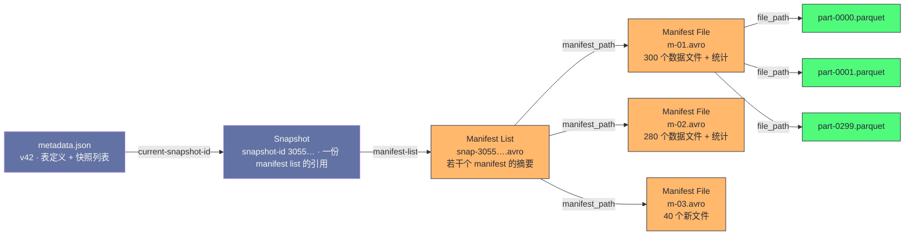
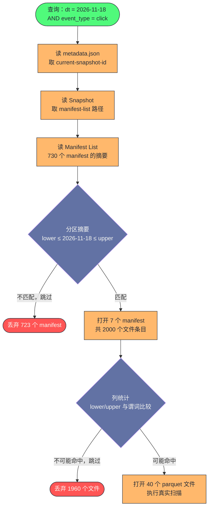
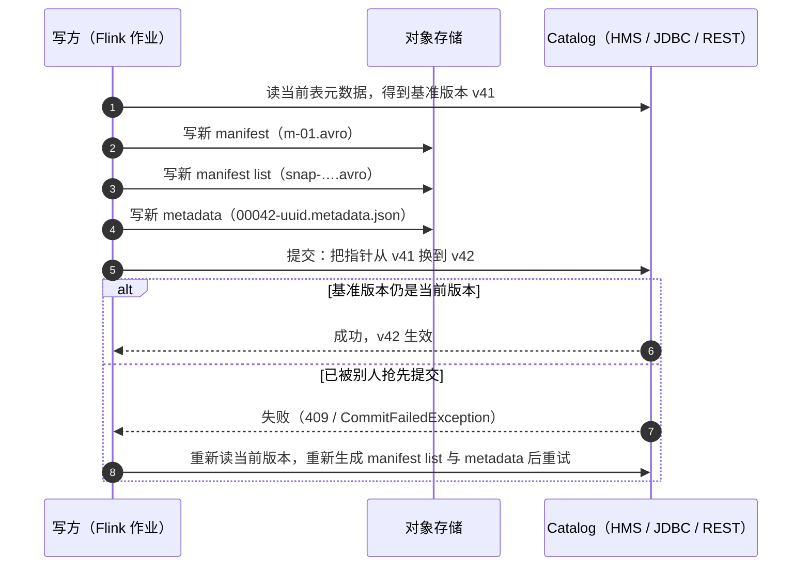
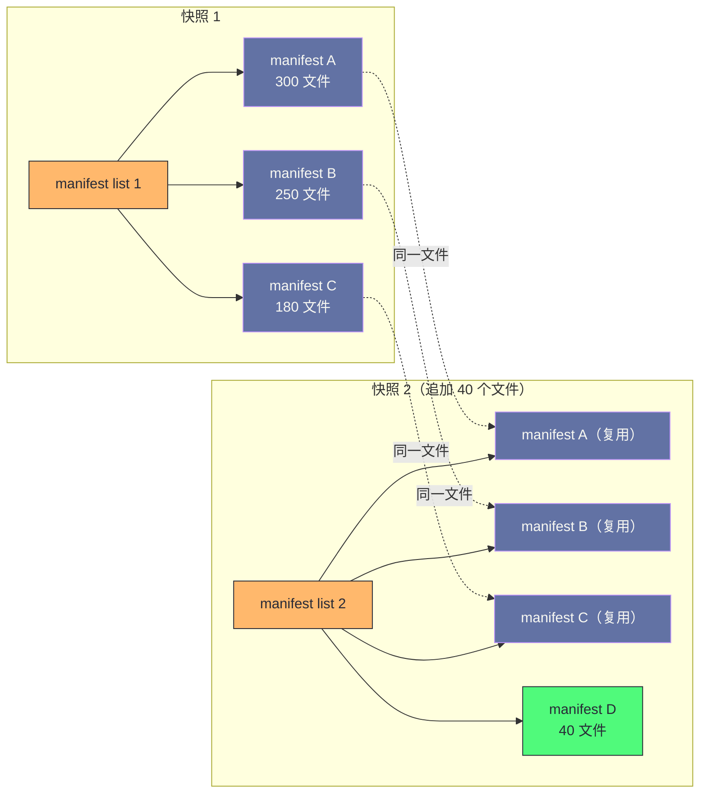
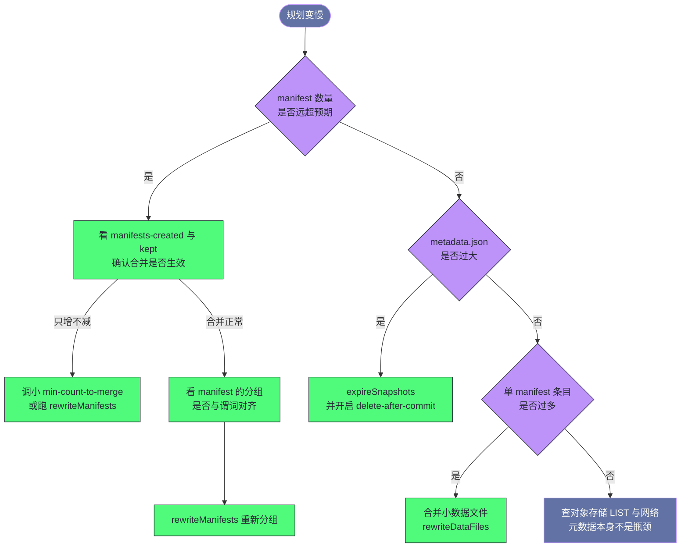

**摘要：**

Apache Iceberg 的能力清单很长——快照隔离、Time Travel、Hidden Partitioning、跨引擎一致读取——但它们都长在同一棵树上。本文把这棵树拆开看：`metadata.json` 是唯一的提交点，一份 JSON 文件的原子替换决定了"哪一版算数"；Snapshot 把某一时刻的完整文件集合固化成对象；Manifest List 用分区摘要做第一级裁剪；Manifest File 用列级 min/max/null_count 做第二级裁剪，让查询在打开任何一个 parquet 文件之前就能把它排除掉。文章也算清这棵树的两笔账：它换来了"每个文件都有统计、可以分层跳过"，代价是元数据文件本身变成需要维护的对象——提交越频繁，avro 小文件越多，规划越慢，于是过期快照、manifest 合并与重分组从可选优化变成了周期性义务。围绕提交协议，逐个交代 HadoopCatalog、HiveCatalog、JDBC 与 REST 各自怎么做 check-and-put，为什么原子性最终并不由对象存储提供；`format-version` 1/2/3 的门槛差在哪里，v3 的删除向量与行谱系改变了什么；以及孤儿元数据、指针错位、并发 409、过期与长查询竞态这几种不一致分别长什么样、怎么判断、怎么处置。落点是一个权衡：树不是免费的，它把成本从"读的时候列举"搬到了"写的时候记账"，是否划算取决于写入的批次粒度与查询谓词的形状。

---

## 第 1 章 一张表并不住在目录里

### 1.1 目录即表的年代

在 Hive 的世界里，一张表就是 HDFS 上的一个目录，分区就是子目录，`dt=2026-11-18/region=cn/` 这样的路径本身携带了全部语义。这套约定之所以成立，是因为 HDFS 的目录就是元数据：`ls` 一次就拿到了分区清单，目录名是可信的，改名与删除是原子的。查询时把 `WHERE dt = '2026-11-18'` 翻译成路径前缀，剩下的工作交给文件系统。

把同样的约定搬到对象存储上，问题就一个一个冒出来。S3 没有真正的目录，只有带前缀的对象名，`ls` 退化成一次分页的 LIST，返回的是一批字符串，中间没有层级；LIST 的开销随对象数增长，一个几十万文件的分区要把 LIST 翻上很多页；早期 S3 的 LIST 还是最终一致的，刚写进去的文件可能不在列表里。更要紧的是"哪一版算数"这件事失去了载体——HDFS 上靠目录结构隐式表达"当前有哪些文件"，对象存储上你没法用一次原子操作表达"这一批文件同时可见、那一批同时消失"。

Hive 元存储（HMS）试图补上这个缺口，把分区信息放进 MySQL 的 `PARTITIONS` 表，查询规划先去查这张关系表。这在几千个分区的规模上工作良好，到几十万、上百万行时就成了热点：一次查询规划要先扫一遍元数据库，而元数据库是整套数据湖里最难水平扩展的部件。问题的根子不在于 MySQL 不够快，在于"表的定义"被拆成了两半——一半在目录结构里，一半在元数据库里，两边都可能不一致，谁也不能单独作为真相。

### 1.2 一次提交把什么变成真相

换个角度看这件事：一个 parquet 文件被写出来的那一刻，它只是对象存储里的一堆字节，和表没有任何关系。它进入表，唯一的原因是某份清单记录下了它的路径、大小、统计信息；它离开表，唯一的原因是某份新清单不再记录它。表不是目录，表是**清单**。

顺着这个判断往下走，Iceberg 的全部设计就变得顺理成章。既然表的身份由清单定义，那么清单本身必须是不可变的——一旦允许原地修改清单，就回到了"一半新一半旧"的中间状态；既然清单不可变，每次提交就必须生成新的清单，而新清单需要有人告诉读方"哪一份是最新的"；既然这个"谁是最新"的指针必须原子地切换，那么对象存储提供不了的能力，就得由目录服务（catalog）来补。

这三步推理连起来，就是 Iceberg 元数据架构的全部骨架：一份可原子替换的表定义文件，加一棵层层可裁剪的清单树。

### 1.3 一个贯穿全篇的例子

为了让后面的算术有具体的着落，笔者设想一张用户行为日志表 `dwd.user_events`：按 `dt`（天）加 `bucket(user_id, 16)` 两列分区，每天约两亿行，落成两千个左右的 parquet 文件，单文件一百来 MB；写入方有三个——Flink 作业做实时小批写入，每小时提交若干次；Spark 每天凌晨跑一次全量重写某个分区；还有一个 compaction 作业在低峰期合并小文件。查询方主要是 BI 看板，谓词集中在 `dt` 区间和 `event_type` 上，偶尔有人按 `user_id` 做点查。

这张表的日常形态会贯穿全文：实时写入制造大量小提交，小提交制造大量小 manifest，而 compaction 又会不断把旧文件标记删除、新文件标记新增。元数据树在这种写入模式下的表现，比在"每天一次大批量追加"的教科书场景里复杂得多，也更能说明这套结构真正的边界。

### 1.4 树的形状

下图是 `dwd.user_events` 在某次提交后的元数据形状（为便于阅读只画了三个 manifest）。左边是三层元数据文件，右边是叶子上的数据文件；箭头的方向就是读方打开一张表时实际走的方向。



图中橙色的三个 manifest 是这一层真正干活的地方。注意它们之间的关系不是"包含"，而是"并列"：读方拿到 manifest list 之后，知道有三个 manifest、每个覆盖哪些分区、各有多少个文件，然后才决定打开哪几个。这就是"树"这个说法的全部含义——每一层都是下一层的索引，而不是下一层的内容。

所谓"三层架构"，指的是 Snapshot、Manifest List、Manifest File 这三层元数据；数据文件不属于元数据，它是树的叶子。把数据文件也算进来，从表定义到字节一共是四层，这也是后文展开的顺序。

---

## 第 2 章 四层结构：从表定义到数据文件

### 2.1 每层各解决什么问题

层次化的意义不在于"文件多"，而在于每一层能独立地回答一个问题，而且回答的代价与下一层的规模无关。把四层的职责并排放在一起，这个分工就清楚了。

| 层 | 物理格式 | 回答的问题 | 规模量级 |
|---|---|---|---|
| `metadata.json` | JSON | 这张表现在长什么样，哪一份快照算数 | 单文件，几十 KB 到几 MB |
| Snapshot | 内嵌在 JSON 中 | 某一刻的完整文件集合是哪一份 manifest list | 每个快照一条记录，几百字节 |
| Manifest List | Avro | 这份快照由哪些 manifest 组成，各自覆盖哪些分区 | 每行一个 manifest，几百字节 |
| Manifest File | Avro | 这个 manifest 里有哪些数据文件，统计如何 | 每行一个文件，几百字节 |
| 数据文件 | Parquet / ORC / Avro | 行数据本身 | 单个文件几十 MB 到几 GB |

四层的分工可以用一个朴素的标准检验：如果某一层被去掉，会发生什么。去掉 manifest list，读方必须打开快照里的所有 manifest 才能知道有哪些文件，第二级裁剪无从谈起；去掉 manifest，文件清单就退化成一张平铺的大表——大小随文件数线性增长，每次提交都要整体重写，也没法做文件级的跳过；去掉快照，就没有"某一刻的完整视图"这个概念，隔离性和 Time Travel 一起消失；去掉 `metadata.json`，表连自己的 schema 都没有地方放。

### 2.2 metadata.json：表定义加一个提交点

`metadata.json` 是树的根，它装三类东西：表的静态定义（schema 历史、分区规范历史、排序规范、表属性）、快照的清单（`snapshots` 数组与 `current-snapshot-id`）、以及两条历史线索（`snapshot-log` 与 `metadata-log`）。它不记录任何一个数据文件的名字——那是 manifest 的职责。

这个分工有一个直接的后果：`metadata.json` 的大小不随表的文件数增长，只随提交次数（快照条目数）与 schema 变更次数增长。一张有六十万个数据文件、但只做过十万次提交的表，它的 `metadata.json` 大约只有几十 MB 量级（示例推算：每条快照记录含 id、父 id、序号、时间戳、manifest list 路径与 summary，约两三百字节，十万条合计二三十 MB），而它的 manifest 加起来是 GB 级。读方每次打开这张表都要把整份 JSON 读进来解析一次，这就是快照过期必须定期执行的经济理由。

### 2.3 Snapshot：把"某一刻"固化

快照不是"本次改动的差集"，而是"这一刻的完整视图"。它记录一个快照 id、父快照 id、序号、创建时间、一份 manifest list 的路径，以及一段描述本次操作性质与规模的 summary。文件集合不直接存在快照里——快照指向 manifest list，manifest list 指向 manifest，manifest 才列出文件。

这个"间接"是有意为之。如果快照直接存文件清单，那么每个快照就是一份完整清册，写入成本等于表的大小；现在快照只存一个指针，清单的复用交给 manifest 层处理。一个 manifest 只要内容没变，就可以被任意多个快照引用，这是 Iceberg 写放大小的根本原因。

### 2.4 Manifest List：在元数据里做第一级裁剪

Manifest List 是 Avro 文件，每行一个 manifest，行里带着这个 manifest 覆盖的分区范围、文件计数、行数计数和序号。它的价值在于让读方无需打开 manifest 本身，就能丢掉大部分 manifest。

### 2.5 Manifest File：让统计在打开文件之前生效

Manifest File 也是 Avro，每行一个数据文件，行里带着路径、格式、分区值、大小、记录数，以及一组以列 id 为键的统计：`lower_bounds`、`upper_bounds`、`value_counts`、`null_value_counts`、`nan_value_counts`。这些统计是第二级裁剪的依据。

关键在于这些统计存在**元数据文件里**，而不是数据文件里。parquet 自己也有行组级统计，但要读到它必须先打开文件、读 footer，在对象存储上这意味着一次完整的 GET 请求。Iceberg 把文件级统计抄了一份放在 manifest 里，读方只要读 manifest 就能决定这个文件要不要打开——这一层"抄写"是整个格式里最划算的一笔交易。

### 2.6 一次查询走完四层

把四层串起来看一遍。查询 `SELECT … FROM dwd.user_events WHERE dt = '2026-11-18' AND event_type = 'click'`，规划阶段的动作如下。



这是一次示例推算：一天两千个文件、每个 manifest 收三百个文件，一天就是七个 manifest 上下；保留九十天再加上实时与 compaction 的产物，总量按 730 个估。分区摘要把 730 个砍到 7 个，列统计把 2000 个文件砍到 40 个，两级裁剪之后真正被打开的文件是原文的百分之二。

注意裁剪发生在两个不同的粒度上：第一级是"manifest 要不要打开"，第二级是"文件要不要打开"。这是两层索引而不是一层——只有一层的时候，你必须打开清单才能看到文件的统计；有了两层，清单本身也可以被跳过。

---

## 第 3 章 metadata.json：提交点与被替换的那一个文件

### 3.1 为什么不原地改

`metadata.json` 的第一条设计约束是不可变：任何表状态的变化都生成一个新文件，旧文件原样保留。这条约束换来三件东西。读方拿到某个路径之后可以放心读，不会读到一半被别人改掉；崩溃恢复变得简单，提交失败只需丢弃那个没人引用的新文件；历史版本天然存在，Time Travel 与审计不必另建机制。

代价也直接：每提交一次就多一个 JSON 文件，文件数随提交次数线性增长。这就是 `metadata-log` 与 `write.metadata.previous-versions-max` 这对机制存在的原因，第 8 章会算这笔账。

### 3.2 关键字段

`metadata.json` 的字段很多，但真正决定架构性质的是其中一小半。下表按"这字段解决什么问题"来组织，而不是按规范的排列顺序。

| 字段 | 含义 | 解决的问题 |
|---|---|---|
| `format-version` | 1 / 2 / 3 | 读方的门槛，高于实现版本必须报错 |
| `table-uuid` | 表的唯一标识 | 刷新元数据后校验，防止读到另一张表的元数据 |
| `location` | 表根目录 | 写入方据此决定文件放哪 |
| `last-sequence-number` | 已分配的最大序号 | 删除文件只对更老的数据文件生效的依据 |
| `schemas` / `current-schema-id` | schema 历史与当前 schema | Schema Evolution 不需要重写数据文件 |
| `partition-specs` / `default-spec-id` | 分区规范历史与当前规范 | Partition Evolution 可以新旧共存 |
| `current-snapshot-id` | 当前快照 | 与 `refs` 中 `main` 分支指向同一处 |
| `snapshots` | 有效快照列表 | Time Travel 与过期清理的作用域 |
| `snapshot-log` | 当前快照的变更流水 | 按时间戳做 Time Travel 时用它定位 |
| `metadata-log` | 上一版元数据文件的流水 | 找回历史版本、清理旧 JSON |

表里有三个字段容易被混为一谈：`snapshots` 回答"有哪些快照"，`snapshot-log` 回答"当前快照在什么时候被谁替换过"，`metadata-log` 回答"这份 JSON 自己是怎么一代代演化来的"。前两个服务于数据的时间旅行，第三个服务于元数据的考古。当 `metadata.json` 被误删或损坏时，能救命的恰恰是 `metadata-log`——它记录着上一版文件的完整路径。

这里有一条容易被忽略的设计后果：`snapshots` 数组里存的是**有效**快照，按规范的定义，有效意味着它列出的所有数据文件都还在文件系统里。这条定义把"元数据一致性"和"物理文件是否存在"绑在了一起，也是第 10 章那些故障的判据来源。

### 3.3 提交点：catalog 的角色

写一份新 JSON 只是一半工作，另一半是让所有人知道它成了最新的。规范把这个动作定义为"原子地把表元数据指针从旧版本换成新版本"，但**没有规定怎么实现**——因为实现取决于表由谁托管。这是 Iceberg 规范里一个刻意的留白，也是不同 catalog 行为差异的来源。

下图是一次提交的时序，核心只有一步：指针的成功替换。



图上还有一处细节：重试时写方只需要重写 manifest list 和新 metadata，manifest 本身可以复用。原因是 manifest 条目里新增文件的序号写的是 `null`，读取时由 manifest list 中的序号继承而来；序号变了，改的是 list 而不是 manifest。这个"序号继承"的设计让提交失败的重试不必重写几百 MB 的 manifest，属于典型的用一层间接换一次写入。

### 3.4 四种 catalog 的原子性来源

各家 catalog 的实现方式不同，但都在做同一件事：给"换指针"这个动作找一个支持比较并交换（check-and-put）的原语。

| Catalog | 指针存在哪 | 怎么保证唯一提交点 |
|---|---|---|
| HadoopCatalog（文件系统表） | `version-hint.text` 加目录里的最大版本号 | 写 `<uuid>.metadata.json` 后 rename 成 `v<N+1>.metadata.json`，rename 失败即冲突 |
| HiveCatalog | HMS 表参数 `metadata_location` | 先取 metastore 锁，再比对基准路径，不一致抛 `CommitFailedException` |
| JDBC Catalog | 关系库 `iceberg_tables` 表的 `metadata_location` 列 | `UPDATE … WHERE metadata_location = 旧值`，影响行数为 0 即冲突 |
| REST Catalog | 服务端实现（可能是任意数据库或表服务） | 客户端发 `requirements` 加 `updates`，服务端校验不通过返回 409 |

文件系统表那一行有个重要的限定：规范明确标注这套 rename 方案在对象存储与本地文件系统上**不安全**，已被标记为废弃，将在 format-version 4 中移除。原因是 S3 没有 rename，所谓原子改名在对象存储上是"复制再删"，两步之间谁都能看见中间态；而 `version-hint.text` 本身又是个可以被并发覆盖的普通文件。用 HadoopCatalog 管 S3 上的表，在生产里是一个应当避免的组合。

HiveCatalog 的机制更接近传统数据库：HMS 里那张表有一个 `metadata_location` 参数，提交时先拿锁，读回当前参数与本地的基准路径比对，一致才写新值。锁的实现可以是 HMS 表锁，也可以是 ZooKeeper，取决于配置。这里有一个容易忽略的失效条件——如果底层的 metastore 不支持事务，条件更新就退化成"读一遍再写一遍"，两个写方仍可能同时通过校验；代码里对这种情况只留下一条提示，要求更换 metastore。

JDBC 的机制最干净：一条带条件的 `UPDATE`，数据库的行锁天然把并发写方排成一队，影响行数为零就说明基准已过期。REST 则把这层逻辑彻底推到服务端，客户端只提交语义化的要求（表 uuid 是什么、当前快照是谁）与更新内容，由服务端裁决，冲突返回 409，客户端按 `commit.retry.num-retries` 重试（默认 4 次，退避从 100 毫秒起，总超时 30 分钟）。

四种实现放在一起看，可以得出一个结论：**原子性来自 catalog**。对象存储只负责让文件不可变，判断"谁是最新"的权力被移交给一个支持条件更新的服务。这也解释了为什么"裸表"（没有 catalog、只用路径访问）不是一个可用的部署方式——那张表读得到数据，但没人能安全地写它。

还有一种路径正在变成现实：把原子性下沉到对象存储的条件写。较新的对象存储开始提供带前置条件的写入，用 `If-None-Match` 表示"同名对象不存在时才创建"，于是两个写方对同一个版本号争抢时，存储层本身就能分出胜负，不需要另找一个服务做裁判。它的好处是少一个要运维的部件，代价是把表绑死在特定存储上——条件写并非所有对象存储都提供，而 Iceberg 规范从不依赖它，所以它只能是一种实现选择，不能当成格式能力。

### 3.5 为什么不能只靠对象存储

一个常见的反问是：既然文件名里有版本号，读方列一下目录取最大的不就行了，何必再引入 catalog。这个方案在两个地方站不住。

其一，列举的代价与目录规模成正比。`metadata/` 下有几万个文件时，一次 LIST 要翻很多页，而每次查询都要做一次，这笔开销比读元数据本身还大。其二，列举结果不构成"当前版本"的判断依据：写方 A 可能已经把 v42 写完但还没来得及切换指针就崩了，此时目录里确实有 v42，但它从未被提交过。只有 catalog 里的那个指针知道谁算数。第三条更微妙：并发场景下两个写方可能各自写出 v42 的不同副本（文件名带不同的 UUID），目录里同时存在两份"v42"，靠文件名分不出胜负。

指针是有状态的、只有一处的事实；文件名只是候选。这是所有表格式都绕不过去的一条分界线。

---

## 第 4 章 Snapshot：把"某一刻"固化成一个对象

### 4.1 快照记了什么

| 字段 | 含义 | 备注 |
|---|---|---|
| `snapshot-id` | 唯一的 long | 由提交时生成，与版本号无关 |
| `parent-snapshot-id` | 父快照 | 无父时省略，链的起点 |
| `sequence-number` | 单调递增序号 | v2 起必填，与快照 id 不同 |
| `timestamp-ms` | 创建时间 | 过期清理与时间旅行都依赖它 |
| `manifest-list` | manifest list 路径 | 快照与树其余部分的唯一接口 |
| `summary` | 操作类型与统计 | 含 `operation` 与各类计数 |
| `schema-id` | 创建时的 schema | 让老快照能按当时的 schema 解释 |

`snapshot-id` 与 `sequence-number` 是两个不同的东西，这一点经常被混淆。前者标识一个快照对象，后者标识"这一批写入在时间上的位置"，主要用于判断删除文件是否应当作用于某个数据文件——删除文件只对序号更小或相等的旧数据生效。之所以不直接用快照 id 做比较，是因为跨分支、跨回滚的场景下快照 id 的大小没有语义。

### 4.2 父链与回滚

快照之间通过 `parent-snapshot-id` 形成一条链，链的当前末端就是 `current-snapshot-id`。回滚（rollback）不是删除新快照，而是把 `current-snapshot-id` 改回链上某个更早的节点。被跨过的快照仍然留在 `snapshots` 数组里，直到过期清理把它们移出。

这条设计带来一个反直觉的后果：回滚之后，那些"曾经被新快照加入、现在又不在当前视图里"的数据文件，既没有被删除，也不在任何 scan 的视野内。它们靠"有没有被保留快照引用"来判定生死，而不是靠"是不是当前快照的一部分"。所以判断一个数据文件能否删除，需要看所有保留快照的并集，而不是当前快照——这也是过期清理必须整体计算而不能逐个快照删除的原因。

### 4.3 summary 里的三个计数

`summary` 里最有信息量的是 `manifests-created`、`manifests-kept`、`manifests-replaced` 三个计数（规范的可选字段）。它们直接反映了这次提交对元数据树做了什么：新建了几个 manifest，原样沿用了几个，替换掉了几个。

对 `dwd.user_events` 这样的表，一次实时小批写入的 summary 通常是"created 1，kept 300，replaced 0"，而一次 compaction 是"created 2，kept 10，replaced 8"。前者说明增量很小、复用很高，后者说明这次提交改动了相当一批 manifest 的引用关系。观察这三个数的长期趋势，比看文件总数更能判断元数据是否健康——如果 `manifests-created` 持续为 1 而 `manifests-kept` 持续增长，说明 manifest 只增不减，第 8 章的合并机制没有生效。

### 4.4 refs：分支与标签

从 v2 起，快照可以被 `refs` 引用，引用有两种类型：分支（branch）与标签（tag）。分支是可移动的，提交时会把分支的指针推到新快照；标签是固定的，指向某个具体快照不再移动。`main` 分支始终存在，且与 `current-snapshot-id` 保持一致。

`refs` 不只是个便利功能，它同时是**保留策略**的作用对象。过期清理时会先保留所有分支和标签指向的快照，再沿每个分支向上保留若干祖先，其余才允许过期。由此可知，一个快照只要还被某个标签指着，它的文件就不会被物理删除。这一点在排障时很实用：如果发现存储空间降不下来，先查 `refs`，再看是否有一批标签钉住了历史。

---

## 第 5 章 Manifest List：在元数据里做第一级裁剪

### 5.1 每行一个 manifest

Manifest List 是 Avro 文件，一行对应一个 manifest。它的 schema 由规范固定，字段 id 从 500 起编，这与 manifest 条目从 0 起编的编号体系是分开的。

| 字段 | 含义 |
|---|---|
| `manifest_path` | manifest 文件路径 |
| `manifest_length` | 文件大小，可用于估算打开代价 |
| `partition_spec_id` | 写入该 manifest 时用的分区规范 |
| `content` | 0 表示数据文件，1 表示删除文件 |
| `sequence_number` | manifest 加入表时的序号 |
| `min_sequence_number` | manifest 内所有有效条目的最小序号 |
| `added_snapshot_id` | 首次加入该 manifest 的快照 |
| `added_files_count` / `existing_files_count` / `deleted_files_count` | 三种状态的条目数 |
| `added_rows_count` / `existing_rows_count` / `deleted_rows_count` | 三种状态的记录数 |
| `partitions` | 分区字段摘要列表 |
| `first_row_id` | v3 起，为新增数据分配行 id 的起点 |

`partitions` 是一个列表，每个元素对应分区规范里的一个字段，包含四个值：`contains_null`（是否有空分区值）、`contains_nan`（是否有 NaN）、`lower_bound` 与 `upper_bound`（非空非 NaN 值的上下界，按单值二进制序列化）。

### 5.2 计数器怎么被用来跳过

读方跳过 manifest 有三条路，代价依次递增。

第一条是看计数。如果一个 manifest 的 `added_files_count`、`existing_files_count`、`deleted_files_count` 全为零，它里面没有有效文件，直接跳过。这类空 manifest 在频繁小提交之后并不罕见。

第二条是看分区摘要。查询谓词先按分区规范投影成分区谓词，再与 `lower_bound`/`upper_bound` 比较。用 day 分区、查询 `dt = '2026-11-18'` 时，投影结果就是一个等值条件，落在上下界之外的 manifest 全部出局。这里必须限定一点：投影必须是**包含性**的，即"如果某行的谓词为真，它所在分区的谓词也必然为真"，因此投影只会放宽不会收紧，漏掉的文件不会造成错误结果，只会让裁剪稍微保守。

第三条才是打开 manifest 看文件级统计——那是第 6 章的事。

### 5.3 为什么 `contains_nan` 要单独存在

浮点数有一处特殊行为：NaN 与任何值比较都为假，包括与它自己。于是"最小值"和"最大值"这两个概念对 NaN 没有意义，`lower_bound` 与 `upper_bound` 都无法表达"这个分区里存在 NaN"。如果把 NaN 当成普通值参与比较，`WHERE score <> 0` 这类谓词会错误地把含有 NaN 的分区排除掉。

规范的处理办法是另开一个布尔位：`contains_nan` 为真时，任何涉及该字段的谓词判断都要保守处理，即使上下界看起来不匹配也不能跳过。这是一个很小的字段，但它体现了统计信息的一条底线——统计只能用来排除**确定不可能**的情况，任何不确定都必须退回扫描。违背这条底线的实现会让查询安静地少读几个文件，然后安静地给出错误结果。

### 5.4 一次裁剪的算术

把上面的机制落到数字上（示例推算）。`dwd.user_events` 按天加 bucket 分区，一天 16 个 bucket、2000 个文件，每个 manifest 收 300 个文件，于是每天约 7 个 manifest。保留 90 天的活跃数据、加上实时写入与 compaction 的产物，manifest 总数按 730 个估。

- 不裁剪：读 730 个 manifest，约 730 次 GET。按每次 20 毫秒算，光元数据就要 15 秒左右。
- 分区摘要裁剪：`dt = '2026-11-18'` 命中 7 个 manifest（当天的两千个文件都在里面），其余 723 个跳过。GET 次数降到 7 次，元数据阶段 150 毫秒。
- 列统计裁剪：这 7 个 manifest 里 2000 个文件条目，按 `event_type = 'click'` 的上下界再筛，留下 40 个。

两级裁剪的价值在请求数上体现得最清楚：730 次降到 7 次，两个数量级。这也解释了为什么 manifest 的数量比数据文件的数量更容易成为规划瓶颈——文件级的跳过发生在打开 manifest 之后，而 manifest 级的跳过发生在打开之前，前者省的是行组扫描，后者省的是网络往返。

---

## 第 6 章 Manifest File：让统计在打开文件之前生效

### 6.1 文件本身也带元数据

manifest 是 Avro 文件，除了行数据，它的文件级键值元数据里还记着四样东西：写入时的 `schema`（JSON 形式）、`schema-id`、`partition-spec`（只含字段数组）、`partition-spec-id`，v2 起还有 `content`（数据还是删除文件）与 `format-version`。

这些属性的用途是让 manifest 能够被独立解释。一个 manifest 可能由几个月前的旧代码写出，分区规范可能已经换过两代，读方必须按 manifest 自己记录的分区规范去解释它里面的分区值，而不能用当前规范。这条规则是 Partition Evolution 能工作的前提：新旧规范的文件可以共存于同一张表，各按各的解释。

### 6.2 三种状态与一个反直觉的事实

manifest 的每一行是 `manifest_entry`，第一个字段是 `status`：0 表示已存在（EXISTING），1 表示新增（ADDED），2 表示已删除（DELETED）。配套的 `snapshot_id` 记录这个文件在哪个快照被加入或被删除，`sequence_number` 与 `file_sequence_number` 记录序号。

这里有个规范里写得很直白、但读一遍容易滑过去的事实：**DELETED 条目不参与扫描**。读方在规划时只把 live 条目（EXISTING 与 ADDED）收进文件集合，DELETED 条目会被忽略。

为什么还要写它？因为 avro 文件不可变，删掉一个文件这件事没法靠在旧 manifest 上划掉一行来表达。写方的做法是把含有被删文件的旧 manifest 整体重写一份新的：要删的文件写成 DELETED，同一 manifest 里其余仍然有效的文件以 EXISTING 状态照抄过去，然后在新 manifest list 里用这份新 manifest 顶替旧的那份。EXISTING 状态的意义由此显形——它表示的不是"没变"，而是"容器位置变了、内容没变"。于是 DELETED 条目的读者不是查询引擎，而是三件事：过期清理（判断哪些文件随这个快照一起可以删）、增量读取（还原这次提交删了什么）、审计工具（看清一次 compaction 换掉了哪些文件）。

理解了这一点，才能理解"删除一个文件"在 Iceberg 里为什么比看上去贵：它不是从清单里减去一行，而是重写一份包含这行墓碑的新清单，再重建一次 manifest list 的引用关系。

### 6.3 data_file 结构

`manifest_entry` 的第二个字段是 `data_file`，它才是统计信息的载体。

| 字段 | 含义 |
|---|---|
| `content` | 0 数据、1 位置删除、2 等值删除 |
| `file_path` | 完整 URI |
| `file_format` | PARQUET / ORC / AVRO |
| `partition` | 分区值元组，字段 id 来自分区规范 |
| `record_count` | 记录数；对删除向量则是被删行数 |
| `file_size_in_bytes` | 文件大小 |
| `column_sizes` | 按列 id 的磁盘占用 |
| `value_counts` | 按列 id 的值个数，含 null 与 NaN |
| `null_value_counts` | 按列 id 的 null 个数 |
| `nan_value_counts` | 按列 id 的 NaN 个数 |
| `lower_bounds` / `upper_bounds` | 按列 id 的上下界，二进制序列化 |
| `split_offsets` | 行组偏移，用于拆分并行读 |
| `equality_ids` | 等值删除的判定列，仅等值删除文件有 |
| `referenced_data_file` | 位置删除或删除向量所指向的数据文件 |

`value_counts` 的定义需要留意：它统计的是值的个数，**包含 null 与 NaN**，所以 `record_count` 减去 `value_counts` 才是"缺失该列"的证据。而 `null_value_counts` 只数 null。这两个字段的差值在跨引擎读写时经常被算错，进而让 `IS NULL` 的裁剪结论出错。

### 6.4 上下界是二进制，而且会被截断

`lower_bounds` 与 `upper_bounds` 是 `map<int, binary>`，键是列 id，值是按类型做**单值序列化**的字节。整数按小端序、字符串按 UTF-8、时间戳按微秒或纳秒计数、十进制按未缩放值加标度，浮点有专门规则（`-0.0` 必须排在 `+0.0` 之前，NaN 不允许作为界）。这套序列化是规范附录里的一部分，跨引擎互通靠的就是它——Spark 写出的界，Trino 必须能解释。

字符串与二进制列的界默认会被截断。截断长度由表属性控制，`write.metadata.metrics.default` 的默认值是 `truncate(16)`，即字符串界最多保留 16 个字符、二进制最多 16 个字节；也可以按列设 `write.metadata.metrics.column.<列名>`，取值有 `none`、`counts`、`truncate(length)` 与 `full`。

截断带来一个方向性的问题：下界取前缀之后必然不大于原值，作为下界是安全的；上界取前缀之后可能小于原值，作为上界就不安全了。所以实现要对上界做向上取整——把前缀的最后一个字符推到更大的一档，必要时再补字符——保证截断后的界仍然满足"下界不大于所有值、上界不小于所有值"。规范把这条写成硬性要求，因为一旦破坏它，裁剪就会把可能命中的文件错误地排除，结果是查询少读数据、给出错误结果。规范划出的边界只是下限，实现里那段向上取整的代码才真正决定正确性。

### 6.5 一个条目长什么样

把规范里的 avro schema 用 JSON 的形式写出来，便于对照。这是等价表示，不是真实的 avro 编码。

```json
{
  "status": 1,
  "snapshot_id": 3055729675574597004,
  "sequence_number": null,
  "file_sequence_number": null,
  "data_file": {
    "content": 0,
    "file_path": "s3://warehouse/dwd/user_events/dt=2026-11-18/bucket=07/00042-a1b2.parquet",
    "file_format": "PARQUET",
    "partition": {"dt": 20775, "bucket": 7},
    "record_count": 1048576,
    "file_size_in_bytes": 134217728,
    "column_sizes": {"1": 100663296, "2": 33554432},
    "value_counts": {"1": 1048576, "2": 1048576},
    "null_value_counts": {"1": 0, "2": 576},
    "nan_value_counts": {},
    "lower_bounds": {"1": "base64…", "2": "base64…"},
    "upper_bounds": {"1": "base64…", "2": "base64…"},
    "split_offsets": [4, 8388612, 16777220],
    "sort_order_id": 0
  }
}
```

这份记录里两个序号都是 `null`，含义是"继承自包含它的 manifest"。这个设计是第 3 章提到的重试优化的基础：序号在提交尝试之间可能变化，而 manifest 一旦写出就不再修改，把会变的东西放在会重写的文件里，把不变的东西放在不重写的文件里。

### 6.6 统计为什么要抄一份

parquet 的 footer 里有行组级的 min/max，精度甚至比 Iceberg 的文件级统计更高——一个文件里几十个行组各有自己的界。既然如此，为什么要花额外的空间在 manifest 里再存一遍文件级的？

答案在读取路径的代价结构上。要用 parquet 的 footer 统计，必须打开文件、读尾部、解出元数据，在对象存储上这是一次完整的 GET 加一次 seek，几十毫秒起步；而读一个 manifest 是一次 GET 换来三百个文件的统计。把"过滤文件"和"扫描文件"这两件事分开，意味着被过滤掉的文件一次都不用打开。

这也解释了为什么 Iceberg 的统计精度只到文件级：更细的行组级过滤发生在已打开的文件内部，由 parquet 自己的 reader 完成，不需要写进元数据。

> [!info] 统计的边界
> 文件级统计是"帮助排除"的工具，不是"断言内容"的工具。它只能用来证明"这个文件里不可能有匹配行"，不能用来证明"这个文件里一定有匹配行"。任何实现如果把统计当作精确断言（譬如用它直接回答 `count(*)`），都会在数据有删除、有截断、有 NaN 的时候出错。

---

## 第 7 章 为什么是树而不是日志

### 7.1 两种记账方式

Delta Lake 用的是另一条路：一个只追加的日志目录，每次提交追加一个 JSON，日志里的 `add` 与 `remove` 记录文件的进出，当前文件集合靠重放日志重建（配合周期性的 checkpoint 把历史压成一个文件）。这套结构是线性流水账，每个版本记的是"变化"。

Iceberg 的结构是分层索引，每一层记的是"某一层级的完整状态切片"：manifest 记一批文件的完整状态，manifest list 记一组 manifest 的完整状态，快照记一个 manifest list 的引用。没有"重放"这个动作，因为每一层本身就是全量。

两者的差别不在"有没有 checkpoint"，而在索引可以在哪一层被使用。

### 7.2 逐项对比

| 维度 | Iceberg 的树 | 平铺日志（以 Delta 为代表） |
|---|---|---|
| 组织方式 | 分层的完整切片，每层可独立裁剪 | 单层的变更流水，按序重放 |
| 读路径 | 读根、读快照、读命中的 manifest | 读 checkpoint，再重放其后的日志 |
| 写路径 | 新 manifest 加新 manifest list 加新 metadata | 追加一个 JSON |
| 统计位置 | 每个 manifest 条目都带列级统计 | 每个 `add` 带 stats（JSON 或结构化列） |
| 裁剪粒度 | manifest 级与文件级两层 | 文件级一层（checkpoint 内） |
| 文件级统计的复用 | 跨快照复用 manifest，统计不必重算 | checkpoint 需定期重写全部活文件元数据 |
| 多引擎读取 | 规范只定义文件格式，任何引擎按同一套 schema 解释 | 依赖各引擎实现日志重放与 checkpoint 解析 |
| 元数据文件数量 | 每次提交产生若干 avro 与一个 JSON | 每次提交一个 JSON，另有周期性 checkpoint |

表里最后一行是下面要继续算的账。

### 7.3 树的成本：每次提交都在重写索引

树的结构决定了每次提交必须重写"从根到叶"路径上的每一层索引：快照要新增一条记录，manifest list 要整体重写（因为 manifest 集合变了），manifest 只在需要时才新建。

manifest list 的大小正比于 manifest 的数量，这一点是树的固有成本。一张有一万个 manifest 的表，每提交一次就要重写一份含一万行的 avro，按每行两百字节算就是 2 MB 上下。相比之下，追加日志的写路径每次只加一个 JSON，几十 KB。

文件数这笔账同样不能只看单次。每次提交至少留下三个新对象——一份 `metadata.json`、一份 manifest list、一个 manifest，元数据文件数于是随提交次数线性增长；按每分钟一次提交算，一年五十二万次提交就是一百五十万个元数据对象（示例推算），而其中绝大多数都只有几 KB 到几十 KB。这就是"大量小 avro"这个说法的来处：它不是实现粗糙的产物，是树结构在碎提交下的必然形状。

不过账要算全。日志的读路径在有 checkpoint 的情况下是"一个 checkpoint 加最多 N 个 JSON"，checkpoint 的大小正比于活文件数；树的读路径是"一个 JSON 加快照加命中的 manifest"，manifest list 的大小正比于 manifest 数。两者都在用"周期性重写一份全量"换取"读路径短"，只是重写的时机不同：树在每次提交都重写 list，日志每隔若干版本重写 checkpoint。

这就有了一个很实际的推论：Iceberg 适合**读多写少、批次不碎**的场景；写入极碎时，manifest list 的重写成本会积少成多。第 8 章的合并机制正是为了压住这个成本。

### 7.4 增量更新与 manifest 复用

下图说明一次追加提交之后，哪些文件是新的、哪些是沿用的。



这次追加只写了一个 manifest（40 行）、一份新的 manifest list、一份新的 metadata。三个旧 manifest 原样复用，一点没动。这就是"fast append"的实现方式——新数据写新 manifest，而不是往旧 manifest 里追加记录。规范里对此有明确的说明：这条路径的存在，就是为了让追加不必重写已有 manifest。

manifest 还有一个与 Hive 习惯相反的性质：它不按分区划分，一个 manifest 可以装任意分区的文件。这一点与 Hive 的"一个分区一个目录"有本质区别，也是它可以跨分区把文件重新分组（第 8 章的 rewriteManifests）的前提。

### 7.5 什么规模下树不划算

树不是在所有规模上都赢。有三种情况它的相对成本会上升。

其一，提交极碎。每分钟一次提交、每次只写几个文件，一天 1440 次提交就是 1440 个新 manifest 与 1440 份 manifest list。如果每份 list 有几千行，光写 list 就是每天几百 MB 的元数据写入（示例推算：3000 行乘 200 字节乘 1440 次，约 860 MB）。这类场景要么靠 `commit.manifest-merge.enabled` 自动合并，要么把提交频率降下来，要么换一种写入模型。

其二，查询没有任何可用于裁剪的谓词。`SELECT count(*)` 这类全表聚合用不上分区摘要，也用不上列统计，树的全部优势退化为"能快速列出文件清单"。这时树的成本仍然存在，收益接近于零。

其三，表很小、历史很短。几百个文件、几十次提交的表，用什么结构都能在毫秒内规划完，额外的元数据层次只是增加了要理解的部件。

---

## 第 8 章 膨胀：树长大之后要修枝

### 8.1 三种膨胀

树的膨胀有三个独立的维度，混在一起谈容易误判。

第一种是快照数膨胀。每次提交一个快照，快照列表变长，`metadata.json` 变大，每次打开表都要解析得更久。它同时让过期数据无法回收——只要快照还在，它引用的文件就不能删。

第二种是 manifest 数膨胀。每次提交至少新增一个 manifest，而 manifest 只有被合并才会减少。manifest list 的大小正比于 manifest 数，于是规划时间随提交次数线性上升。

第三种是条目数膨胀。compaction 把十个文件合成一个，旧文件以 DELETED 条目写进新的 manifest，新文件以 ADDED 写进去；只要这些带墓碑的 manifest 之后不被重写，条目总数就会持续超过实际文件数，而 manifest 又不能只删掉那几行。

三种膨胀的处置手段完全不同：8.2 针对快照，8.3 针对 manifest，8.4 处理 JSON 自身，8.5 汇总这几件事的取舍。

### 8.2 过期快照与保留策略

快照过期（expire snapshots）做的事情是：从 `snapshots` 数组里移除不再保留的快照，然后删掉只被这些快照引用的 manifest、manifest list 与数据文件。判断"只被这些快照引用"需要把保留快照的文件集合求并，再从候选里减去——不是逐快照删除。

保留哪些快照，规范给了五步算法：

1. 从空集开始，收集要保留的快照；
2. 移除所有超过 `max-ref-age-ms` 的引用（`main` 除外）；
3. 把每个分支与标签指向的快照加入保留集；
4. 对每个分支沿父链向上加，直到快照早于 `max-snapshot-age-ms` **且**不属于该分支最前面的 `min-snapshots-to-keep` 个；
5. 其余快照全部过期。

三个阈值各有默认值：`history.expire.max-snapshot-age-ms` 默认五天，`history.expire.min-snapshots-to-keep` 默认 1，`history.expire.max-ref-age-ms` 默认永久（`main` 分支永不失效）。这组默认值的取向很清楚——尽量少删，把"删多少"的决定权交给运维。

Spark 上的调用形式是 `CALL system.expire_snapshots('dwd.user_events', TIMESTAMP '…')`。执行之后可以用 `SELECT * FROM dwd.user_events.snapshots` 验证剩余快照数，用 `SELECT * FROM dwd.user_events.metadata_log_entries` 看元数据文件的演化。

过期有一个必须交代的安全边界：删快照会连带删除数据文件，而正在跑的查询可能还拿着旧快照的引用。如果过期的时间点切得太近，查询会在扫描阶段报文件不存在。保留期必须大于最长查询与最长写入的耗时，这个约束不是建议，是正确性要求。

### 8.3 manifest 合并与重写

manifest 数量的控制有两条路径，一条自动、一条手工。

自动路径是提交时的合并。`commit.manifest-merge.enabled` 默认为真，写入方在提交时会把小 manifest 合并到 `commit.manifest.target-size-bytes`（默认 8 MB）附近，`commit.manifest.min-count-to-merge`（默认 100）控制"攒够多少个才开始合并"。这条路径的效果是让 manifest 的平均大小维持在几 MB，而不是几十 KB。

手工路径是 `rewriteManifests`，它做的事与自动合并不同：自动合并按加入顺序合并相邻的 manifest，`rewriteManifests` 则允许**按新的规则重新分组**，譬如把散落在各个 manifest 里的小文件按第一个分区字段重新聚到一起。后者的价值在于让 manifest 的分组方式与查询谓词对齐——按天写入、按天查询时，顺序合并就够了；按小时写入、按用户维度查询时，就需要重新分组。

`rewriteManifests` 是一次纯粹的重排：它不改变数据文件，只改变文件在 manifest 中的分布，因此快照的 `operation` 是 `replace`。重排之后，原先的 manifest 全部被替换，DELETED 墓碑也随之消失——这也是清理墓碑条目的手段。

### 8.4 metadata.json 自身的清理

JSON 文件的清理由两个表属性控制：`write.metadata.delete-after-commit.enabled`（默认假）与 `write.metadata.previous-versions-max`（默认 100）。开启前者之后，每次提交在写完新 JSON 后会删掉 `metadata-log` 里最老的那个文件，让被追踪的版本数维持在阈值内。

这里有一个文档里专门点出的陷阱：这两个开关只能删**被追踪**的文件。如果一张表在建表初期没有开启这个特性，把 `write.metadata.previous-versions-max` 设成 10，跑满一百次提交之后就是 10 个被追踪、90 个已经滑出追踪范围；后来再把开关打开，那 90 个文件也不会被删掉，它们成了孤儿，只能靠孤儿文件清理（`deleteOrphanFiles`）处理。

孤儿文件的清理有一个默认的保留窗口（三天），用意是避开"正在写但还没提交"的文件。把窗口调得比一次写入的最长耗时还短，清理作业就会把在途文件当成孤儿删掉，直接损坏表。

### 8.5 维护动作的取舍

把这些动作放在一起，各自的代价与风险需要看清。

| 动作 | 作用对象 | 何时做 | 主要风险 |
|---|---|---|---|
| `expireSnapshots` | 快照、数据文件 | 保留期外的历史不再需要 | 保留期短于最长查询，读方报文件缺失 |
| `rewriteManifests` | manifest 分组的形状 | 写入顺序与查询谓词不对齐 | 重写量大，期间规划性能抖动 |
| 提交时自动合并 | 小 manifest | 常开，按目标大小合并 | 每次提交多写一些元数据 |
| `write.metadata.delete-after-commit` | 被追踪的旧 JSON | 提交频繁、JSON 数量可观 | 只能删被追踪的，孤儿需另行处理 |
| `deleteOrphanFiles` | 未被任何元数据引用者 | 任务失败留下残骸 | 窗口过短会删掉在途文件 |
| `rewriteDataFiles` | 小数据文件 | 文件数远超分区数的合理值 | 与并发写冲突，需要重试 |

下图是面对"规划变慢"时的判断顺序，顺序错了会做无用功。



---

## 第 9 章 版本门槛：format-version 的三个台阶

### 9.1 版本号是给读方看的一扇门

`format-version` 是一个整数，语义简单粗暴：读方打开表时先看它，如果实现支持的版本低于表声明的版本，**必须抛异常**，而不是"尽力读一读"。这条规定的动机是防止安静地读错——新版本引入的特性（删除文件、删除向量）在没有对应实现的读方眼里不是错误数据，而是"看起来正常的旧数据"。

三个版本的能力差异可以列成一张表。

| 能力 | v1 | v2 | v3 |
|---|---|---|---|
| 行级删除 | 不支持 | 位置删除与等值删除文件 | 删除向量（DV），禁止新写位置删除文件 |
| `sequence-number` | 无 | 必填（表、快照、manifest list、条目） | 必填 |
| 删除清单 | 无 | `content=1` 的删除 manifest | 同 v2，且 DV 可记在删除 manifest |
| 行谱系 | 无 | 无 | `next-row-id`、`first-row-id`、`_row_id` |
| 新数据类型 | 基础类型 | 同 v1 | 纳秒时间戳、`unknown`、`variant`、几何与地理类型 |
| 列默认值 | 无 | 无 | 支持 |
| 多参分区变换 | 不支持 | 不支持 | 支持 |
| 表加密密钥 | 无 | 无 | `encryption-keys` |

### 9.2 v2：把删除变成一等公民

v2 的核心增量是删除文件。数据文件仍然不可变，删除另外写成文件：位置删除文件记"某个数据文件的第几行被删了"，等值删除文件记"某列等于某值的行被删了"。两类删除文件存在删除 manifest 里，`content` 字段为 1，与数据 manifest 分开。

除了能力，v2 还提高了对写方的要求：序号必须写，`manifest list` 的若干计数字段从可选变必填，快照的 `sequence-number` 必填。这类"更严格"的改动不改变读者的能力，但改变了元数据的完整程度，所以升级 v2 时旧写方必须一起升级。

### 9.3 v3：删除向量与行谱系

v3 改动集中在两件事上。

第一件是把行级删除的表示从"删除文件"换成删除向量（deletion vector）。DV 是一个位图，第 P 位为 1 表示该数据文件第 P 行被删除，按 Puffin 文件格式存储，blob 类型为 `deletion-vector-v1`。实现上为了兼顾 64 位位置与空间效率，把位置拆成高 32 位作为键、低 32 位作为子位置，每个键维护一个 32 位的 Roaring 位图。

DV 相对位置删除文件的优势在执行侧：位置删除文件是一张"文件加行号"的表，扫的时候要 join；位图可以在读取数据文件时按行序直接判断，代价低得多。规范对 DV 加了几条硬约束：一个数据文件在一个快照里最多一个 DV；写新 DV 时必须合并已有的位置删除；删数据文件时要连带删掉它的 DV（不要求重写包含该 DV 的 Puffin 文件本身）。同时 v3 禁止新写位置删除文件，等值删除在 v3 仍可写、到 v4 被禁止。

第二件是行谱系（row lineage）。v3 的表元数据新增 `next-row-id`，每个快照新增 `first-row-id` 与 `added-rows`，每个数据文件可以带 `first_row_id`，于是每一行都能推算出稳定的 `_row_id`。这条能力服务于增量处理与变更追踪：下游可以按行 id 判断"这一行是新出现的还是更新过的"，不必依赖全列比较。

v3 还加了几个与类型系统相关的能力：纳秒精度的时间戳、`variant` 半结构化类型、几何与地理类型、列默认值、多参数分区变换、表级加密密钥。这些能力彼此独立，用到哪个就要求读方支持哪个，但都受 `format-version=3` 这道门统一约束。

### 9.4 升级的单向性

升级不是改一个数字。把 `format-version` 从 2 改成 3 意味着此后写出的元数据可能包含 v2 读方无法解释的结构，而任何 v2 实现读到 `format-version: 3` 都会直接拒绝打开。反过来，把 3 改回 2 更不可能——历史里已经写入了 DV 与行 id，改回 2 并不会让这些字节消失，只会让读方按错误的语义解释它们。

所以升级应当被当作一次涉及全部读写方的决定：Spark、Trino、Flink、各家的连接器版本、自研的读取工具，全都要能处理新版本，否则从提交那一刻起它们全部失效。规范要求读方在版本过高时报错，正是为了让这个决定无法被悄悄绕过。

顺带说明口径：v1、v2、v3 是已经完成并被社区采纳的版本；规范里同时在开发 v4（自适应元数据树、根 manifest 取代 manifest list、数据文件与 DV 合并条目、相对路径、约束等），但明确标注为"尚未正式采纳"。以 v4 的能力做生产设计为时尚早，本文涉及 v4 的地方只作为演进方向的说明。

---

## 第 10 章 故障形态：四种不一致

### 10.1 孤儿元数据文件

症状是 `metadata/` 目录里的文件数远超历史提交数，且有一些文件的命名符合 `<版本>-<uuid>.metadata.json` 却不被任何指针引用。

判据是比对 `metadata-log` 与目录列表：不在 `metadata-log` 里、也不是当前版本的 JSON，就是孤儿。同类孤儿还包括 manifest 与 manifest list——写入成功但提交失败的提交会留下 `<uuid>-m1.avro` 与 `snap-….avro`。

根因通常是提交失败（版本冲突、进程被杀、网络中断）之后的清理不彻底。Iceberg 的提交流程在失败时会尝试删除自己刚写的元数据文件，但进程被强杀时这一步不会执行。另一类根因是并发提交：两个写方基于同一版本各写了一份 v42，胜者留下，败者的文件成为孤儿。

处置是 `deleteOrphanFiles`，保留窗口不要小于一次写入的最长耗时（默认三天是个稳妥的起点）。不要手工 `rm`，尤其是在有作业正在写这张表的时候。

### 10.2 指针与文件不一致

症状是打开表时报元数据文件不存在（`FileNotFoundException` 或对象存储的 404），但 `metadata/` 目录里明明有别的版本。

判据分两个方向。指针指向的文件不存在：catalog 里的路径在本应所在的位置找不到，可能是有人手工删了文件，也可能是跨区域复制的延迟。文件存在但指针没更新：提交成功写了新 JSON，但 catalog 的指针仍停在旧版本，此时表读起来是旧数据，"新数据没写进去"的错觉由此产生。

根因集中在"绕过表接口动文件"这一类操作上：手工删旧 JSON、用对象存储的生命周期策略清理 `metadata/` 前缀、跨集群复制时只复制了部分前缀。处置要先冻结写入，再从 `metadata-log` 里找最近一个可读的版本，把指针改回去；改指针这一步必须通过 catalog 的接口做，直接改 HMS 参数或数据库字段的风险是绕过它的校验逻辑。

### 10.3 并发提交

症状是写入作业报 `CommitFailedException`，REST catalog 下对应 HTTP 409。

判据看异常消息里的基准路径。HiveCatalog 的消息形如"基准元数据路径与当前表元数据路径不一致"；JDBC 是"更新表失败"（影响行数为 0）；REST 是"一个或多个 requirement 校验失败"。三者指向同一件事：提交时基于的版本已经过期。

处置分两类。追加类操作的重试是安全的，规范明确写着追加没有额外要求，可以应用在新版本上重试；替换类操作必须校验"要删的文件是否仍在表里"，compaction 与格式转换属于这一类，冲突时要重新计算。重试次数由 `commit.retry.num-retries`（默认 4）与两个退避参数控制，总超时 `commit.retry.total-timeout-ms` 默认 30 分钟。

还有一类更麻烦的状态：客户端与 catalog 的连接在提交过程中断开，既没收到成功也没收到失败。此时提交可能已经落地，作业如果按失败处理、重新读一次当前版本再追加一遍，重复数据就是这样产生的。规范的实现里为此设计了状态回读流程，用 `commit.status-check.*` 这组参数控制重试；排障时看到 `CommitStateUnknownException`，第一件事是回读 catalog 确认指针，而不是直接重跑作业。

### 10.4 过期与并发读的竞态

症状是查询跑到一半报文件不存在，而表本身元数据完好。

判据是时间线：查询开始的时间点与 `expireSnapshots` 执行的时间点重叠。查询拿到的是执行前的快照，过期清理认为这个快照已经超出保留期，把它引用的数据文件删了，查询的扫描阶段于是找不到文件。

根因是把保留期配得比查询耗时短。处置是调大 `history.expire.max-snapshot-age-ms`，或者把过期作业放在低峰期并给足余量。这类故障在长查询（几分钟到几十分钟的大扫描）与高频过期（每小时一次）并存时最容易出现。

### 10.5 一张处置表

| 症状 | 判据 | 根因 | 处置 |
|---|---|---|---|
| 目录里残留未被引用的 JSON 或 avro | 不在 `metadata-log`，也非当前版本 | 提交失败后的清理未完成 | 跑孤儿文件清理，窗口不小于最长写入耗时 |
| 打开表报元数据文件不存在 | 指针路径无对应对象 | 手工删除或复制不完整 | 冻结写入，从 `metadata-log` 找可读版本修指针 |
| 表读到旧数据 | 目录有新 JSON，catalog 指针未变 | 提交未真正落地 | 回读指针确认，重跑提交 |
| 写入报提交失败或 409 | 异常带基准路径不一致或 requirement 失败 | 并发提交，基准过期 | 追加类直接重试，替换类重算后重试 |
| 提交状态未知 | `CommitStateUnknownException` | 连接中断，结果不明 | 先回读 catalog，再决定是否重试 |
| 查询中途报文件缺失 | 与过期作业时间重叠 | 保留期短于查询耗时 | 调大保留期，错峰执行过期 |
| 规划阶段越来越慢 | manifest 数远高于数据文件数除以单个 manifest 的合理容量 | 小提交未合并，manifest 膨胀 | 开合并、跑 `rewriteManifests` |

---

## 第 11 章 反例：四件不该做的事

### 11.1 手工删 `metadata/` 下的旧版本

`metadata/` 目录看起来只是一堆文件，删几个"旧的"似乎无害，因为当前版本还在。这个操作破坏的是两条链路。

第一条是 `metadata-log`。它记录着历史版本文件的路径，删掉文件之后这些路径全部悬空，用元数据表 `metadata_log_entries` 查出来的结果变成一堆不可读的指针。第二条是 Time Travel 与审计：按时间戳回溯时，读方要靠 `metadata-log` 定位那个时刻的元数据文件，文件没了就只能报错。

更危险的是"看起来删的是旧的"。判断哪个文件是旧版本，需要读当前 JSON 的 `metadata-log` 并与目录交叉比对；按文件名的时间戳或修改时间判断，很容易把一份仍被引用的文件划入"旧"的范畴。用对象存储的生命周期规则自动清理 `metadata/` 前缀是更常见的版本——规则按对象年龄删，完全不看引用关系。

### 11.2 忽略 manifest 膨胀

这个反例的症状最隐蔽，因为表一直是对的，只是越来越慢。规划时间从几百毫秒涨到几秒，用户开始抱怨"查一下要等很久"，而所有监控指标——数据量、文件数、查询返回行数——看起来都正常。

根因是 manifest 只增不减。每次小提交至少新增一个 manifest，几个月后 manifest 数量达到几十万，manifest list 变成几十 MB 甚至上百 MB 的 avro，每次规划都要读它、解析它、遍历它。此时第二级裁剪仍然有效，但第一级裁剪的输入本身已经太贵。

处置不是"删 manifest"，而是合并与重排。判断是否已经膨胀，看两个比值：manifest 平均大小与 `commit.manifest.target-size-bytes` 的差距，以及 manifest 数与数据文件数的比值。健康状态下，一个 manifest 装几百到几千个文件；如果平均只装几个到几十个，说明合并没生效。

### 11.3 绕过表格式直接往目录里写文件

用 Spark 的 parquet writer 直接往表目录写一批文件，文件确实躺在那里，但元数据里没有对应条目，于是查询看不见它们。这批文件永远不会被收编，也不会被 `expireSnapshots` 删除——过期清理只处理"元数据里记录过、现在不再被引用"的文件，不在元数据里的文件不在它的视野内。

反方向同样有问题：直接用 parquet reader 读表目录，读到的是全部物理文件，包括已经被标记删除但尚未物理清理的旧文件，结果里会出现重复行与已删行。表格式的全部保证——schema 校验、分区裁剪、快照隔离——在这条路径上都不生效。

这类文件只能靠孤儿文件清理处理，而孤儿清理有它自己的窗口约束。更稳妥的做法是把表目录当成"表格式独占的存储区域"，任何写入都通过表接口。

### 11.4 把保留期配得比业务回溯需求还短

`expireSnapshots` 的保留期是一个业务决策，不是运维参数。把它设成一天，意味着任何超过一天的查询、任何依赖旧快照的下游作业、任何"回滚到昨天"的诉求都失效。

这个反例的特殊之处在于失效是延迟显现的：配错的当天什么都不会发生，一周后某个回溯任务报"快照不存在"，或者某次回滚发现目标版本已经被清掉。等到那时，能做的只有接受数据不可回溯。

合理的做法是先量出业务侧的最长回溯需求（常见的是一周或一个月），再把保留期设在它之上并留出余量；同时确认 `refs` 里没有业务标签被误删，因为标签是钉住历史快照的唯一手段。

---

## 第 12 章 树的意义：把索引写进元数据

回头看这棵树，每一层都在做同一件事：把下一层的"内容"压缩成"摘要"，让读方可以只看摘要就决定要不要深入。`metadata.json` 把历史压缩成快照列表，快照把文件集合压缩成一份 manifest list，manifest list 把 manifest 集合压缩成分区摘要，manifest 把数据文件压缩成路径加统计。四层压缩，换来的是"打开任何一个 parquet 之前就能排除它"。

这个结构之所以成立，靠的是三条互相支撑的约束：所有元数据文件不可变，所以同一个 manifest 可以被无数快照复用；每一层都自带足够的信息来解释自己（manifest 带自己的分区规范，条目的统计按列 id 索引），所以不同时期写出的文件可以共存；提交点被移交给 catalog，所以"哪一版算数"有一个唯一的、支持条件更新的答案。

代价也同样清楚：树把成本从"读时列举"搬到了"写时记账"。每次提交都要重写从根到 list 的路径，提交越碎，重写的次数越多；元数据文件本身成了需要清理的对象，快照、manifest、JSON 各有各的过期机制；而 catalog 一旦出问题，整张表就没有权威的当前版本，只有一堆无人认领的候选文件。

所以判断这棵树是否适合一张表，问题不在于"Iceberg 是否先进"，而在于三件事能否同时成立：写入是否以批量为主，让每次提交摊薄 manifest list 的重写成本；查询是否带有可用于裁剪的谓词，让两级跳过真正生效；运维是否愿意维护过期与合并这两件周期性工作。三件事都成立时，这套结构可以用很小的元数据代价支撑很大的表；任何一件不成立，它都会退化成一堆需要人工照看的小文件。

---

## 参考资料

1. [Apache Iceberg Table Spec](https://iceberg.apache.org/spec/)：表元数据字段、快照、manifest list、manifest 条目、序号继承、快照保留策略、提交冲突处理与版本差异的权威定义。
2. [format/spec.md（GitHub 源文件）](https://github.com/apache/iceberg/blob/main/format/spec.md)：与官网同步的规范文本，便于按章节检索表格原文。
3. [Iceberg Configuration](https://iceberg.apache.org/docs/latest/configuration/)：`write.metadata.metrics.default`、`commit.manifest.target-size-bytes`、`commit.retry.*`、`history.expire.*` 等属性的默认值。
4. [Iceberg Maintenance](https://iceberg.apache.org/docs/latest/maintenance/)：`expireSnapshots`、`rewriteManifests`、`deleteOrphanFiles` 与旧元数据文件清理的行为与注意事项。
5. [Iceberg Spark Queries（元数据表）](https://iceberg.apache.org/docs/latest/spark-queries/)：`snapshots`、`manifests`、`entries`、`metadata_log_entries`、`refs` 等元数据表的字段与用法。
6. [REST Catalog OpenAPI 规范](https://github.com/apache/iceberg/blob/main/open-api/rest-catalog-open-api.yaml)：`requirements`/`updates` 的提交模型与 409 冲突语义。
7. [HiveTableOperations.java](https://github.com/apache/iceberg/blob/main/hive-metastore/src/main/java/org/apache/iceberg/hive/HiveTableOperations.java)：HiveCatalog 的加锁、基准路径比对与提交状态回读。
8. [JdbcTableOperations.java](https://github.com/apache/iceberg/blob/main/core/src/main/java/org/apache/iceberg/jdbc/JdbcTableOperations.java)：JDBC catalog 的条件更新提交。
9. [Puffin Spec](https://iceberg.apache.org/puffin-spec/)：删除向量所用的 `deletion-vector-v1` blob 与 Roaring 位图编码。

---

> [!note] 思考题
> 1. 树的每一层都是下一层的索引，那么"再加一层"是否总能带来收益？如果把 manifest 再切成"子 manifest"，读路径会变短还是变长？
> 2. 追加写可以无冲突重试，替换写必须校验文件是否仍在表里。这条差异对 compaction 作业的并发设计意味着什么？
> 3. `metadata.json` 的大小随快照数增长，而 manifest list 的大小随 manifest 数增长。哪一项更容易先成为瓶颈，为什么？
> 4. 如果一次提交已经写出数据文件与 manifest，却在切换指针前崩溃，这批文件处于什么状态？谁会、在什么条件下回收它们？
> 5. `format-version` 只能单向升级。假设业务确实需要从 v3 退回 v2，除了重写历史数据，还有没有别的路径？