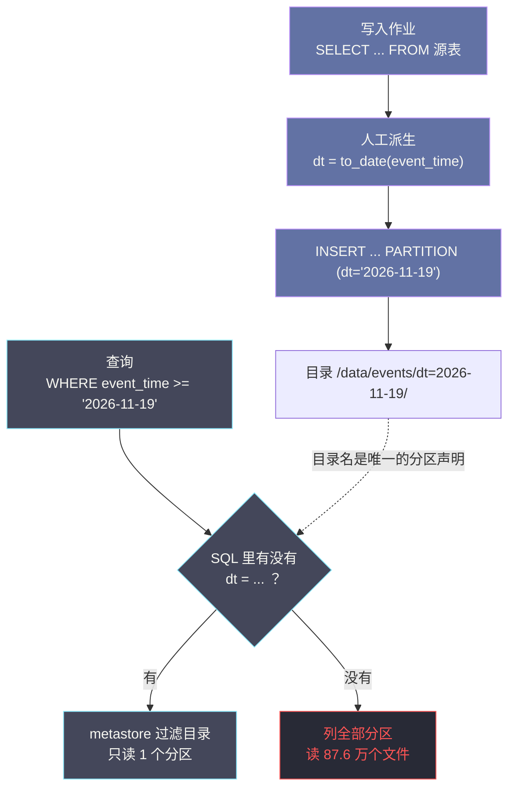
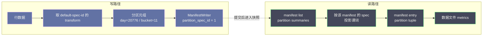
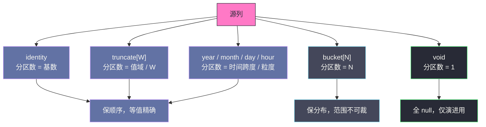
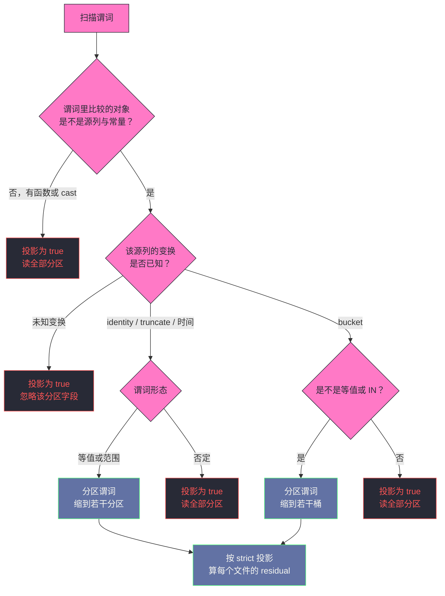
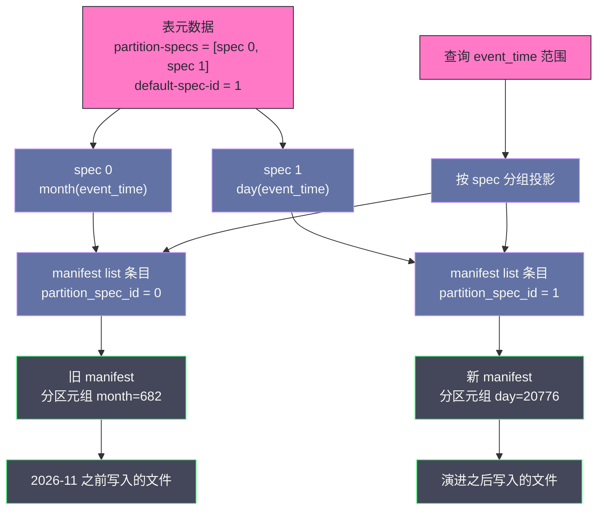

# 03 Hidden Partitioning——告别分区列陷阱

**摘要：**

传统数据湖把分区编码进目录名，由此产生三处耦合：分区值必须先落成路径里的一段字符串；分区列必须先成为表里的一列；查询必须再写一遍这个派生列，否则优化器不知道 `event_time` 与 `dt` 的关系。三者叠加的结果不是报错，而是静默的错行与四十分钟的全表扫描。Iceberg 的 hidden partitioning 把这层关系交给元数据：分区值由 `identity`、`bucket`、`truncate`、`year`、`month`、`day`、`hour` 等变换从源列推导，目录名退化成命名习惯，读取时按每个 manifest 记录的 spec 解释它所装的文件。

这笔交易换来两个能力：一是谓词与物理布局解耦，查询只写业务列，投影负责把源列谓词翻译成分区谓词；二是分区方案可以原地演进，旧数据按旧 spec、新数据按新 spec 长期共存，不需要重写历史。代价落在两处：投影只能放宽不能收紧，`ts > 12:00` 最多缩到"那一天"，精度要靠文件级统计与排序补回；多份 spec 共存让裁剪、覆写与元数据表的语义分叉，配置不当会出现补数翻倍、跨引擎丢行这类难查的故障。全文按"路径编码的困境、spec 与分区元组、七种变换、投影的保守性、多 spec 的账、与排序和 Z-Order 的分工、反例与边界"展开，量化数字均为示例推算。

---

## 第 1 章 目录即分区：一次全表扫描的由来

### 1.1 一条按时间过滤的查询要打开多少文件

运营同学要一份"昨天的事件量"，SQL 写得完全自然：

```sql
SELECT count(*) FROM ods.user_events
WHERE event_time >= TIMESTAMP '2026-11-19 00:00:00'
  AND event_time <  TIMESTAMP '2026-11-20 00:00:00';
```

在 Hive 的执行计划里，这条查询没有分区谓词可用。表按 `dt` 分区，三年下来 1095 个目录；每天 400 GB、按 512 MB 一个文件估约 800 个文件，全表就是 87.6 万个数据文件、438 TB 数据。对象存储上打开一个文件是一次往返，按每次 10 毫秒计（示例推算，未计入并发摊薄），仅打开文件就要两个多小时，读数据的时间还没算。

把条件补成 `AND dt = '2026-11-19'`，同一个查询变成读 800 个文件、400 GB。差别不在引擎的优化能力，而在元数据里有没有"`dt` 等于 `event_time` 的日期部分"这条声明。Hive 没有这条声明，它能做的只是一次 metastore 端的字符串过滤：把用户写下的常量与目录名里的字符串逐个比对，匹配不上的分区整个拿掉。用户不写，它就认为这些目录全都在候选集里。

### 1.2 分区值是路径里的字符串，不是数据里的列

Hive 的分区列不参与数据文件的 schema。`PARTITIONED BY (dt STRING)` 声明的列只出现在 metastore 与目录名里，Parquet 文件里没有 `dt` 这一列，读取时由 `dt=2026-11-19/` 这段路径回填。这条设计带来几个后果，且都不报错。

第一个后果是类型退化。分区值在路径里是字符串，Hive 拿它做字典序比较，或者按 DDL 声明的类型做一次 cast。`dt` 若写成 `2026-1-1` 而不是 `2026-11-19` 这种补零格式，`BETWEEN '2026-01-01' AND '2026-01-31'` 就会漏掉数据；`dt` 若带时分秒，等值匹配直接失效。Iceberg 官方文档在对比 Hive 时把这条写得很直白：格式写错产生的是**静默的错误结果**，而不是查询失败。

第二个后果是派生逻辑无处安放。`event_time` 到 `dt` 的换算写在 ETL 作业里，可能写在三个团队的三个作业里，各自用各自会话的时区。一个用 UTC、一个用 Asia/Shanghai，同一份数据会被写进两个不同日期的目录；两个目录都能被查出来，加起来就是重复行。

第三个后果是分区值的正确性没有校验。Hive 无法在写入时验证 `dt` 是否等于 `date(event_time)`，因为数据文件里根本没有 `dt` 可供比对。写者说这批数据属于 11-19，它就被登记为 11-19。

还有一层更基础的：分区目录不由表定义管理。作业把文件直接写进 HDFS、或者从别的集群拷一批目录过去，Hive 表并不知道这些分区存在，必须靠 `MSCK REPAIR TABLE` 或 `ALTER TABLE ADD PARTITION` 把它们登记进 metastore。分区既是数据布局，又是一份需要人工同步的目录清单，两份状态之间的漂移在生产里是常态，而漂移的后果同样是"少行"。

### 1.3 分区列必须先在表里有个位置

因为分区是目录，目录名要来自某一列，所以 Hive 表的分区列必然先是一个"列"，两种形态都别扭。

一种是虚拟列：`dt` 只存在于 `PARTITIONED BY` 里，查询 `SELECT dt` 时由路径回填。这类列没有真实存储，不同文件格式、不同连接器的行为并不一致，下游把它当普通列做 join、做聚合时经常踩到类型与 null 语义的差异。

另一种是物化列：既把 `dt` 写进数据文件，又拿它做分区。冗余由此产生，两处值的一致性要由写者保证。笔者见过的事故里，最典型的一种是补数作业只更新了数据文件里的 `dt`，没有重写目录，于是同一批数据在文件里和路径里属于两个不同的日期。

Iceberg 的 identity 变换不需要这一层。分区值从源列推导，存在 manifest 的分区元组里；读取端遇到 identity 变换，直接把分区元组里的值填给那一列，不去文件里读。分区列的值因此保住了原类型：`date` 就是 `date`，`bigint` 就是 `bigint`，范围谓词做的是真正的数值比较，而不是字符串比较。

### 1.4 查询必须再写一遍派生列

下表是工程里最常见的几种写法，第三列是 Hive 侧的裁剪结果。

| 查询写法 | 能否触发分区裁剪 | 原因 |
|---|---|---|
| `WHERE dt = '2026-11-19'` | 能 | 谓词直接落在分区列上 |
| `WHERE event_time >= '2026-11-19' AND event_time < '2026-11-20'` | 不能 | 元数据里没有两列的关系声明 |
| `WHERE to_date(event_time) = '2026-11-19'` | 不能 | 函数包裹之后连分区列都不是 |
| `WHERE dt = '2026-11-19' AND event_time >= ...` | 能 | 但正确性依赖人记得写第一个条件 |

第三行是最容易出事的一种。它在业务语义上完全正确，在 Hive 上却退化为全表扫描，而引擎不会给任何提示：没有告警、没有警告，只有一条跑了四十分钟的查询。团队通常靠文档、代码评审和"分区列必须出现在 WHERE 里"的规约来兜底，这类规约的本质是把系统的知识挪到人的脑子里。

### 1.5 分区与分桶都钉死在 DDL 里

`PARTITIONED BY` 与 `CLUSTERED BY ... INTO N BUCKETS` 都是建表语句的一部分，一旦创建就固定在 metastore 的表定义里。同一张 Hive 表不能出现"一部分数据按天分区、一部分按小时分区"的混合结构，因为目录层次只有一种解释方式。

数据量从 40 GB 一天涨到 400 GB 一天之后，按天分区的单分区变成 400 GB，按小时分区的诉求就出现了。可选路径只有一条：建新表、把历史数据全量重写、下游切换、清理旧表。438 TB 数据按 20 个节点、每节点 200 MB/s 吞吐估（示例推算），重写要三十个小时以上，期间还要处理双写与增量追平。

分桶的不变性更隐蔽。`CLUSTERED BY (user_id) INTO 64 BUCKETS` 一旦被下游用来做 bucket map join，桶数就成了跨表的隐式契约：两张表桶数相同、分桶键相同，join 才能省掉 shuffle。把桶数从 64 改成 128 在新表上很容易，让所有参与 join 的表同时改则是一件需要跨团队排期的事。

### 1.6 三处耦合的故障形态

把前面的分析收成一张表，可以看出这些故障的共同特征：没有异常，只有错误的结果或意外的耗时。

| 耦合点 | 表现 | 直接后果 | 出错时的信号 |
|---|---|---|---|
| 分区值来自路径 | 目录名是唯一声明 | 分区方案即目录结构 | 写错格式进错目录，不报错只少行 |
| 分区列来自 schema | `PARTITIONED BY` 的虚拟列 | 需要派生列与双写一致性 | 文件内与路径里的值不一致 |
| 谓词绑定分区列 | 查询必须写 `dt = ...` | 布局泄漏到 SQL | 忘写即全表扫描，无告警 |
| 布局钉在 DDL | 分区与分桶不可变 | 变更等于重建 | 重建期双表并存、口径分叉 |

下图把写入侧与查询侧各自对分区方案的依赖画在一起，可以看到目录名同时承担了两个角色：写入时的落点，查询时的索引。



要跳出这张图，需要的不是更强的优化器，而是把"分区值与源列的换算关系"变成元数据的一部分。这正是 Iceberg 的 partition spec 做的事。

---

## 第 2 章 把分区关系写进元数据

### 2.1 一份 spec 由四个字段构成

Iceberg 表的分区方案叫 partition spec，它不描述目录，只描述"分区值怎么算出来"。规范附录里的形态是这样的：

```json
{
  "spec-id": 1,
  "fields": [
    { "source-id": 4, "field-id": 1000, "name": "event_time_day", "transform": "day" },
    { "source-id": 2, "field-id": 1001, "name": "user_id_bucket", "transform": "bucket[16]" }
  ]
}
```

四个字段各司其职。`source-id` 指向表 schema 里的字段 ID，不是列名，所以列改名不影响分区方案；`field-id` 是分区字段自己的 ID，从 1000 起分配，用来在分区元组里定位位置；`name` 只是给人看的标签；`transform` 是变换表达式，决定分区值怎么算。

跨这份 spec 与表的关系放在表元数据里：`partition-specs` 是全部 spec 的列表，`default-spec-id` 指出写者当前该用哪一份，`last-partition-id` 记录已经分配出去的最大分区字段 ID，保证新字段不会与历史 spec 撞号。从 v2 起这三个字段是必填项；v1 表里只有 `partition-spec` 一个字段，装当前 spec 的字段列表，分区字段 ID 由实现按 1000 起顺序隐式分配——这条历史包袱后面讲分区演进时会回来。

规范对旧的 `partition-spec` 字段有一句注解，是整篇文章的枢纽：它被 deprecated，因为读路径不用它，读取时用的是"manifest 文件里记录的 spec"。这句话把权威来源从"表上当前的分区方案"挪到了"每个文件被写出来时用的那份 spec"，多 spec 共存才有落脚点。

### 2.2 写入：从一行数据算出一个分区元组

写者拿到 `default-spec-id`，对每行取 transform，得到一组值，这组值就是分区元组。以 `day(event_time)` 为例，`2026-11-19 12:34:56` 的 `event_time` 算出来是 20776（自 1970-01-01 起的天数）。写者按分区元组分组，同一组的行落进同一个数据文件，文件路径由 location provider 生成。

路径在这里的地位需要澄清。Iceberg 的默认 location provider 确实会把分区路径拼进目录，形如 `data/event_time_day=2026-11-19/00000-0-....parquet`，看起来与 Hive 一模一样；把 `write.object-storage.enabled` 打开之后，路径改成熵哈希前缀，分区目录彻底消失，表照样能读。这个开关是"路径不是语义"的反证：它只影响文件放哪儿，不影响任何一次裁剪。

写路径还有一件事与 Hive 不同：DataFrame 里不需要带分区列。变换从源列算，`event_time` 在 schema 里就够了，`event_time_day` 这一列从头到尾不存在于用户的 DataFrame 和表 schema 里。

### 2.3 读取：三层判据各自吃不同的输入

读路径要回答"哪些文件不可能包含目标行"，Iceberg 把它拆成三层，每层的输入形式不同。

第一层在 manifest list 上做。manifest list 的每个条目带 `partition_spec_id` 和该 manifest 覆盖的 partition summaries——每个分区字段的 `contains_null`、`lower_bound`、`upper_bound`。这一层不需要打开 manifest，每个分区字段几十字节的摘要就足以排除掉整块数据。

第二层在 manifest 内部做。manifest 的每个 entry 带完整的分区元组与文件级 metrics，逐条判定即可。

第三层在数据文件内部做。清单里存的是 `lower_bounds`、`upper_bounds`、`value_counts`、`null_value_counts`、`nan_value_counts`，按 field id 索引，交给 Parquet 的 row group 统计继续往下切。文件级统计的另一半——metrics 的收集范围与字符串截断——在 [[05 查询优化——Partition Pruning、Column Metrics 与 Row-level Delete|文件级统计与行级删除]] 里有更细的展开。

三层里只有第一、二层需要**分区谓词**，第三层要的是普通列谓词。这就解释了为什么 hidden partitioning 的关键不在存储，而在谓词翻译。

### 2.4 分区值的类型与 null 语义

两个细节决定了投影能不能做对。

其一，transform 必须满足 null 进 null 出。规范明文要求所有变换对 null 输入返回 null，于是 `IS NULL` 这类谓词可以被投影到分区字段上，分区元组里的 null 与数据里的 null 有了同一套解释。

其二，输出类型由 transform 决定，且各变换不一致。`year`、`month`、`hour` 输出 int，`day` 输出 `date`（早期实现写过 int，读取端必须兼容这种写法），`identity` 与 `truncate` 保持源类型，`bucket[N]` 输出 int 且值域固定在 `[0, N)`。分区元组是按这些类型编码的，分区摘要的上下界也按这些类型序列化，投影时若把 `day` 的边界当 int 处理，一天的分区边界就会算错。

下图把写路径与读路径并排放，读路径上任何一层都不读"表上当前的 spec"，它读的是 manifest 自带的那一份。



### 2.5 两种编码方式的对照

把两种编码方式并排，差异最终收敛到一个问题上：分区值怎么算出来的这条关系，由谁持有、由谁解释。

| 维度 | 路径编码（Hive 分区目录） | 元数据编码（Iceberg spec） |
|---|---|---|
| 分区值存放位置 | 目录名字符串 | manifest 的分区元组 |
| 分区列是否进 schema | 是，虚拟列或物化列 | 否，transform 从源列推导 |
| 写入是否需要用户提供分区值 | 是 | 否 |
| 分区值由谁解释 | 路径解析器与 metastore | spec 里的 source-id 与 transform |
| 谓词如何裁剪 | 只能匹配分区列 | 任意源列谓词经投影 |
| 分区值类型 | 字符串，读取时 cast | transform 的输出类型 |
| 改分区方案 | 建新表并重写历史 | 新增一份 spec，旧数据不动 |
| 一个文件能属于两个分区吗 | 不能 | 不能，但同一张表可以有多份 spec |

### 2.6 为什么其他湖格式没有走这条路

Delta Lake 与 Hudi 的分区仍然是目录键。前者的分区值以字符串形式记在事务日志的 `partitionValues` 里，后者的分区路径由 `partitionpath` 模板拼出；两者都没有 transform 这一层，分区列仍然是用户要维护的真实列，谓词也仍然要落在这一列上才能裁剪。

Databricks 平台侧的生成列能把派生值的计算交给引擎，用户不必手写派生列，但分区列依旧是一个真实的 schema 列，产物仍然键在路径上。差别不在于谁的目录更整齐，而在于"分区值与源列的换算关系"有没有被格式记录下来：只有写进格式，读取端才可能在用户只写源列谓词时替他把谓词翻译过去。这一层记录，是 Iceberg 在分区维度上与另外两种格式最实质的分野。

---

## 第 3 章 七种变换

### 3.1 identity：等值分区，但列不必物化

`identity` 直接把源值当分区值，语义上等价于 Hive 的等值分区，差别在于它不需要那个列存在于数据文件里，也不需要用户手工写。适用于低基数字符串或枚举列，`region`、`status`、`tenant_id` 这类取值在几十到几千之间的列。

它也是唯一一个会被读取端"接管"的变换：读文件时若有 identity 分区字段，引擎用分区元组里的值填充该列，不再从文件里读。这条实现细节的意义是让分区列的值摆脱了文件格式差异，同一份数据无论写成 Parquet 还是 ORC，读出来的 `region` 都来自同一处。

陷阱有两个。取值为 null 的行会全部落进同一个 null 分区，这个分区往往成为倾斜源；对高基数列用 identity 则是把分区数直接乘上基数，后文第 7 章会算这笔账。

如果业务表里本来就有一个 `event_date` 列，用 `identity(event_date)` 与用 `day(event_time)` 会得到相同的分区粒度，取舍在于依赖谁：前者信任那一列被正确填充，后者从时间戳推导、与列内容无关。把换算关系交给变换，等于取消了"这一列是不是可信"这个问题。

### 3.2 bucket[N]：哈希取模，保分布不保顺序

`bucket[N]` 把源值做 32 位哈希，对 N 取模。规范把哈希定义到字节级：32 位 Murmur3，x86 变体，种子为 0，公式是 `(hash & Integer.MAX_VALUE) % N`——先丢掉符号位再取模，保证结果非负。

哈希的输入不是值的"某种自然表示"，而是规范附录 B 逐类型规定的序列化：int 先提升为 long 再哈希，所以 `34` 与 `34L` 得到相同的 2017239379，schema 从 int 提升到 long 不会改变历史桶号；`date` 按自 epoch 起的天数哈希；`timestamp` 按自 epoch 起的微秒哈希，纳秒精度必须先降到微秒；`string` 按 UTF-8 字节哈希，`decimal` 按最小 big-endian 无标度字节哈希，与 scale 无关。附录 B 还给每个类型配了测试值，这组测试值的存在说明**跨引擎一致是规范级要求**，不是实现自由度。

能力边界很清楚：等值谓词能精确落到某个桶，`user_id = 12345` 只需要读它算出来的那一个桶（假设桶号为 47）；范围谓词完全无效，`user_id BETWEEN 10000 AND 20000` 的哈希值均匀散在 16 个桶里，一个都剪不掉。桶数 N 本身可以在演进时改，规范明确说"表变大时可以演进 spec 改桶数"，但新旧桶数下同一行的桶号不同，旧数据留在旧 spec 里。

### 3.3 truncate[W]：按值域切，保住顺序

`truncate[W]` 对整数做向下取整到 W 的倍数，对字符串取前 W 个码点，对二进制取前 W 个字节。整数的公式要留意负数的取模行为，规范给出的写法是 `v - (((v % W) + W) % W)`，直接用语言默认的 `%` 在负数上会往零方向截断而不是向下取整。

它与 bucket 的分工是"保顺序"与"保分布"的取舍。truncate 是单调的，`user_id BETWEEN 12000 AND 19000` 在 `truncate[1000]` 上只需要读 8 个分区，范围谓词有效；代价是分布不均匀，值域上稀疏的区段会形成空分区，早期注册的用户 ID 集中在低位时，前几个分区会显著偏大。

字符串截断按码点而不是字节或 char，避免把代理对切成两半，`truncate[3]` 对 `"iceberg"` 得到 `"ice"`。这个变换适合编码有前缀语义的业务键，`product_code` 前三位是品类时，按品类聚在一处分区；`WHERE product_code LIKE 'ABC%'` 这类前缀条件，在引擎先把它规范化为 startsWith 之后也能投影到 `truncate[3]` 上的一个等值分区谓词（是否发生取决于连接器对 LIKE 的规范化能力）。

### 3.4 year / month / day / hour：从纪元起计数

四个时间变换都是从 1970 年起算的计数，便于比较：`year` 是年数，`month` 是"年乘 12 加月减 1"，`day` 是天数，`hour` 是小时数；除 `day` 输出 `date` 之外，其余三个都输出 int。2026 年对应 `year = 56`，2026-11 对应 `month = 682`，2026-11-19 对应 `day = 20776`，同一天 12 点对应 `hour = 498636`。

时区是这四个变换最容易出错的地方。`timestamptz` 在存储上是 UTC 瞬间，规范对它的描述是"以 UTC 存储、不保留源时区"，变换也就按 UTC 切分。业务时区为 +08 时，`2026-11-20 07:00 +08:00` 落在 UTC 的 11-19，分区值属于 20776；本地日期的边界与分区边界因此错开八小时，一个自然日的本地数据会跨两个分区，而一个分区里装的也不是一个完整的本地日。`timestamp`（无时区）没有这个问题，变换直接按字面时间切。

粒度选择的算术很直接。三年数据在四种粒度下的分区数分别是 3、36、1095、26280；每天 400 GB 按 512 MB 目标文件算，单分区文件数分别是约 29 万（按年，单分区 146 TB）、2.4 万（按月，单分区 12 TB）、800（按天，单分区 400 GB）、33（按小时，单分区 17 GB）。分区数乘单分区文件数约等于文件总数 87.6 万，任何分区设计都只是在这个乘法的两端挪动同一个总量：分区变细，单分区变小、分区数变多，元数据条目与规划开销随之上升；分区变粗则反过来。

### 3.5 void：给 v1 的演进留的占位符

`void` 变换永远返回 null，规范里它只有一个用途：v1 表要"删掉"一个分区字段时，把变换替换成 void，保留字段 ID 与位置，从而不影响读取端对分区元组的解析。v2 起分区字段 ID 被显式跟踪，`last-partition-id` 保证不复用，删除字段可以真的删，但历史 spec 里的字段位置仍然要能对上，实现上靠 partition type 的投影与缺失字段补 null 完成。

### 3.6 变换选择的判据

把七种变换（外加 void 占位）放在一张表里，选择时看的其实是三件事：谓词的形态、分区的数量、以及数据分布是否均匀。

| 变换 | 输入类型 | 输出 | 分区数上界 | 可裁剪谓词 | 典型场景 | 主要陷阱 |
|---|---|---|---|---|---|---|
| identity | 除 geo 外的原语 | 源类型 | 基数 | 等值与范围都精确 | 低基数枚举列 | 高基数导致分区爆炸 |
| bucket[N] | 原语、字符串、binary、uuid | int | N | 仅等值与 IN | 高基数等值、join 共置 | 范围谓词无效；哈希必须跨引擎一致 |
| truncate[W] | int、long、decimal、string、binary | 源类型 | 值域/W | 范围与等值 | 高基数范围、前缀编码键 | 分布倾斜，空分区 |
| year | date、timestamp | int | 年数 | 范围与等值 | 多年归档表 | 单分区过大 |
| month | date、timestamp | int | 月数 | 范围与等值 | 中等粒度事实表 | 月边界与业务口径错位 |
| day | date、timestamp | date | 天数 | 范围与等值 | 主流事实表 | timestamptz 按 UTC 切分 |
| hour | timestamp | int | 小时数 | 范围与等值 | 高吞吐近实时表 | 分区数乘 24，小文件 |
| void | 任意 | 源类型 | 1 | 无（全为 null） | v1 演进占位 | 裁剪退化为 null 判断 |

下图把七种变换按"保顺序"与"保分布"两个轴向摆开，顺带标注每种变换的分区数由什么决定。



一张表只放一种变换很少见。按 `day(event_time)` 分区、再按 `bucket[16](user_id)` 分桶，是行为日志类表的常见组合：时间维度上范围查询占多数，用户维度上等值查询占多数，两个维度各取所需，代价是分区总数变成"天数乘 16"。

---

## 第 4 章 谓词到分区谓词的投影

### 4.1 inclusive projection：只能放宽的翻译

规范给读路径定了一条规则：扫描谓词要转换为分区谓词，用的是 **inclusive projection**，定义是"若扫描谓词匹配某一行，则分区谓词必须匹配该行所在的分区"。半句之后它有解释：之所以叫 inclusive，是因为不满足扫描谓词的行也可能被分区谓词放进候选集。

这条定义确定了翻译的方向：分区谓词必须比真实集合宽。规范给的例子正好是时间范围：表按 `ts_day = day(ts)` 分区，查询写 `ts > X`，投影结果是 `ts_day >= day(X)`。注意这里是 `>=` 而不是 `>`，因为 `X` 当天晚些时候的行满足 `ts > X`，而它们与 `X` 处于同一天，分区值相等。

翻译之所以只能放宽，是因为分区值丢掉了精度。分区里只存了"哪一天"，没有存"哪一刻"，任何比一天更细的谓词都无法在分区层表达。放宽不是实现偷懒，而是**正确性要求**：漏掉一个可能命中的分区就丢数据，多读一个分区只是慢。

### 4.2 十几种谓词形态各自翻译成什么

下表按源列谓词的形态列出投影结果，第四列说明精度损失在哪儿。表中 `s` 表示源列，`p` 表示对应的分区字段。

| 源谓词 | 分区谓词（inclusive） | 精确度 | 损失来源 |
|---|---|---|---|
| `s = v`（day） | `p = day(v)` | 分区级精确 | 同一分区内还有其他时刻 |
| `s > v`（day） | `p >= day(v)` | 最多多读一天 | 边界那天的其余时刻 |
| `s >= v`（day） | `p >= day(v)` | 最多多读一天 | 同上 |
| `s < v`（day） | `p <= day(v)` | 最多多读一天 | 同上 |
| `s <= v`（day） | `p <= day(v)` | 最多多读一天 | 同上 |
| `s BETWEEN a AND b` | `p BETWEEN day(a) AND day(b)` | 两端各多一天 | 两端边界 |
| `s IS NULL` | `p IS NULL` | 分区级精确 | 无 |
| `s IS NOT NULL` | `p IS NOT NULL` | 分区级精确 | 无 |
| `s IN (v1, v2)`（bucket） | `p IN (bucket(v1), bucket(v2))` | 桶级精确 | 桶内其他值 |
| `s = v`（bucket） | `p = bucket(v)` | 桶级精确 | 桶内其他值 |
| `s > v`（bucket） | true | 无法裁剪 | 哈希不保序 |
| `s BETWEEN a AND b`（truncate） | `p >= truncate(a) AND p <= truncate(b)` | 两端各多一格 | 边界格 |
| `s = v`（identity） | `p = v` | 完全精确 | 无 |
| `p1 AND p2` | 两个投影的 AND | 取交集 | 各自损失 |
| `p1 OR p2` | 两个投影的 OR | 取并集 | 各自损失叠加 |
| `NOT p` | true | 无法裁剪 | 否定破坏单调性 |
| 未知变换 | true | 无法裁剪 | 规范要求忽略 |

最后两行值得单独说。`NOT` 无法投影不是实现缺陷：一个分区里只要存在不满足内层谓词的行，`NOT p` 就可能在分区内成立，而分区谓词没法表达"某些行"这件事，只能返回 true。规范对未知变换的处理同样是 true，因为忽略一个分区字段不影响正确性，只影响速度。

### 4.3 放宽的代价：分区宽度就是最小分辨率

拿第 1 章那组数字做算术。按 `day(event_time)` 分区，一天 400 GB、800 个文件。查询 `event_time > '2026-11-19 12:00:00'` 投影成 `event_time_day >= 20776`，候选集是 11-19 当天加之后所有天的分区；若查询同时有上界 `event_time < '2026-11-19 18:00:00'`，投影成 `<= 20776`，候选集缩回当天。六小时的窗口，读的是一整天的 400 GB。

放大比可以按"候选分区总宽度除以查询窗口宽度"估。6 小时的窗口落在同一个日分区内，候选 24 小时，放大 4 倍；窗口跨两个日分区（譬如 22:00 到次日 04:00），候选 48 小时，放大 8 倍。分区换成 `hour`，6 小时窗口最多覆盖 7 个小时分区，放大降到 1.17 倍，代价是分区数乘 24、单分区文件数降到 33（示例推算，假设写入按分区对齐、查询窗口连续）。这就是"分区裁剪不够精确"的全部技术原因：它不是裁剪算法的问题，是分区这个粒度携带的信息量只有那么多，剩下的精度必须由第三层的文件 metrics 补。

第三层能不能补上，取决于文件内数据是否按源列有序。乱序写的文件，每文件的 `event_time` 区间都横跨整天，`lower_bounds`/`upper_bounds` 判据一个都排除不掉；按 `event_time` 聚簇过的文件，区间收窄，第三层才开始起作用。分区裁剪给的是下界，排序和聚簇给的是增益，两者不是替代关系。

### 4.4 strict projection 与残留谓词

规范还定义了另一个方向：**strict projection** 生成的分区谓词，在它为真时该分区内所有行都必须满足扫描谓词。它不用于选文件，用于计算每个文件的**残留谓词**（residual）——也就是"分区层判定不了、必须下推到行级过滤的那部分条件"。

两个投影在实现里成对出现。选文件用 inclusive，避免漏；算 residual 用 strict，避免多做行过滤。若某个分区的 strict 投影为真，整个分区可以直接跳过行级谓词求值，这在宽表扫描里能省掉可观的 CPU。

strict 在 bucket 上几乎没有用武之地：桶里装的值除等值外没有任何可推理的结构，`user_id > v` 的 strict 投影只能是 false。在 identity 分区上它很强，`region = 'CN'` 的分区里所有行都满足条件，residual 直接为空。

### 4.5 投影不上的四种写法

投影是语法层面的模式匹配，Iceberg 的表达式体系只认识"源列与常量的比较"，以及少量派生形态。以下写法在引擎侧下推之后仍然匹配不上，裁剪退化为 true。

```sql
-- 1. 函数包裹：投影不认 day()、date_trunc()、CAST
WHERE to_date(event_time) = DATE '2026-11-19'

-- 2. 字符串化再匹配：类型都变了
WHERE CAST(event_time AS STRING) LIKE '2026-11-19%'

-- 3. 哈希不可逆：bucket 上的范围
WHERE user_id > 1000000

-- 4. 否定
WHERE NOT (event_type = 'click')
```

第一行是最常见的。它的等价改写是 `event_time >= DATE '2026-11-19' AND event_time < DATE '2026-11-20'`，改写之后投影立刻生效。第二行的问题更根本：`CAST` 之后比较的对象已经是字符串，分区值是按 `timestamptz` 算出来的 `date`，两者之间没有可用的映射规则。第三行在 bucket 分区上是注定无效的，这不是写法问题。

有些引擎会在下推之前做等价改写，把 `to_date(...)` 的等值条件变成时间戳区间，把 `CAST` 消掉。这类改写属于引擎的优化能力，同一张表在 Spark 上裁剪生效、在另一个连接器上全分区扫描是可能的。把裁剪的正确性寄托在引擎的规范化上，等于把跨引擎的一致性交给运气。

### 4.6 如何确认裁剪真的发生了

判断裁剪是否生效，看三个位置比看文档可靠。

第一个是执行计划。Spark 的 `EXPLAIN EXTENDED` 能展开扫描节点与下推条件：V1 路径下写作 `PartitionFilters` 与 `PushedFilters`，V2 路径体现在 `BatchScan` 节点的 filter 里。这一层能看到"下推了什么"，但看不到"少读了多少"，后一个数字要看 Iceberg 的 scan 计划：`TableScan.planFiles()` 返回的任务数与字节数，才是裁剪后的真实候选集。

第二个是元数据表。`partitions` 表按分区列出 `record_count` 与 `file_count`，`files` 表按文件列出 `spec_id`、`partition`、`sort_order_id`，两个表都是普通的 Iceberg 表，可以直接 SQL 查询。

```sql
-- 每个 spec 下有多少文件，确认是否多 spec 共存
SELECT spec_id, count(*) AS files FROM lake.ods.user_events.files GROUP BY spec_id;

-- 某个分区有多少行、多少文件
SELECT partition, record_count, file_count
FROM lake.ods.user_events.partitions
WHERE spec_id = 1
ORDER BY record_count DESC
LIMIT 10;
```

第三个是元数据列。`_spec_id` 给出每一行来自哪个 spec，`_partition` 给出该行的完整分区元组，`_file` 给出文件路径；把查询结果按 `_spec_id` 聚合，能直接看出这次扫描有没有跨 spec 读到旧数据。

下图把一次投影的判定路径画成决策树，两个出口分别是"缩到若干分区"与"退化为全部候选"。



### 4.7 一次查询的候选集逐层收缩

把投影、摘要、metrics 三层放在同一条查询上，才看得出精度到底从哪儿来。假设表按 `day(event_time)` 分区、再按 `bucket[16](user_id)` 分桶，全表 87.6 万文件；查询是：

```sql
SELECT count(*) FROM ods.user_events
WHERE event_time >= '2026-11-19 07:00:00'
  AND event_time <  '2026-11-19 13:00:00'
  AND user_id = 12345;
```

两个谓词各自投影一次：时间条件落到 `event_time_day = 20776` 这一个大分区（400 GB、800 个文件），用户条件落到 `user_id_bucket = 11` 这一个桶。两者取交集，候选集是"11-19 这个日分区的第 11 号桶"，按均匀分布估约 50 个文件、25 GB（示例推算）。

| 层级 | 判据 | 候选集 | 依据 |
|---|---|---|---|
| 分区裁剪 | `event_time_day = 20776` 且 `user_id_bucket = 11` | 约 50 个文件、25 GB | 分区宽度一天，桶数 16 |
| manifest 摘要 | 分区摘要的上下界 | 可能只剩一两个 manifest | 摘要只到分区粒度 |
| 文件 metrics | `user_id` 的上下界 | 视数据分布，通常 5 到 10 个文件 | 桶内 user_id 无序时收不动 |
| row group | `event_time` 的 column chunk 统计 | 视文件内是否有序 | 文件未排序时收不动 |

这张表最值得看的是最后两行的对比。分区层把 87.6 万缩到 50，是四个数量级；再往下能缩多少，取决于文件内的数据布局，而不是分区方案。桶内一亿多行、25 GB 里只有一行命中，剩下 25 GB 的读取全靠 metrics 与 row group 去跳；如果文件按 `user_id` 排过序，用户条件在文件层还能再切一刀，如果没排过，就只能在 row group 层碰运气。分区设计能保证的是"不读 87.6 万个文件"，它保证不了"只读一个文件"，后者是排序与聚簇的职责。

---

## 第 5 章 多份 spec 共存：分区演进的真实代价

### 5.1 三种演进操作

Spark SQL 扩展里有三个动词，覆盖了分区方案的全部变更方式。

```sql
-- 新增一个分区字段，只对新数据生效
ALTER TABLE lake.ods.user_events
ADD PARTITION FIELD day(event_time) AS event_time_day;

-- 用新字段替换旧字段
ALTER TABLE lake.ods.user_events
REPLACE PARTITION FIELD event_time_month WITH day(event_time) AS event_time_day;

-- 删掉一个分区字段
ALTER TABLE lake.ods.user_events
DROP PARTITION FIELD event_time_hour;
```

三个操作都是纯元数据变更，官方文档的措辞是"不改变任何已有数据"，新数据按新 spec 写，旧数据留在旧布局里，元数据表里旧文件的新分区字段显示为 null。v2 表还会分配新的分区字段 ID；`REPLACE` 在规范里等价于"删一个、加一个"，新字段拿新 ID，旧字段的 ID 从此不再被使用。

v1 表没有这个自由度。分区字段 ID 在 v1 里是隐式的、按 1000 起顺序分配的，删掉中间一个字段再追加新字段，会出现 ID 与位置错位的风险。规范给出的 v1 演进规则是三条约束：不重排字段顺序、不删字段（改用 void 替换变换）、只在末尾追加。这三条不是风格建议，而是让读取端能把不同 spec 的分区元组对齐的充要条件。

### 5.2 演进在物理上只多了一份 spec

演进之后表元数据多了一个对象，`default-spec-id` 指向新的 spec，此后每次提交用新 spec 生成新的 manifest，老 manifest 一个字节都不动。

这里要讲清楚"manifest 记着自己的 spec"这句话的准确含义。manifest list 的每个条目有 `partition_spec_id` 字段，manifest 自身的 key-value metadata 里也有同一个值；一个 manifest 内的所有 entry 共享这一份 spec，这是格式约束，但一个 manifest 可以包含多个分区的文件，manifest 与分区之间没有绑定关系。规范对读取端的表述是："转换使用写入该 manifest 时所使用的分区 spec，与当前 spec 无关。"

于是读取路径退化成**按 spec 分组**：把 manifest list 按 `partition_spec_id` 分成若干组，每组用该组自己的 spec 做投影，各自得到一组候选 manifest，再各自裁剪。旧数据按旧规则过滤，新数据按新规则过滤，同一张表里两种粒度共存，对查询透明。

### 5.3 旧数据在新字段上是 null，为什么不会误裁

一个自然的疑问是：新加了 `region` 分区字段，旧数据在新字段上的分区值是 null，查询 `WHERE region = 'CN'` 会不会把旧数据全部剪掉。

答案是**投影按 spec 分别做**，而旧 spec 里根本没有 `region` 这个分区字段，谓词无法投影到旧 spec 上，投影结果为 true，旧数据全部保留。新 spec 才有 `region`，谓词在新 spec 上精确落到 `region = 'CN'` 的分区。同一份 SQL 在两组 manifest 上得到两个不同的分区谓词，这就是多 spec 共存能保证正确性的机制。

代价是统计口径的分叉。元数据表里旧文件的 `region` 显示为 null，这与"region 真的是 null"无法区分；`SELECT region, count(*) FROM files GROUP BY region` 会把一批未知值算进 null 一组。做容量分析、做分区均衡评估时，这批文件必须单独识别——判据是 `spec_id` 小于当前 `default-spec-id`。

### 5.4 演进的副作用

下面这张表列出六个会被忽视的副作用，前两个有官方文档的明确警告。

| 副作用 | 触发条件 | 症状 | 处置 |
|---|---|---|---|
| 动态分区覆写语义变化 | 演进后继续用 `INSERT OVERWRITE` 的隐式分区覆写 | 覆写只覆盖新 spec 的分区，旧 spec 的旧粒度分区残留，重跑后行数翻倍 | 演进后改用显式分区或按 `where` 的覆写 |
| 元数据表 schema 变化 | `DROP PARTITION FIELD` | `files` 表的列变了，下游依赖列名的 SQL 报错或结果变化 | 演进前评估下游元数据查询 |
| 分区摘要无法跨 spec 合并 | 多 spec 共存 | 表级"某月有多少行"要手工跨 spec 汇总 | 用 `partitions` 表按 spec 分组统计 |
| 分区字段 ID 只增不减 | 反复演进 | `partition-specs` 列表变长，投影次数随 spec 数增加 | 低频演进；必要时重写旧数据消除旧 spec |
| void 字段占位 | v1 表删除分区字段 | 分区元组里有恒为 null 的字段，裁剪退化为 null 判断 | 升级到 v2 |
| manifest 数量增长 | 提交频繁 | manifest list 变大，规划阶段读取的元数据变多 | 用 `rewrite_manifests` 合并小 manifest |

第一条最危险，因为它不报错。日分区演进成小时分区之后，原来那条 `INSERT OVERWRITE ... PARTITION (event_time_day='2026-11-19')` 的补数作业语义就变了：覆写接口按当前 spec 解释分区，只作用于小时分区，而演进前按日 spec 写的那批文件不在覆盖范围内，重跑一遍之后小时分区被重写、旧文件仍然存活，查询里两批数据叠加。官方文档对这一点用了显式的 Danger 标注，说明它是被反复踩过的坑。

### 5.5 什么时候值得重写旧数据

重写旧数据不是正确性要求，是收益选择。演进的直接收益已经拿到：新数据按新粒度写，查询在新数据上的裁剪精度立刻提升；旧数据保持原样，最坏也只是维持演进前的精度，不会退化。

演进的方向并不对称。细化（月到天、天到小时）对新数据是纯收益，旧数据只是保持原精度；粗化（天到月）则相反，新数据的单分区变大、查询在新数据上变粗，而旧数据仍然是细粒度，同一张表里"新粗旧细"会让按分区数做的容量监控、按分区数规划的并发度同时失真。粗化之前要先确认查询窗口确实大于新粒度，否则不如维持原样。

要不要把旧数据也重写，取决于 4.3 节那个放大比在旧数据上的查询频次。举例来说，438 TB 历史数据按日分区，主要查询窗口在小时级（按 6 小时计），放大 4 倍；如果这批历史数据的查询量只占全表 5%，重写它的回本期会拉得很长，远不如把预算花在热数据上。反过来，如果旧数据是分析主战场且查询窗口细，重写就是值得的，因为它同时消掉了多 spec 共存带来的规划与统计成本。

执行上，重写走的是重写文件的流程，`rewrite_data_files` 按 `where` 限定范围，重写后旧文件被移除、新文件按当前 spec 写入，旧 spec 在后续提交中自然消失。manifest 层面的整理另有 `rewrite_manifests`，它只调整 manifest 的划分，不改分区方案，用于压缩 manifest 数量。

下图把演进后 spec、manifest 与文件的归属关系画出来，可以看到旧 spec 的 manifest 不需要任何改写就继续有效。



---

## 第 6 章 分区、排序与 Z-Order 的分工

### 6.1 切与排是两种布局手段

分区决定文件集合的划分：哪些行落进同一个文件、文件属于哪个目录或哪个分区元组。排序决定值域的重叠程度：一个文件里某一列的取值范围有多宽。前者是硬边界，一个文件只能属于一个分区；后者是软聚簇，排序失效只是区间变宽，不影响正确性。

两者作用在不同层。分区裁剪的粒度是分区宽度，最小就是"一个分区"；文件级裁剪的粒度是文件的 min/max 区间，最小是"一个文件"；row group 裁剪再细一层。三层串联，上一层的残余交给下一层，任何一层失效，后面的层要独自承担全部候选集。

### 6.2 sort order：写在元数据里的写序

Iceberg 的排序规范是表级元数据：`sort-orders` 是列表，`default-sort-order-id` 指出写者该用哪一份，每个数据文件在 manifest 里带 `sort_order_id`。Spark 侧的入口是三个 DDL：

```sql
-- 全局有序：写入时跨任务排序，等价于 INSERT ... SELECT ... ORDER BY
ALTER TABLE lake.ods.user_events WRITE ORDERED BY event_time, user_id;

-- 任务内有序：每个写任务内部排序，代价低得多
ALTER TABLE lake.ods.user_events WRITE LOCALLY ORDERED BY event_time;

-- 取消排序
ALTER TABLE lake.ods.user_events WRITE UNORDERED;
```

官方文档对它的能力有一条明确限定：写序不保证查询结果的顺序，它只影响数据怎么写。这句话划出了边界——sort order 的作用是让新写入文件的 min/max 区间变窄，让第三层裁剪有判据可用，它不提供"读出来天然有序"的承诺，也不改变分区裁剪。

sort order 可以演进，演进后新文件带新的 `sort_order_id`，旧文件保留旧 id，这与分区演进的多 spec 共存是同构的设计。区别在于几乎没有引擎会在读路径上利用历史 sort order 做优化，它更多是可观测性与重写决策的依据。

### 6.3 Z-Order 与 Hilbert：一次重写，不是一种分区

Iceberg 的多维聚簇不是表属性，而是一次重写动作的参数：

```sql
CALL lake.system.rewrite_data_files(
  table      => 'ods.user_events',
  strategy   => 'sort',
  sort_order => 'zorder(user_id, event_type)'
);
```

规范与过程文档里，`zorder()` 与 `hilbert()` 是 `rewrite_data_files` 的 sort_order 参数的两个特例，二者不能混用，也不能与普通列排序混在一次调用里。执行时它把分区内的文件读出来、按多维曲线重排、再按目标文件大小写回，产出新文件与新 manifest，旧文件被移除。

分区边界在这一步不发生任何变化。多维聚簇只在单个分区内部重排，这是它与分区的根本区别：分区决定"哪些行可以放在一起"，Z-Order 决定"放进来之后按什么顺序排"。这句话的另一层含义是，**Z-Order 不改善分区裁剪**，它只改善分区内部的第二层与第三层。也正因为边界不动，分区粒度过细会直接掐死 Z-Order 的空间——单分区只有 20 个文件时，重排最多也只能产出 20 个文件，每文件的 min/max 区间仍然横跨整个分区值域。

用文件数与聚簇维度的关系估一下：设分区内文件数为 F，聚簇维度为 d，单列等值查询的文件命中率约为 F 的负 1/d 次方。F 为 800（400 GB 的日分区）时，两维聚簇的单列命中率约 3.5%；F 为 20（10 GB 的小分区）时，命中率约 22%。同一套 Z-Order 技术，在两个分区粒度上一个值得做、一个不值得做，差别不在算法，在 F。

### 6.4 这几种手段如何组合

一条可用的组合规则是：先用分区把单分区的文件数控制在几十到几百之间，再用排序或聚簇把区间收窄，最后让文件大小与 row group 大小匹配查询的期望分辨率。

| 手段 | 作用层 | 裁剪粒度 | 生效条件 | 变更代价 |
|---|---|---|---|---|
| 分区 | 文件归属 | 分区宽度 | 谓词能投影到分区字段 | 元数据变更，旧数据保持 |
| sort order | 文件内与文件间 | 文件 min/max | 写时排序，且查询列在排序键上 | 重写新数据，旧文件保留 |
| Z-Order / Hilbert | 分区内的多维聚簇 | 文件 min/max | 需要一次全分区重写 | 全分区重写，不幂等 |
| 文件内排序 | row group | row group 统计 | 写入端开关与排序键 | 每次写入的额外开销 |

这张表也解释了为什么"分区裁剪不准"这个问题的答案常常不在分区上。把小时级查询的窗口精度要求全压在分区上，只能靠 `hour` 分区把分区数乘 24；而把同样的精度要求交给排序与聚簇，分区可以保持在 `day` 这一级，文件数与元数据规模都可控。分区与聚簇解决的是同一个问题的两个粒度：前者把候选集从全表缩到分区，后者把候选集从分区缩到文件。

### 6.5 metrics 截断：分区裁剪在字符串上的相对优势

文件级统计有一个默认的精度损失：Iceberg 的 `write.metadata.metrics.default` 默认值是 `truncate(16)`，字符串与二进制的上下界只保留前 16 个字符，其余截断。订单号、UUID 这类长字符串的等值查询，文件级统计几乎给不出判别力，同一批次写入的文件前缀高度相同，目标值落在每个文件的区间里。

分区裁剪不受这个截断影响。identity 或 truncate 分区把值域先切了一刀，字符串的等值查询在分区层就能被精确地映射到一个分区，这一层的信息量不依赖 metrics 的截断长度。这也是长字符串主键做分区设计时的现实理由：分区提供的是"精确的粗筛"，metrics 提供的是"粗糙的细筛"，两者失效条件不同。

---

## 第 7 章 反例与故障形态

### 7.1 自己实现哈希，或者让两个引擎分别实现

症状有两种，严重程度差一个量级。轻的是分区分布不均、裁剪率下降；重的是等值查询丢行。

后者的成因是跨引擎的**哈希不一致**。桶号写错的时候，写入端按引擎 A 的哈希把记录放进桶 47，裁剪端按引擎 B 的哈希算出目标在桶 12，于是正确地读了一个不含该行的分区，返回空结果。整个过程没有任何异常，只有一条少了几行的报表。

判据很直接：用引擎自带的变换函数对同一个值算桶号，两边对齐。Trino 提供 `system.bucket(value, N)`，Spark 与部分引擎提供同名的 catalog 函数，算出来的桶号必须一致。再看 `_spec_id` 与 `partition` 的值，确认写入端的 spec 与预期一致。

根因几乎总是实现偏离了规范附录 B 的序列化规则：字符串没用 UTF-8、时间戳用了毫秒而不是微秒、decimal 用了定长字节而不是最小字节、int 没有先提升为 long。处置方式不是自己修正哈希，而是把写入侧升级到遵循附录 B 的连接器版本——附录 B 给出的那组测试值就是为此准备的。

### 7.2 对高基数列用 identity

症状是提交变慢、元数据表查询超时、小文件遍地。判据是分区数：`SELECT count(*) FROM lake.ods.user_events.partitions`，或者按分区数除以文件数看粒度。

算术很残酷。行为日志每天 20 亿行、100 万活跃用户，按 `identity(user_id)` 叠加日分区，每天产生 100 万个分区，每分区约 2000 行、400 KB；一天的文件数从 800 涨到 100 万，三年下来是十亿量级的 manifest 条目。即使写入端能扛住，规划阶段光读 manifest list 就要几十秒（示例推算）。

正确做法由谓词形态决定：等值多就 `bucket[N]`，范围多就 `truncate[W]`，等值与范围都多就干脆不按它分区，把用户维度交给排序与聚簇，分区只留时间维度。

另一类爆炸来自 null。identity 分区下所有 null 值落进同一个分区，`contains_null` 让裁剪仍然正确，但那个分区可能装着全表一半的数据，`WHERE region IS NULL` 的代价与 `WHERE region = 'CN'` 完全不对称。对可空率高、又常被当作过滤条件的列，先看 null 占比再决定是否拿它分区。

### 7.3 依赖裁剪，但谓词映射不上

症状是扫描量不降，或者降得远低于预期。判据是执行计划里分区过滤为空，以及查询读的 manifest 数等于全部。根因是 4.5 节的四种写法之一：函数包裹、类型转换、bucket 上的范围、否定。

处置的第一步是改写，把谓词还原成"源列与常量的比较"；第二步是确认改写后投影真的生效，用执行计划或 `planFiles()` 的任务数对比；第三步才是评估要不要换分区方案。跳过前两步直接改分区方案，是最常见的浪费——把 `day` 换成 `hour` 之后谓词仍然投影不上，问题一点没解决。正确的顺序是**先验证投影，再改分区方案**。

### 7.4 演进之后覆写语义变了

症状是补数重跑之后行数翻倍，或者旧分区数据删不掉。判据是同一个分区在 `partitions` 表里出现多行、且 `spec_id` 不同。根因是 5.4 节那条 Danger：动态分区覆写按当前 spec 解释分区。

处置是两条并行。短期把覆写改成显式分区列表或用按 `where` 的重写流程，确认覆写范围覆盖旧 spec 的文件；长期要么一次性重写历史数据消除旧 spec，要么在演进的同时把补数作业的覆写逻辑一起改掉。这类事故的根源不在格式，在演进通知没有传达到写作业。

### 7.5 时区错位

症状是本地日期的查询跨两个分区、或者某些小时的数据落在"错误的一天"。根因是 `timestamptz` 的日、小时变换按 UTC 切分，而业务口径是本地时间。

处置有三条路，各有代价。改用无时区的 `timestamp` 承载本地时间，语义最直白，但跨时区业务会有歧义；保留 `timestamptz` 并用 `hour` 分区，本地日跨分区的问题从"跨两天"缩到"跨边界两小时"，代价是分区数乘 24；在查询侧把本地时间换算成 UTC 半开区间，分区仍是 `day`，但每个业务查询都要多做一次换算，且换算逻辑必须统一在一处。

### 7.6 v1 表的字段 ID 复用

症状是元数据表查询报列不存在，或者分区列读到别的字段的值。根因是 v1 分区字段 ID 隐式按 1000 起顺序分配，`DROP` 中间字段后再 `ADD` 同名列，位置与 ID 都会错位，旧 manifest 的分区元组按位置解释，读到的新字段便不是它该有的值。

处置是不在 v1 表上做删字段的演进，用 void 替换变换；有条件就升级到 v2。升级本身是元数据变更，之后的分区字段 ID 由 `last-partition-id` 显式分配，这类错位不会再发生。

### 7.7 反例速查

六个故障形态压成一张表，诊断顺序按"症状 → 判据 → 根因 → 处置"走，避免一上来就改分区方案。

| 症状 | 判据 | 根因 | 处置 |
|---|---|---|---|
| 等值查询丢行 | 两侧 `bucket()` 结果不一致 | 哈希实现偏离附录 B | 统一写入引擎版本，不自实现变换 |
| 提交变慢、元数据表超时 | 分区数达到百万级 | 高基数列用 identity | 换 bucket 或 truncate，或不分区 |
| 扫描量不降 | 计划里分区过滤为空 | 谓词投影不上 | 改写为源列比较，先验证再改方案 |
| 补数后行数翻倍 | 同分区多行、spec_id 不同 | 动态分区覆写按新 spec 解释 | 改显式覆写，或重写历史 |
| 本地日跨两个分区 | `spec_id` 对应的分区边界落在 UTC | timestamptz 按 UTC 变换 | 换 timestamp 列，或改 hour 分区 |
| 元数据表列缺失 | `files` 表结构与下游 SQL 不符 | 演进删了分区字段 | 用 void 替换，或升级 v2 |

---

## 第 8 章 边界：什么场景不该依赖 Hidden Partitioning

### 8.1 分区不是索引

把 `hour` 分区当成"按小时查询的索引"，在单分区仍有 16 GB 数据时，一次小时查询要读 33 个文件、16 GB，裁剪率看着是 1/24，绝对量仍然很大。真正决定这条查询快不快的，是第二层与第三层能不能把 33 个文件再筛掉大半。**分区的信息量等于分区宽度**，这句话可以用来挡住"再加细一级分区"的冲动。

判断一张表该不该继续细化分区，可以看两个比值：单分区文件数、单分区字节数。单分区字节数远小于几个目标文件时，分区已经过细，继续细化只会增加元数据；单分区文件数在千级时，分区偏粗，第二层要在上千个文件上做判断，第三层的效果也有限。

### 8.2 高基数点查不是分区的战场

用户 ID、订单号、设备 ID 这类列的查询模式是点查，等值条件命中一行。分区对这类查询的最好结果是 `bucket[N]`，把一个点查变成"读一个桶"，而桶内仍有几十万行要过滤。真正有效的手段是排序与聚簇把命中收敛到一两个文件，再靠文件内统计把 row group 切到个位数。

把点查的期望压在分区上，会走向 `identity` 分区爆炸；压在 bucket 上，则需要接受"桶内仍需全扫"的现实。两条路的分界点是查询的选择性落在哪一层：**分区管跳过多少文件，聚簇管文件里跳过多少行**。

### 8.3 流式写入与演进频率

流式写入的提交频率决定了 manifest 的生成节奏。小时分区配每分钟提交，一年会产生五十万级的 manifest，manifest list 的读取成了规划阶段的主要开销（示例推算）。这种情况下分区粒度要与提交节奏匹配：提交越密，分区应急粗，或者用独立的 compaction 作业周期性合并小文件与小 manifest。

分区演进在流式场景里也要克制。每次演进都会产生新 spec，正在写的作业必须重新读取元数据才能拿到新的 `default-spec-id`；演进过于频繁，作业会在两个 spec 之间反复切换，产出的文件分布既不按旧方案也不按新方案集中。合理的做法是把演进当成一次发布：停写、验证、恢复、观察一个周期。

### 8.4 与 Hive 生态互操作时的落差

Hive 连接器读 Iceberg 表时，能拿到的只是文件清单与分区目录，transform 的语义要由连接器自己去实现投影。不同版本、不同发行版对 Iceberg 元数据的支持程度差异很大，同一张表在 Iceberg 原生引擎上裁剪生效、在某个较旧的 Hive 连接器上退化为扫描全部文件，是可以复现的。这不是格式的问题，是读取端能力的问题——分区裁剪的收益由读取端兑现，格式只负责把关系记录下来。

同理，下游如果有作业直接扫描数据文件目录、按 `dt=` 解析路径，那么打开 `write.object-storage.enabled` 或调整 location provider 之后这些作业会失效。**Iceberg 的路径没有语义承诺**，任何依赖路径的消费者都是在依赖实现细节。

### 8.5 一张决策表

把前面的边界收成一张按场景取值的表，前四行覆盖了绝大多数事实表与日志表，后三行是容易选错的情形。

| 场景 | 分区方案 | 排序与聚簇 | 主要理由 |
|---|---|---|---|
| 事实表，按时间范围查询为主 | `day(event_time)` 或 `hour` | 按查询列的 sort order | 时间范围是投影最可靠的形态 |
| 行为日志，时间加用户双维度 | `day(event_time)` 加 `bucket[N](user_id)` | 用户维度做聚簇 | 两个维度各取所需，分区数受控 |
| 高基数点查表 | 不按 ID 分区 | 按 ID 排序或 Z-Order | 点查靠聚簇，不靠分区 |
| 小表，千万行级 | 不分区 | 视查询而定 | 分区带来的元数据开销盖过收益 |
| 频繁全量重算的表 | `day` 或 `month` | 不做 | 每次重写都会重建布局，聚簇不划算 |
| 需要与 Hive 混跑的表 | 保守的 `day` 分区 | 不做 | 读取端能力不一致，收益无法保证 |
| 流式写入，分钟级提交 | `hour` 或更粗 | 周期性 compaction | 分区粒度要匹配提交节奏 |

这张表的形状很集中：绝大多数场景都落在"时间维度做粗分区，高基数列交给排序与聚簇"这一个组合的变体上。分区方案能提供的只是"把候选文件砍到几十上百个"，剩下的精度要靠文件级统计与行内布局去补。把这条链路看清楚，hidden partitioning 的价值与边界就同时清楚了：它把分区从"要人去维护的目录约定"变成了"元数据里的一条换算关系"，于是分区可演进、谓词可翻译；但它改变不了分区宽度所携带的信息量，也替代不了排序与聚簇。manifest list 与 manifest 的字段解释见 [[02 元数据三层架构——Snapshot、Manifest List 与 Manifest File|元数据三层结构]]，残余候选集如何继续收缩见 [[05 查询优化——Partition Pruning、Column Metrics 与 Row-level Delete|文件级统计与行级删除]]。

---

## 参考资料

1. Apache Iceberg 规范《Table Spec》——partition spec 字段、manifest list 的 `partition_spec_id` 与 partition summaries、inclusive/strict projection 的定义：https://iceberg.apache.org/spec/
2. Apache Iceberg 规范《Partition Transforms》——七种变换的类型矩阵、bucket 哈希公式、truncate 的负数取模修正：https://iceberg.apache.org/spec/#partition-transforms
3. Apache Iceberg 规范《Partition Evolution》——v1 与 v2 的字段 ID 规则、void 占位的适用条件：https://iceberg.apache.org/spec/#partition-evolution
4. Apache Iceberg 规范《Appendix B: 32-bit Hash Requirements》——逐类型的哈希序列化规则与测试值：https://iceberg.apache.org/spec/#appendix-b-32-bit-hash-requirements
5. Apache Iceberg 文档《Partitioning》——hidden partitioning 与 Hive 分区模型的逐条对比：https://iceberg.apache.org/docs/latest/partitioning/
6. Apache Iceberg 文档《Spark DDL》——`ADD/DROP/REPLACE PARTITION FIELD`、`WRITE ORDERED BY`、动态分区覆写的 Danger 说明：https://iceberg.apache.org/docs/latest/spark-ddl/
7. Apache Iceberg 文档《Spark Procedures》——`rewrite_data_files` 的 sort 策略与 `zorder()`、`hilbert()` 参数：https://iceberg.apache.org/docs/latest/spark-procedures/
8. Apache Iceberg 文档《Configuration》——`write.metadata.metrics.default`、`write.object-storage.partitioned-paths`、`write.target-file-size-bytes` 的缺省值：https://iceberg.apache.org/docs/latest/configuration/
9. Apache Iceberg 文档《Spark Queries》——`files`、`partitions`、`manifests` 等元数据表的列定义：https://iceberg.apache.org/docs/latest/spark-queries/
10. 源码 `LocationProviders.java`——默认 provider 把分区路径拼进文件路径，object store provider 改为熵哈希前缀：https://github.com/apache/iceberg/blob/main/core/src/main/java/org/apache/iceberg/LocationProviders.java
11. 源码 `PartitionUtil.java`——identity 分区字段在读取端以分区元组的值填充：https://github.com/apache/iceberg/blob/main/core/src/main/java/org/apache/iceberg/util/PartitionUtil.java
12. 源码 `MetadataColumns.java`——`_spec_id`、`_partition`、`_file` 等元数据列的定义：https://github.com/apache/iceberg/blob/master/core/src/main/java/org/apache/iceberg/MetadataColumns.java
13. Trino 文档《Iceberg connector》——`system.bucket(value, N)` 函数与 `iceberg.bucket-execution` 的桶共置执行：https://trino.io/docs/current/connector/iceberg.html
14. Spark 文档《Performance Tuning》——storage-partition join 对 V2 表桶共置的要求：https://spark.apache.org/docs/latest/sql-performance-tuning.html

---

> [!note] 思考题
> 1. `day` 变换对 `timestamptz` 按 UTC 切分，业务时区是 +08。在设计分区时你会选"仍用 timestamptz 的 day"、"换成无时区 timestamp"还是"降到 hour"，代价分别落在写入、查询、分区数量中的哪一处？
> 2. 规范给的 inclusive 投影把 `ts > v` 翻译成 `day(ts) >= day(v)`。如果把分区粒度换成 `hour`，这个投影会变成什么？多读的数据量如何随分区宽度变化？
> 3. 分区演进后，旧文件在新分区字段上的分区值是 null，元数据表无法区分"未知"与"真 null"。你会用什么判据把旧 spec 的文件单独圈出来，并怎样在容量统计里标注它们？
> 4. 桶数从 16 演进到 64，旧数据留在 spec 0。一次等值查询在两组 manifest 上分别得到什么分区谓词？哪些依赖桶共置的 join 优化会因此失效？
> 5. 单分区只有 20 个文件时做 Z-Order，收益接近零。如果坚持要提升这条查询，你会先动分区粒度、目标文件大小，还是先确认谓词是否能投影？判断顺序的依据是什么？
